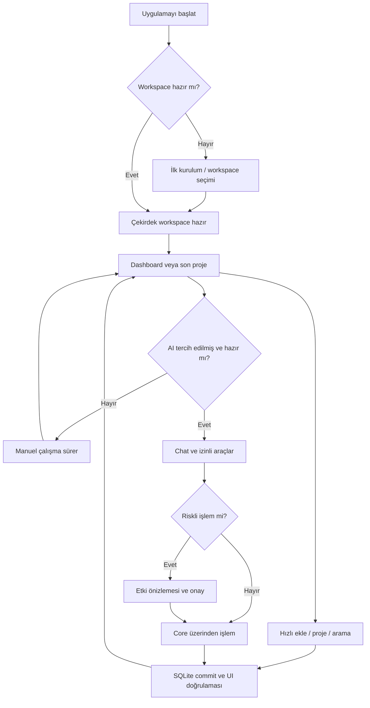
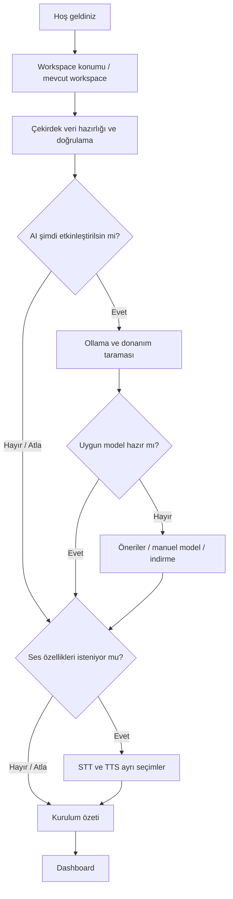
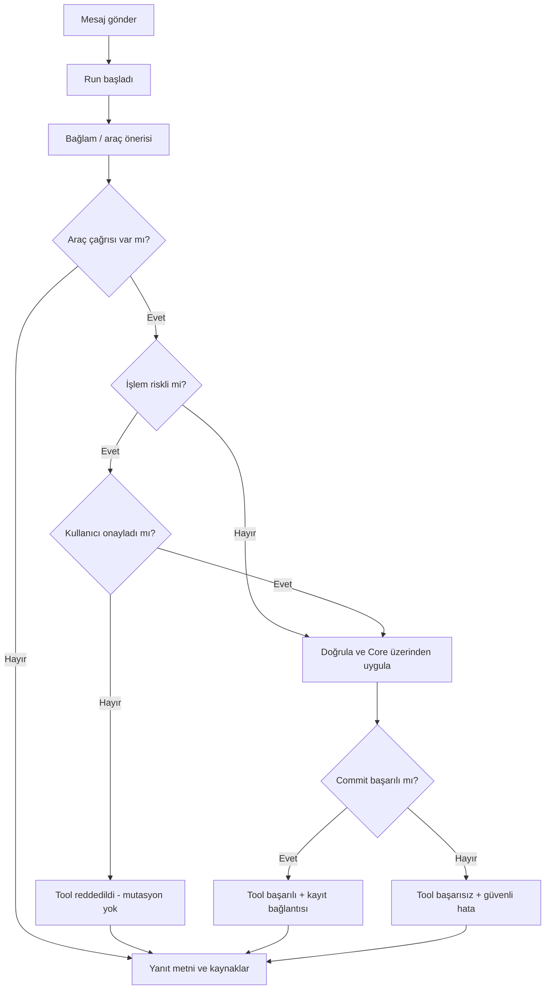
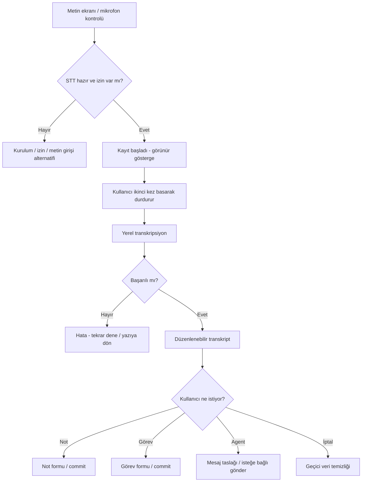

# Iterkeep — Kullanıcı Yolculukları ve Etkileşim Akışları

> **Belgenin görevi:** Kullanıcı ilk açılıştan düzenli çalışmaya, proje hafızasını geri çağırmadan isteğe bağlı AI/ses kullanımına ve hata kurtarmaya kadar Iterkeep ile *nasıl etkileşir?* sorusunu test edilebilir adımlarla yanıtlamak. `JRN-001–018`, `DOC-02` içindeki `AC-001–018` ile birebir ilişkilidir. `JRN` kimlikleri ürün akışının kalıcı referanslarıdır.
>
> **Yetki sınırı:** `DOC-02` özellik kapsamı ve ürün gereksinimleri için; `DOC-08` kesin domain durumları; `DOC-11` IPC mesajları; `DOC-18` sihirbazın teknik durum makinesi; `DOC-19` capability sağlığı; `DOC-21` kesin ekran/rota envanteri; `DOC-22` bileşen ve klavye etkileşimleri; `DOC-26–27` agent/tool izinleri; `DOC-28–29` ses altyapısı; `DOC-31` sayısal performans eşikleri; `DOC-33` otomatik test kimlikleri için yetkilidir. Bu belgede kullanılan ekran adları **kavramsal UX kimlikleridir**, henüz kesin route/komponent/IPC isimleri değildir.
>
> **Durum:** `draft`. Akışlar kodlama ajanı için doğrulanabilir tasarım girdileridir; `SCOPE-01–08` ürün tercihleri ve ilgili yetkili dokümanlar onaylanmadan 'tamamlanmış mimari' olarak yorumlanmamalıdır.

## 1. Ürün deneyiminin sözleşmesi

Iterkeep'te birincil kullanıcı yolculuğu **yakala → düzenle → çalış → hatırla → devam et** döngüsüdür. AI/ses bu döngüyü kısaltabilir fakat döngünün hiçbir adımının ön koşulu değildir.

**Beş değişmez kullanıcı deneyimi kuralı:**

1. **Açılabilir çekirdek:** Ollama, STT, TTS, Git veya internet başarısız olsa da çalışma alanı açılır ve çekirdek veri işlemleri yürür (`REQ-004`, `094`).
2. **Gerçek başarı:** 'Kaydedildi', 'tamamlandı', 'silindi', 'dışa aktarıldı' gibi kesin bildirimler ancak ilgili kalıcı işlem gerçekten başarıyla bitince gösterilir. Optimistik UI `saving` durumunu gizleyemez (`DOC-02 §2.1`).
3. **İşlem geri dönülebilirliği:** Normal navigasyon içerik kaybettirmez; yıkıcı veya geri alınamaz işlem hedefi ve etkisi açıklanmadan gerçekleşmez (`REQ-020`, `037`, `075`, `089`, `110`).
4. **Kaynağı açılabilir bilgi:** Arama veya AI yanıtından proje, görev, karar ve günlük kayıtlarının asıl kaynağına ulaşılabilir (`REQ-055`, `116`).
5. **Açık etkinleştirme:** Model indirme, mikrofon kaydı, yerel olmayan veri iletimi ve Git push kullanıcı eylemi veya açık yetkilendirmesi dışında başlamaz (`REQ-009`, `071`, `099`, `119`, `131–132`).

### 1.1 Kimlik sistemi

| Kimlik | Anlamı | Kapsam |
|---|---|---|
| `JRN-001–018` | Bir uçtan uca kullanıcı yolculuğu | Bu belge; `AC-001–018` ile eşleştirilir |
| `UX-G-01–14` | Akışlar arası kullanıcı deneyimi invariants | Bu belge; bütün uygun yolculuklar |
| `SC-*` | Kavramsal ekran ailesi | `DOC-21` ekran/rota kararı ile kesinleşir |
| `UXS-*` | Kullanıcıya görünen durum sınıfı | Bu belge; kesin status enum `DOC-08/12/19` |
| `REQ-*` | Normatif ürün gereksinimi | `DOC-02` |
| `AC-*` | Normatif ürün kabul sonucu | `DOC-02` |
| `TEST-*` | Gerçek otomatik test kimliği | Sonradan `DOC-33` |

`JRN-001`, `AC-001`'in **uygulama yolu**dur; AC'nin yerine geçmez. Yalnız bu belgedeki bir örnek metinden yeni teknik zorunluluk veya IPC adı türetilmez.

### 1.2 Hedef kullanım profilleri

| Profil | Tipik başlangıç noktası | Başarı sinyali | Kritiklik |
|---|---|---|---|
| Yeni teknik olmayan kullanıcı | Boş çalışma alanı; Ollama yok | Bir proje ve görev oluşturur; uygulama yeniden açılır | P0 |
| Çok proje yürüten kullanıcı | Çok sayıda açık iş ve karar | Son çalışmaya ve ilgili karara hızla döner | P0 |
| Klavye odaklı geliştirici | Uygulamanın herhangi bir ekranı | Komut paletinden hızlı kayıt; kaynağa sıçrama | P0/P1 |
| Yerel AI kullanan kullanıcı | Ollama modeli hazır | Kullanıcı denetimli tool eylemi ve görünür iz | P0/P1 |
| Sesle yakalama isteyen kullanıcı | STT kurulu ve izin verilmiş | Düzeltilebilir transkriptle kayıt oluşturur | P0/P1 |
| Veri sahipliğini önemseyen kullanıcı | Yedek/export ihtiyacı | Doğrulanabilir taşınabilirlik, geri yükleme | P0 |

## 2. Ortak UX altyapısı

### 2.1 Kavramsal ekran haritası

| Ekran ID | Ad | Kullanıcı amacı | Olabilecek girişler | İlgili yolculuklar |
|---|---|---|---|---|
| `SC-SETUP` | İlk Kurulum | Workspace, opsiyonel AI/ses tercihleri | Yeni kurulum; Ayarlardan yeniden aç | 001, 010, 011 |
| `SC-HOME` | Dashboard / Son Çalışma | Devam edilecek iş ve son bağlam | Başarılı açılış; kenar menü | 001, 003, 015 |
| `SC-PROJECTS` | Projeler | Listele, ara, aç, yeni oluştur | Kenar menü; palet | 001, 003 |
| `SC-PROJECT` | Proje Alanı | Açık görev, not, karar, günlük | Proje listesi; arama sonucu | 003–005 |
| `SC-INBOX` | Inbox | Projesiz hızlı yakalama ve triage | Hızlı ekleme; kenar menü | 002 |
| `SC-TASKS` | Görevler / Kanban | Listele, durum/öncelik düzenle | Proje sekmesi; genel görevler | 002, 005 |
| `SC-DOCUMENT` | Not / Karar / Günlük | İçeriği oku, yaz, ilişkili kayıtları aç | Proje; arama; son çalışma | 003, 004, 013 |
| `SC-SEARCH` | Birleşik Arama | Kaynağı bul ve aç | Arama ikonu; palet | 004, 006 |
| `SC-CHAT` | Agent / Chat | Soru sor, tool adımlarını takip et | İsteğe bağlı panel veya chat ekranı | 012, 014 |
| `SC-TRANSFER` | İçe/Dışa Aktar ve Git | Veri taşı ve sürümle | Ayarlar/Workspace menüsü | 007, 008, 015 |
| `SC-BACKUP` | Yedekle / Geri Yükle | Doğrula ve kurtar | Ayarlar/Workspace menüsü; recovery | 009, 016, 017 |
| `SC-SETTINGS` | Ayarlar | Dil, tema, çalışma alanı, AI/Voice | Kenar menü; palet | 010, 014, 018 |
| `SC-HEALTH` | Sistem Sağlığı / Model Manager | Tespit, tanılama, onarma | Ayarlar; hata eylemi | 010, 011, 014 |
| `SC-RECOVERY` | Çalışma Alanı Kurtarma | DB açılamadığında güvenli eylem | Başlatma hatası; migration | 009, 016, 017 |

Navigasyonun kesin URL/route isimleri ve panel yerleşimi `DOC-21`'de belirlenir. Bir ekrandan diğerine geçerken yapılandırılmış context (proje ID, belge ID, filtre vb.) taşınmalı; text başlığı kimlik gibi kullanılmamalıdır.

### 2.2 Görünür durumlar ve başarı semantiği

| UX sınıfı | Kullanıcıda görünen durum | Yapılmasına izin verilenler | Yasak yorum |
|---|---|---|---|
| `UXS-idle` | Eyleme hazır | Normal etkileşim | Henüz hiçbir iş başlamamış |
| `UXS-loading` | Veriler yükleniyor | Geri dön, gerekiyorsa iptal | Boş kayıtla karıştırma |
| `UXS-editing` | Yerelde değiştiriliyor | Yazma, vazgeçme | Kalıcı olarak kaydedildi sanma |
| `UXS-saving` | Kayıt sürüyor | Güvenli bekleme/iptal politikası | 'Kaydedildi' deme |
| `UXS-saved` | Kalıcı kayıt onaylandı | Yeni işlem, navigasyon | Sadece model metnine dayanma |
| `UXS-empty` | Gerçekten veri yok | İlk eylem CTA | Servis hatasını veri yok sanma |
| `UXS-filter-empty` | Veri olabilir, filtre eşleşmiyor | Filtre temizle | 'Projeniz yok' deme |
| `UXS-awaiting-approval` | Etkisi açıklanan onay bekleniyor | Onayla, reddet | Onay öncesi mutasyon yapma |
| `UXS-unavailable` | Opsiyonel yetenek hazır değil | Ayarlar, yeniden dene, çekirdeğe devam | Bütün uygulamayı kilitleme |
| `UXS-error-recoverable` | İş başarısız, veri korunuyor | Düzelt, yeniden dene, iptal | Sahte başarı bildirimi |
| `UXS-error-blocking` | Workspace güvenle açılamıyor | Kurtarma, yedek, tanılama | Sessizce yeni DB oluşturma |

### 2.3 Genel etkileşim kuralları (`UX-G-*`)

- **UX-G-01 — Tutarlı gezinme:** Geri/ileri ve proje içerik linkleri nesne kimliğine göre çalışır; silinmiş hedef anlaşılır uyarı verir.
- **UX-G-02 — Kalıcı yazma göstergesi:** `editing → saving → saved` veya `editing → saving → failed`; hata durumunda düzenlenmiş metin korunur.
- **UX-G-03 — İşlem tekrarı:** Çift tık, enter tekrarı, ağ/IPC retry gibi nedenler aynı eylemin iki kez uygulanmasına yol açmaz.
- **UX-G-04 — Yıkıcı işlemler:** Hedef adı, etkilenecek bağlı kayıtlar ve geri alınabilirlik onay ekranında açıklanır.
- **UX-G-05 — Odak geri yükleme:** Dialog kapanınca odak onu açan kontrole veya mantıklı sonraki öğeye döner; klavyeyle tuzak oluşmaz.
- **UX-G-06 — Hata ve boş durum ayrımı:** 'Kayıt yok', 'filtreyle sonuç yok', 'yüklenemedi' farklı açıklama ve eyleme sahiptir.
- **UX-G-07 — Çevrimdışı bütünlük:** Çekirdek kayıt/arama, dış API bağlantısı olmadan çalışır; AI düğmesi ana işe engel olmaz.
- **UX-G-08 — İzin denetimi:** Mikrofon veya dış sistem izni öncesinde neden ve olası etkiler açıklanır; ret normal bir karardır.
- **UX-G-09 — İptal semantiği:** Uzun bir işi iptal etmek geçmişte commit edilmiş ayrı eylemleri otomatik geri almış sayılmaz; sonuçlar doğru raporlanır.
- **UX-G-10 — Bağlama dönüş:** Arama veya sohbetten açılan kayıt, kaynağa ve ilgili projeye geri bağlantı taşır.
- **UX-G-11 — Seçenek şeffaflığı:** Öneri (özellikle model önerisi) otomatik ve zorunlu kurulum gibi sunulmaz; kullanıcı manuel değiştirebilir.
- **UX-G-12 — Ses göstergesi:** Mikrofon yalnız aktif kullanıcı tetiklemesiyle başlar; görünür kayıt göstergesi kapanana kadar sürer.
- **UX-G-13 — Veri taşınabilirliği:** Import/export/restore önizlemesi; etki, hedef, çakışma ve hata sayıları hakkında kullanıcıyı bilgilendirir.
- **UX-G-14 — Dil ve tema ayrımı:** Metin, odak, düzen ve renk değişebilir; domain nesneleri, kimlikler ve kayıt sonuçları değişemez.

### 2.4 Ortak geri bildirim sözleşmesi

- **Toast:** Düşük riskli, kısa ve doğrulanmış sonuç. Tek bilgi kanalı değildir; ekran okuyucuya durum duyurulur.
- **Inline error:** Düzeltilmesi gereken alana en yakın hata; odaklanılabilir ve `aria-describedby`/eşdeğer semantik ilişkisi vardır.
- **Blocking dialog:** Geri alınamaz silme, workspace restore veya Git push gibi yüksek etkili eylemler için kullanılır.
- **Non-blocking banner:** Ollama yok, TTS çöktü, Git bulunamadı gibi çekirdeği etkilemeyen yetenek sorunlarını açıklar.
- **Job panel:** Model indirme, export, import, yedekleme gibi uzun işlerde ilerleme, iptal kuralları, başarısızlık ve tamamlanma durumlarını gösterir.
- **Empty state:** Öncelikle 'neden boş?' sorusuna yanıt verir ve tek sonraki eylem önerir. 'Hata' metinleri empty-state olarak sunulmaz.

## 3. Üst düzey yolculuk akışları



**Gösterim notu:** `L → M` yalnız kullanıcı onaylarsa geçerlidir; kullanıcı reddederse tool `rejected` olur ve mutasyon olmadan `E`'ye dönülür. Bütün statü/enum sözleşmeleri ilgili teknik belgelerde tanımlanır.

## 4. Kanonik kullanıcı yolculukları

Her yolculuk aşağıdaki sözleşmeyi içerir: başlangıç, adımlar, alternatif/hata, gözlenebilir son koşul, klavye/erişilebilirlik, gerekirse ölçüm ve `AC/REQ` izleri.

### JRN-001 — AI'sız temiz kurulum (`AC-001`)

**Kullanıcı hedefi:** Hiçbir AI servisi veya internet kurmadan ilk projeyi başlatabilmek.

**Başlangıç:** Temiz Windows profili; Ollama, Git, Python yok; internet kesik; workspace yok.

| # | Kullanıcı eylemi | Arayüz tepkisi / servis davranışı | Başarılı çıkış |
|---:|---|---|---|
| 1 | Iterkeep'i açar | İlk kurulum açılır; hesabı veya bağlantıyı zorunlu istemez | Sihirbaz görünür |
| 2 | Varsayılan workspace yoluna bakar | Yol, yerel veri niteliği ve değiştir seçeneği görülür | Karar kullanıcıda |
| 3 | Yolu kabul eder veya yerel klasör seçer | Yazılabilirlik/erişilebilirlik doğrulanır; veritabanı güvenle oluşturulur | Workspace `ready` |
| 4 | AI adımında 'Şimdilik atla' der | İndirme veya servis kurulumu başlamaz; tercih pasif kaydedilir | Çekirdek akış sürer |
| 5 | STT/TTS adımını da atlar | Eksik özelliklerin sonradan Ayarlar'da kurulacağı açıklanır | Zorunlu blokaj yok |
| 6 | 'Başla' der | Dashboard/ilk proje empty-state'i açılır | Kullanılabilir UI |
| 7 | Proje, görev ve not oluşturur | Her biri SQLite commit sonrası doğrulanır | Kayıtlar kalıcı |
| 8 | Arama yapar, uygulamayı kapatıp yeniden açar | Kayıtlar bulunur; tekrar setup zorunlu gösterilmez | `AC-001` geçer |

**Alternatifler:** Geçersiz path → alan içi hata, eski seçim korunur; iptal → workspace yaratılmışsa çekirdeğe giriş korunur; yarım setup → tekrar açılışta kurulum ilerlemesi veya atla seçeneği, hiçbir durumda sessiz veri reseti yok.

**Erişilebilirlik:** Adımlar başlık/ilerleme ilişkisiyle duyurulur; 'Atla' klavyeyle erişilir. Başlangıç odağı sayfa başlığına veya ilk anlamlı alana gider.

**İz:** `REQ-001–004`, `009`, `012–013`, `025`, `041`, `053`, `093–095`, `134`; `JTBD-01`, `10–11`.

### JRN-002 — Proje seçmeden hızlı yakalama / Inbox (`AC-002`)

**Kullanıcı hedefi:** Aklına gelen işi proje seçerek zaman kaybetmeden saklamak.

**Başlangıç:** Workspace sağlıklı; hiçbir proje seçili değil; uygulama açık.

| # | Eylem | Beklenen etkileşim | Sonuç |
|---:|---|---|---|
| 1 | Hızlı ekleme veya command palette açar | Odak tek giriş alanında; eylem türü seçilebilir | Yazmaya hazır |
| 2 | 'Memory testlerini yaz' girer | Uygulama seçili proje olmadığını tespit eder, varsayılan hedefi Inbox gösterir | Hedef görünür |
| 3 | Görev olarak kaydeder | İlk anda `saving`; commit sonrasında `saved` | Inbox'ta **bir** görev |
| 4 | Inbox'ı açar | Yeni görevi doğru başlıkla görür | Kayda erişir |
| 5 | Görevi Kaiwen Agent projesine taşır | Hedef seçimi, kalıcı taşıma ve doğrulama | Aynı görev ID'si |
| 6 | Görev geçmişini/proje listesini inceler | Inbox kopyası oluşmaz; görev hedef projede | Tek kaynak |

**Negatif yollar:** Boş/yalnız boşluk girdi → kaydetme engeli; çift Enter → tek kayıt; DB yazma hatası → girdi kaybolmadan tekrar dene; proje silinmişse taşıma anında hedef yeniden seçilir.

**Erişilebilirlik:** Palet açılınca odak girişe, kapanınca tetikleyiciye döner. Görev türü ve hedef proje yalnız renkle ayırt edilmez.

**İz:** `REQ-021–022`, `025`, `035–036`, `062`; `JTBD-02`.

### JRN-003 — Haftalar sonra projeye dönme (`AC-003`)

**Kullanıcı hedefi:** 'Nerede kalmıştım?' sorusuna notları tek tek taramadan yanıt almak.

**Başlangıç:** Mevcut proje; en az bir açık ve bir tamamlanmış görev, karar, log ve geçmiş etkinlik.

| # | Eylem | Beklenen etkileşim | Sonuç |
|---:|---|---|---|
| 1 | Uygulamayı yeniden açar | Son görüntülenen yer bulunur veya Dashboard hazır olur | Proje bağlantısı görünür |
| 2 | Projeyi seçer | Proje özeti son etkinlik, açık/devam eden görev ve son kararı gösterir | Bağlam geri gelir |
| 3 | 'Son çalışmaya git' eylemini kullanır | Tarih/saat ve bağlantılı log açılır | Son adım görülür |
| 4 | İlgili görevi açar | Aynı kaydın durumu ve ilişkili notları görünür | Devam noktası |
| 5 | Karar bağlantısına gider | Gerekçeli karar, geçerli statü ve varsa revizyon açılır | 'Neden?' yanıtı |
| 6 | Yeni log ekler veya görevi sürdürür | Yeni kayıt commit edilir, proje özeti güncellenir | Döngü yeniden başlar |

**Alternatifler:** Yeni/hiç çalışılmamış projede anlamlı empty-state; arşivlenmiş projede salt-okunur varsayımı yapılmaz — düzenleme izinleri `DOC-13`'te tanımlanır; ilişkili kayıt silinmişse kırık link açıklanır.

**Güvenilirlik:** Son etkinlik SQLite verisinden türetilir; yapay zekâ özeti gerçeğin yerine geçmez. Son güncelleme saati kullanıcıya uygun yerel zamanla gösterilir.

**İz:** `REQ-015–017`, `023`, `027–029`, `043–046`; `JTBD-03`, `04`.

### JRN-004 — Teknik kararın gerekçesini ve geçmişini bulma (`AC-004`)

**Kullanıcı hedefi:** Neden bir teknolojiyi seçtiğini ve kararın sonradan değişip değişmediğini öğrenmek.

**Başlangıç:** Bir eski karar ve yerine geçen yeni karar, gerekçe ve ilişki bilgileriyle kayıtlı.

| # | Eylem | Beklenen etkileşim | Sonuç |
|---:|---|---|---|
| 1 | Arama alanına konu veya gerekçe yazar | Tür/proje filtreleri kullanılabilir | Kararlar listelenir |
| 2 | Sonuçtaki kararı seçer | Kaynak türü, proje, tarih ve eşleşme açıklanır | Doğru kayıt açılır |
| 3 | Eski karara bakar | Durumu ve yerini alan kararın bağlantısı görünür | Tarihçe anlaşılır |
| 4 | Yeni kararı açar | Yeni bağlam, gerekçe ve etki okunur | Karar zinciri tamam |
| 5 | Kaynağa geri döner | Arama filtreleri tercihen korunur | Bağlam kaybı yok |

**Negatif yollar:** Adında aynı sözcük geçen birden çok karar → ayırt edici proje/tarih; eksik supersede ilişkisi → uydurma tarihçe üretme; sonuç yok → farklı terim ve filtre temizleme önerisi.

**İz:** `REQ-043–044`, `050`, `053–058`; `JTBD-04`, `05`.

### JRN-005 — Görevi listeden ve Kanban'dan aynı veriyle yönetme (`AC-005`)

**Kullanıcı hedefi:** Farklı görünümler arasında tutarlı görev durumu.

**Başlangıç:** Projede bir görev var; liste ve Kanban destekleniyor.

| # | Eylem | Beklenen etkileşim | Sonuç |
|---:|---|---|---|
| 1 | Liste görünümünde görevi açar | Başlık, öncelik, durum ve gerekiyorsa tarih görünür | Tek görev |
| 2 | Kanban görünümüne geçer | Aynı görev ID'si sütunda yer alır | Kopya yok |
| 3 | Kartı başka durum sütununa taşır | Optimistik hareket olabilir; `saving` durumu görünür | DB komutu çalışır |
| 4 | Commit başarılı olur | `saved`; ilgili filtre ve sayaçlar güncellenir | Durum kalıcı |
| 5 | Listeye döner, uygulamayı yeniden açar | Durum tutarlı ve sıra kayıtlıdır | `AC-005` geçer |

**Negatif yol:** DB commit başarısız olursa görsel hareket geri alınır veya kullanıcıya çatışma çözümü gösterilir; hiçbir şekilde sessiz başarı bildirilmez. Hedef sütun dışında geçersiz durum veya yarışan düzenleme ayrıca raporlanır.

**Erişilebilirlik:** Sürükle-bırak tek yol olmayacak; klavye ile erişilebilir durum menüsü aynı sonucu üretecek.

**İz:** `REQ-025–032`, `039`, `083`, `089`; `JTBD-06`.

### JRN-006 — Türkçe birleşik arama ve filtreler (`AC-006`)

**Kullanıcı hedefi:** Proje/karar/not/görev/günlüğü tek aramadan bulmak.

**Başlangıç:** Türkçe karakter, büyük/küçük harf ve çok sözcük içeren test fixture'ları.

| # | Eylem | Beklenen etkileşim | Sonuç |
|---:|---|---|---|
| 1 | Birleşik aramayı açar | Arama alanı otomatik odakta | Sorguya hazır |
| 2 | 'İstanbul veri' benzeri metin girer | Tanımlı normalizasyonla yerel indeks sorgulanır | İlgili sonuçlar |
| 3 | Sadece 'Kararlar' filtresini seçer | Kayıt türü görünür, sonuçlar daralır | Açıklanabilir filtre |
| 4 | Sonucu seçer | Proje, tür, eşleşme ve kayıt kimliği üzerinden doğru belge açılır | Kaynağa geçiş |
| 5 | Aramaya döner | Sorgu ve filtre mümkünse korunur | Hızlı karşılaştırma |

**Negatif yollar:** Boş sorgu → başlangıç önerisi veya yakın zamanda kullanılan hedefler (özel içerik önbelleği politikasına bağlı); sıfır sonuç → filtre temizle; indeks bozuk → verileri koruyarak yeniden oluştur; Türkçe ekleme/kök eşlemesi garanti edilmez; açıkça tanımlı normalizasyon dışına çıkan aramalarda sahte 'tam eşleşme' verilmez.

**Performans UX:** Kullanıcı yazarken ağır işlem UI'ı kilitlemez; sorgu iptal/debounce mantığı sonucu eskimiş sorgunun yeni sorguyu ezmesine yol açmaz; liste sanallaştırılır.

**İz:** `REQ-053–062`, `091`; `JTBD-05`.

### JRN-007 — Markdown/YAML ile dışa aktarma ve geri içe alma (`AC-007`)

**Kullanıcı hedefi:** Veriyi başka bilgisayara/uygulamaya taşımak; format sahibinin kontrolünde kalsın.

**Başlangıç:** En az iki proje, karma kayıt türleri ve asset referansları; hedefte yeni veya boş workspace.

| # | Eylem | Beklenen etkileşim | Sonuç |
|---:|---|---|---|
| 1 | Workspace > Dışa aktar'a gider | Format, kapsam, hedef dizin ve dahil edilen asset'ler açıkça görünür | Kullanıcı seçimi |
| 2 | Önizlemeyi inceler | Proje/kayıt/asset sayıları ve tahmini çıktı listesi görünür | Etki bilinir |
| 3 | Dışa aktarmayı başlatır | İlerleme, yazma/izin hatası ve tamamlanma gerçek duruma bağlı | Deterministik paket |
| 4 | Yeni workspace açar, içe aktar seçer | Dosyalar doğrulanır; mevcut DB'ye yazılmadan önizleme yapılır | Güvenli başlangıç |
| 5 | Kimlik çakışmaları varsa seçim yapar | Atla/kopya/uygun birleştir seçenekleri etkileriyle sunulur | Politika açık |
| 6 | İçe aktarmayı onaylar | Atomik veya belgelenmiş güvenli transaction planı yürür | Kalıcı kayıtlar |
| 7 | Yeni workspace'ten yeniden dışa aktarır | Eşdeğer şema/içerik ve kararlı metadata sağlanır | Round-trip testi |

**Negatif yollar:** Var olan hedef dosyanın üzerine sessiz yazma yok; kısmi disk, dosya izni, kimlik çakışması ve bozuk asset referansları raporlanır; farklı şema sürümü açık uyarı gerektirir.

**Önemli ayrım:** Export klasörünü elle düzenlemek canlı DB'yi kendiliğinden değiştirmez. Değişikliklerin uygulanması için explicit import gerekir.

**İz:** `REQ-063–068`, `072`, `074`; `JTBD-09`.

### JRN-008 — Kötü niyetli/bozuk içe aktarmayı reddetme (`AC-008`)

**Kullanıcı hedefi:** Hatalı bir paketi denerken mevcut workspace'in zarar görmeyeceğinden emin olmak.

**Başlangıç:** Kullanıcı verileri bulunan workspace; bozuk YAML, hatalı kimlik veya `../` path traversal barındıran import paketi.

| # | Eylem | Beklenen etkileşim | Sonuç |
|---:|---|---|---|
| 1 | Dosya/paket seçer | Kaynak yolu ve format belirtilir; henüz DB mutasyonu yok | Hazırlık |
| 2 | Önizleme/doğrulamayı çalıştırır | Şema, ID, ilişki, dosya yolu ve boyut denetlenir | Doğrulama raporu |
| 3 | Hatalı pakette devam etmeye çalışır | İlgili kusurlar ve neden reddedildiği görünür | İçe alma engellenir |
| 4 | İptal eder | Önceki çalışma alanı aynı kalır | Veri korunur |

**Asla yapılmayacak:** Hatalı paket okunurken workspace dışına yazma; eksik/bozuk import'tan yarım görevler oluşturma; beklenmeyen HTML/script'i etkinleştirme.

**İz:** `REQ-065–068`, `129–130`; `JTBD-09`, `12`.

### JRN-009 — Doğrulanmış yedekten geri yükleme (`AC-009`)

**Kullanıcı hedefi:** Önceki duruma dönüşte neyi kaybedeceğini ve neyi geri alacağını bilmek.

**Başlangıç:** Sağlam yedek; sonrasında aktif workspace'te değişmiş görevler mevcut.

| # | Eylem | Beklenen etkileşim | Sonuç |
|---:|---|---|---|
| 1 | Yedekler ekranını açar | Tarih, boyut, doğrulama ve kapsam gösterilir | Seçilebilir yedek |
| 2 | İlgili yedeği seçer | Yedek bütünlüğü doğrulanır; bozuksa restore engellenir | Güvenli önizleme |
| 3 | 'Geri yükle' ister | Değişecek aktif veriler, bağlı asset'ler ve olası mevcut veri kaybı açıklanır | Bilinçli karar |
| 4 | Onay verir | Yazma işleri durdurulur / güvenli sıraya alınır; mevcut veri kurtarma planına alınır | Restore başlar |
| 5 | Restore tamamlanır | DB/asset bütünlüğü doğrulanır; servisler yeni durumla yeniden bağlanır | Geçerli workspace |
| 6 | İlgili görevi açar | Yedekteki durum görünür; restore sürümüne dönüldüğü açıklanır | Doğrulanabilir sonuç |

**Negatif yollar:** Onayı reddetme → hiç mutasyon yok; bozuk yedek → restore başlamaz; disk doluluğu/mid-restore çökmesi → `DOC-17/32` güvenli geri dönme protokolü ve hata ekranı; backup tarihi yerel zamanla açıkça gösterilir.

**İz:** `REQ-073–079`, `089`; `JTBD-12`.

### JRN-010 — Ollama yokken başlamak; sonradan AI açmak (`AC-010`)

**Kullanıcı hedefi:** İlk gün AI kullanmamak, daha sonra aynı workspace'te rahatça etkinleştirmek.

**Başlangıç:** AI kapalı setup tamamlanmış; projeler mevcut; Ollama başta yok.

| # | Eylem | Beklenen etkileşim | Sonuç |
|---:|---|---|---|
| 1 | AI kapalı normal uygulamayı kullanır | Proje ve arama çalışır; chat alanı erişilebilir bilgilendirme gösterir | Çekirdek bağımsız |
| 2 | İstediğinde Ollama'yı kendi seçimiyle kurar | Iterkeep dış kurulumu izinsiz zorlamaz | Harici tercih |
| 3 | Ayarlar > AI'ya gider, etkinleştirir | 'Etkinleştirildi' tercihi sağlıkla karıştırılmaz; kısa tarama başlar | Capability kontrolü |
| 4 | 'Yeniden tara' der | Çalışan servis, mevcut modeller, hata/timeout ayrı ayırt edilir | Gerçek durum gösterilir |
| 5 | Yüklü uyumlu model varsa seçer; yoksa öneri görür | Kullanıcı modeli manuel seçebilir veya onaylı indirebilir | Model seçimi |
| 6 | Model hazır olduğunda chat açar | Soru veya izinli tool komutu gönderilebilir | AI kullanılabilir |
| 7 | AI'yı tekrar kapatır | Aktif run güvenle durdurulur; geçmişi ve projeleri kaybolmaz | Çekirdek çalışır |

**Negatif yollar:** Ollama kurulu ama çalışmıyor → başlatma yönergesi + taramayı yenile; servis erişimi reddedildi → düzeltilebilir uyarı; donanım tespiti yok → manuel model listesi; ilk kurulum sihirbazını sıfırdan tamamlatma yok.

**İz:** `REQ-004`, `094–106`, `117`; `JTBD-10–11`.

### JRN-011 — Model indirme yarıda kalırsa (`AC-011`)

**Kullanıcı hedefi:** Belirsiz indirme veya sahte hazır durumları olmadan ilerlemek.

**Başlangıç:** Ollama erişilebilir; model yok; kullanıcı indirmeyi açıkça onaylıyor.

| # | Eylem | Beklenen etkileşim | Sonuç |
|---:|---|---|---|
| 1 | Önerilen modelleri inceler | Ad, kullanım amacı, paket boyutu ve disk etkisi; öneri nedeni | Bilinçli seçim |
| 2 | 'İndir' seçer | Kaynak/etiket/indirme etkisi onaylanır | İndirme başlar |
| 3 | İlerlemeyi izler | Yüzde ancak güvenilir ölçüm varsa; yoksa aşama ve indirilen veri gösterilir | Doğru durum |
| 4 | Bağlantı kopar / uygulamayı kapatır | 'Hazır' denmez; güvenli kapanış, eksik durum korunur veya yeniden keşfedilir | Kayıp başarı yok |
| 5 | Uygulamayı tekrar açar | Çekirdek UI hemen açılır; indirme arka planda kontrol edilir | Kullanılabilir UI |
| 6 | Model Manager'a gider | Gerçek Ollama model listesi / iş durumu temelinde eksik model görülür | Sorun anlaşılır |
| 7 | 'Yeniden dene' veya başka model seçer | Kullanıcının onayıyla güvenli retry; gerekirse yeniden indirme | Hazırlık tamamlanabilir |

**Negatif yollar:** Disk yetersiz → indirmeden önce uyarı veya süreçte hata, hazır saymama; doğrulanmamış model → seçim engeli; indirme iptali, Ollama tarafından gerçekten iptal edilemiyorsa UI bu sınırı dürüstçe açıklamalı; başka Ollama istemcilerinin işlerini keyfî sonlandırma yok.

**İz:** `REQ-095`, `099–104`, `106`; `JTBD-10–11`.

### JRN-012 — Agent'ın yaptığı işleri görmek; yıkıcı işlem reddi (`AC-012`)

**Kullanıcı hedefi:** Agent yararlı işi yapsın ama çalışma alanını habersiz değiştirmesin.

**Başlangıç:** Yerel model `ready`; proje var; chat'in bağlamı projeye bağlı.

| # | Eylem | Beklenen etkileşim | Sonuç |
|---:|---|---|---|
| 1 | 'İki görev ekle; sonra bu projeyi sil' der | Chat kullanıcı mesajını ve run'ın başladığını gösterir | Run görünür |
| 2 | Agent proje bilgisini okuyan aracı çağırır | Tool satırında ad, amaç, durum ve süre görünür | Denetlenebilir okuma |
| 3 | Agent ilk/ikinci görev ekleme komutlarını önerir | Core doğrulaması sonrası her görev commit edilir | Kalıcıysa `success` |
| 4 | Agent proje silmeyi önerir | Riskli eylem onay ekranı hedef projeyi, silinecek ilişkileri ve geri dönüş riskini açıklar | `awaiting approval` |
| 5 | Kullanıcı 'Reddet' der | Silme tool'u `rejected`; DB üzerinde silme işlemi yok | Proje kalır |
| 6 | Agent sonucu özetler | Eklenen görevleri ve reddedilen silmeyi ayrı söyler; kaynağa link verir | Yanıltıcı cevap yok |
| 7 | Tool adımlarını açar | Parametrelerin güvenli özeti, giriş/çıkış, süre, hata ve kayıt linkleri görünür | Audit yolu |

**İnce ayrım:** Kullanıcı run'ı durdurursa daha önce **commit edilmiş** görev eklemeleri otomatik geri alınmış sayılmaz; UI yapılanları ve yapılmayanları ayırır. Yıkıcı silme bir model cümlesiyle değil sadece izinli core komutuyla gerçekleştirilebilir.

**Negatif yollar:** Tool argümanı geçersiz → doğrulama hatası ve gerekiyorsa kontrollü tekrar deneme; model kapandı → run failed/cancelled, temel uygulama çalışır; tool izin dışı → denied; iki kez event → işlem idempotency kontrolü.

**Erişilebilirlik:** Tool adımları sadece ikonla anlatılmaz; `running`, `awaiting approval`, `rejected`, `completed`, `failed` anlaşılır adlarla duyurulur. Onay dialogundan güvenli varsayılan 'Reddet'tir.

**İz:** `REQ-107–118`, `129–132`; `JTBD-08`, `12`.

### JRN-013 — Kaydı durdur, transkripti düzelt, göreve dönüştür (`AC-013`)

**Kullanıcı hedefi:** Yazmak yerine konuşarak hızlı ve hatasız not/görev oluşturmak.

**Başlangıç:** Yerel STT yüklü, izin verilmiş, uygun mikrofon bağlı.

| # | Eylem | Beklenen etkileşim | Sonuç |
|---:|---|---|---|
| 1 | Mikrofon butonuna basar | İzin kontrolü; görünür aktif kayıt göstergesi | Kayıt açık |
| 2 | 'Memory testlerini yaz' der | Ses yerel olarak geçici tutulur | Veri yakalanır |
| 3 | Aynı butona yeniden basar | Kayıt durur, işleme durumu görünür | Gizli kayıt yok |
| 4 | STT transkripti getirir | Düzenlenebilir önizleme; hiçbir otomatik görev/tool çağrısı başlamaz | Kullanıcı kontrolü |
| 5 | Yanlış kelimeyi elle düzeltir | Düzeltilen metin görünür | Doğru içerik |
| 6 | 'Görev oluştur' seçer; gerekirse hedef proje/Inbox belirler | Çekirdek görev formu ve validasyon uygulanır | Kayıt hedefi bilinir |
| 7 | Kaydı onaylar | SQLite commit sonrası başarı; ses geçici veri saklama politikasına göre temizlenir | Kalıcı görev |

**Negatif yollar:** Mikrofon izni yok → gerekçe/izin yönergesi; cihaz yok → metin girişi; sessiz kayıt → 'anlaşılır konuşma algılanmadı', boş görev oluşturma; STT hata/iptal → güvenli retry veya yazıya dön; kaydı kapatmadan panelden çıkma → stop/discard için belirgin seçim.

**Ses kayıtlarının mahremiyeti:** Kalıcı ses arşivi varsayılan değil. Kayıt saklama süresi, çökmede geçici dosya temizliği ve explicit saklama onayı `DOC-28`'de tanımlanacak.

**İz:** `REQ-119–124`, `035`; `JTBD-07`.

### JRN-014 — TTS kurulu değilken veya hata verirken metin yanıtı (`AC-014`)

**Kullanıcı hedefi:** Sesli geri bildirim opsiyonel olsun; cevap hiçbir zaman kaybolmasın.

**Başlangıç:** Agent yanıt metni hazır; TTS yüklü değil / devre dışı / çökmüş.

| # | Eylem | Beklenen etkileşim | Sonuç |
|---:|---|---|---|
| 1 | Chat yanıtını okur | Metin eksiksiz görünür; ses servisini beklemez | Esas çıktı erişilebilir |
| 2 | 'Seslendir' seçeneğine bakar | TTS yoksa 'Kur' veya etkinleştir eylemi gösterir; metin etkilenmez | Açıklanabilir durum |
| 3 | TTS'yi etkinleştirip oynatır (kuruluysa) | İşleme/oynatma durumu, durdur kontrolü | Ses isteğe bağlı |
| 4 | Yan servis hata verir | Ses için hata ve tekrar dene; metin ve sohbet geçmişi kalır | Fail-soft |
| 5 | TTS'yi kapatır | Yalnız ses yeteneği kapanır; agent chat çalışır | Bağımsız kontrol |

**Negatif yollar:** Büyük metin, iptal edilmiş oynatma, çıkış aygıtı yok, ses provider değişimi `DOC-29`'un teknik sorumluluğudur. UI hata durumunda tüm agent run'ını başarısız saymaz.

**İz:** `REQ-125–128`, `095–096`; `JTBD-07`, `10`.

### JRN-015 — Çevrimdışı ve gizlilik dostu çekirdek kullanım (`AC-015`)

**Kullanıcı hedefi:** İnternet olmadan ve hiçbir model servisinin arayüzü bozmadan çalışmak.

**Başlangıç:** AI/voice/Git kapalı; tüm ağ erişimi kesik.

| # | Eylem | Beklenen etkileşim | Sonuç |
|---:|---|---|---|
| 1 | Uygulamayı açar | Çekirdek workspace yüklenir | Offline açılış |
| 2 | Proje ve görev değiştirir | SQLite yerel işlem | Kalıcı güncelleme |
| 3 | Karar/not/log ekler | Yerel editör ve kayıt | Başarılı CRUD |
| 4 | Tüm workspace'te arama yapar | Yerel FTS sonuçları | Kaynak bulunur |
| 5 | Yerel yedek alır | Dosya konumuna güvenli çıktı; doğrulama | Yedek hazır |
| 6 | Ayarlar/Sağlık ekranını inceler | Opsiyonel servisler kapalı/yok, çekirdek sağlıklı olarak ayrışır | Anlaşılır durum |

**Negatif yol:** Offline olduğunda uygulamanın 'internet bağlantısı olmadan kullanılamaz' ekranına düşmesi kabul edilemez. Otomatik telemetri veya açıklanmamış dış istek V1 ürün ilkelerine aykırıdır. Güncelleme kontrolü varsa çekirdek yolu bloke etmez ve ağ politikası `DOC-30/34` ile uyumludur.

**İz:** `REQ-001`, `004`, `053`, `073`, `094`, `129–132`; `JTBD-09–10`.

### JRN-016 — Yazma izni veya disk alanı yetersizliği (`AC-016`)

**Kullanıcı hedefi:** Sistem hatasında verinin gerçekten kaydedilip kaydedilmediğini bilmek ve yazdığını kaybetmemek.

**Başlangıç:** Workspace yolu sonradan write-protected olmuş veya disk dolmak üzere.

| # | Eylem | Beklenen etkileşim | Sonuç |
|---:|---|---|---|
| 1 | Not düzenler ve kaydetmeyi tetikler | UI `saving` olur | Yazma girişimi |
| 2 | OS/SQLite yazma hatası döner | Hata alanı 'kaydedilmedi' der; taslak mümkün olduğu kadar bellekte tutulur | Sahte başarı yok |
| 3 | Kullanıcı düzeltme önerisini açar | İzin/alan/başka yere export seçenekleri ve kayıt riski açıklanır | Kurtarma seçimi |
| 4 | Alan açar veya erişimi düzeltir | Tekrar dene butonu | Yeniden doğrulama |
| 5 | Yeniden kaydeder | Commit ve okuyarak doğrulama sonrası başarı | Kayıt kalıcı |
| 6 | Aynı hatayı model indirme/backup'ta deneyimler | Her iş kendi hatasıyla başarısız; uygulama çekirdeği kilitlenmez | İzolasyon |

**Sınır:** Sürecin ani ölümünde henüz kalıcılaştırılmamış taslağın **her koşulda** kurtarılacağı vaat edilmez; varsa autosave/draft kurtarma sözleşmesi ilgili teknik belgede kanıtlanır. UI kullanıcıya bunu yanlış iddia etmez.

**İz:** `REQ-005`, `042`, `078–079`, `099`, `133`; `JTBD-12`.

### JRN-017 — Migration başarısızlığında veri kurtarma (`AC-017`)

**Kullanıcı hedefi:** Güncellemeden sonra eski verilerin sessizce kaybolmaması.

**Başlangıç:** Eski DB sürümü; kasıtlı başarısız migration fixture'ı; test yedeği alınabilecek disk.

| # | Eylem | Beklenen etkileşim | Sonuç |
|---:|---|---|---|
| 1 | Güncel Iterkeep'i açar | DB şema sürümü algılanır; uygun kontrol yapılır | Durum teşhisi |
| 2 | Migration gerekirse sürüm yükseltme ve kurtarma politikası uygulanır | Önce doğrulanabilir recovery point | Yedek kanıtı |
| 3 | Migration hata verir | Uygulama normal workspace açılmış gibi davranmaz | Bloklayıcı recovery |
| 4 | Kullanıcı kurtarma ekranına gelir | 'Ne oldu?', veri nerede, hangi seçenekler güvenli açıklanır | Eylemler anlaşılır |
| 5 | Yedek/onarım yolunu seçer | Karşılık gelen doğrulama ve onay | Güvenli işlem |
| 6 | İşlem bitince yeniden kontrol edilir | Workspace tutarlıysa normal açılış; değilse kurtarma ekranında kalır | Veri korunur |

**Negatif yollar:** Başarısız migration'dan sonra bozuk DB'yi 'boş proje listesi' olarak gösterme; dosyanın üzerine sessiz sıfır DB yazma; doğrulanmamış yedeğe 'güvenli' deme yasaktır. Kendi kendine rollback'in hangi aşamada mümkün olduğu `DOC-17/32`'ye bırakılmıştır.

**İz:** `REQ-005`, `073–079`, `138`; `JTBD-12`.

### JRN-018 — Tema ve dil değişiminde aynı iş akışı (`AC-018`)

**Kullanıcı hedefi:** Görsel tercihlerini değiştirirken işini kesintiye uğratmamak.

**Başlangıç:** İçerik dolu workspace; Türkçe UI, koyu tema.

| # | Eylem | Beklenen etkileşim | Sonuç |
|---:|---|---|---|
| 1 | Ayarlar > Görünüm'ü açar | Açık/koyu/sistem seçenekleri anlaşılır | Tema seçilebilir |
| 2 | Açık temayı seçer | Ortak tokenlar güncellenir; bilgi mimarisi değişmez | Kontrast uygun |
| 3 | Dili İngilizce yapar | UI metinleri değişir; kullanıcı notları/ID'ler çevrilmez | Veriler aynı |
| 4 | Görev, arama, chat ve ayar ekranlarına bakar | Kontrollerin işlevi sabittir; metin kesilmesi kritik eylemi gizlemez | İki dilde kullanılabilir |
| 5 | Uygulamayı kapatıp açar | Tema/dil tercihi korunur | Kalıcı ayar |

**Negatif yollar:** Geçersiz kaydedilmiş tema → güvenli varsayılan; uzun çeviri → responsive düzen; sistem teması değişince 'system' seçeneği canlı takip eder; reduced-motion tercihine saygı gösterilir.

**İz:** `REQ-007`, `081–092`; `JTBD-01–12`.

## 5. Kurulum sihirbazı: çapraz durum ve dallanma ayrıntıları

`JRN-001`, `010`, `011` üç farklı koşulu kapsar. Bunların tamamını tek ve yeniden açılabilir kurulum deneyimi karşılamalıdır.

### 5.1 Önerilen adım sırası (UX sözleşmesi; teknik state machine `DOC-18`)



**Kritik ayrım:** `C` başarıyla tamamlanmadan 'Çalışmaya başla' denemez; `D/E/F/G/J` adımlarının başarısızlığı `C` sonucunu geçersiz yapamaz. Sağlayıcı hazır değilse kullanıcı atlayıp `I/K`'ya gidebilir.

### 5.2 Sistem durumu → görünür eylem matrisi

| Algılanan durum | Kullanıcıya metin anlamı | Birincil eylem | İkincil eylem | Çekirdek |
|---|---|---|---|---|
| İlk workspace yok | 'Çalışma alanını hazırlayın' | Konum seç / oluştur | Var olanı aç | Kurulumdan sonra hazır |
| Workspace yolu geçersiz | 'Bu konuma yazılamıyor' | Başka klasör seç | Yeniden dene | Henüz açılamaz |
| AI tercih = kapalı | 'Yapay zekâ isteğe bağlıdır' | Atla / devam et | Daha sonra etkinleştir | Tam çalışır |
| AI tercih = açık, Ollama yok | 'Ollama bulunamadı' | Resmî kurulum bilgisi | AI olmadan devam et | Tam çalışır |
| Ollama kurulu, servis kapalı | 'Ollama yanıt vermiyor' | Nasıl başlatılır | Yeniden tara / atla | Tam çalışır |
| Ollama çalışıyor, model yok | 'Henüz model yok' | Modelleri gör | Atla | Tam çalışır |
| Model indiriliyor | 'İndirme sürüyor' | İlerlemeyi görüntüle | Çekirdeği kullan | Tam çalışır |
| İndirme başarısız | 'İndirme tamamlanmadı' | Yeniden dene | Başka model / atla | Tam çalışır |
| Model var, çalıştırılamıyor | 'Model şu anda hazır değil' | Tanıla / model değiştir | AI olmadan devam et | Tam çalışır |
| STT yok | 'Sesli giriş kurulmadı' | STT kur / seç | Atla | Tam çalışır |
| Mikrofon izni yok | 'Mikrofon erişimi verilmedi' | İzin yönergesi | Metinle devam et | Tam çalışır |
| TTS yok | 'Sesli yanıt kurulmadı' | TTS kur / seç | Metinle devam et | Tam çalışır |
| Git yok | 'Git özellikleri kullanılamıyor' | Git kurulum bilgisi | Git'siz devam et | Tam çalışır |
| Donanım verisi okunamadı | 'Otomatik öneri kısıtlı' | Manuel model seç | Yeniden tara / atla | Tam çalışır |

### 5.3 Devam ettirilebilir kurulum: davranış sözleşmesi

- Kullanıcının **tamamladığı çekirdek workspace adımı** yeniden yürütülerek veri silinmez.
- Son görülen kurulum ekranı saklanabilir; ancak uygulamanın açılışında mevcut workspace hazırsa ayarlardaki yarım AI kurulumundan dolayı ana UI bloklanmaz.
- Geçmişte 'Ollama yok' tespiti, aylar sonra tekrar açıldığında güncel sağlığın yerine geçmez; yeniden taranabilir.
- Kullanıcı AI'yı kapattığında model paketleri habersizce silinmez ve daha önceki sohbetler otomatik silinmez.
- Model dosyası silinirse kurulu/ready state otomatik olarak doğrulanır; yalnız UI state'ine dayanılmaz.
- Model indirme işi uygulama kapanınca başka süreçte devam edebiliyorsa bunun sahibi ve devam durumu dürüstçe gösterilir; uygulama açılışında kendiliğinden ikinci paralel indirme başlatılmaz.
- Kullanıcı hem STT hem TTS istemeyebilir; biri seçilince diğeri zorunlu değildir.
- Workspace ve AI tercihi değiştirmek proje içeriklerini değiştirmez. Workspace değişimi ayrı veri taşıma güvenliği gerektirir (`REQ-011`).

## 6. Agent sohbeti: görünen işlem yaşam döngüsü

### 6.1 Akış



### 6.2 Chat kullanıcı yüzeyinin minimum içeriği

| Bileşen | Gösterilecek bilgi | Gösterilmeyecek / yapılmayacak |
|---|---|---|
| Kullanıcı mesajı | Kullanıcı metni, zaman ve ilgili proje context'i | Gizlice eklenen mutasyon |
| Agent yanıtı | Streaming metin (hazırsa), dosya/kayıt referansları | Model söylemini kalıcı başarı kanıtı sayma |
| Tool timeline | Araç adı, anlaşılır amaç, durum, süre, etkili hedef | Ham gizli tokenlar, OS secret'ları |
| Tool detay paneli | Doğrulanmış argümanların redakte edilmiş özeti, sonuç/hata | Sınırsız shell veya SQL girişi |
| İzin dialogu | Etkilenecek proje/nesne, adet, risk, onay/ret | Önceden seçilmiş gizli onay |
| Run kontrolleri | Durdur/iptal, uygun retry, açık hata | Commit olmuş işleri yanlışlıkla geri alındı sayma |
| Kaynak linkleri | Asıl not/görev/karara git | Kaynağı olmayan kesin iddia |

### 6.3 Aynı run'da çoklu işlem davranışı

Örnek: Kullanıcı üç görev eklenmesini istedi; ilk ikisi commit edildi, üçüncü tool başarısız oldu.

- UI run'ı bütünüyle '3 görev tamamlandı' şeklinde göstermeyecek.
- İki başarılı işin kimlikleri ve üçüncü başarısız adımın nedeni ayrı görüntülenecek.
- Retry yalnız başarısız iş için güvenli ise çalıştırılacak; idempotency key varsa tekrar eklenecek ilk iki görev duplike edilmeyecek.
- Kullanıcı sohbeti kapatabilir; run'ın ne zaman iptal edileceği/arka planda sürüp sürmeyeceği `DOC-12/24/27` içinde kesinleştirilecek ve UI bununla tutarlı kalacak.
- İzin politikasındaki 'hangi eylem otomatik, hangisi onaylı' matrisi burada tahmin edilmez; `DOC-27` yetkilidir.

## 7. Sesli kullanım: durumlar ve güvenli çıkış yolları



### 7.1 Özellikle korunacak davranışlar

1. Mikrofon ışığı gibi cihaz-OS göstergeleri için uygulama tarafından garanti verilemez; uygulamanın **kendi** görünür kayıt durumu kesintisiz olmalıdır.
2. Önizlemede transkript kullanıcı tarafından düzenlenebilir; STT yanlışı otomatik bir agent aracı hâline gelmez.
3. Ses kaydı varsayılan olarak kalıcı proje dokümanı değildir; metin kaydından ayrı yaşam döngüsüne sahiptir.
4. Kayıt kesilirse yanlışlıkla 'tam transkript hazır' denmez; kısmi sonuç etiketi gerekiyorsa açık gösterilir.
5. TTS yanıtı oluşturma, STT kayıt başlatma eylemi değildir; birinin oynatılması diğerini sessizce tetiklemez.
6. Sistem düşük bellek/VRAM tespit ederse provider sırası, gerektiğinde CPU fallback veya kullanıcıya hata önerisi `DOC-24/28/29`'a göre işler; çekirdek editör yine kullanılabilir.

## 8. Önemli yan yolculuklar (kanonik 18 akışı tamamlayan kullanım örnekleri)

Bu bölüm yeni V1 gereksinimi eklemez; var olan REQ'lerin UI üzerinde unutulmamasını sağlar.

### 8.1 Proje yaşam döngüsü: oluştur, düzenle, arşivle, sil

| Eylem | Kullanıcıda görünen karar | Kaydetme/sonuç | İlgili REQ |
|---|---|---|---|
| Yeni proje | Başlık zorunlu; açıklama/etiket opsiyonel | Kimlik oluşturulur, proje açılır | `013–014`, `017–019` |
| Yeniden adlandır | Aynı proje ID'si korunur | İlişki/linkler bozulmaz | `013–014` |
| Arşivle | 'Silmez; arşiv filtresinden geri alabilirsiniz' | Arşivlenmiş proje ayrılabilir | `015` |
| Arşivden çıkar | Geri alınabilir eylem | Önceki görev ve dokümanlar korunur | `015` |
| Silmeyi dene | Etkilenecek görev/doküman sayısı ve geri alınabilirlik açık | Onay olmadan silinmez | `020` |
| Etiket/sıralama | Proje adı ve aktiflik üzerinden listeleme | Filtre ve sıranın tutarlılığı | `018–019` |

### 8.2 Görev yaşam döngüsü: oluştur, bağla, taşı, tamamla, sil

- Task detayından durum/öncelik/tarih/açıklama düzenlenir; alan doğrulaması ve başarı durumu görünür (`REQ-025–028`, `034`, `038`).
- Proje bazlı ve birleşik görev listesi tek domain kaydını gösterir; filtre ve Kanban asla iki ayrı görev kopyası üretmez (`REQ-029–031`).
- Manuel sıra yeniden açılışta korunur; filtreleme ile manuel sıra mantığı çakışıyorsa kullanıcıya açık kurallar gösterilir (`REQ-032`).
- Task başka projeye taşındığında ID ve geçmiş korunur; bağlı doküman linkleri kopmamalıdır (`REQ-033`, `036`).
- Silme ve Undo davranışı `DOC-13/22`'de kesinleşir; UI tehlikeyi kullanıcıdan saklamaz (`REQ-037`, `089`).
- Filtre sonucunda sıfır görev varsa 'filtreyle eşleşen görev yok' gösterilir; projede gerçekten sıfır görev varsa 'ilk görevini oluştur' gösterilir (`REQ-039`).

### 8.3 Karar yenileme / günlük ekleme

- Kullanıcı mevcut kararı açar, 'yeni karar bu kararın yerini alıyor' ilişkisini kurar; eski gerekçe silinmez (`REQ-043–044`).
- Günlük kaydı normal akışta append-only eklenir; yanlış eklenen kayıt için düzeltme/ek açıklama politikası ilgili belgeye bağlanır (`REQ-045`, `048`).
- Bir not veya göreve asset ekleniyorsa kontrollü yerel içe alma önizlemesi ve eksik asset fallback'i vardır (`REQ-051–052`).
- HTML/Markdown önizlemesi içerik çalıştırmaz; link açma güvenlik kurallarına uyar (`REQ-049`, `132`).

### 8.4 Git'e dışa aktarma (opsiyonel)

| Durum | Gösterilecek işlem | Güvenlik beklentisi |
|---|---|---|
| Git yok | 'Git yüklü değil' + yükleme yönergesi | Diğer özellikler çalışır |
| Git var, export dizini yok | Önce deterministik export | Boş yanlış repo yaratma yok |
| Dosyada kullanıcı değişikliği var | Diff/status açıkça gösterilir | Kullanıcı değişikliklerini habersiz stage etme |
| Yerel commit isteniyor | Seçili export kapsamı ve commit özeti görünür | Sadece izinli dosyaları stage et |
| Push isteniyor | Remote/hedef/aktarılacak veri türü ve onay | Sessiz push yok |
| Git işlemi başarısız | İşlem raporu, retry/manuel devam | Workspace DB etkilenmez |

`REQ-069–072`; Git CLI argümanları ve güvenli path stratejisi `DOC-16/30`'un yetkisidir.

### 8.5 Çalışma alanını değiştirme

- Kullanıcı Ayarlar'dan başka bir workspace seçerse mevcut açık işlerin etkisini görür (`REQ-011`).
- Save/agent/import/backup gibi uzun işler tamamlanmış/iptal edilip güvenli sınır oluşturulmadan DB bağlantısı değiştirilmez.
- Yeni hedef geçersizse eski workspace açık kalır; uygulama kendiliğinden boş veritabanına geçmez.
- Tek aktif workspace kuralı kullanıcıya açıktır (`SCOPE-06`).

## 9. Ekran başına zorunlu empty/loading/error durumları

| Ekran | Empty-state (gerçek veri yok) | Loading/saving | Hata/onarım yolu |
|---|---|---|---|
| Dashboard | Henüz proje yok; yeni proje | İlk temel özet | Workspace recovery veya tekrar dene |
| Proje listesi | 'İlk projeni oluştur' | Sayfalı liste yükleniyor | Listeleme hatası, yenile |
| Proje alanı | 'Görev/not ekle' | Proje bağlamı getiriliyor | Proje bulunamadı/değişti |
| Inbox | 'Henüz yakalanmış iş yok' | Yeni iş kaydediliyor | Taslak + retry |
| Görev listesi | Hiç görev yok | İşlem sürüyor | DB yazma/çatışma |
| Kanban | Sütunda görev yok | Taşıma kaydediliyor | Eski konuma dön + açıklama |
| Not editörü | Yeni not başlangıcı | Kaydedilmedi/kaydediliyor/kaydedildi | Metni koru + tekrar dene |
| Kararlar | Henüz teknik karar yok | Karar geçmişi açılıyor | Eksik karar zinciri uyarısı |
| Günlük | Henüz çalışma kaydı yok | Yeni log ekleniyor | Başarısız append bilgisi |
| Arama | Sorgu için çağrı | Sorgu/indeks çalışıyor | İndeksi güvenli yeniden oluştur |
| Search filtreli | 'Filtreyle eşleşen sonuç yok' | Yeni filtre sorgusu | Filtre temizle |
| Chat | AI kapalı/sohbet yok ayrımı | Run/Tool durumları | Provider/izin/tool hatası |
| Model Manager | Yüklü model yok | Tarama/indirme | Servis yok/kapalı/error ayrımı |
| Voice | STT yok/izin yok ayrımı | Recording/transcribing | Text fallback/retry |
| Export/Import | Henüz export yok | Paket doğrulama/oluşturma | Rapor + tekrar dene/iptal |
| Yedekler | Yedek yok; 'yedek oluştur' | Snapshot doğrulama | Restore yapma; dosya doğrula |
| Sistem Sağlığı | Henüz tarama yok | Sağlık kontrolü | Manuel onarım/yeniden dene |
| Recovery | Normal boş durumu yok | DB/asset doğrulaması | Önceki duruma dön/diagnostic |

**Not:** Skeleton yükleniyor durumunu güzelleştirebilir ama yavaş/donmuş servisleri saklamamalıdır. Sonsuz spinner yerine timeout, retry ve açıklayıcı adım gerekir.

## 10. Klavye ve erişilebilirlik: yolculuk bazında teslim koşulları

Kesin kısayol kombinasyonları `DOC-22/23`'te belirlenecek; burada ürün davranışı sabittir.

1. **Tam klavye erişimi:** Hızlı ekleme, proje açma, görev durumu değiştirme, not kaydetme, arama ve onay/ret işlemleri fare olmadan yapılabilir (`REQ-082`, `090`).
2. **Görünür odak:** Tüm etkileşimli öğelerde klavye odak halkası erişilebilir kontrasta sahiptir.
3. **Modal odağı:** Riskli eylem dialogu açılınca odak dialog içinde; Escape/iptal varsa işlem yapmadan kapatır, kapandıktan sonra önceki mantıklı konuma döner.
4. **Ekran okuyucu:** Tool durumu, kayıt başarısı, indirme ilerlemesi, mikrofon aktifliği sadece renk veya animasyonla bildirilmez.
5. **Reduced motion:** Kanban, panel, sihirbaz ve ses görselleri reduced-motion'da anlamsal bilgiyi koruyarak hareketi azaltır.
6. **Minimum pencere:** Ekran daralınca agent paneli kapanabilir/drawer olabilir ancak ana CRUD kontrolleri kaybolmaz (`REQ-088`).
7. **İki dil:** TR/EN yerelleştirme kayıt içeriğini veya karmaşık durum makinelerini değiştirmez; buton kısalığı anlam kaybına yol açmamalı.
8. **Uzun içerik:** Sanallaştırılan listede erişilebilir odak/klavye gezinme korunur; bellekte tutulan öğelerin yanlış sırayla sunulması kabul edilmez.
9. **Mikrofon eşdeğeri:** Her sesle yapılabilir eylem yazıyla da yapılabilir; ses zorunlu hiçbir işlem yoktur.
10. **Önemli bildirimler:** Toast kaybolsa bile kalıcı sonuç/hata ilgili ekranın durumunda bulunabilmelidir.

## 11. Örnek arayüz metinleri (TR/EN; nihai sözlük `DOC-23`)

| Bağlam | TR örneği | EN örneği | Metin niyeti |
|---|---|---|---|
| Boş proje listesi | Henüz projen yok. İlk projeni oluştur. | No projects yet. Create your first project. | Boş + çözüm |
| Inbox hedefi | Proje seçilmedi; kayıt Inbox'a eklenecek. | No project selected. This will go to Inbox. | Hedef şeffaflığı |
| DB kaydı | Kaydediliyor… | Saving… | Geçici; başarı değil |
| DB kaydı başarılı | Kaydedildi. | Saved. | Yalnız commit sonrası |
| DB kaydı başarısız | Değişiklik kaydedilemedi. Metnin burada duruyor. | Couldn't save. Your draft is still here. | Hata + veri durumu |
| AI yok | AI kapalı. Projelerini kullanmaya devam edebilirsin. | AI is off. You can keep using your projects. | Çekirdeğe devam |
| Ollama kapalı | Ollama yanıt vermiyor. Yeniden tara veya AI olmadan devam et. | Ollama isn't responding. Retry or continue without AI. | Onarım + atla |
| Model yok | Yüklü model bulunamadı. Bir model seçebilirsin. | No installed model found. Choose a model to continue. | Doğru teşhis |
| Model indiriliyor | Model indiriliyor. Diğer işlemler kullanılabilir. | Downloading model. Other features remain available. | Non-blocking |
| Tool onay | Bu işlem 1 projeyi ve bağlı kayıtlarını etkileyecek. Onaylıyor musun? | This affects 1 project and its related records. Approve? | Etki + bilinçli karar |
| Tool ret | İşlem reddedildi. Herhangi bir değişiklik yapılmadı. | Action rejected. No changes were made. | Gerçek sonuç |
| Mikrofon | Kayıt sürüyor. Bitirmek için tekrar bas. | Recording. Press again to stop. | Durum + eylem |
| Transkript | Metni gözden geçir ve nereye kaydedeceğini seç. | Review the text and choose where to save it. | Kontrol |
| TTS yok | Sesli yanıt kurulmadı; metin yanıtı kullanılabilir. | Voice playback isn't installed. Text is still available. | Fail-soft |
| İçe aktarma reddi | Paket doğrulanamadı. Mevcut verilerin değişmedi. | Import validation failed. Your existing data was unchanged. | Veri bütünlüğü |
| Restore onay | Bu yedek, şu anki çalışma alanının yerini alacak. | This backup will replace the current workspace. | Yüksek risk |
| Recovery | Veritabanı güvenle açılamadı. Verilerin üzerine yazılmadı. | Workspace couldn't be opened safely. Your data wasn't overwritten. | Dürüst güvence |

**Yerelleştirme ilkesi:** Microcopy kısa, anlaşılır ve doğrulanabilir olmalı. 'Güvenli', 'kayıpsız', 'tamamlandı' gibi mutlak ifadeler yalnız teknik olarak kanıtlanabilen durumda kullanılır.

## 12. UX telemetrisi yerine yerel, mahremiyet dostu ölçüm

V1 kendiliğinden uzak analitik göndermez (`REQ-131`). Geliştirme ve onay süreçlerinde sentetik fixture'larla / test oturumlarında ölçülebilecek davranışlar:

| Ölçüm fikri | Başlangıç ve bitiş | Yorum / veri gizliliği | Kaynak |
|---|---|---|---|
| Time to first project | İlk setup ekranı → ilk proje commit | Offline temiz kurulum test cihazı | `JRN-001` |
| Time to capture | Hızlı ekleme tetiklemesi → görev commit | Kullanıcı metni rapora girmez | `JRN-002` |
| Resume effort | Proje açılışı → son çalışma/karara ulaşma | Tıklama + navigasyon adımı | `JRN-003` |
| Search discoverability | Sorgu başlangıcı → doğru kaynak açılması | Sorgu içeriği toplanmadan sentetik veri | `JRN-004/006` |
| Kanban consistency | Durum sürükleme → doğrulanmış UI state | Başarısız commit testlenir | `JRN-005` |
| Import/restore confidence | Önizleme → açık onay → sonuç raporu | Sahte veri ile E2E | `JRN-007–009` |
| AI optionality | AI'sız açılış → kullanılabilir çekirdek | Provider yok fixture | `JRN-001/015` |
| Agent truthful completion | Tool event → core commit + yanıt | Tool sonucu ile özet uyuşur mu? | `JRN-012` |
| Transcript correction | STT sonucu → kullanıcı düzeltme → commit | Gerçek konuşma içeriği telemetry olmaz | `JRN-013` |
| Failure recoverability | Hata → kullanıcı güvenli yola erişir | Hata kodu ve çözüm odaklı | `JRN-016/017` |

Sayısal hedef, cihaz tipi, tekrar sayısı, yüzdelik ölçümleri ve performans bütçesi **yalnız** `DOC-31`'de kesinleştirilir. Bu belge '100 ms kesin garanti' demez.

## 13. Yolculuk → kabul → gereksinim izlenebilirlik matrisi

| Yolculuk | DOC-02 AC | Birincil REQ | İlgili ekran | En önemli negatif test |
|---|---|---|---|---|
| JRN-001 | AC-001 | 001–004, 009, 012, 013, 025, 041, 053, 094, 134 | Setup, Home | AI/internet yok |
| JRN-002 | AC-002 | 021–022, 025, 035, 062 | Inbox, Tasks | Çift ekleme/başarısız commit |
| JRN-003 | AC-003 | 015–016, 023, 027–029, 043–046 | Home, Project | Empty/bağlantı kırık |
| JRN-004 | AC-004 | 043–044, 053–058 | Search, Document | Eski karar silinmiş görünmesi |
| JRN-005 | AC-005 | 025–032, 039 | Tasks | DB hata/kanban rollback |
| JRN-006 | AC-006 | 053–061 | Search | Türkçe + bozuk indeks |
| JRN-007 | AC-007 | 063–068, 072, 074 | Transfer | Round-trip/çakışma |
| JRN-008 | AC-008 | 065–068, 129–130 | Transfer | Path traversal |
| JRN-009 | AC-009 | 073–079 | Backup, Recovery | Bozuk yedek/iptal |
| JRN-010 | AC-010 | 094–106 | Settings, Health, Chat | AI sonradan açılır |
| JRN-011 | AC-011 | 095, 099–104 | Setup, Health | Yarım indirme/yeniden açılış |
| JRN-012 | AC-012 | 107–118, 129–132 | Chat | İzin ret + kısmi başarı |
| JRN-013 | AC-013 | 119–124 | Voice, Task/Document | Yanlış transkript/izin ret |
| JRN-014 | AC-014 | 125–128 | Chat, Health | TTS crash |
| JRN-015 | AC-015 | 001, 004, 053, 073, 094, 129–132 | Home, Search, Backup | Sıfır internet/AI |
| JRN-016 | AC-016 | 005, 042, 078–079, 099, 133 | Document, Health, Backup | Disk doluluğu |
| JRN-017 | AC-017 | 005, 073–079, 138 | Recovery | Migration rollback |
| JRN-018 | AC-018 | 007, 081–092 | Settings, tüm ekranlar | Dil/tema persistence |

> **Tam kapsama uyarısı:** Bu matris öncelikle kanonik `AC-*` senaryolarını listeler. `REQ-001–140`'ın **her birine** ayrıntılı test kimliği iliştirilmesi `DOC-33`'ün sorumluluğudur. `REQ-010–011`, `018–020`, `033–034`, `036–040`, `047–052`, `069–072`, `080`, `084–092`, `103–106`, `112–118`, `123–128`, `135–140` gibi yolculuğa dolaylı bağlanan gereksinimler test planından düşürülmez; bu belgenin §8–12 kuralları ve yetkili teknik dokümanlar tarafından kapsanır.

## 14. Test tasarımına dönüştürme: senaryo şablonu

`DOC-33`, aşağıdaki örneğin test fixture, fixture seed, otomasyon aracı, assert ve `TEST-*` ID'lerini kesinleştirecek. Bu bölüm doğrudan çalışan test dosyası olduğunu iddia etmez.

```gherkin
Feature: Resume project context without AI

  Scenario: Open context after a long break
    Given a seeded offline workspace with project "Sample Project"
    And the project has open tasks, a recent log and superseded decisions
    And Ollama, STT and TTS are not installed
    When I open "Sample Project"
    Then I see the latest work entry
    And I can reach an open task and its linked decision
    And I can open the previous decision in the supersession chain
    And no AI service is required
```

```gherkin
Feature: App remains usable after model download fails

  Scenario: Resume a partial download without false-ready state
    Given my core workspace has saved tasks
    And the Ollama provider exists but the selected model is unavailable
    When I approve a model download
    And the download is interrupted
    And I restart Iterkeep
    Then I can immediately browse and edit my tasks
    And the model is not labeled "Ready" without provider verification
    And Model Manager offers a valid next action
```

```gherkin
Feature: Agent permission prevents destructive mutation

  Scenario: Reject deleting a project after creating a task
    Given an agent model is available
    And a project "Sample Project" exists
    When the agent successfully creates a new task
    And the agent proposes deleting "Sample Project"
    Then I can inspect the deletion target and impact
    When I reject the proposal
    Then the project still exists
    And the created task still exists
    And the tool timeline distinguishes success from rejection
```

### 14.1 Asgari test varyasyonları

Her `JRN-*` test kataloğu şunları değerlendirmelidir:

- **Happy path:** Sağlıklı fixture'da beklenen veri/UI sonucu.
- **Interruption:** Uygulama kapanması, işlemin iptali, geri gitme, ekran değişimi.
- **Dependency absence:** Ollama/STT/TTS/Git yokluğu uygun yolculuklarda.
- **Failure injection:** Permission denied, disk full, transaction fail, provider timeout/kill uygun modüllerde.
- **Accessibility:** Klavyeyle bitirilebilirlik, odak düzeni, screen-reader duyuruları.
- **Persistence:** Yeniden açılınca aynı kayıtların doğru kimlik/durumla gelmesi.
- **No false success:** Başarı mesajının sadece doğrulanmış commit/işlemden sonra gelmesi.

## 15. Açık UX kararları ve teknik belgelere aktarım

Bu belge kapsamında bilinçli olarak **kesinleştirmediğimiz** konular, geliştirici agent'ın keyfî karar vereceği boşluklar değildir. Yetkili dokümana açık görevdir:

| Yetkili belge | Kesinleştireceği karar / teslim |
|---|---|
| `DOC-04` | Her JRN/AC'nin yayına geçme koşulu, QA sahipliği ve kanıt biçimi |
| `DOC-08` | Gerçek entity, project/task/decision statü enum'ları, revizyon modeli |
| `DOC-09/10` | Her eylemin SQL kalıcılığı, transaction/rollback, optimistic concurrency |
| `DOC-11` | `projects.create`, `tasks.move` benzeri örnekler için **gerçek** IPC kanal adları, istek/hata şemaları |
| `DOC-12` | Async job iptal/yeniden deneme ve background UI yaşam döngüsü |
| `DOC-13` | Proje arşiv/silme ve görev düzenleme/sıra/undo ayrıntıları |
| `DOC-14` | Not autosave, append-only log düzeltme istisnaları, karar revizyonu |
| `DOC-15` | Türkçe arama normalizasyonu, sonuç sıralaması, indeksi kurtarma |
| `DOC-16` | Import/export çatışma politikasının kesin kuralı, Git commit/push güvenliği |
| `DOC-17` | Tam backup/restore güvenlik adımları ve recovery point doğrulaması |
| `DOC-18` | Kurulum state machine'i, skip/resume ve dış sağlayıcı kurulum stratejisi |
| `DOC-19` | Kullanıcı tercihi vs capability health durumları, Health ekranı eylemleri |
| `DOC-20` | Tema tokenları, motion, renk ve tipografi |
| `DOC-21` | Gerçek route/tab/drawer/modal yapısı ve pencere breakpoints |
| `DOC-22` | Kesin bileşen, buton, kısayol, Undo süreleri, focus yönetimi |
| `DOC-23` | Nihai TR/EN microcopy, a11y semantiği, platform kısayolları |
| `DOC-24/25` | Ollama sağlık yoklaması, model indirme ve kaynak yönetimi UX uyumu |
| `DOC-26/27` | Tool risk/izin matrisi, audit veri redaksiyonu, run/step terminal state'leri |
| `DOC-28/29` | Ses izin/cihaz/STT/TTS durum makineleri ve sidecar çökmesinde UI davranışı |
| `DOC-30` | Dış URL açma, HTML güvenliği, download izinleri ve mahremiyet |
| `DOC-31` | 'Hızlı' sözcüğünün cihaz/fixture/P95 bazlı sayısal eşiği |
| `DOC-32` | Kurtarma karar ağaçları, hata kodları ve kaynak kaybı durumları |
| `DOC-33` | Her REQ/JRN/AC için `TEST-*`, otomasyon düzeyi, fixture, failure injection |
| `DOC-35` | Yolculukların dikey slice'lara ayrılması, kodlama sırası ve bağımlılık kapıları |

### 15.1 Tasarım ve kapsam için gözden geçirilecek sorular

1. `SCOPE-01–08` önerilerinin tümü ürün sahibi tarafından onaylandı mı?
2. Setup başlangıçta açıkken workspace hazırsa kullanıcının Dashboard'a **AI beklemeden** devam edebildiği kanıtlandı mı?
3. Silme/restore/Git push'ta nihai yetki ve etki önizlemesi belirsiz mi?
4. Autosave başarısızlığında editör taslağının korunması ve kullanıcı metni kaybetmeme stratejisi kesin mi?
5. İki dilde terimler (Inbox, görev, karar, log, workspace) tutarlı mı?
6. Eksik sağlık tespitleri için `skip/retry/manual` üçlüsü doğru yerlerde var mı?
7. Chat ve ses hatası ana proje ekranının işlevini engelliyor mu?
8. Gerçek tool loglarında PII, ses içeriği veya hassas veri istemeden dışarı sızıyor mu?
9. Testler baştan sona yeniden açma ve failure injection senaryolarını içeriyor mu?
10. Belirsiz bir davranış varsa yetkili belgenin adı ve blokaj kaydı açık mı?

## 16. Bu dokümanın Definition of Done

### 16.1 Metin hazırlığı

- [x] `AC-001–018` için `JRN-001–018` kalıcı yolculuk kimlikleri oluşturuldu.
- [x] Her kanonik yolculuğa başlangıç, adım adım etkileşim, son koşul ve hata/alternatif yolu eklendi.
- [x] İlk kurulum / AI atlama / AI sonradan açma / model indirme kesilmesi çapraz durumları tanımlandı.
- [x] Agent tool timeline, kullanıcı onayı, ret, kısmi başarı ve kaynak bağlantısı anlatıldı.
- [x] Ses start/stop/transkript düzenle/commit ve TTS fallback akışları ayrıştırıldı.
- [x] Import/export, Git, yedekleme, migration ve yazma başarısızlığı kullanıcı güvenliği ele alındı.
- [x] Ekran ve durum sözlüğü, a11y davranışı ve TR/EN örnek metinler eklendi.
- [x] `AC`, `REQ`, `JTBD` izlenebilirlik bağlantıları ve sonraki belgelere aktarım yer aldı.

### 16.2 Onay ve uygulamaya hazırlık için bekleyenler

- [ ] Ürün sahibi `DOC-02` kapsam seçimlerini ve bu belgenin temel yollarını onayladı.
- [ ] `DOC-21/22/23` ekran, bileşen, metin, klavye ve odak kurallarını kesinleştirdi.
- [ ] `DOC-08–12`, `13–19`, `24–32` referans verilen domain/IPC/provider/error sözleşmelerini netleştirdi.
- [ ] `DOC-33` her `JRN/AC/REQ` için gerçek otomatik test/fixture bağlantısı oluşturdu.
- [ ] En az temiz AI'sız kurulum, hatalı commit, indirmenin yarıda kalması ve yıkıcı tool reddi E2E olarak doğrulandı.

**Sonuç:** Bu dosya UX akışı bakımından **hazır taslaktır**. Uygulama kodu ve E2E doğrulaması tamamlanmış gibi gösterilmez. Kuralların `approved` statüsüne geçmesi `DOC-00` onay protokolüne bağlıdır.

## 17. Sonraki belge

Sıradaki: [`04-QUALITY-GATES.md`](./04-QUALITY-GATES.md).

Orada bu belgedeki her yolculuk için tasarım, güvenlik, bütünlük, performans, erişilebilirlik, uçtan uca test ve yayın kontrolü **kanıt gerektiren geçiş kapılarına** dönüştürülecektir. Bütün 36 dosyanın tamamlanmış olması yalnız dokümantasyonun hazır olduğu anlamına gelir; uygulamanın yayına hazır olduğu anlamına gelmez.

---

## Değişiklik geçmişi

| Sürüm | Tarih | Değişiklik |
|---|---|---|
| 0.1.0 | 2026-10-10 | 18 kanonik kullanıcı yolculuğu, ortak UX kuralları, ekran sözlüğü, setup/agent/voice hata akışları, izlenebilirlik ve teslim kontrol listesi eklendi. |
