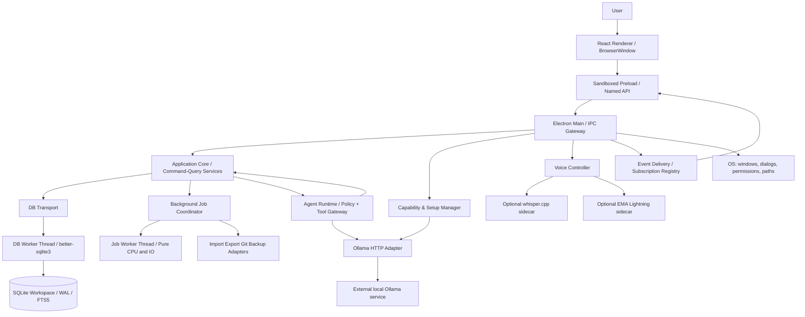
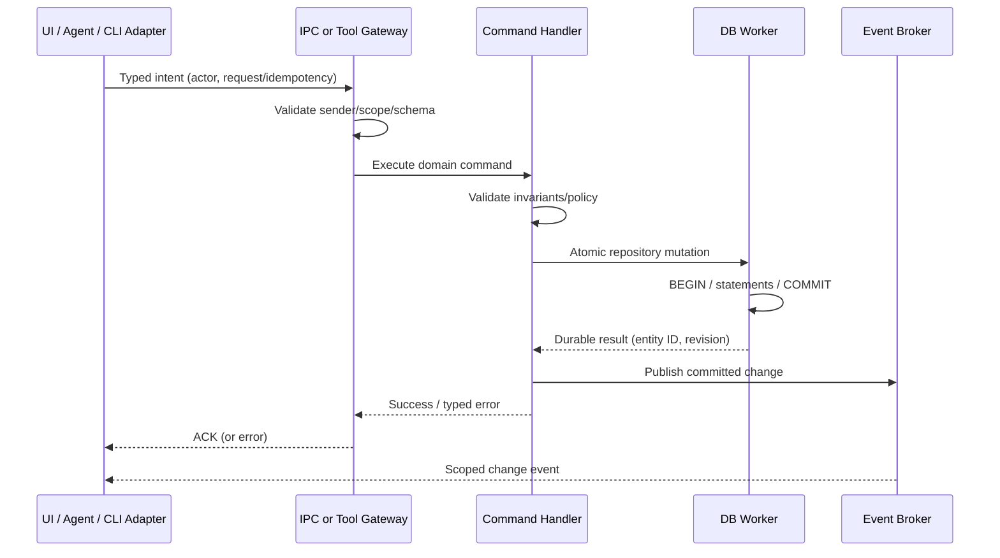
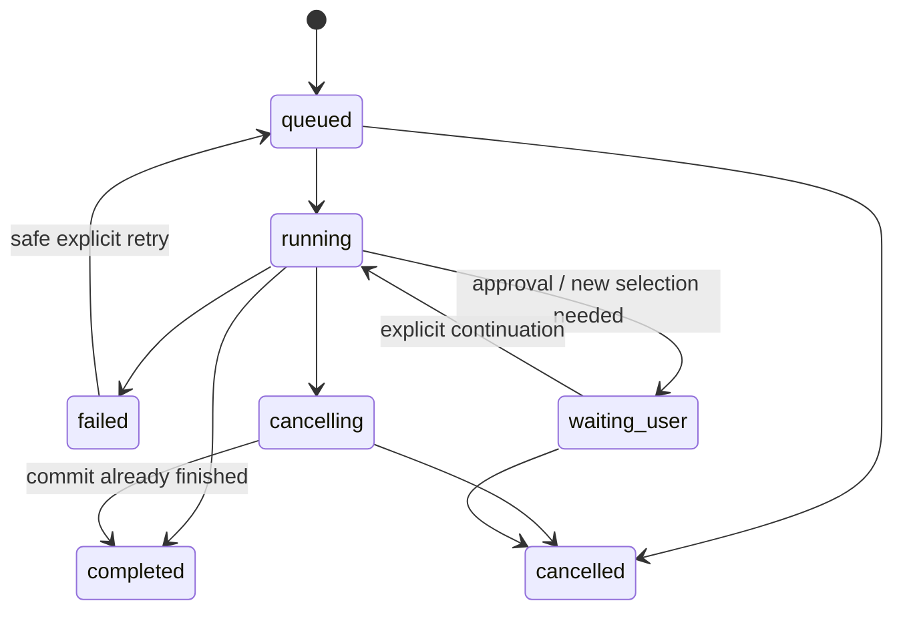
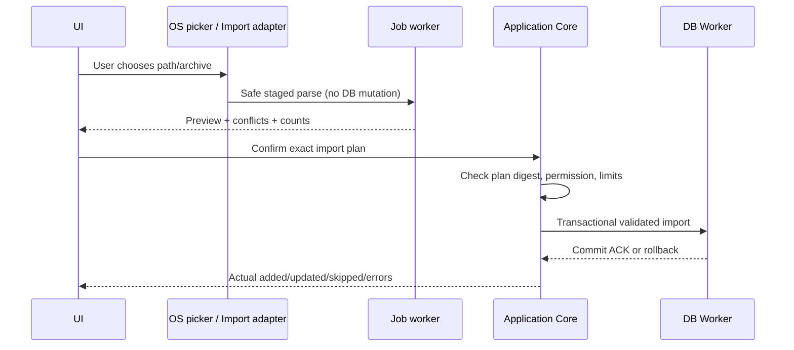
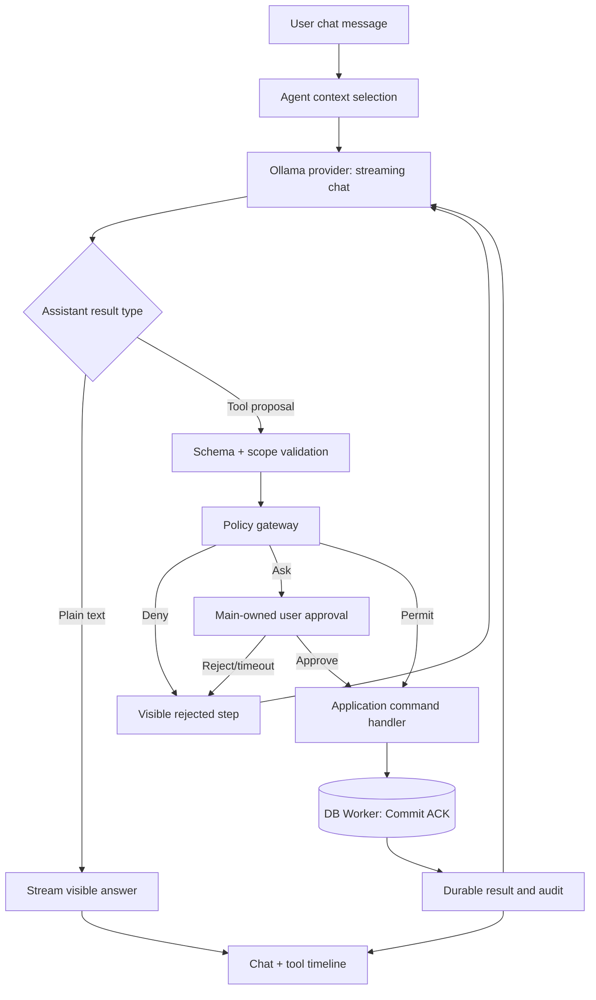

# Iterkeep — Sistem Mimarisi, Süreç Sınırları ve Uçtan Uca Veri Akışları

> **Belgenin amacı:** Iterkeep V1'in Electron süreçlerini, modül sınırlarını, güven ilişkilerini, komut/sorgu akışlarını, SQLite ve worker sahipliğini, isteğe bağlı AI/ses servislerini, açılış-kapanış-kurtarma yaşam döngüsünü **kodlama ajanının yorum yapmak zorunda kalmayacağı mimari kesinlikte** tarif etmek.
>
> **Yetki alanı:** Süreç topolojisi, bileşen sorumluluğu, süreçler arası akış ve bağımlılık yönü konusunda **DOC-06** normatiftir. Tam repo ağacı **DOC-07**; kesin entity, DTO ve domain olayları **DOC-08**; SQL DDL **DOC-09**; DB transaction, backup ve bağlantı davranışı **DOC-10**; gerçek IPC kanal adları, Zod şemaları ve hata payload'ları **DOC-11**; event/job ve UI cache state makineleri **DOC-12**; AI provider **DOC-24/25**; tool/policy **DOC-26/27**; voice **DOC-28/29**; güvenlik detayları **DOC-30**; performans eşikleri **DOC-31**; toparlanma **DOC-32**; testler **DOC-33**; build/installer **DOC-34**; uygulama sırası **DOC-35**. Bu belgede bulunan TypeScript parçaları bağlayıcı **mimari referans kalıplarıdır**; kesin dosya yolu veya derlenmiş ürün kodu iddiası değildir.
>
> **Durum:** `draft`. Süreç mimarisi tasarım kararıdır; Electron 44 / Forge 7 / Vite 8 / native `better-sqlite3` uyumluluğu **POC-STACK-001/002** ile gerçek Windows x64 paketinde henüz kanıtlanmamıştır. Başarısız POC, ilgili ADR güncellenmeden farklı mimariye sessiz geçiş izni vermez.

---

## 1. Sistem görevi, kapsam ve mimari başarı tanımı

Iterkeep, insanların **yap → kaydet → hatırla → devam et** döngüsünü destekleyen, internet ve AI olmadan çalışan bir bireysel masaüstü uygulamasıdır. V1'de bir kullanıcının tek bilgisayardaki bir çalışma alanını yönetir; gerçek zamanlı çok kullanıcılı ortak düzenleme, bulut sunucu, otomatik uzak senkronizasyon ve sürekli açık mikrofon **yoktur**.

Mimari dört somut sonuca hizmet etmelidir:

1. **Kullanılabilir çekirdek:** Ollama/Whisper/EMA Lightning/Git bulunmasa, çalışmasa veya bozulsa bile proje/görev/not/karar/günlük/arama işlevleri kullanılabilir.
2. **Tutarlı veriler:** Bir UI eylemi, agent aracı veya klavye komutu **aynı** doğrulanmış Application Core iş kuralından geçer; kalıcı gerçeklik SQLite'tır.
3. **Öngörülebilir performans:** Ağ, model, indeksleme, arşivleme veya DB sorgusu Electron main ve renderer event loop'larını uzun süre bloke etmez; performans **ölçülerek** doğrulanır.
4. **Denetlenebilir eylem:** Özellikle agent ile yapılan değişiklikte kullanıcı izin, onay, işlem durumu, gerçek sonuç, hata ve kaynağı görebilir.

**Teslim başarısı:** DOC-02'deki P0/P1 gereksinimleri ve DOC-04 kalite kapıları uygun test ortamlarında `PASS` alır; macOS/Linux için paketlenme başarısı kanıtlanmadan destek iddiası yapılmaz. DOC-31 dışında bu belgede yeni sabit milisaniye/FPS eşiği icat edilmeyecektir.

### 1.1 Mimari kimlikler ve izlenebilirlik

| Kimlik | Anlamı | Bu belge içindeki kullanım |
|---|---|---|
| `ARCH-I-*` | Değişmeyen mimari invariant | Testle doğrulanması gereken yasak/garanti |
| `ARCH-B-*` | Bileşen ve sahiplik sınırı | Yazma/erişim yetkisinin kime ait olduğu |
| `ARCH-F-*` | Uçtan uca işlem akışı | Normal ve hatalı yürütme |
| `ARCH-T-*` | Mimari kanıt/test vakası | DOC-33'e aktarılacak test tasarımı |
| `ADR-*` | Teknoloji/mimari seçim gerekçesi | **DOC-05** karar defteri |
| `REQ-*`, `AC-*`, `JRN-*`, `QG-*` | Ürün, kabul, yolculuk ve kalite | **DOC-02/03/04** otoritesi |

İçerik değişince referans ID'leri yeniden numaralandırılmaz. Belge bir endpoint veya kolon ismi icat etmez: kesin sözleşme başka belgede ise aynı konuda ikinci rakip sözleşme yaratılmaz.

---

## 2. Değiştirilemez mimari invariant'lar

| ID | Değişmez kural | İhlal örneği |
|---|---|---|
| ARCH-I-001 | SQLite, çalışma alanının **tek kanonik yapılandırılmış veri kaynağıdır**. | Markdown ile DB'yi aynı anda canlı master saymak. |
| ARCH-I-002 | DB'yi yalnız **DB worker** açar; renderer, preload, agent, job worker ve main içinde doğrudan SQL yoktur. | React'tan `better-sqlite3` import etmek. |
| ARCH-I-003 | Domain yazmaları Application Command Handler üzerinden geçer. | Agent'ın SQLite'a doğrudan `INSERT` üretmesi. |
| ARCH-I-004 | Preload **dar, isimlendirilmiş** API sunar; raw `ipcRenderer`, Node API veya keyfî kanal aktarımı yoktur. | `window.api.send(channel,payload)`. |
| ARCH-I-005 | Main yalnız OS yaşam döngüsü, doğrulama/orkestrasyon ve hızlı yönlendirmeden sorumludur; uzun hesaplama yapmaz. | Main'de büyük Markdown parse, senkron DB sorgusu, model inference. |
| ARCH-I-006 | Bir mutasyon ancak **başarılı transaction ACK** sonrası kullanıcıya `saved/completed` olarak sunulur. | İyimser UI'da DB hatasından önce `Kaydedildi` göstermek. |
| ARCH-I-007 | Opt-in yapılmadan model indirme, otomatik Git push, uzak API'ye proje metni aktarma ve mikrofon başlatma yoktur. | Başlangıçta arka planda model çekmek. |
| ARCH-I-008 | Kurulumda tamamlanan adımlar ile anlık provider sağlığı farklı durum bilgileridir. | `setup_completed=true` ise model her zaman vardır varsayımı. |
| ARCH-I-009 | AI/voice/Git bozulması **core'u** açılmaz hâle getiremez. | Ollama timeout'unu ilk pencere render'ında `await` etmek. |
| ARCH-I-010 | UI, CLI ve agent aynı Application Core eylemlerini kullanır; ikinci iş mantığı yoktur. | Agent'a ayrı görev CRUD repository'si yazmak. |
| ARCH-I-011 | Kullanıcı verisi uzaktaki sunucuya gizlice gitmez; varsayılan loglar içerik ve hassas yolları redakte eder. | Model prompt'unu tam loglamak. |
| ARCH-I-012 | Import/restore/delete gibi yüksek etkili işler erişim kapsamı ve açık onayla sınırlanır. | Verilen arşivdeki mutlak yolu doğrudan yazmak. |
| ARCH-I-013 | Olaylar **transaction yerine geçmez**; olay yayınlanamadığında commit geçmişi doğru okunabilir kalır. | Toast/event yayınını kalıcılık sanmak. |
| ARCH-I-014 | Ekrandaki liste, arama ve Chat hiçbir zaman tüm 100 bin kayıtla eşzamanlı render'a zorlanmaz. | Bütün DB satırlarını aynı React state'e doldurmak. |
| ARCH-I-015 | Application Core, React veya Electron tiplerine bağımlı değildir. | Domain servisinde `BrowserWindow` kullanmak. |
| ARCH-I-016 | IPC, worker ve provider sınırlarında **runtime doğrulama** yapılır. | TypeScript type assertion'ı kullanıcı girdisine güvenmek için kullanmak. |
| ARCH-I-017 | Aynı mutasyonun çift tıklama/retry sonucu iki kez uygulanmaması için etki kapsamına uygun idempotency gerekir. | Timeout sonrası görev eklemeyi keyfî tekrar edip çift kayıt oluşturmak. |
| ARCH-I-018 | Başarısız migration gerçek veriyi gizlice sıfırlamaz; kurtarma ekranına veya açık read-only duruma geçilir. | DB açılamayınca boş DB yaratıp eskiyi unutmak. |
| ARCH-I-019 | Worker veya sidecar iptali tamamlanmış transaction'ları otomatik geri almamış sayılır. | İptal sonrası önceden oluşturulan görevi yok saymak. |
| ARCH-I-020 | İsteğe bağlı servisleri başlatmak/kapatmak üçüncü taraf süreçlerine müdahale etmez. | Kullanıcıya ait başka Ollama sürecini `taskkill` etmek. |
| ARCH-I-021 | DB worker'ın JavaScript exception'ı yönetilebilir; **native crash aynı OS sürecini de devirebilir** ve güçlü izolasyon garantisi verilmez. | `worker_threads` kullandığı için native segfault'ta Electron main kesin hayatta kalır demek. |
| ARCH-I-022 | Uygulama yükseltmesi sırasında kullanıcı workspace'i installer kaynağı/ASAR altında bulunmaz. | Workspace DB'yi paket kaynaklarının içinde tutmak. |
| ARCH-I-023 | Agent'ın ürettiği metin/dışarıdan alınan Markdown güvenilir talimat değildir. | İçerikteki “DB'yi temizle” cümlesini yetkili sistem komutu kabul etmek. |
| ARCH-I-024 | Uygulama sistem sağlığı ile kullanıcı tercihini karıştırmaz; kapatılan capability kendi kendine etkinleşmez. | Health probe başarılı oldu diye kapalı AI'yı açmak. |
| ARCH-I-025 | Release'deki mimari vaatler gerçek Windows installer, upgrade, native worker ve uçtan uca testlerle ispat edilir. | Sadece Vite dev server'da çalışıp feature'ı tamamlandı saymak. |

### 2.1 Güven ve verinin yetki sıralaması

```text
UNTRUSTED / LOW TRUST
  Imported Markdown / archive / user-pasted text / model output
     |  parse, limit, sanitize, Zod validate
  React Renderer (sandbox, no Node)
     |  named preload API, structured clone, origin validation
  Electron Main IPC Gateway
     |  app-level authz, capability/policy/intent validation
  Application Core
     |  transaction command / typed repository request
  Dedicated DB Worker (SQLite authority)
HIGHER PRIVILEGE
```

Bu sıra, **renderer güvenilmezse tüm OS güvendedir** iddiası değildir. Main, worker, child process ve Node bağımlılıkları yüksek yetkili kodlardır; bu sebeple input doğrulama, CSP, izin ve binary hash doğrulaması ayrı kontrollerle korunur (DOC-30).

---

## 3. Kanonik çalışma zamanı topolojisi



**Şemadaki okların anlamı:** Yetkili çağrı/veri akışı gösterir; her ok aynı çağrı mekanizmasını kullanmak zorunda değildir. DB bağlantısı **DB worker içinde** açılır. Ollama, uygulamanın başlattığı zorunlu process değil, kullanıcı ortamındaki bağımsız **yerel HTTP hizmetidir**. Ses sidecar'ları gerektiğinde başlatılır; kalıcı değildir. Arşiv/backup sırasında DB okuma-yazma işlemleri yine DB worker'a yönlenir.

### 3.1 Süreç ve thread envanteri

| Parça | Teknoloji / yer | Ne zaman oluşur? | Sahibidir | Çalışma sırasında izin verilen işler | İzin verilmeyenler |
|---|---|---|---|---|---|
| Electron Main | Electron ana OS süreci | Uygulama başlatıldığında | Windows, main gateway, coordinator, lifecycle | Hafif orchestration, event forwarding | Ağır parse, blocking SQL, inference |
| React Renderer | Sandboxed Chromium renderer | Pencere gösterildiğinde | UI, klavye, tema, ses capture görünümü | Render, kullanıcı etkileşimi, UI-only state | `fs`, Node, SQL, child process, arbitrary network |
| Preload | Context-isolated sınırlı bridge | Renderer'dan önce | Named API binding | Sınırlı `invoke` ve doğrulanmış event aboneliği | Generic IPC, SQL, shell, secret erişimi |
| DB Worker | `node:worker_threads` | Workspace açılırken | DB connection, migrations, statement, transaction | Senkron `better-sqlite3`, FTS5, backup DB işleri | DOM, React, model inference |
| Background Job Worker | Node worker (gerektiğinde) | İş ihtiyacında / kontrollü havuzda | CPU-bound saf dönüşümler | Parse, normalize, diff, export render | SQLite connection, raw OS shell |
| Application Core | Main'deki framework'süz servis örnekleri | Core hazırlanırken | Business rules, command/query | Async services ve portlar üzerinden DB/job access | Electron import, raw renderer erişimi |
| Capability Manager | Main controller | UI'dan bağımsız, core sonrası | Kurulum tercihleri + gerçek sağlık ayrı | Capability probe, health TTL, lifecycle | Başlatmada tüm probe'ları beklemek |
| Agent Runtime | Main orchestration / gerektiğinde async jobs | Kullanıcı agent isterse | Run context, policy, tool plan | Onaylı core command ve model stream | Raw SQL, shell, sınırsız FS |
| Ollama | Kullanıcı/haricî yerel servis | Kullanıcının bağımsız kararı | LLM inference | Loopback API erişimi | Uygulamanın körlemesine sonlandırması |
| whisper.cpp | Optional sidecar | Ses işi başladığında | STT inference | Sınırlı ses girişi, transcript sonucu | Workspace DB erişimi |
| EMA Lightning | Optional sidecar | TTS etkin ve ses istendiğinde | TTS inference | Metin→ses | Workspace DB erişimi |
| Git CLI | Optional subprocess | Kullanıcının açık Git eyleminde | İzinli dışa aktarım dizini Git işleri | Kısıtlı `git` argümanları | Serbest shell yorumlama |

**Terim ayrımı:** `process` ve `thread` eşdeğer değildir. DB ve job worker'lar V1'de aynı Electron main OS sürecindeki Node thread'leridir; CPU bloklamayı ana event loop'tan ayırırlar, ancak native seviyede **mutlak çökme izolasyonu sağlamazlar**. Whisper/EMA sidecar ayrı OS sürecidir. Gerekirse DB'yi Electron `utilityProcess` içine taşıma, `ADR-005` revizyonu + native paketleme POC ve regresyon testi gerektirir; sessizce yapılmaz.

### 3.2 Çalışma zamanı bağımlılık grafiği

```text
React components/hooks
    -> renderer application adapter -> named preload API
    -> IPC Gateway -> Application Core
    -> Domain services / ports -> repository adapter
    -> worker RPC -> DB Worker -> SQLite

Agent tool command -> same Application Core (NO parallel business rules)

CLI adapter (future/optional) -> same Application Core via supported bootstrap

Optional Ollama / STT / TTS -> capability-specific ports
                       -X-> mandatory workspace startup
```

`Domain` paketinden herhangi bir UI, Electron, Node, SQLite veya model provider import'u ters bağımlılıktır ve statik import-boundary testiyle reddedilir. İlgili gerçek package import kuralları DOC-07'de verilir.

---

## 4. Bileşen sınırları ve tek sorumlu kuralı

| ID | Bileşen | Tek temel sorumluluk | Girdi | Çıktı | Kalıcı durum yetkisi |
|---|---|---|---|---|---|
| ARCH-B-001 | WindowManager | Ana pencere, focus, activation | OS lifecycle | Window state | UI preference command aracılığıyla |
| ARCH-B-002 | IpcGateway | Sender/shape/limit/policy boundary | Named renderer request | Typed Result | **Yok** |
| ARCH-B-003 | ApplicationCore | Use-case, command/query, domain transaction orchestration | Validated intent & actor | Typed outcome | **Repository port** aracılığıyla |
| ARCH-B-004 | Domain | Entity invariants, state machine, value objects | Typed value | Valid value/domain error | **Yok** |
| ARCH-B-005 | DbClient | Async worker RPC / lifecycle | Repository request | Typed DB response | Doğrudan bağlantı yok |
| ARCH-B-006 | DbWorker | SQLite sahipliği, connection, transaction, migration | Validated internal RPC | Commit/result | **Tek bağlantı sahibi** |
| ARCH-B-007 | JobManager | Uzun iş kuyruğu, iptal, progress | Start/cancel job | Job events/result | Job repository ile |
| ARCH-B-008 | EventBroker | Per-subscriber event akışı, sıra, snapshot ile recovery | Domain/job event | UI-safe delta | Kanonik veri değil |
| ARCH-B-009 | SetupManager | Sihirbaz adımları ve kullanıcının tercihleri | User selections | Saved setup choices | DB setting command aracılığıyla |
| ARCH-B-010 | CapabilityManager | Kullanılabilirlik ve sağlık snapshot'ı | Service probe | Capability status | DB'ye yalnız tercih/diagnostic bilgisi |
| ARCH-B-011 | ModelManager | Ollama model discovery/download/selection | User request | Model status/progress | App settings/profiles command |
| ARCH-B-012 | AgentOrchestrator | Run lifecycle, streamed model output | User input/context | Tool proposal/result stream | Agent repository üzerinden |
| ARCH-B-013 | ToolGateway/Policy | Tool allowlist, risk, approval ve validated action | Proposed tool | Permit/deny/ask result | Audit via core |
| ARCH-B-014 | VoiceController | Mic/STT/TTS session lifecycle | Explicit user start/stop | Editable transcript/audio | Voice job metadata only |
| ARCH-B-015 | ResourceManager | Model yükleme/çakışma/süre/bellek limitleri | Resource request | Acquire/reject/release | Kalıcı preference; kullanım geçici |
| ARCH-B-016 | ImportExportAdapter | Validated import plan / Markdown render | Archive/snapshot | Structured plan/files | Transaction yalnız core+DB |
| ARCH-B-017 | BackupRestoreCoordinator | DB + asset tutarlı snapshot ve restore guard | User intent | Verified backup/restore result | DB worker ile kontrollü |
| ARCH-B-018 | GitAdapter | Sınırlı Git komutları | Approved export folder | Status/commit/push result | SQLite yetkisi yok |
| ARCH-B-019 | LocalDiagnostics | Gizlilik korumalı teknik kayıt/ölçüm | Telemetry-safe event | Local diagnostic | Ayrı redakte dosya, sınırlı saklama |

### 4.1 Core ile IO adaptörlerinin ayrılması

Domain use-case'i model/SQLite/React/OS API bilmemelidir; sadece port arayüzlerini bilir. Composition root, bu portlara somut adaptör bağlar.

Örnek bağımlılık yönü:

```text
UseCase: CompleteTask
  depends on: TaskRepository, Clock, DomainEventSink

SQLiteTaskRepository
  implements: TaskRepository
  depends on: DbClient -> DB worker

TaskComponent
  calls: window.iterkeep.tasks.complete
  NEVER imports: SQLiteTaskRepository

Agent Tool: tasks.complete
  calls: CompleteTask application command
  NEVER implements: "second complete task logic"
```

Bir özelliğe iki veri yazma yolu açılırsa mimari hata kabul edilir (ARCH-I-003/010).

### 4.2 Domain olayları vs UI olayları

- **Domain event:** Kalıcı business olgusu (görev tamamlandı, karar oluşturuldu); gerçeğin kaynağı DB commit'idir. Alanların kesin sözleşmesi DOC-08.
- **Integration/job event:** Uzun işlem ilerlemesi, provider sağlık değişimi, stream token'ı; geçici olabilir. Kesin event/job protokolü DOC-12.
- **UI event:** Panel kapandı, focus değişti, toast göster; domain invariant değildir.

**Yasak:** EventBroker içindeki ephemeral bir mesajı, DB transaction yapılmış gibi kalıcı olgu kabul etmek. İlgili listeye dönerken query snapshot canonical kalır.

---

## 5. Ana uygulama composition root ve başlatma protokolü

### 5.1 Başlatma hedefi

**Pencere hızlı görünür; çekirdek ise ancak workspace güvenle açılınca kullanılabilir.** Model probe ve ses işleri temel pencere açılmasını veya ilk veriyi bloklamaz. İlk defa yüklenen kullanıcı setup ekranını görür; daha önce hazırlanmış kullanıcı doğrudan workspace'e gider.

```mermaid
sequenceDiagram
  participant OS as OS
  participant M as Electron Main
  participant UI as React UI
  participant D as DB Worker
  participant S as Setup Manager
  participant C as Capability Manager
  OS->>M: launch / app ready
  M->>M: single-instance lock + secure protocols
  M->>M: create secured BrowserWindow
  M->>D: spawn DB worker / open selected workspace
  M->>UI: show shell (not false "ready")
  D-->>M: ready OR migration/recovery error
  alt DB ready
    M-->>UI: coreReady + workspace summary
    UI->>S: get setup preference
    S-->>UI: completed / incomplete
    M->>C: schedule optional probes AFTER core ready
    C-->>UI: independent capability snapshots
  else DB unavailable
    M-->>UI: recovery required; no silent new DB
  end
```

### 5.2 Zorunlu bootstrap sırası (`BOOT-01–12`)

| Adım | İşlem | Blokladığı şey | Geçilemeyecek kontrol |
|---|---|---|---|
| BOOT-01 | Sürüm/packaged mode, platform ve local user-data path çöz | OS init | Kullanıcı girdisiyle `isDev` yaratılmaz |
| BOOT-02 | Tekil uygulama instance lock | İkinci main açılışı | İkinci instance DB'yi eşzamanlı yazma için açmaz |
| BOOT-03 | Güvenli custom protocol/CSP/permission handler oluştur | Güvenli pencere | `contextIsolation`, sandbox ve origin politikası |
| BOOT-04 | Preload ve BrowserWindow oluştur; görünür shell | UI shell | Renderer'a yetkili Node API açılmaz |
| BOOT-05 | Workspace seçimi / mevcut path metadata'sını çöz | DB init | Workspace taşındıysa eski DB üzerine boş DB yazılmaz |
| BOOT-06 | DB worker başlat, handshake ve schema version al | Kalıcı sorgu/mutasyon | POC'de kanıtlı native yükleme |
| BOOT-07 | Integrity/migration lock, gerekiyorsa migration + preflight yedek | Core readiness | Hata → recovery, veri sıfırlama yok |
| BOOT-08 | Application Core repositories/queries/jobs registry'yi bağla | Core-ready | Portlar ve DB worker ready |
| BOOT-09 | `coreReady` snapshot'ını UI'ya sun | Kullanıcı işlemleri | Taslak setup seçimi, gerçek commit'ten ayrılır |
| BOOT-10 | Kullanıcı setup/ana ekran yönlendirmesi | Normal gezinme | Setup state ve cap health ayrı |
| BOOT-11 | İsteğe bağlı capability probe'larını sınırlı concurrency ile zamanla | Sadece provider UI | **Core/UI başlatmayı bloklamaz** |
| BOOT-12 | Recoverable job reconciliation, update kontrolü (opt-in policy) | İlgili job | Dış ağa sessiz zorunlu çağrı yok |

**Önemli:** BOOT-07 ve BOOT-08 tamamlanmadan API'ya gelen yazma isteği deterministik `CORE_NOT_READY` benzeri typed hata verir; keyfî bekleme/kayıt kaybı olmaz. Gerçek hata kodu isimleri DOC-11/32'de sabitlenir.

### 5.3 İlk açılış ve sonraki açılış farkı

- **İlk açılış:** Workspace seçilebilir/oluşturulabilir. Zorunlu kurulum adımları workspace doğrulama + temel tercihler; AI ve voice tamamen atlanabilir. AI indirme zorla başlamaz (`AC-001`, `AC-010`).
- **Normal açılış:** Son geçerli workspace açılır; tema ve dil tercihi mümkünse önbellekten erken uygulanır, daha sonra DB ile tutarlılaştırılır. Setup tekrar zorunlu gösterilmez.
- **Workspace yok/taşındı:** Sessizce boş DB oluşturulmaz; yeniden konum seç/backup restore ekranı çıkar.
- **Yanlış/bozuk DB:** Görev oluşturma etkinleşmez; kurtarma paneline yönlendirilir. Tamir stratejisi DOC-17/32.
- **AI tercihi kapalı:** Sağlık kontrolleri isteğe bağlı ayarlar sayfası açılmadıkça düşük öncelikli veya tamamen pasif olabilir; chat offline/unavailable gösterilir.
- **AI açık, provider kapalı:** Ana ekran çalışır; chat alanında yeniden bağlan/ayarlar eylemi çıkar. Automatik model download başlatılmaz.

### 5.4 Hazır olma düzeyleri birbirine karıştırılmaz

| Bayrak / kavram | Anlam | Nereden gelir | UI davranışı |
|---|---|---|---|
| `shellVisible` | Pencere ve React iskeleti görülebilir | Main/renderer lifecycle | Skeleton/setup/recovery olabilir |
| `workspaceReady` | DB worker bağlandı ve schema güvenli | DB handshake + core | CRUD etkin |
| `setupComplete` | Kullanıcı zorunlu setup adımlarını bitirdi | Persisted preference | Dashboard'a geçilebilir |
| `capabilityEnabled` | Kullanıcı özelliğe izin verdi | Persisted settings | Gerekirse health probe |
| `providerHealthy` | Servise son probe başarılı | Capability snapshot, TTL | Model sorgulama denenebilir |
| `modelReady` | Seçilen model hâlen yüklü ve kullanılabilir | Model provider + functional check | Agent chat çalışabilir |
| `voiceReady` | STT/TTS ilgili modül çalıştırılabilir | Sidecar probe | Voice UI'sı etkin |

`setupComplete=true` hiçbir zaman `modelReady=true` anlamına gelmez. DOC-18/19 durum enum'ları bunu kesinleştirir.

---

## 6. IPC güven sınırı ve iletişim ilkeleri

### 6.1 İstek/yanıt yolu

```text
User intention
 → Renderer UI handler
 → named preload function (one capability = explicit function)
 → ipcRenderer.invoke (private, fixed channel)
 → ipcMain.handle
 → senderFrame allowlist + size/shape/rate checks + policy
 → Application Core command/query
 → typed Result/error
 → preload result normalization
 → React Query mutation/query
 → render success only AFTER DB ACK
```

Renderer **kendi onayı ile yetki elde etmez**. `isApproved=true` gibi istemciden gelen bayrak, main policy'de başlı başına yetki değildir. Onay, main tarafından kaydedilen doğru operation/risk/scope/expiry kaydıyla ilişkilendirilir.

### 6.2 Tip güvenliği tek başına güvenlik değildir

- Renderer request payload'ı IPC girişinde runtime Zod doğrulamasından geçer; limit ve hedef ID kontrolü yapılır.
- `event.senderFrame` ve kaynağın app origin'i doğrulanır; alt frame'ler veya başka kaynaklardan gelen mesajlar reddedilir.
- Doğrulamadan sonra Application Core business authorization yapar. Güvenli IPC bütün iş kurallarının yerine geçmez.
- Model tool sonucu ayrı bir düşük güven sınıfıdır; yeniden şema, policy ve scope doğrulanır.
- Worker mesajları da ana süreçten geliyor diye körlemesine kabul edilmez: `message.version`, `requestId`, `operation`, payload, payload boyutu ve timeout doğrulanır.
- Hatalı/oversize mesajlar logda hassas içerik çoğaltmadan engellenir.
- API'ya electron `ipcRenderer` Event argümanı, raw `BrowserWindow`, `MessagePort`, genel `fsPath` veya Node obje referansı sızdırılmaz.

### 6.3 Akış/push iletişimi

Chat stream, model indirme progress'i ve job event'i gibi konularda her token için UI query yenilemek yasaktır. İletişim iki türdür:

1. **Query/mutation:** Typed request-response (kalıcı snapshot ve kesin sonuç).
2. **Subscription/event:** UI'ya izinli, isimlendirilmiş event tipleri; unsubscribe/cancel destekli; asıl snapshot query'den alınır.

Burada exact IPC isimleri seçilmez; DOC-11'i bekleriz. Sonradan dar API'yi açık bir entegrasyon sözleşmesiyle oluşturmak zorunludur.

### 6.4 Event sırası ve kaçan event çözümü

- UI aboneliği koparsa *event replay* beklemeden canonical snapshot query çağırır.
- Sıralama gerekiyorsa snapshot revision veya monotonic sequence üzerinden stale event atlanır.
- İki farklı proje için event'ler tek bir global sıralamanın varlığını varsaymamalıdır.
- DB commit sonrası `revision` değeri canonical kayıttan gelir; EventBroker tahmin ederek ilerletmez.
- Agent token stream'i veya indirme progress'i UI'da event kaybetse bile kalıcı run/job durumu yeniden sorulabilir.
- DOC-12 event sequence, cursor, retention ve per-subscription backpressure ayrıntılarını belirler.

### 6.5 Bildirim semantiği

| İşlem | Kullanıcıya hemen gösterilebilir | Yalnız ACK sonrası gösterilebilir |
|---|---|---|
| Task create | Editörde geçici `saving` kartı | `Task created / Saved` |
| Task complete | Geçici durum / spinner | Kalıcı tamamlandı |
| Chat model stream | Alınmış geçici metin parçaları | `tool succeeded` ancak gerçek command sonucu |
| Import | Önizleme, pending job progress | Tüm seçili işlemin kabul edilen transaction sonucu |
| Backup | Hazırlanıyor / doğrulanıyor | Doğrulanan backup artefaktı |
| Export | Yazılıyor / geçici dosyalar | Atomik final dosya üretildi |
| Model download | Gerçek provider progress | Model mevcut ve doğrulanabilir |

---

## 7. Application Core — Command Query Separation

Buradaki CQRS, ayrı veritabanı veya message bus demek değildir. **Aynı SQLite üzerinde** query ve command servislerinin sorumluluk ayrımıdır.

### 7.1 Command handler akışı



Bu akışta `COMMIT` sonrası event yayınlanamazsa **commit boşa gitmiş sayılmaz**. UI hata politikası: Query invalidation/refetch; daha güçlü teslim garantisi gereken olaylar için DOC-08/09/12'de transactional outbox gereksinimi varsa DDL ve state sözleşmesi orada tanımlanacaktır. İlk sürümde outbox'ın her entity için zorunlu olduğu varsayılmaz.

### 7.2 Query handler akışı

```text
React Query / Search UI
   → typed query
   → Application Query Service
   → DB read RPC (indexed query / FTS)
   → paginated typed DTO
   → UI cache (entity/query keys)
```

- UI hiçbir zaman SQL veya FTS sorgu sözdizimini serbestçe göndermez; kullanıcı metni arama sorgu derleyicisine gider (DOC-15).
- Query dönüşlerinde canonical `entityId`, `revision`/`updatedAt`, pagination cursor ve ilgili ilişki ID'leri bulunabilir; kesin DTO DOC-08/11.
- Kullanıcı doğrulama hata mesajında neyin düzeltilebileceğini görebilir; veritabanı exception stack'i ekrana basılmaz.

### 7.3 Tek servis, farklı girişler

| Giriş | Intent örneği | Aynı yürütme noktası |
|---|---|---|
| UI form | Görev oluştur | `CreateTask` application command |
| Klavye hızlı yakalama | Projesiz görev | `CreateTask` + Inbox destination |
| Agent tool | "Bu görev için deadline ekle" | `UpdateTask` command + policy |
| İçe aktarma | Validated task record | Kontrollü `ImportTasks` transactional command |
| İleri tarihli CLI | `iterkeep task add` | `CreateTask` command; database worker'a uygun bootstrap |

**Önemli:** Import'un toplu transaction semantiği, tek tek UI `CreateTask` çağrılarının rasgele döngüsü değildir; aynı domain invariant'ları koruyan ayrı batch use-case tanımlanır. Aynı anda çalıştırılan import ve normal CRUD, job/DB worker aracılığıyla koordineli olur.

### 7.4 Komut sonuçlarının anlamı

- `success`: Yalnızca doğrulanmış kalıcı sonuç; hedef ID ve varsa revision.
- `validation_error`: Veri kötü; DB mutasyonu yok.
- `permission_denied`: Kapsam/yetki reddi; DB mutasyonu yok.
- `conflict`: Beklenen revision güncel değil; istemci son sürümü çekmeli.
- `unavailable`: DB veya opsiyonel adapter erişilemiyor; hangisi olduğuna göre kullanıcıya farklı mesaj.
- `unknown_commit_outcome`: İstek sırasında kopma oldu, DB'de kalıcı etki gerçekleşmiş olabilir. **Kör tekrar yapılmaz**, idempotency/reconciliation ile sonuç çözülür.

Kesin discriminated-union tipi ve hata kodları DOC-08/11/32'de tanımlanır.

---

## 8. SQLite worker topolojisi ve tutarlılık modeli

### 8.1 Worker'ın sahipliği

**Bir workspace = çalışma anında tek aktif yazma bağlantısı sahibi DB worker.** Tüm uygulama SQL'i `Repository` sınıfları ile DB worker üzerinde uygulanır; Query ve Command servisleri yalnız RPC çağırır.

Worker yüklenince sıralama:

1. Workspace canonical path doğrulanmış olmalı.
2. Var olan DB açılır; ilk kurulumsa açık yaratma akışı kullanılır.
3. Sürüm/şema uyumluluğu sorgulanır.
4. Gereken migration/backup **DOC-10/17** kurallarıyla yapılır.
5. `foreign_keys=ON`, uygun WAL ve yoğunluk/timeout pragmaları doğrulanır.
6. Hazırlanmış statement/FTS5 testleri çalışır.
7. Worker `ready` handshake verir.

`better-sqlite3` **synchronous** API'nin worker thread'de kullanılması ana main event loop'u bloke etmez, fakat tek worker'ın kendisi aynı anda birden çok senkron sorgu yürütemez. Bu nedenle kısa transaction, sınırlı sorgu, pagination ve uzun işlerde chunking gerekir.

### 8.2 DB worker istemci protokolü — örnek şekil

Aşağıdaki örnek, **exact kanal ve entity sözleşmesi değildir**. IPC (`renderer → main`) ve worker RPC (`main → DB worker`) **ayrı protokollerdir**; bunu tek `generic execute` API olarak renderer'a açmak yasaktır.

```ts
// Architectural sketch — DOC-10/11/12 refine names and schemas.
type InternalRequest = {
  protocolVersion: 1;
  requestId: string;
  operation: 'task.create' | 'task.get' | 'task.list' | 'workspace.status';
  payload: unknown;
  deadlineEpochMs?: number;
};

type InternalResponse =
  | { protocolVersion: 1; requestId: string; ok: true; data: unknown }
  | {
      protocolVersion: 1;
      requestId: string;
      ok: false;
      error: { code: string; safeMessage: string; retryable: boolean };
    };
```

- Worker'ın cevapları `requestId` ile pending map'e bağlanır; bilinmeyen/gecikmiş cevabı yanlış Promise'e yönlendirmek yasaktır.
- Worker `error`, `exit` ve initial ready timeout'u lifecycle yöneticisince yakalanır.
- Worker her iç mesaja yeniden runtime validation uygular; main'le aynı TS tipi kullanılabilir ama runtime doğrulama kaldırılmaz.
- Kullanıcı girdisinden `operation`, raw SQL text veya keyfî path direkt worker'a aktarılmaz.
- DB kanallarında zorunlu olmayan ağır veri içerikleri loga yazılmaz.

### 8.3 Concurrency, kilit ve request yürütme

| Risk | V1 stratejisi | Kabul davranışı |
|---|---|---|
| Çift görev ekleme | `idempotencyKey` / dedup kayıt semantiği | Tek görev veya sonuç uzlaştırma |
| Aynı görev iki ekranda güncellendi | `expectedRevision` optimistic concurrency | İkinci güncelleme conflict + refresh |
| UI + agent eşzamanlı yazdı | İkisi de aynı command → DB worker yolu | Invariant korunur |
| Uzun FTS taraması | Sorgu/limit/pagination; gerekirse chunked job | UI ve main responsive |
| Import + normal CRUD | Import izolasyon/transaction + job lock | Açık progress veya busy, bozuk ara durum yok |
| Backup + yazma | SQLite destekli tutarlı snapshot | Başarılı geri yükleme testi |
| DB lock from external process | `busy_timeout`, bounded retry if safe | Retry sonsuz değil; hata görünür |
| İş bitmeden uygulama kapandı | Shutdown drain, timeout, next-start reconciliation | Belirsiz başarı ilan edilmez |

Revision ve dedup verilerinin SQL kısıtları DOC-09; retry policy DOC-10/32; job lock ayrıntıları DOC-12 tarafından kesinleştirilir.

### 8.4 Worker crash koşulları ve dürüst sınır

- **JS hata / kontrollü worker `exit`:** Main çalışıyorsa DB capability `recovering/unavailable` olur, pending istekler `unknown outcome` veya kanıtlı `failed` ile sonuçlanır; yeni worker yalnız güvenli reconciliation sonrası oluşturulur.
- **Native addon segfault / process-level crash:** `worker_threads` aynı OS sürecinde bulunduğundan Main de düşebilir. **İlk mimari bunun olmamasını garanti etmez.** SQLite transaction recovery, startup backup ve integrity check sonraki açılışta devreye girer. Native crash izolasyonu gereksinim veya testte zorunlu hâle gelirse `utilityProcess` için yeni ADR/POC açılır.
- **OS güç kaybı:** Son kullanıcının gördüğü başarılı ACK'ler ile fiziksel dayanıklılık arasındaki garantiler SQLite journal/synchronous/OS/disk ayarlarına bağlıdır; DOC-10'da açıkça belirlenir. `ACK` kesin kayıt anlamında tasarlanır ancak bozuk donanım için mutlak garanti verilmez.

### 8.5 SQLite failover yoktur

V1'de ikinci writer, otomatik DB replikası veya arka planda çatışmasız veri birleştirme **yoktur**. DB çalışmadığında uygulama "SQLite'ı bulamadım, Markdown'a yazayım" demez. İşlem güvenle tamamlanamıyorsa UI'da açıkça `not saved` gösterilir. Editördeki taslak metin uygun düzeyde korunur; gerçek taslak kurtarma ayrıntısı DOC-14/32.

---

## 9. Background job mimarisi

### 9.1 Hangi işler job olmalıdır?

Kullanıcı etkileşimini aşan veya uzun sürebilen işler job olarak modellenir:

- Çok sayıda Markdown/YAML içe aktarım ve export.
- Workspace backup/restore ve doğrulama.
- Büyük arama indeksinin bakım/rebuild kontrolü.
- Git status/commit/push gibi I/O işleri.
- Ollama model indirme ve cihaz benchmark'ı.
- STT transcription, TTS synthesis, uzun agent run'ları.

Görev ekleme gibi kısa domain komutunu gereksiz yere uzun iş kuyruğuna koymayız. `DOC-12` iş türü, quota, progress ve persist politikalarını kesinleştirir.

### 9.2 İş yürütme sınıfları

| Sınıf | Örnek | Yürütücü | DB yazma yöntemi |
|---|---|---|---|
| `interactive` | Task create, note save | Application Core → DB worker | Tek kısa transaction |
| `cpu_background` | Markdown parse, diff, format dönüşümü | Background worker | Sonuç core tarafından doğrulanıp yazılır |
| `io_background` | Export, asset copy, Git subprocess | Job adapter/subprocess | Metadata core üzerinden |
| `external_local` | Ollama pull/probe/chat | Ollama adapter | Status ve seçili profil core üzerinden |
| `voice_compute` | whisper/EMA | Optional sidecar | User-confirmed transcript/metadata core üzerinden |
| `maintenance` | Integrity, backup, migration | DB Worker + coordinator | Exclusive/safe checkpoint prosedürü |

### 9.3 Kuyruk disiplinleri

1. **Foreground priority:** Yeni görev kaydetme veya proje açma, uzun ve düşük öncelikli indeks rebuild'inden makul biçimde önce sonuçlanmalı. Büyük işlem küçük parçalar hâlinde ilerlemelidir.
2. **Bounded concurrency:** Worker sayısı, eşzamanlı import, model indirme ve GPU ses işleri sınırsız artmaz; hardware-aware limitler uygulanır.
3. **Fairness:** Düşük öncelikli iş tamamen açlığa bırakılmaz; limit DOC-12.
4. **Cancellation:** `requestCancel` ve `cancelAcknowledged` ayrı; bazı commit/OS işlemleri anlık iptal edilemez.
5. **Progress truth:** "Yüzde 74" yalnız ölçülebilir iş ilerlemesi varsa gösterilir; ölçülemiyorsa `indeterminate` durum kullanılır.
6. **No surprise resume:** Yeniden açılışta veri yıkıcı veya dış ağa çıkan işler otomatik devam ettirilmez; DOC-12/18/25 policy'si kullanıcıya açıkça anlatır.
7. **Persistent checkpoints:** Uzun işlerin safhası ve tamamlanan adımları kaydedilerek toparlanma sağlanır; geçici RAM queue kalıcı geçmiş diye sunulmaz.

### 9.4 Job yaşam döngüsü — yüksek seviye



Bu durumlar kavramsaldır; **kesin enum, kalıcılık ve geçiş tablosu DOC-12'ye aittir**. `cancelling → completed` meşru olabilir; tamamlanan bir transaction geriye alınamaz. UI bunu açık biçimde gösterir.

### 9.5 Process başına zaman aşımı

- `startupTimeout`, `requestTimeout`, `idleTimeout`, `shutdownGracePeriod` birbirinden farklı konfigürasyon alanlarıdır.
- Tek bir evrensel "30 saniye timeout" bütün modüllere uygulanmaz: model indirme ile DB lookup aynı değildir.
- Timeout, dışarıda işin gerçekten durduğu anlamına gelmez. Belirsiz commit sonucu `unknown` olarak sorgulanmalı veya idempotency anahtarıyla uzlaştırılmalıdır.
- Sidecar zaman aşımında sadece **uygulamanın başlattığı** ilgili child process terminate edilebilir; dış Ollama süreci öldürülmez.
- Sayısal eşikler DOC-31 (performans) ve DOC-32 (hata/retry) ile kesinleşir.

---

## 10. Event broker ve UI veri sahipliği

### 10.1 Üç çeşit state

| State kategorisi | Sahip | Kalıcı mı? | UI kullanımı |
|---|---|---|---|
| Canonical workspace data | SQLite / repositories | Evet | React Query snapshot + entity keys |
| UI-only ephemeral | React local state / Zustand | Hayır (tercihler hariç) | Panel, modal, selection, draft view state |
| Job/agent/provider activity | Job/Capability/Agent managers | Kısmen | Subscription stream + snapshot refetch |

Zustand'a tüm `projects`, `tasks`, `messages` tablolarını kopyalamak yasaktır. Böyle yapılırsa birbirinden bağımsız cache'ler oluşur ve UI'da eski veri kalır.

### 10.2 Snapshot + delta stratejisi

```text
Open project
  -> Query snapshot(projectId, pagination/filter)
  -> render visible rows
  -> subscribe to relevant project events
  -> on authoritative change: invalidate specific key / apply revision-safe update
  -> lost events or reconnect: refetch canonical snapshot
```

- Pencere minimize/restore olduğunda körlemesine her tablo polling yapılmaz.
- Çok kayıt varsa backend pagination + renderer virtualization beraber kullanılır.
- Model token stream'leri UI'da frame dostu batch ile yansıtılır; her token global state'e ayrı render zorlamaz.
- Event subscriber yaratılan her UI mount/unmount sırasında unsubscribe yapmalıdır.
- StrictMode çift mount ve App Router navigasyonu memory leak üretmemelidir.

### 10.3 Kayıt UI durumu

| State | Açıklama | Kullanıcıya vaat |
|---|---|---|
| `editing` | Lokal editör değişti | Henüz kaydedilmedi |
| `saving` | Command gönderildi, ACK bekleniyor | Kaydediliyor |
| `saved` | DB commit teyidi + revision alındı | Kaydedildi |
| `failed` | Commit olmadı veya sonucuna güvenilemiyor | Kaydedilemedi / kontrol gerekli |
| `conflicted` | Başka revision ile çakışma | Farkları incele veya yeni sürümü al |

Bir `failed` sonucu işlem `unknown_commit_outcome` ise ekrandaki metin başarısız diye otomatik geri sarılmadan önce canonical sonuç sorgulanır. Kaydedilmedi kesin biliniyorsa güvenli optimistic rollback yapılabilir.

---

## 11. Çekirdek özelliklerin uçtan uca akışları

### ARCH-F-001 — Proje oluşturma

**Girdi:** UI modal/form (adı, açıklama, opsiyonel etiketler) → named preload method → sender ve Zod validation → Application `CreateProject` → domain rules → DB worker kısa transaction → proje kimliği ve revision → `saved` ACK → yalnız ilgili project query invalidation → yeni proje ekranına geçiş.

**Hatalar:** Boş isim/çok uzun alan = validation; aynı request replay = idempotent outcome; DB readonly = hiçbir proje oluşturulmaz; UI, form değerlerini korur.

**Kanıt:** UI, klavye, agent ve mümkünse CLI aynı business kurallarına tabidir (`REQ-013–020`, `ARCH-I-010`).

### ARCH-F-002 — Görev güncelleme / Kanban sürükleme

1. UI mevcut `taskId` ve `revision` ile sürükleme intent'i gönderir.
2. Command handler destination status/order invariant'larını doğrular.
3. DB worker transaction tek atomik değişimi (gerekirse sıra güncellemeleriyle) yapar.
4. Transaction ACK sonucu yeni `revision` döner.
5. UI geçici sürükleme animasyonunu confirmed hâle geçirir; conflict/DB error'da ilgili snapshot ile onarır.

**Yasak:** Sürükleme biter bitmez `Saved` toast'u gösterip arka planda SQL başarısızlığını gizlemek (`AC-005`).

### ARCH-F-003 — Not/autosave ve önemli karar kaydı

- Markdown editöründe kullanıcı yazarken UI içindeki local draft UI state olarak korunur.
- Kaydetme, debounce/explicit save politikasına göre Application Command'ına gider; her keystroke için DB transaction zorunlu değildir.
- UI hangi revision'ın diske kalıcı yazıldığını bilir; pencere kapanırken pending change varsa kullanıcıya dürüst uyarı verilir.
- Karar geçmişi sessizce geçmiş kaydın üzerine yazılıp gerekçe kaybettirmez; domain policy DOC-14/08.
- Ses transkripti önizlemesi kayda eklenmeden kullanıcı gözden geçirir.

**Hatalar:** DB unavailable, field too large, revision conflict, app quit while save pending. Recovery DOC-14/32.

### ARCH-F-004 — Arama ve kaynak kayda gitme

```text
User query → debounce → query parser / search service
→ DB FTS5 / indexed structured filter
→ paged hits {sourceType, entityId, projectId, highlight-safe spans}
→ UI virtualized list → select hit → entity detail query
```

- Büyük result set tek mesaja serileştirilmez.
- FTS syntax/raw SQL kullanıcıdan aynen DB'ye geçirilmez.
- Türkçe büyük küçük harf ve diakritik davranışı DOC-15 testleriyle ölçülür.
- Kaynak silinmişse `not found` açıklaması çıkar, rastgele başka ID'ye gidilmez (`AC-004/006`).

### ARCH-F-005 — Markdown import



- İçe aktarma preview'si ve gerçek işlem arasında dosya değişmişse digest/fingerprint yeniden doğrulanır.
- ZIP path traversal, symlink ve büyük arşiv saldırı kontrolleri **parse öncesinde** uygulanır (DOC-16/30).
- Bir planın bütünlüğü korunamayacaksa sessiz kısmi başarı olmayacak; explicitly chunked/import policy ise kullanıcıya etki açıklanır (`AC-008`).

### ARCH-F-006 — Markdown export ve Git

1. DB worker'dan **tutarlı** proje snapshot'ı alınır.
2. Background worker deterministik Markdown/YAML output üretir.
3. Hedef güvenli temporary/staging dizinine yazılır; bütünlük doğrulanır.
4. Nihai dizine geçiş ve overwrite kontrolü kullanıcı tercihine göre yapılır.
5. `GitAdapter`, yalnız açık kullanıcı işlemiyle izinli export dizinini inceler veya commit yapar.
6. `git push` bağımsız açık onay gerektirir; network yoksa export başarıyla kalabilir.

**Yasak:** Live SQLite `.db`, `-wal`, `-shm` dosyalarını Git merge/değişim formatı olarak kullanmak. Secret'ların export ve Git'e sızması kullanıcıya uyarıyla açıklanır (`AC-007`, `REQ-069–071`).

### ARCH-F-007 — Workspace backup/restore

**Backup:** BackupCoordinator → DB worker SQLite-aware backup API → asset snapshot/manifest → doğrulama → kanıtlanmış başarılı artefakt. WAL açıkken yalnız `.db` normal dosya kopyası başarı sayılmaz. **Restore:** Kullanıcı dosya seçer → restore preview+integrity+asset check → açık onay → aktif erişimi durdur/worker'ı güvenle kapat → offline staging + atomic swap/rollback planı → yeni DB worker aç → integrity/reconciliation → UI query cache reset. İşlem sırasında normal CRUD block edilir, tamamlandı sahte ilan edilmez.

Restore sırasında başarısızlıkta eski veritabanı ve yedek dosyalarının nasıl korunacağı DOC-17/32'nin kesin protokolüdür. `AC-009/016/017` testleri zorunludur.

---

## 12. Kurulum sihirbazı, Capability Manager ve Model Manager

### 12.1 Neden üç ayrı bileşen?

- **SetupManager:** Kullanıcı hangi setup adımını tamamladı, workspace seçti mi, isteğe bağlı AI/voice tercihlerini nasıl bıraktı?
- **CapabilityManager:** Şu anda kurulu, erişilebilir, uyumlu ve healthy olan özellik hangisi? Son probe ne zaman çalıştı?
- **ModelManager:** Ollama'nın gerçek yüklü modelleri, digest/sürüm, model benchmark ve kullanıcı seçimi; indirme job yaşam döngüsü.

Bu görevleri tek `isAiInstalled` boolean'a indirgemek, model silinince veya Ollama kapatılınca bozulma üretir.

### 12.2 Durum matrisi

| Kullanıcı tercihi | Gerçek durum | Temel uygulama | Agent UI | Otomatik davranış |
|---|---|---|---|---|
| AI kapalı | Ollama kurulu/kurulu değil | Açık | Kapalı/gri, yeniden etkinleştirme | Probe/download zorunlu değil |
| AI açık | Ollama kurulu değil | Açık | Setup linki, anlaşılır unavailable | Gizli kurulum yok |
| AI açık | Ollama kurulu ama server kapalı | Açık | Start/retry önerisi | Sınırlı probe |
| AI açık | Server var, model yok | Açık | Model Manager önerisi | İndirme onaysız yok |
| AI açık | Model var ama silinmiş seçili model | Açık | Model seçim uyarısı | Fallback önermeli, sessiz model değişikliği yok |
| AI açık | Model yanıt vermiyor | Açık | Run fails/retry | Timeout + health status güncelle |
| Voice kapalı | STT/TTS kurulu olsa bile | Açık | Voice entry disabled | Mikrofon/süreç başlamaz |
| STT açık, TTS kapalı | STT sağlıklı | Açık | Transkript kullanılabilir | TTS zorunlu değil |
| TTS sağlıksız | Text chat sağlıklı | Açık | Sesli playback unavailable | Metin yanıtı başarılı kalır |

### 12.3 Model keşfi ve seçim akışı (`ARCH-F-008`)

```text
Open setup/model settings
  → short-timeout local Ollama probe
  → local model list + digest/details
  → hardware estimate (if permission/platform supports)
  → candidate profile list (user-readable reason)
  → optional benchmark with explicit user intent
  → user chooses installed model OR requests download
  → progress (real bytes if provider supplies) / cancel / retry
  → verify model present + functional check
  → persist selected profile
  → capability snapshot updated
```

Öneri bir zorunlu indirme değildir. Model paket boyutu VRAM tüketimine eşit değildir. Model öneri algoritması, model katalog kaynağı ve test veri seti DOC-25 ile sabitlenir.

### 12.4 Yeniden açılış / tamir davranışı (`ARCH-F-009`)

- Setup tamamlanmışsa sonraki açılışta tüm sihirbaz tekrar gösterilmez.
- Kullanıcı ayarlardan sihirbazı yeniden açabilir; tamamlanan, hâlâ geçerli adımları yeniden yapmak zorunda değildir.
- İndirme job'ları idempotent şekilde uzlaştırılır; kapanmış bir uygulama kendi başına download'a devam ediyormuş gibi davranmaz.
- Donanım tespiti başarısızsa manuel model seçiminden devam edilir; başarısız donanım sorgusu tüm uygulamayı bozmaz.
- Her capability'nin `preferred/enabled`, `installed`, `healthy`, `activeJob`, `lastError` özellikleri ayrıdır; kesin state DOC-19.
- Kullanıcı AI'yı kapatınca yeni agent run kabul edilmez; devam eden run'ların iptal/bitirme davranışı DOC-24/27'de tanımlanır. Üçüncü taraf Ollama servisi zorla kapatılmaz.

---

## 13. Agent runtime, tool gateway ve denetim izi

### 13.1 Agent işlem topolojisi



Model cevabı bir **öneridir**, eylem tamamlandı kanıtı değildir. Model hatalı JSON üretirse tool reddedilir; shell'e veya SQL'e doğrudan geçilmez. Dış verilerdeki prompt injection metni sistem yetkisi kazanamaz.

### 13.2 Agent çalışma sınırları

- **Yalnız allowlist tools.** Project/task/note/decision/log/search gibi önceden kayıtlı ve Zod ile doğrulanan araçlar (`DOC-26`).
- **Scope:** Agent'a iletilen current workspace/project context, tool hedefinin gerçek erişilebilirlik kontrolü olmadan yetki sayılmaz.
- **Onay:** Delete/bulk edit/export/push gibi eylemler policy risk sınıfına göre Main-owned approval bekler. UI'da onay butonunun görünmesi tek başına izin vermez.
- **Kanıt:** Tool step `started`, `awaiting approval`, `succeeded`, `failed`, `rejected`, `cancelled` gibi gerçek durumlardan hangisini aldıysa o gösterilir; modelin gizli düşünce zinciri taklit edilmez.
- **İptal:** Run iptal edilirse yeni tool çağrısı başlamaz; tamamlanmış önceki commmit'ler korunur ve sonuçta açıkça belirtilir.
- **Sınırlamalar:** Serbest shell, raw SQL, keyfî dosya okuma, otomatik remote push ve sınırsız process çalıştırma araçları V1'de yok.

### 13.3 Bir agent run'ının yüksek seviyeli akışı (`ARCH-F-010`)

1. Kullanıcı chat'e metin yazar veya **onayladığı** transkripti gönderir.
2. Chat UI, `runId` ile yeni run ister; provider ready değilse hemen typed unavailable sonucu gelir.
3. Agent runtime bağlama erişimi core query ile alır; query sonucu metni minimum gerekli kapsamda sunar.
4. Ollama stream başlar; kullanıcı metin parçalarını ve gerçek tool timeline'ını görür.
5. LLM tool önerirse `ToolGateway` schema + policy + scope doğrular.
6. İzin gerekiyorsa ayrıntılı diff/target/effect içeren onay talebi üretilir ve **aynı run ve operation** ile ilişkilendirilir.
7. Onaydan sonra typed domain command çağrılır; DB commit ACK sonucu audit olayı üretilir.
8. Agent'a tool sonucu döner; kullanıcıya başarı/başarısızlık ve kaynak linki gösterilir.
9. LLM hata/timeout verirse önceki başarılar silinmez; run `partial` veya uygun hata sonucuyla kapatılır.
10. Conversation/run/tool verileri yerel DB'de kalır; diagnostik log prompt içeriğini tam kopyalamaz.

### 13.4 Agent onayına ilişkin tehditler

| Tehdit | Mimari çözüm |
|---|---|
| Model farklı task ID yazdı | Target ID doğrula; kullanıcıya hedefi göster; policy scope kontrolü |
| Kullanıcı başka run'a ait onayı tıkladı | `runId + proposalId + operation hash + expiration` eşleştirmesi |
| Onay sırasında veri değişti | Optimistic revision kontrolü; gerekiyorsa yeniden onay |
| Model success dedi, DB hata verdi | Sonuç DB ACK'den belirlenir; tool `failed` |
| Chat tab kapandı | Run ownership/cancellation politikası; transient state sorgulanabilir |
| Provider kapandı | `unavailable` ve run error; core görevler çalışır |
| Yanlış/prompt-injected Markdown | Source content untrusted, tool args + policy yeniden kontrol |
| Bir tool tekrar çağrıldı | İdempotency + duplicate detection |

### 13.5 Görünür log ve gerçek gizli muhakeme ayrımı

UI'daki "adımlar" gerçek, denetlenebilir olaylardır: kullanılan araç adı, amacı, izin isteği, durum, süre, sonuç ID'leri ve kullanıcıya güvenle gösterilebilen çıktı. Modelin iç düşünce zincirinin tam olarak erişilebilir olduğu izlenimi verilmez. `DOC-27` audit event şeması, debug modunun gizlilik politikası ve saklama süresi için yetkilidir.

---

## 14. Ses girişi (STT) ve sesli yanıt (TTS)

### 14.1 Sesli giriş yüksek seviye akışı (`ARCH-F-011`)

```text
User taps Mic (explicit gesture)
  → renderer asks for microphone permission
  → visible recording indicator + local capture
User taps Mic again
  → stop capture; bounded duration/size
  → safe media transfer or staged temporary audio file
  → Voice Controller starts on-demand whisper.cpp sidecar
  → transcription result (text + safe metadata)
  → editable preview in UI
User confirms
  → [save note] OR [create task] OR [send to agent]
```

- Kayıt yalnız görünür kullanıcı başlatması ile başlar. Tekrar basma stop eylemidir. Sürekli mikrofon ya da wake-word V1'de yoktur.
- Ses blob'u disk/IPC üzerinden taşınırken boyut, format, süre ve stream/buffer sınırları doğrulanır. Büyük ses **tek sınırsız JSON/base64 IPC** mesajı yapılmaz.
- Geçici ses dosyaları çalışma alanı notlarıyla karıştırılmaz; kontrollü izin, ömür, temizleme ve isteğe bağlı kayıt politikasına sahiptir.
- Mikrofon izin reddi, cihaz kaybı, kayıt sessizliği, transcription timeout'u kullanıcıya görünür; mevcut çalışma devam eder.
- Transkript onayından önce yıkıcı agent aracı çalıştırılmaz.
- Windows/macOS izin ve codec farklarının kesin çözümü DOC-28.

### 14.2 Sesli yanıt yüksek seviye akışı (`ARCH-F-012`)

```text
Assistant text response committed/ready
  → user has enabled TTS?
     NO → show text only
     YES → request resource budget + launch EMA Lightning sidecar if needed
           → text input (bounded/sanitized)
           → PCM/audio asset delivered to player
           → playback start/stop + cleanup
```

- TTS başlatılamazsa Chat metni silinmez; metin yanıtı başarılı kalır.
- Kullanıcı sesli yanıtı durdurabilir; process shutdown veya session cancellation ses dosyası temizliğini etkiler.
- TTS runtime/model paketini çekirdek Electron paketine zorla dahil etmeyiz; Python bağımlılıkları ayrı manifest/hash ile yönetilir.
- Model ağırlığı küçük diye RAM, yükleme veya paket boyutu otomatik küçük kabul edilmez.
- EMA Lightning çok dilli TTS gibi sunulmaz; Türkçe desteğin gerçek kalite ölçümü DOC-29.

### 14.3 Voice sidecar mesajlaşması ve yaşam döngüsü

İsteğe bağlı native/Python yan süreçler aşağıdaki genel sözleşmeye uyar:

```text
not-installed
 → installed
 → starting
 → ready
 → busy
 → idle / stopping
 → stopped

Any running state → failed (exit / timeout / invalid output / OOM)
failed → installed (explicit repair/retry)
```

Gerçek state enum ve protokol DOC-28/29'da tanımlanır. Process protokolünde sürüm, iş ID'si, input source, output location/ref, progress, error code ve cancel bulunmalıdır. Kayıt veya kullanıcı not metni varsayılan stdout loglarında görünmemelidir. Native binary/modeller hash + manifest ile doğrulanır; komut dizgisi shell yorumlayıcısına verilmeyip argv olarak çalıştırılır.

---

## 15. Resource Manager ve donanım baskısı

### 15.1 Kaynak sınıfları

- **CPU:** Markdown parse / import, düşük öncelikli arka plan hesaplama, CPU STT/TTS.
- **Disk I/O:** SQLite, backup/export, model indirme, arşiv açma.
- **GPU/VRAM:** Ollama inference ve opsiyonel GPU STT/TTS.
- **RAM:** Electron/React, SQLite cache, model sağlayıcıları, audio buffer.
- **Network:** Sadece izinli model indirme, kullanıcı başlatmalı Git push, kontrol edilen localhost erişimi.

### 15.2 Model ve ses için scheduler prensipleri

| Durum | Karar |
|---|---|
| Başlangıçta hiçbir AI işi yok | GPU modelini önceden yükleme zorunlu değil |
| Agent yanıt veriyor, kullanıcı STT istiyor | Önceliği kullanıcı eylemine göre belirle; VRAM tahmini ve kapasite kontrolü |
| VRAM yetersiz | CPU fallback veya daha küçük model seçeneğini **açıkça** sun; gizli zorla ayar değiştirme |
| TTS tek cümle okuyacak | Mevcut provider/CPU yoluyla ölçülmüş uygun uygulama |
| Uzun GPU işi açıkken kullanıcı DB'ye görev ekledi | DB komutu GPU kuyruğundan bağımsız ve hızlı kalmalı |
| Kullanıcı AI'yı kapattı | Yeni run kapat, ilgili app-owned kaynakları durdur; external Ollama'yı öldürme |
| Cihaz uykuya geçti | Açık kaynakları askıya al/iptal et; wake sonrası state doğrula |
| Ollama model unload gerekli | Yalnız kullanıcı onaylı API ve sağlanan server semantiği; dış paylaşımlı servis varsayımı |

Model seçimi otomatik yapılabilir ama **donanım tahmini** ile **gerçek model benchmark** farklı şeylerdir. RTX 4050 6 GB üzerindeki model performansı için yalnız katalog boyutu yeterli değildir (`DOC-24/25/31`).

### 15.3 Backpressure

- Aynı anda sınırsız worker/job/sidecar oluşturulmaz.
- Model download event'leri UI'ya ölçülü aralıkta yansıtılır; her byte için React render tetiklenmez.
- Chat stream mesajları bounded buffer ile gösterilir; kullanıcı pencereyi kapatırsa subscription memory leak bırakmaz.
- Kuyruktaki büyük import yüzünden normal task ekleme sonsuza kadar beklemez; maintenance exclusive lock gerekiyorsa UI bunu bildirir.

---

## 16. Dosya yerleşimi ve saklama sınırları

### 16.1 Veri sınıfları

| Veri | Kanonik sahip | Varsayılan saklama bölgesi | Kişisel veri koruması |
|---|---|---|---|
| Projects/tasks/notes/decisions/logs | DB worker | User-selected workspace / `workspace.db` | OS dosya izni; varsayılan encryption vaat edilmez |
| Conversations/agent audit | DB worker | Aynı workspace DB (şema DOC-09) | Telemetry'den ayrı; kullanıcı verisi |
| UI preferences/setup | Settings service → DB | App config/workspace belirlenmiş scope | Senkronizasyon/ownership DOC-19 |
| Attached assets | Asset coordinator | Workspace-managed assets directory | Path validation, backup manifest |
| SQLite WAL/SHM | SQLite | DB ile aynı desteklenen storage directory | Manuel silme yok |
| Redacted diagnostics | LocalDiagnostics | OS userData diagnostics dir | Content redaction/retention |
| Downloaded optional model/runtime | Model/Voice Manager | OS user-specific app cache veya provider-owned Ollama dir | Manifest, hash, kullanıcı kontrolü |
| Temp import/audio/export | Job Coordinator | OS temp / scoped app staging | Quota, TTL, cleanup |
| Markdown exports | Export adapter | Kullanıcı seçtiği dış dizin | Açık overwrite/secret uyarısı |
| Backups | BackupCoordinator | User-selected local location | Manifest+integrity; varsayılan encrypted değil |

**Sınırlama:** Aynı kullanıcı makinesinde başka OS kullanıcılarının erişimi OS ACL ve dizin izinleriyle yönetilir; V1 "end-to-end encrypted" veya "disk at rest always encrypted" iddiasında bulunmaz. Windows BitLocker vb. cihaz düzeyi şifreleme kullanıcıya ayrı konudur.

### 16.2 Workspace path ve installer

- Ana kullanıcı verileri `app.asar`, paket kurulum dizini veya sürüm yükseltmeyle silinebilecek konumda tutulmaz.
- V1'de `app.getPath('userData')` yerel metadata/default öneri için kullanılır; kullanıcı workspace seçerse gerçek DB onun kontrolündeki yoldadır.
- Workspace path seçildiğinde canonicalization, symlink, izin, boş alan ve lock kontrolü yapılır.
- Portable model yalnız açık sürüm tasarım kararıyla desteklenir; kullanıcı verilerini exe yanında oluşturmayı default yapmayız.
- Eski uygulama sürümü daha yeni DB schema'sıyla karşılaşırsa sessiz "downgrade migration" çalışmaz; güvenli blocked/read-only/recovery yolu sunulur.

---

## 17. Uygulama kapanışı, yeniden başlatma ve çökme

### 17.1 Normal kapanış (`ARCH-F-013`)

```text
User closes window / chooses Quit
 → Main marks shutdownRequested
 → reject new mutating commands
 → check editor unsaved drafts/pending saves
 → let in-flight short DB commands finish within policy limit
 → cancel/park background work and mark jobs honestly
 → shut down app-owned sidecars (not external Ollama)
 → flush app metadata/diagnostics
 → DB worker checkpoint/close using DOC-10 policy
 → BrowserWindow & process exit
```

Not: Windows'ta pencere kapanışı ile uygulamadan çıkma davranışı bir ürün tercihidir; doğru seçenek DOC-21/32'de netleşir. Burada zorunlu olan belirsiz verinin kaydedildi diye işaretlenmemesidir.

### 17.2 Kullanıcı çıkışını geciktiren durumlar

- Editörde kalıcı kaydı doğrulanmamış metin varsa, kullanıcıya **kaydet / taslağı koru / vazgeç** gibi dürüst seçenekler sunulur.
- Model indirmesi / export / backup sürüyorsa hangi işin iptal edileceği, hangisinin kapatılamayacağı açıklanır.
- Çıkış eylemi sürekli beklemeye zorlanmaz; bounded grace period sonrası job reconciliation ile kapanış tamamlanır.
- `beforeunload` ya da render içi JS olayını tek güvenilir koruma kabul etmek yasaktır; main lifecycle ile bağlantılı yaklaşım kullanılır.

### 17.3 Beklenmedik crash ve güç kesintisi (`ARCH-F-014`)

Sonraki başlatmada:

1. Mevcut DB dosyaları **silinmez**.
2. SQLite journal/WAL recovery doğal davranışı işletilir; şema ve bütünlük doğrulanır.
3. Biten, yarım kalan ve sonucu bilinmeyen job'lar ayırt edilir.
4. Commit ACK almadığı hâlde gerçekleşmiş olabilecek işlem idempotency kaydıyla uzlaştırılır.
5. Staging/temp, güvenli silme politikasıyla temizlenir; kullanıcıya ait dış dosya keyfî silinmez.
6. Gereken dosya kurtarma/yedekleme aksiyonları Recovery UI'da sunulur.
7. Opsiyonel agent/voice provider başarısızlığı DB recovery'yi bloke etmez.

### 17.4 Tek örnek ve ikinci uygulama penceresi

V1, aynı workspace'i iki bağımsız Electron main tarafından eşzamanlı yönetmez. `requestSingleInstanceLock()` yaklaşımı kullanılacak; ikinci açılış ana instance'a odak iletilerek sonuçlanır. İleride çok pencere desteği eklenirse iki renderer aynı main IPC/Core/DB worker'a bağlanır; ikinci writer yaratılmaz. Kesin OS davranışı DOC-21/32.

### 17.5 Update ve migration

- Sürüm güncellemesi uygulama bundle'ını değiştirir; workspace'i installer içine taşımaz.
- Şema yükseltme önce güvenli backup ve preflight kontrol ister.
- Kullanıcı güncellemeden sonra eski sürümü başlatırsa ileri schema versiyonunu görüp yanlış DB açma riskine karşı guard olur.
- Otomatik güncelleme altyapısı çekirdek local-first kullanımın ön koşulu değildir.

---

## 18. Hata izolasyonu ve kullanıcıya doğru durumu gösterme

| Arıza kaynağı | Etkilenen alan | Uygulama davranışı | Test izi |
|---|---|---|---|
| React component runtime error | İlgili ekran | Error boundary ve güvenli yeniden açma | ARCH-T-010 |
| Preload köprüsü hazır değil | Renderer/core iletişim | Tanımlı unavailable/reload yolu, yanlış success yok | ARCH-T-011 |
| DB worker JS exception | Core writes/reads | Pending sonuçları uzlaştır; recovery | ARCH-T-006 |
| Native DB crash | Ana OS süreci risk altında | Sonraki açılış SQLite recovery, ek izolasyon iddiası yok | ARCH-T-007 |
| DB `SQLITE_BUSY` / constraint | İlgili mutasyon | Bounded retry veya conflict/failed, rollback | ARCH-T-004 |
| Disk doldu / permission denied | Core veya export | Draft koru, kesin `not saved`, hata çözümü | ARCH-T-005 |
| Ollama unreachable | Chat/agent | Offline/unavailable; CRUD etkilenmez | ARCH-T-012 |
| Model deleted mid-run | Chat/agent | Run fail, model seç; core etkilenmez | ARCH-T-013 |
| Agent tool validation error | Yalnız run/tool | Audit rejected/failed; DB eylemi yok | ARCH-T-014 |
| STT sidecar crash | Sesli giriş | Retry/typed error; metin not akışı çalışır | ARCH-T-015 |
| TTS timeout | Sesli playback | Text response korunur | ARCH-T-016 |
| Import archive path traversal | Import | Preview/commit reddi, workspace değişmez | ARCH-T-017 |
| Model download interrupted | Model Manager | Reconcile/repair; setup bitti sahte ilan edilmez | ARCH-T-018 |
| Git binary bulunamadı | Git özellikleri | Export normal çalışır | ARCH-T-019 |
| Event subscription disconnected | UI live updates | Snapshot refetch ile tutarlılık | ARCH-T-020 |

**Genel hata ilkesi:** "Opsiyonel özelliğin bozulması" ile "canonical DB'nin bozulması" aynı modal/hata sınıfına sokulmaz. Core veri güvenliği hatası recovery gerektirebilir; AI servis yokluğu sadece onun özelliğini devre dışı bırakır.

---

## 19. Electron ve süreç güvenliği

### 19.1 Güvenli varsayılan pencere

```ts
// Architectural pattern; exact file path/config DOC-07/30.
const securityPreferences = {
  contextIsolation: true,
  sandbox: true,
  nodeIntegration: false,
  webSecurity: true,
  preload: absolutePreloadPath,
} as const;
```

Uygulamanın yalnız paketlenmiş yerel renderer içeriğini sunması tercih edilir. Üretimde özel protokol, sıkı CSP, navigation/window-open policy ve IPC sender frame validation uygulanır. React Markdown preview'da keyfî HTML/script çalıştırılmaz. Resmî Electron güvenlik önerileri: <https://www.electronjs.org/docs/latest/tutorial/security>.

### 19.2 Main üzerindeki security chokepoint

Main IPC Gateway aşağıdaki sırayı atlamaz:

1. Kaynak origin/frame doğrula.
2. Sabit allowlist IPC channel ve method eşleştirmesi.
3. Payload boyutu/sıklığı sınırını doğrula.
4. Zod ile shape/type validation.
5. Actor/workspace/capability ve operation scope policy.
6. Gerekiyorsa main-owned approval binding.
7. App Core ile işlem; DB worker RPC.
8. Typed sanitized response; tanılama için hassas payload kaydetme.

Kesin threat model DOC-30'dadır. `contextIsolation` tek başına güvenli uygulama garantisi değildir: <https://www.electronjs.org/docs/latest/tutorial/context-isolation>.

### 19.3 Dış süreç ve binary güvenliği

- Sidecar ve Git çalıştırılırken `spawn/execFile` benzeri argv temelli kontrol kullanılır; kullanıcı/LLM metni shell komutuna string olarak yapıştırılmaz.
- İndirilen model veya binary paketleri kaynak, lisans, boyut, hash ve manifest politikasıyla doğrulanır (DOC-25/28/29/30).
- Sidecar yalnız kendi staging dir'ine erişmesi gerektiği ölçüde erişir; OS process izinleri daha genişse bunu **sandboxlandı** diye yanlış tanıtmayız.
- İsteğe bağlı local provider dış internet yönlendirmesine dönüşmez; URL allowlist ve loopback politikası vardır.
- Renderer içine remote web content gömmek V1'de ihtiyaç değildir; haricî bağlantı kontrollü sistem tarayıcısına açılır.

---

## 20. Performans mimarisi ve ölçüm noktaları

### 20.1 Performansın tasarımsal ana kuralı

**Hot path kısa, cold path ertelenebilir, offline path kesin.**

- Hot path: pencere shell, proje başlığı, görev create/update, arama sonuçlarının ilk sayfası.
- Warm path: daha önce açılmış proje/note bilgisi, cache key'leri ve query snapshot.
- Cold/deferred path: model probe, model yükleme, tüm geçmiş indeks bakımı, Git, backup, TTS runtime load.

Tüm hedef süreler için **DOC-31 tek sayısal gerçek kaynağıdır**; önceki ürün konuşmalarındaki örnek süreler veya ölçülmemiş niyetler geçiş kanıtı değildir.

### 20.2 Kesit ölçümleri

| Metrik | Başlangıç → bitiş | Sahip / test |
|---|---|---|
| `startup.shell_visible_ms` | OS app launch → ilk pencere kullanılabilir shell | Main + UI, DOC-31 |
| `startup.core_ready_ms` | Launch → DB worker+migration+core ready | Main/DB |
| `db.queue_wait_ms` | DB RPC enqueued → started | DbClient |
| `db.exec_ms` | DB worker statement/transaction başladı → bitti | DB worker |
| `command.ack_ms` | UI request → verified persistent ACK | Gateway/Core |
| `search.first_page_ms` | Search submitted → paginated results | SearchService/UI |
| `renderer.long_tasks` | UI main-thread long tasks | Renderer profiler |
| `ui.commit_duration_ms` | React render commit | React Profiler |
| `capability.probe_ms` | Probe başladı → health snapshot | Capability Manager |
| `model.first_token_ms` | Ollama request → ilk visible token | Agent Manager |
| `stt.transcribe_ms` | Audio stopped → transcript ready | Voice Controller |
| `tts.first_audio_ms` | Text request → first playable audio | Voice Controller |

Metriklerde kullanıcı notları, model prompt'u ve transkriptin tamamı bulunmaz. Donanım, build tipi, fixture boyutu, cold/warm ayrı kaydedilir.

### 20.3 Performans karşıt örnekleri

- Renderer mount olunca `SELECT * FROM tasks` ile tüm workspace yüklemek.
- Uygulama açılırken bütün Ollama modellerinin benchmark'ını çalıştırmak.
- UI tıklamasında JavaScript ana thread'de büyük Markdown parse.
- Her React render'da DB query veya full FTS rebuild.
- Modelden gelen her token için tüm chat history komponentlerini yeniden render ettirmek.
- DB worker'ı çok uzun sync işlemle tutarken kullanıcının `CreateTask` isteğini sonsuza kadar bekletmek.
- Tüm SQLite tablolarını ve query state'i Zustand'a ikinci kalıcı kaynak gibi çoğaltmak.
- İsteğe bağlı TTS runtime'ını setup'ın ilk ekranında import ederek cold-start süresini artırmak.

### 20.4 İndeksleme stratejisi

FTS5 indeksler DB ve transaction stratejisinin bir parçasıdır. Arka planda indeks build/rebuild gerekirse worker/job sözleşmesine uyar; `tasks` indeksini hızlandırmak için ikinci, kopuk JSON cache "gerçek veri" yapılmaz. Arama doğruluğu ve Türkçe tokenize algoritması DOC-15.

---

## 21. Kod referansları: sınırın gerçekten nasıl korunacağı

Aşağıdaki parçalar tasarım referansıdır, projede aynen kopyalanınca derlenecekmiş gibi sunulmaz. **Örnekler gerçek hata semantiğini göstermeyi** amaçlar; repo dosyası/çalışır kodun son şekli DOC-07/08/10/11/12 tarafından belirlenecek.

### 21.1 Core port ve use-case kalıbı

```ts
// Architecture example. Domain has no Electron/React/SQLite import.
type Revision = number;
type TaskId = string;

type CreateTaskIntent = {
  projectId: string | null;
  title: string;
  idempotencyKey: string;
};

type CreateTaskResult = {
  taskId: TaskId;
  revision: Revision;
};

interface TaskWriter {
  create(input: CreateTaskIntent): Promise<CreateTaskResult>;
}

class CreateTaskUseCase {
  constructor(private readonly writer: TaskWriter) {}

  execute(intent: CreateTaskIntent): Promise<CreateTaskResult> {
    // Domain validators are injected/applied here, not bypassed for AI.
    return this.writer.create(intent);
  }
}
```

**Sınır:** `TaskWriter` tipleri normalize edilmiş domain data'yı kullanır; `TaskWriter` implementation DB worker RPC'den geçer. Gerçek ID/value object, input limits, actor context ve sonuç türleri DOC-08/11'de kesinleşir.

### 21.2 Worker request correlation iskeleti

```ts
// Main-side conceptual adapter. See DOC-10/12 for tested code.
import { randomUUID } from 'node:crypto';
import type { Worker } from 'node:worker_threads';

type Pending = {
  resolve: (value: unknown) => void;
  reject: (cause: Error) => void;
  timeout: ReturnType<typeof setTimeout>;
};

class DbWorkerClientSketch {
  private readonly pending = new Map<string, Pending>();
  private closed = false;

  constructor(private readonly worker: Worker) {
    worker.on('message', (reply: unknown) => this.onReply(reply));
    worker.on('error', (error) => this.failAll(error));
    worker.on('exit', (code) =>
      this.failAll(new Error(`DB worker exited (code ${code})`)),
    );
  }

  request(operation: string, payload: unknown, timeoutMs: number): Promise<unknown> {
    if (this.closed) return Promise.reject(new Error('DB worker unavailable'));
    if (!Number.isSafeInteger(timeoutMs) || timeoutMs <= 0) {
      return Promise.reject(new Error('Invalid internal timeout'));
    }
    const requestId = randomUUID();
    return new Promise((resolve, reject) => {
      const timeout = setTimeout(() => {
        this.pending.delete(requestId);
        // IMPORTANT: timed out is UNKNOWN, not necessarily rolled back.
        reject(new Error('DB operation outcome requires reconciliation'));
      }, timeoutMs);
      this.pending.set(requestId, { resolve, reject, timeout });
      try {
        this.worker.postMessage({ protocolVersion: 1, requestId, operation, payload });
      } catch (error) {
        clearTimeout(timeout);
        this.pending.delete(requestId);
        reject(error instanceof Error ? error : new Error('IPC post failed'));
      }
    });
  }

  private onReply(reply: unknown): void {
    // Production: Zod-validate message before extracting requestId.
    if (!reply || typeof reply !== 'object' || !('requestId' in reply)) return;
    const requestId = (reply as { requestId: unknown }).requestId;
    if (typeof requestId !== 'string') return;
    const pending = this.pending.get(requestId);
    if (!pending) return; // stale or unknown reply — audit safe code only
    clearTimeout(pending.timeout);
    this.pending.delete(requestId);
    pending.resolve(reply); // Production: unwrap validated typed ok/error union.
  }

  private failAll(cause: Error): void {
    this.closed = true;
    for (const pending of this.pending.values()) {
      clearTimeout(pending.timeout);
      pending.reject(cause);
    }
    this.pending.clear();
  }
}
```

**Notlar:** Bu kod *mekaniği* göstermek içindir; gerçek uygulamada `onReply` payload Zod doğrulaması, kanal/operation allowlist, AbortSignal, worker ready handshake, idempotency reconciliation, çıkış sıralaması, zaman sınırları ve typed error discriminant'ları tamamlanmadan kullanılmaz. Örnekte basit `setTimeout` ile timeout olması, worker üzerindeki senkron SQLite işlemini gerçekten durdurmaz. İşlem sonradan commit etmiş olabilir; dolayısıyla kör retry yasaktır.

### 21.3 Dar preload API örneği

```ts
// Illustrative only; concrete IPC channels belong to DOC-11.
import { contextBridge, ipcRenderer } from 'electron';

const bridge = {
  projects: {
    list: (input: { limit: number }) =>
      ipcRenderer.invoke('project:list', input),
  },
  tasks: {
    create: (input: { title: string; projectId?: string }) =>
      ipcRenderer.invoke('task:create', input),
  },
};

contextBridge.exposeInMainWorld('iterkeep', bridge);
```

**Güvenlik notu:** Örnek channel isimleri **kanonik değildir**. Üretimde Main'de sender origin, Zod validation, rate/size limit, role/scope, error normalization şarttır; renderer'a `ipcRenderer.invoke` fonksiyonu veya generic `send` metodu aktarılmaz. Sandbox preload için uyumlu bundle çıktısı `POC-STACK-003` ile test edilir.

### 21.4 Composition root bağlantı örneği

```ts
// Architectural wiring sketch; real factories and lifecycle DOC-07/10/12.
interface RuntimeDeps {
  dbClient: unknown;
  jobManager: unknown;
  capabilityManager: unknown;
  agentRuntime: unknown;
  eventBroker: unknown;
  core: unknown;
}

async function bootstrapRuntimeSketch(): Promise<RuntimeDeps> {
  const dbClient = await createValidatedDbClient();
  const eventBroker = createEventBroker();
  const jobManager = createJobManager({ dbClient, eventBroker });
  const core = createApplicationCore({ dbClient, eventBroker, jobManager });
  const capabilityManager = createCapabilityManager({ core, jobManager });
  const agentRuntime = createAgentRuntime({ core, capabilityManager, jobManager });
  return { dbClient, jobManager, capabilityManager, agentRuntime, eventBroker, core };
}
```

`createValidatedDbClient` vb. isimler henüz implement edilmemiş **placeholder**'lardır. Bu kodu derlendi diye kabul etmek yasaktır. Gerçek composition root, DI ve path düzeni DOC-07'de belirlenir. Ana mesaj **import sınırı ve sahiplik**tir.

---

## 22. Mimari kararlarla doğrulama ve ödünleşimler

### 22.1 Neden DB worker thread, neden ayrı DB süreci değil?

| Seçenek | Avantaj | Risk | V1 kararı |
|---|---|---|---|
| Main içinde `better-sqlite3` | En basit kod | Main event loop bloklanır | **Yasak** |
| Renderer içinde SQLite | UI'ya yakın | Sandboxing/IPC/security bozulur | **Yasak** |
| Node `worker_threads` içinde SQLite | Basit, düşük IPC overhead, ana event loop bloklanmaz | Native crash aynı OS sürecini düşürebilir | **Seçilen başlangıç tasarımı** |
| Electron `utilityProcess` içinde SQLite | Daha güçlü OS crash izolasyonu | Native build/ABI, packaging, message protocol daha karmaşık | Gereksinim/POC gerektirirse ADR revizyonu |
| Ayrı daemon DB server | Yüksek izolasyon / paylaşım | Ek kurulum, auth, servis yönetimi | V1 dışı |

Electron'un `utilityProcess` API'si Node özellikli yardımcı süreç ve MessagePort sağlar; güçlü izolasyon ihtiyacında değerlendirmeye alınabilir. Kaynak: <https://www.electronjs.org/docs/latest/api/utility-process> ve <https://www.electronjs.org/docs/latest/tutorial/process-model>.

### 22.2 Neden tamamen event-driven değil?

Etkinlik akışları UI güncellemeleri, progress ve audit için faydalıdır. Ancak kalıcı görev/not/karar gerçekliği **SQLite transaction** ile sağlanır. Sadece event bus belleğinden veri tekrar oluşturmak, güvenilir storage yerine geçmez. Bu proje mikroservis sistemi değildir; tek kullanıcılı masaüstü uygulamasında gereksiz karmaşık dağıtılmış altyapı kullanılmaz.

### 22.3 Neden model bağlantısı main orchestration'da?

Renderer'ın doğrudan Ollama loopback HTTP'ye erişmesi protokol/izinleri UI içine yayar, aynı güvenlik doğrulamasını agent dışı bileşenlere kopyalatır. Provider adapter, güvenilir main/core sınırında olursa model seçimi, timeout, content scope ve audit merkezi yönetilir. Model inference yine dış Ollama servisindedir; main event loop'ta lokal ağır inference yapılmaz.

### 22.4 Neden TTS ve STT sidecar?

`whisper.cpp` veya Python EMA Lightning bağımlılıkları Electron/Node çalıştırma grafiğine zorla dahil edilirse kurulum paketi, native uyumluluk ve başlangıç kaynak tüketimi artar. Sidecar, opsiyonelliği ve crash/timeout denetimini kolaylaştırır. Bedeli ise binary doğrulama, dağıtım manifest'i, IPC protokolü ve platform bazlı destek testidir.

### 22.5 Neden sync değil import/export?

İki ayrı master (Markdown ve SQLite) tutmak çift yönlü sync/conflict sorunları oluşturur. SQLite asıl kaynaktır; export snapshot deterministiktir. Kullanıcı arada Markdown'ı düzenlerse explicit import preview + conflict yönetimi uygulanır. Bu karar `P-03/04` ve `ADR-020` ile uyumludur.

---

## 23. Mimari test planı ve kalitelendirme

Aşağıdaki `ARCH-T-*` kodları DOC-33'e **test tasarım girdisi**dir; henüz gerçek otomatik test raporu değildir. İlgili kalite kapısı kesin tablolarına DOC-04'ten bakılır.

| Test ID | Senaryo / Enjeksiyon | Beklenen sonuç | İlişkili AC/QG |
|---|---|---|---|
| ARCH-T-001 | Ollama/Whisper/TTS/Git **hiç kurulu değilken** temiz Windows install | Workspace, proje, görev, arama çalışır | AC-001; QG-011/012 |
| ARCH-T-002 | App açılışında Ollama TCP bağlantısı sonsuz beklemeye çalışır | Shell ve core açılır; probe timeout'la ayrılır | AC-001/010; QG-011/013/021 |
| ARCH-T-003 | Aynı görev create request'i çift iletilir | Duplicate oluşmaz veya reconciliation ile tek mantıksal etki | AC-002/005; QG-005/009 |
| ARCH-T-004 | DB transaction `constraint`/`SQLITE_BUSY` | Yarım yazma yok, typed conflict/bounded retry | AC-005/016; QG-004/005 |
| ARCH-T-005 | Save sırasında disk full / permission denied | `Saved` gösterilmez, taslak korunur | AC-016; QG-004/022 |
| ARCH-T-006 | DB worker controllable `error/exit` | Pending yönetilir, recovery gösterilir, sahte ACK yok | AC-016/017; QG-004/022 |
| ARCH-T-007 | Native worker crash simulation / process kill | Restart ve integrity/recovery, veri kaybı iddiası yok | AC-017; QG-004/006 |
| ARCH-T-008 | Migration midway failure | Backup/kurtarma; eski DB otomatik kaybolmaz | AC-017; QG-006/007 |
| ARCH-T-009 | Live WAL varlığında backup/restore | Verify + restore sonrası aynı canonical değerler | AC-009; QG-007 |
| ARCH-T-010 | Bir UI panelinde render exception | İlgili UI error boundary; DB bozulmaz | AC-003; QG-022 |
| ARCH-T-011 | İzin verilmeyen IPC channel/origin/payload | Reject; worker/OS side effect yok | AC-012/015; QG-003/020 |
| ARCH-T-012 | Ollama mid-chat bağlantıyı keser | Run fail/partial; manuel CRUD çalışır | AC-010/012; QG-013/014/022 |
| ARCH-T-013 | Seçilen Ollama modelini kullanıcı siler | Chat unavailable; öneri/tekrar seçim; app çalışır | AC-010; QG-013 |
| ARCH-T-014 | Agent yıkıcı tool önerir; kullanıcı reddeder | DB mutasyonu yok, audit rejected | AC-012; QG-014/015/020 |
| ARCH-T-015 | Whisper sidecar çöker veya permission reddi | Transcript yok, manuel entry açık | AC-013; QG-016/022 |
| ARCH-T-016 | EMA Lightning launch/OOM hatası | Text yanıt korunur; voice status failed | AC-014; QG-017/022 |
| ARCH-T-017 | ZIP traversal, symlink, changed import preview | Import reddedilir veya yeniden preview gerekir | AC-008; QG-008/020 |
| ARCH-T-018 | Ollama indirmesi sırasında app kapanır | Reopen, indirme durumu uzlaştırılır; otomatik complete yok | AC-011; QG-012/013 |
| ARCH-T-019 | Git binary absent, offline export | Export çalışır, Git unavailable | AC-007/015; QG-008/022 |
| ARCH-T-020 | UI event aboneliği drop/reconnect | Snapshot refetch sonrası canonical veri | AC-003/005; QG-009/022 |
| ARCH-T-021 | 100k log, çok sayıda görev; FTS5 first page | DOC-31 hedefi ölçülür; full list render yok | AC-006; QG-010/021 |
| ARCH-T-022 | Dark/light/language switch while DB/AI jobs running | Veriler değişmez; UI çalışır | AC-018; QG-018/019 |
| ARCH-T-023 | İkinci uygulama instance aynı workspace'i açar | Tek writer; var olan pencere aktif | AC-015/016; QG-004/020 |
| ARCH-T-024 | Windows installer ve native DB worker `.node` | Kur/çalıştır/görev ekle/yükselt/kaldır | AC-001/017; QG-024/025 |
| ARCH-T-025 | Cancel sırasında önceki tool commit tamamlanmış | UI confirmed history korunur, yalnız kalan işlemler durur | AC-012; QG-014/015 |
| ARCH-T-026 | Agent tool output içinde kullanıcıyı yanıltan prompt instruction | Policy ve bounded tool scope aşılmaz | AC-012/015; QG-003/014/020 |
| ARCH-T-027 | Setup AI skip, sonra enable, disable, enable | Her geçişte core kullanılabilir, indirme onaysız başlamaz | AC-001/010/011; QG-011/012/013 |
| ARCH-T-028 | Markdown export tekrar, no content change | Deterministic semantic output; idempotent import preview | AC-007; QG-008 |
| ARCH-T-029 | İşlem sırasında renderer reload/unmount | Core canonical state korur; eski subscription temizlenir | AC-003/012; QG-022 |
| ARCH-T-030 | Uygulama offline mod, network blocked | Proje CRUD, search, export, yedek çalışır | AC-015; QG-011/020 |

### 23.1 Üç test katmanı

1. **Contract/unit:** Domain kuralları, validasyon, port mocks, hata eşlemeleri, güven izinleri.
2. **Integration:** DB worker gerçek SQLite, WAL/FTS, transaction, migration, ipc sender invalidation, event broker, job concurrency.
3. **Packaged Windows E2E:** Gerçek Electron UI + native worker + installer + güncelleme + kapanıp açılma, isteğe bağlı gerçek Ollama/voice testleri.

Mock ile geçen provider testi **gerçek donanım / gerçek binary üzerinde test edildi** anlamına gelmez. DOC-04'teki `NOT_RUN/BLOCKED` kalite durumu release için PASS sayılmaz.

### 23.2 Mimari test otomasyonunda zorunlu red flags

- `renderer` paketinde Node `fs`, `child_process`, `better-sqlite3` import'u bulunması.
- `domain` veya `application core` içinde `electron`, `react`, `@tanstack/react-query` import'u.
- Any generic `window.api.send()` veya arbitrary `db.execute(sql)` fonksiyonu renderer'a açılması.
- Agent'ın doğrudan repository veya worker RPC'ye ulaşması (ToolGateway ve Core atlaması).
- Setup tamamlanma ile provider health'in tek Boolean olarak tutulması.
- `Saved` state'in DB confirmed ACK öncesinde sunulması.
- Opsiyonel AI paketlerini import etmek için başlangıçta eager large load yapılması.
- Windows packaged build'de worker entry/native addon path'inin doğrulanmaması.

Bu kontroller unit/architecture lint veya kaynak taramasıyla CI'ya bağlanmalıdır; string grep tek başına AST/import analysis'ın yerine geçmez.

---

## 24. DOC-05 POC uyumluluk sözleşmesi

| POC | Bu mimaride kanıtlanması gereken | Başarısızsa ne yapılır? |
|---|---|---|
| `POC-STACK-001` | Forge + Vite + Electron secure BrowserWindow, packaged installer | ADR-002 uyum düzeltmesi / revizyon |
| `POC-STACK-002` | `better-sqlite3` native binding **DB worker içinde** packaged app'de yüklenir; WAL/FTS5 | DB adapter/native build sorunu çözülmeden devam etme |
| `POC-STACK-003` | Sandboxed preload + named IPC, sender validation | Preload/bundle güvenlik sınırını düzelt |
| `POC-STACK-004` | Command ACK ↔ React Query invalidation ↔ persistent DB consistency | Query key/revision mimarisini düzelt |
| `POC-STACK-005` | AI/voice yokken core ve UI çalışır, lazy service load | İsteğe bağlı bağımlılığın import zincirini kes |
| `POC-STACK-006` | Sidecar child lifecycle: spawn/timeout/cancel/crash | Adapter/process manager izolasyonunu düzelt |
| `POC-STACK-007` | Markdown export/import roundtrip ve determinism | DOC-16 plan/codec düzeltmesi |
| `POC-STACK-008` | Temiz `npm ci` + ikinci build reproducibility | Dependency/lock/build pipeline düzelt |

**Mimari değişiklik prosedürü:** POC başarısızsa geliştirici ajan bulguyu, etkilenen ADR ve `REQ/AC/QG` kimliklerini raporlar; sonra yetkili belge güncellenir. Aynı PR'da kaynak kodun değiştirilip dokümanların eski bırakılması kabul edilmez.

---

## 25. Yetkili diğer belgeler için kesin devretme listesi

Bu belge konsept düzeyinde kalmaması gereken ama **başka belgede tek otoriteye sahip** ayrıntıları açıkça devreder.

| Hedef belge | Kesinleşecek çıktı | Bu belgeden gelen invariant |
|---|---|---|
| DOC-07 Repo Structure | Paket sınırları, gerçek entry'ler, worker bundling, import rules | ARCH-I-002/004/015 |
| DOC-08 Domain Model | Entity/actor/request IDs, revisions, domain errors/events | ARCH-I-003/017 |
| DOC-09 Database Schema | SQL DDL, FTS5, idempotency kayıtları, indeksler, FK | ARCH-I-001/006/017 |
| DOC-10 DB Operations | Connection, transaction, WAL/checkpoint, backup, migration, worker RPC | ARCH-I-002/021 |
| DOC-11 IPC Contracts | Named methods, Zod schema, errors, versioning, subscriptions | ARCH-I-004/016 |
| DOC-12 State Jobs Events | Queue limits, event ordering, cancellation, cache policy | ARCH-I-013/014/019 |
| DOC-13 Projects Tasks | CRUD domain use-case ve kanban invariant | ARCH-F-001/002 |
| DOC-14 Notes Decisions Logs | Editor save/autosave, domain history, drafts | ARCH-F-003 |
| DOC-15 Search | FTS5 query, Turkish handling, ranking, pagination | ARCH-F-004 |
| DOC-16 Import Export Git | File formats, path safety, deterministic export, Git operations | ARCH-F-005/006 |
| DOC-17 Backup Recovery | Asset-manifest, backup proof, restore lock/swap | ARCH-F-007 |
| DOC-18 Setup Wizard | Exact steps, persist/resume, offline skip states | ARCH-F-008/009 |
| DOC-19 Settings Capability | Preference vs health state enum, settings scope | ARCH-I-008/024 |
| DOC-20 Design Tokens | Token system & theming | UI design layer |
| DOC-21 Screens Navigation | Routes, window lifecycle, screen states | ARCH-B-001 |
| DOC-22 Components Interactions | Editor/chat/tools UI, virtual lists, focus | ARCH-I-014 |
| DOC-23 Accessibility I18N | Keyboard, reader, locale, a11y tests | UX invariants |
| DOC-24 Local AI Architecture | Provider API, ResourceManager, model concurrency | ARCH-B-010/015 |
| DOC-25 Ollama Model Manager | Probe/model digest/download, ranking, restart | ARCH-F-008/009 |
| DOC-26 Agent Tools | Allowlist tools, typed payloads, source links, idempotency | ARCH-F-010 |
| DOC-27 Agent Policy Observability | Risk/onay/audit/run tool timeline | ARCH-I-006/023 |
| DOC-28 Voice STT | Capture limits, mic permissions, file/stream transfer, transcript | ARCH-F-011 |
| DOC-29 Voice TTS | Sidecar/binary protocol, EMA playback, errors | ARCH-F-012 |
| DOC-30 Security Privacy | Threat model, CSP, origin, path, binary verification, redaction | ARCH-I-011/012/016 |
| DOC-31 Performance | Sayısal SLO, fixture, hardware, benchmark measurement | ARCH-I-005/014 |
| DOC-32 Error Recovery | Timeout/retry error code, crash, shut down, restart | ARCH-F-013/014 |
| DOC-33 Test Strategy | ARCH-T-001–030 actual test mapping/CI evidence | ARCH-I-025 |
| DOC-34 CI/CD Distribution | Packaged binary, installer, version, update, signature | ARCH-I-022/025 |
| DOC-35 Implementation Playbook | Build order, dependencies, gate reviews | G0/POC policy |

---

## 26. Geliştirici ajan için uygulanacak adımlar

### 26.1 Kod yazmadan önce

1. `DOC-00`, `DOC-02`, `DOC-04`, `DOC-05` ve bu belgeyi oku.
2. İlgili özelliğin yetkili spesifikasyonları henüz `approved` değilse, onları oluştur/onaya sun; tahmin edip kalıcı API yazma.
3. Özelliği `REQ-*`, `AC-*`, `QG-*`, `ARCH-I-*`, `ARCH-T-*` ile bağla.
4. Bir sequence/data flow çiz; hangi katman DB yazabilir ve onay kime aittir göster.
5. İlk olarak native packaging ve worker POC'lerini geç; renderer mock başarısını release kabulü sayma.

### 26.2 Kod yazarken

- UI–Preload–Main–Core–DB worker import sınırını koru.
- Gerekli her command/query için domain hizmeti, input validation, idempotency ve typed error düşün.
- Opsiyonel sağlayıcıları lazy ve replaceable adapter olarak ekle.
- `AbortSignal`/timeout isteği ile gerçekten iptal olmuş durumunu birbirinden ayır.
- Tek bir sık kullanılan başarı mesajını dahi gerçek kalıcılık ACK'sine bağla.
- Rollback, error state, unavailable provider, offline mode testlerini happy path kadar önemse.
- Daha hızlı olsun diye Core'u aşan shortcut veya yeniden üretilmesi güç gizli cache oluşturma.

### 26.3 Kod bitince

- Uygun `ARCH-T-*` testlerini çalıştır, sonuçları commit SHA/build OS ile kaydet.
- Gerçek Windows packaged native worker smoke testini doğrula.
- `QG` kapılarından `FAIL/BLOCKED/NOT_RUN` varsa feature'ı `done` ilan etme.
- Yeni bağımlılık veya interface sınırı açtıysan DOC-05/06/07/11 ve ilişkili belgeleri güncelle.
- Son raporda *neyin gerçek ortamda çalıştığı* ile *mock/örnek olarak yazıldığı* bilgisini ayır.

---

## 27. Açık kararlar ve bu dosyanın tamamlanma tanımı

### 27.1 Bilinçli olarak çözülmemişler

| Açık nokta | Neden burada karara bağlanmadı? | Sahibinin dosyası / kabulü |
|---|---|---|
| Tam Electron/Forge/Vite dependency lock | Gerçek POC gerektirir | DOC-05/07/34 + POC-STACK-001 |
| DB native addon `worker_threads` paketleme yolu | OS/ABI denenmeli | DOC-07/10 + POC-STACK-002 |
| DB worker'ın `utilityProcess`'e taşınması | Native crash izolasyonu gerekçesi ölçülmeli | Yeni ADR, DOC-05/10 |
| Exact IPC channel/DTO/version names | İkinci sözleşme olmaması için | DOC-08/11 |
| Queue limitleri, run states, event retention | Bunlar jobs/events yetki alanı | DOC-12 |
| Setup enum ve model auto-recommend score | UX ve sağlayıcı protokolü | DOC-18/19/25 |
| Audio codec/süre ve subprocess wire protocol | Voice platform entegrasyonu | DOC-28/29 |
| Sayısal performans hedefleri | Benchmark ortamı/metrik kaynağı | DOC-31 |
| App secret/path handling ve platform ACL detayları | Threat model ile beraber tanımlanmalı | DOC-30 |
| Auto-update, imza ve Linux platform yöntemi | Release packaging kararı | DOC-34 |

Buradaki hiçbir açık nokta, geliştirici ajanın rastgele seçip üretim kodunda sessizce standarda dönüştürmesi için izin değildir.

### 27.2 Belge Definition of Done (yazım kapsamı)

- [x] Electron Main / React Renderer / Preload / DB worker / job worker / Ollama / sidecar ayrıldı.
- [x] Sınırlar ve tek yazma kaynağı 25 mimari invariant ile belirlendi.
- [x] Core command/query ve end-to-end akışlar normal/hata senaryolarıyla açıklandı.
- [x] Startup, shutdown, crash, migration, restore ve capability yeniden etkinleştirme sınırları tanımlandı.
- [x] Agent/voice/tool akışı açık ve denetlenebilir yapıda tasarlandı.
- [x] Native crash izolasyonu konusunda yanlış garanti verilmedi.
- [x] Güvenlik, performans ve test kodlarına yönlendirme yapıldı.
- [x] 30 mimari test vakası tanımlandı.
- [ ] `POC-STACK-001/002/003/004/005/006/007/008` gerçek Windows testleriyle tamamlandı.
- [ ] Sonraki yetkili belgeler `approved` oldu; belirsiz sözleşmeler netleştirildi.
- [ ] Başlangıç kodunda import-boundary, native installer ve kritik E2E kanıtları üretildi.

**Sonuç:** Bu dosya, mimari tasarım çıktısı olarak hazırlanmıştır; henüz doğrulanmış veya yayınlanmış çalışan uygulama iddiası yoktur. Mimari taslağı kodlamaya hazır kabul etmek, diğer sözleşme belgelerinin tamamlanmasını ve DOC-04 G0 kapısını gerektirir.

### 27.3 Sonraki belge

**`07-REPO-STRUCTURE.md`**: Bu belgede tanımlanan process/layer sınırlarını somut monorepo dizinine, package import kurallarına, gerçek Electron/worker entrypoint'lerine, Vite build target'larına, test fixture konumlarına ve artefakt yollarına dönüştürecektir. O belge DOC-06 sınırlarını bozamaz; uyumsuzluk varsa açık ADR/DOC revizyonu açılır.

---

## 28. Başlıca resmî teknik referanslar

Bu bağlantılar teknoloji API doğrulaması için kullanılır; ürünün hazır olduğu kanıtı değildir.

1. Electron Process Model — <https://www.electronjs.org/docs/latest/tutorial/process-model>
2. Electron `utilityProcess` — <https://www.electronjs.org/docs/latest/api/utility-process>
3. Electron Context Isolation — <https://www.electronjs.org/docs/latest/tutorial/context-isolation>
4. Electron Security — <https://www.electronjs.org/docs/latest/tutorial/security>
5. Electron Process Sandboxing — <https://www.electronjs.org/docs/latest/tutorial/sandbox>
6. SQLite WAL — <https://www.sqlite.org/wal.html>
7. SQLite Backup API — <https://www.sqlite.org/backup.html>
8. SQLite FTS5 — <https://www.sqlite.org/fts5.html>
9. Node.js Worker Threads — <https://nodejs.org/api/worker_threads.html>
10. Electron Native Node Modules — <https://www.electronjs.org/docs/latest/tutorial/using-native-node-modules>

## Değişiklik geçmişi

| Tarih | Sürüm | Değişiklik | Durum |
|---|---|---|---|
| 2026-10-10 | 0.1.0 | İlk mimari spesifikasyon: bileşen sınırları, süreç ve worker modeli, 14 akış, 25 invariant, 30 test senaryosu, kapsam/handover | Draft |
