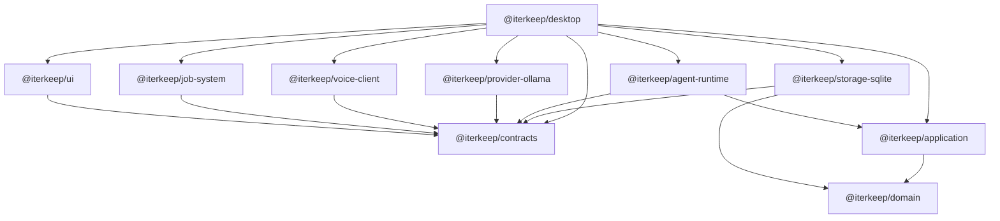

# Iterkeep — Monorepo Yapısı, Paket Sınırları, Kod Yerleşimi ve Build Sözleşmeleri

> **Normatif amaç:** Geliştirme ajanının herhangi bir özelliği nereye koyacağını, hangi paketten neyi import edebileceğini, hangi kodun hangi çalışma zamanı tarafından çalıştırılacağını ve repodan nasıl test/installer üretileceğini **dosya düzeyinde** belirlemek.
>
> **Sınır:** Bu dosya dizin ağacı, paket grafiği, adlandırma, sahiplik, build ve import kurallarında yetkilidir. İşlevsel gereksinimler `DOC-02`, teknoloji sürümleri `DOC-05`, çalışma zamanı akışları `DOC-06`, domain ve DTO'lar `DOC-08`, gerçek SQL `DOC-09`, DB komutları `DOC-10`, kesin IPC kanalları `DOC-11`, job/event state `DOC-12`, bileşen ve tokenlar `DOC-20–22`, test yaklaşımı `DOC-33`, release pipeline `DOC-34` tarafından sabitlenir. Aşağıdaki tipler **önerilen uygulama kalıbıdır**; ilerideki kanonik sözleşmeleri gölgede bırakmaz.
>
> **Kanıt düzeyi:** Belge tasarlanmış, dosya ağacı ve kurallar tanımlanmıştır. Henüz repo iskeleti oluşturulmamış, `npm ci`, Electron paketleme, native modül yükleme veya installer E2E testi çalıştırılmamıştır. Bu yüzden `draft` statüsündedir; `implemented` ya da `verified` denmez.

---

## 1. Değişmeyen temel repo ilkeleri (`REPO-I-001–016`)

| ID | Zorunlu kural | İhlal örneği |
|---|---|---|
| REPO-I-001 | Tek Git repo + npm workspaces + kökte **tek** `package-lock.json` | Her paketin bağımsız lockfile'ı |
| REPO-I-002 | Domain, Electron/React/Node/SQLite/Ollama bağımsız saf TypeScript | Domain içinde `electron` import'u |
| REPO-I-003 | İş kuralları `application` ve `domain` içinde tek kez yazılır | Agent ve UI farklı görev CRUD uygular |
| REPO-I-004 | Renderer yalnız web API ve açık preload metodlarını kullanır | Renderer'da `fs`, `node:child_process`, `better-sqlite3` |
| REPO-I-005 | Electron Main kompozisyon, pencere, IPC ve OS yetkilerinin sahibidir | React'ın subprocess başlatması |
| REPO-I-006 | SQLite'a `storage-sqlite` DB worker dışında bağlantı açılmaz | Main'de doğrudan `new Database()` |
| REPO-I-007 | Sidecar, Ollama ve Git entegrasyonları çekirdekten ayrılabilir adapter'lardır | AI SDK'sının domain paketinde olması |
| REPO-I-008 | Tek kaynak SQLite, Markdown ise transfer formatıdır | Markdown ve SQLite eşit/eşzamanlı canonical write |
| REPO-I-009 | Paketler birbirine yalnız `exports` üzerinden erişir | `../../some-package/src/private.ts` |
| REPO-I-010 | Döngüsel package ve feature bağımlılığı yasaktır | `application ↔ storage-sqlite` |
| REPO-I-011 | Tüm IPC/worker/sidecar sınırlarında çalışma zamanı doğrulaması vardır | Type assertion ile `unknown as Task` |
| REPO-I-012 | Unit testi co-located olabilir; uçtan uca ve performans testleri ayrıdır | E2E'nin uygulama kaynak dosyalarında tutulması |
| REPO-I-013 | Üretilen veri, indirilen modeller ve kullanıcı DB'si repoda / ASAR'da tutulmaz | `models/*.gguf` Git commit'i |
| REPO-I-014 | Bir paket yalnız gerçekten kullandığı bağımlılığı ilan eder | Tüm dependency'lerin root `dependencies` altında olması |
| REPO-I-015 | Derleme/paketleme yolu sabittir; dev ve packaged davranışı eşdeğerdir | `src/` relatif yolu nedeniyle prod'da bozulma |
| REPO-I-016 | Test kanıtı olmadan `done` denmez | Installer açılmadan 'release ready' ilanı |

İlkeler `DOC-00` içindeki P-01–P-12 ile ve `DOC-06` içindeki ARCH-I kurallarıyla birlikte uygulanır. Çatışma olduğunda `DOC-00 §6` karar hiyerarşisi geçerlidir; sessiz mimari ikame yapılmaz.

## 2. Repo kökü ve monorepo topolojisi

### 2.1 Kanonik üst dizin

```text
iterkeep/
├── .editorconfig
├── .gitattributes
├── .gitignore
├── .npmrc
├── .nvmrc
├── .prettierignore
├── .prettierrc.json
├── AGENTS.md                         # Ajana docs/00-README.md okuma talimatı
├── README.md                         # Kullanıcı ve geliştirici quickstart
├── LICENSE                           # Yayından önce karar/veri
├── SECURITY.md
├── CONTRIBUTING.md
├── package.json                       # Root scripts + workspaces, private:true
├── package-lock.json                  # TEK lockfile; npm ci için commit edilir
├── tsconfig.base.json
├── tsconfig.json                       # TypeScript project references
├── eslint.config.mjs
├── vitest.workspace.ts                 # Test projesi tanımları (sürüme uyumlu)
├── playwright.config.ts
├── .github/
│   ├── workflows/
│   │   ├── pr-checks.yml
│   │   ├── windows-package.yml
│   │   ├── nightly-bench.yml
│   │   └── release.yml
│   └── dependabot.yml                 # İsteğe bağlı kontrollü dependency PR
├── apps/
│   └── desktop/
├── packages/
│   ├── domain/
│   ├── contracts/
│   ├── application/
│   ├── storage-sqlite/
│   ├── import-export/
│   ├── search/
│   ├── git-adapter/
│   ├── agent-runtime/
│   ├── provider-ollama/
│   ├── voice-client/
│   ├── job-system/
│   ├── ui/
│   └── testing/
├── sidecars/
│   ├── stt-whisper/
│   ├── tts-ema/
│   └── manifests/
├── scripts/
│   ├── check-import-boundaries.mjs
│   ├── verify-artifact-layout.mjs
│   ├── verify-doc-links.mjs
│   ├── check-package-graph.mjs
│   ├── build-sidecar.mjs
│   ├── native-smoke.mjs
│   └── generate-sbom.mjs
├── tests/
│   ├── e2e/
│   ├── integration/
│   ├── fixtures/
│   ├── resilience/
│   ├── security/
│   └── performance/
├── docs/
│   ├── 00-README.md
│   ├── 01-PRODUCT-VISION.md
│   ├── 02-SCOPE-REQUIREMENTS.md
│   ├── 03-USER-JOURNEYS.md
│   ├── 04-QUALITY-GATES.md
│   ├── 05-STACK-DECISIONS.md
│   ├── 06-SYSTEM-ARCHITECTURE.md
│   ├── 07-REPO-STRUCTURE.md
│   └── 08-DOMAIN-MODEL.md ... 35-IMPLEMENTATION-PLAYBOOK.md
└── .artifacts/                      # Git ignored, CI test/benchmark evidence
```

**Açıklama:** Dizin ağacı hedef tasarımı gösterir; geliştirici tüm boş dizinleri ilk commit'te oluşturmak zorunda değildir. Bir paket, ilk gerçek kullanımda minimal iskelet ve test ile eklenir. `LICENSE` yayın öncesinde gerçekten seçilmiş lisans içermelidir; belirsiz bırakılıp sahte lisans seçilmez.

### 2.2 Uygulama dizininin tam yerleşimi

```text
apps/desktop/
├── package.json
├── tsconfig.json
├── tsconfig.main.json
├── tsconfig.preload.json
├── tsconfig.renderer.json
├── forge.config.ts
├── vite.main.config.ts
├── vite.preload.config.ts
├── vite.renderer.config.ts
├── index.html
├── assets/
│   ├── icon.ico
│   ├── icon.png
│   └── app-protocol/
├── src/
│   ├── main/
│   │   ├── index.ts                 # Electron Main, yalnız boot çağırır
│   │   ├── bootstrap/
│   │   │   ├── create-app.ts        # Composition root / DI
│   │   │   ├── bootstrap-state.ts   # BOOT-01..12 states
│   │   │   └── shutdown.ts          # Graceful shutdown
│   │   ├── window/
│   │   │   ├── create-window.ts
│   │   │   ├── lifecycle.ts
│   │   │   ├── permissions.ts
│   │   │   ├── protocol.ts
│   │   │   └── navigation-policy.ts
│   │   ├── ipc/
│   │   │   ├── register-handlers.ts
│   │   │   ├── ipc-gateway.ts
│   │   │   ├── validate-sender.ts
│   │   │   ├── route-registry.ts
│   │   │   └── event-subscriptions.ts
│   │   ├── db/
│   │   │   ├── spawn-db-worker.ts
│   │   │   ├── db-rpc-client.ts
│   │   │   └── db-worker-health.ts
│   │   ├── jobs/
│   │   │   └── register-job-runners.ts
│   │   ├── capabilities/
│   │   │   ├── capability-registry.ts
│   │   │   ├── setup-coordinator.ts
│   │   │   └── resource-manager.ts
│   │   ├── services/
│   │   │   ├── workspace-paths.ts
│   │   │   ├── diagnostics.ts
│   │   │   ├── updater.ts
│   │   │   └── asset-service.ts
│   │   └── security/
│   │       ├── csp.ts
│   │       ├── safe-url.ts
│   │       └── resource-allowlist.ts
│   ├── preload/
│   │   ├── index.ts                 # Tek contextBridge export
│   │   ├── client-api.ts            # Public, named methods
│   │   ├── invoke.ts                # Fixed channel only
│   │   └── subscribe.ts             # Whitelisted event subscription
│   ├── workers/
│   │   └── db.worker.ts             # Worker giriş noktası; DB tek sahibi
│   └── renderer/
│       ├── main.tsx
│       ├── app/
│       │   ├── App.tsx
│       │   ├── AppProviders.tsx
│       │   ├── Router.tsx
│       │   ├── ErrorBoundary.tsx
│       │   └── bootstrap-query.ts
│       ├── pages/
│       │   ├── DashboardPage.tsx
│       │   ├── ProjectsPage.tsx
│       │   ├── ProjectDetailPage.tsx
│       │   ├── SearchPage.tsx
│       │   ├── InboxPage.tsx
│       │   ├── ChatPage.tsx
│       │   ├── SetupPage.tsx
│       │   ├── SettingsPage.tsx
│       │   └── RecoveryPage.tsx
│       ├── features/
│       │   ├── projects/
│       │   ├── tasks/
│       │   ├── notes/
│       │   ├── decisions/
│       │   ├── logs/
│       │   ├── search/
│       │   ├── setup/
│       │   ├── ai-chat/
│       │   ├── voice/
│       │   ├── backup/
│       │   └── settings/
│       ├── shared/
│       │   ├── api/                  # window.iterkeep facade
│       │   ├── hooks/
│       │   ├── utils/
│       │   └── errors/
│       ├── stores/
│       │   └── ui-preferences.store.ts
│       ├── styles/
│       │   ├── index.css
│       │   └── token-overrides.css
│       ├── locales/
│       │   ├── tr-TR.json
│       │   └── en-US.json
│       ├── types/
│       │   └── global.d.ts
│       └── test/
│           ├── setup.ts
│           └── mocks/
└── out/                              # Git ignored, build output
```

Ayrıntıdaki `feature` alt klasörü `components/`, `hooks/`, `queries/`, `mutations/`, `__tests__/` içerebilir. Örneğin `features/tasks/components/TaskRow.tsx`, `features/tasks/hooks/useTasks.ts` ve `features/tasks/__tests__/task-row.test.tsx`. Klasörler kaynak kod büyüdüğünde açılır; boş klasör koleksiyonu oluşturulmaz.

### 2.3 Paket iç yerleşimleri ve somut dosya adları

```text
packages/
├── domain/
│   ├── package.json
│   ├── tsconfig.json
│   └── src/
│       ├── index.ts
│       ├── entities/{project,task,document,decision,activity}.ts
│       ├── value-objects/{ids,priority,status,timestamps}.ts
│       ├── events/{domain-event,event-types}.ts
│       ├── policies/{task-transitions,decision-version}.ts
│       └── errors/domain-error.ts
├── contracts/
│   ├── package.json
│   └── src/
│       ├── index.ts
│       ├── shared/{result,error-envelope,pagination}.ts
│       ├── ipc/{project,task,search,setup,agent,voice}.contracts.ts
│       ├── worker/{db-rpc,job}.contracts.ts
│       └── sidecar/{handshake,stt,tts}.contracts.ts
├── application/
│   ├── package.json
│   └── src/
│       ├── index.ts
│       ├── ports/{repositories,clock,id-factory,event-sink}.ts
│       ├── commands/{create-project,create-task,complete-task,add-log}.ts
│       ├── queries/{get-project,list-tasks,recent-activity}.ts
│       ├── services/{workspace-service,decision-service}.ts
│       └── errors/application-error.ts
├── storage-sqlite/
│   ├── package.json
│   ├── migrations/
│   │   ├── 0001_initial.sql
│   │   └── 0002_*.sql             # Yalnız gerçek onaylı migration
│   └── src/
│       ├── index.ts
│       ├── connection/{open-database,pragmas,migrate}.ts
│       ├── repositories/{project,task,document,decision,activity}.repository.ts
│       ├── search/{fts-index,queries}.ts
│       ├── operations/{backup,checkpoint,integrity}.ts
│       └── test/{temp-workspace,fixtures}.ts
├── import-export/
│   └── src/{index,markdown,manifest,validate,plan,render}.ts
├── search/
│   └── src/{index,normalize,parse-query,rank,search-service}.ts
├── git-adapter/
│   └── src/{index,git-client,git-policy,git-status}.ts
├── agent-runtime/
│   └── src/{index,run-manager,context-builder,tool-registry,policy,approval,audit}.ts
├── provider-ollama/
│   └── src/{index,ollama-client,health,models,pull,stream,tool-adapter}.ts
├── voice-client/
│   └── src/{index,sidecar-process,voice-protocol,stt-client,tts-client}.ts
├── job-system/
│   └── src/{index,job-manager,job-runner,queue,events,reconciliation}.ts
├── ui/
│   └── src/{index,styles/tokens.css,components,primitives,icons}.ts
└── testing/
    └── src/{index,factories,fixtures,fake-clock,ipc-harness}.ts
```

**Kısıt:** Yukarıda görünmesi için kullanılan `{foo,bar}` ve `*.sql` şablon anlatımıdır; literal dosya adı değildir. `DOC-08–12` sonrasında kesin DTO/DDL isimleriyle ağaç güncellenir. `ui` paketinin `src/index.ts` yolu React bileşenleri için `.tsx` modüllerini export edebilir; `ui` saf domain paketi değildir.

## 3. Paket manifest'leri, bağımlılık matrisi ve yönü

### 3.1 Kanonik `name` alanları

| Workspace | Package name | Runtime türü | Sorumluluk |
|---|---|---|---|
| `apps/desktop` | `@iterkeep/desktop` | Electron main, preload, renderer | OS composition + UI |
| `packages/domain` | `@iterkeep/domain` | Saf TS | Entity, policy, domain event |
| `packages/contracts` | `@iterkeep/contracts` | Ortak TS/Zod | IPC/worker DTO, error envelope |
| `packages/application` | `@iterkeep/application` | Saf TS + port | Use-case ve iş akışları |
| `packages/storage-sqlite` | `@iterkeep/storage-sqlite` | Node-only/native | SQL adapter, migration, backup |
| `packages/import-export` | `@iterkeep/import-export` | Node-only | Markdown/YAML transfer |
| `packages/search` | `@iterkeep/search` | Saf arama mantığı + port | Query/normalize/rank |
| `packages/git-adapter` | `@iterkeep/git-adapter` | Node-only | Sınırlı Git yürütme |
| `packages/agent-runtime` | `@iterkeep/agent-runtime` | Main tarafı Node | Agent orkestrasyonu ve politika |
| `packages/provider-ollama` | `@iterkeep/provider-ollama` | Main tarafı Node | Ollama HTTP adapter |
| `packages/voice-client` | `@iterkeep/voice-client` | Main tarafı Node | Voice sidecar IPC/process |
| `packages/job-system` | `@iterkeep/job-system` | Node | Queue, retry, progress |
| `packages/ui` | `@iterkeep/ui` | Renderer-only React | Ortak görsel bileşenler |
| `packages/testing` | `@iterkeep/testing` | Dev-only | Test fixtures/harness |

**Not:** `contracts` domain entity kopyası değildir. Sınırdan geçen sürümlü Zod DTO'ları `contracts` içinde; iş kuralının canonical modeli `domain` içinde bulunur. `application` dönüşümleri açık mapper ile yapar.

### 3.2 İzinli dependency grafiği



Şema **paket seviyesinde izinleri** gösterir; `desktop` çok çalışma zamanlı olduğundan aşağıdaki daha katı kaynak dizini kuralı geçerlidir. `domain` başkasını import etmez (yalnız genel amaçlı saf küçük yardımcılar gerekiyorsa ADR). `application`, storage implementasyonu değil repository **port**'unu bilir. `search` belirli bir SQLite connection import etmez. `storage-sqlite`, çalışma zamanı bağımsız contract kullanır; Electron paketi import etmez.

### 3.3 Dizin seviyesinde import matrisi (`allow` list)

| Kaynak | İzinli doğrudan import | Yasak |
|---|---|---|
| `packages/domain/src/**` | `@iterkeep/domain` içi | Electron, React, Node FS, SQL, application |
| `packages/contracts/src/**` | Zod + kendi saf modülleri; gerekliyse `domain` değer tipleri | Main/renderer/storage |
| `packages/application/src/**` | domain, ports, contracts DTO türleri | React, Electron, `better-sqlite3`, Ollama |
| `packages/storage-sqlite/src/**` | domain, contracts, `better-sqlite3`, Node | Electron main, UI |
| `packages/agent-runtime/src/**` | application, contracts, port tipleri | Ham SQL ve renderer kaynakları |
| `apps/desktop/src/main/**` | Node/Electron + backend paketleri | Renderer `src` içi component |
| `apps/desktop/src/workers/**` | storage-sqlite, contracts, Node | Electron window ve React |
| `apps/desktop/src/preload/**` | Electron IPC, contracts türleri/validatorları | `better-sqlite3`, FS, agent runtime |
| `apps/desktop/src/renderer/**` | ui, contracts, named preload API | `node:*`, Electron, storage, provider sidecar |
| `packages/ui/src/**` | React, contracts için UI DTO türleri | Main, Node FS, SQLite, child_process |
| `sidecars/**` | Kendi runtime manifest/protokolü | Node workspaces'e gizli runtime bağımlılığı |

**Kritik:** `desktop` manifest'inde storage paketi dependency olarak görünmesi, renderer'ın onu import edebileceği anlamına **gelmez**. Bunun için statik sınır testi ve renderer bundle taraması zorunludur.

### 3.4 Yasak örnekler ve düzeltilmiş sürümleri

```ts
// YASAK: renderer'dan native DB
import Database from 'better-sqlite3';
const db = new Database('workspace.db');

// DOĞRU: renderer'dan dar IPC client
const result = await window.iterkeep.tasks.create({ projectId, title });
```

```ts
// YASAK: application uygulaması storage implementasyonunu kendisi oluşturuyor
import { SqliteTaskRepository } from '@iterkeep/storage-sqlite';

// DOĞRU: application sadece port bilir
export interface TaskRepository {
  findById(id: string): Promise<unknown>;
  // Kesin entity/DTO tipleri DOC-08'de tanımlanır.
}
```

```ts
// YASAK: agent işi gizli ayrı mutasyon yolu üzerinden yapıyor
await connection.prepare('UPDATE tasks SET done = 1').run(taskId);

// DOĞRU: policy'den sonra aynı application komutu
await application.commands.completeTask({ taskId }, actorContext);
```

**Kod örnekleri temsili:** `DOC-08`, `DOC-11` tamamlandıktan sonra gerçek `projectId` tipi ve `window.iterkeep` metot adları kesinleştirilir.

## 4. Dosya sahipliği ve katman sınırları

| İş / değişiklik | Yetkili dosya/konum | Çalıştıran süreç | Tek sahiplik kuralı |
|---|---|---|---|
| Kullanıcı pencere açılışı | `main/bootstrap`, `main/window` | Main | DB işlemi içermez |
| IPC request güvenlik kapısı | `main/ipc` | Main | Named allowlist + validate sender |
| Proje/görev iş mantığı | `packages/application` | Main use-case | Agent/UI aynı use-case |
| Domain invariants | `packages/domain` | Her uyumlu TS runtime | I/O yok |
| DB connection/transaction | `packages/storage-sqlite` | **DB worker** | Tek bağlantı sahibi |
| DB worker spawn/restart | `main/db` | Main | Electron Main'de doğrudan SQL yok |
| Worker iç RPC dispatch | `workers/db.worker.ts` + storage adapter | Worker | Ham SQL RPC yok |
| Setup kullanıcı tercihi | `main/capabilities` → application | Main / DB worker | Tercih vs sağlık ayrı |
| Ollama HTTP | `packages/provider-ollama` | Main, job koordinasyonunda | Core startup'a bağlanmaz |
| Agent araç/policy | `packages/agent-runtime` | Main/ayrı job | İzin mekanizması atlanmaz |
| Git komutları | `packages/git-adapter` | Main/job | İsteğe bağlı, path onaylı |
| Audio binary çalıştırma | `packages/voice-client` | Main/process | Renderer child spawn yapmaz |
| Ortak görsel tokenlar | `packages/ui/src/styles/tokens.css` | Renderer | Tek token kaynağı |
| Features görünüm state'i | `renderer/features` | Renderer | Canonical business state DB'de |
| Job durable state | `packages/job-system` → application repo | Main / DB worker | Kalıcı işler transaction üzerinden |
| İçe/dışa aktarım | `packages/import-export` | Background job | DB mutasyonu application ile |
| Backup ve recovery | application service + storage adapter | Main / DB worker | Üzerine yazmadan önce doğrula |

### 4.1 Feature oluştururken izleyeceğin karar ağacı

1. Bu değişiklik iş kuralı mı? → `domain` veya `application`.
2. Veri saklama/sorgu mu? → `storage-sqlite`, ama API domain port'u üzerinden.
3. Yeni sınır/veri alışverişi mi? → DTO `contracts`; kesin IPC method `DOC-11`.
4. Uzun süren ya da iptal edilebilir iş mi? → `job-system` ve main composition.
5. Harici binary/provider mı? → ilgili adapter ve capability registry.
6. Görsel bileşen mi? → ortaksa `ui`, tek feature'a özgüyse `renderer/features/*`.
7. Ekran navigasyonu mu? → `renderer/app/Router.tsx`, `pages/`.
8. Değişiklik yeni bağımlılık mı getiriyor? → package ownership + lockfile + security + POC.

Her PR açıklamasında bu karar ağacına göre seçilen modülün gerekçesi en az bir cümleyle yer alır.

## 5. Root package, workspace ve package contract

### 5.1 Kök `package.json` taslağı

```json
{
  "name": "iterkeep-repo",
  "private": true,
  "version": "0.0.0-development",
  "workspaces": ["apps/*", "packages/*"],
  "engines": { "node": ">=24 <25" },
  "scripts": {
    "dev": "npm run dev -w @iterkeep/desktop",
    "build": "npm run build -w @iterkeep/desktop",
    "make": "npm run make -w @iterkeep/desktop",
    "typecheck": "tsc -b",
    "lint": "eslint .",
    "lint:boundaries": "node scripts/check-import-boundaries.mjs && node scripts/check-package-graph.mjs",
    "format:check": "prettier --check .",
    "format:write": "prettier --write .",
    "test": "vitest run",
    "test:e2e": "playwright test",
    "test:integration": "vitest run tests/integration",
    "test:resilience": "vitest run tests/resilience",
    "test:security": "vitest run tests/security",
    "test:performance": "node tests/performance/run-benchmarks.mjs",
    "verify:docs": "node scripts/verify-doc-links.mjs",
    "verify:artifact": "node scripts/verify-artifact-layout.mjs",
    "verify": "npm run typecheck && npm run lint && npm run lint:boundaries && npm run format:check && npm run test"
  }
}
```

**Bu dosya çalışır proje iddiası değildir.** Paketler, script hedefleri ve test config'leri oluşturulup `npm run verify` ile doğrulanana kadar örnek sözleşmedir. `vitest run tests/integration` kullanımının seçilen Vitest yapılandırmasında doğru klasörü filtrelediği ayrıca test edilecektir. Node major ve tam sürüm pinleri `DOC-05` yetkisindedir.

### 5.2 `apps/desktop/package.json` asgari şablonu

```json
{
  "name": "@iterkeep/desktop",
  "version": "0.1.0",
  "private": true,
  "main": ".vite/build/main.js",
  "scripts": {
    "dev": "electron-forge start",
    "build": "electron-forge package",
    "make": "electron-forge make"
  },
  "dependencies": {
    "@iterkeep/contracts": "0.1.0",
    "@iterkeep/application": "0.1.0",
    "@iterkeep/storage-sqlite": "0.1.0"
  }
}
```

**Önemli:** `"main": ".vite/build/main.js"` ve Forge çıktısı yalnız `POC-STACK-001` için önerilen düzen örneğidir. Forge/Vite seçili tam sürümlerinde ortaya çıkan path farklıysa **doğrulanmış path** referans alınır ve belgenin manifest kısmı güncellenir. Gerçek `dependencies` tablosu uygulamada kullanılan tüm backend/renderer workspace ve 3. parti paketleri içerecek; burada kısaltılmıştır. Workspaces içindeki bağımlılık sürümleri aynı repo package version'ıyla tutarlı tutulur; `workspace:*` protokolüne otomatik geçiş yapılmaz (`DOC-05`: npm workspaces).

### 5.3 Her paketin minimal manifest sözleşmesi

```json
{
  "name": "@iterkeep/domain",
  "version": "0.1.0",
  "private": true,
  "type": "module",
  "sideEffects": false,
  "types": "./dist/index.d.ts",
  "exports": {
    ".": {
      "types": "./dist/index.d.ts",
      "import": "./dist/index.js"
    }
  },
  "files": ["dist"]
}
```

`domain`, `application` ve `contracts` için ESM temelli çıktı tercih edilir. Ancak Electron Main/worker'ın üretim ortamında ESM/CJS yükleme uyumluluğu `POC-STACK-001/002` ile doğrulanmadan varsayılmaz. Native `better-sqlite3` adapter package manifest'i kendi Node/Electron runtime gereksinimini ilan eder. Kütüphane doğrudan Node ile kullanılacaksa `tsc` çıktısı Node resolution için gerçek `.js` uzantılarını içermeli veya bundler buna göre yapılandırılmalıdır.

### 5.4 Workspace import standardı

```ts
// İzinli public import
import type { ProjectId } from '@iterkeep/domain';

// YASAK private / deep import
import type { ProjectId } from '../../../packages/domain/src/value-objects/ids';
```

`exports` dışına erişim yapılmaz; testlerin internal kodu zorunlu olarak kullanması gerekiyorsa `package.json`'a `./testing` alt export eklenir. Bu export üretimde kullanılamaz ve lint policy ile sınırlandırılır.

## 6. TypeScript projesi, derleme sırası ve runtime ayrımı

### 6.1 Temel `tsconfig.base.json`

```json
{
  "compilerOptions": {
    "target": "ES2022",
    "strict": true,
    "noUncheckedIndexedAccess": true,
    "exactOptionalPropertyTypes": true,
    "noFallthroughCasesInSwitch": true,
    "noImplicitOverride": true,
    "forceConsistentCasingInFileNames": true,
    "useUnknownInCatchVariables": true,
    "skipLibCheck": true,
    "declaration": true,
    "sourceMap": true,
    "composite": true
  }
}
```

`skipLibCheck:true` üçüncü taraf declaration dosyaları için pratik bir tercihtir; `strict`'in yerini almaz. Her paket kendi `module`, `moduleResolution`, `lib`, `types`, `rootDir`, `outDir` değerlerini açıkça tanımlar. Tek `tsconfig` ile Node, browser, Electron preload ve sidecar uyumsuz modlarını birbirine karıştırmak yasaktır.

### 6.2 Project reference örneği

```json
{
  "files": [],
  "references": [
    { "path": "./packages/domain" },
    { "path": "./packages/contracts" },
    { "path": "./packages/application" },
    { "path": "./packages/storage-sqlite" },
    { "path": "./packages/search" },
    { "path": "./packages/job-system" },
    { "path": "./packages/agent-runtime" },
    { "path": "./apps/desktop" }
  ]
}
```

Bu örnek eksiksiz değildir; oluşturulmuş her TS workspace kendi referansını ekletir. Referans sırası döngü içermemeli, `tsc -b --dry`/CI kontrolünde graf sağlam olmalıdır. `--dry` desteği seçilen TS sürümünde kontrol edilmeden CI'ya körlemesine eklenmez.

### 6.3 Node ile browser tiplerinin karışmasını önleme

- `renderer` için `lib: ["DOM", "DOM.Iterable", "ES2022"]`, `types` yalnız renderer'a gereken test/Vite tipleri.
- `main` ve `workers` için Node/Electron tipleri; `DOM` ancak açık gerekçeyle.
- `preload` için en dar Electron + Node tipleri ve kesin allowlisted import'lar.
- Domain için Node globals (`process`, `Buffer`) ve DOM global'leri yok.
- Electron renderer'da TypeScript'in Node tipini kazara görebilmesi **yetki vermez**; statik import ve runtime sandbox testleri gerekir.

### 6.4 `dist/`, `out/`, `.vite/` stratejisi

- Kütüphaneler: `packages/*/dist/`; üretim kodu Git'e girmez.
- Forge: `.vite/` ve `apps/desktop/out/` build artefaktıdır; Git'e girmez.
- Test sonuçları: `.artifacts/`, `test-results/`, `playwright-report/` Git ignore edilir.
- `src/` ile `dist/` karşılıklı import edilmez; yalnız package public export kullanılır.
- Üretilen source map'ler normal çalışma paketinde mutlak kullanıcı dosya yolları veya hassas bilgiler içermez; release policy `DOC-34`.

## 7. Electron Main, preload, renderer ve DB worker giriş sözleşmesi

### 7.1 Main entry: mümkün olan en ince composition

```ts
// apps/desktop/src/main/index.ts — iskelet; gerçek boot implementasyonu DOC-06.
import { app } from 'electron';
import { createApplication } from './bootstrap/create-app.js';

const hasLock = app.requestSingleInstanceLock();
if (!hasLock) {
  app.quit();
} else {
  app.whenReady().then(() => createApplication()).catch((error: unknown) => {
    // Güvenli local diagnostic + recovery UI; kullanıcı verisini sıfırlama yok.
    // Hata bildiriminin gerçek yolu DOC-32'de belirlenir.
    reportBootstrapFailure(error);
  });
}

declare function reportBootstrapFailure(error: unknown): void;
```

`reportBootstrapFailure` ve dosyadaki beyan **pseudocode** yer tutucusudur. Üretimde böyle boş declaration bırakmak veya `catch` ile hatayı gizlemek yasaktır. Sözleşme: main entry sadece single-instance, lifecycle ve composition root başlatır; on binlerce satır iş mantığı içermez.

### 7.2 Preload: geçişli generic IPC yasak

```ts
// Örnek conceptual shape; kesin isimler DOC-11'e göre üretilecek.
interface IterkeepPublicApi {
  projects: {
    list(): Promise<unknown>;
    create(input: unknown): Promise<unknown>;
  };
  tasks: {
    create(input: unknown): Promise<unknown>;
  };
}

// YASAK:
// contextBridge.exposeInMainWorld('electron', ipcRenderer);
// contextBridge.exposeInMainWorld('iterkeep', { send: (channel, x) => ipcRenderer.send(channel, x) });
```

Preload raw event nesnelerini renderer'a geçirmez, callback aboneliğinde unsubscribe döndürür, allowlist olmayan channel için köprü sunmaz. Sayfa güvenliği: `contextIsolation: true`, `sandbox: true`, `nodeIntegration: false`, sıkı CSP. Preload tarafının `sandbox` etkisi POC ile gerçek paketlenmiş Electron'da test edilir.

### 7.3 Renderer state ve import sınırı

```text
React UI
  ├─ TanStack Query: server-like canonical snapshot → IPC query
  ├─ Zustand: panel/sidebar, ephemeral view state
  ├─ local component state: input focus, drafts, toggles
  └─ browser-safe ui components/tokenlar
```

Renderer hiçbir zaman `SQLite` bağlantısını kurmaz; `localStorage` kanonik proje verisi için kullanılmaz. Tema kısa süreli bootstrap cache'i olabilir ama DB ayarının yerine geçemez. Sadece `result.ok=true` ve durable DB acknowledgment sonrası kalıcı kayıt için başarı bildirimi çıkar.

### 7.4 DB worker'ın yerleştirilmesi ve paketlenmesi

```text
apps/desktop/src/main/db/spawn-db-worker.ts
   ↓ starts Worker with validated absolute bundled path
apps/desktop/src/workers/db.worker.ts
   ↓ imports @iterkeep/storage-sqlite via package export
packages/storage-sqlite/src/connection/open-database.ts
   ↓ better-sqlite3 native module (ASAR unpack / rebuilt Electron ABI)
SQLite workspace file
```

- Worker yolu `app.getAppPath()` veya `__dirname`'e kontrolsüz `../../src` eklenerek bulunmaz.
- Worker için **gerçek build entry** Forge plugin / bundler'da beyan edilir; çıktı path'i manifest'e yazılır.
- Üretimde worker'ın kullanılacağı path `exists` + build smoke ile doğrulanır; `out/` içindeki mutlak kaynak klasörü kullanılmaz.
- Native `.node` Electron ABI için yeniden derlenir; paket açılırken aynı `.node` yolunun yüklendiği smoke test yapılır.
- Worker RPC, **named repository operation** ve doğrulanmış DTO kullanır; dışarıdan SQL metni alınmaz.
- Worker crash, otomatik sahte ACK'e dönüştürülemez; devreye alınan işlem pending/unknown ise yeniden durum sorgulanır.

### 7.5 Worker bundling ve fallback kararı

`@electron-forge/plugin-vite` yalnız main/preload/renderer girişlerini yapılandırmış olmak worker'ı otomatik paketler demek değildir. `db.worker.ts` için ayrı derleme hedefi tanımlanacak ve paket içinde oluştuğu `verify-artifact-layout` testinde doğrulanacaktır. Eğer Forge Vite V1 kombinasyonu bunu güvenli şekilde sağlayamıyorsa, worker için Node hedefli bağımsız `tsc`/Vite build aşaması eklenir. Bu ayrı build adımı **documented ADR amendment** ve POC ile belirlenir; üretimde kaynak `.ts` dosyasını çalıştırma kestirmesi yasaktır.

## 8. Feature dikey kesitleri: uçtan uca dosya eşlemesi

### 8.1 `CreateTask` kesiti

| Aşama | Sorumlu dosya grubu | Beklenen sınır |
|---|---|---|
| Kullanıcı formu | `renderer/features/tasks` | UI validation ve bekleme durumu |
| API client | `renderer/shared/api` | Named preload method |
| Public DTO | `contracts/src/ipc/task.contracts.ts` | Zod request/response |
| IPC handler | `main/ipc/route-registry.ts` | Sender + schema + limit |
| Use case | `application/src/commands/create-task.ts` | Domain validation + repo port |
| Entity/policy | `domain/src/entities/task.ts` | Değişmez iş kuralı |
| Worker RPC | `main/db/db-rpc-client.ts` | Correlation + timeout |
| Adapter | `storage-sqlite/src/repositories/task.repository.ts` | Prepared SQL, transaction |
| DB | workspace SQLite | Commit + canonical ID |
| Event | `job-system` / main event broker | Commit sonrası invalidation |
| UI sonucu | Query invalidation / cache | ACK sonrası başarı göster |

Testler: domain invariants → use-case fake repository → DB integration → IPC security → renderer UI → packaged E2E. Kesin iş gereksinimleri `DOC-13`.

### 8.2 Agent `tasks.create` kesiti

```text
renderer/features/ai-chat (input)
 → main IPC run request
 → agent-runtime/run-manager
 → provider-ollama (tool proposal; model output is untrusted)
 → agent-runtime/policy + approval
 → application.commands.createTask
 → DB worker + storage-sqlite
 → persisted tool invocation/result
 → event subscription/streamed user-visible tool log
```

Agent'ın kendine özgü SQL yolu açması yasaktır. Approval anahtarı renderer'da `approved:true` bayrağı değildir; server/main-owned operation digest ile ilişkili olmalıdır (`DOC-27`). Kullanıcı chat'i kapatsa bile sürmekte olan izinli işin UI ve job yaşam döngüsü `DOC-12`'ye tabidir.

### 8.3 Sesli görev kesiti

```text
renderer/features/voice (mic click/permission)
 → main voice session coordinator
 → voice-client sidecar process protocol
 → whisper.cpp or verified STT binary
 → editable transcript renderer state
 → explicit user accept / send-to-agent or quick-task
 → Application Core → DB Worker
```

Yalnız bir `mic` tıklaması sesin doğrudan kalıcı görev olarak yazılması anlamına gelmez. Ses ham verisi varsayılan olarak kalıcı kaydedilmez; dosya TTL, izin ve iptal sözleşmesi `DOC-28` yetkisindedir. TTS, metin yanıtının tamamlanma koşulu değildir.

### 8.4 Markdown transfer kesiti

```text
User selects import/export
 → scoped file picker in Main
 → import-export adapter validates & previews
 → Application Core transaction or snapshot
 → SQLite DB worker
 → deterministic export folder / no silent git push
```

Export edilebilen alanların kesin şeması `DOC-16`. Canlı SQLite DB ve Git arasında merge yapılmaz. Yedekleme işlemi `DOC-17`'deki SQLite backup API akışını takip eder.

## 9. Sidecar kodu, manifest ve optional dağıtım

### 9.1 Sidecar klasörleri

```text
sidecars/
├── stt-whisper/
│   ├── README.md
│   ├── build/                 # ignored
│   ├── patches/               # yalnız gerekçeli vendor yaması
│   └── manifest.template.json
├── tts-ema/
│   ├── README.md
│   ├── requirements.lock       # hash/sürüm sabitlemesi; format kanıtlı
│   ├── service/
│   │   ├── __init__.py
│   │   ├── main.py
│   │   ├── protocol.py
│   │   └── synthesis.py
│   └── tests/
│       └── test_protocol.py
└── manifests/
    ├── protocol-version.json
    ├── provider-catalog.json
    └── checksum-policy.md
```

Sidecar modeli/binary'si otomatik **repo dependency** değildir. Model manifest'i sürüm, kaynak, SHA-256, lisans, platform/architecture, disk boyutu, minimum runtime ve download permission bilgisi içerir. Yerel binary `app.getPath('userData')` altında kontrollü dizinde tutulur; kullanıcıya ait workspace içine karışmaz.

### 9.2 Sidecar güven sınırı

- Child process **shell metin komutu** şeklinde başlatılmaz; executable path ve argv ayrı verilir, `shell:false`.
- Binary hash doğrulama yapılmadan çalıştırılmaz; izinli dizin dışı path kabul edilmez.
- STDOUT protokol kanalıysa diagnostic log ayrı STDERR'a yazılır.
- JSONL mesajları size limit, request ID ve schema sürümü taşır; user input satırlarını komut olarak yorumlamaz.
- Sidecar çökmesi Chat/Task/SQLite için `core failed` anlamına gelmez.
- Stop/timeout, stray subprocess temizliği ve kaynak sınırlamaları `DOC-29/32`'de detaylanır.
- Python ve GPU toolkit son kullanıcı için **çekirdek uygulama ön şartı olamaz**; etkinleşen ses özelliğine özel yönetilen runtime gerekir.

### 9.3 Kaynakların lazily yüklenmesi

`provider-ollama`, `voice-client` ve büyük UI chat/voice parçaları **ilk ekranda import edilmez**. Main capability servisleri model kontrolünü BOOT-11'den önce zorla başlatmaz. Renderer `ChatPage` ve ses bileşenleri route-based code splitting kullanır. İlk açılış JS bundle bütçesi `DOC-31`'de ölçülür.

## 10. Kalıcı kullanıcı verisi, workspace ve build artefaktları

### 10.1 Repository ile kullanıcı verisini ayır

```text
# Örnek kullanıcı profili; gerçek yol platform servisinden alınır.
<UserData>/Iterkeep/
├── application-settings.json       # Yalnız bootstrap için gereken minimum metadata
├── diagnostics/
├── capabilities/
│   ├── model-manifests/
│   ├── stt/
│   └── tts/
└── workspaces/
    └── <workspace-id>/
        ├── workspace.db
        ├── assets/
        ├── backups/
        └── exports/
```

**Not:** Fiziksel `userData` kökünün tam isimlendirmesi Electron ürün kimliği tarafından belirlenecek; burada `Iterkeep` yalnız mantıksal örnektir. Kullanıcı farklı workspace dizini seçebilir. `application-settings.json` SQLite'ın ikinci gerçek kaynağı değildir; sadece son workspace locator, erken tema/dil tercihi gibi bootstrap için gerekli minimal bilgiyi tutar. Kalıcı iş verisi DB'dedir. Önceden var olduğu bilinen workspace bulunamıyorsa sessizce boş DB oluşturmak yasaktır.

### 10.2 `.gitignore` asgari kapsamı

```gitignore
node_modules/
**/dist/
**/.vite/
**/out/
coverage/
.artifacts/
test-results/
playwright-report/
**/*.tsbuildinfo
*.log
.env
.env.*
!.env.example
*.db
*.db-wal
*.db-shm
*.sqlite
*.sqlite3
sidecars/**/build/
sidecars/**/.venv/
__pycache__/
*.py[cod]
models/
model-cache/
```

Repo içinde test fixture'ı olarak küçük, anonimleştirilmiş veritabanı gerekirse `tests/fixtures/` altı için **dar istisna** yazılır ve hassas veri denetimi gerekir. Genel `*.db` ignore'ı altında gerçek kullanıcı verisi hiçbir koşulda commit edilmez.

### 10.3 Sürümden bağımsız veri yolu

- Development: test workspace'i kullanıcı gerçek DB'sinden farklı olmalı; `ITERKEEP_TEST_USERDATA` gibi açık yalnız-development override.
- E2E: her test için izole geçici userData ve unique workspace; test bittiğinde cleanup.
- Production: kullanıcı tarafından seçilen workspace path'i canonicalize ve yetki doğrulamasından geçer.
- Update: binary değiştirilirken workspace yerinde korunur; migration `DOC-17` sürecini takip eder.
- Restore: yeni/saf dizine güvenli restore ya da açıkça onaylanmış swap; kaynak DB üzerinde yarım restore yok.

## 11. Adlandırma, kaynak boyutu ve modülerlik kuralları

### 11.1 Dosya adları

| Tür | Şablon | Örnek |
|---|---|---|
| React component | `PascalCase.tsx` | `TaskRow.tsx` |
| Hook | `useX.ts` | `useTasks.ts` |
| Store | `kebab-case.store.ts` | `ui-preferences.store.ts` |
| Use case | `verb-noun.ts` | `complete-task.ts` |
| Repository | `noun.repository.ts` | `task.repository.ts` |
| Zod contract | `noun.contracts.ts` | `task.contracts.ts` |
| Test | `*.test.ts(x)` | `create-task.test.ts` |
| E2E | `*.spec.ts` | `setup-no-ai.spec.ts` |
| SQL migration | `NNNN_description.sql` | `0001_initial.sql` |
| Build scripts | `kebab-case.mjs` | `native-smoke.mjs` |
| Public barrel | `index.ts` | `packages/domain/src/index.ts` |

### 11.2 Dosya büyümesi için kod inceleme bütçesi

- Yaklaşık **300 satırı** geçen servis/component için bölünme değerlendirilir; bu katı teknik limit değil, refactor uyarısıdır.
- Uzun JSX koşulları feature-level hooks veya alt bileşene ayrılır; gereksiz wrapper oluşturulmaz.
- `utils.ts`, `helpers.ts`, `misc.ts`, `index.ts` gibi her şeyi toplayan dosyalar dev hizmet deposuna dönüştürülemez.
- `index.ts` yalnız açık public export; side effect ile DB/sidecar başlatamaz.
- Kullanılmayan veya örnek amaçlı kütüphane `dependencies` listesinde tutulmaz.
- Barrel import yüzünden main'e renderer veya renderer'a Node transitif gelmemelidir.

### 11.3 React performansı için dosya organizasyonu

- Route'lar dinamik import ile ayrılır.
- Uzun görev listesi ve loglar sanallaştırılır.
- Ağır Markdown parse/indexleme renderer render zincirinden uzak tutulur.
- React Query cache key'leri tek factory üzerinden yönetilir; UI state ile DB state kopyalanmaz.
- `packages/ui` tasarım tokenları CSS değişkenlerinden beslenir; her bileşen kendine tema rengi icat etmez.
- Bundle analyzer sonucu `.artifacts/performance/` altında yayın kanıtı olarak tutulur.

## 12. Test klasörleri ve fixtür stratejisi

### 12.1 Test katmanı ve yeri

| Katman | Konum | Gerçek bağımlılık |
|---|---|---|
| Domain unit | `packages/domain/src/**/*.test.ts` | Saf bellek |
| Use-case unit | `packages/application/src/**/*.test.ts` | Fake repository/clock |
| SQL integration | `tests/integration/storage-sqlite/` | Geçici gerçek SQLite |
| IPC boundary | `tests/security/ipc/` | Electron test harness / paketli smoke |
| UI component | `apps/desktop/src/renderer/**/__tests__/` | React Testing Library |
| E2E | `tests/e2e/` | Gerçek Electron launch |
| Crash/resilience | `tests/resilience/` | Worker kill, disk fault inject |
| Performance | `tests/performance/` | Sabit fixture ve ölçüm |
| Sidecar protocol | `sidecars/*/tests/` | Stub veya gerçek sidecar |

### 12.2 Fixture dosyalarının sahibi

```text
tests/fixtures/
├── markdown/
│   ├── valid-project/
│   ├── malicious-path-traversal/
│   └── malformed-frontmatter/
├── sqlite/
│   └── schema-fixtures/          # Kurulu gerçek şemadan üretilir
├── fake-ollama/
│   └── responses/
├── fake-sidecar/
│   └── protocol-messages/
└── data-generators/
    ├── seed-projects.ts
    ├── seed-tasks.ts
    └── seed-logs.ts
```

Kullanıcıya ait gerçek verilerin anonimleştirilmeden test fixture olarak eklenmesi yasaktır. Performans fixture'ları `DOC-31` tarafından kesin büyüklüklerle tanımlanacak. Fixture üreticileri deterministik sabit seed kullanır; saat, zaman dilimi ve locale ayarlanabilir olmalı.

### 12.3 Test adlarının izlenebilirliği

Örnek:

```ts
it('AC-001 / REQ-...: AI olmadan workspace oluşturur', async () => {
  // test implementation; gerçek gereksinim ID DOC-02'den alınmalı
});
```

Test adındaki `REQ-...` yer tutucu gerçek test commit'inde **kalmaz**. `DOC-02` gereksinim numaraları ve `DOC-04` kalite kapıları CI için makine tarafından izlenebilir metadata üretir. `G0/G1/G2` kapısı hangi testin neyi doğruladığını görmelidir.

## 13. Statik mimari denetimler ve CI kapıları

### 13.1 `scripts/check-import-boundaries.mjs`

Zorunlu kurallar:

1. `renderer/**` altından `node:*`, `electron`, `better-sqlite3`, `@iterkeep/storage-sqlite`, `@iterkeep/provider-ollama`, `@iterkeep/voice-client` import edilirse **fail**.
2. `domain/**` altından React, Electron, Node, application, storage import edilirse **fail**.
3. `application/**` altından somut `storage-sqlite` import edilirse **fail**.
4. `preload/**` altından `storage-sqlite`, `fs`, `child_process` import edilirse **fail**.
5. `storage-sqlite` dışından `better-sqlite3` import edilirse **fail**. Worker `storage-sqlite` public API kullanır.
6. Paket dışına `../../` ile deep import veya `@iterkeep/foo/src/...` kullanımı **fail**.
7. `apps/desktop/src/main` ve `workers` dışında OS process spawn API'si kullanımı **fail**; ilgili adapter izinleriyle sınırlandırılır.
8. Döngüsel package dependency **fail**.
9. Re-export zinciri üzerinden yasağın dolanılması dependency graph analizinde **fail**.

Bu kontrol sadece düz metin grep ile yapılmaz; TypeScript AST veya uygun dependency graph tool ile **import, re-export, dynamic import, require** taranır. Build çıktısındaki renderer bundle da Node/native modül sızıntısı bakımından ayrıca taranır.

### 13.2 `scripts/check-package-graph.mjs`

- `npm workspaces` listesi ve gerçek `packages/*`/`apps/*` manifestlerinin birebir eşleşmesini doğrular.
- Her internal dependency'nin manifestte ve `exports` altında varlığını kontrol eder.
- `domain` için ters bağımlılık olmadığını doğrular.
- Lockfile ile ilan edilmiş dependency graph tutarsızsa fail.
- Döngü, yasak private deep import ve gereksiz broad dependency değişikliği için rapor üretir.

### 13.3 `scripts/verify-artifact-layout.mjs`

Paketlenmiş uygulamada doğrulanması gerekenler:

- Main entry gerçek yoluyla yüklenir.
- Preload dosyası vardır ve named API bridge çalışır.
- Renderer HTML/JS/CSS doğru protocol/origin üzerinden açılır.
- DB worker gerçek bundle içinden başlar.
- `better-sqlite3.node` ASAR dışında/yüklenebilir konumda bulunur; ABI uyumludur.
- Kullanıcı DB dizini writable olup installer içindeki read-only kaynaklara yazılmaz.
- Ollama/STT/TTS **kurulu olmadığında** zorunlu dosya referansı yüzünden app çökmez.
- App start tek instance, safe navigation, restrictive CSP testlerinden geçer.

Yalnız dosyanın var olduğunu kontrol etmek yeterli değildir: `native-smoke.mjs` gerçek DB açma, transaction ve okuma testi yapar. Windows temiz VM E2E, testin zorunlu ikinci kanıtıdır (`DOC-05 POC-STACK-001/002`, `DOC-04`).

### 13.4 Önerilen PR CI iş zinciri

```text
npm ci
 ├─ format:check
 ├─ lint + lint:boundaries
 ├─ typecheck
 ├─ test (unit/integration)
 ├─ test:security
 └─ docs link / traceability check

windows-package:
 ├─ Electron native rebuild
 ├─ forge package/make
 ├─ verify-artifact-layout
 ├─ native-smoke
 └─ packaged Electron smoke/e2e

release:
 ├─ version/license/SBOM/provenance
 ├─ signed artifact when signing configured
 ├─ clean-user-profile install and run
 └─ manual release approval gate
```

Bu **iş grafiğidir**, çalışır GitHub Actions YAML'si değildir. Gerçek action sürümü, permissions, signing, artifact retention ve release yetkileri `DOC-34` tarafından verilir. Testlerin başarı kriterleri `DOC-04`, performans bütçeleri `DOC-31` yetkisindedir.

## 14. Repo gizlilik, tedarik zinciri ve yayın güvenliği

- API key, token, kişisel workspace, model session logları ve ham konuşma kayıtları Git'e **asla** dahil edilmez.
- `.env.example` yalnız dummy değerler ve açıklamalardır; uygulama gerçek sır olmadan temel işlevini sürdürür.
- Üçüncü taraf model/binary indirmeleri kullanıcı yetkisi + doğrulanmış metadata + lisans kontrolü gerektirir.
- `postinstall` script'leri ve native binary'lerin etkisi dependency güncelleme sırasında incelenir.
- Electron renderer CSP ve safe navigation testleri CI'da doğrulanır.
- Update servisi kapalı/erişilemez olsa da çekirdek çalışır; otomatik ağ istekleri kullanıcı tercihine tabidir.
- Kullanıcı dosyaları `app.asar` veya Git repo kökü altına yazılmaz.
- Özel üretim telemetry endpoint'i V1 zorunlu değildir; loglar yerel ve redakte tutulur.
- `AGENTS.md` üretim modüllerine atlama için bir backdoor değildir; doküman okuma sırası ve kalite kapıları geçerlidir.

## 15. Geliştirme ajanı için yürütülebilir uygulama sırası (`REPO-WP-*`)

| Paket | Yapılacak iş | Ön şart | Kanıt |
|---|---|---|---|
| REPO-WP-001 | Kök manifest, npm workspace, TypeScript, lint ve format | DOC-05 sürüm kararı | `npm ci`, `typecheck`, `lint` |
| REPO-WP-002 | Saf `domain` + test | DOC-08 | Domain unit tests |
| REPO-WP-003 | `contracts` + runtime validation | DOC-08/11 | DTO boundary tests |
| REPO-WP-004 | `application` ports ve ilk use-case | DOC-08/13 | Mock repository use-case tests |
| REPO-WP-005 | `storage-sqlite` + DB worker + migration | DOC-09/10 | Native SQLite worker integration |
| REPO-WP-006 | Electron main/preload/renderer güvenli iskelet | DOC-05/06/11 | Secure IPC packaged E2E |
| REPO-WP-007 | Proje + görev dikey kesiti | DOC-13 | AC-002/005 smoke |
| REPO-WP-008 | Import/export, search, backup katmanı | DOC-15–17 | AC-006–009 |
| REPO-WP-009 | Setup + capability + job system | DOC-12/18/19 | AC-001/010/011 |
| REPO-WP-010 | Agent + Ollama adapter | DOC-24–27 | AC-012 security trace |
| REPO-WP-011 | Optional voice sidecars | DOC-28/29 | AC-013/014 + real-device evidence |
| REPO-WP-012 | Tema, a11y, i18n, perf ve release | DOC-20–23/30–34 | G2–G4 kalite kapıları |

**Önemli sıra notu:** `REPO-WP-005` ile `REPO-WP-006` ayrı yürütülebilir, fakat native POC için minimal Electron/worker iskeleti daha önce kurulabilir. `REPO-WP-012` test/güvenlik işlerini sona ertelemez; bunlar önceki paketlerin bütününe yayılır. Tam iteration/sprint sırası `DOC-35`.

### 15.1 Agent uygulama kontrol listesi

- [ ] `docs/00-README.md`, `05`, `06`, `07` okunmuş; ilgili feature'ın kanonik belgesi mevcut.
- [ ] Kök `npm ci` temiz makinada başarılı, lockfile sabit.
- [ ] Her paket için bir `package.json`, açık exports ve TS config bulunur.
- [ ] Repo yasak import kontrolü otomatik çalışır.
- [ ] `application` içinde real IO yok, `storage-sqlite` renderer'a sızmaz.
- [ ] Gerçek Windows packaged SQLite worker testi yapılmıştır.
- [ ] AI/voice kurulu olmadan temiz startup testi geçmiştir.
- [ ] İlgili REQ, AC, QG kanıtları üretilmiştir.
- [ ] Belge ve uygulama sapması varsa docs/ADR değişikliği PR'da açıklanmıştır.

## 16. Mimari test örnekleri ve beklenen başarısızlıklar

| Test ID | Girdi/koşul | Beklenen sonuç | Kalite ilişkisi |
|---|---|---|---|
| REPO-T-001 | `domain` → `electron` import | Boundary check FAIL | QG-001/002 |
| REPO-T-002 | Renderer → `better-sqlite3` import | Static + bundle FAIL | QG-003 |
| REPO-T-003 | Agent doğrudan SQL `UPDATE` | Policy/static FAIL | QG-014 |
| REPO-T-004 | `npm ci` lockfile uyuşmazlığı | CI FAIL; auto `npm install` yok | QG-024 |
| REPO-T-005 | Worker dosyası packaged output'ta yok | Installer smoke FAIL | QG-025 |
| REPO-T-006 | Native `.node` Electron ABI uyumsuz | Native smoke FAIL | QG-025 |
| REPO-T-007 | Ollama yok, uygulama açılıyor | PASS (core usable) | QG-011 |
| REPO-T-008 | STT binary yok, görev ekranı kullanılabilir | PASS | QG-016 |
| REPO-T-009 | Renderer `ipcRenderer` generic expose | Security test FAIL | QG-003/020 |
| REPO-T-010 | Main'de ağır sync SQLite sorgusu | Architecture check FAIL | QG-021 |
| REPO-T-011 | Workspace klasörü silindi/taşındı | Recovery, sessiz boş DB yok | QG-007/022 |
| REPO-T-012 | `src` private deep import | Graph check FAIL | QG-001 |
| REPO-T-013 | Export klasöründe `workspace.db` Git commit | Security guard FAIL | QG-008/020 |
| REPO-T-014 | İki SQLite writer instance açılıyor | DB ownership test FAIL | QG-004/005 |
| REPO-T-015 | Agent tool result mutasyon gerçekleşmeden success | E2E FAIL | QG-015/022 |
| REPO-T-016 | Theme change extra duplicate design token | Token lint/UI review FAIL | QG-018 |
| REPO-T-017 | Model download main bootstrap'u blokluyor | Startup benchmark FAIL | QG-011/021 |
| REPO-T-018 | Sidecar handshake schema yanlış | Graceful degrade PASS, voice unavailable | QG-017/022 |

Yukarıdaki bazı testlerin uygulanma biçimi ileriki belge kapsamındadır. Bu tablo **test envanteri**dir; testin gerçekten koşulduğuna veya geçtiğine ilişkin kanıt değildir.

## 17. Tasarım kararı sınırları ve gelecekteki değişiklikler

### 17.1 İleriki belgelerde netleşecek alanlar

| Konu | Yetkili belge | DOC-07'nin garanti ettiği sınır |
|---|---|---|
| Entity ID ve ilişki biçimleri | DOC-08 | Domain/DTO katmanı ayrı |
| SQL DDL, gerçek migration isimleri | DOC-09 | Migration yalnız storage paketinde |
| Transaction/backup çalışma şekli | DOC-10 | Main/renderer doğrudan SQLite bağlanmaz |
| Kesin IPC API ve error envelope | DOC-11 | Public, named, validated preload |
| Event ve job persist kuralları | DOC-12 | Job manager merkezi |
| CRUD kullanıcı davranışı | DOC-13/14 | Application Core tek yol |
| Search ranking/tokenization | DOC-15 | SQLite FTS ve search port |
| Setup state ve model seçimi | DOC-18/19/25 | AI optional capability boundaries |
| UI komponent API/tokenlar | DOC-20–23 | `ui` ile feature ayrımı |
| Agent tool isimleri ve approval | DOC-26/27 | Agent SQL yapmaz, policy bypass yok |
| Voice binary, model protokolü | DOC-28/29 | Sidecar optional ve izole |
| Benchmark sayıları | DOC-31 | Repo build/measure artefaktları sunar |
| Workflow YAML ve signing | DOC-34 | Ortak CI/tek lockfile |
| Sprint/iş paketi kesin sıra | DOC-35 | Paket sınırı korunur |

### 17.2 Değişiklik kontrolü

1. Yeni workspace paketi yalnız gerçek gereksinim ve import sahipliği gerekçesiyle açılır.
2. Paket graph değişiyorsa `REPO-I-*`, testler, build metadata ve architecture diyagramı beraber güncellenir.
3. `DOC-05`'te belirlenmiş kütüphane/sürüm değiştirilirse önce ADR değişikliği yapılır.
4. `.vite`/ASAR/native path düzeni yalnız gerçek packaged POC ile değiştirilir.
5. DTO'ya yeni public alan eklendiğinde `DOC-08/11` ve backward compatibility etkisi değerlendirilir.
6. Dosya yeniden adlandırma otomatik import rewrite + tüm testler + docs örnek güncellemesini gerektirir.

## 18. Bu dokümanın Definition of Done'u

### 18.1 Belgede tamamlanan tasarım kapsamı

- [x] Monorepo kök yapısı ve tam desktop source tree tanımlandı.
- [x] 14 workspace package ve sorumlulukları belirlendi.
- [x] Paket/çalışma zamanı import matrisi ve yasak örnekleri tanımlandı.
- [x] Kök manifest, TS config ve export kalıpları verildi.
- [x] Main, preload, renderer ve DB worker giriş noktaları belirlendi.
- [x] Model sidecar/manifest ve kullanıcı verisi klasör sınırları belirlendi.
- [x] Test, fixture, CI ve güvenlik sahipliği tanımlandı.
- [x] 18 repo mimari testi ve 12 iş paketi tanımlandı.
- [x] Belgenin yetki sınırı ve gelecek dokümanlara devir yazıldı.

### 18.2 `approved` statüsüne geçiş için eksikler

- [ ] `DOC-08–12` gerçek entity/DTO/DDL/IPC sözleşmeleriyle path ve exports doğrulandı.
- [ ] `POC-STACK-001–008` ilgili kritik parçaları gerçek ortamda geçti.
- [ ] `npm ci`, `npm run verify`, gerçek Electron package/make çalıştı.
- [ ] `better-sqlite3` Electron 44 worker içinde packaged Windows installer'da yüklendi.
- [ ] Sidecar ve AI'sız startup E2E geçişi kanıtlandı.
- [ ] Testlerdeki örnek placeholder'lar gerçek sözleşmeyle değiştirildi.
- [ ] `DOC-33–35` test ve release otomasyonu ile belge uygulaması eşleştirildi.

**Kural:** Bu belgenin hazırlanması, `REPO-WP-*` işlerinin yerine getirildiği anlamına gelmez. Kapsam tasarımı tamam; uygulama ve kanıtlar bekliyor.

## 19. Geliştirme ajanına son talimat

> Repository'yi bu dokümandaki ağaç ve izinli dependency grafiğine göre kur. Aynı iş kuralını React, agent ve CLI tarafında çoğaltma. SQLite'a sadece DB worker bağlansın. Ollama ve voice modülleri olmadan boş bilgisayarda çekirdek uygulamayı çalıştırmayı ilk aşamada kanıtla. Kırılgan relative path veya dev-only Electron import yöntemiyle paketlemeyi geçici olarak 'düzeltme'. Deney sonuçlarını `.artifacts/` altında üret, ilgili QG kanıtıyla eşleştir ve doğrulanmamış işi bitmiş raporlama. Eksik sözleşmeler için `DOC-08–35`'in yetki sırasını izle.

## 20. Kaynaklar, referanslar ve değişiklik geçmişi

### Normatif iç referanslar

- `docs/00-README.md` — ilkeler, doküman hiyerarşisi, `AGENTS.md` protokolü.
- `docs/02-SCOPE-REQUIREMENTS.md` — V1 gereksinimleri, `REQ-*`, `AC-001–018`.
- `docs/04-QUALITY-GATES.md` — `QG-*` kalite kapıları ve kanıt politikası.
- `docs/05-STACK-DECISIONS.md` — ADR, npm, Electron/Forge/SQLite sürüm adayları.
- `docs/06-SYSTEM-ARCHITECTURE.md` — `ARCH-B-*`, BOOT, worker ve sidecar akışları.
- `docs/08-DOMAIN-MODEL.md` ve sonrası — üretim implementasyon sözleşmeleri (henüz hazırlanacak).

### Birincil teknik referanslar

- Electron Process Model: https://www.electronjs.org/docs/latest/tutorial/process-model
- Electron Security: https://www.electronjs.org/docs/latest/tutorial/security
- Electron Native Node Modules: https://www.electronjs.org/docs/latest/tutorial/using-native-node-modules
- Forge Vite Plugin: https://www.electronforge.io/config/plugins/vite
- Forge Auto Unpack Natives: https://www.electronforge.io/config/plugins/auto-unpack-natives
- npm Workspaces: https://docs.npmjs.com/cli/using-npm/workspaces
- TypeScript Project References: https://www.typescriptlang.org/docs/handbook/project-references.html
- Node Worker Threads: https://nodejs.org/api/worker_threads.html
- SQLite WAL: https://www.sqlite.org/wal.html
- SQLite FTS5: https://www.sqlite.org/fts5.html

### Değişiklik kaydı

| Tarih | Sürüm | Değişiklik | Durum |
|---|---|---|---|
| 2026-10-10 | 0.1.0 | İlk kanonik repo dizini, paket sınırları, worker/build, test ve ajan sözleşmesi | Draft |

**Sıradaki doküman: `08-DOMAIN-MODEL.md`.** Burada Project, Task, Note, Decision, ActivityLog, Conversation, ToolCall ve ilişki/kimlik/durum sözleşmeleri tanımlanarak `DOC-09/10/11` için ortak tip zemini hazırlanacaktır.
