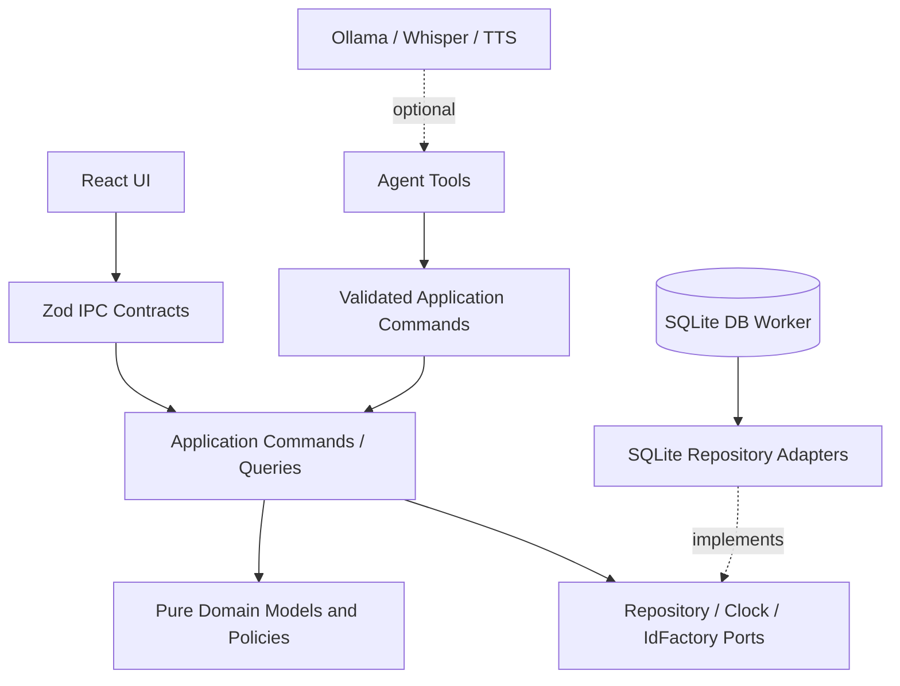
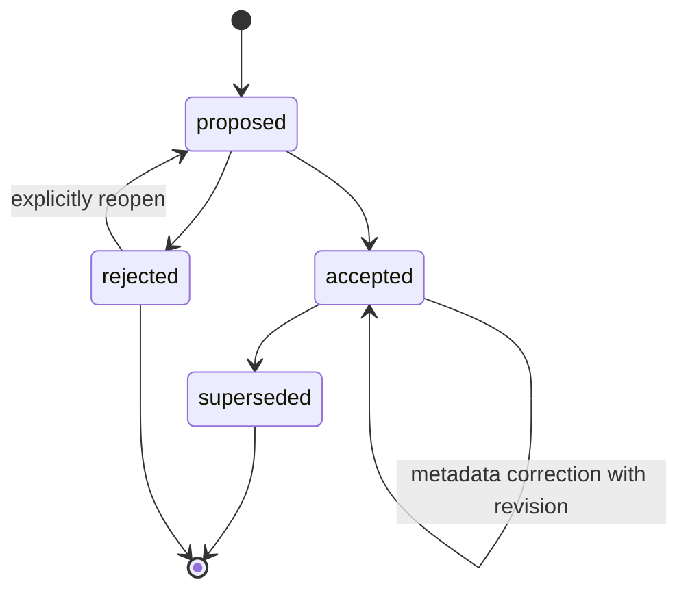
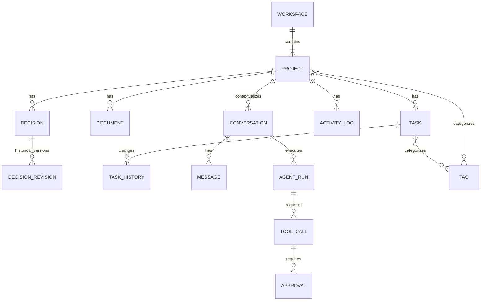

# Iterkeep — Domain Modeli, Tip Sözleşmeleri ve İş Kuralları

> **Normatif hedef:** Proje, görev, not, karar, günlük, bağlantı, sohbet, agent çalışması, kurulum tercihi ve opsiyonel yeteneklerin anlamını; kimliklerini, ilişkilerini, yaşam döngülerini, geçerli durum geçişlerini, doğrulama sınırlarını ve kalıcı işlem semantiğini sabitlemek. Bu belge, geliştirici ajanın veri modeli hakkında sessizce varsayım yapmasını önler.
>
> **Yetki:** Domain varlıkları, enum'lar, domain policy'leri, değer nesneleri ve domain olayları için **DOC-08 tek yetkili kaynak**tır. SQL tablo/sütun/indeks/FTS tasarımı **DOC-09**; transaction/locking/migration **DOC-10**; IPC wire payload ve kanal adları **DOC-11**; jobs/event transport **DOC-12**; agent araçları **DOC-26**; policy/onay **DOC-27**; setup ekran akışı **DOC-18** tarafından kesinleştirilir. Aşağıdaki örnek TypeScript arayüzleri kanonik *anlamsal sözleşmelerdir*; fiziksel SQLite satırlarının birebir kopyası değildir.
> 
> **Durum:** `draft`: model ve örnekler dokümantasyon seviyesinde tanımlandı. Kod derlemesi, SQL uygulaması, migration/E2E/performans testi henüz yapılmadı. `approved` veya `implemented` olarak yorumlama.

---

## 1. Temel karar özeti (`DM-D-*`)

| ID | Kesin V1 kararı | Gerekçe |
|---|---|---|
| DM-D-001 | Tek kullanıcı / tek aktif workspace; workspace kanonik verisi SQLite | Çakışmasız, anlaşılır yerel sahiplik |
| DM-D-002 | Bütün kalıcı kayıt kimlikleri workspace genelinde benzersiz **UUID v4** | Node `crypto.randomUUID()` ile ek üretim bağımlılığı olmadan güçlü kimlik |
| DM-D-003 | Domain saf TypeScript: `fs`, Node, Electron, React, SQL, Ollama veya Zod import etmez | Taşınabilir, saf test edilebilir iş kuralları |
| DM-D-004 | IPC/import/tool JSON'u sınırda `@iterkeep/contracts` içindeki Zod 4 şemalarıyla doğrulanır; domain ayrıca invariant kontrol eder | TypeScript derleme zamanı doğrulaması çalışma zamanı kontrolü değildir |
| DM-D-005 | Her mutable root kayıtta `revision` ile optimistic concurrency | Sessiz son-yazan-kazan veri kaybını önleme |
| DM-D-006 | Her başarılı mutasyon DB transaction commit'inden **sonra** başarılı kabul edilir | Yanıltıcı başarı bildirimini önleme |
| DM-D-007 | Verilerden yapılan Markdown/YAML dışa aktarım salt bir snapshot'tır, ayrı kanonik kaynak değildir | Çift yazma/senkronizasyon karmaşası yok |
| DM-D-008 | Varsayılan Inbox, workspace başına tam bir adet sistem projesidir; silinemez/arşivlenemez | Proje seçmeden hızlı yakalama |
| DM-D-009 | Görev durumları `todo`, `in_progress`, `blocked`, `done`, `cancelled` | V1 listesinin/Kanban'ın ortak semantiği |
| DM-D-010 | Öncelik `none`, `low`, `medium`, `high`, `urgent` | Düzeyler sıralanabilir, seçmek zorunlu değil |
| DM-D-011 | Görev hedef günü `YYYY-MM-DD` (takvim günü); olay zamanları UTC RFC3339 millisecond | Tarih-saat ile takvim günü karışmaz |
| DM-D-012 | Karar geçmişi append-only revizyonlarla korunur; sonradan değiştirilen kabul edilmiş karar yeni karar olarak ilişkilendirilir | Geçmiş gerekçeler silinmez |
| DM-D-013 | Çalışma günlüğü append-only; düzeltme önceki kaydı değiştirmek yerine yeni kayıtla yapılır | Tarihsel izlenebilirlik |
| DM-D-014 | Kullanıcının tercih ettiği AI/STT/TTS ile anlık capability/health birbirinden farklı kavramdır | Sağlayıcı yokken core normal çalışır |
| DM-D-015 | Agent, UI ve import işlemleri aynı application command handler'larına gider | Tek geçerli iş kuralı |
| DM-D-016 | Her anlamlı komut kaynak aktörünü, correlation ID'sini ve gerekiyorsa idempotency key'i taşır | İzlenebilir ve tekrar güvenli işlem |
| DM-D-017 | Silmeler kontrollü soft-delete/tombstone politikası kullanır; purge açık ve ayrı yetki gerektirir | Kaza sonucu silme ve geri alma |
| DM-D-018 | V1 çok kullanıcılı izin, cloud sync, CRDT, gerçek zamanlı ortak düzenleme içermez | Gereksiz dağıtık karmaşıklıktan kaçınma |
| DM-D-019 | Arama sonuçları kanonik kayıt ID + tür + konumu referans eder; FTS arama indeksi ikincil türetilmiş veridir | Kaynak kayda güvenilir erişim |
| DM-D-020 | Ağır jobs ve agent run'ları kullanıcı kaydı değildir; bunların yaşam döngüsü ve saklama politikası ayrıdır | Core ve opsiyonel kaynaklar ayrışır |

**Önemli sapma kontrolü:** İlk örnekteki `meta.yml` için ULID fikri kabul edilmiş bir kalıcı sözleşme değildir. Bu dosyada **UUID v4** normatif seçimdir. `DOC-09/11/16` aynı kimlik biçimini kullanmalıdır. UUIDv7/ULID'ye ileride geçmek istersek yeni ADR + import/export uyumluluk politikası gerekir. Mevcut UUID'ler asla yeniden atanmaz.

## 2. Kavramlar ve Aggregate sınırları

### 2.1 Ubiquitous language / sözlük

| Terim | Domain anlamı | Kapsam dışı yanlış yorum |
|---|---|---|
| Workspace | Tek aktif yerel veri evreni ve ayar sınırı | Uzaktaki takım workspace'i |
| Project | Görev, not, karar ve çalışma günlüğünün ait olduğu çalışma bağlamı | Fiziksel klasör |
| Inbox | Varsayılan sistem projesi | Projesiz, foreign key'i null olan kayıt havuzu |
| Task | Durumu ve önceliği olan yapılabilir iş | Mesajlaşma veya job nesnesi |
| Document | Başlıklı Markdown notu | Dosya sistemindeki kanonik `.md` dosyası |
| Decision | Gerekçesiyle kaydedilen ve geçmişi korunan teknik/kişisel karar | Üzerine yazılabilen serbest not |
| ActivityLog | Kullanıcının bir çalışma anını tarihle kaydetmesi | Uygulama tanılama logu |
| RecordLink | Bir domain kaydından diğerine ilişki | Şifrelenmemiş uzak URL |
| AgentRun | AI isteğinin uçtan uca yürütülmesi | Modelin gizli düşünce izi |
| ToolCall | Agent tarafından talep edilmiş doğrulanabilir uygulama aracı çağrısı | Serbest shell veya SQL komutu |
| BackgroundJob | Uzun süren uygulama/sağlayıcı işi | Task/To-Do |
| Capability | Kurulmuş ve gerçekten kullanılabilir özellik | Kullanıcı ayarındaki 'enabled' boolean'ı |
| Projection | Bir veya çok kayıttan türetilmiş okuma görünümü | Ayrı kanonik write store |

### 2.2 Aggregate root ve veri sahipliği

| Aggregate root | Sahip olduğu alt varlık / ilişki | Atomik invariant | Doğrudan değişim yetkisi |
|---|---|---|---|
| `Workspace` | İnbox referansı, workspace tercihleri | Tek aktif workspace ve bir Inbox | WorkspaceService |
| `Project` | Project tags / statüsü | Inbox koruması, referans bütünlüğü | ProjectService |
| `Task` | Task state, sort order, task history | valid transition + completedAt | TaskService |
| `Document` | Markdown gövde + doküman revizyonu | Kaydetme sürüm denetimi | DocumentService |
| `Decision` | DecisionRevision, supersession | Eski gerekçe ve geçmiş korunur | DecisionService |
| `ActivityLog` | Düzeltme kaydı referansı | Append-only | ActivityService |
| `Conversation` | Message listesi, AI run bağlantısı | Sıra, run association | ConversationService |
| `AgentRun` | ToolCalls, Approvals | Uygulama gerçeğinden sapmayan terminal state | AgentRunManager |
| `Job` | Job attempts/progress | Yapısal job state machine | JobManager (`DOC-12`) |
| `SetupState` | Setup step receipts, capability preference | Completed ≠ available | SetupService |

Aggregate sınırları DB transaction sınırına **her zaman** birebir denk gelmez. Örneğin görevin başka projeye taşınmasında eski/yeni ordering ve audit aynı transaction'da olmalıdır. Servisler cross-aggregate işlemde transaction-port kullanır; domain, SQL bağlantısı açmaz.

### 2.3 Bağımlılık yönü



Bu diyagram bağımlılık **ilişkilerini kavramsal olarak** gösterir. Runtime wiring'in gerçek yönü ve Electron process ownership için `DOC-06` esas alınır. `@iterkeep/domain`, `@iterkeep/contracts` veya `@iterkeep/application` içinde Electron import'u yoktur.

## 3. Kimlik, zaman, eşzamanlılık ve ortak alanlar

### 3.1 Kimlik türleri

- Persistent ID: RFC4122 UUID v4, küçük harf, tireli 36 karakter; örn. `f2ca11f4-4e0d-4a89-b796-66f6ea1d46a2`.
- Yeni ID, `application/src/ports/id-factory.ts` portunun üretimiyle alınır. Portun Node implementasyonu `crypto.randomUUID()` kullanabilir; domain Node'a bağlı değildir.
- Görev, not, karar ve log kimlikleri **workspace genelinde** benzersizdir. Proje adı veya slug kimlik değildir.
- `DEC-0001` gibi insan okunur karar numarası isteğe bağlı ikincil alan (`displayCode`) olup **aynı proje kapsamında** benzersizdir; transaction içerisinde tahsis edilir. Referansların asıl anahtarı `decision.id`'dir.
- İçe alınan kayıt kimliği geçerliyse korunur. Çakışma çözümü `DOC-16`: önizleme + merge/skip/new-ID kararı; sessiz overwrite yasak.
- `correlationId`, `causationId`, `idempotencyKey` kayıt ID değildir; işlem ile olayları bağlar. İptal edilen/başarısız işler tanımsız kimlik üretmez.

```ts
// packages/domain/src/value-objects/ids.ts
// Saf TypeScript. Runtime input doğrulaması @iterkeep/contracts içinde.
export type Brand<Value, Name extends string> = Value & {
  readonly __brand: Name;
};
export type WorkspaceId = Brand<string, 'WorkspaceId'>;
export type ProjectId = Brand<string, 'ProjectId'>;
export type TaskId = Brand<string, 'TaskId'>;
export type DocumentId = Brand<string, 'DocumentId'>;
export type DecisionId = Brand<string, 'DecisionId'>;
export type DecisionRevisionId = Brand<string, 'DecisionRevisionId'>;
export type ActivityLogId = Brand<string, 'ActivityLogId'>;
export type RecordLinkId = Brand<string, 'RecordLinkId'>;
export type AttachmentId = Brand<string, 'AttachmentId'>;
export type TagId = Brand<string, 'TagId'>;
export type ConversationId = Brand<string, 'ConversationId'>;
export type MessageId = Brand<string, 'MessageId'>;
export type AgentRunId = Brand<string, 'AgentRunId'>;
export type ToolCallId = Brand<string, 'ToolCallId'>;
export type ApprovalId = Brand<string, 'ApprovalId'>;
export type JobId = Brand<string, 'JobId'>;
export type CorrelationId = Brand<string, 'CorrelationId'>;
```

`as TaskId` yalnız **güvenilir parse/IdFactory sınırından** sonra uygulanabilir. Kullanıcıdan gelen herhangi bir string'e direkt `as TaskId` yapmak doğrulama sayılmaz. Runtime'ın gerçek UUID kuralı `DOC-11` wire contract ve `DOC-09` DB constraint düzeyinde de uygulanır.

### 3.2 Tarih ve saat sözleşmesi

| Kavram | Kanonik biçim | Örnek | Politikası |
|---|---|---|---|
| Olay zamanı | UTC RFC3339 string, milisaniye hassasiyeti | `2026-10-10T12:30:45.123Z` | Veritabanında UTC, UI yerel saat dilimine çevirir |
| Takvim hedef günü | `YYYY-MM-DD`, yerel takvim günü | `2026-10-17` | Saat veya UTC offset eklenmez |
| Kullanıcı saat dilimi | IANA timezone identifier | `Europe/Istanbul` | İşletim sisteminden okunabilir/değiştirilebilir |
| Süre | Tam sayı milisaniye | `153` | Monotonik saatten ölçülür; domain timestamp değildir |
| Alan yokluğu | `null` | `dueDate: null` | `undefined` yalnız patch request'te 'alan gönderilmedi' anlamına gelir |

Kurallar: `createdAt <= updatedAt`, UTC değerleri normalize edilir; yazılabilir kayıtta `revision >= 1`. Kullanıcı saat dilimi değiştiğinde `dueDate` **değişmez**; yalnız görüntülenecek tarih/saat yeniden formatlanır. Tarih-only için `new Date('YYYY-MM-DD')` ile yerel gün türetme yapılmaz; doğrudan takvim değeridir.

### 3.3 Değişebilir root metadata sözleşmesi

```ts
export type UtcTimestamp = string & { readonly __brand: 'UtcTimestamp' };
export type LocalDate = string & { readonly __brand: 'LocalDate' };
export interface EntityMetadata {
  readonly id: string; // daraltılmış varlık ID'si ile override edilir
  readonly createdAt: UtcTimestamp;
  readonly updatedAt: UtcTimestamp;
  readonly revision: number; // 1'den başlar; başarılı yazıda +1
  readonly deletedAt: UtcTimestamp | null;
}
export interface RevisionPrecondition {
  readonly expectedRevision: number;
}
```

**Revision kuralı:** Mutasyondan önce sunucu/worker'daki mevcut revision doğrulanır; `expectedRevision` uyuşmazsa `CONFLICT_REVISION` döner ve herhangi bir yazma yapılmaz. Domain'de `revision + 1` saf mantığı bulunabilir; kalıcı compare-and-swap sorgusu `DOC-10`'da tasarlanır. Aynı gün iki işlemde `updatedAt` eşit olabilir; yarış çözümü için timestamp kullanılmaz.

### 3.4 Aktör ve işlem bağlamı

```ts
export type ActorRef =
  | { readonly kind: 'user'; readonly id: 'local-user' }
  | { readonly kind: 'agent'; readonly runId: AgentRunId }
  | { readonly kind: 'import'; readonly importJobId: JobId }
  | { readonly kind: 'system'; readonly reason: 'setup' | 'migration' | 'recovery' | 'maintenance' };

export interface CommandContext {
  readonly actor: ActorRef;
  readonly correlationId: CorrelationId;
  readonly idempotencyKey: string | null;
  readonly timestamp: UtcTimestamp; // Port clock'tan; input olarak UI tarihine güvenme
}
```

`ActorRef` **yetki belgesi değildir**. Renderer'ın kendini `system`/`agent` ilan etmesine izin verilmez. Gerçek aktör ve izinler Main'de güvenli oturum/komut bağlamından türetilir. User/agent/import kaynaklı bütün mutasyonlar aynı doğrulama, yetki ve precondition kurallarından geçer.

## 4. Ortak değer nesneleri ve normalizasyon kuralları

| Alan türü | Sınır | Normalizasyon | İhlalde davranış |
|---|---|---|---|
| Project name | 1–120 Unicode code point | Görünen baş/son boşluk trim, NFC | `VALIDATION_FAILED` |
| Task title | 1–300 Unicode code point | Trim + NFC; satır sonu yasak | `VALIDATION_FAILED` |
| Document / decision title | 1–200 Unicode code point | Trim + NFC | `VALIDATION_FAILED` |
| Tag name | 1–40 Unicode code point | Trim + NFC; kontrol karakteri yok | `VALIDATION_FAILED` |
| Açıklama kısa metin | 0–2.000 UTF-8 byte | Satır sonu normalize (`\n`) | `PAYLOAD_TOO_LARGE` |
| Markdown body | 0–2 MiB UTF-8 byte / kayıt | CRLF→LF, içerik anlamını koru | `PAYLOAD_TOO_LARGE` |
| Log entry | 1–64 KiB UTF-8 byte | CRLF→LF, boş kaydı reddet | `VALIDATION_FAILED` |
| Tool arg JSON | Araç bazında + üst sınır 64 KiB | Strict allowlist schema | `VALIDATION_FAILED` |
| UI arama ifadesi | 0–1.024 Unicode code point | Güvenli token parse, LIKE/FTS escape | `VALIDATION_FAILED` |
| `slug` | 1–160 ASCII (`[a-z0-9-]`) | Gösterim amaçlı; ID'nin yerine geçmez | `VALIDATION_FAILED` |

**Birim farkı:** Code point üst sınırı ≠ UTF-16 `.length` ≠ UTF-8 byte. UI, IPC ve import aynı doğrulayıcıyı kullanır. İçeriği otomatik kesip başarılı döndürmek yasaktır. HTML, Markdown alanında **ham veri olarak saklanabilir**, ancak görüntülerken güvenli renderer/sanitization yapılır; storage'ta anlamsız karakter silme yapılmaz. Riskli URL'ler görüntüleme/navigasyon katmanında engellenir (`DOC-30`).

### 4.1 Proje ve durum enum'ları

```ts
export const PROJECT_STATUSES = [
  'active', 'paused', 'completed', 'archived',
] as const;
export type ProjectStatus = (typeof PROJECT_STATUSES)[number];

export const TASK_STATUSES = [
  'todo', 'in_progress', 'blocked', 'done', 'cancelled',
] as const;
export type TaskStatus = (typeof TASK_STATUSES)[number];

export const PRIORITIES = [
  'none', 'low', 'medium', 'high', 'urgent',
] as const;
export type Priority = (typeof PRIORITIES)[number];

export const DECISION_STATUSES = [
  'proposed', 'accepted', 'rejected', 'superseded',
] as const;
export type DecisionStatus = (typeof DECISION_STATUSES)[number];

export type ContentFormat = 'markdown';
```

**Türkçe UI etiketleri:** `active=Aktif`, `paused=Duraklatıldı`, `completed=Tamamlandı`, `archived=Arşiv`; `todo=Yapılacak`, `in_progress=Devam Ediyor`, `blocked=Engellendi`, `done=Tamamlandı`, `cancelled=İptal`. DB enum değerleri dil bağımsızdır. Çeviriler için `DOC-23` yetkilidir.

### 4.2 Etiket ve sıralama

Etiket kimliği UUID'dir; tek workspace içinde adın normalleştirilmiş/casefold edilmiş `nameKey` değeri benzersizdir. Türkçe `I/İ/ı/i` dönüşümleri generic ASCII lowercase'a indirgenmez; `DOC-09/15` açık normalizasyon uygulamasını testlerle sabitleyecek. Etiketi yeniden adlandırmak ilişkiyi bozmaz.

Görev sırası `sortOrder` sıfır veya pozitif **güvenli tam sayı**dır. Aynı `(projectId, status)` görünümünde deterministik tie-break `(sortOrder, createdAt, id)` kullanılır. Kanban sürükleme sonucu, etkilenen alanın sıra değerleri **tek transaction** içinde yeniden tahsis edilebilir. Serbest fractional ranking veya string LexoRank V1'de zorunlu değildir; gerekirse ADR ile değiştir.

## 5. Workspace ve sistem Inbox modeli

```ts
export interface Workspace {
  readonly id: WorkspaceId;
  readonly displayName: string;
  readonly createdAt: UtcTimestamp;
  readonly updatedAt: UtcTimestamp;
  readonly schemaCompatibilityVersion: number;
  readonly inboxProjectId: ProjectId;
  readonly revision: number;
}

export interface WorkspacePreferences {
  readonly workspaceId: WorkspaceId;
  readonly locale: 'tr-TR' | 'en-US';
  readonly theme: 'light' | 'dark' | 'system';
  readonly timezone: string; // doğrulanmış IANA ID
  readonly lastSelectedProjectId: ProjectId | null;
  readonly lastView: 'dashboard' | 'projects' | 'tasks' | 'search' | 'chat';
  readonly revision: number;
}
```

**Workspace metadata vs app bootstrap:** Veritabanı path'i bilinmeden önce gereken minimal `activeWorkspacePath` gibi yönlendirme değeri Electron `userData` içinde tutulabilir. Bu bootstrap işaretçisi proje içeriğinin ikinci canonical store'u değildir (`DOC-06`). Workspace yolu taşınırsa sessizce yeni boş `workspace.db` oluşturulmaz.

**Inbox invariant (`DM-I-WS-*`):**

1. Yeni bir workspace atomik bootstrap ile tam bir `Inbox` projesi oluşturur (`Project.kind='inbox'`); `Workspace.inboxProjectId` bu projeyi gösterir.
2. Bir workspace içinde ikinci Inbox oluşturma komutu `INBOX_ALREADY_EXISTS` olarak reddedilir. Import sırasında gelen Inbox kimliği ayrı bir kullanıcı projesi olarak rastgele çoğaltılmaz; eşleştirme önizleme ister.
3. Inbox adı lokalize olarak gösterilebilir; `Project.name` kullanıcı değiştiremez. `kind='inbox'` kimliği stabil kalır.
4. Inbox silinemez, arşivlenemez, `paused`/`completed` yapılamaz; görevleri başka projelere taşınabilir.
5. İlk bootstrap başarısızsa yarım workspace'i hazır sayma. Kurtarma/import ekranına yönlendir; duplicate Inbox üretme.

## 6. `Project` — proje varlığı

```ts
export interface Project extends EntityMetadata {
  readonly id: ProjectId;
  readonly kind: 'user' | 'inbox';
  readonly name: string;
  readonly description: string;
  readonly slug: string; // URL/export convenience, UNIQUE ID değildir
  readonly status: ProjectStatus;
  readonly priority: Priority;
  readonly tagIds: readonly TagId[];
  readonly sortOrder: number;
  readonly lastActivityAt: UtcTimestamp | null; // türetilmiş materialized summary olabilir
}

export interface ProjectCreateDraft {
  readonly name: string;
  readonly description?: string;
  readonly priority?: Priority;
  readonly tagIds?: readonly TagId[];
}
```

- `kind='user'` projesi yalnız kullanıcının komutuyla açılır; varsayılan `status='active'`, `priority='none'`.
- `slug`, görünen isme göre türetilebilir; slug çakışması export/route stratejisiyle çözülür. **Asıl iç referans daima `id`**. Proje rename hiçbir ilişkide kimlik değişikliği yaratmaz.
- `archived`: mevcut görevler ve notlar korunur, varsayılan aktif listede gizlenir. Arşivlenmiş proje read-only değildir; V1'de doğrudan mutasyon yapılacaksa kullanıcıya arşiv uyarısı gösterilir, hizmet gerekli olarak projeyi önce active yapmaya zorlayabilir (`DOC-13`).
- `completed`: tüm alt görevlerin `done` olmasını zorunlu kılmaz (gerçek iş yönetiminde istisnalar olabilir); UI tamamlanmamış işleri gösterebilir.
- `lastActivityAt` yalnız proje-ilişkili gerçeğin **okuma projeksiyonu**dur; ayrı domain gerçeği veya elle düzenlenebilir alan değildir.
- Kalıcı silme: içerik etkisi ve açık onay. V1 için `soft delete` önce, geri alınamaz purge ayrı açık işlem; ilişkili kayıtları sessiz `ON DELETE CASCADE` ile yok etmek yasaktır.

### 6.1 Proje durum geçişleri

| From | To | İzin | Ek kural |
|---|---|---|---|
| active | paused/completed/archived | Evet | Inbox için hayır |
| paused | active/completed/archived | Evet | — |
| completed | active/archived | Evet | — |
| archived | active | Evet | Restore/reopen |
| archived | paused/completed | Hayır | Önce restore to active |
| herhangi | aynı durum | İdempotent no-op | Gereksiz revision/event yazma yok |
| archived/diğer | deleted | Şartlı | Açık user confirmation, soft delete policy |

`cancelled` proje durumu değildir; proje iptali V1'de arşivleme ya da açıklamalı tamamlanma olarak modellenir. Geçersiz geçiş `INVALID_STATUS_TRANSITION` üretir.

## 7. `Task` — görev ve Kanban

```ts
export interface Task extends EntityMetadata {
  readonly id: TaskId;
  readonly projectId: ProjectId; // her görev Inbox dahil bir projeye aittir
  readonly title: string;
  readonly bodyMarkdown: string;
  readonly status: TaskStatus;
  readonly priority: Priority;
  readonly dueDate: LocalDate | null;
  readonly completedAt: UtcTimestamp | null;
  readonly sortOrder: number;
  readonly tagIds: readonly TagId[];
  readonly blockedReason: string | null;
}

export type TaskChange = Readonly<{
  title?: string;
  bodyMarkdown?: string;
  priority?: Priority;
  dueDate?: LocalDate | null;
  status?: TaskStatus;
  projectId?: ProjectId;
  tagIds?: readonly string[];
  blockedReason?: string | null;
}>;
```

**Task invariant'ları:**

1. Başlık dolu, body geçerli boyutta, hedef proje mevcut ve `deletedAt=null` olmalıdır.
2. `status='done'` ise `completedAt != null`; diğer tüm statuslarda `completedAt=null`. Reopen geçişi tamamlanma anını event/history'de saklar.
3. `blockedReason`, status `blocked` iken isteğe bağlıdır; blocked'dan çıkıldığında geçmişteki gerekçe history'ye aktarılıp aktif alanda null'a çekilir.
4. Görev `projectId=null` olmaz. Proje seçmeden hızlı ekleme uygulama tarafından Inbox'a yönlendirilir.
5. Görev projesi değiştirilirken ID değişmez; iki projenin dizilimleri ve proje özetleri aynı transaction'da güncellenir.
6. Kaydedilmeyen UI taslak görevi kalıcı `Task` değildir. İptal edilirse transaction başlamadan biter.
7. Görev linkleri ID'ye dayanır; Kanban ile liste **aynı Task satırlarını** gösterir, ayrı veri koleksiyonu değildir.
8. Silinen task standart listeden kaybolur fakat geri alma için tombstone/history tutulabilir; arama sonuçları varsayılan olarak silinenleri içermez.

### 7.1 Task durumu geçiş matrisi (kanonik)

| From → To | todo | in_progress | blocked | done | cancelled |
|---|---:|---:|---:|---:|---:|
| **todo** | no-op | ✓ | ✓ | ✓ | ✓ |
| **in_progress** | ✓ | no-op | ✓ | ✓ | ✓ |
| **blocked** | ✓ | ✓ | no-op | ✓ | ✓ |
| **done** | ✓ | ✓ | ✓ | no-op | ✓ |
| **cancelled** | ✓ | ✓ | ✓ | ✓ | no-op |

V1 kısıtlı görevler için esnek geri açma ve hızlı geçiş desteklenir. `done → in_progress` yeni tamamlanma zamanı oluşturmaz, eski tamamlanma olayını silmez. Geçişin etkileri:

- `to === 'done'`: `completedAt=clock.now()`, `TaskCompleted` event.
- `from === 'done' && to !== 'done'`: `completedAt=null`, `TaskReopened` event.
- `to === 'cancelled'`: iş tamamlandı olarak sayılmaz, `completedAt=null`, `TaskStatusChanged` event.
- Normal diğer geçiş: `TaskStatusChanged` event.
- `to === from`: aynı payload'da başka değişim yoksa **no-op** (revision artmaz, event yok).

`blocked` gösterimini ayrı Kanban sütunu yapma kararı UI'ya bırakılabilir; fakat domain enum asla UI görünümüne göre değişmez. Filtrelerde `open = todo|in_progress|blocked`; `closed = done|cancelled` olarak tanımlanır. `cancelled` tamamlanmış başarı metriğine dahil edilmez.

### 7.2 Görev history / audit

`TaskHistoryEntry` kullanıcıya anlamlı değişim olgusu olarak saklanır; her gövde autosave tuşuna olay oluşturmak zorunda değildir, fakat statü, project move, completion, undo gibi önemli değişimler kaydedilir.

```ts
export type TaskHistoryKind =
  | 'created' | 'status_changed' | 'completed' | 'reopened'
  | 'moved_project' | 'priority_changed' | 'deleted' | 'restored';
export interface TaskHistoryEntry {
  readonly id: string; // UUID v4
  readonly taskId: TaskId;
  readonly kind: TaskHistoryKind;
  readonly fromValue: string | null;
  readonly toValue: string | null;
  readonly occurredAt: UtcTimestamp;
  readonly actor: ActorRef;
  readonly correlationId: CorrelationId;
}
```

Task history uygulama tanı logu değildir; UI geçmişinde gösterilebilir. `TaskHistoryEntry` oluşturma ve asıl Task mutasyonu aynı transaction'da kalıcılaştırılır.

## 8. `Document` — Markdown notu

```ts
export interface Document extends EntityMetadata {
  readonly id: DocumentId;
  readonly projectId: ProjectId;
  readonly title: string;
  readonly bodyMarkdown: string;
  readonly pinned: boolean;
  readonly tagIds: readonly TagId[];
}

export interface DocumentVersion {
  readonly id: string; // UUID v4
  readonly documentId: DocumentId;
  readonly bodyMarkdown: string;
  readonly title: string;
  readonly revisionNumber: number;
  readonly savedAt: UtcTimestamp;
  readonly actor: ActorRef;
}
```

- Markdown saklanan gerçektir; WYSIWYG HTML, FTS indeksi ve UI preview **türetilmiş** içeriktir.
- Not editörünün local draft'ı kalıcı içerikten farklıdır. `save` commit'i gelmeden “Kaydedildi” gösterilemez (`REQ-042`).
- Autosave, en güncel beklenen `revision` ile compare-and-swap uygular. Sürüm uyuşmazlığında kullanıcıya merge/diff veya iki kopyayı koruyan güvenli yol sunulur; sessiz overwrite yasaktır.
- `DocumentVersion` için tüm tuş vuruşlarını saklamak zorunlu değildir. En azından manuel save, önemli değişiklik veya conflict öncesi checkpoint sürümleme politikası `DOC-14`'te kararlaştırılır.
- `Document.deletedAt` soft delete geri almayı destekler; eklerin fiziki temizliği ayrı job olarak ve backup politikasına uyarak yapılır.

## 9. `Decision` — gerekçe ve değişiklik tarihi

```ts
export interface Decision extends EntityMetadata {
  readonly id: DecisionId;
  readonly projectId: ProjectId;
  readonly displayCode: string; // ör. DEC-0007, proje içinde tekil
  readonly title: string;
  readonly contextMarkdown: string;
  readonly decisionMarkdown: string;
  readonly rationaleMarkdown: string;
  readonly consequencesMarkdown: string;
  readonly alternativesMarkdown: string;
  readonly status: DecisionStatus;
  readonly decidedAt: UtcTimestamp | null;
  readonly supersedesDecisionId: DecisionId | null;
  readonly supersededByDecisionId: DecisionId | null;
}

export interface DecisionRevision {
  readonly id: DecisionRevisionId;
  readonly decisionId: DecisionId;
  readonly revisionNumber: number;
  readonly snapshot: Readonly<{
    title: string;
    contextMarkdown: string;
    decisionMarkdown: string;
    rationaleMarkdown: string;
    consequencesMarkdown: string;
    alternativesMarkdown: string;
    status: DecisionStatus;
  }>;
  readonly changedAt: UtcTimestamp;
  readonly actor: ActorRef;
  readonly changeReason: string;
}
```

**Ömür döngüsü:**



- `decidedAt`, ilk `accepted` anında atanır; `proposed/rejected` için null olabilir.
- `accepted` olan kararın **özünü** değiştirmek için eski kararı düzenleyip içeriği silmek yerine yeni `Decision` oluşturulur, eskisinde `status='superseded'` ve iki taraflı ID bağlantısı yazılır.
- Yazım hatası/format düzeltmesi gibi materyal olmayan editler `DecisionRevision` ile gerekçe kaydı tutularak yapılabilir. Kabul edilmiş kararda içerik değişikliğini basit bir onaysız update sanmak yasaktır.
- `supersedesDecisionId` aynı projedeki (V1 kuralı) önceki kararı referans eder; kendini gösteremez, döngü yaratamaz. Yönlü graph acyclic olmalıdır.
- Yeni kabul edilen karar eski kararı `superseded` yaparken bütün bağlantılar aynı transaction'da commit edilir. Eski karar silinmez; aramada ve geçmişte bulunabilir.
- Başarısız transaction'da yeni karar/bağlantı/önceki statüden hiçbiri yarım uygulanmaz.
- `DecisionRevision` append-only'dir. Sürüm numarası o karar için 1'den artar; aynı `(decisionId, revisionNumber)` iki kez oluşamaz.

## 10. `ActivityLog` — çalışma günlüğü

```ts
export interface ActivityLog {
  readonly id: ActivityLogId;
  readonly projectId: ProjectId;
  readonly textMarkdown: string;
  readonly occurredAt: UtcTimestamp; // çalışmanın gerçekleştiği zaman
  readonly recordedAt: UtcTimestamp; // sistemin kaydettiği an
  readonly actor: ActorRef;
  readonly correctionOfId: ActivityLogId | null;
  readonly correlationId: CorrelationId;
  readonly relatedTaskId: TaskId | null;
  readonly relatedDecisionId: DecisionId | null;
}
```

`ActivityLog` kullanıcının çalışma günlüğüdür; uygulamanın hata teşhis logu değildir. **Append-only:** eski logu aynı ID ile update/delete eden normal kullanıcı/agent komutu bulunmaz. Yanlış metin `correctionOfId` ile yeni logla düzeltilir; UI düzeltme zincirini gösterebilir. Gizlilik/yasal veri silme ihtiyacı için özel açık `redact/purge` akışı vardır; bu, olağan düzenleme değildir.

`occurredAt` kullanıcıdan geçmiş zaman olarak alınabilir; format ve makul sınırlar doğrulanır. `recordedAt` her zaman güvenilir `Clock` tarafından atanır. Varsayılan `occurredAt=recordedAt`. Log listesi `occurredAt DESC, recordedAt DESC, id DESC` sırasıyla deterministiktir. Günlük Markdown export'u `occurredAt` temelinde yerel tarihe gruplanır; geçmişteki orijinal UTC anları ve timezone bilgisi import/export manifestinde korunur (`DOC-16`).

## 11. `Tag`, `RecordLink`, `Attachment`

```ts
export type RecordKind = 'project' | 'task' | 'document' | 'decision' | 'activity_log';
export type RecordRef = Readonly<{
  kind: RecordKind;
  id: string; // ilgili kind'a göre doğrulanmış UUID
}>;

export interface Tag {
  readonly id: TagId;
  readonly name: string;
  readonly nameKey: string;
  readonly createdAt: UtcTimestamp;
}

export interface RecordLink {
  readonly id: RecordLinkId;
  readonly source: RecordRef;
  readonly target: RecordRef;
  readonly relation: 'references' | 'depends_on' | 'related_to';
  readonly createdAt: UtcTimestamp;
  readonly actor: ActorRef;
}

export interface Attachment {
  readonly id: AttachmentId;
  readonly owner: RecordRef;
  readonly displayName: string;
  readonly relativeAssetPath: string;
  readonly mediaType: string;
  readonly byteSize: number;
  readonly sha256: string; // 64 hex karakter
  readonly createdAt: UtcTimestamp;
  readonly deletedAt: UtcTimestamp | null;
}
```

- V1 `Attachment.owner` yalnız `document`, `task` veya `activity_log` olabilir; genişleme ADR ile yapılır.
- `relativeAssetPath` workspace asset-root altında normalize edilir. Absolute path, `..`, symlink traversal, drive/UNC escape ve harici URI reddedilir; disk erişim kontrolü `DOC-17/30`.
- `RecordLink` yalnız gerçekten var olan ve erişilebilir target'a yönelir. Link oluşturulurken her iki ID type+existence doğrulanır.
- Görev bir projeden diğerine taşındığında linkler ID temelli olduğu için bozulmaz; V1 linkler farklı projeleri işaret edebilir (UI bunu görünür kılar).
- `depends_on` yalnız `task → task` için anlamlıdır; kendine referans, duplicate ve döngü yasaktır. Domain policy bu graph'ı repository port üzerinden doğrulatır.
- `related_to` simetrik ilişkiyi tek kanonik sıra ile saklar veya read layer simetrik yorumlar; çift satır üretme.
- Soft-deleted hedefin linki gösterilirken güvenli `missing/deleted` yer tutucusu kullanılır; sessiz yanlış kayda yönlendirme yapılmaz.
- Asset hash ve boyut, eklenen verinin doğruluğu içindir. URL'den otomatik indirme veya ağ erişimi kullanıcı etkileşimi olmadan başlamaz.

## 12. `Conversation`, `Message` ve `AgentRun`

### 12.1 Sohbetler

```ts
export interface Conversation extends EntityMetadata {
  readonly id: ConversationId;
  readonly projectId: ProjectId | null; // genel sohbet mümkün
  readonly title: string;
  readonly archived: boolean;
}

export type MessageRole = 'user' | 'assistant' | 'tool';
export type MessageStatus = 'streaming' | 'complete' | 'failed' | 'cancelled';

export interface ConversationMessage {
  readonly id: MessageId;
  readonly conversationId: ConversationId;
  readonly role: MessageRole;
  readonly bodyText: string;
  readonly status: MessageStatus;
  readonly createdAt: UtcTimestamp;
  readonly finalizedAt: UtcTimestamp | null;
  readonly agentRunId: AgentRunId | null;
  readonly toolCallId: ToolCallId | null;
  readonly sequence: number;
}
```

- Chat geçmişi yereldir. AI kapatılınca kayıtlı sohbet okunabilir; aktif yeni run oluşmaz.
- UI streaming token'ları kalıcı model gerçeği değildir; model mesajı `complete` olmadan yanıt tamamlandı olarak sunulmaz.
- `tool` rolündeki mesaj yalnız doğrulanmış tool sonucunu temsil eder. Kullanıcı/metin içeriği uygulama sistem talimatı gibi değerlendirilmez.
- `sequence` artan tamsayıdır; `(conversationId, sequence)` benzersiz. Sıralama için sunucu arrival timestamp'i tek kaynak değildir.
- Mesaj geçmişinde ham reasoning/chain-of-thought saklanmaz veya görüntülenmez. Yalnız görünür yanıt, araç çağrısı ve denetim metadatası saklanır.

### 12.2 Agent run ve tool çağrıları

```ts
export type AgentRunStatus =
  | 'queued' | 'running' | 'awaiting_approval'
  | 'completed' | 'failed' | 'cancelled';

export interface AgentRun {
  readonly id: AgentRunId;
  readonly conversationId: ConversationId;
  readonly projectContextId: ProjectId | null;
  readonly status: AgentRunStatus;
  readonly modelProvider: 'ollama';
  readonly selectedModelId: string; // yüklü model fingerprint'iyle doğrulanmış
  readonly startedAt: UtcTimestamp | null;
  readonly finishedAt: UtcTimestamp | null;
  readonly createdAt: UtcTimestamp;
  readonly correlationId: CorrelationId;
  readonly errorCode: string | null;
}

export type ToolCallStatus =
  | 'proposed' | 'awaiting_approval' | 'running'
  | 'succeeded' | 'failed' | 'denied' | 'cancelled';

export interface ToolCall {
  readonly id: ToolCallId;
  readonly runId: AgentRunId;
  readonly name: string; // DOC-26 allowlist tool name
  readonly argsRedactedJson: string; // UI-safe audit projection
  readonly status: ToolCallStatus;
  readonly resultSummary: string | null;
  readonly startedAt: UtcTimestamp | null;
  readonly completedAt: UtcTimestamp | null;
  readonly errorCode: string | null;
  readonly idempotencyKey: string;
}

export interface ApprovalRequest {
  readonly id: ApprovalId;
  readonly runId: AgentRunId;
  readonly toolCallId: ToolCallId;
  readonly actionFingerprint: string; // canonical action + target + validated arg digest
  readonly riskLevel: 'low' | 'medium' | 'high';
  readonly status: 'pending' | 'approved' | 'denied' | 'expired' | 'cancelled';
  readonly requestedAt: UtcTimestamp;
  readonly resolvedAt: UtcTimestamp | null;
  readonly expiresAt: UtcTimestamp;
}
```

- Agent run'ı yalnız provider çağrısı değil, kullanıcı isteği→bağlam→tool yürütme→yanıt tüm akışıdır.
- ToolCall'un başarısı **yalnız Application Core mutasyonunun başarılı commit sonucu** veya salt-okuma tool'un doğrulanmış sonucu ile belirlenir; modelin “yaptım” demesi yeterli değildir.
- `argsRedactedJson` maskelenmiş görünür audit kopyasıdır. Tool execution için gerçek doğrulanmış argümanlar izole uygulama belleğinde bulunur, gereksiz kalıcı raw argüman saklanmaz (`DOC-27/30`).
- Onay, `actionFingerprint` bağlamında **yalnız o işlemi** yetkilendirir; argüman değişirse eski onay geçersizdir. Onay otomatik olarak diğer tool call'lara miras kalmaz.
- `denied` veya `expired` tool mutasyonu çalıştırılmaz. Bir run'da önceki başarılı araçlar kalıcı olarak başarılı kalır; sonraki araç hatası eski sonucu 'geri alındı' gösteremez.
- Aktif run uygulama kapanınca yeniden açılışta `interrupted` olarak yeni kalıcı enum eklemek yerine güvenli `failed`/`cancelled` terminal durumuna reconcile edilir ve interruption reason auditlenir (`DOC-12/27`).

### 12.3 Agent run durum matrisi

| Eski durum | Geçerli hedefler | Terminal mi? |
|---|---|---|
| queued | running, cancelled, failed | Hayır |
| running | awaiting_approval, completed, failed, cancelled | Hayır |
| awaiting_approval | running, cancelled, failed | Hayır |
| completed | — | Evet |
| failed | — | Evet |
| cancelled | — | Evet |

Aynı terminal duruma tekrar yazma idempotent no-op olabilir; terminal→aktif geçiş yasaktır. Retry ayrı `AgentRun.id` ile yapılır; önceki run bozulmaz. Her run için tool attempt sayısı, concurrency, token/time bütçesi ve cancellation politikası `DOC-24/27`'de sınırlandırılır.

## 13. `SetupState`, kullanıcı tercihleri ve Capability durumu

```ts
export type FeatureKey = 'ai' | 'stt' | 'tts' | 'git';
export type PreferenceMode = 'enabled' | 'disabled';
export type CapabilityState =
  | 'unknown' | 'checking' | 'available'
  | 'unavailable' | 'incompatible' | 'error';

export interface FeaturePreference {
  readonly feature: FeatureKey;
  readonly preference: PreferenceMode;
  readonly updatedAt: UtcTimestamp;
  readonly revision: number;
}

export interface CapabilitySnapshot {
  readonly feature: FeatureKey;
  readonly state: CapabilityState;
  readonly checkedAt: UtcTimestamp | null;
  readonly diagnosticCode: string | null;
  readonly activeProviderId: string | null;
  readonly details: Readonly<Record<string, string | number | boolean | null>>;
}

export interface SetupState {
  readonly workspaceId: WorkspaceId;
  readonly coreSetupCompleted: boolean;
  readonly lastCompletedStep: string | null;
  readonly aiSetupChoice: 'unselected' | 'enabled' | 'skipped';
  readonly voiceSetupChoice: 'unselected' | 'enabled' | 'skipped';
  readonly updatedAt: UtcTimestamp;
  readonly revision: number;
}
```

**Örnek:** `FeaturePreference(ai)=enabled`, `CapabilitySnapshot(ai).state=unavailable`, `SetupState.coreSetupCompleted=true` aynı anda **geçerli** olabilir. Kullanıcının isteği ile sistemin o anki durumu birbirine karıştırılmaz.

- `coreSetupCompleted`, workspace hazır + temel tercihler doğrulanmış olduğunda true olur; model kurulumu gerektirmez.
- AI veya sesli kurulum `skipped` olunca ana özellikler kullanılır, sihirbaz zorla yeniden açılmaz.
- `CapabilitySnapshot` **ephemeral/TTL'li gözlem**dir. İstenirse son kontrol/sorun kodu tanı için kalıcı saklanabilir ama açılışta 'available' sayılmaz; yeniden probe gerekir.
- `FeaturePreference` persistent; runtime açılışındaki health probe bağımsızdır ve ana ekranı bloke etmez.
- `ModelProfile`: model ID + provider + fingerprint/digest + kullanıcı seçimi + opsiyonel benchmark kanıtıdır. Bir model silinince profil otomatik fiziksel model sayılmaz; `DOC-25` doğrular.
- AI, STT ve TTS birbirinden bağımsız etkinleştirilebilir; `stt=enabled`, `tts=disabled` geçerli durumdur.
- Bootstrap path/installer state, workspace içerikli tercihlerle tek tabloda tutulmak zorunda değildir; gerçek dosya konumları `DOC-06/18`.

### 13.1 Kalıcı `ModelProfile` ve anlık provider durumu

`ModelProfile` bir **kullanıcı seçimi + öneri geçmişi** nesnesidir; indirilmiş model dosyasının veya canlı servis sağlığının kanıtı değildir. Kayıtlı profil bir Ollama modelinin silinmesinden sonra da korunabilir, ancak çalıştırılamaz olarak görünür.

```ts
export interface ModelProfile {
  readonly id: string; // UUIDv4
  readonly provider: 'ollama';
  readonly providerModelName: string; // ör. qwen3:4b; provider'a özgü string
  readonly modelDigest: string | null; // provider varsa tam fingerprint
  readonly contextWindow: number; // güvenli pozitif tam sayı
  readonly selectedForAgent: boolean;
  readonly createdAt: UtcTimestamp;
  readonly updatedAt: UtcTimestamp;
  readonly revision: number;
}

export interface ModelBenchmarkReceipt {
  readonly id: string; // UUIDv4
  readonly profileId: string;
  readonly deviceFingerprint: string; // privacy-safe cihaz özellik özeti
  readonly benchmarkVersion: string;
  readonly measuredAt: UtcTimestamp;
  readonly firstTokenMs: number | null;
  readonly tokensPerSecond: number | null;
  readonly toolSuccessCount: number;
  readonly toolTestCount: number;
  readonly outcome: 'passed' | 'failed' | 'inconclusive';
}
```

- Workspace başına **en çok bir** `selectedForAgent=true` profil bulunur; set/unset transaction içinde yapılır. Seçimin saklanması, modelin yüklü olduğunu söylemez.
- Profillerde `providerModelName` değişirse veya digest farklılaşırsa eski benchmark sonucu yeni model için geçerli sayılmaz. Model sorgusu gerçek provider API'sinden yapılır (`DOC-25`).
- Donanım fingerprint'i seri numarası, kullanıcı adı, IP veya kişiyi tanımlayan bilgi içermez. Öneri ölçümleri kullanıcı onayıyla yerel olarak üretilir.
- `toolTestCount = 0` iken başarı yüzdesi `0%` uydurulmaz; `inconclusive` gösterilir. Zaman ve token metrikleri yalnız ölçüldüyse doludur.
- Gerçek kurulum/indirme ve model belleği domain state'i değil runtime capability/job state'idir. Binary dosyaları workspace DB'sine BLOB olarak gömmek V1 tasarımı değildir.

### 13.2 STT/TTS ses kaydı, transkript ve geçicilik

```ts
export type VoiceCaptureStatus =
  | 'idle' | 'recording' | 'processing' | 'review' | 'failed' | 'cancelled';

export interface TranscriptionDraft {
  readonly sourceJobId: JobId;
  readonly text: string;
  readonly detectedLanguage: string | null;
  readonly durationMs: number;
  readonly createdAt: UtcTimestamp;
  readonly editedByUser: boolean;
}

export interface SpeechPlayback {
  readonly sourceMessageId: MessageId | null;
  readonly status: 'queued' | 'playing' | 'finished' | 'failed' | 'cancelled';
  readonly localAudioHandle: string | null; // renderer-safe opaque handle
}
```

- `VoiceCaptureStatus` **renderer/session state**'idir, kullanıcının kanonik proje verisi değildir. Aynı anda yalnız bir mikrofon capture session aktiftir.
- Mikrofon açma kullanıcı eylemiyle başlar; `idle → recording → processing → review`. `review` sırasında metin kullanıcı tarafından düzeltilene kadar otomatik proje mutasyonu yoktur.
- `TranscriptionDraft`, kullanıcı kaydetmeden kalıcı görev/log değildir. Kullanıcı kaydettiğinde normal `CreateTask` / `AppendActivityLog` komutu çalışır ve doğrulanmış veri kalıcı olur.
- Geçici ses dosyaları için sınırlı yaşam süresi, iptalde cleanup ve açıkça etkinleştirilmiş saklama tercihi `DOC-28/30`'un konusudur. Varsayılan ses kaydı saklama zorunluluğu yoktur.
- TTS yanıtı metin sohbetinden ayrıdır: sentez/playback başarısızlığı tamamlanmış assistant metnini geri alamaz. Voice/Ollama servisleri DB'ye doğrudan yazamaz.

## 14. `BackgroundJob` ve model indirme semantiği

```ts
export type JobStatus =
  | 'queued' | 'running' | 'paused'
  | 'succeeded' | 'failed' | 'cancelled';

export type JobKind =
  | 'model_download' | 'model_benchmark' | 'voice_component_install' | 'stt_transcribe'
  | 'tts_synthesize' | 'import' | 'export'
  | 'backup' | 'restore' | 'search_rebuild'
  | 'git_commit' | 'git_push';

export interface BackgroundJob {
  readonly id: JobId;
  readonly kind: JobKind;
  readonly status: JobStatus;
  readonly progressDone: number | null;
  readonly progressTotal: number | null;
  readonly attempt: number;
  readonly createdAt: UtcTimestamp;
  readonly startedAt: UtcTimestamp | null;
  readonly finishedAt: UtcTimestamp | null;
  readonly errorCode: string | null;
  readonly correlationId: CorrelationId;
}
```

`DOC-12` gerçek job queue, checkpointer, retries, cancellation ve crash recovery sahibi olacaktır. Buradaki enum + ortak alanlar domain/contract seviyesindedir. `progressTotal=null` olduğu zaman yüzde uydurulmaz; indeterminate UI kullanılır. `done`/`total` varsa `0 <= done <= total` zorunludur. `paused` ancak sağlayıcı gerçekten durdurma/yeniden sürdürme sunuyorsa gösterilir; aksi hâlde `cancelled`/`queued` akışı kullanılmalıdır.

Model indirme sırasında “UI penceresini kapatmak” sağlayıcının bir transferi gerçekten sonlandırdığını kanıtlamaz. İndirme durumu uygulama çıkışında `succeeded` ilan edilmez; tekrar açıldığında sağlayıcının gerçek model listesi ve veri bütünlüğü yeniden doğrulanır. Job'ın `succeeded` olması ayrıca modelin doğru çalıştığını tek başına ispatlamaz.

**DOC-12 uyum notu (2026-10-10):** `git.commitExport()` ve `git.pushExport()` DOC-11 tarafından asenkron `jobId` döndüren işlemler olarak yayımlandığından, `git_commit` ve `git_push` kalıcı `JobKind` kümesine eklenmiştir. Bu ekleme domain iş davranışını veya dış ağ onay politikasını değiştirmez; DOC-12 iptal, uzlaştırma ve asla otomatik tekrarlamama koşullarını belirler.

## 15. Domain sonuçları, hatalar ve olaylar

### 15.1 Hata tipleri

```ts
export type DomainErrorCode =
  | 'VALIDATION_FAILED' | 'PAYLOAD_TOO_LARGE'
  | 'NOT_FOUND' | 'ALREADY_EXISTS'
  | 'CONFLICT_REVISION' | 'INVALID_STATUS_TRANSITION'
  | 'INBOX_PROTECTED' | 'INBOX_ALREADY_EXISTS'
  | 'REFERENTIAL_INTEGRITY' | 'LINK_CYCLE'
  | 'DECISION_HISTORY_PROTECTED'
  | 'APPROVAL_REQUIRED' | 'APPROVAL_EXPIRED'
  | 'PERMISSION_DENIED' | 'INVALID_IDEMPOTENCY_KEY';

export interface DomainFailure {
  readonly code: DomainErrorCode;
  readonly safeMessageKey: string; // i18n key
  readonly details: Readonly<Record<string, string | number | boolean | null>>;
}

export type DomainResult<T> =
  | { readonly ok: true; readonly value: T }
  | { readonly ok: false; readonly error: DomainFailure };
```

Domain, **exception'ı kontrol akışı için rutin olarak kullanmaz**. Beklenen kullanıcı/veri kuralı ihlalleri `DomainResult` ile döner. I/O hataları (`SQLITE_BUSY`, disk dolu, permission, worker crash) ayrı application/infrastructure hata ailesine çevrilir (`DOC-10/11/32`). Kullanıcıya ham SQL path'i, dosya içeriği, model prompt'u veya stack trace gösterilmez.

### 15.2 Domain event sözleşmesi

```ts
export type DomainEventType =
  | 'project.created' | 'project.updated' | 'project.archived'
  | 'task.created' | 'task.updated' | 'task.completed' | 'task.reopened'
  | 'task.moved' | 'task.deleted' | 'task.restored'
  | 'document.created' | 'document.updated'
  | 'decision.created' | 'decision.accepted' | 'decision.superseded'
  | 'activity_log.appended' | 'record_link.created';

export interface DomainEvent<TPayload extends object = Readonly<Record<string, unknown>>> {
  readonly id: string; // UUID v4
  readonly type: DomainEventType;
  readonly schemaVersion: 1;
  readonly aggregateId: string;
  readonly aggregateRevision: number;
  readonly occurredAt: UtcTimestamp;
  readonly actor: ActorRef;
  readonly correlationId: CorrelationId;
  readonly causationId: string | null;
  readonly payload: Readonly<TPayload>;
}
```

**Event güvenilirliği:** Ürün açısından önemli olan değişiklikler, kalıcı kayıtla aynı transaction'da `domain_events/outbox` benzeri yapıda kaydedilir; commit'ten sonra UI event broker'a yayımlanır. UI event'i kaçırırsa `snapshot + since-sequence` veya normal query refetch ile toparlar. Salt UI toast/animation ve model token stream'i domain event değildir.

**Event kayıtları ve gizlilik:** Payload, tam not/sohbet/metin gövdesini kopyalamak zorunda değildir; varsayılan olarak ID, eski/yeni durum gibi minimal bilgiler içerir. Tanılama için hassas içerikleri JSONL/console'a dökmek yasaktır.

### 15.3 Idempotency ve tekrar işleme

- Kullanıcının aynı “görev ekle” tıklaması ağ/IPC retry yüzünden tekrar gelirse **aynı idempotencyKey + komut türü + aktör + payload hash** aynı sonucu döndürür, ikinci görev oluşturmaz.
- Aynı key farklı payload ile kullanılırsa `INVALID_IDEMPOTENCY_KEY`/conflict, sessiz kabul değil.
- `requestId` ile `idempotencyKey` aynı değildir: yeni IPC retry request ID'si değişebilir ancak işlemin idempotency key'i korunur.
- Kalıcı idempotency receipt sonucu ve atomik yazma kararı `DOC-10`'un kapsamıdır. Key retention ve cleanup politikası ölçülebilir şekilde tanımlanır.

## 16. Kayıt ilişkileri ve referential integrity



`WORKSPACE ||--|{ PROJECT` şeması, workspace içinde en az bir Inbox proje olduğunu anlatır; birden çok kullanıcı projesi olabilir. Generic `RecordLink`/`Attachment` polymorphic bağlantıları SQL'de tek foreign key ile doğru ifade edilemeyebilir; `DOC-09` buna özel integrity yaklaşımı tanımlayacaktır.

**Parent kaydı silindiğinde:**

1. Child kayıtları gizlice fiziksel silme yok. Proje silme önizlemesinde bağlı görev/not/karar/log/asset sayıları gösterilir.
2. Silme için user confirmation/token+version precondition gerekir; agent direkt genel `DELETE project` SQL'i yapamaz.
3. Soft-delete'de parent/child görünürlük ve restore davranışı transaction ile tutarlı tutulur.
4. Foreign key hatası domain anlamına çevrilir; UI'ya ham sqlite hata metni sızmaz.
5. Restore sırasında parent yok/soft deleted ise child bağımsız yetim olarak 'normal' görünmez; explicit restore planı gerekir.

## 17. Core state, derived/read model ve saklama farkları

| Veri | Kanonik mutable store | Read projection/cache | Not |
|---|---|---|---|
| Projects/tasks/docs/decisions/logs | SQLite tables | React Query cache + FTS index | Yetkili DB |
| Task Kanban / counts | Task tables | SQL query/projection | Ayrı task kopyası yok |
| Search results | İlgili domain tables | SQLite FTS5 | FTS yeniden üretilebilir |
| 'Nerede kalmıştım?' | Task/Decision/Activity records | Tek bir composite query | Proje özeti root değildir |
| Draft editor text | Renderer ephemeral draft | Local save pending | Başarı ack sonrası DB gerçeği |
| Chat/tool audit | SQLite conversations/runs | UI log panel | Raw hidden reasoning yok |
| Setup preferences | SQLite preferences/setup | UI state | Health/capability bu bilgi değildir |
| Capability health | Probe snapshot | TTL cache | Her açılışta yeniden değerlendir |
| Model binary | Kullanıcının seçtiği model depoları | Model list metadata | Binary DB içine yazılmaz |
| Backup/export | Kullanıcı dosya sistemi | Manifest/progress | Yeni canonical source değil |

`DOC-09` fiziksel tablo tasarımı bu anlamsal ayrımı korumalıdır. Performans amacıyla materialized summary veya FTS eklenebilir fakat güncelliği testlerle kanıtlanmalı; canonical kayıtlara rakip ikinci kaynak olamaz.

## 18. Domain policy kod örnekleri

Aşağıdaki kod parçaları **referans kalıbıdır**. Dış modüllere gizlice bağımlılık veya derlenmiş ürün vaat etmez. Nihai kod DOC-07 klasörlerine yerleştirilir ve test edilir.

### 18.1 Pure task transition

```ts
// packages/domain/src/policies/task-transitions.ts
import type { TaskStatus } from '../value-objects/status';

export type TaskTransition = Readonly<{
  next: TaskStatus;
  changesCompletion: 'complete' | 'reopen' | 'unchanged';
  isNoop: boolean;
}>;

export function planTaskTransition(from: TaskStatus, to: TaskStatus): TaskTransition {
  if (from === to) {
    return { next: to, changesCompletion: 'unchanged', isNoop: true };
  }
  if (to === 'done') {
    return { next: to, changesCompletion: 'complete', isNoop: false };
  }
  if (from === 'done') {
    return { next: to, changesCompletion: 'reopen', isNoop: false };
  }
  return { next: to, changesCompletion: 'unchanged', isNoop: false };
}
```

Import edilen `TaskStatus` modülünün re-export'ı `packages/domain/src/value-objects/status.ts` dosyasında bulunmalıdır; aynı enum iki dosyada el ile çoğaltılmaz.

### 18.2 Revision precondition

```ts
// packages/domain/src/policies/revision.ts
export function isCurrentRevision(actual: number, expected: number): boolean {
  return Number.isSafeInteger(actual) && actual >= 1 &&
    Number.isSafeInteger(expected) && expected >= 1 && actual === expected;
}

// Application code yalnız domain check ile yetinmez:
// DB adapter: UPDATE ... WHERE id = ? AND revision = ? AND deleted_at IS NULL
// changes === 0 -> CONFLICT_REVISION veya NOT_FOUND ayrımını güvenli sorguyla çöz.
```

### 18.3 No-op semantiği ve mutasyon doğruluğu

```ts
// Temsili use-case akışı, gerçek repository API sözleşmesi DOC-10'da.
const existing = await repository.getTask(taskId);
if (existing === null) return notFound();
if (existing.revision !== expectedRevision) return conflict();
const plan = planTaskTransition(existing.status, nextStatus);
if (plan.isNoop) return ok(existing); // Event / timestamp yazılmaz
const next = {
  ...existing,
  status: plan.next,
  completedAt: plan.changesCompletion === 'complete'
    ? context.timestamp
    : plan.changesCompletion === 'reopen' ? null : existing.completedAt,
  updatedAt: context.timestamp,
  revision: existing.revision + 1,
};
return repository.updateTaskAndHistoryAtomically(existing, next, context);
```

Bu örnek Application Core içinde bulunur; domain katmanında `await repository` veya I/O yapılmaz. `repository.updateTaskAndHistoryAtomically` örneği bir port kullanımıdır, ürünün mevcut bir implementasyonu değildir. `cancelled → done` gibi bütün geçişlerin doğrulanması zorunludur.

### 18.4 Contracts katmanında UUID + tarih doğrulama

```ts
// packages/contracts/src/shared/value-schemas.ts — örnek Zod 4 sözleşmesi
import { z } from 'zod';
const uuidV4 = /^[0-9a-f]{8}-[0-9a-f]{4}-4[0-9a-f]{3}-[89ab][0-9a-f]{3}-[0-9a-f]{12}$/;
export const UuidV4Schema = z.string().regex(uuidV4);
export const LocalDateSchema = z.iso.date();
export const UtcTimestampSchema = z.iso.datetime({ offset: false, precision: 3 })
  .refine((value) => value.endsWith('Z'), 'UTC Z is required');
export const TaskStatusSchema = z.enum([
  'todo', 'in_progress', 'blocked', 'done', 'cancelled',
]);
```

`z.iso.datetime()` davranışı kullanılan **kilitli Zod sürümünde** doğrulanmalıdır. Tarihler `2026-02-30` gibi takvimde imkânsızsa reddedilir; `UtcTimestampSchema` yalnız `Z` ve tam üç milisaniye hanesi kabul etmelidir. Brand dönüşümü parse sonrasında yapılır. Unicode code point/UTF-8 byte limitleri için özel `refine` testleri gerekir.

## 19. Kesin mutasyon kuralları ve API davranışı

| İşlem | Girdi/policy | Mutation | Çıktı / hata |
|---|---|---|---|
| CreateProject | Unique ID, doğrulanmış ad | Project + event | `Project` veya validation failure |
| RenameProject | project ID + expectedRevision | Project revision++ | Geri bağlantılar aynı ID |
| ArchiveProject | inbox değil + expectedRevision | status archived | Liste filtresi güncellenir |
| CreateTask | project ID yoksa Inbox; title | Task + history + event | Commit sonrası Task |
| MoveTask | hedef proje aktif, expectedRevision | Task projectId/order + history | ID korunur |
| CompleteTask | revision match, valid transition | status done, completedAt | Task + event |
| ReopenTask | done/cancelled'dan valid open status | status/open | history saklanır |
| SaveDocument | ID + baseRevision | Updated content/version | conflict veya commit |
| AcceptDecision | proposed + expectedRevision | accepted, decidedAt, revision | karar audit |
| SupersedeDecision | old accepted + new proposed | old superseded + new accepted | tek transaction |
| AppendActivityLog | text+project+time validation | New immutable row | log ID |
| AddRecordLink | valid source/target+graph | link row | duplicate/cycle reddi |
| RequestAgentTool | schema + policy + actor | doğrudan yazma **yok** | tool gateway üzerinden command |
| DeleteProject | summary+explicit confirmation | soft delete plan | ilgili kayıtlara göre transaction |

**Önizleme yetkisi** ile **mutasyon yetkisi** ayrı tutulur. Özellikle import, restore, project delete ve toplu agent işlemlerinde `preview` sonucu `approved mutation` yetkisi sayılmaz. Hedef ID ve revision değişmişse yeni onay gereklidir.

## 20. Performans ve indeks tasarımı için domain gereksinimleri

1. Project listesi için tüm task gövdelerini eager load etmek yasaktır. `ProjectListItem` hafif projection'dır.
2. Task listesinde büyük body Markdown'ı ilk sorguda taşımak zorunlu değildir; `TaskSummary` + gerektiğinde Task detail.
3. Son 20 log/son 10 karar ve açık görev özeti tek compose query ile dönülebilir; N+1 sorgular test edilir.
4. Büyük liste API'ları deterministic cursor/sort üzerinden sayfalanır; `offset` kısa listede mümkün, büyük data için keyset tercih edilir.
5. Her filtre `status/priority/dueDate/projectId` semantiğinde canonical enum kullanır.
6. FTS5 indeksleri ve özet cache **tamir edilebilir**: veritabanında kaynak satırlar varsa yeniden oluşturma kayıpsız olmalıdır.
7. Idempotency key indekslenir ama sonsuz geçmiş saklama politikası seçilmez (`DOC-10`).
8. 1000 proje ve 100 bin log satırına göre test fixture boyutları `DOC-31`'de belirlenir. Bu belge herhangi bir sorgu için ölçülmemiş milisaniye garantisi vermez.
9. `RecordRef.kind` arama sonucunun ayrıştırılmasını sağlar; UI bir arama kaydını açmak için başlık veya slug üzerinden guess yapmaz.
10. Agent arama tool'ları doküman/kayıt ID'lerine dayalı ve okunabilir kaynak atıflı sonuç üretir.

### 20.1 Hafif DTO / projection örneği

```ts
export interface TaskSummary {
  readonly id: TaskId;
  readonly projectId: ProjectId;
  readonly title: string;
  readonly status: TaskStatus;
  readonly priority: Priority;
  readonly dueDate: LocalDate | null;
  readonly sortOrder: number;
  readonly revision: number;
}

export interface ProjectResumeSnapshot {
  readonly project: Pick<Project, 'id' | 'name' | 'status' | 'revision'>;
  readonly openTasks: readonly TaskSummary[];
  readonly latestLogs: readonly Pick<ActivityLog, 'id' | 'textMarkdown' | 'occurredAt'>[];
  readonly recentDecisions: readonly Pick<Decision, 'id' | 'displayCode' | 'title' | 'status' | 'updatedAt'>[];
  readonly computedAt: UtcTimestamp;
}
```

`ProjectResumeSnapshot` kaynak verilerden hesaplanır. UI başlangıcında her proje için `ProjectResumeSnapshot` yüklenmez; yalnız açık proje için hesaplanır ve arşiv/filtre durumuyla tutarlı tutulur.

## 21. Domain invariant kataloğu (`DM-I-001–030`)

| ID | Kural | İhlal durumunda beklenen sonuç |
|---|---|---|
| DM-I-001 | Her kalıcı entity ID geçerli, tekil UUIDv4 | Validation/duplicate error |
| DM-I-002 | `revision >= 1`, mutasyonda CAS | `CONFLICT_REVISION` |
| DM-I-003 | Timestamp kanonik UTC milisaniye | Validation error |
| DM-I-004 | Tarih-only alanı yerel calendar date | Invalid calendar date reddi |
| DM-I-005 | Başlık, alan boyutları merkezi sözleşmeye uyar | Validation/too large |
| DM-I-006 | Workspace tek aktif, bir Inbox | Duplicate/incomplete setup denied |
| DM-I-007 | Inbox silinemez/arşivlenemez | `INBOX_PROTECTED` |
| DM-I-008 | Her Task mevcut projeye bağlı | `REFERENTIAL_INTEGRITY` |
| DM-I-009 | Görev statüsü enum dışına çıkmaz | Validation error |
| DM-I-010 | `done` ve `completedAt` tutarlı | Domain invalid state |
| DM-I-011 | Task reopen completion history'yi korur | Invalid history write blocked |
| DM-I-012 | Kanban/list aynı Task kaynağı | Aynı ID ile farklı sonuç testi fail |
| DM-I-013 | Task move kimliği değiştirmez | Migration/mutation denied |
| DM-I-014 | Görev sıra değişimi atomik | Transaction rollback |
| DM-I-015 | Not save base revision doğrular | `CONFLICT_REVISION` |
| DM-I-016 | Decision draft edit revizyon bırakır | Domain rejection |
| DM-I-017 | Accepted decision material edit → yeni decision | `DECISION_HISTORY_PROTECTED` |
| DM-I-018 | Supersession döngüsüz, çift yönlü | Constraint/policy violation |
| DM-I-019 | ActivityLog eski satır değiştirmez | Unsupported command |
| DM-I-020 | Log correction yeni referanslı row | Invalid correction denied |
| DM-I-021 | RecordLink source/target mevcut | Referential error |
| DM-I-022 | Task dependency graph acyclic | `LINK_CYCLE` |
| DM-I-023 | Attachment path workspace dışına çıkamaz | Permission denied |
| DM-I-024 | Agent outcome tool commit ile doğrulanır | Sahte success kaydı yok |
| DM-I-025 | Approval yalnız fingerprint'e bağlı | Changed args require new approval |
| DM-I-026 | Terminal run tekrar active olmaz | Invalid transition |
| DM-I-027 | Setup complete capability healthy demek değildir | No forced healthy status |
| DM-I-028 | AI/STT/TTS yokluğu core'u bloklamaz | Recovery capability unavailable |
| DM-I-029 | Domain event commit öncesi başarı bildirmez | No success before commit |
| DM-I-030 | Import ID çakışması sessiz overwrite etmez | Preview conflict resolution |

## 22. Test kataloğu — minimum 40 domain testi (`DM-T-*`)

| Test ID | Test adı / Given → When → Then | Önem |
|---|---|---|
| DM-T-001 | Yeni workspace → tam bir Inbox ID | P0 |
| DM-T-002 | İkinci Inbox → `INBOX_ALREADY_EXISTS` | P0 |
| DM-T-003 | Inbox archive/delete → rejected | P0 |
| DM-T-004 | Project rename → ilişki ID'leri sabit | P0 |
| DM-T-005 | Project archive/restore → kaynak kayıtlar kaybolmaz | P0 |
| DM-T-006 | Project revision mismatch → conflict/zero mutation | P0 |
| DM-T-007 | Task create no project → Inbox'a yazılır | P0 |
| DM-T-008 | Görev başlığı whitespace-only → reject | P0 |
| DM-T-009 | Task status `todo→done` → completedAt atanır | P0 |
| DM-T-010 | Task status `done→todo` → completedAt null/history korunur | P0 |
| DM-T-011 | Task status aynı→aynı → no-op revision/event yok | P1 |
| DM-T-012 | Task `in_progress→cancelled` → completedAt null | P0 |
| DM-T-013 | Task move Project A→B → ID aynı | P0 |
| DM-T-014 | Task move'la sort reorder atomik; simulated failure rollback | P0 |
| DM-T-015 | DueDate 2026-10-10 OS timezone değişimi → tarih sabit | P0 |
| DM-T-016 | 2026-02-30 dueDate → reject | P0 |
| DM-T-017 | Document stale draft write → `CONFLICT_REVISION` | P0 |
| DM-T-018 | Note Markdown roundtrip → UTF-8/LF anlam korunur | P0 |
| DM-T-019 | Decision proposed→accepted → decidedAt set | P0 |
| DM-T-020 | Accepted decision material change→same ID → reject | P0 |
| DM-T-021 | New superseding decision → old status + links atomic | P0 |
| DM-T-022 | Decision supersession cycle → reject | P0 |
| DM-T-023 | Decision revision duplicate number → reject | P0 |
| DM-T-024 | Log append twice with idempotency key → only one row | P0 |
| DM-T-025 | Log correction → original body immutable | P0 |
| DM-T-026 | Log custom occurredAt ≠ recordedAt → correct sort | P1 |
| DM-T-027 | Task dependency A→B→A → reject | P0 |
| DM-T-028 | Soft-deleted link target → safe unavailable view | P1 |
| DM-T-029 | Attachment `../` → reject | P0 |
| DM-T-030 | Duplicate idempotency key different payload → conflict | P0 |
| DM-T-031 | Terminal AgentRun completed→running → reject | P0 |
| DM-T-032 | Tool denied → no application mutation | P0 |
| DM-T-033 | Tool succeeded only after committed command | P0 |
| DM-T-034 | Approval fingerprint change → approval invalid | P0 |
| DM-T-035 | AI disabled + healthy Ollama → no agent run | P0 |
| DM-T-036 | AI enabled + unavailable Ollama → core CRUD normal | P0 |
| DM-T-037 | TTS unavailable + message complete → text preserved | P0 |
| DM-T-038 | Setup skipped voice/AI → coreSetupCompleted true | P0 |
| DM-T-039 | Domain failure safeMessageKey → no raw SQL prompt data | P0 |
| DM-T-040 | Stale UI cached Task revision → user conflict handling | P0 |
| DM-T-041 | Token/Unicode title limit applied to UTF-8 vs codepoint | P1 |
| DM-T-042 | Import ID collision → no silent overwrite | P0 |
| DM-T-043 | Domain event transaction rollback → event absent | P0 |
| DM-T-044 | Exported record link uses stable UUID after rename | P1 |
| DM-T-045 | Job progressTotal null → cannot display fabricated percentage | P1 |
| DM-T-046 | Two quick creates with same idempotency key → one result | P0 |
| DM-T-047 | Foreign ref to permanently missing task → read/integrity failure safe | P0 |
| DM-T-048 | Unknown Task enum in imported JSON → schema reject | P0 |

Bunlar unit ve integration olarak ayrılır: saf transition/entity testleri `packages/domain` altında, SQLite atomiklik/CAS/outbox ve uniqueness kanıtları `tests/integration` altında çalışır. Eksik implementasyonu test mock'uyla `PASS` göstermek yasaktır.

## 23. Gereksinim ve belge izlenebilirliği

| Domain alanı | Ana gereksinimler (`DOC-02`) | Kullanıcı kabulü (`DOC-02`) | Sonraki teknik detay |
|---|---|---|---|
| Workspace / Inbox | `REQ-001–012`, `REQ-021–022` | `AC-001/002/017` | `DOC-09/10/18` |
| Project | `REQ-013–024` | `AC-003` | `DOC-09/13` |
| Task | `REQ-025–040` | `AC-002/005` | `DOC-09/11/13` |
| Document/Decision/Log | `REQ-041–052` | `AC-003/004` | `DOC-09/14/16` |
| Search/source record | `REQ-053–060` | `AC-006` | `DOC-09/15` |
| Markdown portability | `REQ-061–071` | `AC-007/008` | `DOC-16` |
| Backup/recovery | `REQ-072–081` | `AC-009/016/017` | `DOC-10/17/32` |
| Setup/Capability | `REQ-093–106` | `AC-010/011` | `DOC-12/18/19/25` |
| Agent/Chat/Approval | `REQ-107–118` | `AC-012` | `DOC-24/26/27` |
| Voice/Jobs | `REQ-119–128` | `AC-013/014` | `DOC-12/28/29` |
| Privacy/Errors | `REQ-129–140` | `AC-015–017` | `DOC-30/32` |

**Bu tablo bir üst-seviye haritadır; `DOC-33` kesin birebir gereksinim→test raporunu oluşturur.** Gereksinim aralıklarının yalnız burada anılması ilgili bütün alt maddelerin uygulandığını kanıtlamaz.

## 24. SQL/IPC/Job belgelerine açık devir

### DOC-09 — DATABASE-SCHEMA

Zorunlu şema özellikleri:

1. UUIDv4 PK/FK tip politikası, TEXT/INT depolama, constraint ve indeksler.
2. Workspace bootstrap + Inbox uniqueness + inboxProjectId integrity.
3. `projects`, `tasks`, `task_history`, `documents`, `document_versions`, `decisions`, `decision_revisions`, `activity_logs`, `tags`, join tabloları, record_links, attachments.
4. `conversations`, `messages`, `agent_runs`, `tool_calls`, `approvals`, `background_jobs`, feature prefs, setup state.
5. `domain_events/outbox`, idempotency receipts ve `schema_migrations`.
6. FTS5 source/tombstone ayrımı, contentless vs external content ve trigger/refresh disiplini.
7. Domain enum CHECK constraint; `deleted_at`, `revision`, timestamp consistency.
8. Normalized field/string limits için DB sınırında makul CHECK + app tarafında ortak doğrulama.
9. Foreign key, polymorphic link integrity, dependency-cycle enforcement application + DB ilişkisi.
10. Migration ve backup için V1 uyumlu tablo planı; her tablo sadece ihtiyaç duyulan kalıcılığı kapsar.

### DOC-10 — DB-OPERATIONS

- Atomic task create/move/reorder/reopen, decision supersede, inbox bootstrap ve project soft-delete.
- CAS revision and zero-changes, idempotency receipts, outbox commit/publish.
- WAL, busy retry/backoff, single writer, worker owner, backup/migration ve read failures.
- UTF-8/Unicode işlem katmanı doğrulaması, FTS refresh ve large dataset pagination.

### DOC-11 — IPC-CONTRACTS

- `@iterkeep/contracts` Zod 4 parsing, exact DTO, error envelope ve branded ID deserialization.
- `undefined` patch semantics vs `null` clear semantics.
- Actor güven sınırı: UI aktör rolü gönderemez; origin Main tarafından eklenir.
- Cursor/limit/status/priority filters, request correlation, cancel ve stream lifecycle.

### DOC-12 — STATE-JOBS-EVENTS

- Event sıralaması ve kaçan event recovery; job state transition + `paused` şartı.
- Voice/model pull sırasında process crash ve yeniden deneme; kalıcı job receipt.
- Capability TTL snapshot + preference ayrımı; job retention.

### DOC-13/14/16/24–29

- Görev UI akışları, karar revizyon ekranı, deterministic Markdown ve import collision politikası.
- Agent model bağlamı/source citation, tool risk sınıfları, approval fingerprint politikası.
- Audio provider yetenekleri ve binary yönetimi; kaynak/CPU/VRAM planı.

## 25. Açık kararlar, riskler ve değişiklik protokolü

| Konu | V1 önerisi | Ne zaman değişir? |
|---|---|---|
| UUID türü | v4 | Kanıtlanmış perf/uyumluluk gerekçesi + ADR |
| Tag key Türkçe | Normalize/casefold, locale-aware test | DOC-09/15 implementation POC |
| Task history kapsamı | Önemli statü/taşıma olayları | DOC-13 UX/kullanıcı testleri |
| DocumentVersion frequency | önemli checkpoint+manual save | DOC-14 autosave testleri |
| Attachment izinli türler | V1 güvenli allowlist | DOC-30 threat review |
| Sıralama | integer + atomik normalize | Benchmark gerektirirse farklı ranking modeli |
| Workspace içi privacy | OS kullanıcı izinleri, varsayılan tam DB encryption yok | Ürün kararı + doğru key management |
| ModelProfile details | sağlayıcı fingerprint ve benchmark refs | DOC-25 model registry verisi |
| Depo silme politikası | soft delete/explicit purge | DOC-13/17/30 kesin retention |

**Açık karar = implementasyona sessiz izin değildir.** Geliştirici agent bir kararı etkileyen kod yazmadan önce yetkili belgenin ilgili bölümündeki kesin protokolü arar. Yalnız örnek kodda geçen fonksiyon adları ürün API'si varsayılmaz. Çelişki gördüğünde `DOC-00 §6` sürecini uygular, ilgisiz alanları keyfî değiştirmez.

## 26. Geliştirici ajan için uygulama sırası

1. `packages/domain` altında `ids`, `timestamps`, `priority`, `status`, `entities` ve `policies` dosyalarını oluştur; yalnız saf TypeScript import'ları kullan.
2. Domain tiplerini tek kaynakta tanımla, `index.ts` üzerinden açık export et. `enum` değerlerini UI/DB/IPC'de kopyalama; contracts bu enum listelerini import ederek Zod üretmeli.
3. `packages/contracts` altında sınır doğrulayıcılarını oluştur; invalid UUID/timestamp/size/enum girdileri test et.
4. `packages/application` içinde `IdFactory`, `Clock`, `Repository`, `UnitOfWork`, `EventSink` portlarını tanımla; mutasyonlarını saf domain policy ile kompoze et.
5. `DOC-09` DDL oluşturulmadan SQL isimlerini sabitlenmiş gibi varsayma. DDL sonrası gerçek SQLite adapter'ları kur.
6. `DOC-10` gerektirdiği atomiklik ve CAS işlemleri ekle. Sadece TS interface'i uygulamak transaction kanıtı değildir.
7. `DM-T-001–048` testlerini unit/integration katmanlarına böl ve çalıştır; beklenen hata kodlarını snapshot ile değil olgusal assert ile doğrula.
8. Arayüz, agent ve voice farklı iş kuralları geliştirmesin; aynı application command entrypoint'ine bağlanmalı.
9. Paket sınırı lint/tsc kontrollerini ve SQLite entegrasyon testlerini CI'ya bağla.
10. Belgelenmiş model ile kodun modeli değiştiyse ilgili ADR, schema migration ve testleri güncelle; sessiz değişiklik yapma.

## 27. Bu belgenin Definition of Done ve gözden geçirme

- [x] Temel domain terminolojisi, aggregate ve kimlik sözleşmesi yazıldı.
- [x] Workspace/Inbox, Project, Task, Document, Decision, ActivityLog ilişkileri tanımlandı.
- [x] Enum'lar, timestamp/dueDate, revision ve soft-delete kuralları sabitlendi.
- [x] Agent/chat/job/voice tercihleri domain düzeyinde ayrıldı.
- [x] Olaylar, hata aileleri, idempotency ve kaynak bağlantıları tanımlandı.
- [x] 30 invariant ve 48 test senaryosu kataloglandı.
- [x] `DOC-09/10/11/12` için somut teslim gereksinimleri yazıldı.
- [ ] Kullanıcı bu V1 alan adlarını, enum değerlerini ve saklama politikalarını onayladı.
- [ ] Referans TypeScript gerçek `tsc --noEmit` ve Vitest altında doğrulandı.
- [ ] SQLite schema/IPC/Job belgeleriyle uygulama uyumluluğu doğrulandı.
- [ ] Gerçek paketlenmiş Electron üzerinde alan/kimlik migration smoke testleri tamamlandı.

**Belge sonucu:** Tasarım spesifikasyonu yazılmıştır, ancak bu checklist'in son dört kalemi olmadan belge `approved/verified` veya proje kodu `done` sayılmaz.

## 28. Sonraki belge

**`docs/09-DATABASE-SCHEMA.md`**: Burada tanımlanan entity'lerden gerçek SQLite DDL, FK/UNIQUE/CHECK constraint'leri, indexes, FTS5, migrations ve kayıt saklama stratejisi çıkarılacaktır. İsim ve enum çelişkisinde `DOC-08` domain semantiği korunur; şema planı bu belgeye uygun hâle getirilir.

## Değişiklik geçmişi

| Tarih | Sürüm | Değişiklik |
|---|---|---|
| 2026-10-10 | 0.1.0 | İlk kapsamlı domain sözleşmesi; 20 karar, 30 invariant, 48 test senaryosu, geçiş ve veri bütünlüğü kuralları. |

> **VOICE-ADR-001 uyum güncellemesi (2026-10-10):** İsteğe bağlı STT/TTS runtime ve model paketlerinin uygulama içinden, güvenli katalog üzerinden kullanıcı onaylı indirilmesi için `voice_component_install` job / `voice.listComponents` ve `voice.startComponentInstall` sözleşmesi gerektiği yerde eşlendi. Bu tasarım değişikliği henüz çalışır kod kanıtı değildir.
