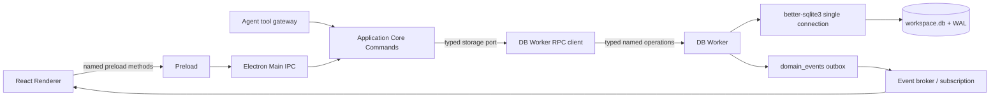

# Iterkeep — SQLite İşlem Katmanı, DB Worker, Transaction, Backup ve Kurtarma Sözleşmeleri

> **Normatif amaç:** DOC-09'un kanonik SQL şemasını Electron uygulamasında güvenli, ölçülebilir, hızlı ve kurtarılabilir şekilde işletmek. Burada DB worker'ın yaşam döngüsü, komut yürütümü, eşzamanlılık, idempotency, revision-CAS, outbox, migration, WAL, yedekleme, sağlık kontrolleri ve repository uygulama kalıpları kesinleştirilir. Kodlama ajanı yeni tablo, alan, durum enum'u veya alternatif şema tasarlamaz.
>
> **Yetki sınırı:** SQL DDL, trigger, indeks ve `0001_initial.sql` için **DOC-09**; domain anlamı/durum geçişi için **DOC-08**; repo klasörleri için **DOC-07**; IPC kanal adları, wire DTO'lar ve limitler için **DOC-11**; background jobs/event subscription için **DOC-12**; arama dilinin sözdizimi için **DOC-15**; restore/retention UX için **DOC-17**; gizlilik ve güvenlik ilkeleri için **DOC-30**, hata kullanıcı yüzeyi için **DOC-32** yetkilidir. Bu belgede örnek olarak görünen TypeScript işlevleri, türleri ve prosedürler ilgili dosyalara kod olarak aktarılmalı; `TODO implement` şeklinde bırakılmamalıdır.
>
> **Doğrulama durumu:** DOC-09 DDL'si önceki aşamada Python `sqlite3` ile smoke-test edilmiştir. Bu belgedeki `better-sqlite3` örnekleri **referans uygulama kodudur**; gerçek Windows Electron 44 + Forge 7 + `better-sqlite3` 13.0.3 native binary üzerinde derlenmiş/entegrasyon testinden geçirilmiş sayılmaz. Bu testlerden önce statü `draft` kalır.

---

## 1. Değişmez işletim kuralları (`DBO-I-001–028`)

| ID | Zorunlu uygulama kararı | Reddetme nedeni |
|---|---|---|
| DBO-I-001 | Her açık workspace için yalnız **bir DB worker ve bir write-owning SQLite bağlantısı** | Çoklu writes yarıştırılmaz. |
| DBO-I-002 | `Application Core` SQL metni, SQL bağlantısı veya DB path'ini renderer'a göstermez | Güven sınırı. |
| DBO-I-003 | `domain` saf TypeScript'tir; `storage-sqlite` port/adaptör sınırından erişilir | Test edilebilirlik. |
| DBO-I-004 | DB worker `better-sqlite3` ile senkron SQL yürütür; Main/Renderer bu işten bloke olmaz | UI akıcılığı. |
| DBO-I-005 | Worker'ın cevap vermemesi, proses ölümü veya timeout **başarılı/başarısız commit kanıtı değildir** | Bilinmeyen sonucun doğru gösterimi. |
| DBO-I-006 | Başarı ACK'i ancak transaction **commit döndükten sonra** verilir | Yanıltıcı “kaydedildi”. |
| DBO-I-007 | Her mutasyon `CommandContext` (actor, correlation, idempotency, timestamp) taşır | Audit ve retry güvenliği. |
| DBO-I-008 | Idempotency aynı key+actor+command+aynı kanonik payload için **aynı kalıcı sonucu** döndürür | Çift görev oluşturmayı engeller. |
| DBO-I-009 | Aynı key ile farklı payload `IDEMPOTENCY_CONFLICT` verir | Yanlış komutun yinelenmesi önlenir. |
| DBO-I-010 | Revision-CAS başarısızlığı üçe ayrılır: not-found, deleted, conflict; aynı değer no-op ayrı | Sessiz veri kaybı önlenir. |
| DBO-I-011 | Domain verisi, history, outbox event ve idempotency receipt **tek transaction** içinde yazılır | Atomiklik. |
| DBO-I-012 | UI event'i yalnız commit sonrası yayınlanır; kaçırılanlar `domain_events.sequence` ile yakalanır | Kaybolmuş UI bildirimi düzelir. |
| DBO-I-013 | `BEGIN IMMEDIATE` yalnız kısa, tamamen senkron mutasyon gövdeleri için | Kilit ömrü sınırlı. |
| DBO-I-014 | `await`, provider/HTTP/voice, kullanıcı onayı, büyük dosya I/O'su transaction içinde **yasak** | Uzun DB lock önlenir. |
| DBO-I-015 | `PRAGMA foreign_keys=ON`, `journal_mode=WAL` doğrulanır; `busy_timeout=3000ms` | Veri bütünlüğü. |
| DBO-I-016 | V1 için `synchronous=FULL` varsayılan; `NORMAL` yalnız açık dayanıklılık ADR'siyle | Güç kesintisi dayanıklılığı varsayımı. |
| DBO-I-017 | DB dosyası kayıp/bozuk/sürümü ileri olduğunda otomatik yeni boş DB oluşturulmaz | Gizli veri kaybı. |
| DBO-I-018 | V1 migration SQL'i DOC-09'dan **byte-for-byte** çıkarılır, checksum korunur | Kaynak çatallanması önlenir. |
| DBO-I-019 | Mevcut veri üzerinde migration öncesi online/tutarlı backup doğrulanır | Kurtarma yolu. |
| DBO-I-020 | `workspace.db` dosyasını WAL açıkken tek başına `copyFile` ile yedeklemek yasaktır | Eksik snapshot riski. |
| DBO-I-021 | Search projection bozulursa kullanıcı kayıtları değil, türetilmiş indeks yeniden yapılır | Doğru kaynak korunur. |
| DBO-I-022 | Backup başarısızlığı işlevi sessizce tamamlandı göstermez | Kullanıcı güveni. |
| DBO-I-023 | Disk doluluğu, erişim reddi, corrupt DB, busy ve native module crash farklı hata sınıflarıdır | Doğru kurtarma. |
| DBO-I-024 | AI, Ollama, Whisper ve TTS erişilebilirliği DB açılışının önkoşulu değildir | AI-optional. |
| DBO-I-025 | Dışarıdan gelen SQL, tablo adı, sıralama alanı veya dosya yolu string olarak çalıştırılmaz | Enjeksiyon ve path riski. |
| DBO-I-026 | Uzun arama/backup/migration işlemleri UI'ya yansıyan progress veya güvenli busy state taşır | Hissedilen hız. |
| DBO-I-027 | Hata günlüklerine proje metni, Markdown gövdesi, prompt veya özel konuşma kopyalanmaz | Local-first gizlilik. |
| DBO-I-028 | Her ana işlem için P0 test, metric ve açık tamamlanma kanıtı gerekir | Belge yazılmış olması özellik bitmiş demek değildir. |

### 1.1 Sözleşme düzeyi: kanonik ve örnek

- **Normatif:** Tablo/sütun isimleri DOC-09'da nasılsa aynen kalır. Komut ve veri kabul kriterleri bu belgede normatiftir.
- **Referans kod:** Aşağıdaki `ts` blokları gerçek uygulama için uygulanabilir iskeletlerdir; kodun yanındaki belirtilmiş eksik paket bağlantıları ve Zod şemaları DOC-11'de üretilir.
- **Prototip/PoC:** SQLite'ı çalışma zamanı içinde gerçekten açmadan, `better-sqlite3` API uyumluluğu ve native dağıtım kanıtlanmış sayılmaz.

## 2. Runtime topolojisi ve sorumluluk matrisi



| Bölge | Yetki | İzin verilmeyen |
|---|---|---|
| Renderer | Intent, form state, optimistic görüntü (durum etiketi doğru), arama görünümü | `Database`, `fs`, `Worker`, raw SQL |
| Preload | İsimlendirilmiş, dar, yetkili API | Herhangi string kanal gönderme |
| Electron Main | Workspace path, tek örnek kilidi, OS, worker supervision | İş kuralını ikinci kez yazma, direct `new Database()` |
| Application Core | Validation, domain policy, orchestration, transaction command port | `better-sqlite3` import'u, provider bağımlılığı |
| DB RPC client | Timeout, request correlation, cancellation state, worker supervision | DB commit hakkında tahmin yürütme |
| DB Worker | Tek gerçek connection, SQL, transaction, migration, outbox, backup | Model çağırma, UI render, genel shell |
| `storage-sqlite` repository | Kanonik veri yazma/okuma sorguları | Domain durumlarını yeniden tanımlama |
| Event broker | Commit edilmiş olayları yayımlama, sequence resume | Commit öncesi “success” yayını |

### 2.1 İşlem sınıfları ve öncelik

| Sınıf | Örnek | Öncelik | DB kullanım kuralı |
|---|---|---|---|
| Interactive query | Aktif görev listesi, tek not açma | Yüksek | Index + limit, kısa sorgu |
| Interactive mutation | Görev ekle, tamamla | Yüksek | Kısa `immediate` transaction |
| Search | FTS5 tam metin, filtre | Orta | Bound `LIMIT`, FTS parser ayrı |
| Durable job state | Job progress terminal state | Orta | Seyrek/coalesced update |
| Maintenance | Backup, integrity, checkpoint, FTS rebuild | Düşük | Ayrı bakıma geçiş protokolü |
| Migration/restore | Şema yükseltme, DB değiştirme | Exclusive | Başka komut kabul etmez |

**Operasyonel uyarı:** Worker Thread içindeki tek senkron `better-sqlite3` sorgusu çalışırken aynı worker'a gelen yeni cancel mesajı, o sorgu bitmeden işlenemeyebilir. İptal `queued` taleplerde kesin, başladıktan sonra sorgu bazında **best-effort** kabul edilir. Kesilemeyen P0 kayıt işleminin ortasında worker'ı öldürüp sonuç için “failed” demek yasaktır.

## 3. Fiziksel çalışma alanı yolu ve sahiplik

### 3.1 Path sözleşmesi

- Canonical DB: `<selected-workspace>/workspace.db`; SQL bağlantısı `workspace.db`'ye yapılır.
- Yan dosyalar SQLite'ın aynı klasörde oluşturduğu `workspace.db-wal`, `workspace.db-shm` olabilir; kullanıcıya bunları elle silme talimatı verilmez.
- Assets ve kullanıcı dışa aktarımı `<selected-workspace>/assets/`, `<selected-workspace>/exports/`; `backups/` için workspace dışı ayrıca seçilen konum desteklenebilir.
- Uygulama ayarlarında sadece kullanıcının seçtiği workspace path'i yer alır; installer/ASAR veya projenin kaynak repolarında canlı DB tutulmaz.
- Başlatma sırasında `realpath`, izinler, sürücü erişimi, symlink ve dosya türü doğrulanır. Kullanıcının verdiği klasör dışına path kaçışı engellenir.
- Yeni workspace oluşturma **ayrı kullanıcı eylemidir**. Eski workspace klasörü kaybolunca `openExisting()` otomatik `mkdir + new Database()` yapmaz.
- Çalışma alanını cloud-sync veya network filesystem'e koymak V1'in test edilmiş garanti alanı **dışındadır**; V1 varsayılanı yerel disk, kullanıcıya eşzamanlı senkronizasyon riski gösterilir.

### 3.2 Workspace sahiplik kilidi

Electron `requestSingleInstanceLock()` genel uygulama tekliğini sağlar ama bir DB dosyasının başka süreçten açılmadığını kesin kanıtlamaz. Tek writer yaklaşımı bu uygulamanın **kendi içinde** geçerlidir. Harici SQLite client'ları açılabilir; SQLite kilitleri geçerlidir. Bu nedenle:

1. Uygulama içine ikinci aynı workspace `DB Worker` açılması yasak.
2. Aynı workspace yeniden seçilirse mevcut worker referansı kullanılır.
3. Dış süreç kilitleri `SQLITE_BUSY` olarak ele alınır; kullanıcıya taşıma/kapama önerisi verilir, dosya üzerine zorla yazılmaz.
4. “`workspace.db.lock` dosyasının varlığı” tek başına güvenli kilit değildir; stale lock problemi olduğundan SQLite lock + çalışan uygulama sahipliği birlikte değerlendirilir.

## 4. Bağlantı açma ve readiness protokolü

### 4.1 Asıl açılış sırası (`DBO-BOOT-01–14`)

1. Workspace path'ini güvenli `WorkspaceLocator` ile çöz.
2. `openExisting` ve `createNew` yollarını ayır; dosya beklentisini kontrol et.
3. SQLite native bağımlılığının paketlenmiş ortamda yüklenebildiğini doğrula.
4. İlgili worker için tek bağlantı aç; `fileMustExist` seçimini eylem tipine göre ayarla.
5. `foreign_keys=ON`, `busy_timeout=3000ms` ve WAL modu uygula/doğrula (mevcut dosyada transaction dışında).
6. V1 tercihi `synchronous=FULL` yap; değerini okuyarak doğrula.
7. `SELECT sqlite_version()` ve FTS5/JSON/STRICT özellikleri için POC test veya doğrulama kontrolü uygula.
8. `PRAGMA user_version` ve `schema_migrations` versiyon/hash uyumunu incele.
9. Gerekirse migration öncesi tutarlı backup ile migration çalıştır.
10. Workspace + Inbox invariant'ını doğrula; yeni workspace ise birlikte bootstrap et.
11. `PRAGMA quick_check`, `PRAGMA foreign_key_check` ve önemli invariants'ı doğrula; maliyetli tam kontrolü zamanlanmış bakımda yap.
12. DB worker `ready` snapshot gönderir; yalnız burada mutation kabul edilir.
13. İlk proje listesini kısa query ile döndür.
14. **Bundan sonra** AI/voice/Git capability probe arka planda başlar; DB readiness bu servisleri beklemez.

**Önemli:** İlk defa şema yaratıldığında workspace bootstrap henüz tamamlanmamışsa bunu yalnız açık `createNew` flow'u tamamlayabilir. Var olan kullanıcı dosyası bozuk veya yarım ise core “başka yeni workspace oluşturuldu” diye davranmaz.

### 4.2 Konfigürasyon örneği

```ts
// packages/storage-sqlite/src/connection/open-database.ts
import Database from 'better-sqlite3';

export interface OpenDatabaseOptions {
  readonly path: string; // already resolved by trusted Main/WorkspaceLocator
  readonly intent: 'open_existing' | 'create_new';
}

export function openDatabase(options: OpenDatabaseOptions): Database.Database {
  const db = new Database(options.path, {
    fileMustExist: options.intent === 'open_existing',
    timeout: 3000,
  });
  try {
    db.pragma('foreign_keys = ON');
    if (db.pragma('foreign_keys', { simple: true }) !== 1) {
      throw new Error('DB_FOREIGN_KEYS_OFF');
    }
    db.pragma('busy_timeout = 3000');
    const mode = String(db.pragma('journal_mode = WAL', { simple: true })).toLowerCase();
    if (mode !== 'wal') throw new Error('DB_WAL_UNAVAILABLE');
    db.pragma('synchronous = FULL');
    if (Number(db.pragma('synchronous', { simple: true })) !== 2) {
      throw new Error('DB_SYNCHRONOUS_MISMATCH');
    }
    return db;
  } catch (error) {
    db.close();
    throw error;
  }
}
```

`openDatabase()` **tek başına `ready` değildir**; migration, bootstrap ve integrity kontrollerinden sonra worker `ready` der. `new Database` dosya oluşturabileceği için `create_new` akışında dosyanın gerçekten önceden olmadığını kontrol etmek ve yarış durumunu güvenli yaratma protokolüyle ele almak gerekir. Yeni dosyanın güvenle ayrılması `WorkspaceLocator`/Main ve worker protokolünün ortak sorumluluğudur.

### 4.3 `:memory:` test bağlantıları

- Bellek DB'sine `journal_mode=WAL` dayatma; SQLite bellekte WAL sağlamaz.
- `foreign_keys=ON`, `STRICT`, FTS5, JSON fonksiyonları ve schema DDL test edilir.
- Gerçek açılış/WAL/checkpoint/backup/restore testleri yalnız geçici **disk dosyası** üzerinde yapılır.
- Worker crash davranışı process testinde; `sqlite3` Python ve bellek DB testleri üretim native uyumluluğunun yerine geçmez.

## 5. DB worker komut protokolü

`DOC-11` kesin IPC channel/DTO adlarını tanımlar. DB worker'ın private RPC envelope'u Electron IPC ile **aynı** sözleşme değildir. Burada operasyon kategorisi ve taşıma kuralları normatiftir.

```ts
// packages/storage-sqlite/src/worker/protocol.ts (tasarım referansı)
export type DbOperation =
  | 'workspace.bootstrap' | 'workspace.read'
  | 'projects.create' | 'projects.read' | 'projects.list' | 'projects.update'
  | 'tasks.create' | 'tasks.read' | 'tasks.list' | 'tasks.update'
  | 'documents.save' | 'documents.read'
  | 'decisions.create' | 'decisions.read'
  | 'activity.append' | 'activity.list'
  | 'search.query' | 'events.since' | 'receipts.lookup'
  | 'maintenance.backup' | 'maintenance.checkpoint'
  | 'maintenance.quick_check' | 'maintenance.fts_rebuild';

export interface DbWorkerRequest {
  readonly requestId: string; // UUID v4
  readonly op: DbOperation;
  readonly payload: unknown; // validated with per-operation Zod before dispatch
  readonly timeoutMs: number; // duration budget, enforced with worker/client local monotonic clocks
}

export type DbWorkerReply =
  | { readonly requestId: string; readonly ok: true; readonly result: unknown }
  | { readonly requestId: string; readonly ok: false; readonly error: {
      readonly code: string; readonly retryable: boolean; readonly safeMessageKey: string;
    }};
```

**Zaman aşımı sözleşmesi:** `timeoutMs` bir süre bütçesidir, mutlak duvar saati değildir. Main/worker her biri kendi `performance.now()` referansında kalan süreyi ölçer; request kuyruğa alındığında Main'in başlattığı toplam bekleme bütçesi yeniden sıfırlanmaz. Mesaj gönderiminde kalan `timeoutMs` aktarılır. Timeout, worker içinde transaction'ın gerçekten rollback olduğu anlamına gelmez; mutasyonda receipt ile uzlaştırma zorunludur. DOC-11 bu DTO'yu Zod ile kesinleştirir.

### 5.1 Named operation dispatch

- Operation allowlist **derleme zamanı enum** + çalışma zamanı Zod union ile sağlanır.
- `payload` içinde SQL, tablo adı, property path, raw WHERE/ORDER BY ve kanonik DB dosya yolu **bulunmaz**.
- Her DB operation örneği ayrı schema'yı ve authorization'dan geçmiş `CommandContext`'i bekler.
- Request üst sınırı ve reply üst sınırı DOC-11'e bağlıdır; boyut ölçümü serialize edilen UTF-8 byte üzerinden yapılır.
- Gereksiz büyük query sonuçları cursor/keyset ile parçalanır.
- Worker schema/contract versiyonu Main ile uyuşmuyorsa fatal handshake failure, **hata görünür**.

### 5.2 Sıralama ve backpressure

V1'de tek bağlantı ve tek senkron worker döngüsü, yarışların çoğunu basitleştirir fakat öncelikli iş yönetimi için Main tarafında ayrı bounded `pending` kuyruğu bulunur:

- Interactive mutasyonlar: FIFO, var olan transaction atomik.
- Interactive sorgular: uygun olduğunda yüksek öncelik, ancak başka işlem sürüyorsa sıraya alınır.
- Maintenance: kullanıcı eylemleri sırasında başlanmaz; düşük öncelik.
- Bekleyen request sayısı için konfigürasyon sınırı başlangıç **200**; üzeri `DB_BACKPRESSURE`, uygun sorgular tekilleştirilebilir.
- Bir `search.query` için yeni sorgu gelirse eski henüz **başlamamış** sorgu iptal edilir; başladıysa sonuç geldiğinde eski UI nesliyle eşleşmediği için atılır.
- Aynı göreve aynı anda iki mutation gelirse sırayla çalışırlar; ikincisi `revision` çatışmasını doğru bildirir.
- Kuyruk limitleri ve P95 gecikmeleri DOC-31 gerçek ölçümle optimize edilir; 200 sabitini herkese her platformda optimum diye varsayma.

### 5.3 Worker kaybı ve belirsiz sonuç

1. Bütün inflight işlemleri kaydet: `requestId`, `commandName`, `idempotencyKey`, yerel gönderim zamanı.
2. `exit` / `error` durumunda yeni write admission durdur; UI'ya `storage_reconnecting` göster.
3. Worker tekrar açılmadan “işlem başarısız” demek **yasak**: `COMMIT` yapılmış, ACK yolda kaybolmuş olabilir.
4. Yeniden açılışta integrity ve migration uyumu doğrulanır; ilgili `idempotency_receipts` üzerinden sonuç okunur.
5. Receipt varsa kaydedilmiş sonuç dön; yoksa komutun eylemi ve güvenli tekrar durumu değerlendirilir.
6. Kayıt semantiği belirsizse `UNKNOWN_COMMIT_OUTCOME` ile kullanıcıya bilgi ver; otomatik yeni ID ile aynı eylemi üretme.
7. Worker'ın tekrar tekrar çökmesi durumunda `storage_unavailable`; temizleme/yeniden kurma ile kullanıcı verisini değiştirme.

**P0:** `unknown_commit_outcome` durumunda yapılacak hiçbir UI animasyonu veya toast kaydın tamamlandığını iddia etmez. Kullanıcıya “durumu doğrulanıyor” gösterilir.

## 6. Transaction motoru ve lock stratejisi

### 6.1 Hangi işlem transaction ister?

| İşlem | En küçük atomik sınır |
|---|---|
| Görev yaratma | `tasks` + `task_history` + `domain_events` + `idempotency_receipts` |
| Görev güncelleme | `tasks` revision CAS + history + event + receipt |
| Decision supersede | Eski/yeni decision bağı + revision logları + event + receipt |
| Günlük ekleme | `activity_logs` + event + receipt |
| Document update | `documents` CAS + `document_versions` + event + receipt |
| Proje create | `projects` + registry/FTS trigger sonucu + event + receipt |
| Workspace bootstrap | Workspace + Inbox + prefs + setup + capability prefs |
| Import batch | Batch başına tutarlı atomic sınır; tüm dev importu tek kilit transaction'ında tutma |
| Outbox dispatch flag | `domain_events.dispatched_at` tek güncelleme; kimlik ve sequence korunur |
| Migration | İlgili SQL dosyası + `schema_migrations` + `user_version` |

SQLite trigger'ları kaynak satırın transaction'ında çalışır. Böylece DOC-09'daki search trigger'ları için ayrı ikinci yazma katmanı kurulmaz.

### 6.2 `better-sqlite3` transaction kullanımı

```ts
// packages/storage-sqlite/src/operations/transaction.ts
import type Database from 'better-sqlite3';

export function inImmediateTransaction<T>(
  db: Database.Database,
  fn: () => T,
): T {
  // fn MUST be synchronous. better-sqlite3 transaction is sync.
  const tx = db.transaction(fn);
  return tx.immediate();
}
```

- Bu yardımcı **yalnız DB worker içinde** bulunur.
- `fn` asla `Promise` döndürmez. Üretim lint/type kuralı, transaction callback'inde `async` kullanımını yasaklar.
- Nested transaction gerekiyorsa `SAVEPOINT` semantiği ayrı gerekçelendirilir; iç `RELEASE` **kalıcı commit garantisi değildir**.
- DB worker'ın tek bağlantısı üzerinde transaction açıkken event broker, Ollama, microphone veya filesystem beklenmez.
- `BEGIN IMMEDIATE` diğer writer'ları bekletebilir; DB busy/timeout normal hata kanalından döner.

### 6.3 Transaction süre bütçesi

- Basit create/update komutunda worker içi transaction P95 hedefi **15 ms veya altı**; ölçülmüş değil, performans bütçesidir.
- 50 ms üzeri transaction'lar diagnostik sayaçta `slow_db_tx` olarak işaretlenir (içeriğin kendisi loglanmaz).
- 250 ms üzeri interactive transaction regression'dır; CI benchmark / profiling raporu gerekir.
- SQL yoğun import/search rebuild işleri **küçük parçalara** ayrılır; idempotent cursor/step tutularak güvenli devam edilir.
- `performance.now()` ile worker-local elapsed ölçülür, sistem saatine dayalı duration hesaplaması yapılmaz.

## 7. Revision CAS, no-op ve hata ayrımı

### 7.1 Genel optimistic concurrency algoritması

1. Command input runtime Zod doğrulamasından geçer, revision pozitif integer olmalıdır.
2. Komutun iş kuralı domain service tarafından doğrulanır (durum geçişi, yetki, sınır).
3. `BEGIN IMMEDIATE` açılır ve idempotency receipt varsa doğrulama/geri döndürme yapılır.
4. Eski satır `id` + soft-delete görünürlüğüyle okunur; `revision` kontrol edilir.
5. İstenen yeni değer eskiyle eşitse **no-op** kararı verilir; revision artmaz, yanlış “updated” event'i oluşmaz.
6. Fark varsa `UPDATE ... WHERE revision = ? AND deleted_at IS NULL RETURNING ...` yürütülür.
7. Revision etkisi yoksa işlem rollback ve `CONFLICT_REVISION`; `NOT_FOUND`/`DELETED` ayrımı DB snapshot'ında yapılır.
8. History ve event kaydı yazılır; receipt başarılı sonuçla kaydedilir; commit sonrası başarı ve event dispatch başlar.

### 7.2 Gerçek tablo adına uyan SQL

```sql
SELECT id, project_id, title, status, priority, revision, deleted_at
FROM tasks WHERE id = @id;

UPDATE tasks
SET title = @title, updated_at = @now, revision = revision + 1
WHERE id = @id AND revision = @expectedRevision
  AND deleted_at IS NULL AND title <> @title
RETURNING id, project_id, title, status, priority, revision, updated_at;
```

- `expectedRevision` istemcinin son gördüğü sürümdür; DB'deki revision ile eşleşmeden değişiklik kaydedilmez.
- No-op kararını önce eski revision'ı kontrol ettikten sonra ver. Aksi hâlde eski formun kaydetme eylemi sessizce yeni değer üzerinde “başarılı” sayılabilir.
- Title `trim`, UTF-8 limit ve normalizasyon sınırları DOC-08 ve DOC-11'den uygulanır; SQL `CHECK(length())` tek savunma değildir.
- `sort_order`/status gibi alanlar spesifik command ve transition kurallarıyla değişir; genel `PATCH arbitrary column` yasak.
- Task history yalnız şemada izin verilen `kind` değerlerinden biriyle yazılır; her title değişikliğine sahte `priority_changed` history yazma. Gerekli ayrıntıyı event payload'a sınırlı koy veya DOC-09'a yeni migration tasarlamadan önce ADR aç.

### 7.3 Revision conflict response

```json
{
  "ok": false,
  "error": {
    "code": "CONFLICT_REVISION",
    "safeMessageKey": "task.errors.modifiedElsewhere",
    "details": { "recordId": "<uuid>", "expectedRevision": 4, "currentRevision": 5 }
  }
}
```

`currentRevision` yetkili snapshot'tan alınır. İstemci kullanıcıya `yenile`, `farkları göster` veya `vazgeç` sunar; sessiz force overwrite yoktur. Gerçek `details` şekli DOC-11'de Zod ile sabitlenir.

## 8. Idempotency: çift oluşturmayı ve bilinmeyen sonucu engelleme

### 8.1 Kimlik semantiği

- `requestId`: transport isteğinin kimliği, her network/IPC tekrarında değişebilir.
- `idempotencyKey`: bir **kullanıcı niyeti**nin sabit UUID v4 tabanlı anahtarı; tekrar aynı key ile gönderilir.
- `correlationId`: uçtan uca izleme ilişkisi; farklı komutları aynı kullanıcı akışında bağlayabilir.
- `payload_sha256`: command input'unun **sabit kanonik serileştirilmiş** hâlinin SHA-256'sı.
- `command_name`: `tasks.create` gibi sabit operation adı; `actor_kind`, `actor_ref` ile birleşik unique sınırdır (DOC-09).

### 8.2 Komut payload hash kanonikleştirme

1. Gelen wire input Zod'dan geçirilir. İzin verilmeyen anahtarlar reddedilir veya sözleşmede açıkça strip edilir.
2. Saat/ID sunucuda üretilecek alanlar, komutun niyet payload'ına sonradan eklenmez.
3. JSON key sıralaması deterministik; Unicode dizeleri ve sayı temsili sürümlemeye uygun.
4. Hash girdisi `command schema version + command name + validated canonical intent payload` içerecek; rastgele `requestId` içermez.
5. Hash sürümlemeye alınır; şema değişirse eski anahtarların tekrar çalıştırılması geçmişteki payload ile doğrulanabilir olmalıdır.

**Dikkat:** JavaScript `JSON.stringify()` genel bir canonical JSON standardı değildir; üretimde test edilmiş sabit canonicalizer veya kendi dar kapsamlı şema alan sıralayıcısını kullan. Hash hesaplama client ile server'da farklı formatlarda yapılmayacak; nihai hash güvenilen Application Core/worker sınırında üretilir.

### 8.3 Receipt yazımı

`idempotency_receipts` tablo alanları DOC-09'a göre: `id`, `actor_kind`, `actor_ref`, `command_name`, `idempotency_key`, `payload_sha256`, `result_json`, `created_at`, `expires_at`.

```sql
SELECT payload_sha256, result_json
FROM idempotency_receipts
WHERE actor_kind=@actorKind AND actor_ref=@actorRef
  AND command_name=@commandName AND idempotency_key=@idempotencyKey;

INSERT INTO idempotency_receipts
 (id,actor_kind,actor_ref,command_name,idempotency_key,
  payload_sha256,result_json,created_at,expires_at)
VALUES
 (@receiptId,@actorKind,@actorRef,@commandName,@idempotencyKey,
  @payloadHash,@resultJson,@now,@expiresAt);
```

`UNIQUE` receipt'e yazar; aynı kimlikle eşzamanlı ikinci transaction (harici writer varsayımı) eşleşen sonucunu yeni transaction'da okur veya çatışma bildirir. `INSERT OR REPLACE` **yasaktır**: geçmiş receipt'i değiştirebilir.

### 8.4 Idempotent task create — uygulanabilir referans

```ts
// packages/storage-sqlite/src/repositories/task.repository.ts
import { randomUUID } from 'node:crypto';
import type Database from 'better-sqlite3';

type CreateTaskCommand = {
  projectId: string;
  title: string;
  actorKind: 'user' | 'agent' | 'import' | 'system';
  actorRef: string;
  correlationId: string;
  idempotencyKey: string;
  payloadHash: string; // canonicalized/validated upstream
  now: string; // trusted UTC timestamp from Clock
  expiresAt: string; // explicit retention policy
};

type CreatedTask = { id: string; projectId: string; revision: 1 };

export function createTask(db: Database.Database, cmd: CreateTaskCommand): CreatedTask {
  const tx = db.transaction((): CreatedTask => {
    const prior = db.prepare(`
      SELECT payload_sha256, result_json FROM idempotency_receipts
      WHERE actor_kind=? AND actor_ref=? AND command_name=? AND idempotency_key=?
    `).get(cmd.actorKind, cmd.actorRef, 'tasks.create', cmd.idempotencyKey)
      as { payload_sha256: string; result_json: string } | undefined;

    if (prior) {
      if (prior.payload_sha256 !== cmd.payloadHash) {
        throw new Error('IDEMPOTENCY_CONFLICT');
      }
      // Runtime-validate receipt result before returning in production.
      return JSON.parse(prior.result_json) as CreatedTask;
    }

    const project = db.prepare(`
      SELECT id FROM projects WHERE id=? AND deleted_at IS NULL
    `).get(cmd.projectId);
    if (!project) throw new Error('PARENT_PROJECT_UNAVAILABLE');

    const id = randomUUID();
    db.prepare(`
      INSERT INTO tasks
        (id,project_id,title,status,priority,created_at,updated_at,revision)
      VALUES(?, ?, ?, 'todo', 'none', ?, ?, 1)
    `).run(id, cmd.projectId, cmd.title, cmd.now, cmd.now);

    db.prepare(`
      INSERT INTO task_history
        (id,task_id,kind,occurred_at,actor_kind,actor_ref,correlation_id)
      VALUES(?, ?, 'created', ?, ?, ?, ?)
    `).run(randomUUID(), id, cmd.now, cmd.actorKind, cmd.actorRef, cmd.correlationId);

    db.prepare(`
      INSERT INTO domain_events
        (id,type,schema_version,aggregate_id,aggregate_revision,occurred_at,
         actor_kind,actor_ref,correlation_id,payload_json)
      VALUES(?, 'task.created', 1, ?, 1, ?, ?, ?, ?, ?)
    `).run(randomUUID(), id, cmd.now, cmd.actorKind, cmd.actorRef,
           cmd.correlationId, JSON.stringify({ taskId: id, projectId: cmd.projectId }));

    const result: CreatedTask = { id, projectId: cmd.projectId, revision: 1 };
    db.prepare(`
      INSERT INTO idempotency_receipts
        (id,actor_kind,actor_ref,command_name,idempotency_key,
         payload_sha256,result_json,created_at,expires_at)
      VALUES(?,?,?,?,?,?,?,?,?)
    `).run(randomUUID(), cmd.actorKind, cmd.actorRef, 'tasks.create',
           cmd.idempotencyKey, cmd.payloadHash, JSON.stringify(result),
           cmd.now, cmd.expiresAt);

    return result;
  });
  return tx.immediate();
}
```

**Bu kodun entegrasyon önkoşulları:** `title`, `projectId`, UUID, actor ve time kesin Zod/domain doğrulamasından geçmiştir; `projectId` valid workspace içindedir; `actorRef` yetkilendirilmiştir; payload hash, App Core'da kanonik hesaplanmış olup worker tarafından yeniden doğrulanabilir; response schema doğrulanır; `expiresAt` timezone UTC'dir; veri modeli release branch'te `DOC-09` ile birebir eşleşir. Bunların hiçbiri `createTask` içinde gizlice varsayılıp dış sınır doğrulaması kaldırılmaz.

### 8.5 Receipt retention ve belirsiz outcome

V1 başlangıç politikası: başarılı kullanıcı mutasyonları için receipt minimum **30 gün**, uzun import ve agent işlerinde işin tamamlanmasından itibaren en az **30 gün** tutulur; gerçek saklama DOC-17/30 ile senkronize edilir. Çok eski bir key geldiğinde otomatik “güvenle tekrar” kararı vermek tehlikelidir:

- Aynı işlem hâlâ proje/task varlığı üzerinden doğrulanabiliyorsa uzlaştır.
- Receipt artık yoksa ve sonuç emin değilse yeni mutasyon başlatma; kullanıcıya doğrulanamayan eylem göster.
- Temizlik `expires_at < now` filtresiyle kontrollü bakım job'ında, aktif/inflight komut anahtarlarını koruyarak yapılır.
- Import retry ve content-addressing farklı yaşam döngülerine sahiptir; DOC-16/17/27 gereken daha uzun kanıtları saklayabilir.

## 9. Commit sonrası outbox ve UI tutarlılığı

DOC-09 `domain_events` tablosu committed event'lerin kanonik outbox'ıdır: `sequence INTEGER PRIMARY KEY AUTOINCREMENT`, `id`, `type`, `aggregate_id`, `aggregate_revision`, `occurred_at`, `actor_kind`, `actor_ref`, `correlation_id`, `causation_id`, `payload_json`, `dispatched_at`.

### 9.1 Asgari dispatch algoritması

1. Mutation commit döner ve `result` güvenli şekilde RPC'ye aktarılır.
2. Outbox dispatcher `dispatched_at IS NULL` kayıtlarını `sequence ASC LIMIT 100` okur.
3. Event broker'a aynı `sequence` ile yayınlar; consumer'lar event ID/sequence'e göre duplicate toleranslıdır.
4. Broker'ın **gerçek kabulü** alındıktan sonra `dispatched_at` alanı tek kısa DB update ile işaretlenir.
5. Dispatcher/UI kapanırsa sonraki açılışta kalan olaylar tekrar yayımlanır; exactly-once delivery iddiası yok.
6. Renderer aboneliği koptuğunda son `sequence` ile `events.since` çağırır, gap varsa snapshot refetch yapar.

```sql
SELECT sequence,id,type,aggregate_id,aggregate_revision,occurred_at,payload_json
FROM domain_events WHERE dispatched_at IS NULL
ORDER BY sequence ASC LIMIT 100;

UPDATE domain_events SET dispatched_at=@now
WHERE sequence=@sequence AND dispatched_at IS NULL;
```

**Kritik:** `dispatched_at` outbox transport işaretidir; bütün UI'ların olayı aldığının kanıtı değildir. Bu yüzden UI'da snapshot/resume gerekir. Outbox payload çoğunlukla ID ve küçük metadata içerir, uzun not/metin içeriğini çoğaltmaz. Event sıralaması `sequence` sayacıyla yapılır, UTC zaman karşılaştırmasıyla değil.

### 9.2 UI optimistic update kuralı

- UI “Saving…” gösterebilir; geçici optimistic görünüm yalnız `pending` etiketiyle belirgindir.
- DB commit ACK gelince “Saved” olur.
- Conflict/rollback gelirse eski verified snapshot korunur veya sunucudan yenilenir.
- Timeout/worker death `unknown` olarak görünür; silindi ya da kaydedildi diye tahmin edilmez.
- TanStack Query cache'i SQLite kanonik kaydının bir kopyası değil, tekrar okunabilir kısa süreli projection'dır.

## 10. Query/repository düzeni ve performans

### 10.1 Repository listesi ve sahip olduğu SQL

| Dosya | Komut/query |
|---|---|
| `repositories/project.repository.ts` | create, rename, archive, list, recent; Inbox asla soft-delete edilmez |
| `repositories/task.repository.ts` | create, status transition, move, reorder, list, restore, history |
| `repositories/document.repository.ts` | save CAS, version, read, list |
| `repositories/decision.repository.ts` | proposal, accept, supersede, read revision history |
| `repositories/activity.repository.ts` | append, correction append, timeline |
| `repositories/tag.repository.ts` | create and attach (workspace checks) |
| `repositories/record-link.repository.ts` | attach/detach, graph cycle validation |
| `repositories/conversation.repository.ts` | messages / agent runs / approvals metadata |
| `repositories/setup.repository.ts` | preferences, provider and model profiles |
| `repositories/job.repository.ts` | durable job status and progress |
| `repositories/idempotency.repository.ts` | lookup, record, cleanup |
| `repositories/event.repository.ts` | outbox read, mark-dispatched, since-sequence |
| `search/queries.ts` | bound FTS5 MATCH, indexed filters and pagination |

DOC-07'de sayılan asgari repository dosyaları korunur; yukarıdaki ek repository'ler bağımlılık yönünü değiştirmeden aynı `storage-sqlite` paketine yerleşir. Her repository'nin DB bağımlılığı constructor injection veya `db` parametresiyle olur; `new Database(...)` komut içinde tekrarlanmaz.

### 10.2 Prepared statement ve query kuralları

- Veriler yalnız `.get/.all/.run` parametre binding ile gider; SQL string interpolation **yapılmaz**.
- `ORDER BY` kolonları whitelist enum'dan sabit SQL parçacığı seçimiyle belirlenebilir; kullanıcı girdisiyle interpolasyon yasak.
- `LIMIT` başlangıç üst sınırı 100, tam sınır DOC-11. Büyük listeler keyset/cursor ile gelir.
- `SELECT *` yüksek trafikli projection sorgularında yasak; yalnız gereken sütunlar döner.
- Prepared statement cache bağlantı ömrü boyunca aynı SQL için kullanılabilir; yeni workspace bağlantısında yeniden hazırlanır.
- Listeleme sırasında project soft-delete kontrolü ve record registry görünürlüğü uygulanır; `FK var` görünürlük garantisi değildir.
- Kullanıcı FTS sorgusu `safe_fts_query` parser üzerinden geçmeden `MATCH` içine verilmez.
- `EXPLAIN QUERY PLAN` ve gerçek fixture benchmark raporları indeks iyileştirmelerini gerekçelendirir; rastgele indeks eklemek performans garantisi değildir.

### 10.3 Task listesi: sabit filtre ve sıralama

```sql
SELECT t.id,t.project_id,t.title,t.status,t.priority,
       t.due_date,t.sort_order,t.updated_at,t.revision
FROM tasks AS t
JOIN projects AS p ON p.id=t.project_id
WHERE t.project_id=@projectId AND p.deleted_at IS NULL
  AND t.deleted_at IS NULL
  AND (@status IS NULL OR t.status=@status)
ORDER BY t.sort_order ASC,t.created_at ASC,t.id ASC
LIMIT @limit;
```

**Not:** `status` opsiyonel OR filtresi SQLite index planında beklenmedik etki yaparsa, statü filtreli ve filtresiz iki **sabit** prepared SQL ayrılır (güvensiz dinamik SQL değil). Sonraki sayfada sıralama anahtarları keyset olarak taşınır; sadece `OFFSET 100000` kullanmak yerine gerçek sorgu planı ölçülür.

### 10.4 Reorder ve çoklu alan mutasyonları

Kanban sürükleme sırasında `sort_order` değerleri tek transaction ile güncellenir. Çok sayıda güncelleme 100'lerce satırı etkiliyorsa batched order normalization veya fractional ranks politikası DOC-13'te kesinleşir; burada tekil task CAS ve history olmadan çoklu tablo `UPDATE` yapılmaz. Agent ve UI aynı `TaskService.reorder` komutunu çağırır.

## 11. Migration yönetimi

### 11.1 Migration manifest ve değiştirilemez hash

```ts
interface MigrationEntry {
  version: number;
  name: string;
  sql: string; // bytes from packaged migration artifact
  sha256: string; // SHA-256 of exact SQL file bytes
}
```

- `0001_initial.sql` **DOC-09 §4 içindeki SQL bloğundan aynen** alınır; test için ayrı SQL kopyası yönetilmez.
- Migration manifest, build çıktısına paketlenmiş gerçek dosya yollarını içerir; dev `src` ve packaged ASAR farklı relative path tahmin etmez.
- Migration uygulanırken `user_version`, `schema_migrations` geçmişi, hash ve beklenen sıraya bakılır.
- Eski migration dosyasının içeriği değişmişse `MIGRATION_CHECKSUM_MISMATCH`, otomatik tamir yok.
- DB daha yeni şemaya sahipse `SCHEMA_TOO_NEW`; **read-only fallback bile yeni şema varsayımı olmadan sessiz uygulanmaz**.
- SQLite'da DDL çoğunlukla transaction içindedir; V1 migration'ı DOC-09'daki tek `BEGIN IMMEDIATE` transaction planına uyar.

### 11.2 Migration açılış senaryoları

| Dosya durumu | Davranış |
|---|---|
| Var olmayan DB + kullanıcı `Create workspace` | Yeni dosya + `0001_initial` + workspace bootstrap |
| Var olan v1 + doğru hash | Uyum, sadece kısa integrity doğrulaması |
| Var olan v0/önceki sürüm | Preflight, tutarlı backup, sıradaki migration, postcheck |
| V1 DB + hash tutarsızlığı | Yazma açma, manuel güvenli recovery |
| V2 DB + V1 binary | `SCHEMA_TOO_NEW`, yükseltme uyarısı |
| Disk dolu | Migration yapma veya transaction rollback, eski DB/backup koru |
| Kullanıcı migration sırasında uygulamayı kapattı | Tam atomiklik beklenir; sonraki açılışta versiyon/hash kontrolü |
| Şema bozuk, `integrity_check` fail | Normal write kapat, onarım/restore ekranı |

### 11.3 Transaction-safe migrator çalışma sırası

1. Schema dosyalarının paket içindeki checksum manifest'ini doğrula.
2. Workspace manifest/path ve erişilebilir disk alanını kontrol et.
3. Yeni DB mi mevcut DB mi ayrıştır; mevcut DB için tüm pending write'ları durdur.
4. Mevcut DB'de uygun sürüm aralığıysa **tutarlı backup** al, integrity ve restore edilebilirliğini doğrula.
5. `BEGIN IMMEDIATE` migration transaction aç; SQL `.exec` çalıştır, `schema_migrations` kaydet, `user_version` ve FK check uygula.
6. Commit başarılıysa gerekli domain invariant'ları ve arama index uyumunu kontrol et.
7. Hata varsa rollback + tanılama raporu; yeni sürümde write açma, mevcut backup sakla.
8. `restore` işlemi doğrudan var olan DB üzerine açık bağlantıyla dosya overwrite etmez; güvenli swap prosedürü DOC-17'ye bağlıdır.

**İlk migration için not:** `schema_migrations` tablosu henüz yoktur; `sqlite_master` kontrolüyle v0 doğru tanınır. Var olan, şemasız görünen ama kullanıcı verisi içeren DB dosyası sıfırlanmaz. DDL'de `PRAGMA user_version = 1` SQL sonunda yer alır, ek duplicate sürüm update'i yapılmaz.

## 12. Backup API, WAL checkpoint ve restore sınırı

### 12.1 Neden live `copyFile(workspace.db)` yok?

WAL modunda son committed işlemler `workspace.db-wal` içinde bulunabilir. Sadece ana `.db` dosyasını kopyalamak eksik veya tutarsız veri üretebilir. **Varsayılan:** `better-sqlite3` `db.backup(destination, options)` üzerinden SQLite Online Backup mekanizmasını kullan.

### 12.2 Backup için somut servis sözleşmesi

```ts
// packages/storage-sqlite/src/operations/backup.ts — referans örneği
import { mkdir, rename, rm } from 'node:fs/promises';
import { dirname } from 'node:path';
import { randomUUID } from 'node:crypto';
import type Database from 'better-sqlite3';

export async function createConsistentBackup(
  db: Database.Database,
  finalPath: string,
): Promise<void> {
  const tmpPath = `${finalPath}.partial-${randomUUID()}`;
  await mkdir(dirname(finalPath), { recursive: true });
  try {
    await db.backup(tmpPath);
    // In production: open the temp file via trusted read-only verifier,
    // run PRAGMA integrity_check, compare workspace identity, then close.
    await rename(tmpPath, finalPath);
  } catch (error) {
    await rm(tmpPath, { force: true }).catch(() => undefined);
    throw error;
  }
}
```

**Üretime çıkmadan tamamlanacak kritik adımlar:** `finalPath` mutlak/allowlisted yol kontrolü, aynı hedefin overwrite edilmemesi, yeterli boş alan, backup metadata/sha256, temp dosyanın özel izinleri, dosya/dizin sync davranışı, backup açılıp `integrity_check` ve workspace/Inbox validasyonu, süreç çökmesinde `.partial-*` temizliği, platformlar arası atomik ad değişiminin sınırı. Bu örnek bunların hepsini **yapmış gibi göstermez**. UI'da “yedek tamamlandı” yalnız verify ve commit edilmiş metadata sonrasında gösterilir.

### 12.3 Backup öncesi/sırası işlem disiplini

- Online Backup API, WAL açıkken canlı committed içerikten tutarlı backup üretebilir.
- Aynı bağlantıda backup sırasında yeni mutasyonlar backup snapshot'ını etkileyebilir; **V1 ürün garantisi:** backup noktasını netleştirmek için yazma admission kapatılır ve aktif transaction'lar bitirilir.
- Backup uzun sürerse interaktif sorguların hangi kısma kadar izinli olacağı test/ölçümle netleştirilir. Kısıtlama kullanıcıya görünür olmalı.
- Başka process aynı SQLite dosyasına yazıyorsa backup restart/starvation görülebilir; `backup` timeout ve `DB_BUSY` davranışı var.
- Worker event loop'u ve online backup adımlarının gerçek uyumluluğu `DBO-T-030` altında doğrulanır.
- Backup sürerken uygulama kapatılırsa güvenilir temp/artifact manifest ile incomplete backup görünür ama **geçerli backup** diye gösterilmez.

### 12.4 WAL checkpoint türleri ve politika

| Mod | Davranış / kullanım |
|---|---|
| `PASSIVE` | Uygun olduğu kadar checkpoint, read/write bekletmeden; periyodik en düşük riskli bakım |
| `FULL` | Tamamlama amacıyla bekleyebilir; maintenance penceresi |
| `RESTART` | Yeni writer'ın WAL başından başlamasını sağlamak için reader boşalmasını bekleyebilir |
| `TRUNCATE` | WAL'ı başarılıysa küçültür; interaktif kullanımda rastgele çalıştırılmaz |

Başlangıç politika önerisi:

- `wal_autocheckpoint=1000` (SQLite varsayılanını sabitle); sayfa boyutu ve disk performansına göre benchmark edilir.
- Gözlenen WAL boyutu örneğin **64 MiB**'ı geçtiğinde düşük öncelikli `PASSIVE` maintenance önerilir; `PASSIVE` tüm frame'leri işleyemeyebilir.
- Kullanıcı aktif edit yaparken bloklayan `TRUNCATE` otomatik başlatma.
- Normal kapanışta bağlantı temiz kapatılır; başarısız checkpoint uygulama kapanışını sonsuza kadar bekletmez.
- Force-kill/crash sonra WAL/SHM dosyalarının bulunması normal olabilir; **silinmez**, SQLite sonraki açılışta WAL recovery yapar.

```ts
// packages/storage-sqlite/src/operations/checkpoint.ts
import type Database from 'better-sqlite3';

export function passiveCheckpoint(db: Database.Database): unknown[] {
  // Must run outside any open transaction.
  return db.pragma('wal_checkpoint(PASSIVE)');
}
```

`PRAGMA wal_checkpoint` çıktısı `busy`, `log`, `checkpointed` alanlarının üçlüsüdür; tip ve sonuçların normalizasyonu runtime testte yapılır. Pencerenin kapanması sırasında her seferinde `TRUNCATE` zorlamak performans hedefiyle çatışır.

### 12.5 Restore / geri yükleme güvenlik kontratı

1. Kullanıcı açıkça backup dosyasını seçer; mevcut DB'yi değiştirme onayı istenir.
2. Tüm aktif jobs, agent mutasyonları ve DB worker istekleri duraklatılır/bitirilir.
3. Mevcut DB için koruyucu **ayrı** tutarlı backup alınır; overwrite edilmez.
4. Restore adayı geçici DB dosyasına kopyalanır/doğrulanır; `integrity_check`, FK, manifest schema version ve workspace kimliği kontrol edilir.
5. DB worker bağlantısı güvenli kapatılır; eski WAL/SHM çevrimi ürün restore algoritmasının bir parçası olarak yönetilir; rastgele `unlink` yok.
6. Atomic rename/swap yalnız desteklenen dosya sistemi/OS garantisi altında denenir; Windows lock ve antivirus testleri gerekir.
7. Başarılı açılışta `workspace.db` + Inbox doğrulaması yapılır, UI cache'leri sıfırlanır, yeni snapshot çekilir.
8. Her başarısız adımda eski DB ve koruyucu backup korunur; işlem “başarılı” görünmez.

Detaylı kullanıcı onayı, adlandırma, retention ve tam restore state machine DOC-17'ye aittir. DOC-10 yalnız veri güvenliği alt sınırını koyar.

## 13. Integrity ve onarım prosedürleri

### 13.1 Hafif sağlık kontrolü

- `PRAGMA quick_check;` → tam olarak `ok` olmalı.
- `PRAGMA foreign_key_check;` → 0 satır.
- `schema_migrations` hash + `PRAGMA user_version` eşitliği.
- `workspaces` sayısı 1 ve `inbox_project_id` gerçek aktif Inbox'a ait.
- `record_registry` iş kuralları (foreign key dışında kalan semantik ilişkiler) spot-check.
- AI/provider bulunamadığında bu kontroller yine çalışır.

### 13.2 Derin bakım kontrolü

- `PRAGMA integrity_check;` sonuçları saklanır; `quick_check` daha hızlıdır ama tam eşdeğeri değildir.
- FTS5 external content `integrity-check` ve gerekiyorsa deterministik rebuild.
- Trigger'ları yalnız kaynak korumasıyla test et; product data'yı onarım denemesi sırasında tehlikeye atma.
- Bağlantı bozulma hatası varsa read-only kurtarma/restore deneyimi; otomatik `DROP TABLE`, `VACUUM INTO` üzerine yazma ya da yeni DB yaratma yok.
- Diagnostics özel metin dökmez, sadece error code, schema version, check result ve veri sayacı/süre bilgisi.

### 13.3 FTS rebuild özel akışı

`search_fts` türetilmiş indeks; `search_index` kaynağı ise domain tablosundan türetilmiş projection. DOC-09 §6.2 SQL tam eşleşme kaynağıdır.

1. Bakım admission lock al, interaktif mutation durdur, job başlat.
2. Kaynak ve indeksin current count/sequence ölç.
3. DOC-09'daki `search_index` temizleme ve yeniden doldurma SQL'ini transaction'da uygula.
4. `search_fts` external-content indeksinin tutarlılığını `integrity-check` ile doğrula; gerekiyorsa `rebuild` komutu.
5. Hatalıysa rollback ve arama unavailable durumu; kullanıcı domain verisini kaybetmez.
6. Başarılıysa search cache invalidate, `search_rebuild` job terminal state ve tek UI bilgilendirmesi.

Büyük veri kümelerinde tek transaction'ın süre bütçesini aşması varsa shadow projection + swap için **yeni migration/ADR** gerekebilir. V1 şemasına sessiz farklı tablo eklenmez.

## 14. Busy, disk full, permission, corruption hata sınıfları

### 14.1 Hata taksonomisi (`DBO-ERR-*`)

| Kod | Kaynak | Retry | Kullanıcıya |
|---|---|---|---|
| `DB_BUSY` | `SQLITE_BUSY`, harici writer/reader lock | Sınırlı | Bekleniyor/yeniden dene |
| `DB_LOCKED` | `SQLITE_LOCKED` | Ancak neden giderilirse | İşlem meşgul |
| `DB_DISK_FULL` | `SQLITE_FULL` | Otomatik yok | Boş alan aç, koru |
| `DB_READ_ONLY` | `SQLITE_READONLY` | Otomatik yok | Yazma izni yok |
| `DB_IO_FAILURE` | `SQLITE_IOERR` | Değişkene bağlı, default yok | Disk/erişim hatası |
| `DB_CORRUPT` | `SQLITE_CORRUPT`, `SQLITE_NOTADB`, integrity fail | Otomatik yok | Kurtarma |
| `DB_CONSTRAINT` | FK, CHECK, UNIQUE | Generic retry yok | Kural/çakışma |
| `DB_SCHEMA_TOO_NEW` | `user_version` ileri | Yok | Uygulamayı güncelle |
| `DB_MIGRATION_MISMATCH` | Checksum/hash uyuşmazlığı | Yok | Kurtarma |
| `DB_WORKER_UNAVAILABLE` | thread exit/native crash | Koşullu restart | Bağlantı kesildi |
| `UNKNOWN_COMMIT_OUTCOME` | ACK yok, receipt ile kanıt henüz yok | Kör tekrar yok | Sonuç doğrulanıyor |
| `DB_BACKPRESSURE` | Kuyruk dolu | Koşullu | Bekleyen işler var |

Hata kodları `DOC-11` wire error tiplerine aktarılır. Ham `e.message` veya SQL sorgusu UI'ya ve harici loglara gönderilmez; `code` eşleme yapılır. Native crash durumunda aynı proses etkilenebilir; Worker Thread ayrı OS crash containment garantisi sunmaz.

### 14.2 Retry kuralları

- **Sadece `SQLITE_BUSY`** ve güvenli/idempotent operasyonlar için sayısı sınırlı retry değerlendir; `busy_timeout` zaten 3 saniye bekleyebilir, üzerine tekrar 3 saniyeler eklemek UX'i bozar.
- Başlangıç bütçesi: interactive write için toplam 3 saniye üstü bekleme **kullanıcıya meşgul** gösterir; arka plan maintenance için toplam 10 saniyeye kadar kontrollü retry.
- UI'yı bloke etmeyen bekleme `DB RPC client` tarafında olabilir; worker senkron query üzerinde rastgele `sleep` ile bekletilmez.
- `SQLITE_FULL`, `CORRUPT`, `CONSTRAINT`, `READONLY` için otomatik aynı mutasyonu tekrar etmek yasaktır.
- Timeout sonrası mutasyonda receipt durumu sorgulanmadan yeni `idempotencyKey` oluşturulmaz.
- Sıralı event, command ve actor bilgisi retry boyunca korunur.

### 14.3 Koruma modları

| Mod | Mutasyon | Okuma | Bakım |
|---|---|---|---|
| `ready` | Evet | Evet | Planlı |
| `busy` | Kuyruk / kontrollü wait | Evet/queue | Hayır |
| `maintenance` | Yeni write reddet/duraklat | Gerekirse read | Evet |
| `read_only_recovery` | Hayır | Güvenliyse | Sınırlı teşhis |
| `unavailable` | Hayır | Hayır | Harici kurtarma |

Mod ve geçiş eventleri DOC-12'deki state machine ile birleştirilir; `ready` ile AI hazır olması karıştırılmaz.

## 15. Shutdown, power-loss ve retry sonrası kurtarma

### 15.1 Normal kapanış

1. Yeni mutation admission kapat.
2. Kuyruğa alınmış mutasyonları politika dahilinde bitir veya güvenli `cancelled_before_start` yap.
3. Çalışmakta olan transaction'ın commit/rollback sonucu beklenir; UI kapanış senaryosu belirsizse kayıt durumu kullanıcıya bildirilebilir.
4. Outbox dispatch için bounded flush dene; alınamayan olaylar DB'de kalır.
5. Worker'da aktif maintenance/backup varsa tamamlanma, güvenli iptal veya incomplete artifact bırakma politikası uygula.
6. `db.close()` dene. Wal/shm dosyasını manuel silme.
7. Main worker exit sonucunu gözler; gereksiz uzun beklemeye zorlamadan kullanıcı verisi için kontrollü kapanış yap.

### 15.2 Beklenmedik kapanma / yeniden açılış

- SQLite journal recovery'nin kendi protokolünü kullan; eski `.wal` dosyasını “çöp dosya” diye silme.
- `quick_check`, FK, schema/version ve Inbox doğrulamasından sonra normal açılışa izin ver.
- `background_jobs.status='running'` kayıtları yeniden sınıflandırılır; kör “succeeded” yok. Job türüne göre resume/failed/queued DOC-12'de tanımlanır.
- Son ACK'i gelmemiş kullanıcı mutasyonları `idempotency_receipts` ile uzlaştırılır; sonucun bilinmemesi saklanır.
- `outbox.dispatched_at IS NULL` olayları yeniden gönderilebilir; duplicate-tolerant UI tarafı şarttır.
- Eksik model veya provider, DB recovery'yi engellemez.

### 15.3 Güç kaybı dayanıklılığı notu

WAL + `synchronous=FULL`, SQLite'ın belirttiği dayanıklılık garantilerine yaklaşmak için V1 tercihi; **donanım/OS diske yazma garantilerinin sınırlılığı** yüzünden mutlak sıfır veri kaybı vaadi değildir. `synchronous=NORMAL` bazı durumlarda son commit'in güç kesintisinde kaybına yol açabileceğinden performans iyileştirmesi için sessizce geçiş yapılmaz.

## 16. Güvenlik sınırları ve hassas bilgi koruması

- Render process `Database`, DB file path ve `SQL` doğrudan görmez.
- İşletim sistemi yol açma/kopyalama/restore yetkileri Main/Storage adapter'dadır; kullanıcının `input filename` string'iyle arbitrary path açılmaz.
- Agent, allowlist üzerinden `Application Command` oluşturur; SQL ya da `DB RPC` op'u doğrudan çağıramaz.
- `PRAGMA trusted_schema` gibi güvenlik ayarları mevcut FTS/trigger/JSON uyumluluğu test edilmeden değiştirilmez; native SQLite'ın trusted schema/dependency uyumu ayrı threat testidir.
- Yedekler proje gövdesinin tamamını içerebilir; uygulama bunları varsayılan olarak public cloud'a veya otomatik Git'e yüklemez.
- Backup ve export klasörü kullanıcı erişim sınırlarıyla korunur; temp dosyalara özel izin uygulanır.
- Loglar hassas alanları redakte eder. Ekran hata mesajı SQL veya mutlak yol sızdırmaz.
- DB dosyası varsayılan olarak **uygulama düzeyinde şifreli değildir**. OS disk şifreleme ayrı güvenlik katmanıdır; “şifreli saklama” iddiası yapılmaz. SQLite şifreleme gerekiyorsa migration/dağıtım ile yeni karar gerekir.

## 17. İzlenebilir performans ve telemetri

### 17.1 Ölçüm alanları (lokal ve redakte)

| Metric | Birim | Etiket / kısıt |
|---|---|---|
| `db_open_duration_ms` | ms | Workspace ID ham loga yazılmaz |
| `db_query_duration_ms` | ms | Query-template ID, SQL string değil |
| `db_tx_duration_ms` | ms | Command name, başarı/error code |
| `db_queue_depth` | sayı | İstek adedi |
| `db_queue_wait_ms` | ms | Öncelik sınıfı |
| `db_busy_total` | sayı | Connection/command ID değil |
| `db_wal_bytes` | byte | Boyut |
| `db_backup_duration_ms` | ms | Boyut ve doğrulama sonucu |
| `db_checkpoint_duration_ms` | ms | Mode/busy/frame counts |
| `db_fts_rebuild_duration_ms` | ms | Tamamlanma/başarısızlık |
| `db_migration_duration_ms` | ms | Versiyon |
| `db_worker_restart_total` | sayı | Sebep kodu |
| `db_unknown_commit_outcomes` | sayı | Komut türü |

Bu veriler yalnız yerel diagnostik/benchmark'a yazılır, kullanıcı izni olmadan ağ telemetrisi yapılmaz.

### 17.2 V1 bütçeleri ve kullanım notu

| İşlem | Referans performans hedefi | Test veri kümesi |
|---|---|---|
| DB açma (mevcut V1, soğuk olmayan native load) | P95 250 ms altı | 1000 proje, 100k log |
| Tek proje/görev create (DB iş zamanı) | P95 15 ms altı | 100k log |
| Project switch ilk query | P95 100 ms altı | 1000 proje |
| Aktif task listesi | P95 50 ms altı | 10k task |
| FTS5 tipik arama | P95 100 ms altı | 100k log |
| Worker query kuyruğunda bekleme | P95 50 ms altı | Normal yük |
| Backup/restore | Boyutla orantılı, progress var | 100 MB ve 1 GB DB |

Bu sayılar **SLA garantisi değil**, DOC-31'de donanım, warm/cold durumu, P50/P95/P99, fixture ve tekrarla netleştirilecek bütçelerdir. Ağır AI/voice kaynak baskısı altında ayrıca ölçülür. DB transaction ve UI etkileşim süresi birbirine karıştırılmaz.

## 18. Test kataloğu (`DBO-T-001–048`)

| ID | Senaryo | Beklenen sonuç | Kritik |
|---|---|---|---|
| DBO-T-001 | Mevcut DB açılışı | `fileMustExist`, correct workspace | P0 |
| DBO-T-002 | Kaybolan DB path | Yeni boş DB yaratılmaz | P0 |
| DBO-T-003 | FK kapalı connection | `ready` reddedilir | P0 |
| DBO-T-004 | WAL desteklenmeyen gerçek DB | Açılış reddi/kurtarma | P0 |
| DBO-T-005 | `synchronous` doğrulaması | FULL = 2 | P0 |
| DBO-T-006 | `:memory:` fixture | WAL zorlamadan DDL smoke | P1 |
| DBO-T-007 | Yeni workspace bootstrap | 1 workspace, 1 Inbox, tüm varsayılanlar | P0 |
| DBO-T-008 | Bootstrap ortasında hata | Sıfır yarım workspace | P0 |
| DBO-T-009 | İkinci Inbox girişimi | Trigger/UNIQUE reddi | P0 |
| DBO-T-010 | 2 paralel create aynı key/hash | Tek task, aynı sonuç | P0 |
| DBO-T-011 | Aynı key farklı hash | `IDEMPOTENCY_CONFLICT`, mutation yok | P0 |
| DBO-T-012 | Transport timeout, commit oldu | Receipt ile aynı ID uzlaştırılır | P0 |
| DBO-T-013 | Transport timeout, commit olmadı | Kör duplicate yok | P0 |
| DBO-T-014 | Receipt eksik/eski | `UNKNOWN_COMMIT_OUTCOME` doğru gösterilir | P0 |
| DBO-T-015 | Revision CAS 4→5 | Tek update + event | P0 |
| DBO-T-016 | Eski revision 4, DB 5 | Conflict, eski veri korunur | P0 |
| DBO-T-017 | Aynı title no-op | Revision/event artmaz | P1 |
| DBO-T-018 | Silinmiş task güncellemesi | `DELETED`/not found policy | P0 |
| DBO-T-019 | History insert başarısız | Ana mutasyon rollback | P0 |
| DBO-T-020 | Outbox insert başarısız | Ana mutasyon rollback | P0 |
| DBO-T-021 | Event dispatch crash | Reopen ile pending events publish | P0 |
| DBO-T-022 | Event duplicate delivery | UI id/sequence dedup | P1 |
| DBO-T-023 | UI event gap | `events.since` + refetch | P0 |
| DBO-T-024 | Harici writer `SQLITE_BUSY` | Sınırlı timeout, UI donmaz | P0 |
| DBO-T-025 | `SQLITE_FULL` simülasyonu | Başarı yok, veri bozulmaz | P0 |
| DBO-T-026 | `SQLITE_READONLY` | Açık write hatası | P0 |
| DBO-T-027 | DB dosyası corrupt | Yeni DB yaratma yok, recovery | P0 |
| DBO-T-028 | İleri sürümlü schema | Eski binary yazma yapmaz | P0 |
| DBO-T-029 | Migration checksum mismatch | Auto repair yok | P0 |
| DBO-T-030 | Online backup yazma koordinasyonu | Tutarlı snapshot, doğrulama | P0 |
| DBO-T-031 | WAL açıkken backup | En son committed veri backup'ta | P0 |
| DBO-T-032 | Backup interrupted | `.partial` geçerli backup değil | P0 |
| DBO-T-033 | Backup destination invalid | Ana DB değişmez | P0 |
| DBO-T-034 | Restore yanlış workspace | Koruma/doğrulama hatası | P0 |
| DBO-T-035 | Restore sırasında dosya kilidi | Eski DB ve backup korunur | P0 |
| DBO-T-036 | PASSIVE checkpoint | UI donmaz, sonuç ölçülür | P1 |
| DBO-T-037 | TRUNCATE başka okuyucu ile | Busy gösterilir, veri korunur | P0 |
| DBO-T-038 | FTS source update | Search projection commit ile tutarlı | P0 |
| DBO-T-039 | FTS rebuild hata | Domain kayıtları etkilenmez | P0 |
| DBO-T-040 | Worker native crash | Yanıltıcı başarı yok, recovery | P0 |
| DBO-T-041 | 200 üzeri kuyruk | Bounded backpressure | P1 |
| DBO-T-042 | Queued search cancel | Gereksiz query başlatılmaz | P1 |
| DBO-T-043 | Uzun senkron query cancel | Best-effort ve UI tutarlı | P1 |
| DBO-T-044 | 1000 proje/100k log benchmark | DOC-31 bütçesi raporu | P1 |
| DBO-T-045 | AI ve voice hiç kurulu değil | DB + core normal çalışır | P0 |
| DBO-T-046 | Packaged Windows Electron | Native DB worker `.node` açılır | P0 |
| DBO-T-047 | SQL injector input | Parameter/allowlist, SQL çalışmaz | P0 |
| DBO-T-048 | Log gizlilik taraması | Ham not/prompt/DB yolu sızmaz | P0 |

### 18.1 Test katmanları ve fixture

```text
packages/storage-sqlite/src/test/
  temp-workspace.ts
  fixtures.ts
  open-database.test.ts
  migration.integration.test.ts
  repository-task.integration.test.ts
  idempotency.integration.test.ts
  outbox.integration.test.ts
  backup.integration.test.ts
  checkpoint.integration.test.ts
  search-projection.integration.test.ts
  recovery.integration.test.ts

tests/performance/
  sqlite-1000-projects-100k-logs.bench.ts
  sqlite-cas-under-load.bench.ts

tests/e2e/
  packaged-native-db.spec.ts
  setup-without-ai.spec.ts
```

- Native module testinde sahici **packaged Windows installer** smoke gerekir; sadece Node.js `vitest` başarı yeterli değildir.
- Fixture'larda gerçek kaynak paketlenmiş DOC-09 SQL kullanılır; test için farklı SQL copy/paste yapılmaz.
- Deterministik Clock ve UUID factory injection gerekir; sınır senaryoları kolay çoğaltılmalı.
- Her test yeni temp workspace ve kontrollü cleanup ile çalışır; canlı kullanıcının `workspace.db` dosyasına dokunmaz.
- Backup/restore testleri dosya seviyesinde ve süreç ölümü simülasyonuyla doğrulanır.

### 18.2 Çalıştırılabilir SQL smoke kontrolü

**Repo hazır olduğunda** test harness şunları assert eder:

```sql
PRAGMA foreign_keys;
PRAGMA journal_mode;
PRAGMA synchronous;
PRAGMA user_version;
PRAGMA quick_check;
PRAGMA foreign_key_check;
SELECT version,name,sha256 FROM schema_migrations ORDER BY version;
SELECT count(*) AS workspace_count FROM workspaces;
SELECT count(*) AS inbox_count FROM projects WHERE kind='inbox' AND deleted_at IS NULL;
```

`foreign_key_check` sıfır satır, `quick_check` tek `ok`, schema version beklenen sürüm, workspace/inbox sayısı bir olmalıdır. Testlerin tüm sorgu çıktılarını full kullanıcı datası olarak loglama.

## 19. CI/CD kapıları ve Definition of Done

### 19.1 P0 yayın engelleri

- DB başka workspace veya geçmiş dosyası kaybolduğunda sessiz sıfırlanıyorsa **release block**.
- Mutasyon commit olmadan başarılı görünüyorsa **release block**.
- Duplicate idempotency create oluşturuyorsa **release block**.
- Receipt yokken unknown commit kör retry yapıyorsa **release block**.
- Migration checksum/şema kontrolü başarısız olup UI'da normal kullanım başlıyorsa **release block**.
- Foreign key devre dışıysa veya packaged `better-sqlite3` worker açılmıyorsa **release block**.
- Backup geçerli olmadan başarılı raporlanıyorsa **release block**.
- Agent doğrudan raw SQL veya storage operation gönderebiliyorsa **release block**.
- AI modülleri eksik diye DB/Core başlamıyorsa **release block**.

### 19.2 DoD — geliştirici ajanının kanıtlaması gerekenler

- [ ] DOC-09 SQL dosyası **aynı içerikle** migration'a çıkarıldı; checksum manifest oluşturuldu.
- [ ] Gerçek native `better-sqlite3` `Worker` içinde Windows packaged ortamda açıldı.
- [ ] TypeScript import sınırları DOC-07 ile doğrulandı.
- [ ] Tüm repository operasyonları typed port ve command context üzerinden çalışıyor.
- [ ] Transaction + CAS + history + outbox + receipt testi geçiyor.
- [ ] UI kaydetme durumu `pending/committed/unknown/failed` ayrımını koruyor.
- [ ] Workspace/Inbox bootstrap atomik.
- [ ] FTS kaynak verilerle tutarlı, arama filtreleri hardcoded SQL whitelist.
- [ ] Online backup doğrulanıyor, incomplete artifact başarılı gösterilmiyor.
- [ ] Migration checksum, rollback ve yeni şema reddetme testleri geçti.
- [ ] SQL error mapping, logging redaction ve privacy testleri geçti.
- [ ] 1000 proje/100k log için benchmark kanıtı DOC-31 formatında saklandı.
- [ ] P0 `DBO-T-*` testleri geçti, kalan P1'ler issue veya kanıtla kapatıldı.
- [ ] Uygulama Ollama/Whisper/TTS olmadan açılıp temel işlevleri çalıştırıyor.

### 19.3 Kanıt kaydı biçimi

```yaml
# artifacts/quality/db-operations-report.yml — CI'nin oluşturacağı örnek şema
component: storage-sqlite
spec: DOC-10
source_migration: packages/storage-sqlite/migrations/0001_initial.sql
status: not_verified
platform: windows-x64
electron_version: "44.x"
checks:
  native_worker_load: pending
  schema_checksum: pending
  transaction_atomicity: pending
  cas_idempotency: pending
  backup_restore: pending
  fts_consistency: pending
  ai_disabled_boot: pending
metrics:
  db_open_p95_ms: null
  write_tx_p95_ms: null
  search_p95_ms: null
```

Bu rapor **test yapılmadan `passed` olarak doldurulmaz**. Belge kalitesi ile uygulama kalitesi ayrı durumdur. `DOC-04` içindeki global kalite kapıları bu raporları zorunlu kanıt olarak tüketir.

## 20. Diğer dokümanlara kesin devir

| Sonraki doküman | Bu belgenin devrettiği sorumluluk |
|---|---|
| DOC-11 `IPC-CONTRACTS` | UI/Main worker wire DTO'ları, isimlendirilmiş IPC kanalları, request boyutları ve error union |
| DOC-12 `STATE-JOBS-EVENTS` | Background job scheduling/state, events.since replay, cancel/retry state machine |
| DOC-13 `PROJECTS-TASKS` | Task komutları, kanban reorder, service UX |
| DOC-14 `NOTES-DECISIONS-LOGS` | Autosave cadence, decision supersede, append-only UI |
| DOC-15 `SEARCH` | FTS parser, Unicode/TR test matrisi, ranking ve pagination cursor |
| DOC-16 `IMPORT-EXPORT-GIT` | Transfer batch, Markdown format, Git snapshot güvenliği |
| DOC-17 `BACKUP-RECOVERY` | Restore UX, retention, snapshot metadata, staged swap |
| DOC-18 `SETUP-WIZARD` | İlk DB/bootstrap, AI skip, capability seçim adımları |
| DOC-19 `SETTINGS-CAPABILITY` | Preferences revision, provider değişiminde DB davranışı |
| DOC-26/27 `AGENT-*` | Tool yetkileri, onay ve audit izleri Application Core'dan geçer |
| DOC-30 `SECURITY-PRIVACY` | Workspace path, redaction, backup confidentiality |
| DOC-31 `PERFORMANCE-BENCHMARKS` | Gerçek donanım ve fixture ile performans kanıtı |
| DOC-32 `ERROR-RECOVERY` | DB hata kodları → kullanıcı eylemleri |
| DOC-33/34 `TEST/CI-CD` | Windows native SQLite ve recoverability P0 kapıları |

**Çelişki çözümü:** Yeni DOC-11 ya da DOC-12 bu belgedeki DB işlemi anlamını değiştirmek zorundaysa sessiz isim değişikliği yapılamaz; ADR, belge versiyonu ve izlenebilir etki analizi gerekir. DOC-09 şemasında kanonik alan değiştirme kararı `0002_*` migration olmadan yasaktır.

## 21. Açık riskler ve karar ihtiyacı

| Risk | Başlangıç kararı | Onay/test koşulu |
|---|---|---|
| Native better-sqlite3 ABI / ASAR | Worker'da tek native connection | Packaged Windows E2E başarı |
| Worker Thread native crash tüm process'i etkileyebilir | V1 risk kaydı; ayrı utility process gerekirse ADR | Fault injection / smoke |
| Backup sırasında uzun süre write admission bekletme | Bakım ekranı + progress | 100 MB/1 GB test |
| `synchronous=FULL` SSD maliyeti | Veri güvenliği öncelikli | DOC-31 benchmark sonrası explicit ADR |
| Dış SQLite yazıcısı / cloud-sync | V1 destekli değil; busy/uyarı | Harici bağlantı testleri |
| Idempotency receipt temizliği | Min. 30 gün | DOC-17/30 retention politikası |
| FTS rebuild büyük veri | Maintenance mode + tek txn | Gerçek veri hacmi ile ölçüm |
| Wire timeout / kuyruk süresi | `timeoutMs` duration + monotonic local clocks | DOC-11 contracts unit tests |
| Restore atomik swap Windows | Geçerli backup + erişim kontrolü | Windows dosya kilit testi |

Açık risk kalması otomatik olarak kötü tasarım değildir; fakat **P0 release blocker** olanlar gerçek test olmadan kapatılamaz. Özellikle native module paketleme ve backup doğrulaması başarılı olana kadar uygulama “production ready” olarak tanıtılamaz.

## 22. Geliştirme ajanı için uygulama sırası

1. Önce DOC-07 repo paketlerini ve DOC-09 `0001_initial.sql` dosyasını **birebir** oluştur.
2. Native `better-sqlite3` POC ile Windows packaged worker açılışını kanıtla.
3. `open-database.ts`, `pragmas.ts`, `migrate.ts`, temporary workspace test harness yaz.
4. Workspace + Inbox atomic bootstrap uygulayıp DB invariant testlerini geçir.
5. `DbWorkerClient`, operation allowlist, request correlation ve backpressure ekle.
6. Task repository create/update, revision CAS ve idempotency receipt uygula.
7. Domain event outbox + dispatcher/resume yap.
8. Diğer domain repository'lerini DOC-08/09'a göre tamamla.
9. FTS5 query/rebuild akışını uygula; Türkçe arama detaylarını DOC-15'e bağla.
10. Backup, checkpoint, restore preflight ve corruption response'ları ekle.
11. Timeout/worker death/partial migration fault injection testlerini geçir.
12. 1000 proje/100k log benchmark koş, sonuç raporla.
13. DOC-11/12 ile RPC/joblifecycle entegrasyonunu ve UI pending/unknown durumlarını test et.
14. P0 kalite kapıları geçmeden başka module tamamlandı demeyi bırak; önce veri güvenliğini düzelt.

## 23. Belge gözden geçirme ve statü

- [x] DOC-09 tablo/kolon adları temel referans alındı.
- [x] DB worker/transaction/idempotency/outbox/backup/restore için normatif akış yazıldı.
- [x] Hata sınıfları, test kimlikleri, performans bütçeleri ve kanıt şeması tanımlandı.
- [x] Agent/voice/AI olmayan çalışma garanti hedefi olarak ayrıldı.
- [ ] Reference TS kodu repo içinde `tsc` + native runtime ile derlenip test edildi.
- [ ] Packaged Windows native loader testi geçti.
- [ ] 1000 proje/100k log fixture benchmark ve backup restore fault testleri geçti.
- [ ] DOC-11/12 IPC/job şekilleri ile entegrasyon sözleşmesi derleme zamanında doğrulandı.
- [ ] Kullanıcı gizliliği ve yedekleme retention politikası onaylandı.

**Sonuç:** Belge kapsamı yazılmıştır, fakat `status: draft` kalır. Ürüne ait hiçbir gerçek veri sistemi yalnız bu belgenin üretilmesi sebebiyle çalışıyor veya testlerden geçmiş sayılmaz.

## 24. Birincil kaynaklar ve referanslar

1. [SQLite — Write-Ahead Logging](https://www.sqlite.org/wal.html)
2. [SQLite — Isolation in SQLite](https://www.sqlite.org/isolation.html)
3. [SQLite — BEGIN TRANSACTION](https://www.sqlite.org/lang_transaction.html)
4. [SQLite — SAVEPOINT](https://www.sqlite.org/lang_savepoint.html)
5. [SQLite — WAL checkpoint C API](https://www.sqlite.org/c3ref/wal_checkpoint_v2.html)
6. [SQLite — Online Backup API](https://www.sqlite.org/backup.html)
7. [SQLite — PRAGMA statements](https://www.sqlite.org/pragma.html)
8. [better-sqlite3 — API documentation](https://github.com/WiseLibs/better-sqlite3/blob/master/docs/api.md)
9. İç normatif belgeler: DOC-00, DOC-02, DOC-04, DOC-05, DOC-06, DOC-07, DOC-08, DOC-09.

### Değişiklik geçmişi

| Tarih | Sürüm | Açıklama |
|---|---|---|
| 2026-10-10 | 0.1.0 | İlk DB Operations tasarımı; gerçek Windows/Electron integration testleri bekliyor. |
