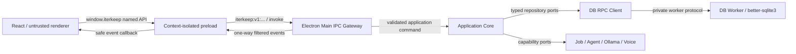
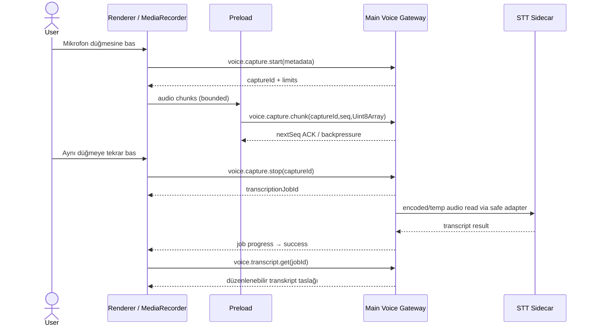

# Iterkeep — IPC Sözleşmeleri, Preload API, Zod Wire DTO ve Olay Akışları

> **Normatif amaç:** React Renderer ↔ Preload ↔ Electron Main arasında hangi **isimlendirilmiş API** yöntemlerinin bulunduğunu, hangi istek/yanıt Zod şemalarının geçtiğini, kimlik/doğrulama/izin kontrollerini, event ve stream iletişimini ve Main ↔ DB Worker arasında ayrı kullanılan RPC protokolünü kesinleştirmek. Geliştirme ajanı genel amaçlı `send(channel, payload)` köprüsü, renderer'dan çalışan SQL, keyfî filesystem erişimi veya geçersiz güven varsayımları ekleyemez.
>
> **Yetki:** Bu belge **IPC kanal kataloğu**, wire envelope, DTO doğrulaması, payload/timeout/rate limitleri, client proxy, olay transportu ve version negotiation için kanonik kaynaktır. Domain semantiği `DOC-08`; SQL/tables/migration `DOC-09`; transaction/idempotency/backup `DOC-10`; process ve launch `DOC-06`; dosya yolları `DOC-07`; job event sınıfları ve persistence `DOC-12`; provider/setup semantiği `DOC-18/19/24/25`; agent tool ve approval `DOC-26/27`; STT/TTS `DOC-28/29`; security `DOC-30`; kullanıcı hata ekranları `DOC-32` tarafından ayrıntılandırılır. Bu belge o yetki alanlarını yeniden tanımlamaz.
>
> **Kanıt:** Electron resmi IPC, contextBridge ve sender-validation dokümanları gözden geçirilmiştir. Kod blokları `@iterkeep/contracts` ve Electron iskeleti için **referans implementasyon**dur, henüz TypeScript/Electron ortamında derlenmiş değildir. Dökümana `implemented`, `verified` veya `approved` statüsü verilmez.

---

## 1. Temel iletişim kararı ve kapsam

### 1.1 Uçtan uca güven akışı



- **Renderer = güvenilmez sınır.** UI route veya buton varlığı yetki değildir.
- **Preload = dar arayüz.** Public API çağrıları yalnız adlandırılmış fonksiyonlar; kanal string'i UI'ya verilmez.
- **Main IPC Gateway = erişim kontrolü.** Sender, request size, schema, rate, workspace ve capability kontrollerini yönetir.
- **Application Core = tek iş kuralı.** UI/agent/import aynı use-case'leri kullanır.
- **DB Worker = tek SQLite sahibi.** Renderer veya agent SQL string'i gönderemez.
- **Event = bildirim.** Asıl veri sorgulanabilir snapshot veya kalıcı `domain_events` kaynağıdır; event delivery ACK değildir.

### 1.2 İnvariant kataloğu (`IPC-I-001–030`)

| ID | Kesin kural |
|---|---|
| IPC-I-001 | Sadece `window.iterkeep` public bridge dışarı açılır; `ipcRenderer`, Electron event nesnesi, Node, `fs` ve SQL açılmaz. |
| IPC-I-002 | Tüm kanallar `iterkeep:v1:<name>` önekiyle statik kayıtlıdır; dinamik kanal ismi yoktur. |
| IPC-I-003 | UI'dan gelen JSON/typed-array payload runtime'da Zod ile parse edilir; sadece TS interface güvenlik sayılmaz. |
| IPC-I-004 | Her `ipcMain.handle` senderFrame, ana frame, aktif pencere ve beklenen origin kontrolünden geçer. |
| IPC-I-005 | Dev server origin'i sadece development'ta, pin'lenmiş localhost adresi/port için geçerlidir; prod'da kabul edilmez. |
| IPC-I-006 | Renderer `actor`, `system`, `agentRunId` yetkisi, onay boolean'ı veya DB path belirleyemez. |
| IPC-I-007 | Main kendi `CommandContext.actor`, clock ve capability scope'unu doğrulanmış oturumdan türetir. |
| IPC-I-008 | Mutasyonlar güvenilir `idempotencyKey` taşır; retry aynı anahtarı kullanır. |
| IPC-I-009 | `requestId` her transport attempt için ayrı UUIDv4; `idempotencyKey` iş niyeti sabit kimliğidir. |
| IPC-I-010 | Bir mutasyonun timeout'u commit olmadığını ispatlamaz; `outcome: 'unknown'` ve receipt uzlaştırması kullanılır. |
| IPC-I-011 | Transaction başarı mesajı yalnız gerçek DB commit ACK'inden sonra çıkar. |
| IPC-I-012 | Hiçbir IPC handler `new Database()` veya `better-sqlite3` kullanmaz. |
| IPC-I-013 | Tüm public invoke yanıtları discriminated `ApiResult` biçimindedir; ham exception/stack dönmez. |
| IPC-I-014 | Request/response şema sürümü zorunludur; bilinmeyen major reddedilir. |
| IPC-I-015 | Pagination üst sınırı server'da uygulanır; renderer `limit:1000000` ile full-table çekemez. |
| IPC-I-016 | Büyük not body, ses ve binary, boyut sınırlı özel yoldan geçer; stream UI'nın main thread'ini doldurmaz. |
| IPC-I-017 | Her abonelik unsubscribe ve pencere kapatılınca otomatik cleanup destekler. |
| IPC-I-018 | Domain event'i commit sonrası çıkar, sıra numarası + snapshot/refetch kaçırılan event'i onarır. |
| IPC-I-019 | Agent token stream'i kalıcı domain-event sırası olarak kullanılmaz. |
| IPC-I-020 | Çok yavaş event abonesine sonsuz tampon yoktur; bounded coalescing/backpressure bulunur. |
| IPC-I-021 | Dialog seçiminin sonucu keyfî dosya yolu değil, amaç/süre/pencere ile bağlı opaque selection token'dır. |
| IPC-I-022 | Session/selection token hata loguna, renderer URL'sine veya exported Markdown'a yazılmaz. |
| IPC-I-023 | Capability disabled ise agent/voice API'ları `CAPABILITY_DISABLED` üretir; core sorguları etkilenmez. |
| IPC-I-024 | İlk açılış Ollama/STT/TTS'yi beklemez; eksik servis typed unavailable cevabıdır. |
| IPC-I-025 | Main/Worker/sidecar RPC'leri public renderer IPC kataloğundan ayrı protokollerdir. |
| IPC-I-026 | Cihaz doğrulaması ve permission kontrolü UI'daki gizlenmiş butona güvenmez. |
| IPC-I-027 | Ham tool argümanı, gizli prompt, kişisel not, ses buffer'ı audit/telemetry loglarına otomatik kopyalanmaz. |
| IPC-I-028 | IPC channel silme/yeniden adlandırma sürüm kırılmasıdır; `v2` ve geçiş testi ister. |
| IPC-I-029 | Her mutasyon ve yüksek etkili sorgu unit + integration + malicious sender testine sahiptir. |
| IPC-I-030 | Bu belgenin contract manifest'i ile gerçek kayıtlı handler listesi otomatik karşılaştırılır; yetimsiz method kalmaz. |

---

## 2. Wire tasarımının ortak tipleri

### 2.1 JSON ve structured clone ilkeleri

Electron IPC Structured Clone Algorithm kullanır; `Error`, sınıf örneği, DOM node, Electron nesnesi, `File` ve fonksiyon referansları public DTO değildir. `Date` yerine UTC RFC3339 millisecond string; `bigint` yerine gerektiğinde güvenli string; `Map` yerine JSON map/dizi; `undefined` yerine açıkça opsiyonel veya `null` kullanılır. `Uint8Array` sadece özel `voice.capture.chunk` endpoint'inde mümkündür; hiçbir object URL ve keyfî ArrayBuffer kalıcı tutulmaz.

- Kanonik kimlik **UUID v4 `string`**; DOM'dan alınan ya da DB'den dönen ID tekrar doğrulanır.
- Yerel takvim günü `YYYY-MM-DD`, olay zamanı `YYYY-MM-DDTHH:mm:ss.sssZ`.
- UTF-8 byte hesabı gerekirse `Buffer.byteLength` (Node) veya TextEncoder sonucu; `.length` byte sayısı değildir.
- İçerik limitleri `DOC-08`'in 120/300/200 code-point ve 2 MiB Markdown limitleriyle tam uyumludur.
- Şema `z.strictObject` kullanır, beklenmeyen `actor`, `sql`, `dbPath`, `approved` alanlarını kabul etmez.

### 2.2 Kanonik request/response ve hata envelope'u

**Dosya:** `packages/contracts/src/shared/{result,error-envelope,pagination}.ts` ve `packages/contracts/src/ipc/common.contracts.ts` (repo içindeki exact isim `DOC-07` sınırında uygunsa `ipc/common.contracts.ts` ilavesi onaylıdır).

```ts
import { z } from 'zod';

export const UuidV4Schema = z.uuidv4();
export const RequestIdSchema = UuidV4Schema;
export const IdempotencyKeySchema = UuidV4Schema;
export const CorrelationIdSchema = UuidV4Schema;

export const UtcMsSchema = z.string().regex(
  /^\d{4}-\d{2}-\d{2}T\d{2}:\d{2}:\d{2}\.\d{3}Z$/,
);
export const LocalDateSchema = z.iso.date(); // ayrıca YYYY-MM-DD exact kontrol

export const FailureCodeSchema = z.enum([
  'VALIDATION_FAILED','PAYLOAD_TOO_LARGE','NOT_FOUND','ALREADY_EXISTS',
  'CONFLICT_REVISION','INVALID_STATUS_TRANSITION','INBOX_PROTECTED',
  'INBOX_ALREADY_EXISTS','REFERENTIAL_INTEGRITY','LINK_CYCLE',
  'DECISION_HISTORY_PROTECTED','APPROVAL_REQUIRED','APPROVAL_EXPIRED',
  'PERMISSION_DENIED','INVALID_IDEMPOTENCY_KEY','IDEMPOTENCY_CONFLICT',
  'CORE_NOT_READY','WORKSPACE_UNAVAILABLE','SCHEMA_INCOMPATIBLE',
  'DATABASE_BUSY','DATABASE_DISK_FULL','DATABASE_CORRUPT','DB_WORKER_UNAVAILABLE',
  'DB_BACKPRESSURE','OPERATION_OUTCOME_UNKNOWN','TIMEOUT','CANCELLED',
  'CAPABILITY_DISABLED','PROVIDER_UNAVAILABLE','MODEL_UNAVAILABLE',
  'AUDIO_PERMISSION_DENIED','IMPORT_INVALID','EXPORT_FAILED','BACKUP_FAILED',
  'RESTORE_FAILED','INVALID_SELECTION_TOKEN','SELECTION_EXPIRED',
  'UNSUPPORTED_PROTOCOL','EVENT_GAP','RATE_LIMITED','INTERNAL_ERROR',
  // DOC-16: Import/export/Git domain-specific errors; no arbitrary code strings.
  'PORTABLE_UNSUPPORTED_VERSION','PORTABLE_MANIFEST_INVALID',
  'PORTABLE_HASH_MISMATCH','PORTABLE_METADATA_CONFLICT',
  'IMPORT_ARCHIVE_BOMB','IMPORT_ENTRY_LIMIT','IMPORT_PATH_INVALID',
  'IMPORT_FILE_TOO_LARGE','IMPORT_ASSET_TOO_LARGE','IMPORT_TOTAL_LIMIT',
  'IMPORT_METADATA_INVALID','IMPORT_PREVIEW_STALE','IMPORT_TARGET_CHANGED',
  'IMPORT_ASSET_RECOVERY_REQUIRED','EXPORT_TARGET_UNSAFE',
  'EXPORT_TARGET_CHANGED','EXPORT_INCOMPLETE','SOURCE_CHANGED',
  'GIT_UNAVAILABLE','GIT_REPO_NOT_DEDICATED','GIT_INDEX_CONFLICT',
  'GIT_PUSH_REQUIRES_APPROVAL','GIT_REMOTE_OUTCOME_UNKNOWN',
]);

export const SafeDetailsSchema = z.record(
  z.string().max(64), z.union([z.string().max(180), z.number(), z.boolean(), z.null()]),
);
export const ApiErrorSchema = z.strictObject({
  code: FailureCodeSchema,
  messageKey: z.string().regex(/^[a-z0-9_.-]{1,120}$/),
  retryable: z.boolean(),
  outcome: z.enum(['failed', 'unknown']),
  details: SafeDetailsSchema.default({}),
  retryAfterMs: z.number().int().min(0).max(60_000).nullable(),
});
export const ApiMetaSchema = z.strictObject({
  requestId: UuidV4Schema,
  serverTime: UtcMsSchema,
  protocolVersion: z.literal(1),
});

export function resultSchema<T extends z.ZodType>(data: T) {
  return z.discriminatedUnion('ok', [
    z.strictObject({ ok: z.literal(true), data, meta: ApiMetaSchema }),
    z.strictObject({ ok: z.literal(false), error: ApiErrorSchema, meta: ApiMetaSchema }),
  ]);
}
export type ApiResult<T> =
  | { ok: true; data: T; meta: z.infer<typeof ApiMetaSchema> }
  | { ok: false; error: z.infer<typeof ApiErrorSchema>; meta: z.infer<typeof ApiMetaSchema> };

export const BaseRequestSchema = z.strictObject({
  protocolVersion: z.literal(1),
  requestId: RequestIdSchema,
});
export const MutationMetaSchema = BaseRequestSchema.extend({
  idempotencyKey: IdempotencyKeySchema,
});
```

**Zod sürüm şartı:** `z.uuidv4()`, `z.iso.date()` ve `z.strictObject()` için `DOC-05`'te sabitlenen Zod 4 sürümü kullanılmalıdır. Eğer pin'lenen sürümde API uyuşmazsa yine Zod 4 içinde test edilmiş eşdeğer doğrulayıcıyla düzelt ve contract testi ekle; runtime doğrulamasını kaldırma. `UtcMsSchema` format regex'inden sonra takvim/geçerli tarih kontrolü ayrıca yapılır. `SafeDetailsSchema` güvenlik gereği `stack`, `path`, `sql`, `prompt`, `body`, `token` gibi anahtarları da explicit denylist ile reddeder; yukarıdaki kod parçası örnek çekirdektir.

### 2.3 İstek örneği ve başarı yanıtı

```json
{
  "protocolVersion": 1,
  "requestId": "d2b18e55-e9c8-4e2c-b19d-47aa6c86f002",
  "idempotencyKey": "3812d45e-7629-4e08-bf87-b332a8a1c1c9",
  "payload": {
    "projectId": "793c4898-9298-4057-9e1d-95d22e457d21",
    "title": "Memory modülünü test et",
    "priority": "high"
  }
}
```

```json
{
  "ok": true,
  "data": {"id":"bcb9f38b-cf43-456d-950d-f294780fabdd","revision":1},
  "meta": {
    "requestId":"d2b18e55-e9c8-4e2c-b19d-47aa6c86f002",
    "serverTime":"2026-10-10T14:15:00.000Z",
    "protocolVersion":1
  }
}
```

### 2.4 Hata kodlarının somut UI anlamı

| Kod | Etki | Kullanıcıya eylem | Yeniden deneme |
|---|---|---|---|
| `VALIDATION_FAILED`, `PAYLOAD_TOO_LARGE` | İstek reddedildi | Alanı düzelt | Aynı isteği kör tekrar etme |
| `NOT_FOUND`, `CONFLICT_REVISION` | Kaynak eski/silinmiş | Kaydı yenile/diff | Güncel revision ile yeni niyet |
| `CORE_NOT_READY`, `WORKSPACE_UNAVAILABLE` | Core henüz hazır değil | Setup/recovery | Kullanıcı durumu sonra tekrar kontrol eder |
| `DATABASE_BUSY`, `DB_BACKPRESSURE` | Bekleme/kilit | Kısa kontrollü retry | Receipt politikasıyla |
| `DATABASE_DISK_FULL`, `DATABASE_CORRUPT` | Kayıt riski | Recovery/backup ekranı | Otomatik kör tekrar yok |
| `OPERATION_OUTCOME_UNKNOWN` | Commit sonucu bilinmiyor | Durumu uzlaştır | **Aynı** idempotency key ile |
| `PROVIDER_UNAVAILABLE`, `MODEL_UNAVAILABLE` | Opsiyonel AI yok | Ayarlar/model manager | Core etkilenmez |
| `APPROVAL_REQUIRED`, `APPROVAL_EXPIRED` | Yetki eksik/süresi geçmiş | Yeni onay akışı | Eski approval token'ı tekrar kullanma |
| `PERMISSION_DENIED`, `INVALID_SELECTION_TOKEN` | Güvenlik sınırı | Uygun dialog/izin | Token değiştirmeden bypass yok |
| `EVENT_GAP` | Subscription'da sıra kaybı | Snapshot refetch | Resume cursor'ını güncelle |
| `INTERNAL_ERROR` | Bilinmeyen güvenli hata | Tanılama kodu | Gizli stack/SQL göstermeden |

`retryable=true`, tekrarın otomatik güvenli olduğu anlamına **tek başına** gelmez; mutation için receipt kontrolü ve komut semantiği de gerekli. `outcome='unknown'` iken başarılı toast yasaktır.

### 2.5 Payload ve iş süresi bütçeleri

| Sınıf | Gönderme üst sınırı | Yanıt üst sınırı | Main dispatch deadline başlangıcı | Davranış |
|---|---:|---:|---:|---|
| Core list/get/update (kısa) | 128 KiB | 1 MiB | 5 saniye | SQL worker DB `busy_timeout` dikkate alınır |
| Text search | 8 KiB | 512 KiB | 5 saniye | Son query generation'ı olmayan sonuç UI'da atılır |
| Document save/read | 2.2 MiB | 2.2 MiB | 10 saniye | İçerik üst sınırı DOC-08'de 2 MiB UTF-8 |
| Import/export/backup/restore başlatma | 64 KiB | 64 KiB | 10 saniye | Uzun iş job ID ile asenkron yürür |
| Agent run start/stop/status | 128 KiB | 128 KiB | 10 saniye | LLM üretimi IPC handler içinde beklenmez |
| Voice chunk | 64 KiB ikili | 4 KiB ACK | 5 saniye | Bounded queue ve sıra numarası |
| Event tek mesaj | — | 32 KiB | — | Özet metadata, büyük metin ayrı sorgu |

- İstek boyutuna raw serialization geçmeden önce **yaklaşık** alt maliyetli kontrol, parse sonrası deterministik UTF-8 byte hesabı ekle. Binary chunk byteLength ile kontrol edilir.
- `JSON.stringify` üzerinde güvenlik sayımı için stringify sırasında getter/toJSON yan etkisine güvenme: structured clone ve Zod ile düz veri kabul edilir, aşırı derinlik/özellik sayısı için ön limit uygulanır.
- Bütün immutable limits config altında tek kaynaktır: `packages/contracts/src/ipc/limits.ts`; UI ve Main aynı contract'ı import eder ama Main ayrıca uygular.
- İşin kuyrukta bekleme süresi toplam deadline'a dahildir. Deadline dolunca Main sonucu `unknown` olarak dönebilir; işlemin iptal olduğu varsayılmaz.
- AbortSignal JS nesnesi IPC ile taşınmaz; client isteği iptal edince request ID üzerinden iptal niyeti gönderir. Yazma transaction'ı iptal edilemediyse commit reconcile gerekir.
- 128 KiB üstü standart payload reddedilir; not endpoint'i istisnası keyfî nesne aktarım kapısı değildir.

---

## 3. Kanal adlandırma, public API ve sözleşme manifest'i

### 3.1 Statik metot haritası (kanonik)

Her satır: **`window.iterkeep.<namespace>.<method>` → `iterkeep:v1:<channel>`**. `Q` = query; `M` = mutation; `J` = start/cancel job; `D` = dialog; `S` = subscription management. Yalnız aşağıdaki yöntemler public. Bu liste gerçek `ContractRegistry` tarafından otomatik test edilir.

#### 3.1.1 Sistem / workspace / navigasyon (12)

| Public method | Channel suffix | Tür | Input → Output (öz) |
|---|---|---|---|
| `system.bootstrap()` | `system.bootstrap` | Q | `{} → BootstrapSnapshot` |
| `system.health()` | `system.health` | Q | `{} → {core,db,version,capabilitySummary}` |
| `system.getDiagnostics()` | `system.diagnostics` | Q | `{level:'safe'} → SanitizedDiagnostics` |
| `workspace.get()` | `workspace.get` | Q | `{} → WorkspaceSummary` |
| `workspace.listRecent()` | `workspace.listRecent` | Q | `{} → WorkspacePointerSummary[]` |
| `workspace.chooseFolder()` | `workspace.chooseFolder` | D | `{purpose:'create'\|'open'} → SelectionHandle\|null` |
| `workspace.create()` | `workspace.create` | M | `{selectionHandle,displayName} → WorkspaceSummary` |
| `workspace.open()` | `workspace.open` | M | `{selectionHandle} → WorkspaceSummary` |
| `workspace.updatePreferences()` | `workspace.preferences.update` | M | `{patch,expectedRevision} → Preferences` |
| `workspace.getPreferences()` | `workspace.preferences.get` | Q | `{} → Preferences` |
| `operations.getReceipt()` | `operations.receipt.get` | Q | `{idempotencyKey,commandName} → ReceiptStatus` |
| `system.openExternalUrl()` | `system.openExternalUrl` | M* | `{url,verifiedUserGestureToken} → {opened}`; yalnız politika izinli URL |

`M*`: `system.openExternalUrl` DB mutation değildir; one-shot gesture token + OS policy gerektirir. Genel `openUrl(string)` keyfî protokol/`file:` açamaz. `system.health` gizli path, token, prompt, user note içermez.

#### 3.1.2 Proje / görev / hızlı kayıt (17)

| Public method | Channel suffix | Tür | Input → Output |
|---|---|---|---|
| `projects.list()` | `projects.list` | Q | `{cursor?,limit?,status?,search?,tagIds?,sortBy?,direction?} → Page<ProjectSummary>` |
| `projects.get()` | `projects.get` | Q | `{projectId} → ProjectDetail` |
| `projects.getResume()` | `projects.resume` | Q | `{projectId} → ProjectResumeSnapshot` |
| `projects.create()` | `projects.create` | M | `{name,description?,priority?,tagIds?} → {id,revision}` |
| `projects.update()` | `projects.update` | M | `{projectId,patch,expectedRevision} → {revision}` |
| `projects.changeStatus()` | `projects.status` | M | `{projectId,status,expectedRevision} → {revision}` |
| `projects.trash()` | `projects.trash` | M | `{projectId,expectedRevision,approvalId?} → {revision}` |
| `projects.restore()` | `projects.restore` | M | `{projectId,expectedRevision} → {revision}` |
| `tasks.list()` | `tasks.list` | Q | `{projectId?,status?,priority?,due?,tagIds?,sortBy?,direction?,cursor?,limit?} → Page<TaskSummary>` |
| `tasks.get()` | `tasks.get` | Q | `{taskId} → TaskDetail` |
| `tasks.create()` | `tasks.create` | M | `{projectId?,title,bodyMarkdown?,priority?,dueDate?,tagIds?} → {id,revision}` |
| `tasks.update()` | `tasks.update` | M | `{taskId,patch,expectedRevision} → {revision}` |
| `tasks.changeStatus()` | `tasks.status` | M | `{taskId,status,expectedRevision} → {revision}` |
| `tasks.move()` | `tasks.move` | M | `{taskId,projectId,status?,sortOrder?,expectedRevision} → {revision}` |
| `tasks.reorder()` | `tasks.reorder` | M | `{projectId,status,orderedTaskIds,expectedRevisions} → {updatedIds}` |
| `tasks.trash()` | `tasks.trash` | M | `{taskId,expectedRevision} → {revision}` |
| `tasks.restore()` | `tasks.restore` | M | `{taskId,expectedRevision} → {revision}` |

**Inbox:** `tasks.create().projectId` eksikse Main, Application Core üzerinden mevcut workspace Inbox ID'sini çözerek kaydeder; `null` foreign key yazmaz. `projects.trash` sistem Inbox üzerinde asla izinli değildir. `tasks.reorder` için `orderedTaskIds` üst sınırı 250, sadece görünür scope, hiçbir yabancı projeden ID taşıyamaz. `TaskStatus` ve `Priority` değerleri `DOC-08` ile aynı.

#### 3.1.3 Doküman / karar / günlük / ilişki / arama / ekler (22)

| Public method | Channel suffix | Tür | Input → Output |
|---|---|---|---|
| `documents.list()` | `documents.list` | Q | `{projectId,cursor?,limit?,includeDeleted?} → Page<DocumentSummary>` |
| `documents.get()` | `documents.get` | Q | `{documentId} → DocumentDetail` |
| `documents.create()` | `documents.create` | M | `{projectId,title,bodyMarkdown,pinned?,tagIds?} → {id,revision}` |
| `documents.save()` | `documents.save` | M | `{documentId,expectedRevision,patch:{title?,bodyMarkdown?,pinned?,tagIds?}} → {revision,changed,savedAt}` |
| `documents.versions()` | `documents.versions` | Q | `{documentId,cursor?,limit?} → Page<VersionSummary>` |
| `documents.trash()` | `documents.trash` | M | `{documentId,expectedRevision} → {revision}` |
| `documents.restore()` | `documents.restore` | M | `{documentId,expectedRevision} → {revision}` |
| `decisions.list()` | `decisions.list` | Q | `{projectId,cursor?,status?} → Page<DecisionSummary>` |
| `decisions.get()` | `decisions.get` | Q | `{decisionId,revisionsCursor?} → DecisionDetail (bounded revisions page)` |
| `decisions.create()` | `decisions.create` | M | `{projectId,title,contextMarkdown,decisionMarkdown,rationaleMarkdown,...} → {id,revision}` |
| `decisions.revise()` | `decisions.revise` | M | `{decisionId,patch,expectedRevision,reason} → {revision}` (append revision) |
| `decisions.supersede()` | `decisions.supersede` | M | `{oldDecisionId,newDecisionId,expectedRevision,newExpectedRevision} → {revision}` |
| `activity.list()` | `activity.list` | Q | `{projectId,from?,to?,cursor?,limit?} → Page<ActivityLog>` |
| `activity.get()` | `activity.get` | Q | `{activityId} → ActivityLogDetail` (ID üzerinden güvenli tekil okuma; kaynak proje/ilişkili kayıt bilgisi; erişilemeyen kayıt `NOT_FOUND`) |
| `activity.append()` | `activity.append` | M | `{projectId,bodyMarkdown,occurredAt?,correctionOfId?,relatedTaskId?,relatedDecisionId?} → {id}` |
| `records.link()` | `records.link` | M | `{source:{kind,id},target:{kind,id},relationship} → {id}` |
| `records.unlink()` | `records.unlink` | M | `{linkId} → {removed}` |
| `attachments.list()` | `attachments.list` | Q | `{owner:{kind,id},cursor?,limit?} → Page<AttachmentSummary>` |
| `attachments.import()` | `attachments.import` | M | `{selectionHandle,owner:{kind,id}} → {id}` |
| `attachments.reveal()` | `attachments.reveal` | D | `{attachmentId} → {revealed}` |
| `attachments.trash()` | `attachments.trash` | M | `{attachmentId} → {deleted}` |
| `search.query()` | `search.query` | Q | `{query,types?,projectIds?,cursor?,limit?} → Page<SearchHit>` |

**DOC-14 uyumu:** Not create/save payload'larında `pinned/tagIds` vardır; `documents.save` patch biçimindedir. `activity.append`, `DOC-09` correction/related alanlarını kullanır. `attachments.*` güvenli asset işlemleridir, genel `fs`/path API değildir. Mutasyon `idempotencyKey`, payload değil **`MutationMetaSchema` envelope** parçasıdır. `documents.list(includeDeleted=true)` yalnız Trash görünümünde yetkili kullanıcı içindir.

`activity` **günlük** kullanıcı kaydıdır; tanılama logu değildir. Var olan karar/revision doğrudan overwrite edilmez; `decisions.revise` append-only history politikasına tabidir. `search.query` SQL/FTS MATCH string'ini olduğu gibi çalıştırmaz; `@iterkeep/search` ile normalize edilmiş güvenli arama dilini kullanır. `records.link` registry FK ve cycle policy'sini geçer.

#### 3.1.4 Aktarım, yedek, job ve setup (22)

| Public method | Channel suffix | Tür | Input → Output |
|---|---|---|---|
| `files.chooseImport()` | `files.chooseImport` | D | `{types:['markdown'\|'archive'\|'attachment']} → SelectionHandle\|null` |
| `files.chooseExportTarget()` | `files.chooseExportTarget` | D | `{kind:'directory'\|'file'} → SelectionHandle\|null` |
| `transfer.previewImport()` | `transfer.import.preview` | J | `{selectionHandle} → {jobId}` |
| `transfer.commitImport()` | `transfer.import.commit` | J | `{previewJobId,selectionIds,conflictPolicy} → {jobId}` |
| `transfer.exportMarkdown()` | `transfer.export.markdown` | J | `{selectionHandle,projectIds?,options} → {jobId}` |
| `transfer.getImportPreview()` | `transfer.import.preview.get` | Q | `{previewJobId,cursor?,limit?} → ImportPreviewPage` |
| `git.listProfiles()` | `git.profiles.list` | Q | `{} → ExportProfileSummary[]` |
| `git.getStatus()` | `git.status` | Q | `{exportProfileId} → GitStatus` |
| `git.commitExport()` | `git.commit` | J | `{exportProfileId,message} → {jobId}` |
| `git.pushExport()` | `git.push` | J | `{exportProfileId,approvalId} → {jobId}` |
| `backups.create()` | `backups.create` | J | `{destinationHandle?} → {jobId}` |
| `backups.list()` | `backups.list` | Q | `{cursor?,limit?} → Page<BackupSummary>` |
| `backups.previewRestore()` | `backups.restore.preview` | J | `{selectionHandle} → {jobId}` |
| `backups.commitRestore()` | `backups.restore.commit` | J | `{previewJobId,approvalId} → {jobId}` |
| `jobs.get()` | `jobs.get` | Q | `{jobId} → JobSnapshot` |
| `jobs.list()` | `jobs.list` | Q | `{states?,limit?,cursor?} → Page<JobSnapshot>` |
| `jobs.cancel()` | `jobs.cancel` | M | `{jobId} → {accepted}` |
| `setup.get()` | `setup.get` | Q | `{} → SetupSnapshot` |
| `setup.saveStep()` | `setup.saveStep` | M | `{step,preferencePatch} → SetupSnapshot` |
| `setup.complete()` | `setup.complete` | M | `{expectedRevision} → SetupSnapshot` |
| `capabilities.get()` | `capabilities.get` | Q | `{refresh?:boolean} → CapabilityOverview` (`features: Record<FeatureKey, {preference,health,stale,nextEligibleProbeAt}>`, `sampledAt`) |
| `capabilities.setPreference()` | `capabilities.preference.set` | M | `{capability:'ai'\|'stt'\|'tts',enabled} → FeaturePreferences` |

**DOC-16 tamamlayıcı sözleşmesi:** `transfer.getImportPreview` yalnız başarılı ve TTL'si geçmemiş `previewJobId` için en fazla 100 kayıt/sayfa döndürür; path veya token vermez. `git.listProfiles` yalnız güvenli `{id,displayTargetName,gitEnabled,lastExportAt,status}` özetini döndürür. `jobs.get` içinde terminal transfer/export işi `result` alanında bounded safe receipt (ör. `exportProfileId,manifestSha256,counts`) döndürebilir. DB'deki `background_jobs.result_json` sınırlı/şifre içermeyen snapshot'tır; önizleme dosyaları burada tutulmaz.

**İmport/restore** yalnız `preview → user confirms → commitJob` sürecinde ilerler; preview alınması hiç veri yazmaz (geçici iş verisi hariç). `git.push` ve restore onay gerektirir, gizli onay boolean'ı yasaktır. Tek workspace seçimi, çalışan job/DB worker koordinasyonuyla yapılır. `SelectionHandle` kurulumda seçilen dizinin path'ini gizlemez amaçlı değil, keyfî renderer path erişimini engellemek içindir.

#### 3.1.5 Ollama / model / agent / voice (25)

| Public method | Channel suffix | Tür | Input → Output |
|---|---|---|---|
| `models.detectOllama()` | `models.ollama.detect` | Q | `{explicit:true} → OllamaProbeSummary` |
| `models.listInstalled()` | `models.installed.list` | Q | `{} → ModelProfileSummary[]` |
| `models.listRecommended()` | `models.recommended.list` | Q | `{hardwareClass?} → ModelRecommendation[]` |
| `models.setActive()` | `models.active.set` | M | `{modelId} → ModelSelectionReceipt` |
| `models.startDownload()` | `models.download.start` | J | `{modelId,consent:true} → {jobId}` |
| `models.cancelDownload()` | `models.download.cancel` | M | `{jobId} → {accepted}` |
| `models.runBenchmark()` | `models.benchmark.start` | J | `{modelId} → {jobId}` |
| `conversations.list()` | `conversations.list` | Q | `{cursor?,limit?} → Page<ConversationSummary>` |
| `conversations.get()` | `conversations.get` | Q | `{conversationId} → ConversationSnapshot` |
| `conversations.create()` | `conversations.create` | M | `{projectId?,title?} → {id}` |
| `agent.startRun()` | `agent.run.start` | J | `{conversationId,message,projectId?} → {runId}` |
| `agent.getRun()` | `agent.run.get` | Q | `{runId} → AgentRunSnapshot` |
| `agent.cancelRun()` | `agent.run.cancel` | M | `{runId} → {accepted}` |
| `agent.getToolCalls()` | `agent.tools.list` | Q | `{runId} → SafeToolCallSummary[]` |
| `agent.getApprovals()` | `agent.approvals.list` | Q | `{runId?} → SafeApprovalSummary[]` |
| `agent.decideApproval()` | `agent.approvals.decide` | M | `{approvalId,decision:'approve'\|'deny',challengeNonce} → ApprovalReceipt` |
| `voice.getStatus()` | `voice.status` | Q | `{} → VoiceCapabilitySummary` |
| `voice.listComponents()` | `voice.components.list` | Q | `{feature?:'stt'\|'tts'} → VoiceComponentCatalogEntry[]` (bounded installed/recommended manifest summaries) |
| `voice.startComponentInstall()` | `voice.components.install.start` | J | `{componentId,consent:true} → {jobId}` (allowlisted app-managed download, no arbitrary URL) |
| `voice.startCapture()` | `voice.capture.start` | M | `{format,channelCount,sampleRate} → {captureId,limits}` |
| `voice.appendChunk()` | `voice.capture.chunk` | M† | `{captureId,seq,bytes:Uint8Array} → {nextSeq}` |
| `voice.stopCapture()` | `voice.capture.stop` | J | `{captureId} → {transcriptionJobId}` |
| `voice.cancelCapture()` | `voice.capture.cancel` | M | `{captureId} → {discarded}` |
| `voice.getTranscript()` | `voice.transcript.get` | Q | `{transcriptionJobId} → TranscriptionDraft` |
| `voice.speak()` | `voice.tts.start` | J | `{text,voiceId?} → {jobId}` |

**Voice install ADR VOICE-ADR-001 (2026-10-10):** `voice.listComponents` yalnız signed/allowlisted **yerel katalog manifestinden** STT/TTS runtime/model paketi ve `installed|missing|invalid|incompatible` durumlarını listeler. `voice.startComponentInstall` **açık kullanıcı onayı**, platform uyumu, signed manifest ve sabit `componentId` doğrulamasından sonra `voice_component_install` işi başlatır. Bu işlem Ollama'nın `models.startDownload` API'sini yeniden kullanmaz. Model/binary dosyası SQLite'da saklanmaz; yalnız job metadata kalıcıdır. Kurulum job'u sonucunda staged içerik SHA-256 ve imza doğrulamasından sonra atomik yerleştirilir. UI `jobs.get`, `jobs.cancel` ve `job.progress` olaylarıyla izler; iki yeni route ile toplam 101 olur. TTS bileşen katalog içerikleri `DOC-29`, STT katalog içerikleri `DOC-28` sahibidir.

`M†` = high-frequency chunk: normal mutation metadata/DB receipt **istemeyen**, session-sequence ve capture ID ile idempotent doğrulanan özel aktarım. Aynı chunk `(captureId, seq, SHA-256(bytes))` ile tekrar gelirse aynı ACK; farklı bytes ile aynı `seq` reddedilir. Raw audio buffer otomatik chat message değildir. Chunk'ların kendisi yalnız temp dosyada/serviste tutulur; varsayılan saklanmaz. `agent.decideApproval` tarafında `challengeNonce` onay yetkisi değildir: Main onay kaydını aynı `approvalId`, actor, risk, scope, TTL ve beklenen operation hash'iyle eşleştirir.

#### 3.1.6 Subscription / event kontrolü (3)

| Public method | Channel suffix | Tür | Input → Output |
|---|---|---|---|
| `events.subscribe()` | `events.subscribe` | S | `{topics,projectIds?,runIds?,jobIds?,sinceDomainSequence?} → {subscriptionId,domainCursor}` |
| `events.unsubscribe()` | `events.unsubscribe` | S | `{subscriptionId} → {unsubscribed}` |
| `events.getSince()` | `events.since` | Q | `{afterSequence,limit?} → {events,cursor,hasMore}` |

Olay taşıma kanalı **yalnız Main → Preload**: `iterkeep:v1:event`. Bu kanal `ipcMain.handle` ile genel çağrı endpoint'i yapılmaz. Preload `onEvent(listener)` fonksiyonuna doğrudan callback verir; Electron `event` nesnesini client'a geçirip genel kanal dinleyicisi açmaz.

### 3.2 Toplam manifest ve tekillik

- 12 system/workspace + 17 projects/tasks + 22 docs/decisions/activity/search/attachments + 22 import/jobs/setup + 25 AI/voice + 3 subscription = **101 named invoke route**.
- Event push `iterkeep:v1:event` ayrıca **1 yönlü transport**; 101 sayısına dahil değil.
- Bazı yüksek etkili işler V1 özellik kapsamına göre **feature gate** ile görünmez veya unavailable olabilir; manifestten sessizce eksiltmek yasak. Test ve modül kabul durumları `DOC-02/04` ile eşleştirilir.
- Tüm route'lar için schema manifest nesnesi, secure IPC registry ve Preload surface snapshot testi otomatik üretilir.
- `models.listRecommended` için renderer'ın verdiği `hardwareClass` güvenilir kaynak değildir; yerel prob sonucu Main karar verir. Renderer ancak `profilePreference` sunabilir; donanım sınıfını kendisi ilan edemez.

---

## 4. DTO sözleşmeleri — gerçek örnek şemalar

Aşağıdaki çekirdek şemalar **kanonik örnekler**dir; alan isimleri tablo sütunu değildir, `DOC-08` domain mapping'iyle birebir kavramsal uyum taşır. Katalogdaki kalan yöntemlerde `packages/contracts/src/ipc/*.contracts.ts` dosyaları **aynı deseni kullanarak** tam Zod `input`, `output` ve result schema'sını tanımlamadan handler yazılmaz. Kodlama ajanı `z.any()` ile boşluk bırakamaz.

### 4.1 Ortak ölçüm ve ID doğrulayıcıları

```ts
import { z } from 'zod';

const utf8Bytes = (s: string): number => new TextEncoder().encode(s).byteLength;
const codePoints = (s: string): number => [...s].length;
const normalizeTitle = (s: string) => s.trim().normalize('NFC');

export const ProjectNameSchema = z.string()
  .transform(normalizeTitle)
  .refine(s => codePoints(s) >= 1 && codePoints(s) <= 120, 'PROJECT_NAME_LENGTH');
export const TaskTitleSchema = z.string()
  .transform(normalizeTitle)
  .refine(s => !/[\r\n]/.test(s) && codePoints(s) >= 1 && codePoints(s) <= 300,
    'TASK_TITLE_LENGTH');
export const ShortTextSchema = z.string()
  .transform(s => s.replace(/\r\n?/g, '\n'))
  .refine(s => utf8Bytes(s) <= 2_000, 'SHORT_TEXT_TOO_LARGE');
export const MarkdownSchema = z.string()
  .transform(s => s.replace(/\r\n?/g, '\n'))
  .refine(s => utf8Bytes(s) <= 2 * 1024 * 1024, 'MARKDOWN_TOO_LARGE');
export const PageLimitSchema = z.number().int().min(1).max(100).default(40);
export const PositiveRevisionSchema = z.number().int().min(1).max(Number.MAX_SAFE_INTEGER);
export const TaskStatusSchema = z.enum(['todo','in_progress','blocked','done','cancelled']);
export const ProjectStatusSchema = z.enum(['active','paused','completed','archived']);
export const PrioritySchema = z.enum(['none','low','medium','high','urgent']);
export const CursorSchema = z.string().min(1).max(512).nullable().optional();
```

Client'taki `transform` ile Main parse sonuçları ayrışırsa server sonucu geçerlidir. Normalleştirilmiş canonical input idempotency hash'ine dahil edilir. Kural gereği kullanıcı içeriği anlamını bozan otomatik sansür, sessiz truncation ve gizli yeniden yazma yoktur.

### 4.2 Task create/get/list/update/status: örnek uçtan uca sözleşme

**Dosya:** `packages/contracts/src/ipc/task.contracts.ts`.

```ts
import { z } from 'zod';
import {
  UuidV4Schema, BaseRequestSchema, MutationMetaSchema,
} from './common.contracts';

export const TaskCreatePayload = z.strictObject({
  projectId: UuidV4Schema.optional(), // absent => current workspace Inbox
  title: TaskTitleSchema,
  bodyMarkdown: MarkdownSchema.optional(),
  priority: PrioritySchema.optional(),
  dueDate: LocalDateSchema.nullable().optional(),
  tagIds: z.array(UuidV4Schema).max(30).optional(),
});
export const TaskCreateRequest = MutationMetaSchema.extend({
  payload: TaskCreatePayload,
});
export const RevisionReceipt = z.strictObject({
  id: UuidV4Schema,
  revision: PositiveRevisionSchema,
});
export const TaskStatusPayload = z.strictObject({
  taskId: UuidV4Schema,
  status: TaskStatusSchema,
  expectedRevision: PositiveRevisionSchema,
});
export const TaskStatusRequest = MutationMetaSchema.extend({ payload: TaskStatusPayload });
export const TaskListRequest = BaseRequestSchema.extend({
  payload: z.strictObject({
    projectId: UuidV4Schema.optional(),
    status: z.array(TaskStatusSchema).max(5).optional(),
    priority: z.array(PrioritySchema).max(5).optional(),
    tagIds: z.array(UuidV4Schema).max(30).optional(),
    due: z.enum(['overdue', 'today', 'upcoming', 'no_date']).optional(),
    sortBy: z.enum(['manual', 'due_date', 'priority', 'updated_at']).default('manual'),
    direction: z.enum(['asc', 'desc']).default('asc'),
    cursor: CursorSchema,
    limit: PageLimitSchema,
  }),
});
```

`LocalDateSchema`, `TaskTitleSchema`, `PositiveRevisionSchema` ve diğer ortak öğeler gerçekte `@iterkeep/contracts` barrel export üzerinden import edilecektir. Yukarıdaki kısaltılmış örneklerde tüm import satırları gösterilmemiştir; gerçek kaynak dosyalarında TS `noImplicitAny`, `noUncheckedIndexedAccess` ve `strict` altında derlenme şarttır. `TaskStatus` geçiş kuralı yalnız `DOC-08` policy'sinden gelir; IPC yalnız enum + revision'ı doğrular.

### 4.3 Project CRUD DTO

```ts
export const ProjectCreatePayload = z.strictObject({
  name: ProjectNameSchema,
  description: ShortTextSchema.optional(),
  priority: PrioritySchema.optional(),
  tagIds: z.array(UuidV4Schema).max(30).optional(),
});
export const ProjectUpdatePayload = z.strictObject({
  projectId: UuidV4Schema,
  expectedRevision: PositiveRevisionSchema,
  patch: z.strictObject({
    name: ProjectNameSchema.optional(),
    description: ShortTextSchema.optional(),
    priority: PrioritySchema.optional(),
    tagIds: z.array(UuidV4Schema).max(30).optional(),
  }).refine(p => Object.keys(p).length > 0),
});

export const ProjectListRequest = BaseRequestSchema.extend({
  payload: z.strictObject({
    cursor: CursorSchema,
    limit: PageLimitSchema,
    status: z.array(ProjectStatusSchema).max(4).optional(),
    search: z.string().max(1024).optional(),
    tagIds: z.array(UuidV4Schema).max(30).optional(),
    sortBy: z.enum(['recent', 'name', 'status']).default('recent'),
    direction: z.enum(['asc', 'desc']).default('desc'),
  }),
});
```

**Liste ve patch kesinleşmesi (DOC-13 uyumu):** `tagIds` filtre ve patch değerleri aynı workspace'e ait, tekrarsız UUID'ler olmalıdır; duplicate ID runtime doğrulamada reddedilir. `projects.update.patch.tagIds` verilmişse proje etiketlerinin tüm kümesini atomik replace eder, verilmemişse aynen bırakır. `due='overdue'` ile `today/upcoming` hesapları `workspace_preferences.timezone` içindeki geçerli IANA zone'a göre **yerel takvim günü** ile yapılır; `no_date` null'dır. `sortBy/direction` cursor ile birlikte aynı query fingerprint'e bağlanır; tie-break `id` stabil olmalıdır. Kanban manuel sıralamada direction `asc` olur. Filtre/sıralama değişince önceki cursor geçersizdir. DB sorgu planları DOC-10 ve DOC-13'te uygulanır.

Project name yalnız create/update'da değişir; `kind`, Inbox özelliği, `revision` ve `lastActivityAt` renderer patch'inden yazılamaz. `projects.status` transition kontrolü application policy'dedir. `ProjectDetail` JSON-safe mapping (tag IDs, revision, timestamps) kullanır; `EntityMetadata` private internal alanlarını default serialize etme.

### 4.4 Document save ve çakışma DTO

```ts
export const DocumentSaveRequest = MutationMetaSchema.extend({
  payload: z.strictObject({
    documentId: UuidV4Schema,
    expectedRevision: PositiveRevisionSchema,
    bodyMarkdown: MarkdownSchema,
  }),
});
export const RevisionConflictDetails = z.strictObject({
  entityType: z.enum(['project','task','document','decision']),
  entityId: UuidV4Schema,
  expectedRevision: PositiveRevisionSchema,
  currentRevision: PositiveRevisionSchema,
});
```

- Çatışma olduğunda `CONFLICT_REVISION` + güvenli revision bilgisi; gizlice overwrite yapılmaz.
- UI kaydetme durumları `editing → saving → saved` yalnız commit sonrası; `unknown` durumunda `saved` olamaz.
- Auto-save birbiriyle yarışan eski taslakları sessizce son-yazan-kazan yapmaz. Tek editör lokasyonunda sıraya girer, yalnız güncel revision baz alınır.

### 4.5 Agent tool görünürlük ve izin DTO

```ts
export const AgentStartRunRequest = MutationMetaSchema.extend({
  payload: z.strictObject({
    conversationId: UuidV4Schema,
    projectId: UuidV4Schema.optional(),
    message: z.string().min(1).refine(s => utf8Bytes(s) <= 64 * 1024),
  }),
});
export const ApprovalDecisionRequest = MutationMetaSchema.extend({
  payload: z.strictObject({
    approvalId: UuidV4Schema,
    decision: z.enum(['approve','deny']),
    challengeNonce: z.string().min(16).max(256),
  }),
});
export const SafeToolCallSummary = z.strictObject({
  toolCallId: UuidV4Schema,
  runId: UuidV4Schema,
  displayName: z.string().max(120),
  state: z.enum(['proposed','awaiting_approval','running','succeeded','failed','denied','cancelled']),
  startedAt: UtcMsSchema.nullable(),
  finishedAt: UtcMsSchema.nullable(),
  durationMs: z.number().int().nonnegative().nullable(),
  safeInputSummary: z.string().max(400),
  safeOutputSummary: z.string().max(800).nullable(),
  errorCode: FailureCodeSchema.nullable(),
});
```

**Safe approval list DTO (`DOC-27` ile tamamlanan sözleşme):** Mevcut `agent.approvals.list` kanalı yeni kanal eklenmeden yalnız ilgili pencere sahibi için opsiyonel, tek seferlik `challengeNonce` döndürür. Bu alan varsayılan tanı/audit loguna, diğer pencere/agent event'ine veya provider input'una girmez. Nonce tek başına yetki değildir; `agent.approvals.decide` Main sender/session/window, risk, fingerprint, expiry ve revision doğrulamasını tekrar yapar. High-risk için Main-owned native dialog zorunludur.

```ts
export const SafeApprovalSummary = z.strictObject({
  approvalId: UuidV4Schema,
  runId: UuidV4Schema,
  toolCallId: UuidV4Schema,
  riskLevel: z.enum(['low','medium','high']),
  state: z.enum(['pending','approved','denied','expired','cancelled']),
  safeDescription: z.string().max(300),
  requestedAt: UtcMsSchema,
  expiresAt: UtcMsSchema,
  // Sadece Main tarafından doğrulanmış owner/window'a, pending approval için.
  challengeNonce: z.string().min(16).max(256).optional(),
});
```

**ToolCall state uyumu:** Public safe summary `state` adları veritabanındaki `tool_calls.status` değerleriyle aynı enum'dur: `proposed, awaiting_approval, running, succeeded, failed, denied, cancelled`. AgentRun'ın `queued` değeri bir **run** state'idir, tekil `ToolCall` state'i değildir. UI, `queued` gösterecekse yalnız geçici görsel sunum state'i olarak türetir. Farklı canonical persistent enum yaratılmaz.

Bu `state` değerleri UI görünüm sözleşmesidir; persistence'taki tam enum'un kanonik listesi `DOC-08/27` ile üretimde karşılaştırılır. Ham tool input/output ve chain-of-thought expose edilmez. Onay kaydı `DOC-27` policy'sine göre daha ayrıntılıdır, basit `challengeNonce` yetki devri değildir. Ayrıntı gösterme istenirse `agent.getToolCalls` güvenli daha kapsamlı redacted summary döndürür; bağımsız onaysız raw trace endpoint'i yoktur.

### 4.6 SelectionHandle ve workspace path

```ts
export const SelectionHandleSchema = z.strictObject({
  handle: z.string().min(32).max(128),
  purpose: z.enum(['workspace_create','workspace_open','import','export','backup','restore']),
  expiresAt: UtcMsSchema,
  displayName: z.string().min(1).max(240),
});
```

- Token server-generated cryptographically random (en az 128 bit entropy), renderer tarafından dosya yoluna dönüştürülmez.
- Main token→trusted absolute normalized path mapping'ini yalnız bellekte saklar; `webContents.id`, purpose ve TTL ile bağlar.
- Yeniden başlatma token'ı geçersiz kılar; dosya seçimi yeniden yapılır.
- Token bir defa kullanılmışsa veya işin çok aşamalı preview/commit sürecinde saklanacaksa, Main içindeki **job ticket** kalıcı ve scoped karşılığa geçer; renderer'a kalıcı keyfî path yetkisi verilmez.
- Preview için seçilen dosya daha sonra değişmişse signature/stat/hash karşılaştır; eski onayla yanlış içeriği commit etme.
- Path traversal/symlink/junction/reparse point, UNC/network share ve archive zip-slip kontrolleri `DOC-16/30` ile tamamlanır.

---

## 5. Güvenli Main kayıt ve Preload implementasyonu

### 5.1 Tek kaynak route registry

**Teknisyen görevi:** `packages/contracts/src/ipc/registry.ts` içinde method → channel → input schema → output schema → action class → capability → timeout → limits **tek manifest** tanımlanır. Ana Main handler ve Preload method grupları bu manifestin statik TS isimlerinden türetilir veya compile-time `satisfies` ile karşılaştırılır. UI'ya generic metot verilmez.

```ts
// packages/contracts/src/ipc/registry.ts — register shape reference
export const taskCreateRoute = {
  channel: 'iterkeep:v1:tasks.create',
  kind: 'mutation',
  request: TaskCreateRequest,
  response: resultSchema(RevisionReceipt),
  capability: 'core',
  requestLimitBytes: 128 * 1024,
  responseLimitBytes: 1024 * 1024,
  deadlineMs: 5_000,
} as const;
```

Gerçek route registry'de adlar salt string dizisi olamaz: Her route için `request` ve `response` schema zorunludur. Type-level test `keyof IterkeepApi` ile registry route sayısını karşılaştırır. Var olmayan route bind etmek, yanlış DTO döndürmek veya output parse etmeden JSON göndermek testte ve derlemede hata olmalıdır.

### 5.2 IPC sender doğrulaması

**Dosya:** `apps/desktop/src/main/ipc/validate-sender.ts`.

```ts
import type { BrowserWindow, IpcMainInvokeEvent } from 'electron';

export function assertTrustedInvokeSender(
  event: IpcMainInvokeEvent,
  appWindow: BrowserWindow,
  allowedOrigin: string,
): void {
  const frame = event.senderFrame;
  if (!frame) throw new Error('PERMISSION_DENIED');
  if (appWindow.isDestroyed() || event.sender !== appWindow.webContents) {
    throw new Error('PERMISSION_DENIED');
  }
  if (frame !== appWindow.webContents.mainFrame) {
    throw new Error('PERMISSION_DENIED');
  }
  // Prod: registered trusted app:// origin; Dev: exact startup Vite origin.
  if (frame.origin !== allowedOrigin) {
    throw new Error('PERMISSION_DENIED');
  }
}
```

Bu örnekte `allowedOrigin` renderer'dan gelmez; Electron Main composition root tarafından **protokol kaydı ve dev server gerçek portundan** türetilir. `http://localhost:*`, domain suffix, user-controlled URL veya `startsWith` eşleşmesi yasaktır. Dev `127.0.0.1` ile `localhost` keyfî aynı kabul edilmez. `app://iterkeep` şemasının Electron secure/standard register davranışı gerçekte doğrulanır. `frame === mainFrame` kıyası ilgili Electron pin sürümünde E2E test edilir. Main, uzak sayfaya gezinmeyi ayrıca engeller; bu kontrol navigasyon politikasının yerine geçmez.

### 5.3 Tek güvenli `ipcMain.handle` sarmalayıcısı

**Dosya:** `apps/desktop/src/main/ipc/ipc-gateway.ts`.

```ts
import { ipcMain, type IpcMainInvokeEvent } from 'electron';
import { randomUUID } from 'node:crypto';
import { taskCreateRoute } from '@iterkeep/contracts';

// Implementation sketch: exact port signatures wired by composition root.
export function registerTaskCreate(
  verifySender: (event: IpcMainInvokeEvent) => void,
  tasks: { create: (payload: unknown, context: unknown) => Promise<unknown> },
  nowUtc: () => string,
): void {
  ipcMain.handle(taskCreateRoute.channel, async (event, raw: unknown) => {
    const fallbackId = randomUUID();
    let requestId = fallbackId;
    try {
      verifySender(event);                             // FIRST: trust boundary
      enforceSize(raw, taskCreateRoute.requestLimitBytes);
      const parsed = taskCreateRoute.request.safeParse(raw);
      if (!parsed.success) return failure(fallbackId, 'VALIDATION_FAILED', nowUtc());
      requestId = parsed.data.requestId;
      enforceRateLimit(event.sender.id, taskCreateRoute.channel);
      assertCoreReady();
      const context = createUserCommandContext({
        correlationId: requestId,
        idempotencyKey: parsed.data.idempotencyKey,
        timestamp: nowUtc(),
      });                                             // actor is MAIN-owned
      const value = await tasks.create(parsed.data.payload, context);
      const result = success(requestId, value, nowUtc());
      return taskCreateRoute.response.parse(result); // RESPONSE validation
    } catch (err: unknown) {
      return mapToSafeFailure(err, requestId, nowUtc());
    }
  });
}
```

**Bu blok bilinçli referans kodudur:** `enforceSize`, `failure`, `enforceRateLimit`, `assertCoreReady`, `createUserCommandContext`, `success`, `mapToSafeFailure` gerçek production modüllerinde yazılıp test edilmeden çalışmaz. Uygulamada bu fonksiyonlar `ipc-gateway.ts` içindeki tek paylaşılan dispatcher'dan gelir, her endpoint için copy/paste tekrarı yapılmaz. `response.parse()` hatası dış kullanıcıya ham Zod stack taşımamalı; `INTERNAL_ERROR` ve redact edilmiş diagnostics verilmelidir. Sender hatası loglansa da renderer ham exception almaz.

### 5.4 Preload: yalnız isimlendirilmiş yöntemler

**Dosya:** `apps/desktop/src/preload/{index,client-api,invoke,subscribe}.ts`.

```ts
// preload/client-api.ts — typed surface reference
import { ipcRenderer } from 'electron';
import { TaskCreateRequest, taskCreateRoute } from '@iterkeep/contracts';

async function invokeCreateTask(input: unknown) {
  // Preload check UX içindir; Main'de tekrar mandatory.
  const req = TaskCreateRequest.parse(input);
  const raw = await ipcRenderer.invoke(taskCreateRoute.channel, req);
  return taskCreateRoute.response.parse(raw);
}

export const iterkeepApi = {
  tasks: {
    create: invokeCreateTask,
    // ...remaining explicit named methods; NO invoke(channel, ...)
  },
  events: {
    onEvent: subscribeSafeEvent,
  },
} as const;

// preload/index.ts
// contextBridge.exposeInMainWorld('iterkeep', iterkeepApi)
```

Kod yazımı sırasında `subscribeSafeEvent` sadece güvenli tipli DTO'yu callback'e verir, `(event, ...args)` Electron Event nesnesini atar. `window.iterkeep` declaration `apps/desktop/src/renderer/types/global.d.ts`'de `Readonly<IterkeepApi>` olur. Preload'ın `contextBridge` üzerinden fonksiyonlar sunarken plain verilerin kopyalanma/freeze davranışı için Electron pin sürümünde E2E test yapılır.

### 5.5 Subscription callback referans yönetimi

```ts
// preload/subscribe.ts — eventListener Electron event'ini dışarı sızdırmaz
const handlers = new Set<(e: PublicEvent) => void>();
let installed = false;

export function subscribeSafeEvent(callback: (e: PublicEvent) => void): () => void {
  if (typeof callback !== 'function') throw new TypeError('INVALID_CALLBACK');
  handlers.add(callback);
  if (!installed) {
    ipcRenderer.on('iterkeep:v1:event', (_electronEvent, payload: unknown) => {
      const result = PublicEventSchema.safeParse(payload);
      if (!result.success) return; // sanitized metrics; no raw payload logging
      for (const cb of [...handlers]) {
        try { cb(result.data); } catch { /* UI callback is isolated */ }
      }
    });
    installed = true;
  }
  return () => { handlers.delete(callback); };
}
```

Bu örnek tek preload lifecycle'ı içinde listener şişmesini engeller. Production'da dev HMR ve pencere teardown sırasında `ipcRenderer.off` ile cleanup gerekir; handler fonksiyon referansı saklanmalıdır. Subscription cleanup callback'i UI bileşeninin `useEffect` cleanup'ında çağrılır. Domain topic aboneliği yaratmak/iptal etmek ayrı `events.subscribe/unsubscribe` çağrısıdır; sadece local callback silmek server subscription'ını kapatmaz.

---

## 6. Event protokolü ve güvenilir yeniden senkronizasyon

### 6.1 Public event envelope

```ts
export const PublicEventSchema = z.discriminatedUnion('kind', [
  z.strictObject({
    kind: z.literal('domain.changed'),
    subscriptionId: UuidV4Schema,
    sequence: z.number().int().nonnegative(),
    entityType: z.enum(['project','task','document','decision','activity_log','record_link']),
    entityId: UuidV4Schema,
    change: z.enum(['created','updated','deleted','restored']),
    revision: PositiveRevisionSchema.nullable(),
  }),
  z.strictObject({
    kind: z.literal('job.progress'),
    subscriptionId: UuidV4Schema,
    jobId: UuidV4Schema,
    state: z.string().max(64),
    done: z.number().nonnegative().nullable(),
    total: z.number().nonnegative().nullable(),
    messageKey: z.string().max(120).nullable(),
  }),
  z.strictObject({
    kind: z.literal('agent.chunk'),
    subscriptionId: UuidV4Schema,
    runId: UuidV4Schema,
    streamSeq: z.number().int().nonnegative(),
    textDelta: z.string().max(4_096),
  }),
  z.strictObject({
    kind: z.literal('agent.step'),
    subscriptionId: UuidV4Schema,
    runId: UuidV4Schema,
    toolCallId: UuidV4Schema.nullable(),
    state: z.string().max(64),
    safeSummary: z.string().max(300),
  }),
  z.strictObject({
    kind: z.literal('capability.changed'),
    subscriptionId: UuidV4Schema,
    capability: z.enum(['ai','stt','tts']),
    state: z.string().max(64),
  }),
  z.strictObject({
    kind: z.literal('subscription.resync_required'),
    subscriptionId: UuidV4Schema,
    reason: z.enum(['sequence_gap','buffer_overflow','app_resumed','worker_restart']),
  }),
]);
```

`job.state`, `agent.step.state`, `capability.state` alanlarının tam enum'ları `DOC-08/12/19/27`'de; burada string üzerinden uydurulmuş durum üretmek yasaktır: gerçek manifestte ilgili `z.enum([...])` ortak contracts'a taşınır. `job.progress` tuple semantiğinde `done <= total` hem server hem UI'da enforce edilir. Public event, provider'ın ham HTTP stream'i değildir.

### 6.2 Domain event consistency algoritması

1. Renderer önce preload'da `onEvent` callback'ini bağlar.
2. `events.subscribe({topics:['domain.changed'], sinceDomainSequence:lastSeen})` çağırır. Main subscriber'ı **kayıt altına alır**, güncel durable domain cursor'ını atomik olarak alır, `subscriptionId,domainCursor` döndürür.
3. Renderer snapshot (`projects.list`, `tasks.list` vb.) yükler. Arada gelen domain delta event'lerini kısa bounded buffer'da tutar.
4. Snapshot'ın geçerliliğini teyit için `events.getSince({afterSequence: snapshotCursor})` akışı veya refetch uygulanır. V1'de snapshot ile sıra numarasının tutarlı yakalanması backend için gereksinimdir: request sırasında kullanılan `snapshotCursor` sorgu çıktısına eklenmeli veya snapshot + cursor aynı DB worker sıra bağlamında alınmalıdır. `DOC-10` transaction/worker sırasına uymayan yalnız UI tarihine dayanan yarış çözümü yasaktır.
5. `sequence` beklenenden farklıysa (gap), `subscription.resync_required` veya `EVENT_GAP`; kapsam snapshot yeniden alınır. Kaçırılan event'leri hayalî şekilde kendisi oluşturmaz.
6. Pencere navigasyonu/unmount/close → `events.unsubscribe`, local callback cleanup. Event broker client başına bounded capacity kullanır.
7. UI domain event'inden sonra sadece ilgili TanStack Query cache key'lerini invalidate eder. Olay payload'ına tüm not gövdesi konmaz.

`domain_events.sequence` global artan DB sequence'dir; subscription belirli bir project/topic filtresi kullanıyorsa sequence değerleri atlayabilir. **Filtered sequence gap**, global her numaranın ardışık beklenmesiyle yanlış tespit edilmez. Main, subscription'ın filtreli akışının devamlılık durumunu kendisi takip eder veya `events.getSince` ile global cursor karşılaştırır. `domainCursor` ile `agent.chunk.streamSeq` ayrı sayaçlardır.

### 6.3 Agent stream, job progress ve backpressure

- Token'lar 16–50 ms aralığında/büyüklük limiti içinde batch edilir; her tek token için React Query refetch yok.
- Main→UI stream memory budget örnek başlangıç 1 MiB/window. UI yavaşsa `job.progress` coalesce edilir, `agent.chunk` için partial buffer sınırlanır ve gerekirse `resync_required` bildirip `agent.getRun` snapshot'ına geri dönülür.
- `agent.step` tool çağrıları sadece izinli safe summary döndürür. Tool action timing, status, hata kodu ve onay durumu görülebilir; gizli internal reasoning loglanmaz.
- `agent.startRun` hemen `{runId}` döndürür. Gerçek üretim event subscription veya `agent.getRun` poll ile izlenir; `ipcMain.handle` LLM tamamlanıncaya kadar açık kalmaz.
- Job ilerlemesi `jobs.get` ile tekrar elde edilebilir. Geçici stream kaybı kalıcı işin durumunu `failed` yapmaz.
- Yüzde yalnız `total>0` ve geçerli `done` varsa; bilinmiyorsa indeterminate progress.
- User cancel isteği sadece `accepted` demektir; terminal `cancelled` durumu gelmedikçe sonuç kesinleşmez.

### 6.4 Lifecycle / multi-window

V1 varsayılan tek ana pencere kullanır. İkinci bağımsız pencere açılacaksa her pencere yetki, subscription ve selectionHandle izolasyonunu yeniden kurar. Pencere kapandığında event subscription, capture session ve transient selection token sonlandırılır; başlamış DB mutation idempotency receipt'i korunur. HMR tekrar mounting'de duplicate event ve duplicate mutation yaratmamalıdır.

---

## 7. DB worker özel RPC protokolü

`DB Worker RPC` Electron IPC'nin renderer'a açık bir bölümü değildir. `DOC-10 §5` ile aynı `DbOperation` allowlist'i kullanır. `apps/desktop/src/main/db/db-rpc-client.ts` ve `apps/desktop/src/workers/db.worker.ts` arasındaki `postMessage`'ler ayrı Zod doğrulamasından geçer.

### 7.1 Wire şeması

```ts
import { z } from 'zod';

export const DbOperationSchema = z.enum([
  'workspace.bootstrap','workspace.read',
  'projects.create','projects.read','projects.list','projects.update',
  'tasks.create','tasks.read','tasks.list','tasks.update',
  'documents.save','documents.read',
  'decisions.create','decisions.read',
  'activity.append','activity.list',
  'search.query','events.since','receipts.lookup',
  'maintenance.backup','maintenance.checkpoint',
  'maintenance.quick_check','maintenance.fts_rebuild',
]);
export const DbWorkerRequestBase = z.strictObject({
  protocolVersion: z.literal(1),
  requestId: UuidV4Schema,
  op: DbOperationSchema,
  timeoutMs: z.number().int().min(1).max(60_000),
  payload: z.unknown(), // replaced by discriminated op-specific union BEFORE dispatch
});
export const DbWorkerReplyBase = z.discriminatedUnion('ok', [
  z.strictObject({
    protocolVersion: z.literal(1),
    requestId: UuidV4Schema, ok: z.literal(true), result: z.unknown(),
  }),
  z.strictObject({
    protocolVersion: z.literal(1),
    requestId: UuidV4Schema, ok: z.literal(false),
    error: z.strictObject({
      code: z.string().max(80),
      retryable: z.boolean(),
      safeMessageKey: z.string().max(120),
    }),
  }),
]);
```

**Zorunlu üretim tamamlaması:** Base schema `z.unknown()` bir *dispatch hedefi* değildir. `DbOperationSchema` her değerine `operation`-spesifik payload/result şeması yazılır ve `z.discriminatedUnion('op', [...])` ile private registry oluşturulur. Testte `DbOperationSchema.options` ile registry tüm öğeler tam eşleşir. `DOC-10`'daki `DbWorkerRequest` örneğine burada `protocolVersion:1` eklenmesi **uyumlu protokol kesinleştirmesidir**; bu belge private wire için yetkilidir. Yazılı olarak `DOC-10` geriye dönük referansı bu güncel şemaya bağlanmalıdır.

### 7.2 Pending map, deadline ve unknown outcome

- Main `pending: Map<requestId,{resolve,reject,op,deadline,idempotencyKey?}>` tutar; worker id match olmadan resolve yasaktır.
- Worker pool **tek SQLite bağlantı sahibi**; diğer computation işleri başka worker/job pool'u kullanır.
- Worker exit/error bütün inflight request'leri `DB_WORKER_UNAVAILABLE` veya mutation için `OPERATION_OUTCOME_UNKNOWN` sınıfına taşır.
- Main request timeout sonunda Promise'i settle eder ama worker hâlâ commit edebilir; buna göre receipt reconcile başlatır.
- Yeniden başlatılan worker `handshake` göndererek `protocolVersion`, `schemaVersion`, `workspaceId`, `dbHealthy` bildirir. Yanlış protocol/schema ile çalışma reddedilir.
- `dbRpcClient` stale late reply'ları diagnostic counter'a ekleyebilir, fakat farklı request ID'ye teslim edemez.
- Graceful shutdown öncelikle yeni request almayı durdurur, kısa inflight transaction'ları drain eder, checkpoint sonra DB close; süre aşıldıysa sonraki açılış `quick_check`/receipt reconcile.

### 7.3 DB worker transport yetkisi ve cancellation

Main → DB worker request'leri başka renderer içeriğiyle karıştırılamaz. Worker girişinde `op` allowlist, payload schema, boyut ve deadline kontrolü tekrar çalışır. Worker tek bağlantı olduğundan yürütülmeye başlayan senkron SQL işleminde IPC cancel mesajı çoğu zaman anlık işlemeyecektir. `cancel` burada **best effort**dür; transaction atomikliğini bozacak sahte işlem durdurma vaadi verilmez. Uzun işler parçalara bölünür (`DOC-10/12`).

---

## 8. Kurulum, capability ve model manager protokolü

### 8.1 Setup ile capability'nin bağımsızlığı

- `setup.get()` kalıcı adım/preference bilgisini döndürür; `capabilities.get()` **anlık** health/probe snapshot'ını verir.
- Kullanıcının `ai.enabled=false` tercihi Ollama'nın sistemde kurulu olup olmadığından bağımsızdır.
- `setup.complete()` AI/STT/TTS yüklemelerini beklemez; workspace Core hazırsa bitirilebilir.
- AI sonradan açılınca `capabilities.setPreference` yalnız tercihi kaydeder ve Main capability manager isteğe göre async probe job yaratabilir; UI/SQLite bağımlılığı olmaz.
- Kullanıcı AI'yı kapatınca yeni agent run kabul edilmez, ilgili uygulama-owned run/capability kaynakları politika uyarınca iptal/durdurulur; sistem genelindeki harici Ollama servisleri keyfî durdurulmaz.

**DOC-19 uzlaştırması (2026-10-10; yeni kanal değil):** `capabilities.get({refresh?:boolean})` dört feature için `CapabilityOverview` döndürür. `DOC-08 CapabilitySnapshot` ise **bir tek feature'ın health kaydıdır**. Overview `features.ai|stt|tts|git` anahtarlarını; her biri için `preference: FeaturePreference`, `health: CapabilitySnapshot`, `stale:boolean`, `nextEligibleProbeAt:string|null` ve üstte `sampledAt` taşır. Varsayılan `{refresh:false}` önbellek snapshot'ını kısa sürede döndürür; `{refresh:true}` probe'u nonblocking single-flight başlatır ve ardından `capability.changed` event'i gelir. `setup.get()` henüz workspace oluşmadan çağrılırsa `WORKSPACE_UNAVAILABLE` tipli `ApiError` üretir; `system.bootstrap()` ilk kurulum yönlendirmesi için yetkilidir. UI başka bir `capabilities.refresh` kanalı veya yeni IPC yolu **uydurmaz**. Wire Zod şemaları `@iterkeep/contracts` içinde bu yapıyı doğrular; event tekrar snapshot alınması için bildirimdir.

### 8.2 Ollama probe / öneri / indirme

- `models.detectOllama` yalnız loopback/private allowlist adresi üzerinden, strict timeout ve SSRF korumasıyla sorgular. Renderer keyfî host/port veremez.
- `models.listInstalled` provider'ın gerçek listesine göre çalışır; stale cache “kurulu” iddiası olarak gösterilmez.
- `models.listRecommended` donanım tespitini Main tarafında kullanır; RAM/VRAM ve gerçek benchmark sonuçlarını `DOC-25` kurallarıyla puanlar.
- `models.startDownload` yalnız katalogdaki/imzalı verified model identifiers kabul eder, açık kullanıcı rızası ve yeterli disk alanı kontrolü gerekir.
- `jobId` sonuçta hemen döner. Pull progress `job.progress` olarak gelir; gerçek model hazır olup olmadığını final provider probe belirler.
- İndirme iptal/restart durumunda UI sağlayıcı status'unu tekrar uzlaştırır; `cancel accepted` indirme durdu garantisi değildir.
- Ollama'nın kendi depolama konumları keyfî IPC path üzerinden yazılmaz.

### 8.3 Agent güvenlik katmanı

`agent.startRun` metni modelden üretilen keyfî tool isteğine dönüşebilir. Public IPC sadece run isteği kabul eder; model sonucu **`@iterkeep/agent-runtime` içinde allowlisted tool invocation** olarak validate edilir. Bu invocation Main içinde renderer impersonation ile `window.iterkeep` çağrısı değildir; aynı `@iterkeep/application` command handler'larını, Main-derived `actor.kind='agent'` ve policy izinleriyle kullanır. Agent'a genel komut satırı çalıştırma, raw file write veya raw SQL aracı sunulmaz.

Kritik işlemlerde `agent.decideApproval` kullanıcı kararını yalnız persisted Main approval ile eşleştirir. İşlem/maliyet/kapsam/son kullanma bilgisi farklılaşırsa onay geçersizdir. Approval token ve challenge, genel bir yetki delegasyonu olarak saklanamaz.

---

## 9. Voice capture ve TTS taşıma sözleşmesi

### 9.1 Bas-konuş-bas akışı



- Mikrofon izni Renderer Chromium permission + Main permission handler ile doğrulanır; kayıt başlamadan görünür capture state.
- Ses biçimi `DOC-28` ile sabitlenen allowlist'e uymalı. Örnek: yalnız desteklenen mono PCM16 16 kHz veya doğrulanabilir container codec; client'ın `format` iddiası tek başına yeterli değildir, server decode/probe yapar.
- Başlangıç V1 bütçesi: **en fazla 10 dakika, 20 MiB geçici ses, parça başına 64 KiB**, toplam bekleyen en fazla 8 chunk; eşik gerçek ses biçimiyle DOC-28 testinde ayarlanır.
- Ana süreç chunk ACK vermeden client sınırsız chunk göndermeye devam etmez; queue overflow `DB_BACKPRESSURE` yerine ayrı `RATE_LIMITED`/voice-specific failure'a map edilir.
- Capture sequence artan tam sayı; duplicate aynı hash ise idempotent ACK, farklı hash ise validation error.
- Kullanıcı stop'a basınca **önce kayıt durdurulur**, kuyruğun ACK'leri drain edilir, sonra `voice.capture.stop` ile session seal edilip transcription başlatılır.
- Transkript görünür düzenlenebilir taslağa düşer; otomatik `tasks.create` ya da agent invocation yapılmaz.
- Capture temp files OS private dizinde, random basename ile saklanır; hata/iptal/kapanışta güvenli cleanup. Transcript kalıcı kayda dönüştürülmedikçe kullanıcı projesine yazılmaz.
- STT model kurulu değilse ön kontrol `CAPABILITY_DISABLED`/`PROVIDER_UNAVAILABLE`, ses kaydı alıp sonra kaybolacak şekilde sessizce ilerleme yok.

### 9.2 TTS

`voice.speak({text,voiceId?})` normalized text'i maksimum `DOC-29` segment boyutunda alır, `{jobId}` döner; audio output, `voice-client` sidecar adapter'ın stream/file result protokolüyle işletim sistemi medya yolu üzerinden çalınır. UI'ya devasa Base64 ses string'i IPC yanıtı olarak verilmez. Bir TTS hata verirse AI metin yanıtı bozulmaz. Ses kapalıysa TTS job açılmaz; Python/EMA zorunlu başlangıç bağımlılığı olmaz. Ses ve AI GPU kaynak koordinasyonu `DOC-24/29` Resource Manager'dadır.

### 9.3 Voice güvenliği testlerinin özü

Kayıt iptali, microphone permission denied, model yok, ses biçimi sahteciliği, random chunk sırası, duplicate seq, 10 dakika limit, anlık app quit, recorder crash, STT exit, buffer overflow, kullanıcı stop düğmesine hızlı çift basma, TTS sidecar unavailable senaryoları gerçek Windows runner'ında doğrulanacaktır.

---

## 10. IPC tehdit modeli ve istismar önlemleri

| Tehdit | İstismar örneği | Zorunlu kontrol |
|---|---|---|
| XSS / renderer compromise | `window.iterkeep.projects.trash(...)` | Sender/origin + application policy + confirm/approval, CSP, safe markdown rendering |
| Forged role | JSON `{actor:'system'}` | `strictObject` unknown key reject + actor Main-owned |
| Hidden SQL endpoint | `invoke('db.exec','DROP TABLE')` | Public generic SQL/IPC method yok, named routes |
| Arbitrary filesystem access | `import('/etc/passwd')` | Main dialog opaque purpose-scoped token, trusted path resolve |
| Forged approval | `{approved:true}` | Persisted approvalId + nonce + operation hash + scope/expiry check |
| Oversized data | 100 MiB Markdown/ses | Byte limits, size pre-check, chunking |
| Event leak | Abone farklı window/user context | subscription window ownership + filtering |
| Unlimited provider network | URL field `http://external` | Loopback allowlist, no generic fetch/proxy endpoint |
| Tool injection via note | Markdown 'ignore previous instructions' | Untrusted text classification; tool policy independent of LLM |
| Infinite process spawn | TTS/STT start spam | bounded jobs, capability quotas, subprocess manager |
| Replay/multiple clicks | Aynı task iki kere eklenir | idempotency key + receipt aynı transaction |
| Timeout uncertainty | UI hata verdi ama task eklendi | `unknown` + receipt reconciliation |
| Unbounded token stream | Renderer memory leak | coalescing, max buffered bytes, resync |
| Cross-origin iframe IPC | Third-party frame requests | `senderFrame` mainFrame + exact origin + navigation block |

**Güvenlik sınırı:** CSP/renderer sandbox + dar preload zararı azaltır ancak user-owned local application içinde mutlak güvenlik garantisi değildir. Agent/Ollama çıktıları saldırgan içerik olarak ele alınır. Resource-exhaustion testleri (`memory`, CPU, disk, stdout flood) DOC-30/31'de tekrar doğrulanır.

---

## 11. Uygulama sırası ve kod dosyası sahipliği

| Adım | Kod hedefi | Önkoşul | Çıktı |
|---|---|---|---|
| IPC-IMP-01 | `packages/contracts/src/ipc/common.contracts.ts` | DOC-08 | Common UUID, UTC, error, request/result schema |
| IPC-IMP-02 | `packages/contracts/src/ipc/*.contracts.ts` | IPC-IMP-01 | Her route input/output strict Zod |
| IPC-IMP-03 | `packages/contracts/src/ipc/registry.ts` | IPC-IMP-02 | 101 route static registry + typecheck |
| IPC-IMP-04 | `apps/desktop/src/main/ipc/validate-sender.ts` | DOC-06 app protocol | Origin/mainFrame/window allowlist |
| IPC-IMP-05 | `apps/desktop/src/main/ipc/ipc-gateway.ts` | 03–04 | Generic internal register helper, rate/size/deadline/response |
| IPC-IMP-06 | `apps/desktop/src/main/ipc/register-handlers.ts` | Application commands | Route→use case mapping, no SQL |
| IPC-IMP-07 | `apps/desktop/src/preload/{index,invoke,client-api}.ts` | Registry | `window.iterkeep` methods |
| IPC-IMP-08 | `apps/desktop/src/main/ipc/event-subscriptions.ts` | DOC-10 outbox | Filtered topic event broker |
| IPC-IMP-09 | `apps/desktop/src/preload/subscribe.ts` | Event contract | Event validation + unsubscribe |
| IPC-IMP-10 | `packages/contracts/src/worker/db-rpc.contracts.ts` | DOC-10 | Named op payload/result schemas |
| IPC-IMP-11 | `apps/desktop/src/main/db/db-rpc-client.ts` | Worker handshake | Pending/deadline/reconcile transport |
| IPC-IMP-12 | Renderer `shared/api` + hooks | Preload contract | React Query read/mutation integration |
| IPC-IMP-13 | `tests/integration/ipc-*`, `tests/security/ipc-*` | Hepsi | Mock + packaged IPC E2E |

Repository dosya yerleşimi `DOC-07` ile eşleşir. Yeni eklenen `contracts/src/ipc/common.contracts.ts`, `contracts/src/ipc/registry.ts` ve `contracts/src/ipc/limits.ts` mevcut klasör ağacının içinde alt dosyalardır; mimari paket değiştirmez. Modül başına her 1 method için 1 dosya zorunlu değildir; domain group bazında `.contracts.ts` tutulur.

### 11.1 Kodlama öncesi koşul

Geliştirici ajan şu önkoşullar sağlanmadan React ekranlarında gerçek `window.iterkeep` çağrılarını tamamlanmış saymaz:

1. Her route public method ↔ channel ↔ request/response type tam eşleşiyor.
2. Her route için Main sender doğrulama ve `safeParse` uygulanıyor.
3. DB read/write yalnız worker'da, use-case yetkisi Main/application'da.
4. IPC result `ok` durumları UI'da ayrıştırılıyor, hatalar i18n kodu üzerinden gösteriliyor.
5. `AppWindow` destroy/HMR/strict mode sonrasında leak yok.
6. Inflight unknown mutation retry receipt algoritması bağlanmış.
7. Electron packaged build'de preload ve worker dosya yolları test edilmiş.

---

## 12. Test sözleşmeleri (`IPC-T-001–048`)

| Test ID | Senaryo | Beklenen sonuç |
|---|---|---|
| IPC-T-001 | Registry unique channel | Aynı channel iki kez kayıt edilemez |
| IPC-T-002 | Registry public methods unique | Exposed method ↔ manifest tam eşleşir |
| IPC-T-003 | Eksik response schema | CI fail |
| IPC-T-004 | `window.iterkeep.invoke` arama | Generic IPC method yok |
| IPC-T-005 | Renderer `ipcRenderer` erişimi | Tanımsız/yasak |
| IPC-T-006 | Renderer Node `fs`/`child_process` import | Static boundary fail |
| IPC-T-007 | Valid request typed success | Result parse ve requestId korunur |
| IPC-T-008 | Yanlış protocolVersion | `UNSUPPORTED_PROTOCOL` |
| IPC-T-009 | Geçersiz UUID | `VALIDATION_FAILED` |
| IPC-T-010 | Bilinmeyen payload key | `VALIDATION_FAILED` |
| IPC-T-011 | Forged actor/system field | Yetki reddi |
| IPC-T-012 | Forged approved flag | Gerçek approval olmadan reddedilir |
| IPC-T-013 | iframe sender | `PERMISSION_DENIED` |
| IPC-T-014 | Other BrowserWindow sender | `PERMISSION_DENIED` |
| IPC-T-015 | Remote origin | `PERMISSION_DENIED` |
| IPC-T-016 | Dev origin production build'de | Reddedilir |
| IPC-T-017 | 2 MiB üstü Markdown | `PAYLOAD_TOO_LARGE` |
| IPC-T-018 | Markdown NFC/satır sonu korunumu | Semantik bozulmaz |
| IPC-T-019 | Yanlış UTC timestamp | Validation fails |
| IPC-T-020 | `limit>100` | Validation fails |
| IPC-T-021 | SQL injection benzeri search | SQL çalışmaz, güvenli arama parse edilir |
| IPC-T-022 | Project create DB commit fail | Success ACK çıkmaz |
| IPC-T-023 | Task create duplicate aynı key | Aynı task receipt |
| IPC-T-024 | Aynı key farklı payload | `IDEMPOTENCY_CONFLICT` |
| IPC-T-025 | Mutation timeout after commit | `unknown`→receipt success |
| IPC-T-026 | Worker crash before commit | Uzlaştırma, duplicate yok |
| IPC-T-027 | Task revision conflict | Güncel revision ile kullanıcıya conflict |
| IPC-T-028 | Inbox trash | `INBOX_PROTECTED` |
| IPC-T-029 | Read-only userData/DB locked | Typed read/error, içerik kaybı yok |
| IPC-T-030 | Subscription unsubscribe | Sonraki event callback'e gelmez |
| IPC-T-031 | StrictMode çift mount | Tek server abonelik / no leak |
| IPC-T-032 | Event buffer overflow | `resync_required` + snapshot |
| IPC-T-033 | Filtered global sequence gap | Yanlış gap alarmı yok |
| IPC-T-034 | Agent chunk burst | Bounded coalescing ve akıcı UI |
| IPC-T-035 | Tool summary redaction | Ham prompt/secret dışarı sızmaz |
| IPC-T-036 | Approval expired/fake | `APPROVAL_EXPIRED/PERMISSION_DENIED` |
| IPC-T-037 | AI disabled | Agent unavailable, core CRUD sağlıklı |
| IPC-T-038 | Ollama absent | Setup atlanabilir, app açılır |
| IPC-T-039 | Ollama enabled later | Async probe, UI bloklanmaz |
| IPC-T-040 | Model download request without consent | Reddedilir |
| IPC-T-041 | SelectionHandle wrong window | Reddedilir |
| IPC-T-042 | SelectionHandle expired | `SELECTION_EXPIRED` |
| IPC-T-043 | Restore preview modified before commit | Revalidate/abort |
| IPC-T-044 | Audio chunk out of order | Retry/reject, transkript bozulmaz |
| IPC-T-045 | Audio duplicate same seq/different hash | Reddedilir |
| IPC-T-046 | Audio 10 min/20 MiB overflow | Safe stop, temp cleanup |
| IPC-T-047 | Native packaged Electron on Windows | Preload/worker/IPC complete smoke |
| IPC-T-048 | Main window reload/shutdown | Pending request settle ve cleanup |

### 12.1 Test katmanları ve kanıt dosyaları

- **Unit (Vitest):** Zod strict parsing, UTF-8/code-point limits, request/result mapping, sealed event types, route uniqueness.
- **Integration:** Electron `ipcMain.handle` fake sender, Application Core fake service, DB worker mock, timeout/idempotency receipt, event/snapshot.
- **Security:** iframe, wrong origin, forged actor/approval, oversized bodies, path/token abuse, provider URL SSRF.
- **Packaged Windows E2E:** Production preload, native SQLite, lost worker, window reload, real microphone permission path (hardware-independent mock + manual hardware pass).
- **Evidence:** `.artifacts/ipc/contract-manifest.json`, `.artifacts/ipc/contract-tests.xml`, `.artifacts/ipc/security-report.json`, `.artifacts/ipc/packaged-smoke.json`. Bu dosyalar generated proof artifact'tir, repo içindeki runtime kaynaklar değildir.
- **Source mappings:** Gereksinim ve kullanıcı kabul senaryosu cross-reference `DOC-02`/`DOC-03`; gate tanımı `DOC-04`; ürün geliştirme roadmap `DOC-35`.

### 12.2 Manifest snapshot denetimi

`npm run verify:ipc` adlı root script `packages/contracts` registry'den JSON manifest üretir, Main handler adları ve `window.iterkeep` public method adlarıyla karşılaştırır. CI'da aşağıdakiler fail olur: bilinmeyen kanal; handler'sız route; Zod'suz route; response validate edilmeyen route; method adı çoğaltılması; yalnız dev'e kayıtlı olup production'da bulunmayan required route; resmi manifestte olmayıp preload'dan expose edilen method.

**Kritik:** `npm run verify:ipc` scriptinin var olması test çalıştırıldığına kanıt değildir. Geliştirme ajanı scripti ve fixture'ları gerçekten üretip çalıştırmalı; CI sonuçları DOC-04 kalite kapısı gereği saklanır.

---

## 13. Açık kararlar ve daha sonraki dokümanlara devredilen yetkiler

| Kod | Açık/bağlı konu | Hangi belge kesinleştirir? | Bu belgede sabitlenen sınır |
|---|---|---|---|
| IPC-OD-001 | Job priority, retries ve `JobState` enum | `DOC-12` | IPC typed jobId/snapshot/stream kullanır |
| IPC-OD-002 | Tam Markdown import file manifest | `DOC-16` | SelectionHandle + preview/commit |
| IPC-OD-003 | Restore/disk retention | `DOC-17` | Approval + consistent preview/commit |
| IPC-OD-004 | Setup step exact names | `DOC-18` | Setup persistent ≠ capability health |
| IPC-OD-005 | Capability state enum / probing | `DOC-19` | AI/STT/TTS opsiyonel ve nonblocking |
| IPC-OD-006 | Agent tool names/args | `DOC-26` | Application Core + policy, no SQL/shell |
| IPC-OD-007 | Approval risk/TTL/hash | `DOC-27` | User decision trusted Main record ile bağlanır |
| IPC-OD-008 | Audio format/codec | `DOC-28` | Chunk bounded, replay-safe, 10min/20MiB V1 target |
| IPC-OD-009 | TTS voice output/cache | `DOC-29` | TTS opsiyonel, Base64 audio IPC yok |
| IPC-OD-010 | CSP/URL allowlist/unsafe content | `DOC-30` | IPC sender/origin checks enforced |
| IPC-OD-011 | Exact P95 latency, RPC metrics | `DOC-31` | Start budgets in §2.5 need measurement |
| IPC-OD-012 | Kullanıcı hata UI metinleri / recovery | `DOC-32` | Typed error code + safe i18n key |

*Uygulama sırasında boşluk bulunduysa sessizce yeni method icat etme.* Yeni komut gereksinim olarak gerçekten gerekiyorsa docs change proposal → registry/Zod/handler/preload/test birlikte güncellenir. `DOC-11` sürümü bump edilir, `DOC-02/04` ile kapsam ve kalite eşleştirmesi güncellenir.

---

## 14. Definition of Done (belge vs yazılım)

### 14.1 Bu doküman için belge-DoD

- [x] Electron IPC ve Preload trust boundary ayrıldı.
- [x] Statik route kataloğu ve kanal isimleri belirlendi.
- [x] Zod request/response/error/result şekilleri tanımlandı.
- [x] Named method public API, error ve event modeline bağlandı.
- [x] DB Worker özel RPC ile public IPC ayrıştırıldı.
- [x] Sequence gap, timeout/unknown commit, idempotency ve abort davranışı açıklandı.
- [x] Setup, AI/agent ve voice capabilities kapalı iken güvenli davranış belirlendi.
- [x] Security, testing ve geçiş/versiyon kuralları tanımlandı.
- [ ] Bütün 101 route için tam `z.strictObject` request/output şemaları repo kodunda derlendi.
- [ ] Electron Main + Preload + DB Worker gerçek uygulama altında entegre edildi.
- [ ] Native packaged Windows IPC, zorlayıcı saldırı ve performans testleri çalıştı.

### 14.2 Yazılım için feature-DoD

IPC katmanı **uygulanmış** sayılmak için:

1. Contract typecheck ve runtime Zod testleri geçmeli.
2. `npm run verify:ipc` output route manifest birebir olmalı.
3. Renderer'dan `fs`, generic `ipcRenderer`, unsafe Node/SQL erişimi erişilemez olmalı.
4. Tüm mutation (DB write) endpoint'ler idempotency, revision ve Main actor policy'yi korumalı.
5. Worker crash, client timeout ve geç gelen yanıtlar yanlış başarı göstermemeli.
6. Subscription lifecycle ve hızlı stream yükünde memory/time budget ölçülmeli.
7. AI+voice olmadan açılış, core CRUD, search ve backup çalışmalı.
8. Packaged Windows production origins ve native DB worker başarıyla doğrulanmalı.
9. DOC-04 kalite kapıları açık test kanıtlarıyla PASS olmalı.

**İfade disiplini:** Bir belgenin hazırlanması veya örneklerin düzenlenmesi gerçek kodun derlenmiş/test edilmiş olduğu anlamına gelmez. Testler gerçekleştirilince belge `status` alanı yalnız hak edilmiş kanıt seviyesine yükseltilir.

---

## 15. Referanslar ve devretme notu

- Electron IPC `ipcRenderer.invoke`, structured clone ve event API: https://www.electronjs.org/docs/latest/api/ipc-renderer
- Electron `ipcMain.handle`: https://www.electronjs.org/docs/latest/api/ipc-main
- Electron `contextBridge`: https://www.electronjs.org/docs/latest/api/context-bridge
- Electron Security, sender validation: https://www.electronjs.org/docs/latest/tutorial/security/
- Electron IPC Guide: https://www.electronjs.org/docs/latest/tutorial/ipc
- Electron `MessagePortMain` / yüksek frekanslı gelecekteki transport: https://www.electronjs.org/docs/latest/api/message-port-main
- Zod 4 API: https://zod.dev/api
- `DOC-12` sıradaki doküman: job queue, persistent event/reconciliation, concurrency policies, renderer event cache, cancel/restart. Bu dokümanda belirlenen named IPC kanallarını yeniden adlandırmadan `DOC-12` olay ve job ayrıntılarını tamamlamalıdır.


> **VOICE-ADR-001 uyum güncellemesi (2026-10-10):** İsteğe bağlı STT/TTS runtime ve model paketlerinin uygulama içinden, güvenli katalog üzerinden kullanıcı onaylı indirilmesi için `voice_component_install` job / `voice.listComponents` ve `voice.startComponentInstall` sözleşmesi gerektiği yerde eşlendi. Bu tasarım değişikliği henüz çalışır kod kanıtı değildir.
