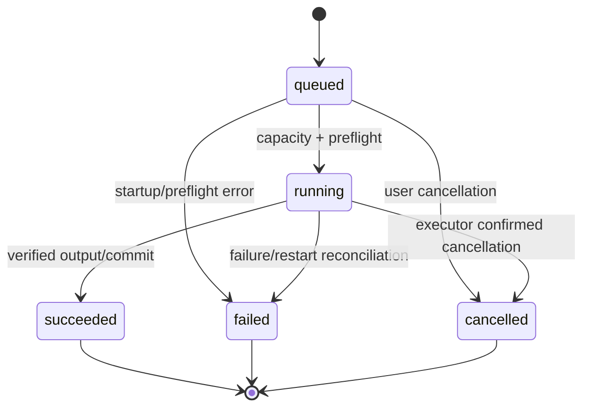

# Iterkeep — Durum, Arka Plan İşleri, Olaylar ve Kurtarma Sözleşmesi

> **Normatif hedef:** React UI, Electron Main, `@iterkeep/job-system`, Application Core ve SQLite DB Worker arasında uzun işleri **yanıltıcı başarı göstermeden**, UI'ı bloke etmeden, kullanıcı izni dışında yeniden çalıştırmadan, kaynakları ölçülü kullanarak yürütmek. İş yaşam döngüsü, yazma-onayı, eşzamanlılık, iptal, olay akışı, recovery ve görünür durumların yürütülebilir kurallarını tanımlamak.
>
> **Yetki sınırı:** Entity ve `JobKind`/`JobStatus` enum'ları DOC-08; `background_jobs` ve `domain_events` DDL'i DOC-09; transaction, idempotency ve DB worker DOC-10; **101 public IPC route ve event envelope** DOC-11; repository yolları DOC-07; AI provider DOC-25; agent run/onay DOC-26/27; ses DOC-28/29; performans eşikleri DOC-31; riskli hata kurtarma DOC-32; test CI DOC-33/34 yetkisindedir. **Bu belge iş zamanlayıcısı, yürütme kontrolü, olay sınıflaması, React state tutarlılığı ve crash reconciliation için tek normatif kaynaktır.** Yeni IPC route veya SQL tablosu icat etmez.
>
> **Kanıt durumu:** Bu dokümandaki algoritmalar ve referans kodlar **tasarımdır**; gerçek Electron/better-sqlite3/Windows ortamında çalıştırılmış sayılmaz. Önceki DOC-08/09 taslaklarındaki `JobKind` / DDL `CHECK` listesine `git_commit` ve `git_push` uyumu 2026-10-10'da işlenmiştir. DOC-09 migration yayınlanmadan bu değişiklik yapılmıştır. Kod ajanı ilk uygulamada bu güncel sürümleri kullanmalıdır.

---

## 1. Ürün bağlamı ve kapsam

İş (job), UI etkileşiminden daha uzun süren ve en azından `queued/running/terminal` olarak kullanıcıya izlenebilir kılınan işlemdir. **Görev (task)** ile karıştırılmaz: task kullanıcının planlama varlığıdır; job uygulama yürütümünün operasyonel varlığıdır. **AgentRun** ise ayrıca kaydedilen AI yürütümüdür; `background_jobs.kind='agent'` yoktur ve oluşturulamaz. `AgentRun` durum yönetimi DOC-26/27'de, genel yürütücü kaynak kuralları bu belgededir.

V1 şu iş türlerini kapsar:

| Kanonik `JobKind` | Başlatan public IPC | Sınır / sahibi | Yeniden açılışta varsayılan davranış |
|---|---|---|---|
| `model_download` | `models.startDownload()` | Ollama HTTP pull adapter | Otomatik tekrar yok; provider gerçeğini yeniden sorgula |
| `model_benchmark` | `models.runBenchmark()` | Ollama + benchmark runner | Kesintiye uğradıysa başarısız; kullanıcı tekrar başlatır |
| `voice_component_install` | `voice.startComponentInstall()` | Manifest-verified STT/TTS runtime/model download installer | Kesilen staging silinir/doğrulanır; açık kullanıcı kararı olmadan otomatik resume yok |
| `stt_transcribe` | `voice.stopCapture()` | Whisper sidecar | Geçici kayıt mevcut ve kullanıcı izin verirse yeni iş oluştur |
| `tts_synthesize` | `voice.speak()` | EMA Lightning sidecar | Otomatik tekrar yok |
| `import` | `transfer.previewImport()` / `commitImport()` | Import adapter + DB writer | Preview güvenli; commit otomatik tekrar edilmez |
| `export` | `transfer.exportMarkdown()` | Snapshot + file writer | Otomatik tekrar yok, eksik staging temizliği yapılır |
| `backup` | `backups.create()` | SQLite backup adapter | Tekrar yok; geçici çıktı doğrulanır/temizlenir |
| `restore` | `backups.previewRestore()` / `commitRestore()` | Restore Coordinator + host journal | Restore journal üzerinden özel uzlaştırma |
| `search_rebuild` | Main bakım politikası; public start yok | DB Worker bakım yolu | Yarıda kaldıysa kontrollü yeniden planlama, anlık auto-run yok |
| `git_commit` | `git.commitExport()` | Git adapter | `HEAD`/repo durumunu sorgula; otomatik ikinci commit yok |
| `git_push` | `git.pushExport()` | Git adapter | Remote sonucu belirsizse kontrol et; otomatik ikinci push yok |

**Ayrım:** `git_commit` ve `git_push` Git dış etkisine sahiptir; `J` türü IPC cevabının `{jobId}` olması, işlemin otomatik olarak güvenle tekrar edilebilir olduğunu **göstermez**. `Git push` ayrıca uygun risk onayı gerektirir. `setup` ve `capabilities` probe işlemleri kısa süreliyse doğrudan request olabilir; uzun tanılama jobs sistemine ancak kanonik tür/IPC şema değişikliği ile alınır.

### 1.1 Normatif değişmezler (`JSE-I-001–036`)

| ID | Zorunlu kural |
|---|---|
| JSE-I-001 | UI, Main, AI veya sidecar iş türü, durum ve kalıcılık şemasını kendi başına genişletemez. |
| JSE-I-002 | `JobStatus` yalnız DOC-08 altı değeridir: `queued`, `running`, `paused`, `succeeded`, `failed`, `cancelled`. |
| JSE-I-003 | `cancelling`, `waiting_resource`, `recovering`, `retrying` kullanıcı gösterim durumudur; **SQL status değildir**. |
| JSE-I-004 | Bir iş ancak DB'de job kaydı commit olduktan sonra `{jobId}` ile başarılı başlatılmış sayılır. |
| JSE-I-005 | Aynı kullanıcı niyeti ve idempotency key aynı job ID'ye bağlanır; iki iş oluşturulamaz. |
| JSE-I-006 | DB worker dışında hiç kimse `background_jobs` veya `domain_events` değiştiremez. |
| JSE-I-007 | SQL transaction boyunca dosya/GPU/network/model işlemine başlanmaz veya bunlar beklenmez. |
| JSE-I-008 | Worker/Main zaman aşımı, işin gerçekten durduğu veya commit etmediği kanıtı değildir. |
| JSE-I-009 | `jobs.cancel().accepted=true`, sadece iptal **talebinin alındığı** anlamına gelir. |
| JSE-I-010 | Terminal iş statüsü kalıcıdır; aynı job ID terminalden `queued`ya dönmez. |
| JSE-I-011 | Retry yeni `jobId` üretir ve doğrulanmış yeni başlatma niyeti ister; gizli tekrar yoktur. |
| JSE-I-012 | `attempt` o job ID'nin gerçek yürütme deneme sayısıdır; `queued` yeni işte 0, ilk koşmada 1'dir. |
| JSE-I-013 | Queue memory'si tek başına dayanıklılık kanıtı değildir; startup reconciliation zorunludur. |
| JSE-I-014 | Reboot sonrası hiçbir dış ağ, dosya değişimi, user data mutasyonu veya AI yürütmesi kendiliğinden yeniden çalışmaz. |
| JSE-I-015 | İşler UI penceresinden bağımsızdır; pencere kapanması tek başına `succeeded/failed` yaratmaz. |
| JSE-I-016 | Genel Main kapatmada işler güvenli sınırda durdurulur; DB worker işlem ortasında kör öldürülmez. |
| JSE-I-017 | AI, STT veya TTS kurulu değilse ilgili job `running` durumuna geçmez; core yine açılır. |
| JSE-I-018 | GPU/CPU/network/disk kaynak kapasiteleri tek Resource Manager tarafından denetlenir. |
| JSE-I-019 | Restorasyon/migration workspace mutasyonlarıyla paralel yürütülemez. |
| JSE-I-020 | Proje/görev event'i **commit sonrası** bildirilir, öncesi değil. |
| JSE-I-021 | DB `domain_events.sequence` UI outbox cursor'ıdır; token stream/job progress sıra numarası değildir. |
| JSE-I-022 | Event transport bir bildirimdir; asıl gerçek `jobs.get`, kanonik query ve durable outbox'tadır. |
| JSE-I-023 | UI subscription kaybolunca snapshot+cursor ile toparlar; kayıp token/progress uydurmaz. |
| JSE-I-024 | Filtreli domain event aboneliklerinde global sequence boşluğu hatalı alarm üretmez. |
| JSE-I-025 | İlerlemede `total=null` ise yüzde gösterilmez; `0 <= done <= total` sağlanır. |
| JSE-I-026 | Progress güncellemeleri/coalescing DB'yi ve React'i token başına yazma/render ile boğmaz. |
| JSE-I-027 | Raw prompt, transkript, kimlik, özel dosya yolu veya tool argümanları event/log'a sızdırılmaz. |
| JSE-I-028 | Main IPC sender ve yetki doğrulaması job başlatma, iptal ve abonelikte tekrar yapılır. |
| JSE-I-029 | Abonelikler pencereye/subscription ID'ye bağlıdır; kapatılınca dinleyici bırakılmaz. |
| JSE-I-030 | Restore tamamlanması eski `workspace.db` job satırının yeni DB'de bulunacağı varsayımına dayanmaz. |
| JSE-I-031 | Dış Git/HTTP sonuçları belirsizse UI `succeeded` ilan etmez; provider/doğrulama gerekir. |
| JSE-I-032 | `paused` V1'de kullanılmaz; gerçek pause/resume ve public resume API eklenmeden bu duruma geçilmez. |
| JSE-I-033 | AgentRun ayrı state machine'dir; background job diye yanlış kaydedilmez. |
| JSE-I-034 | `jobs.list` bounded/paginated; raw bütün geçmişi boot'ta load etmek yasaktır. |
| JSE-I-035 | Görev/iş kaybı, bekleyen riskli onay ve crash kullanıcıya sessizce saklanmaz. |
| JSE-I-036 | Repo'daki tüm durum adı, kanal ve veri türleri DOC-08/09/11 ile derleme ve fixture testinde eşleştirilir. |

---

### Voice component install ek sözleşmesi — VOICE-ADR-001

`voice_component_install` (`DOC-08/09/11` ile eşleşir), STT/TTS runtime veya model paketinin izinli manifest üzerinden indirilip doğrulanmasını temsil eder. `consent:true` sadece Main'in bu tıklamayı doğrulaması için kullanılır, tek başına kullanıcı yetkisi değildir. `componentId` allowlist katalog kimliğidir; renderer URL, hedef dosya yolu veya shell argv gönderemez. Bir iş `succeeded` olmadan **indirildi** denmez; indirme tamamlandıktan sonra checksum + platform compatibility + staged→active atomik değişim + smoke test gerekir. `failed`/`cancelled` işler DOC-12 gereği otomatik resume edilmez; kullanıcı doğrulama sonrası yeni job başlatabilir. `jobs.cancel` normal job iptalidir. Setup core tamamlanması install beklemez. DOC-28/29 güvenlik ve katalog ayrıntılarının tek sahipleridir.

## 2. Tek doğru durum makineleri

### 2.1 `BackgroundJob` kalıcı geçiş tablosu

| From | To | Tek yetkili gerekçe | DB etkisi |
|---|---|---|---|
| *none* | `queued` | Validated start + atomik receipt | INSERT, `attempt=0`, `finished_at=NULL` |
| `queued` | `running` | Runner lease / capacity acquired | `attempt=attempt+1`, `started_at=now` |
| `queued` | `cancelled` | Başlamamış iş kullanıcı isteğiyle silindi | `finished_at=now` |
| `queued` | `failed` | Başlatma preflight/restart sırasında gerekli bağlam yok | `finished_at=now`, `error_code` |
| `running` | `succeeded` | İş etkisi ve doğrulama tamam | `finished_at=now`, mümkünse final progress |
| `running` | `failed` | Kesin işlem hatası / crash reconciliation | `finished_at=now`, `error_code` |
| `running` | `cancelled` | Runner iptalin gerçek sonucu olduğunu doğruladı | `finished_at=now` |
| `paused` | `running` | **V1'de kullanılmaz** | Pause/resume eklenirse ayrı ADR |
| `running` | `paused` | **V1'de kullanılmaz** | Pause/resume eklenirse ayrı ADR |

Yukarıda olmayan her geçiş **reddedilir**. Succeeded iş tekrar `running` olamaz, failed iş sessizce yeni denemeye geçemez. Bir kullanıcı 'yeniden dene' seçeneğini seçtiğinde, aynı validasyonlardan geçen **yeni iş kaydı** oluşturulur. Eski iş geçmiş olarak kalır. DOC-09 tablo kısıtları `terminal => finished_at != NULL` şartını uygular; **uygulama ters şartı da uygular**: terminal olmayan satırda `finished_at=NULL`.



`cancel_requested` ve `waiting_resource` yalnız JobManager transient metadata'sıdır. `jobs.get()` çağrısındaki `status` bundan dolayı `running`/`queued` kalabilir. UI, aynı oturumdaki geçici iptal niyetini *İptal isteniyor* etiketiyle gösterebilir; uygulama yeniden açılışında bu etiketi kalıcı gerçek diye sunamaz. `pause` butonu V1 UI'da yoktur.

### 2.2 Tipli durum politikası (referans TypeScript)

**Yer:** `packages/job-system/src/job-manager.ts`; enum'lar `@iterkeep/domain`dan import edilir, yeniden tanımlanmaz.

```ts
import type { JobStatus } from '@iterkeep/domain';

const allowed: Readonly<Record<JobStatus, ReadonlySet<JobStatus>>> = {
  queued: new Set(['running', 'cancelled', 'failed']),
  running: new Set(['succeeded', 'failed', 'cancelled']),
  paused: new Set([]), // V1 never persists paused
  succeeded: new Set([]),
  failed: new Set([]),
  cancelled: new Set([]),
};

export function assertJobTransition(from: JobStatus, to: JobStatus): void {
  if (!allowed[from].has(to)) throw new Error('INVALID_JOB_TRANSITION');
}
export function isTerminalJob(status: JobStatus): boolean {
  return status === 'succeeded' || status === 'failed' || status === 'cancelled';
}
```

Durum geçişi yalnız `status` alanına `UPDATE` atmak değildir; `WHERE id=? AND status=?` ile compare-and-swap, etkilenen satır sayısı tam 1, `started_at`/`finished_at` ve progress invariant'ları birlikte doğrulanır. SQL'de sorgu sonucu 0 satırsa eski durum yeniden okunur ve typed `CONFLICT_REVISION` veya `INVALID_STATUS_TRANSITION` eşleniği döner. İptal isteğiyle worker terminal sonucu yarışırsa **başarı doğru iş gerçeğidir**; sonuç `succeeded` ise geriye `cancelled` yazılmaz.

### 2.3 AgentRun ile ilişki

`agent_runs.status` enum'u: `queued`, `running`, `awaiting_approval`, `completed`, `failed`, `cancelled` (DOC-09). Agent akışı ve tool onayı DOC-26/27'ye aittir. Ana kural: user cancel/AI disable altında yeni tool başlamaz; önceden commit olmuş kayıtlar silinmez. `awaiting_approval`, genel job'ın `paused` durumuyla **eşdeğer değildir**. Tool/approval event'leri snapshot kaynakları (`agent.getRun`, `agent.getToolCalls`, `agent.getApprovals`) ile doğrulanır; bellek içi token metni audit kaydı yerine geçmez.

---

## 3. JobManager yaşam döngüsü ve DB kalıcılığı

### 3.1 `start` iki aşamalı fakat tutarlı

1. Main sender doğrular; statik `DOC-11` route Zod ile parse edilir, izin/feature/selectionHandle/approval kontrollerinden geçer.
2. Application Core, **iş isteğinin canonical JSON** biçimini ve `idempotencyKey` değerini sabitler; `requestId` değişebilir ama key korunur.
3. DB worker tek transaction'da uygun `background_jobs` satırını ve `idempotency_receipts` yanıtını yazar (`DOC-10`). Bu, **işin kabul edildiği** andır; gerçek iş henüz başlamamış olabilir.
4. DB commit sonucu doğrulanınca Main `JobManager.enqueue(jobId, validatedEphemeralInput)` çağırır ve IPC `{jobId}` döner.
5. Başka işlerin kapasitesine göre queue scheduler işi çalıştırır. `queued` anında event yayınlanabilir; `jobs.get` kalıcı snapshot'tır.
6. DB commit oldu ama Main enqueue edemeden çöktüyse `queued` row kalır. Açılış reconciliation, payload eksik olduğundan işi **`failed/INTERRUPTED_BY_RESTART`** yapar. Kullanıcı yeniden başlatmayı seçebilir; işin kendiliğinden çalışması yasaktır.
7. Başlangıç IPC timeout veya DB reply kaybı varsa aynı idempotency key ile `operations.getReceipt` sorgulanır. Yeni anahtar/iş yaratılmaz.

`background_jobs` tablosunda job input JSON/checkpoint/lease bilgisi **yoktur**. V1 bu sebeple inputları yeniden oluşturarak otomatik işlem başlatma iddiasında bulunmaz. Hafıza içi `RunDescriptor` yalnız aynı process içinde yaşar. Persist edilebilen küçük kullanıcı seçimleri (ör. aktif model profil kimliği) mevcut kanonik tablolarda kalır; `background_jobs` içine SQL şema dışı kolon eklenmez. Otomatik resume gerçekten ürün gereksinimi hâline gelirse **yeni migration ve ADR** ile payload/lease/checkpoint tasarlanmalıdır.

### 3.2 DB Worker repository sözleşmesi

```ts
// packages/job-system/src/job-manager.ts (interface / port)
import type { BackgroundJob, JobKind, JobStatus } from '@iterkeep/domain';

export interface JobRepository {
  createAccepted(input: {
    jobId: string;
    kind: JobKind;
    correlationId: string;
    actor: 'user' | 'agent' | 'import' | 'system';
    actorRef: string;
    idempotencyKey: string;
    commandName: string;
    payloadHash: string;
    acceptedResultJson: string;
    utcNow: string;
  }): Promise<{ jobId: string; replayed: boolean }>;
  transition(input: {
    id: string;
    from: JobStatus;
    to: JobStatus;
    utcNow: string;
    errorCode?: string | null;
    finalProgress?: { done: number | null; total: number | null };
  }): Promise<boolean>;
  markStarted(id: string, utcNow: string): Promise<boolean>;
  updateProgress(id: string, done: number | null, total: number | null): Promise<void>;
  get(id: string): Promise<BackgroundJob | null>;
  list(input: { statuses?: JobStatus[]; cursor?: string; limit: number }): Promise<BackgroundJob[]>;
  findUnfinished(): Promise<BackgroundJob[]>;
}
```

**DOC-16 sonuç uyumu:** `background_jobs.result_json` terminal işlerin bounded, sanitize edilmiş sonuç receipt'ini saklayabilir. `JobRepository.transition` somut adaptörde `safeResultJson?` destekleyecek biçimde genişletilir; ham path, dosya içeriği, token, preview listesi DB job receipt'inde tutulmaz. Preview kayıtları `transfer.getImportPreview` ile ayrı süreli cache'den sayfalanır.

Bu interface, somut DB SQL'i yeni tablo olarak tanımlamaz. İzinli repository kodu `@iterkeep/storage-sqlite` içinde, worker RPC allowlist'i üzerinden çalışır. **ÖNEMLİ:** DOC-10'daki minimal `DbOperationSchema` örnek listesi henüz bütün job repository operasyonlarını göstermiyorsa implementasyon sırasında `DOC-10/11` private worker registry'si ile eş zamanlı **tipli allowlist genişletilir**. Bu, UI'ya `executeSql` kanalı açma izni değildir.

### 3.3 Öncelikli ama sınırlı queue

Başlangıç sınıfları kullanıcıya gösterilen seçenek değildir:

| Sınıf | Örnek | Öncelik | Kapasite / davranış |
|---|---|---:|---|
| `interactive` | `stt_transcribe` (kullanıcı bekliyor), kısa agent generation | 0 | Zaman duyarlı, diğer GPU yüküyle kontrollü paylaşım |
| `user_action` | `import`, `export`, `backup`, `git_commit`, `git_push`, `restore` | 1 | Çakışma/izin ilişkisiyle sınırlanır |
| `download` | `model_download`, `voice_component_install` | 2 | Bounded network ve user consent |
| `maintenance` | `search_rebuild`, `model_benchmark`, düşük öncelikli refresh | 3 | Yalnız sistem boşsa veya kullanıcı açıkça başlattıysa |

Başlangıç bütçesi (ölçülecek; DOC-31'e taşınır): **aynı anda en fazla 2 genel ağır iş**, **1 GPU yoğun çıkarım**, **1 model indirmesi**, **1 DB exclusive bakım işi**, **1 workspace restore**, model benchmark sırasında interactive STT varsa benchmark başlatılmaz. Limitler tahminidir; referans cihaz ölçümleri bu bütçeleri ayarlar. Eşzamanlı olmayan DB worker ayrı bir seri kuyruk kullanır; uzun `better-sqlite3` işlemi worker'ı bloke edebilir. V1 için ağır SQL maintenance güvenli parçalara bölünür.

Adalet: Aynı öncelikte FIFO (job `created_at` + ID). Düşük önceliğin süresiz aç kalmaması için 30 saniyeden uzun bekleyen iş bir scheduler *age* puanı kazanabilir; ancak riskli bir işlemi kullanıcı izni olmadan başlatamaz ve GPU interaktif işini zorla kesemez. Tek bir tür 1000 queued job ile RAM/DB şişiremez: aktif kuyruk limiti (ör. 200) aşılırsa `JOB_QUEUE_FULL`, kullanıcıya güvenli hata; en fazla 100 görünür liste kaydı sayfalama başına.

### 3.4 Kaynak kilitleri, yarışma ve UI duyarlılığı

Resource Manager global kaynak tipleri: `cpu_heavy`, `gpu_inference`, `network_download`, `workspace_read`, `workspace_write`, `workspace_exclusive`, `voice_capture`, `git_repo_write`. Bütün job'lar runner registry'de ihtiyaç duyduğu kaynakları **sabit ve test edilebilir** şekilde bildirir. Kilitleri tek sıralamayla al (`workspace_exclusive → workspace_write → git_repo_write → gpu_inference → network_download → cpu_heavy`) veya merkezi atomik çok-kaynak `tryAcquire` kullan; parça parça kilit alıp bekleme **deadlock** riskidir.

- `restore` workspace-exclusive: Yeni mutasyon / import / DB bakım kabul edilmez; Main ilgili pencerelerde restore görünümünü ve korunmuş host journal'ı gösterir. Kullanıcı açık onayı şarttır.
- `backup` SQLite Online Backup API ile tutarlı snapshot alır; **uzun süre tüm okuma/yazmaları kilitleyen** dış mutex şartı değildir. Backup hedef dosyası yine tekil ve güvenli olmalıdır.
- `model_download` ile `gpu_inference` aynı kaynak değildir: indirme ağ/disk tüketir, yükleme/benchmark VRAM tüketir. Kullanıcı tarayıcısındaki farklı Ollama işlerini bizim süreç sahiplenemez.
- `git_push` ağ erişimi gerektirir; network download limitinden bağımsız **açık kullanıcı isteği ve onay** ister. Harici repo durumuna göre reconciliation yapılır.
- `stt_transcribe` ve `tts_synthesize` same shared GPU device üzerinde sıraya girebilir; CPU fallback varsa kullanıcı tercihi ve başarı ölçümüyle uygulanır.
- 20 ms'lik UI thread bloklanması bile gözlenmelidir; job scheduler Renderer içinde çalışmaz.

Kapasite bulamazsa iş `queued` kalır; gerçek SQL status `'waiting_resource'` yazılmaz. Kaynak edinme başarısızlığı normal `failed` değildir. Kuyruk bekleme süresi ve bağımlılık bilgisi tanılama metriklerine yazılır, özel kullanıcı içeriği yazılmaz.

### 3.5 `JobRunner` sözleşmesi ve sahipliği

```ts
// packages/job-system/src/job-runner.ts — mimari iskelet
import type { JobKind } from '@iterkeep/domain';

export type ResourceName =
  | 'cpu_heavy' | 'gpu_inference' | 'network_download'
  | 'workspace_read' | 'workspace_write' | 'workspace_exclusive'
  | 'voice_capture' | 'git_repo_write';

export type JobOutput = Readonly<{
  receiptId?: string;
  safeSummaryKey: string;
}>;

export interface RunnerContext {
  readonly jobId: string;
  readonly signal: AbortSignal;
  readonly reportProgress: (done: number | null, total: number | null) => Promise<void>;
  readonly assertNotCancelled: () => void;
  readonly nowUtc: () => string;
}

export interface JobRunner<TInput = unknown> {
  readonly kind: JobKind;
  readonly requiredResources: readonly ResourceName[];
  preflight(input: TInput): Promise<void>; // no dangerous side effects
  run(input: TInput, ctx: RunnerContext): Promise<JobOutput>;
  reconcileAfterInterruption?(jobId: string): Promise<'verified_done' | 'unknown' | 'not_done'>;
}
```

`preflight` sırf kontrol amaçlıdır: yeni dosya yaratmaz, Git push yapmaz, model indirme başlatmaz. Kaynak rezervasyonu ve persistent `running` durumundan sonra **gerçek** side-effect başlayabilir. Runner kaydı Main composition root altında `register-job-runners.ts` ile statik eşleşir. Renderer veya eklenti `JobRunner` inject edemez.

`run` hatası terminale geçmeden güvenli `error_code` ile normalize edilir; raw stack sadece user opt-in sanitized diagnostics'e düşebilir. Runner kaynağı serbest bırakmayı `finally` ile yapar. DB transaction commit'inden hemen sonra fakat `succeeded` status'u yazılmadan process çökerse **sonuç belirsizdir**, job otomatik yeniden çalışmaz; external/projeye ait sonuç ayrı doğrulanır.

---

## 4. İptal, deadline, retry ve sonuç belirsizliği

### 4.1 İptal sözleşmesi

`jobs.cancel({jobId})` (DOC-11) yalnız **kullanıcının veya doğrulanmış application policy'nin** yetkili olduğu aktif işe uygulanır.

| Gerçek durum | IPC cevabı | Beklenen davranış |
|---|---|---|
| `queued`, runner başlamamış | `{accepted:true}` | DB transaction ile `cancelled`; start yasak |
| `running`, iptal destekli | `{accepted:true}` | In-memory AbortController tetiklenir; runner doğrularsa terminal `cancelled` |
| `running`, commit/OS çağrısı ortasında | `{accepted:true}` | İstek alınır; gerçek sonuç `succeeded` de olabilir |
| `succeeded`/`failed`/`cancelled` | `{accepted:false}` | Değişiklik yok; gerçek terminal snapshot geri okunur |
| Başkasına ait / bilinmeyen job | Güvenli hata | Unauthorized kabul edilmez; ID tahmini yetki sağlamaz |

`models.cancelDownload({jobId})` aynı general cancellation service'ine bağlanır fakat önce `kind==='model_download'` kontrolü yapar. UI `accepted=true` sonrasında *İptal isteniyor* gösterebilir, **İptal edildi** gösteremez. `AbortSignal` sadece process içi bir sinyaldir; IPC ile JS nesnesi gönderilmez. `AbortController` kimliği job manager'da tutulur; process kapanışında persistent değildir.

### 4.2 Deadline türleri

- **IPC acceptance deadline:** DOC-11'e göre J başlatma en fazla 10 saniye içinde `{jobId}` veya typed hata döndürür; uzun işin tamamını beklemez.
- **Queue wait deadline:** İşin neden beklediği gözlenir; keyfî kısa timeout'la tüm işler `failed` yapılmaz. Kullanıcı iptal edebilir.
- **Runner idle timeout:** Progress/heartbeat olmayan sağlayıcılar için sabit bir değer uydurulmaz; DOC-25/28/29 provider profiline göre timeout.
- **Absolute operation timeout:** Model download, ses işleme ve Git komutu türüne özgü sonlandırma/uyarı politikasına sahiptir; `DOC-32` hata semantiği devreye girer.
- **DB worker RPC timeout:** `DOC-10/11` sözleşmesine göre sonucu **unknown** olabilir. Yeni job/iş yaratmadan receipt ve snapshot uzlaştırılır.

### 4.3 Retry sınıflaması

| Durum | Otomatik tekrar? | Koşul |
|---|---|---|
| Progress event kaybı | Gerekmez | `jobs.get` snapshot yenile |
| Read-only health probe | Sınırlı evet | Exponential backoff + jitter; provider'a yüklenme yok |
| `SQLITE_BUSY` kontrolü | DOC-10'a göre sınırlı | `busy_timeout` etkisi dahil; mutasyon receipt kontrolü |
| Başlamamış saf, salt-okuma sorgu | Kontrollü | Deadline ve risk politikası |
| Model pull bağlantısı kesildi | Varsayılan hayır | Kullanıcı yeniden seçer; provider zaten indiriyorsa önce reconcile |
| Git commit/push timeout | **Hayır** | HEAD/remote karşılaştırmadan tekrar yok |
| Import/restore/backup side-effect | **Hayır** | Önden/sonra doğrulama, yeni niyet ve gerekirse restore journal |
| Agent tool mutasyonu | **Hayır (kör)** | `idempotencyKey`, receipt ve policy tekrar doğrulanır |
| STT/TTS hesaplaması | Kullanıcı isteğiyle | Temp input var mı/izin sürüyor mu, yeni job ID |

`retryable:true` bir hata cevabı, otomatik yeniden deneme izni **değildir**. Dış etki ve commit bilinmiyorsa aynı `idempotencyKey` üzerinden gerçek sonuç önce sorgulanır. Yeni job kullanıcı niyeti/işlem idempotency politikasına göre doğar.

### 4.4 Başlatma/iptal yarışı ve commit penceresi

1. Scheduler kaynakları aldı, `queued→running` DB CAS yaptı.
2. Kullanıcı `cancel` seçti. Main signal tetikler.
3. Runner abort'u kontrol eder; işlem henüz etki yaratmadıysa güvenli sonlandırır.
4. Eğer provider cevaplamış/Git push tamamlanmış/SQLite commit olmuşsa `succeeded` veya doğrulanabilir terminal gerçekliği seçilir.
5. IPC `cancel.accepted=true` UI'da nihai durum olarak asla kullanılmaz.
6. `DB worker` cevap vermezse `OPERATION_OUTCOME_UNKNOWN`, sonra receipt / query uzlaştırma ve kontrollü error screen.

---

## 5. Uygulama yeniden başlatma ve güvenilir toparlanma

### 5.1 Boot-time reconciliation algoritması

Açılış kritik yolu: önce pencere, tema, DB + workspace doğrulama, sonra kullanılabilir UI. **Provider probe job queue toparlanmasının önkoşulu değildir**; Ollama yoksa core açılır.

1. DB worker açılır; DOC-09 migration/checksum + DOC-10 quick checks tamamlanır.
2. `SELECT ... FROM background_jobs WHERE status IN ('queued','running','paused')` DB worker üzerinden okunur. Bounded batch ile uygulanır.
3. V1'de persisted run input/lease/checkpoint olmadığı için bunların tamamı *eski process'ten kaldığı kabul edilen* işlerdir. `failed`, `finished_at=now`, `error_code='INTERRUPTED_BY_RESTART'` yapılır. `paused` zaten kullanılmadığı için karşılaşılması beklenmez; görülürse de korumalı kurtarma gerektirir.
4. Bu geçiş yalnız process başında, **yeni job kabulünden önce** çalışır; yeni başlayan aynı oturum işlerini yanlışlıkla kapatmaz.
5. Model indirme için Ollama'nın kurulu model listesi/çalışan pull süreci ayrıca sorgulanır. Önceki job failed statüsünü geriye dönük sahte success'e çevirmek yerine **yeni verified model availability** gösterilir.
6. Export/temp ses dosyaları yalnız sahibini/TTL'yi doğrulayan dosya bakım işiyle temizlenir. Bir kullanıcının workspace dışı dosyası keyfî silinmez.
7. Olası restore host journal'ı önce okunur; gerekli recovery varsa DB'yi normal yazma modunda açmak engellenebilir (aşağıdaki §5.3).
8. Renderer abonelikte `app_resumed` veya `worker_restart` `resync_required` alır, snapshot yükler.

**En önemli sonuç:** `queued` satırının var olması payload'ın/kullanıcı izninin mevcut olduğu anlamına gelmez. V1'de yeniden başlatma için **otomatik queue replay yoktur**. Bu, 'işler kaldığı yerden sürer' vaadinden daha dürüst ve güvenlidir. Gelecekte resume eklenirse Migration + runner-specific checkpoint + receipt doğrulaması gerekir.

### 5.2 Kapatma sırası

1. Pencerenin kapanması **tek başına** app shutdown değildir (tray/minimize konfigürasyonu DOC-21); uygulamayı gerçekten kapatma niyeti ile ayrılır.
2. Yeni job kabulü durdurulur. Mevcut işler kullanıcıya gerekirse *işlem sürüyor* olarak gösterilir.
3. Agent stream ve sidecar'lara cooperative cancel, provider bağlantılarına iptal isteği gönderilir; başkalarının Ollama servisine `kill` yapılmaz.
4. DB writer'a yeni uzun iş verilmez; mevcut mutasyonun sonucunu receipt üzerinden doğrulayabilecek güvenli kapanış uygulanır.
5. Tamamlanan işler persist edilir, bounded event dispatcher drain uygulanır, event subscription'lar temizlenir.
6. `db.close()` ancak aktif DB transaction kalmadığında ve worker handshake tamamlandığında çağrılır. Kapanış sert şekilde kesilirse SQLite WAL recovery korumasına güvenilir, 'success' uydurulmaz.

**Shutdown soft bütçesi önerisi:** 5 saniye; kullanıcıya *çıkmaya devam et / iptal et* seçeneği sunulabilir. Güvenli commit'in bitmesini beklemek bu bütçeyi aşarsa çalışan mutasyonu öldürmek yerine kullanıcıya açık durum gösterilir. OS force-kill veya elektrik kesintisinde garanti verilmez; recovery testleri bunun içindir.

### 5.3 Restore özel protokolü: workspace DB değişir

`restore` diğer job'lardan farklıdır: Eski `workspace.db` yerine yedekteki DB koyulduğunda **eski `background_jobs` satırı yeni DB'de olmayabilir**. Bu yüzden `backups.commitRestore()` işini sıradan 'old DB'ye status yaz, sonra DB'yi değiştir' mantığıyla tamamlamak **hatalıdır**.

- Main Restore Coordinator, userData altındaki ayrı küçük **host restore journal**'ında `jobId`, hangi workspace işaretçisi, restore aşaması, hash/checksum, oluşturma zamanı ve *hassas yol içermeyen veya OS seviyesinde izinle korunan* konum bilgilerini tutar. Bu journal yalnız alt yapı meta verisidir; kullanıcı proje/domain kayıtlarının ikinci kanonik deposu olmaz.
- Aşamalar: `preview_verified → confirmed → staged_verified → old_db_closed → replacement_attempted → replacement_verified → complete`; hata/kill sonrası journal üzerinden güvenli rollback/recovery.
- Kullanıcı onayı ve önceden alınmış tutarlı backup olmadan eski DB değiştirilmez. Staged DB integrity, version ve beklenen workspace policy kontrolünü geçer.
- `jobs.get(jobId)` restore özel durumunda **kısa süreli host-operation receipt**'inden dönebilir. Yeni DB'nin eski job satırını içermesini şart koşmaz. Restore tamamlandıktan sonra işin UI geçmişi `Restoration receipt` olarak ayrıca gösterilebilir.
- Önceki DB, başarılı yeni açılış doğrulanmadan silinmez. Windows dosya kilitleri ve atomic replacement davranışı gerçek E2E ile test edilir.
- Journal bozuk/çelişkiliyse yeni boş DB oluşturup açılmaz; kullanıcıya recovery ekranı sunulur.

Bu bölüm DOC-17 Backup/Recovery'de ayrıntılı dosya yolları, restore snapshot semantiği ve retention ile tamamlanacaktır. **`workspace.db` dışında operasyon journal dosyası kullanmak SQLite'ın kanonik domain kaynak olmasına aykırı değildir.**

### 5.4 Git özel uzlaştırma

- `git_commit`: `HEAD` ve working-tree/export snapshot incelenmeden ikinci commit atılmaz. Commit komutu başarısız diye düşünülürken gerçek commit oluşmuş olabilir.
- `git_push`: HTTP/Git transport kesilmiş olsa bile uzak hedef push'ı kabul etmiş olabilir. Kullanıcıya belirsiz sonuç açıklanır; otomatik ikinci push olmaz.
- Git işleri retry edilirken yeni jobID + kullanıcı eylemi gerekir; idempotency receipt yalnız **job creation** için yeterlidir, remote yan etkiyi sihirli biçimde atomik yapmaz.
- Export klasörü Git'e dahil, kullanıcı DB'si, raw ses temp dosyaları veya Ollama model ağırlıkları **Git'e otomatik eklenmez**.

---

## 6. Domain event, job progress ve stream: üç ayrı tutarlılık düzeyi

| Sinyal | Kalıcı kaynak | Sıralama | Kaybolursa |
|---|---|---|---|
| `domain.changed` | DB `domain_events` outbox | `sequence` global DB sırası | `events.getSince` + ilgili snapshot |
| `job.progress` | `background_jobs` son snapshot (seyrek persist) | Genel monotonic stream garanti değil | `jobs.get` ile son durum |
| `agent.chunk` | AgentRun mesaj final snapshot + kısmi stream (DOC-26) | `streamSeq` run bazında | `agent.getRun` / mesaj yeniden yükle |
| `agent.step` | `tool_calls`, `approvals`, `agent_runs` | Run/tool timestamps ve ID | `agent.getToolCalls` / `agent.getApprovals` |
| `capability.changed` | anlık probe + feature preference | Zorunlu durable sıra yok | `capabilities.get()` |
| `subscription.resync_required` | Transport meta | Per-subscription | Snapshot refresh |

**Burada event sourcing yoktur.** Domain tablosu gerçektir, `domain_events` olay kuyruğu/izleme için güvenilir projeksiyondur; `job.progress` ephemeral bildirimdir. Outbox `dispatched_at`, tüketici UI'ın olayı aldığını değil Main dispatch denemesini belirtir (DOC-10). DOM'a aktarılan her olay `DOC-11 PublicEventSchema` üzerinden doğrulanır.

### 6.1 Outbox dispatch (Main-side)

1. Application command DB transaction'ında domain kaydı + `domain_events` yazılır.
2. Commit onayından sonra DB worker `events.since(lastDispatchedSequence)` üzerinden küçük bounded batch döndürür.
3. Main EventBroker subscriber topic/project izinlerini doğrular, ilgili küçük DTO'ları gönderir.
4. Worker `dispatched_at`'ı teslimata dair yanlış vaat olmadan *dispatch denemesi* olarak günceller. Uygulama çökerse aynı olay tekrar gönderilebilir; subscriber sequence/dedup bunu kaldırır.
5. Renderer query cache invalidate eder; olay payload'ından domain entity'nin tüm alanlarını oluşturmaz.
6. Event offset penceresi saklama politikasından eskiyse `subscription.resync_required` gönderilir ve tüm ilgili snapshot yeniden okunur.

**At-least-once dispatch olasılığı** nedeniyle dedup gereklidir. Birden fazla pencere aboneliği veya tekrar bağlanan client için event'ler birden çok kez ulaşabilir. `sequence` tek global sayıdır ve zamandan bağımsızdır. Filtrelenmiş abonelikte event no'ları arasındaki doğal atlamalar `sequence_gap` değildir.

### 6.2 Subscription yaşam döngüsü

- `events.subscribe()` yalnız `DOC-11` public API'sidir; `subscriptionId` UUID v4, authorized `webContents` ve topic filtresiyle tutulur.
- Bir subscribe bir **subscribe ownership**'ı oluşturur; başka pencere/untrusted sender aynı ID'yi unsubscribe edemez.
- Main yalnız izinli `topics`, `projectIds`, `runIds`, `jobIds` kombinasyonlarını kabul eder; kullanıcı başka kaydın ham içeriğini göremez.
- `onEvent` preload callback'i Electron event objesi paylaşmaz; handler unsubscribe + `ipcRenderer.off` ile temizlenir.
- Pencere kapanınca broker otomatik subscription ve bounded buffer temizler. HMR'de çift abonelik engellenir.
- Abonelik yeniden kurulduğunda client kendine ait durable domain cursor'ı verir; Main filtre kapsamını önce doğrular.

### 6.3 İlerleme coalescing ve backpressure

**Başlangıç ölçülebilir bütçe:** Runner sıklıkla ilerleme verebilir, fakat DB'de progress persist en çok **saniyede 4 güncelleme/job** ve her durum geçişinde bir kez yapılır. UI'ya event gönderimi progress için en çok **saniyede 10/job**; event broker son değeri tutup ara ilerlemeleri birleştirir. Yalnız bu coalescing `domain.changed` veya `agent.step` gibi anlamlı, ayrı olayları **düşüremez**. Agent tokenları DOC-11'e göre **16–50 ms** aralıkta batch edilir ve her delta en çok 4.096 karakterdir.

Broker buffer: başlangıç **1 MiB/pencere**, public event tek mesaj en çok 32 KiB (DOC-11). Taşarsa düşük önem job progress coalesce edilir; domain/agent stream tutarlılığı garanti edilemiyorsa `subscription.resync_required` üretir, gerekirse subscriber'ı kapatıp snapshot akışına döner. Kuyruk boyutu ve düşen event sayısı gizli içerik taşımayan metriklerde gözlenir. Olaylar her token için TanStack Query invalidate etmez; agent mesajı lokal transient stream buffer'da render edilir.

İlerleme doğrulaması:

```ts
export type Progress = Readonly<{ done: number | null; total: number | null }>;
export function validateProgress(p: Progress): void {
  if (p.done !== null && (!Number.isSafeInteger(p.done) || p.done < 0)) {
    throw new Error('JOB_PROGRESS_INVALID');
  }
  if (p.total !== null && (!Number.isSafeInteger(p.total) || p.total < 0)) {
    throw new Error('JOB_PROGRESS_INVALID');
  }
  if (p.done !== null && p.total !== null && p.done > p.total) {
    throw new Error('JOB_PROGRESS_INVALID');
  }
}
export function progressPercent(p: Progress): number | null {
  validateProgress(p);
  if (p.done === null || p.total === null || p.total === 0) return null;
  return Math.floor((p.done / p.total) * 100);
}
```

**Tür notu:** DOC-09 `progress_done`/`progress_total` INTEGER alanları byte/item/süre sayaçları için kullanılır. Token/s, saniye gibi kesirli metrikler `model_benchmark_receipts` içinde tanımlı alanlarda tutulur; `progress_*` içine ondalıklı birim yazılmaz. Bir job başladıktan sonra progress geriye gidecekse (çok fazlı işlerde ör. download→verify), UI saf yüzde yerine *faz adı + o fazın progress'i* gösterebilir; fakat `background_jobs`'a faz kolonu icat edilmez. V1'de total değiştiğinde yüzde değişimi açıkça belirtilir, yüzde geriye gitmesi tek başına hata değildir.

---

## 7. React state ve kaynakların tekilliği

### 7.1 Kalıcı / sunucu / geçici state ayrımı

| Veri sınıfı | Tek gerçek kaynak | React tarafı | Değişim yolu |
|---|---|---|---|
| Projects/tasks/notes/decisions | SQLite Application Core | TanStack Query cache | Named IPC mutation → commit → invalidate/refetch |
| Search results | FTS5 query | Query key'e bağlı sayfalı cache | `search.query`, debounce/abort generation |
| Jobs | SQLite `background_jobs` veya restore host receipt | `jobs.get/list` Query cache | Event-triggered invalidate veya görünürlükte polling |
| AgentRun, tool, approval | SQLite | Query + küçük stream buffer | Agent IPC/event; nihai server snapshot |
| AI feature preference | SQLite `feature_preferences` | Query cache | `capabilities.setPreference` |
| Capability health (anlık) | Main probe | TTL'li Query cache | `capabilities.get`, `capability.changed` |
| Sidebar açık, tab, modal | Renderer transient | Zustand / local component state | UI-only |
| Henüz kaydedilmemiş editör | Renderer local draft | Component/editor state | Debounced local input; explicit save/confirmed auto-save |
| Theme selection | Workspace preferences / erken boot cache | UI theme store | Önceki tercihle FOUC önleme, sonra authoritative reconcile |
| Model token fragment | Agent stream geçici | Bounded chat stream buffer | `agent.chunk` + run snapshot |

**Önemli:** Zustand store kalıcı entity'lerin ikinci kanonik deposu değildir. `useState`/Zustand'daki optimistic değişiklik DB commit kanıtı olmadan *Kaydedildi* diye gösterilemez. DB hata/`CONFLICT_REVISION` durumunda optimistic state geri alınır ve gerçek snapshot sunulur.

### 7.2 Query key sözleşmesi

```ts
// apps/desktop/src/renderer/app/query-keys.ts — örnek
export const queryKeys = {
  workspace: () => ['workspace'] as const,
  projects: (filters: unknown) => ['projects', filters] as const,
  project: (id: string) => ['project', id] as const,
  tasks: (filters: unknown) => ['tasks', filters] as const,
  task: (id: string) => ['task', id] as const,
  documents: (projectId: string) => ['documents', projectId] as const,
  search: (stableQuery: string, scope: unknown) => ['search', stableQuery, scope] as const,
  job: (id: string) => ['job', id] as const,
  jobs: (filters: unknown) => ['jobs', filters] as const,
  agentRun: (id: string) => ['agentRun', id] as const,
  capabilities: () => ['capabilities'] as const,
} as const;
```

Bu örnek query key'leri ürün düzeyinde kanoniktir; gerçek kodda `filters` nesnesi normalize edilip stable serializable value yapılır (ve fonksiyon/sınıf/Date instance taşınmaz). Aynı proje farklı workspace'te açılabiliyorsa bütün cache'i `workspaceId` ile scope et; workspace değiştirilince eski cache `clear()` edilir. Veritabanı path'i query key/log'a yazılmaz.

### 7.3 Eşzamanlı UI etkileşimi

- **Task create:** UI optimistic placeholder gösterebilir; response/receipt `ok` olmadan gerçek ID/durable success ilan edemez. Create iki kez tıklanırsa aynı intent key ve disabled-submit korunur.
- **Task edit:** `expectedRevision` çakışırsa server overwrite edilmez; kullanıcının taslağı korunarak karşılaştırma/yeniden deneme ekranı açılır.
- **Search:** Her giriş değişiminde yeni query generation; daha eski geç gelen sonucu gösterme. Minimum 150 ms başlangıç debounce hedefi, ölçümle ayarlanır.
- **Agent:** Token delta geçici gösterilir; server `complete` mesajı gelene kadar nihai mesaj gibi güvenilmez. Tool sonucu DB state ile doğrulanır.
- **Workspace switch:** Etkin subscription, preview selection token, voice capture ve job'lar policy'ye göre güvenli kapanır/engellenir. DB worker başka workspace'e geçmeden önce restore/job durumunu doğrular.
- **UI tab closing:** Chat kapatılınca agent run'ın devam edip etmeyeceği açık agent policy'sidir; UI component unmount job'ı sessizce iptal etmez.

### 7.4 Boot state / görüntüleme kararlılığı

`booting → workspace_selection | migration_recovery | ready` sınıflaması **UI transient** durumudur. `ai_detecting` veya `stt_loading` core boot state'i değildir. İlk ekranda minimum `system.bootstrap` snapshot alınır, ağır tabler route-lazy yüklenir, jobs listesi kullanıcı Jobs görünümünü açıncaya kadar tamamıyla sorgulanmaz. `setup_completed` işlev hazır demek değildir (DOC-18/19). Kayıt işlemi başarısızsa gösterilen yazı **Kaydedilemedi** olur; `pending` durumunu başarı gibi gizlemek yasaktır.

---

## 8. Uçtan uca referans akışlar

### FLOW-JSE-01 — Model indirme, onay, restart

1. Kullanıcı model seçer; model listesi/uyumluluk önce `models.listRecommended` ve provider probe ile doğrulanır.
2. `models.startDownload({modelId,consent:true})` dönmeden önce Main kullanıcı rızasını ve provider kimliğini doğrular.
3. Job row `queued` olarak yaratılır; `{jobId}` hemen döner.
4. Scheduler network kapasitesi alır ve `running` yapar; Ollama pull adapter stream'inden gerçek byte/sayı progress alır, `job.progress` yayımlar.
5. Download durursa `cancel accepted` olabilir; provider gerçekten durdurdu mu ayrıca incelenir. Diskteki kısmi modelin varlığı `installed` sayılmaz.
6. Uygulama zorla kapanırsa sonraki boot'ta job `failed/INTERRUPTED_BY_RESTART` olur, fakat Ollama model listesi bağımsız doğrulanır. Kullanıcı yeni job başlatmadan otomatik tekrar yoktur.
7. Tamamlandıysa model `show/list + digest/health` ile doğrulanır; seçili model profili ayrı `models.setActive` komutuyla belirlenir.

### FLOW-JSE-02 — Whisper transkripsiyonu

1. Kullanıcı mikrofonla kayıt yapar; capture durumları voice client içinde transitendir (DOC-28).
2. `voice.stopCapture` doğru `captureId` ile chunk bütünlüğünü doğrular, `stt_transcribe` job yaratır.
3. İzin/model/sidecar yoksa `running` başlamaz; kullanıcı verisi otomatik görev oluşturmaz.
4. Kaynak yöneticisi CPU/GPU seçimini ve paralelliği yönetir; ilerleme gerçekse gönderilir, değilse indeterminate gösterilir.
5. Çıktı `voice.getTranscript` ile düzenlenebilir taslak olarak döner. Kullanıcı açıkça kaydedince normal `tasks.create` veya `activity.append` çalışır.
6. İptal/çökmede temp ses dosyası TTL/privacy politikasıyla temizlenir; ham mikrofon bytes event payload'ına girmez.

### FLOW-JSE-03 — Import preview ve commit

1. Dosya seçimi Main file dialog ile selectionHandle'a çevrilir.
2. `transfer.previewImport` job'ı sadece temp plan ve risk analizi üretir, domain data değiştirmez.
3. Kullanıcı kayıt değişikliklerini ve conflictPolicy'yi açıkça onaylar.
4. `transfer.commitImport` **ayrı job** oluşturur. Batch'ler atomik ve idempotent şekilde DB writer'a gider.
5. Crash/timeout olursa hangi batch commit oldu `idempotency_receipts` ve domain kayıtlarından doğrulanır. Otomatik yeniden yürütme yok; kullanıcıya açıklanmış tekrar/rollback yolu sunulur.
6. Sonuç `succeeded` olsa bile preview'ü geçen verinin bütünü kabul testleri/record count ile doğrulanır; başarısız kayıtlar gizlenmez.

### FLOW-JSE-04 — Export + Git

1. Export job seçili projeler için tutarlı snapshot alır; çıktı geçici dizine yazılır, dosya hash ve manifest doğrulanır, sonra hedef dizine güvenli taşınır.
2. Git `commit` ayrı `git_commit` job'ıdır; export başarı event'inin otomatik push anlamına gelmesine izin verilmez.
3. `git_push` bağımsız risk/approval ve network işi; kullanıcı onayı yoksa başlamaz.
4. Push timeout sonrası local/remote HEAD uzlaştırması yapılmadan yeni push yoktur.

### FLOW-JSE-05 — Backup / restore crash

1. `backups.create()` Online Backup API kullanır; staging, integrity ve güvenli rename sonrası `succeeded` olur.
2. `backups.previewRestore()` user-selected dosyayı doğrular ve veriyi **değiştirmez**.
3. `backups.commitRestore()` approval sonrası restore host journal oluşturur, tüm writer'ları durdurur, önceki DB'yi tutarlı yedekler ve staged verified DB ile değiştirir.
4. İşlem sırasında power-loss testi journal'dan recovery tetikler; sessiz boş workspace yaratma yoktur.
5. Restore başarı gösterimi **yeni DB açılıp doğrulandıktan** ve host journal tamamlandıktan sonradır.

### FLOW-JSE-06 — UI event gap

1. UI son domain cursor ile `events.subscribe()` çağırır; server subscriber'ı ve güncel cursor'ı kaydeder.
2. UI snapshot alır ve arada gelen event'leri kısa süreli buffer'lar.
3. Gap/resume gerekiyorsa `events.getSince` çağırır; filtre kaynaklı doğal sequence atlamalarını gap saymaz.
4. Eşleşen query key'ler invalidate edilir; güncel kayıt ilgili `projects.get/tasks.get` ile yüklenir.
5. İş progress event'inin kaybı `jobs.get(jobId)` refetch ile düzeltilir.

### FLOW-JSE-07 — AI kapalıyken veya sonradan açılınca

1. Uygulama açılır ve core DB/shell hazır olur; hiçbir Ollama veya Python servisi boot'u bloke etmez.
2. Kullanıcı AI'yı devre dışı bırakmışsa yeni agent/model benchmark job kabul edilmez. Başlamış run'lar policy gereği güvenli sonlandırma istendi durumuyla yönetilir; final sonuç gerçek execution'a göre kaydedilir.
3. Sonradan etkinleştirmede `capabilities.get` provider/kurulu model durumunu kontrol eder; önceki failed işleri otomatik yeniden başlatmaz.
4. UI eksik yetenekleri açıklayan ayar/kurulum akışı sunar; kullanıcı temel projelerini kullanmaya devam eder.

### FLOW-JSE-08 — Aynı anda üç talep

1. STT kullanıcı beklerken, benchmark GPU kullanımında ve Ollama indirme network'te olabilir.
2. GPU resource manager STT/benchmark'a kapasite atar; benchmark canlı STT için gerekiyorsa queue'da bekler, çalışma başladıysa güvenli preemption sağlayıcı desteğine bağlıdır.
3. Download model provider'ın dış süreç kaynaklarını sahiplenmez; uygulama kendi yükünü sınırlar.
4. Her iş `jobs.get` ile doğru durumu döndürür; UI hiçbirinde varsayımsal yüzde üretmez.

---

## 9. Tam sözleşme ve teknik uygulama kalıpları

### 9.1 Kalıcı job repository: başlangıç SQL'i

DOC-09'daki `background_jobs` fiziksel isimleriyle uyumlu, örnek `INSERT`:

```sql
INSERT INTO background_jobs (
  id, kind, status, progress_done, progress_total,
  attempt, created_at, started_at, finished_at,
  error_code, correlation_id
) VALUES (
  @id, @kind, 'queued', NULL, NULL,
  0, @utcNow, NULL, NULL, NULL, @correlationId
);
```

**Atomiklik:** Bu INSERT, ilgili `idempotency_receipts` INSERT'iyle aynı DB transaction'ında yapılır (DOC-10). `createAccepted()` implementasyonu idempotency kaydını önce kontrol eder; aynı key+payload hash aynı `jobId` döndürür. Farklı payload aynı key ile gelirse **hata**. Bu kod bloğu tek başına güvenli job kabul işlemi değildir.

### 9.2 DB CAS: `queued → running`

```sql
UPDATE background_jobs
SET status = 'running',
    attempt = attempt + 1,
    started_at = @utcNow,
    finished_at = NULL,
    error_code = NULL
WHERE id = @jobId AND status = 'queued';
-- affected rowCount MUST equal 1; otherwise read current snapshot and stop.
```

### 9.3 DB CAS: terminal

```sql
UPDATE background_jobs
SET status = @toStatus,
    finished_at = @utcNow,
    error_code = @safeErrorCode
WHERE id = @jobId AND status = @fromStatus
  AND @toStatus IN ('succeeded','failed','cancelled')
  AND @fromStatus IN ('queued','running');
-- affected rowCount MUST equal 1; queued→succeeded invalid and must be
-- rejected by domain transition validation BEFORE executing this SQL.
```

### 9.4 Startup reconciliation SQL (yalnız eski process işler)

```sql
UPDATE background_jobs
SET status = 'failed',
    finished_at = @utcNow,
    error_code = 'INTERRUPTED_BY_RESTART'
WHERE status IN ('queued','running','paused')
  AND finished_at IS NULL;
```

Bu SQL yeni run kayıtları açılmadan ve restore journal kurtarmasından sonra yalnız **tek aktif workspace DB'si** için çalıştırılır. BackgroundJob tablo kısıtları pass eder. Sonuç row count sanitized diagnostics'te görülebilir; hassas payload yazılmaz. Recovery SQL'inin doğrudan DB worker allowlist'ine bağlanması `DOC-10` private API'siyle yapılır.

### 9.5 Progress güncellemesi için kontrollü SQL

```sql
UPDATE background_jobs
SET progress_done = @done,
    progress_total = @total
WHERE id = @jobId AND status = 'running'
  AND (@done IS NULL OR @done >= 0)
  AND (@total IS NULL OR @total >= 0)
  AND (@done IS NULL OR @total IS NULL OR @done <= @total);
-- success requires changed row; empty update means stale/terminal.
```

Provider'ın progress ölçümü sadece sayısal birim/unknown bildirir. 100% görünürken doğrulama bitmediyse `status=running` kalabilir; UI *Doğrulanıyor* olarak açıkça gösterebilir. `succeeded` için provider doğrulaması veya dosya hash check gereklidir.

### 9.6 JobManager yürütüm çekirdeği — referans algoritma

```ts
// PSEUDOCODE — exact dependency injection and DB ports implemented in repo.
async function executeQueuedJob(jobId: string): Promise<void> {
  const descriptor = runInputs.get(jobId); // in-memory, validated prior to accept
  if (!descriptor) {
    await jobRepo.transition({ id: jobId, from: 'queued', to: 'failed',
      utcNow: clock.utcNow(), errorCode: 'JOB_INPUT_MISSING' });
    return;
  }
  const lease = await resourceManager.tryAcquireAll(descriptor.resources);
  if (!lease) return; // remain queued, scheduler will retry capacity check
  const controller = new AbortController();
  controllers.set(jobId, controller);
  try {
    if (!(await jobRepo.markStarted(jobId, clock.utcNow()))) return;
    const outcome = await descriptor.runner.run(descriptor.input, {
      jobId,
      signal: controller.signal,
      reportProgress: (done, total) => progressReporter.report(jobId, done, total),
      assertNotCancelled: () => { if (controller.signal.aborted) {
        throw new JobCancelledError();
      } },
      nowUtc: clock.utcNow,
    });
    await verifyOutcome(outcome, descriptor); // may reconcile external effect
    await jobRepo.transition({ id: jobId, from: 'running', to: 'succeeded',
      utcNow: clock.utcNow(), errorCode: null });
  } catch (error: unknown) {
    const disposition = classifyJobFailure(error, controller.signal);
    // "cancelled" ONLY when runner proves cancellation actually prevented
    // side-effect. Unknown external outcome maps to failed+reconciliation path.
    await finalizeByDisposition(jobId, disposition);
  } finally {
    controllers.delete(jobId);
    lease.release();
    runInputs.delete(jobId);
    eventBroker.notifyJobRefresh(jobId); // never source of durable truth
  }
}
```

Bu blok **çalıştırılmış üretim kodu değildir**. `JobCancelledError`, `verifyOutcome`, `classifyJobFailure`, `finalizeByDisposition`, `clock`, `progressReporter`, `resourceManager` vb. sözleşmeleri gerçek modüllerde oluşturulmalıdır. Kodlama agent'ı bunları `any`, sahte try/catch başarı veya boş `TODO` ile geçiştiremez. Özellikle `run` içinde dış etki bitip Main crash olursa `succeeded` yazılamayabilir; startup reconcile sonucu dürüstçe `failed/INTERRUPTED_BY_RESTART` olur ve gerekiyorsa external state sorgulanır.

### 9.7 Minimal scheduler adalet ve güvenlik

```ts
// PSEUDOCODE — no async wait while holding partial resource locks.
interface QueuedCandidate {
  id: string;
  priority: 0 | 1 | 2 | 3;
  enqueuedMonotonicMs: number;
  needed: readonly ResourceName[];
}
function rankCandidate(j: QueuedCandidate, nowMs: number): number {
  const waitMs = Math.max(0, nowMs - j.enqueuedMonotonicMs);
  const ageBoost = Math.min(1, Math.floor(waitMs / 30_000));
  return Math.max(0, j.priority - ageBoost);
}
function selectRunnable(
  waiting: readonly QueuedCandidate[], nowMs: number,
  canAcquireAll: (resources: readonly ResourceName[]) => boolean,
): QueuedCandidate | null {
  const sorted = [...waiting].sort((a, b) =>
    rankCandidate(a, nowMs) - rankCandidate(b, nowMs)
    || a.enqueuedMonotonicMs - b.enqueuedMonotonicMs
    || a.id.localeCompare(b.id)
  );
  return sorted.find(j => canAcquireAll(j.needed)) ?? null;
}
```

`canAcquireAll()` sadece testtir; gerçek tahsis aynı tick'te atomik yapılarak TOCTOU yarışı önlenir. Resource manager Main'de tek sahibi olan service olarak kurulur. `Date.now()` değil monotonik clock bekleme ölçümü içindir; gerçek kayda UTC timestamp yazılır. Bu adalet algoritması safety/recovery kararlarını geçersiz kılamaz.

---

## 10. Test planı — tamamlanma kanıtı (`JSE-T-001–048`)

Her testte `given/when/then`, fixture, platform, gerçek assertion ve kanıt yolu yer alır. Bunlar **henüz koşulmamış** test durumlarıdır. Her test `DOC-04` kalite kapısına ve `DOC-33` test katmanına bağlanır.

| ID | Seviye | Test | Geçiş kanıtı |
|---|---|---|---|
| JSE-T-001 | Unit | `queued→running` izinli | Validator doğru sonucu döndürür |
| JSE-T-002 | Unit | `running→succeeded/failed/cancelled` izinli | Üç geçiş doğru |
| JSE-T-003 | Unit | Terminal→queued/running reddi | Mutation yok |
| JSE-T-004 | Unit | `queued→succeeded` reddi | Invalid transition |
| JSE-T-005 | Unit | V1 `paused` reddi | Pause başlatılamaz |
| JSE-T-006 | DB | job create + receipt atomik | Aynı transaction, aynı job ID |
| JSE-T-007 | DB | key tekrarında ikinci job yok | UNIQUE / receipt replay |
| JSE-T-008 | DB | aynı key farklı payload | Conflict, data unchanged |
| JSE-T-009 | DB | status CAS yarışı | Bir kazanan, doğru terminal |
| JSE-T-010 | DB | started attempt 0→1 | Tek artırma |
| JSE-T-011 | DB | finished_at terminal kontrolü | NOT NULL zorunlu |
| JSE-T-012 | DB | terminal olmayan finished_at policy | App invariant reddeder |
| JSE-T-013 | Unit | unknown progress → yüzde yok | null return |
| JSE-T-014 | Unit | progress negatif/NaN/overflow | Validation rejected |
| JSE-T-015 | DB | progress terminal işte yazılmaz | 0 affected rows |
| JSE-T-016 | Scheduler | max concurrency CPU/GPU/network | Overcommit sıfır |
| JSE-T-017 | Scheduler | pause unsupported | UI'da resume kontrolü yok |
| JSE-T-018 | Scheduler | deadlock ters resource sırası | Stress test completes |
| JSE-T-019 | Scheduler | interactive vs benchmark kaynak yarışı | Tanımlı priority enforced |
| JSE-T-020 | Scheduler | düşük öncelik aç kalmama | Aging deterministic |
| JSE-T-021 | Scheduler | queue full | Typed `JOB_QUEUE_FULL` |
| JSE-T-022 | Integration | started job ID immediate | Runner bitmeden IPC döner |
| JSE-T-023 | Integration | queued cancel | Durum cancelled, runner never invoked |
| JSE-T-024 | Integration | running cancel (abort confirmed) | Cancelled only after confirmation |
| JSE-T-025 | Integration | cancel vs commit race | Verified success korunur |
| JSE-T-026 | Integration | disconnected provider while AI optional | Core CRUD still works |
| JSE-T-027 | Integration | model download cut | Failed + installed probe |
| JSE-T-028 | Integration | resume not automatic after restart | 0 unwanted provider call |
| JSE-T-029 | Integration | crash between DB job insert/enqueue | Startup marks stale job failed |
| JSE-T-030 | Integration | crash during running job | Startup marks as interrupted |
| JSE-T-031 | Integration | crash before reply but after receipt | Idempotency recovers same jobId |
| JSE-T-032 | Resilience | Git commit unknown outcome | No automatic second commit |
| JSE-T-033 | Resilience | Git push unknown outcome | No automatic second push |
| JSE-T-034 | Resilience | import partial batch crash | Only verified commits, clear recovery |
| JSE-T-035 | Resilience | restore after replace but before ack | Host journal recovery, no empty DB |
| JSE-T-036 | Resilience | restore preflight invalid backup | Old DB unchanged |
| JSE-T-037 | Event | commit before domain.changed | Never event before commit |
| JSE-T-038 | Event | event duplicate delivery | Renderer dedups/invalidate once |
| JSE-T-039 | Event | filtered sequence gaps | No false gap alarm |
| JSE-T-040 | Event | buffer overflow | resync_required + snapshot |
| JSE-T-041 | Event | window close/unsubscribe | No leaked listener/subscription |
| JSE-T-042 | Event | agent chunk streamSeq gap | Resync, no fabricated text |
| JSE-T-043 | Event | 1000 high frequency job progress | Coalesced; bounded DB writes |
| JSE-T-044 | UI | optimistic task save fails | Unsaved state visible; no false success |
| JSE-T-045 | UI | stale search response arrives late | Last query wins |
| JSE-T-046 | UI | workspace switching | Old subscriptions/cache released |
| JSE-T-047 | Security | unauthorized job cancel/subscribe | Denied, no data leak |
| JSE-T-048 | E2E | AI/STT/TTS/Git absent clean launch | Project/task/document core works |

### 10.1 Fixture gereksinimleri

- `fake-clock`: UTC wall clock ve monotonic wait clock ayrı; real timer/flaky sleep testi yasak.
- `fake-runner`: emredilmedikçe gerçek dosya/model/network kullanmaz; controllable promises, side-effect recorder ve AbortSignal gözlemleri vardır.
- `db-temp-workspace`: DOC-09 migration çalıştırılmış SQLite tmp dizini ve verified Inbox.
- `fake-event-broker`: duplicate, reorder, lost, overflow, filter simülasyonu.
- `fake-ollama`: pull stream durma/kopma/tamamlama durumlarını sahte network ile yönetir; gerçek model ağırlığına ihtiyacı yoktur.
- `fault-injection`: process kill, DB worker death, disk full, permission denied, replayed IPC, corrupted restore journal.
- Windows gerçek E2E: temp workspace ve model yokluğu senaryoları **paketlenmiş Electron** üzerinde de test edilir.

### 10.2 Ölçüm ve kalite kapıları

| Ölçüm | Başlangıç kriteri | Kanıt |
|---|---|---|
| Core launch without optional providers | Ollama/Python yokken core usable | E2E trace + snapshot |
| J action acceptance | P95 ≤ 200 ms, boş queue/SSD referans | Stopwatch+CI benchmark, değişen disk/CPU belirtilir |
| UI event paint coalescing | 1000 progress event ile UI donmaz | Perf trace, frame drops |
| DB progress write rate | ≤ 4 writes/s/job + terminal write | Traced SQL counts |
| Event broker buffer | ≤ 1 MiB/window | bounded test |
| No unauthorized restart effects | Restart sonrası 0 auto side-effect | mock side-effect counts |
| No false saved/completed toast | 0 false positive in fault matrix | automated E2E assertions |

Bu sayılar ölçüm için **ilk bütçedir**, başarı olarak raporlanmaz. Nihai P95 ve cihaz sınıfları DOC-31'de tutarlı hale getirilir. Geçersiz veriye tolerans adına sessiz truncation veya eski state'in başarıya çevrilmesi yasaktır.

---

## 11. Repo dosya planı ve bağımlılık matrisi

| Dosya / paket | Yapılacak iş | Başlıca test |
|---|---|---|
| `packages/job-system/src/index.ts` | Public exports yalnız interface / factory | dependency boundary |
| `packages/job-system/src/job-manager.ts` | Accept/start/stop/finalize orchestration | JSE-T-001–012 |
| `packages/job-system/src/job-runner.ts` | Runner, resource requirements | JSE-T-016–025 |
| `packages/job-system/src/queue.ts` | Bounded priority queue, fairness | JSE-T-016–021 |
| `packages/job-system/src/events.ts` | Sanitized progress/event batching | JSE-T-037–043 |
| `packages/job-system/src/reconciliation.ts` | Startup stale jobs, external verification | JSE-T-027–036 |
| `packages/storage-sqlite/src/repositories/job.repository.ts` | DOC-09 prepared statements, CAS, receipts | JSE-T-006–015 |
| `apps/desktop/src/main/jobs/register-job-runners.ts` | Static type registry, DI | JSE-T-022,026,048 |
| `apps/desktop/src/main/ipc/event-subscriptions.ts` | Sender-bound subscriptions | JSE-T-037–042,047 |
| `apps/desktop/src/main/capabilities/resource-manager.ts` | Global resource tokens/exclusivity | JSE-T-016–020 |
| `apps/desktop/src/renderer/app/query-keys.ts` | Authoritative query keys | JSE-T-044–046 |
| `apps/desktop/src/renderer/features/jobs/` | Job snapshots/list/cancel/progress | JSE-T-023–025,043 |
| `tests/resilience/` | crash, restore, git unknown outcome | JSE-T-028–036 |

`job.repository.ts`, `query-keys.ts` ve `features/jobs/` dizini DOC-07'nin genel ağaç iskeletine **uyumlu ayrıntılandırmadır**, yeni bağımsız paket açılmaz. IPC Zod schema/worker operations `@iterkeep/contracts` altında DOC-11 ile birlikte yürütülür. `restore` host journal dosya politikası DOC-17/30'da detaylandırılır.

### 11.1 Bağımlılık sırası

1. DOC-08 enum ve DOC-09 SQL fiziki şemasının **güncel** dosya hash/fixture kontrolü.
2. `@iterkeep/domain` / `@iterkeep/contracts` state ve error contracts.
3. `@iterkeep/storage-sqlite` typed job repository + receipt, CAS, recovery operations.
4. `@iterkeep/job-system` scheduler, runner registry ve fake-runner tests.
5. Electron Main composition + resource manager + IPC event broker.
6. React Query cache + Jobs UI, cancel feedback, resync.
7. Provider runners: import/export/Git, Ollama, voice, backup/restore.
8. Windows fault-injection, packaged E2E, real provider optional smoke.

### 11.2 Mimari çakışma kontrol listesi

- [ ] DOC-08 `JobKind` ile DOC-09 `background_jobs.kind CHECK` birebir aynı.
- [ ] DOC-08 `JobStatus` ile SQL `status CHECK` birebir aynı.
- [ ] DOC-11 101 public route adları değişmedi; herhangi yeni çağrı ayrı ADR gerektirir.
- [ ] DOC-11 `PublicEventSchema` event alanları birebir aynı; UI yeni schema uydurmuyor.
- [ ] DOC-10 receipt/outbox doğrulaması job create transaction'ında kullanılıyor.
- [ ] AgentRun, approval ve `ToolCall` state genel job enum'uyla karıştırılmıyor.
- [ ] Restore özel host journal / job snapshot çözümü DOC-17 ile senkronize.
- [ ] Kapanış/başlangıç sırasında otomatik veri bozucu işlem yok.
- [ ] Model indirme arızasında core çalışma koşulları sağlanıyor.
- [ ] Windows paketlenmiş uygulama, sidecar yokken açılıyor.

---

## 12. İzlenebilirlik / ileriki belgeler için bağlayıcı hükümler

| Doküman | Bu belgeden devralacağı karar |
|---|---|
| DOC-13 | Proje/görev CRUD event invalidation, user task vs job ayrımı |
| DOC-15 | Search results Query state, search rebuild job, cursor resync |
| DOC-16 | Import preview/commit, export staging, Git commit/push job türleri |
| DOC-17 | Restore host journal, backup/restore atomik süreçleri, retention |
| DOC-18 | Setup wizard'da eski failed jobs vs yeniden tespit edilmiş capability |
| DOC-19 | AI/STT/TTS preference ile runtime health ayrımı, kaynak kotaları |
| DOC-21/22 | Jobs UI ve progress durumlarının gerçek anlamları, iptal isteniyor durumu |
| DOC-25 | Ollama indirme son durum doğrulaması, timeout/retry kuralları |
| DOC-26/27 | AgentRun ve tool işlem geçmişi; approval/policy, job'a indirgenmez |
| DOC-28/29 | Ses temp veri ömrü, STT/TTS iş kaynağı ve cancel sözleşmesi |
| DOC-30 | Job receipt/path/approval redaction ve event izinleri |
| DOC-31 | Performans bütçelerinin cihaz matrisi ve P95 kanıtı |
| DOC-32 | Hata/retry sınıflaması, restore crash, unknown commit/push, recovery UX |
| DOC-33 | JSE-T-001–048 test implementasyonu ve sonuç arşivi |
| DOC-34 | Windows installer test, CI crash harness, release gates |
| DOC-35 | İmplementasyon bağımlılık sırası ve tamamlama kriterleri |

### 12.1 Gerçek geliştirme öncesi kesinleşmesi gereken parametreler

| Parametre | Bu belgede başlangıç | Kesinleştiren |
|---|---|---|
| CPU / GPU concurrency | 2 ağır iş, 1 GPU inference | DOC-31 referans donanım benchmark |
| Event broker max size | 1 MiB/window | DOC-11 + DOC-31 |
| Progress DB persist | ≤4 Hz/job, ek terminal yazısı | DOC-31 |
| Queue max | 200 aktif iş | DOC-31 |
| Shutdown soft wait | 5 saniye öneri | DOC-32 OS/E2E |
| Retry / timeout per provider | Tür bazlı, kör tekrarsız | DOC-25/28/29/32 |
| Host restore journal retention | Kaydet, kurtar, redakte et | DOC-17/30 |

Bu değerler config üzerinden merkezi yönetilir; React içinde veya farklı adapter'larda ayrı sabit olarak kopyalanmaz. Kural gereği **koşulmamış benchmark 'passed' değildir**.

### 12.2 Bu belge için Definition of Done

- [x] Job enum/state ve SQL tablo alanları DOC-08/09 ile eşlendi.
- [x] `git_commit` / `git_push` V1 taslak domain + DDL eksikliği düzeltildi.
- [x] 12 job kind için runner ve restart politikası tanımlandı.
- [x] Job acceptance, cancellation, unknown outcome, retry ve interrupted restart tanımlandı.
- [x] Restore DB replacement için ayrı host-journal invariant'ı belirtildi.
- [x] Domain outbox, job progress ve token streaming tutarlılık düzeyleri ayrıldı.
- [x] 48 test senaryosu ve açık kabul kanıtları yazıldı.
- [ ] Uygulama, TypeScript strict compile, SQLite schema/repository, IPC mock tests, Windows packaged E2E çalıştırıldı (henüz yapılmadı).
- [ ] DOC-17/25/28/29/31/32 ile son ayrıntı sözleşmeleri tamamlandı (gelecek belgeler).

**Son statü: `draft`.** Bu dosyanın kapsamı tamamlanmış bir mimari spesifikasyondur; ürünün kodu veya testinin tamamlandığı iddia edilmez. Kodlama ajanı bunu tek bir devasa dosya olarak implement etmek yerine dosya/port/test bazlı iş paketleriyle tamamlamalıdır. 

> **VOICE-ADR-001 uyum güncellemesi (2026-10-10):** İsteğe bağlı STT/TTS runtime ve model paketlerinin uygulama içinden, güvenli katalog üzerinden kullanıcı onaylı indirilmesi için `voice_component_install` job / `voice.listComponents` ve `voice.startComponentInstall` sözleşmesi gerektiği yerde eşlendi. Bu tasarım değişikliği henüz çalışır kod kanıtı değildir.
