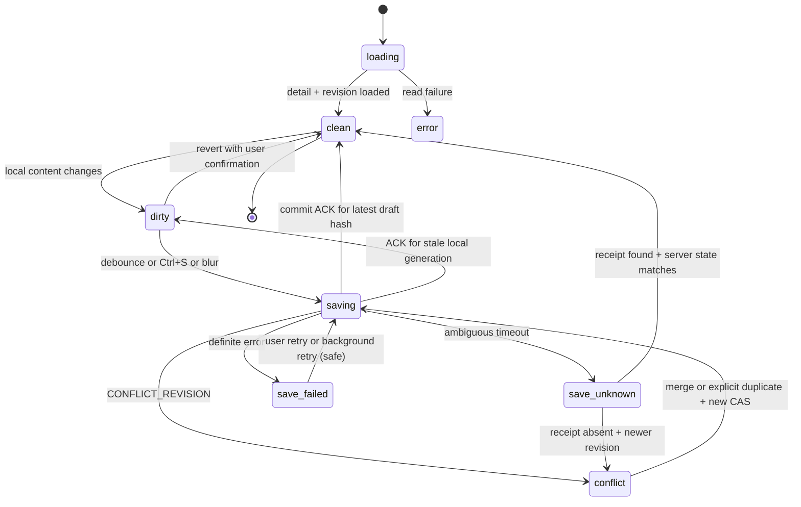
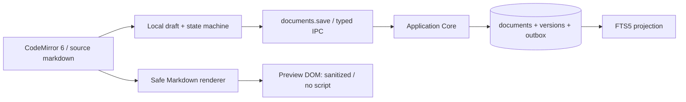

# Iterkeep — Notlar, Teknik Kararlar, Çalışma Günlükleri ve Kayıt Bağlantıları

> **Normatif hedef:** Kullanıcının bir projeyi haftalar sonra yeniden açtığında **ne yaptığını, neden yaptığını ve sıradaki işin ne olduğunu** kayıpsız görmesini sağlayan V1 uygulama davranışını kodlanabilir hâle getirmek. Bu belge belge düzenleyicisinin kaydetme, sürümleme, eşzamanlılık, karar değiştirme, log düzeltme, ek dosyalar ve kayıtlar arası gezinti semantiğinin **ürün / application-layer tek yetkili kaynağıdır**.
>
> **Yetki sınırları:** Entity, enum, ID, UTF-8 boyut sınırı = `DOC-08`; fiziksel SQL DDL/trigger/indeks = `DOC-09`; DB transaction, outbox ve receipt = `DOC-10`; tüm public kanal isimleri ve wire envelope = `DOC-11`; background job/event semantiği = `DOC-12`; proje statüleri = `DOC-13`; arama sözdizimi ve ranking = `DOC-15`; Markdown dosya taşıma = `DOC-16`; asset fiziksel dosya güvenliği ve backup = `DOC-17/30`; UI bileşen/stil = `DOC-20–23`; agent onayı = `DOC-26/27`. Bu doküman bu kanonik sözleşmeleri *yeniden icat etmez*.
>
> **Kanıt durumu:** Bu dosyadaki sorgu ve referans kodu gerçek repoda henüz derlenmemiştir; runtime/Electron/E2E onayı yoktur. SQL örnekleri `DOC-09` alan adlarına uyarlanmıştır; test kataloğu uygulanmadan `verified` veya `implemented` denemez.

## 1. Kullanıcı değerinin ölçülebilir tanımı

Ana kullanım: Kullanıcı 21 gün ara verdiği bir projeyi açar; son çalışma logunu, halen açık üst öncelikli görevleri, en yeni kabul edilmiş kararı ve o kararın gerekçesini **AI kurulu değilken de** bulur. Bilgi aramayı hızlandırmak için not ve log metinleri arama indeksindedir; AI yalnız opsiyonel yorumlama katmanıdır.

| Kullanıcı ihtiyacı | Temel kayıt | Başarı durumu | İlgili gereksinim |
|---|---|---|---|
| Fikri kaybetmeden not tutma | `documents` | Editör kayıt durumunu doğru gösterir | REQ-041–042 |
| Teknik kararın nedenini öğrenme | `decisions`, `decision_revisions` | Karar gerekçesi ve geçmişi erişilebilir | REQ-043–044 |
| Çalışma seansını kaydetme | `activity_logs` | UTC zamanı olan yeni değiştirilemez satır | REQ-045 |
| Projeye kaldığı yerden dönme | Project resume read-model | Son işler + log + karar yan yana | REQ-046 / AC-003 |
| İlgili kayda geçme | `record_links`, `record_registry` | ID-temelli doğru hedef | REQ-047–050 |
| Dosya ekleme | `attachments`, kontrollü asset dizini | Kaynağı koruyan güvenli kopya | REQ-051–052 |

**V1 kapsam dışı:** çok kullanıcılı eşzamanlı editör, CRDT, üçüncü taraf cloud not senkronizasyonu, internetteki URL'den otomatik asset indirme, HTML yürütme, canlı ortak yazma, zengin WYSIWYG içerik formatını ikinci veri gerçeği olarak tutma. Markdown gövde SQL içindeki `TEXT`tir; `*.md` dosyası kanonik depo değildir.

## 2. Değişmez uygulama kuralları (`NDL-D-001–036`)

| ID | Kural |
|---|---|
| NDL-D-001 | Bütün not, karar ve log kayıtları SQLite'ın kanonik domain tablolarından üretilir. |
| NDL-D-002 | Kullanıcı, agent ve import aynı Application Core komutlarına gider; agent doğrudan SQL yazamaz. |
| NDL-D-003 | Proje UUID'si yetkilendirilmiş aktif workspace'ten doğrulanır; renderer `workspaceId` ile yetki oluşturamaz. |
| NDL-D-004 | Projeye bağlı bir içerik, soft-delete edilmiş projeye eklenemez. |
| NDL-D-005 | Proje `archived` veya `completed` ise yeni mutasyon için DOC-13'teki açık yeniden etkinleştirme kuralı geçerlidir. |
| NDL-D-006 | Kullanıcı metninde Markdown kaynak içeriği saklanır; rendered HTML yalnız türetilmiş, inert görünüm olur. |
| NDL-D-007 | Body üzerinde satır sonları CRLF→LF normalize edilir; gizli içerik kırpılmaz. |
| NDL-D-008 | Not başlığı ve karar başlığı 1–200 Unicode code point, body 0–2 MiB UTF-8 byte ile doğrulanır. |
| NDL-D-009 | Çalışma logu 1–64 KiB UTF-8 byte olmalı ve whitespace-only olmamalıdır. |
| NDL-D-010 | Notta iki eşzamanlı kaydetme sessiz last-write-wins yapmaz; `expectedRevision` zorunludur. |
| NDL-D-011 | Uygulama DB commit ACK'i gelmeden 'Kaydedildi' yazmaz. |
| NDL-D-012 | Bekleyen autosave varken sekme değişimi/kapanma taslağı sessizce yok etmez; kullanıcıya gerçek durum gösterilir. |
| NDL-D-013 | Not kaydetme içerik, revision, version checkpoint, outbox event ve receipt'i aynı transaction'da bağlar. |
| NDL-D-014 | İçerik ve meta alanları hiç değişmemişse revision artmaz; no-op yanıtı döner. |
| NDL-D-015 | Notun eski snapshot'ı değiştirilmez; `document_versions` kayıtları append-only'dir. |
| NDL-D-016 | Not silme V1'de soft-delete; eski ID korunur, restore aynı ID ile olur. |
| NDL-D-017 | Karar `proposed` / `accepted` / `rejected` / `superseded` alanlarını kullanır; alternatif enum icat edilmez. |
| NDL-D-018 | Kabul edilmiş kararın anlamını değiştiren düzenleme yeni Decision + `supersede` gerektirir. |
| NDL-D-019 | Karar revizyonunda `reason` zorunlu; eski immutable revizyon satırı asla overwrite edilmez. |
| NDL-D-020 | Eski↔yeni karar bağlantısı ve iki durum güncellemesi tek transaction'dır. |
| NDL-D-021 | Karar supersession aynı proje içinde kalır, kendi kendine/cycle oluşturmaz. |
| NDL-D-022 | `display_code` proje içinde benzersiz, bir kez verilince değişmez; ID yerine kullanılmaz. |
| NDL-D-023 | Log satırı append-only'dir. Düzeltme yeni log + `correction_of_id` ile yapılır. |
| NDL-D-024 | `occurred_at` olay anı, `recorded_at` güvenilir sistemin kayıt anıdır; ikisi farklı olabilir. |
| NDL-D-025 | Log zamanları UTC RFC3339 milisaniyeli; günlük yerel tarih gruplaması görünüm/transfer katmanında yapılır. |
| NDL-D-026 | İlişkiler `kind + UUID` ile saklanır; başlık/slug rename bağlantıyı bozmaz. |
| NDL-D-027 | `depends_on` sadece task→task; döngü reddedilir; `related_to` simetrik ilişki tek kayıt olur. |
| NDL-D-028 | Silinmiş hedeflere giden linkler yanlış başka kayda çözülmez; deleted placeholder gösterilir. |
| NDL-D-029 | Attachment sadece `document`, `task`, `activity_log` sahibi olabilir; orijinal dosya değişmez. |
| NDL-D-030 | Asset path dışarıdan verilen açık disk yolu olarak DB'ye kaydedilmez; güvenli içe alma üretir. |
| NDL-D-031 | Markdown preview script, tehlikeli URI, iframe ve yürütülebilir HTML içermez. |
| NDL-D-032 | AI / STT / TTS kurulmamışken bu bölümün P0 işlevleri aynı şekilde çalışır. |
| NDL-D-033 | Sonsuz liste yok; listelerde keyset pagination, editörde büyük body koruması kullanılır. |
| NDL-D-034 | Etkin işlem günlüğü (`activity_logs`), tanılama logu veya agent tool loguyla birleştirilmez. |
| NDL-D-035 | Mutasyonun timeout sonucu belirsizse işlem kimliğiyle uzlaştırılır; rastgele retry yapılmaz. |
| NDL-D-036 | Hata loglarında not gövdesi, karar gerekçesi, log metni ve orijinal dosya yolu otomatik tutulmaz. |

## 3. Kanonik tablo/alan eşlemesi (`DOC-09`)

| Domain | Kanonik tablo | Zorunlu alanlar | Tarihçe/ilişki |
|---|---|---|---|
| Document | `documents` | `id,project_id,title,body_markdown,pinned,created_at,updated_at,revision,deleted_at` | `document_versions`, `document_tags` |
| DocumentVersion | `document_versions` | `id,document_id,revision_number,title,body_markdown,saved_at,actor_kind,actor_ref` | `(document_id,revision_number)` unique |
| Decision | `decisions` | `id,project_id,display_code,title,context_markdown,decision_markdown,rationale_markdown,consequences_markdown,alternatives_markdown,status,decided_at,supersedes_decision_id,superseded_by_decision_id,revision,deleted_at` | `decision_revisions` |
| DecisionRevision | `decision_revisions` | `id,decision_id,revision_number,snapshot_json,changed_at,actor_kind,actor_ref,change_reason` | immutable snapshot |
| ActivityLog | `activity_logs` | `id,project_id,text_markdown,occurred_at,recorded_at,actor_kind,actor_ref,correction_of_id,correlation_id,related_task_id,related_decision_id` | append-only |
| RecordRef | `record_registry` | `kind,record_id,project_id,deleted_at` | domain trigger tarafından güncellenir |
| RecordLink | `record_links` | `id,source_kind,source_id,target_kind,target_id,relation,created_at,actor_kind,actor_ref` | gerçek kompozit FK |
| Attachment | `attachments` | `id,owner_kind,owner_id,display_name,relative_asset_path,media_type,byte_size,sha256,created_at,deleted_at` | asset root altında dosya |
| Search | `search_index`, `search_fts` | türetilmiş başlık/gövde/record ref | DOC-15 |

**Önemli:** `document_versions` içindeki `revision_number`, `documents.revision` ile aynı anlamı taşır. `decision_revisions.snapshot_json` geçmiş karar alanlarının bütünlüğünü korumalıdır. SQL şema değişiklikleri yalnız yeni migration ve ADR ile yapılır. Bu belge sessizce yeni tablo/kolon eklemez.

## 4. Public IPC yöntemleri ve command/query sınırları

V1 için `DOC-11`'deki adlandırılmış kanallar dışında renderer'a yeni, genel amaçlı bir API sunulamaz. Aşağıdaki girdiler belgenin kesin DTO yorumudur. Tüm `id` değerleri UUID v4; tüm mutasyon context'i Main'de türetilir. `undefined` patch alanı değiştirilmez; `null` yalnız alanın nullable olduğu durumda silme anlamına gelebilir. Rastgele alanı serbest bırakma yasaktır.

| İşlem | Public API | Uygulama komutu | Başarı cevabı |
|---|---|---|---|
| Notları listele | `documents.list` | `ListDocuments` | `Page<DocumentSummary>` |
| Notu aç | `documents.get` | `GetDocument` | `DocumentDetail` |
| Not oluştur | `documents.create` | `CreateDocument` | `{id,revision}` |
| Not kaydet | `documents.save` | `SaveDocument` | `{revision,changed,savedAt}` |
| Geçmişi listele | `documents.versions` | `ListDocumentVersions` | `Page<VersionSummary>` |
| Notu çöpe taşı | `documents.trash` | `TrashDocument` | `{revision}` |
| Notu geri al | `documents.restore` | `RestoreDocument` | `{revision}` |
| Kararları listele | `decisions.list` | `ListDecisions` | `Page<DecisionSummary>` |
| Kararı aç | `decisions.get` | `GetDecision` | `DecisionDetail` |
| Karar öner | `decisions.create` | `CreateDecision` | `{id,revision}` |
| Kararı revize et/durum güncelle | `decisions.revise` | `ReviseDecision` | `{revision}` |
| Yeni kararla yerini al | `decisions.supersede` | `SupersedeDecision` | `{revision}` |
| Logları listele | `activity.list` | `ListActivityLogs` | `Page<ActivityLog>` |
| Tekil logu aç | `activity.get` | `GetActivityLog` | `ActivityLogDetail` |
| Log ekle/düzeltme ekle | `activity.append` | `AppendActivityLog` | `{id}` |
| Kayıtlar arası bağlantı kur | `records.link` | `LinkRecords` | `{id}` |
| Bağlantıyı kaldır | `records.unlink` | `UnlinkRecords` | `{removed}` |
| Ekleri listele | `attachments.list` | `ListAttachments` | `Page<AttachmentSummary>` |
| Ek içe al | `attachments.import` | `ImportAttachment` | `{id}` |
| Eki kullanıcıya aç/göster | `attachments.reveal` | `RevealAttachment` | `{revealed}` |
| Eki çöpe taşı | `attachments.trash` | `TrashAttachment` | `{deleted}` |

`activity.get({activityId})` DOC-21 tekil günlük deep-link ihtiyacı için DOC-11 kataloğuna eklenmiş yalnız-okuma sorgusudur; `activity_logs` tablosuna yeni alan eklemez.

`attachments.*` yöntemleri `DOC-11` v0.1'de eksik olduğundan **DOC-11 ile birlikte güncellenmelidir**. Bu revizyonda dört yeni kapalı kanal tanımlanır; genel `file.read(path)` gibi bir kanal **eklenmez**. `files.chooseImport({types:['attachment']})`, file dialog'dan `SelectionHandle` üretir. `selectionHandle` süreli, pencere/amaç bağlı, tek kullanıcı işlemine bağlı ve yeniden kullanılamaz olmalıdır (`DOC-11/30`).

### 4.1 Girdi DTO'ları — kanonik V1 alanları

```ts
// @iterkeep/contracts/src/ipc/notes-decisions-logs.contracts.ts
// Gösterim tipleri: gerçek Zod şemaları aynı alanlara exact/strict uygulanır.
type UUID = string; // UUIDv4 Zod validator; runtime unchecked string olarak kullanma

type RecordRefDTO = { kind: 'project'|'task'|'document'|'decision'|'activity_log'; id: UUID };

type CreateDocumentInput = {
  projectId: UUID; title: string; bodyMarkdown: string;
  pinned?: boolean; tagIds?: UUID[];
};
type SaveDocumentInput = {
  documentId: UUID; expectedRevision: number;
  patch: { title?: string; bodyMarkdown?: string; pinned?: boolean; tagIds?: UUID[] };
};
type TrashDocumentInput = { documentId: UUID; expectedRevision: number };
type RestoreDocumentInput = TrashDocumentInput;

type DecisionContentPatch = Partial<{
  title: string; contextMarkdown: string; decisionMarkdown: string;
  rationaleMarkdown: string; consequencesMarkdown: string; alternativesMarkdown: string;
  status: 'proposed'|'accepted'|'rejected';
}>;
type CreateDecisionInput = {
  projectId: UUID; title: string; contextMarkdown: string;
  decisionMarkdown: string; rationaleMarkdown: string;
  consequencesMarkdown?: string; alternativesMarkdown?: string;
};
type ReviseDecisionInput = {
  decisionId: UUID; expectedRevision: number;
  patch: DecisionContentPatch; reason: string;
};
type SupersedeDecisionInput = {
  oldDecisionId: UUID; newDecisionId: UUID;
  expectedRevision: number; newExpectedRevision: number;
};

type AppendActivityLogInput = {
  projectId: UUID; bodyMarkdown: string;
  occurredAt?: string; // UTC timestamp; local input renderer'da dönüştürülür
  correctionOfId?: UUID;
  relatedTaskId?: UUID; relatedDecisionId?: UUID;
};
type LinkRecordsInput = {
  source: RecordRefDTO; target: RecordRefDTO;
  relationship: 'references'|'depends_on'|'related_to';
};
type UnlinkRecordsInput = { linkId: UUID };

type ImportAttachmentInput = {
  selectionHandle: string;
  owner: {kind:'document'|'task'|'activity_log';id:UUID};
};
type ListAttachmentsInput = {
  owner: {kind:'document'|'task'|'activity_log';id:UUID};
  cursor?: string; limit?: number;
};
type RevealAttachmentInput = { attachmentId: UUID };
type TrashAttachmentInput = { attachmentId: UUID };
```

**Önemli:** Yukarıdaki tipler yalnız `payload` tipleridir. `requestId`, `protocolVersion` ve mutasyon için sabit `idempotencyKey`, **DOC-11 §2 `MutationMetaSchema` envelope** içindedir; payload içine ikinci kez konmaz.

**Uyum kararı:** İlk `DOC-11` özetindeki `documents.save({documentId,bodyMarkdown,expectedRevision})` yalnız gövde güncellerken başlık/pin/tag düzenlemesini kapsamazdı. Yeni `{patch,...}` biçimi tek kanalda bu açığı kapatır ve `DOC-11` güncel katalogu tarafından doğrulanır. Benzer şekilde `activity.append`'in belirsiz `linkedRecordIds?` alanı, `DOC-09`'un gerçekten desteklediği `relatedTaskId`, `relatedDecisionId`, `correctionOfId` alanlarına dönüşür. Yeni IPC kanal eklenmeden mevcut yöntem parametreleri netleştirilir.

### 4.2 Liste ve detay projeksiyonları

```ts
interface DocumentSummary { id: UUID; projectId: UUID; title: string; pinned: boolean;
  updatedAt: string; revision: number; preview: string; }
interface DocumentDetail extends DocumentSummary {
  bodyMarkdown: string; tagIds: UUID[]; createdAt: string; deletedAt: string|null;
}
interface DecisionSummary { id: UUID; displayCode: string; title: string;
  status: 'proposed'|'accepted'|'rejected'|'superseded';
  updatedAt: string; decidedAt: string|null; revision: number; }
interface DecisionDetail extends DecisionSummary { projectId: UUID;
  contextMarkdown: string; decisionMarkdown: string; rationaleMarkdown: string;
  consequencesMarkdown: string; alternativesMarkdown: string;
  supersedesDecisionId: UUID|null; supersededByDecisionId: UUID|null;
  revisions: {id:UUID;revisionNumber:number;changedAt:string;reason:string}[]; }
interface ActivityLogDTO { id: UUID; projectId: UUID; textMarkdown:string;
  occurredAt:string; recordedAt:string; correctionOfId:UUID|null;
  relatedTaskId:UUID|null; relatedDecisionId:UUID|null; }
```

Listelerde `bodyMarkdown`'ın tamamı taşınmaz; `preview` en fazla 240 code point'e kadar, sadece metin olarak üretilir. Önizleme metni için Markdown parse algoritması güvenli, boyut sınırlı ve deterministiktir. `decisions.get` DTO'da `revisions` yalnız revision *özetleri* ile gelir; büyük `snapshot_json` detayları ayrı pagination stratejisiyle gerekirse listeden seçilen revizyona yüklenir. V1, yeni public kanal olmadan geçmiş snapshot'ına erişimi `decisions.get` response'unda **en fazla 50 adet, cursor'lu** version page ile destekler (UI yeni cursor ile aynı get metodunu çağırır). Bu parametre DOC-11'e eklenmelidir.

## 5. Not oluşturma ve kaydetme yaşam döngüsü

### 5.1 Başlatma ve yaratma

1. UI `projectId` doğrular, aktif veya düzenlemeye izinli proje olduğunu gösterir.
2. Boş not komutu: başlık zorunlu; body boş olabilir. Basit 'Yeni not' butonu boş editör açıyorsa henüz veritabanına kayıt açılmaz. İlk gerçek kaydedişte `documents.create` çağrılır.
3. Main input Zod ve erişim kontrollerinden sonra `CreateDocument` komutuna yönlendirir.
4. DB worker transaction'ı `documents` rev1, `document_versions` rev1, tag joins, domain event, idempotency receipt ekler.
5. Commit ACK'i gelince UI kalıcı not ID'sine ve `saved` durumuna geçer.
6. `project resume` ve search projection commit sonrası yeni içeriği görebilir. AI gerekmez.

### 5.2 Editör durum makinesi



- **Local draft generation**: her edit bir `draftGeneration` artırır; ağ/IPC kaydı gidince (belirli generation snapshot'ı) daha yeni karakterler yazılmışsa ACK yeni taslağı `clean` yapamaz.
- **Varsayılan autosave**: değişim sonrası 1.200 ms sessizlik; kullanıcı Ctrl+S/Cmd+S veya editörden ayrıldığında gecikmeyi atlayıp flush. Kullanıcı ayarlarda kapatabilir; P0 olarak güvenilir manuel save her zaman açık.
- **Yalnız tek in-flight save / note**: daha yeni taslak sıraya alınır, eski isteğin cevabına göre yeni expectedRevision ile yazılır; paralel autosave yarışına girilmez.
- **UI mesajları:** `Kaydedilmedi`, `Kaydediliyor…`, `Kaydedildi`, `Başka bir değişiklikle çakıştı`, `Kaydın sonucu doğrulanıyor`, `Kayıt başarısız`. Gösterilen başlık renk dışında metinle de ayırt edilir.
- **Yeniden açılış:** Kalıcı kayıtta son commit'teki not bulunur. Commit ACK'i görülmemişse receipt ve revision ile uzlaştırılır. Sadece React belleğinde kalmış, henüz hiç gönderilmemiş karakterlerin OS/power crash sonrası kurtarılacağına dair **yanlış garanti verilmez**. Daha güçlü draft recovery ileride ayrı şema/ADR gerektirir.
- **Boş body:** not gövdesi boş olabilir, başlık boş olamaz. `SaveDocument.patch` en az bir alan içermelidir; boş patch invalid.
- **Büyük içerik:** 2 MiB sınırına yaklaşan editör uyarır, 2 MiB üzeri truncate etmez. Preview/render yalnız görünür bölge veya sınırlı debounce ile hesaplanır.

### 5.3 Kaydetme: revizyon/CAS/versiyon

**V1 politikası:** Her **değişiklik içeren başarılı `documents.create/save/trash/restore`** sonrasında yeni `document_versions` snapshot'ı üretilir. Böylece `document_versions` tablosundaki `revision_number`, belgede gerçekten commit edilmiş bir durumdur. Rev1 yaratılış da snapshot içerir. Bu, kullanıcıya sürüm geçmişi doğruluğu verir fakat depolama maliyeti oluşturur. Maksimum 2 MiB gövde ve sık autosave nedeniyle sürüm depolama büyümesi `DOC-31` testlerinde ölçülür; eski snapshot'ların temizlenmesi V1'de sessizce yapılmaz. Çok sık save'leri azaltmak için debounce ve no-op tanıma zorunludur.

**Soft-delete ve restore:** `document_versions` şeması `deleted_at` bilgisini barındırmaz. Bu nedenle çöp/restorasyon olayları `domain_events` ve ana `documents.revision` üzerinden izlenir; `document_versions` snapshot'ı o anki başlık/body'yi içerir fakat silinme bilgisini tek başına kanıtlamaz. `document_versions` her successful trash/restore revision için kayıt oluşturur; buna UI tarafında `archived` gibi uydurma durum eklenmez.

**SQL referansı** (kısa, aynı DB worker transaction'ı içinde; event/receipt'in tamamı DOC-10'a bağlı):

```sql
-- Önkoşul: Main/Application input validation + active workspace authorization.
-- Aşağıdaki UPDATE sonrası değişen satır sayısı = 1 değilse missing/deleted/CAS ayrıştır.
UPDATE documents
SET title = :title,
    body_markdown = :body,
    pinned = :pinned,
    updated_at = :now,
    revision = revision + 1
WHERE id = :document_id
  AND revision = :expected_revision
  AND deleted_at IS NULL;

-- UPDATE changes=1 ise güncel alanları alıp aşağıdaki history'yi ekle.
INSERT INTO document_versions
(id,document_id,revision_number,title,body_markdown,saved_at,actor_kind,actor_ref)
VALUES (:version_id,:document_id,:new_revision,:title,:body,:now,:actor_kind,:actor_ref);
```

*Not:* `tagIds` güncellenecekse `document_tags` diff'i aynı transaction'da yapılır. Etiketler yalnız mevcut aktif workspace'e ait `tags` ID'leri olabilir. Sırf `tagIds` değişmişse belge `revision` artar, aynı başlık/body snapshot'ı saklanır. `documents.save` patch'inde değişmeyen alanların yeni değerleri önce mevcut satırdan alınır. `no-op` tespiti normalleştirilmiş alanların ve tagId set'inin karşılaştırılmasıyla transaction içinde yapılır. SQL'in CAS koşulu `UPDATE ... changes()=1` veya `RETURNING` sonucu ile kesinleşir; snapshot hiçbir zaman başarısız CAS sonrası eklenmez.

### 5.4 Conflict çözümü ve karşılaştırma

1. UI eski `baseRevision` + `localDraft`'ı tutar; worker `CONFLICT_REVISION` verir.
2. `documents.get` ile en yeni remote durum, başlık, body ve revision alınır.
3. Karşılaştırma görünümü: **Baz / Yerel / Güncel**. Yerel taslak korunur; otomatik üzerine yazma yok.
4. Tamamen farklı satırlardaki değişimler güvenli üçlü merge ile *önerilebilir*; aynı satır/yapı değişikliğinde kullanıcı seçim yapar. Üçlü merge otomatik uygulanmaz.
5. Kullanıcı `Günceli kullan`, `Yereli yeni revizyona kaydet` (açık onay), `Elle birleştir` veya `Ayrı not kopyası oluştur` seçeneklerinden birini seçer.
6. Her uygulanacak mutasyonda **yeniden** `expectedRevision` gönderilir; yeni yarış varsa aynı akış tekrar edilir.

`save_unknown` halinde **hemen yeniden `documents.save` çağırma**. Aynı `idempotencyKey` ile receipt sorgulama / güvenli yeniden deneme ve sunucu revision karşılaştırması `DOC-10/11` protokolüne uyar. `idempotencyKey` bir kaydetme *denemesi* boyunca sabit kalır; kullanıcı taslağı değiştirirse yeni key gerekir.

## 6. Not geçmişi, filtreleme, trash ve restore

### 6.1 Liste semantiği

- Varsayılan: `projectId`, `deleted_at IS NULL`, `pinned DESC`, `updated_at DESC`, `id ASC/DESC` (tek kararlı tie-break seç ve response cursor ile eşleştir). Bu belgede seçim: `pinned DESC, updated_at DESC, id ASC`.
- Page limit varsayılan **30**, maksimum **100**. Keyset cursor, `(pinned,updated_at,id)` ve query fingerprint taşır; imzalı/opaque, client tarafından sıralama parametresi uydurulamaz.
- Arama listelemeden farklıdır: `search.query` DOC-15 `search_fts` projeksiyonunu kullanır.
- Arşivlenmiş proje içerikleri proje açıldığında read-only gösterilebilir; projeyi düzenleme için DOC-13 statü kuralı geçerlidir.
- `documents.get` silinmiş notu normal listede açmaz; açık trash görünümünden restore aksiyonu veya deleted placeholder sunar. V1 `documents.list` ayrı trash filtresi sunmuyorsa silinmiş kayıtları filtrede listelemez; kullanıcıya notu undo ile geri getirme ve backup restore imkânı sunulur. Çöp kutusundan tek tek browse gerekiyorsa `DOC-11` API'ye `includeDeleted` parametresi eklenmelidir (bu V1'de eklenmiştir).

### 6.2 Soft-delete

- `trash`: `deleted_at=now`, `revision+1` ve version snapshot aynı transaction'da; `search_index` trigger soft-deleted notu kaldırır.
- `restore`: mevcut parent projenin `deleted_at IS NULL` olmasını ve DOC-13 proje statü politikasını doğrular; `deleted_at=NULL,revision+1` ve snapshot tek transaction'da; FTS tekrar görünür.
- Aynı ID'den iki kez trash/restore no-op ise artan revision üretme, açık `already_deleted/already_active` sonucunu dön; yanlış expectedRevision hatalı olsun.
- Notun eski linkleri ve asset kayıtları kalır; display sırasında silinmiş hedef placeholder olur. Fiziksel asset purge ayrı `DOC-17` bakım protokolüdür.

## 7. Markdown düzenleyici ve güvenli render

### 7.1 Veri–görünüm ayrımı



- **Editor:** CodeMirror 6 source editing; Markdown syntax highlighting, headings, checklist source, autosave status, find in document, Ctrl/Cmd+S, undo/redo *in-memory editor*.
- **Preview:** default read-only, Markdown AST → safe elements; DOM'da tehlikeli raw HTML kullanılmaz. `dangerouslySetInnerHTML` ancak açık sanitize+trusted boundary politikasını geçtiğinde ve güvenlik testleriyle, tercihen hiç kullanılmaz.
- **Fenced code:** düz metin gösterim; syntax-highlight lazy-load; kodu asla eval/exec etme.
- **HTML:** markdown metninde kalabilir fakat render'da raw HTML kapalıdır. Kaynağı veritabanında kayıpsız sakla.
- **URLs:** sadece uygulamanın izin verdiği `https`, `http` ve güvenli local asset handler; `javascript:`, `data:` içeren tehlikeli içerik, `file:`, `vbscript:` ve protokol göreli remote kaynaklar engellenir.
- **Görseller:** uzak URL'lerin otomatik yüklenmesi V1'de kapalı; kullanıcı açık tıklamayla dış tarayıcıya geçebilir. Yerel varlık `attachments` üzerinden whitelist edilen özel handler'la sağlanır.
- **Kısayol güvenliği:** `Ctrl/Cmd+S` pencereden yanıt alır; duruma göre 'saved' veya 'unsaved' gösterir. UI hiçbir zaman doğrudan `fs.writeFile()` yapmaz.
- **Erişilebilirlik:** editör label, canlı save status, ekran okuyucuya ulaşılabilir hata/çatışma paneli, klavye ile tüm işlem.

### 7.2 Markdown içerisinden record referansı

Kanonik ilişki `record_links` tablosudur. UI 'bu görev/karara bağlantı ekle' seçiminde ID'li ilişki oluşturur. Markdown gövdesindeki `DEC-0004` gibi çıplak metin otomatik FK sayılmaz. İsteğe bağlı inline biçimi `iterkeep://record/<kind>/<uuid>` sadece render'da kontrollü router tarafından çözümlenir; parse başarısızsa düz metin, external navigation değil. Yeni URL protokolü açıldığı için `DOC-20–22/30` ile güvenlik testlerinden geçmeden varsayılan aktif sayılmaz; V1 UI'nın güvenli kayıt bağlama paneli yeterlidir.

## 8. Teknik karar kayıtları (Decision / ADR)

### 8.1 Veri alanlarının anlamı

| Alan | Kullanıcı sorusu | Boş olabilir mi? |
|---|---|---|
| `title` | Ne hakkında karar verdim? | Hayır |
| `context_markdown` | Hangi problem ve koşullar vardı? | Evet |
| `decision_markdown` | Ne seçtim? | `proposed` için geçici boş olabilir; kabul anında boş olamaz |
| `rationale_markdown` | Neden bunu seçtim? | `proposed` için geçici boş olabilir; kabul anında boş olamaz |
| `consequences_markdown` | Bedelleri / etkileri neler? | Evet |
| `alternatives_markdown` | Diğer seçenekler neydi? | Evet |
| `status` | Karar kabul edildi mi? | Hayır |
| `decided_at` | Ne zaman kabul edildi? | Proposed/rejected = null, accepted/superseded = geçmiş kabul anı |
| `display_code` | İnsan okunur referans? | Hayır; ör. `DEC-0001` |

### 8.2 Display code tahsisi

- Proje içindeki bütün (silinmiş dahil) `decisions.display_code` değerleri benzersiz kalır. `DEC-0001` ile başlanır; sayı monoton artar, **asla yeniden kullanılmaz**.
- Kanonik ID UUID v4'tür; kod sadece görünen etikettir. Kod tahsisi worker transaction'ı içinde yapılır; tek yazıcı ve unique constraint korunur.
- V1 üretim algoritması: proje içinde kodun `DEC-` sonrasındaki **tam sayısal** suffix'inin en büyüğünü bul, +1; `padStart(4,'0')` minimum genişliktir (`DEC-10000` geçerlidir). İthal edilen eski kodlar sıralamayı etkileyecekse güvenli import map ve conflict handling DOC-16'da yapılır.
- SQL `MAX(display_code)` alfabetik olarak yanlış sonuç verebileceğinden sayısal cast uygulanır; bozuk kodlarda import ön validasyon gerekir.

### 8.3 Durum geçişleri

| Önce | Sonra | İzin / koşul | Etki |
|---|---|---|---|
| Yeni | `proposed` | Temel başlık + proje | Revizyon 1 |
| `proposed` | `accepted` | decision+rationale dolu, reason mevcut | `decided_at=now` |
| `proposed` | `rejected` | Açıklayıcı reason | Geçmiş korunur |
| `rejected` | `proposed` | Açık tekrar değerlendirme, reason | Eski reddetme izi korunur |
| `accepted` | `accepted` | Sadece yazım/format/metadata düzeltmesi | Yeni immutable revision |
| `accepted` | `superseded` | `decisions.supersede` only | Yeni accepted karara çift yönlü bağ |
| `superseded` | Herhangi | Yasak | Eski karar immutable |

`decisions.create` ilk sürümde her zaman `proposed` üretir. Doğrudan accepted create istenirse önce create, sonra revise accepted; agent'ın da aynı akışı izlemesi gerekir. İki işlem tek kullanıcı etkileşiminde gerçekleştiriliyorsa Application Core orchestration iki transaction yapabilir; **ara hâlin accepted olduğu iddia edilmez**. Kabul ve supersede aynı transaction içerisinde yapılabilen `decisions.supersede` servisi daha güvenilirdir.

### 8.4 Revision snapshot politikası

- İlk create `decision_revisions` içine `revision_number=1`, `change_reason='created'` ve tüm karar alanlarının normalize edilmiş snapshot'ını koyar.
- Her etkili `decisions.revise` işleminde CAS update + `decision_revisions` yeni sayı + `domain_events` + receipt bir transaction'dadır.
- Snapshot yalnız tam domain içerik alanlarını, status'u, kabul anını ve supersession referanslarını kapsar. `DOC-08`'deki minimum snapshot'a ek alanlar eklenebilir; snapshot JSON şeması sürümlenir (`schemaVersion=1`).
- Karar önerisinde iki kez aynı içerik/aynı status gelirse `no-op` döner; yalnız reason metni farklı diye yapay revision oluşturma.
- Kabul edilmiş kararda `title` yazım hatası veya Unicode/format gibi özsel olmayan değişikliğe açık `reason` ile izin verilir. `decision_markdown`, `rationale_markdown`, `context_markdown`, `consequences_markdown` veya `alternatives_markdown` içerik değişikliği, anlam farkı yaratabileceğinden V1'de **accepted** durumda otomatik reddedilir; yeni karar önerilir. Bu politika bilinçli muhafazakârdır.
- `decisions.revise` patch'i `status:'superseded'` kabul etmez; bu durum sadece `decisions.supersede` üzerinden oluşur.

### 8.5 Supersede transaction — deterministik uygulama

1. `oldDecisionId !== newDecisionId` ve `expectedRevision`, `newExpectedRevision` zorunlu.
2. Her iki karar mevcut, trash değil, aynı projectId'ye bağlı; eski `accepted`, yeni `accepted`; yeni karar henüz `supersedes_*` bağlı değil.
3. Yeni kararın içeriği ve rationale kabul için yeterli; supersession graph'ı yeni→eski cycle oluşturmaz (recursive CTE veya bounded visited set; belirsiz durumda fail closed).
4. Tek DB transaction içinde iki kaydı CAS ile update et: eskide `status='superseded'`, `superseded_by_decision_id=newId`, `revision+1`; yenide `supersedes_decision_id=oldId`, `revision+1`; mevcut `decided_at` anları korunur.
5. Her iki karar için `decision_revisions` snapshot + `domain_events` kayıtları ve bir idempotency receipt yaz.
6. Commit ACK'inden sonra UI karar listesini/özetini invalid eder. Başarısızlıkta iki taraf da eski hâlindedir.

**SQL iskeleti** (tam transaction wrapper DOC-10; saf prepared binding, hata kontrolleri kod tarafında):

```sql
UPDATE decisions
SET status='superseded', superseded_by_decision_id=:new_id,
    updated_at=:now, revision=revision+1
WHERE id=:old_id AND project_id=:project_id
  AND status='accepted' AND deleted_at IS NULL
  AND revision=:old_revision
  AND superseded_by_decision_id IS NULL;

UPDATE decisions
SET supersedes_decision_id=:old_id,
    updated_at=:now, revision=revision+1
WHERE id=:new_id AND project_id=:project_id
  AND status='accepted' AND deleted_at IS NULL
  AND revision=:new_revision
  AND supersedes_decision_id IS NULL;
```

**Dikkat:** İlk update'le ikinci arasında işlem henüz commit edilmemiştir. İki `changes()=1` koşulu doğrulanmadan commit yasaktır. Döngü, proje ve statü kontrolü **transaction içinde** tekrar yapılır. Uygulama üzerinde iki hata birden varsa, ayrı ayrı kısmi güncelleme yoktur.

## 9. Çalışma günlüğü (append-only ActivityLog)

### 9.1 Hızlı kayıt davranışı

- Proje ekranında tek odaklanabilir alan: 'Bugün ne yaptın?'; kısayol/focus DOC-22'de belirlenir.
- Metin girilir → `activity.append` → `recorded_at` güvenilir UTC clock ile atanır; `occurred_at` yoksa aynı andır.
- Hedef proje aktif ve görünür olmalı. `relatedTaskId`/`relatedDecisionId` varsa bunlar aynı workspace, V1 tercihi **aynı proje** olmalı; farklı projeye bağlantı istenirse ayrı `records.link` kullanılır.
- Commit başarılıysa yeni log timeline'ın tepesinde veya kullanıcının seçtiği `occurredAt` gününde görünür. Görünme sırası `occurred_at DESC,recorded_at DESC,id DESC`.
- Log sadece metinse oluşturma akışı tek kısa transaction'dır; ses transkripti kullanılıyorsa metin önizlemesi gösterilmeden otomatik `append` yapılmaz.

### 9.2 Geçmişteki tarihler ve timezone

- Kullanıcı geçmişte bir seansı kaydedebilir; tarih-saat girdisi yerel kullanıcının IANA timezone bilgisiyle çözümlenip UTC ISO string'e dönüştürülür.
- Yaz saati uygulaması nedeniyle iki anlamlı olan yerel zamanlarda UI offset seçtirir; geçersiz yerel saat reddedilir. Sessiz dönüşüm yapılmaz.
- Varsayılan geçmiş tarih aralığı: 1970-01-01'den ileri ve `recordedAt + 5 dakika` sınırına kadar (5 dakikalık clock drift toleransı). Daha ileri tarihi log yerine planlanan görev/etkinlik kullan.
- Yerel gün gruplaması `Intl.DateTimeFormat` ile aktif gösterim timezone'unda yapılır. SQLite'da UTC günü ile grup yapıp yerel gün başlıklarını karıştırmak yasaktır.
- Import/export `DOC-16` manifestinde kaynak timezone ve UTC zamanın korunması gerekir; eski zaman damgası eşsiz veri kaynağıdır.

### 9.3 Yanlış log kaydını düzeltme

Normal kullanıcı `activity_logs` için `UPDATE`/`DELETE` komutu göremez:

1. Orijinal logda `Düzeltme ekle` eylemi tıklanır.
2. UI orijinal metni kullanıcıya gösterir fakat satırı edit edilebilir hâle getirmez.
3. Kullanıcı yeni açıklamayı yazar; `correctionOfId=originalLog.id` ile `activity.append` yapılır.
4. Application Core aynı projectId ve aynı workspace'i kontrol eder; `correctionOfId` self-reference olamaz, döngü engellenir. V1 bir düzeltmenin **doğrudan orijinal** kayda bağlanmasını ister; zincir uzatmak yerine son yazıyı gösterir.
5. UI orijinal satırın altında `Bu kayıt düzeltildi` ve zamanlı düzeltme listesi gösterir. Arama ikisini de bulabilir; orijinal kayıt silinmez.

**Özel gizlilik silmesi:** Hassas kayıtların fiziksel silinmesi, normal `activity.append`/UI operasyonu değildir. Bu ihtiyaç `DOC-17/30` üzerinden açık kullanıcının eylemine bağlı purge ile çözülür; önce ilişkiler, arama projeksiyonları ve yedek-retention etkileri önizlenir. Normal `trg_activity_logs_no_update` kuralı kapatılmaz.

### 9.4 Append SQL örneği

```sql
INSERT INTO activity_logs
 (id,project_id,text_markdown,occurred_at,recorded_at,
  actor_kind,actor_ref,correction_of_id,correlation_id,
  related_task_id,related_decision_id)
VALUES (:id,:project_id,:text_markdown,:occurred_at,:recorded_at,
        :actor_kind,:actor_ref,:correction_of_id,:correlation_id,
        :related_task_id,:related_decision_id);
```

Commit'ten önce ilgili kaynaklar kontrol edilir, domain event ve receipt aynı transaction'da yazılır. `activity_logs` için `revision` sütunu **yoktur**, sahte revision oluşturulmaz. Parent project soft-delete ise `DOC-09` insert trigger zaten reddeder; uygulama önceden anlamlı hata verir.

## 10. Kayıt bağlantıları ve kayıt keşfi

### 10.1 `record_links` invariants

- `source`/`target` ikilisi gerçek `record_registry` satırına bağlanır. Registry'ye client INSERT yapamaz.
- `source == target` DB `CHECK` ve application tarafından reddedilir.
- `depends_on`: `task → task`, cycle yasak. V1 maksimum grafik taraması için 10.000 node guard; bunun aşılması `GRAPH_CHECK_LIMIT` verir, bağlantı oluşturulmaz.
- `related_to`: `(kind,id)` çiftinin lexicographic sırasını kanonik tut; ters yönden aynı ilişki ikinci satır olmaz.
- `references`: yönlüdür, A→B ile B→A ayrı bilgi olabilir; döngü `references` için yasak değildir.
- Varsayılan yeni linkin iki hedefi de aktif (soft-delete edilmemiş) olmalı; eski linkler soft-delete sonrası görünür placeholder olur.
- `records.unlink` kaydı DB'den kaldırabilir; link **içerik kaydı değildir**, yine de audit outbox event yazılır. Belirsiz timeout'ta aynı idempotency key ile reconciliation yapılır.

### 10.2 Depends-on cycle kontrolü — parametreli CTE

Aşağıdaki sorgu A'nın B'ye bağlı yapılması planlanırken **B'den A'ya ulaşılabiliyor mu?** kontrolünü yapar. Kararlı bağlantı kontrolü insert ile aynı DB write transaction içinde yapılır:

```sql
-- UNION bütün ziyaret edilmiş task ID'lerini tekilleştirir.
-- 10001 satıra ulaşılırsa doğruluk belirsizdir: FAIL CLOSED.
WITH RECURSIVE reach(id) AS (
  SELECT :target_id
  UNION
  SELECT rl.target_id
  FROM record_links AS rl
  JOIN reach AS r ON rl.source_kind='task' AND rl.source_id=r.id
  WHERE rl.relation='depends_on'
    AND rl.target_kind='task'
  LIMIT 10001
)
SELECT
  EXISTS(SELECT 1 FROM reach WHERE id=:source_id) AS would_cycle,
  (SELECT COUNT(*) FROM reach) AS visited_count;
```

- `would_cycle=1` ise bağlantı reddedilir; `visited_count>=10001` ise grafın tamamının kontrol edildiği kanıtlanamadığından **fail closed** gerekir.
- `UNION` düğümleri tekilleştirir; `UNION ALL` kullanılması cycle olan grafikte sonsuz döngüye neden olabilir.
- İlişki insert'i ve döngü testi aynı DB worker transaction'ında yürütülür. Cross-workspace ve deleted-node kontrolü ayrıca yapılır.

## 11. Ek dosyalar (`attachments`) ve workspace güvenliği

### 11.1 V1 varsayılan türler/sınırlar

| Alan | V1 politika |
|---|---|
| İzin verilen uzantılar | `.png`, `.jpg`, `.jpeg`, `.webp`, `.pdf`, `.txt`, `.md` |
| İlk dosya üst limiti | 10 MiB / ek; açık `DOC-30` ADR ile yükseltilebilir |
| Boyut toplamı | Başlangıçta workspace başına 1 GiB uyarı eşiği; fiziksel kota değil |
| Ağ kaynağı | Otomatik URL fetch kapalı |
| SVG/HTML/EXE/script | İçeriği çalıştırma ve aktif HTML/SVG preview yasak; V1 import allowlist dışında |
| Hash | SHA-256, kopya tamamlanınca verify |
| Path | `assets/<2-char-prefix>/<uuid>.<allowlisted-ext>` gibi uygulamanın ürettiği relative path |
| Sahiplik | `document`, `task`, `activity_log` (`DOC-09`) |

OS dosya seçicisinin seçtiği path, renderer'a kalıcı keyfî filesystem yetkisi olarak verilmez. Main, süreli `selectionHandle` üzerinden dosyayı güvenli temporary staging dizinine **stream** eder; kaynak dosyayı asla rename/delete yapmaz. Dosya türü yalnız uzantıya güvenerek belirlenmez; MIME/magic kontrolü, boyut limiti ve gerçek yol/symlink doğrulaması gerekir.

### 11.2 Dosya + SQLite atomiklik sınırı

SQLite transaction'ı filesystem rename ile **tek bir ACID transaction değildir**. Bu nedenle aşağıdaki iki aşamalı protokol uygulanır:

1. Kullanıcı dosyayı seçer, owner aktif ve uygun türde mi kontrol edilir; workspace+asset dizini güvenli resolve edilir.
2. Kaynak dosya `assets/.staging/<operationId>.part` içine stream edilir, byte cap uygulanır; SHA-256 ve mime check yapılır; staging fsync mümkünse uygulanır.
3. Nihai benzersiz relative path seçilir; var olan bir dosyanın üzerine yazılmaz.
4. Staging → final atomik rename **aynı filesystem** üzerinde yapılır; final path idempotency operationId'ye bağlıdır.
5. Tek DB transaction'da owner yeniden doğrulanır ve `attachments` satırı, `domain_events`, `idempotency_receipts` yazılır.
6. DB commit başarılıysa kullanıcıya receipt gösterilir. DB commit reddedilirse final file güvenli cleanup kuyruğuna alınır. Uygulama crash olursa startup asset reconciler DB'de referansı olmayan *uygulama tarafından sahiplenilmiş* final dosyaları operasyon manifestiyle temizler.
7. **Risk notu:** DB commit başarıyla tamamlanıp dosya sonradan fiziksel olarak kaybolursa metin/DB erişimi bozulmaz; eksik asset placeholder gösterilir ve doğrulama/kurtarma önerilir.

**Asla:** origin dosyasını uygulama içinden sessizce silme, kullanıcının keyfî disk dizininde garbage collection, SQLite'ı açık file I/O boyunca kilitleme, kullanıcının home dizinini recursive scan etme.

### 11.3 Eki görüntüleme ve soft-delete

- UI yalnız izinli thumbnail/meta bilgisini görür; doğrudan `file://` veya diske absolute path gönderilmez.
- `attachments.reveal` sadece `attachmentId` ile Main tarafında doğrulanmış `showItemInFolder` benzeri OS API kullanır; silinmiş/missing asset için anlamlı hata döner. Bu eylem dosyayı otomatik çalıştırmamalıdır.
- Görsel gösterimi için güvenli app protocol asset `id` ile resolve edilir, mime allowlist, strict CSP ve path canonicalization uygulanır (`DOC-30`). `file://` kullanılmaz.
- `attachments.trash` yalnız `deleted_at` günceller ve erişilebilir görünümden çıkar; fiziksel silme backup-retention & garbage-collection kontrolüyle ilerler. Parent soft-delete de hemen fiziksel ek silmez.

## 12. Birleşik proje özeti: 'Nerede kalmıştım?'

Bu okuma modeli `DOC-13` içindeki `projects.resume`'un genişletilmesi **değildir**; aynı projeksiyon için not/karar/log sıralamalarını kesinleştirir.

| Blok | Kaynak | Sıralama | V1 limit |
|---|---|---|---:|
| Devam edilen işler | `tasks` | status=in_progress, priority, updated_at | 5 |
| Öncelikli açık işler | `tasks` | urgent/high, due_date, sort_order | 8 |
| Son çalışma | `activity_logs` | occurred_at DESC,recorded_at DESC,id DESC | 5 |
| Son kararlar | `decisions` | decided_at DESC NULLS LAST,updated_at DESC,id DESC | 5 |
| Son notlar | `documents` | pinned DESC,updated_at DESC,id ASC | 5 |

- Bu projection **tek Application Core query** altında birkaç indexed SQL sorgusuyla, ortak DB snapshot'ı içinde alınabilir; `projects.resume` IPC sonucu JSON büyüklük üst sınırına uyar.
- Karar başlığı, statü, zaman, gerekçe önizlemesi UI'da her biri kendi kalıcı ID'siyle gelir. Gerekçe kaydı yoksa sahte bir 'neden' oluşturulmaz.
- Kaydedilmemiş editor draft veya geçici voice transkript, 'son yapılan iş' olarak veritabanında görünmez.
- Agent varsa ayrı bir 'Özetle' butonu eklenebilir. Yerel kaynak record ID ve excerpt olmadan LLM iddiası kullanıcıya kesin doğruluk gibi gösterilmez.
- Büyük proje ilk açıldığında bütün notları, bütün sürümleri ve bütün logları yüklemek yasaktır; sadece özet ve paginated feed çekilir.

## 13. React UI ve etkileşim yüzeyleri

### 13.1 Ekranlar

| Yer | Temel bileşen | Action | Hata/empty/loading |
|---|---|---|---|
| Project Detail / Notes | `DocumentList`, `DocumentEditor`, `PreviewPane` | create, save, pin, tag, trash | no notes, save conflict |
| Project Detail / Decisions | `DecisionList`, `DecisionDetail`, `RevisionHistory` | create, revise, accept, supersede | no decisions, read-only old |
| Project Detail / Timeline | `ActivityTimeline`, `QuickLogComposer`, `CorrectionThread` | append, correct, filter date | empty log, save failure |
| Project Detail / Links | `LinkedRecordsPanel`, `RecordPicker` | link, unlink, navigate | missing/trashed target |
| Project Detail / Attachments | `AttachmentList`, `AttachmentPicker` | add, reveal, trash | missing file, cap exceeded |
| Dashboard / Resume | `ProjectResumeSection` | jump to record | empty state, stale ID |
| Search | `SearchResult` | route `recordRef` to source | deleted placeholder |

### 13.2 Hızlı klavye akışları

- `Ctrl/Cmd+S`: açık notu kaydet; tarayıcı default Save Page davranışı bastırılır.
- `Esc`: kapatılabilen popup kapatır; üzerinde yazılmamış taslağı yok etmez.
- `Enter` tek satır hızlı log composer'da kayıt; çok satır Markdown editörde Enter yeni satırdır, `Ctrl/Cmd+Enter` log append eder.
- Sekme sırası ve screen reader erişilebilirliği `DOC-23` standardına göre; salt ikon butonları erişilebilir ada sahip olmalı.
- Her yeni kayıtta 'Kaydedildi' yazmadan önce commit ACK veya idempotency receipt doğrulanmış olmalı.

### 13.3 UX: etiketler ve görsel ayrımlar

`Karar alındı` = `accepted`; `Yerini aldı` = `superseded`. Eski kararın gerekçesi görünür kalır. Log düzeltme eski satırın altına bağlanır ve **orijinal** metin korunur. Not taslağı ana editörden ayrı görsel/kavramsal durumdur; kullanıcı AI servisi kapalı olsa bile asla bir 'AI hazır değil' engeli görmez.

## 14. Application Core portları ve referans TypeScript

Repo yerleşimi `DOC-07`'deki isimlerin altında kalmalı:

```text
packages/application/src/
  services/{document-service,decision-service,activity-service,record-link-service,attachment-service}.ts
  commands/{create-document,save-document,revise-decision,supersede-decision,append-activity-log}.ts
packages/storage-sqlite/src/
  repositories/{document,decision,activity,record-link,attachment}.repository.ts
apps/desktop/src/renderer/features/
  notes/       decisions/       logs/
```

`application` altındaki yazım tekliği kesin; `packages/storage-sqlite` repository yalnız persistence adapter'dır, iş kuralını kopyalamaz. Her command `CommandContext`, `expectedRevision` gerekirse ve `idempotencyKey` taşır.

### 14.1 Referans: güvenli not kaydetme (model kodu)

```ts
// Şematik TypeScript: tam tipler DOC-08/10/11 üzerinden import edilir.
// Renderer veya agent bu fonksiyona doğrudan SQL bağlantısı veremez.
interface SaveDocumentCommand {
  documentId: string;
  expectedRevision: number;
  patch: {title?:string;bodyMarkdown?:string;pinned?:boolean;tagIds?:string[]};
}
interface SaveResult { revision: number; changed: boolean; savedAt: string }

async function saveDocument(
  cmd: SaveDocumentCommand,
  ctx: CommandContext,
  ports: {documents: DocumentCommandPort}
): Promise<SaveResult> {
  const patch = validateDocumentPatch(cmd.patch); // shared schema, normalization
  return ports.documents.saveWithCasAndReceipt({
    documentId: cmd.documentId,
    expectedRevision: cmd.expectedRevision,
    patch,
    actor: ctx.actor,
    correlationId: ctx.correlationId,
    idempotencyKey: ctx.idempotencyKey!, // trusted mutation metadata
    now: ctx.timestamp
  });
}
```

Bu referans `DocumentCommandPort`, `CommandContext`, `validateDocumentPatch` implementasyonlarının `DOC-08/10/11`'den türetilmesini gerektirir. Aynı `patch` ve stable key ile iki çağrı iki sürüm yaratmamalıdır. Transaction işi `storage-sqlite` üzerinde tek DB worker tarafından yapılır. `async` uygulama fonksiyonu Main'i bloke etmez; native SQL worker senkrondur.

### 14.2 Referans: güvenli, parametreli sayfalama

```sql
SELECT id,project_id,title,pinned,updated_at,revision
FROM documents
WHERE project_id = :project_id AND deleted_at IS NULL
  AND (
    :cursor_pinned IS NULL
    OR pinned < :cursor_pinned
    OR (pinned = :cursor_pinned AND updated_at < :cursor_updated_at)
    OR (pinned = :cursor_pinned AND updated_at = :cursor_updated_at AND id > :cursor_id)
  )
ORDER BY pinned DESC,updated_at DESC,id ASC
LIMIT :limit;
```

İlk sayfada `cursor_pinned=NULL` kullanılabilir; gerçek cursor diğer alanların tam tuple'ını ve filtre hash'ini taşır. `:limit` 1–100 aralığında doğrulanır; `OFFSET 100000` gibi maliyetli geniş offset pagination kullanılmaz. Sıralama anahtarı yazma sırasında değiştiğinden çok sayfalı listede tekrar/atlama olasılığı UI'da refresh/merge ile yönetilir; ileri seviyede snapshot cursor `DOC-15` konusudur.

## 15. Hata matrisi ve toparlanma

| Durum | Hata/sinyal | UI davranışı | Veri garantisi |
|---|---|---|---|
| Save eski revision | `CONFLICT_REVISION` | 3-yönlü diff, korunmuş local draft | Eski DB içeriği üzerine yazılmaz |
| DB worker timeout | `OPERATION_OUTCOME_UNKNOWN` | Receipt/revision uzlaştır | Başarı/başarısızlık tahmini yok |
| Disk dolu | `DATABASE_DISK_FULL` | Draft korunur, kullanıcı bilgilendirilir | Commit yoksa 'saved' yazılmaz |
| Project archive | `INVALID_STATUS_TRANSITION` | Salt okunur, activate seçeneği | Mevcut metin korunur |
| Project deleted | `REFERENTIAL_INTEGRITY` | Placeholder/restore yolu | FK ve görünürlük korunur |
| Body 2MiB üzeri | `PAYLOAD_TOO_LARGE` | Boyutu göster, kaydı reddet | Sessiz truncate yok |
| Bozuk Markdown / tehlikeli HTML | Sanitized preview | Raw kaynak düzenlenebilir | HTML çalıştırılmaz |
| Accepted karar semantik edit | `DECISION_HISTORY_PROTECTED` | Yeni karar oluşturmayı öner | Eski gerekçe korunur |
| Supersede cycle | `DECISION_HISTORY_PROTECTED` | Bağlantı reddedilir | İki karar eski hâlinde kalır |
| Yanlış correction ID | `REFERENTIAL_INTEGRITY` | Hangi kayıt olduğu belirtilir | Yanlış ilişki oluşmaz |
| Kullanıcı attachment kaynağını taşıdı | `NOT_FOUND` | Dosya bulunamadı uyarısı | Metin kaydı kullanılabilir |
| Symlink/path escape | `PERMISSION_DENIED` | Güvenli yeniden seçim | Dış dizin erişimi yok |
| Attachment import rollback | `IMPORT_INVALID` | Retry; staging cleanup | Çift active attachment yok |
| Renderer kapanırken in-flight save | `OPERATION_OUTCOME_UNKNOWN` | Kapanışta durum göster / recover | Sessiz kayıp garantisi verilmez |
| Agent AI kapalı | UI aynı çekirdeği kullanır | Manual note/log normal | AI bağımlılığı yok |

Hata kodları `DOC-11` genel error envelope ile taşınır; yukarıdaki domain-specific kodların canonical enum'a eklenmesi ve otomatik testleri `DOC-11/32` uyum güncellemesidir. SQLite driver hata metni ham olarak renderer'a iletilmez.

## 16. Olaylar, cache invalidation ve audit

| Olay (önerilen domain event `type`) | Ne zaman? | UI invalidation |
|---|---|---|
| `document.created` | İlk document commit | `documents.list`, `projects.resume`, search |
| `document.updated` | Effective save | `documents.get`, `documents.list`, versions, resume/search |
| `document.trashed` | Soft-delete | documents/search/resume/links |
| `document.restored` | Restore | documents/search/resume/links |
| `decision.created` | İlk proposed | decisions/resume/search |
| `decision.revised` | Status/meta içerik | decisions/history/resume/search |
| `decision.superseded` | Atomik old/new güncelleme | iki decision detail, resume/search |
| `activity.appended` | Yeni log veya düzeltme | timeline/resume/search |
| `record.linked` / `record.unlinked` | Link yarat/kaldır | ilgili iki record detail |
| `attachment.added` / `attachment.trashed` | Attachment commit | owner attachments list |

- Event payload **ham Markdown gövdesi içermez**, `recordRef`, `projectId`, revision, correlation ID ve event sequence yeterlidir.
- DB commit olayları outbox'ta kaydedilir; renderer event kaybettiğinde sequence gap sonrası query invalidation ile toparlar (`DOC-10/12`).
- UI TanStack Query cache'i sonucu gösteren record ID üzerinden invalidate eder; bütün proje sorgularını kontrolsüz refetch etmez.
- Log audit/instrumentation `event.type`, süre, payload byte sayısı, `recordRef` ve hatanın sınıfını tutabilir; özel metni tutmaz.
- Agent tool run eylemleri ayrıca `tool_calls` trace'lerinde görülebilir ama bütün uygulama kullanıcısı çalışma loguna otomatik dönüştürülmez.

## 17. Performans bütçeleri ve kaynak sınırları

Bunlar ölçülmesi gereken hedeflerdir, henüz gerçekleşmiş sonuçlar **değildir**. Referans donanım ve veri fixture'ı `DOC-31` tarafından belirlenir.

| Operasyon | Önerilen P95 bütçe | Nasıl ölçülür? |
|---|---:|---|
| Bir notu aç (2–16 KiB body) | 100 ms | IPC call → veri hazır, SSD sıcak |
| Yazarken arayüz input gecikmesi | 16 ms içinde frame hedefi | Performance trace, büyük not hariç |
| Not autosave commit (16 KiB) | 150 ms | dispatch → DB ACK, warmed DB |
| Decision create/revise | 150 ms | iş emri → commit ACK |
| Log append (küçük metin) | 100 ms | iş emri → commit ACK |
| Timeline sayfası (30 log) | 120 ms | DB query + IPC parse |
| Proje Resume (özet 5–8 kayıt) | 200 ms | query → UI visible |
| 100 bin log satırında timeline query | P95 < 100 ms | fixture, filtre ve index doğrulama |
| 10 MiB asset staging | UI nonblocking | operasyon süresini ayrıca ölç |

- Gerçek testte P50/P95/P99 ayrı raporlanır; soğuk/sıcak koşullar belirtilir.
- Notun tamamını her karakterde Markdown→HTML veya FTS re-index yapma. Editör önizlemesi en az **200 ms debounce**, görünmeyen pane için render iptal; FTS yalnız DB commit ile değişir.
- Karar geçmişi ve log timeline virtualized listelerle gösterilir; en çok ilk 30 item yüklenir.
- Not 2 MiB sınırında preview pahalı olabilir: lazy-render, iş bölme ve maksimum render süre kontrolleri bulunmalı.
- Performans için veri güvenliği (`synchronous=FULL`, CAS, append-only) devre dışı bırakılmaz; darboğaz benchmark ile kanıtlanır.
- `fts_index` ve `search_fts` ile domain tablo trigger'ları aynı transaction'da olduğundan not gövdesi güncellemesinin maliyeti değişen boyuta bağlıdır; büyük içerik benchmark'ı dahil edilir.

## 18. Referans uçtan uca kullanıcı akışları (`NDL-F-001–012`)

| ID | Kullanıcı akışı | Normatif geçiş/çıktı |
|---|---|---|
| NDL-F-001 | AI yokken not oluştur | Create → receipt → detail; model probe yok |
| NDL-F-002 | Bir paragraf yaz, autosave | debounce → CAS → version → saved |
| NDL-F-003 | Arka arkaya yazarken geç ACK | Eski generation ACK local draft'ı temizlemez |
| NDL-F-004 | İki pencereden aynı notu değiştir | Biri conflict; iki metin de ulaşılabilir |
| NDL-F-005 | Not çöp→restore | ID aynı, FTS geri, version + event |
| NDL-F-006 | Yeni proposed karar ve kabul | reason + revision, decidedAt geçerli |
| NDL-F-007 | Accepted kararın yerini yenisi alsın | Old superseded/new linked, iki revizyon atomik |
| NDL-F-008 | 21 gün sonra proje aç | resume: gerçek açık iş/son log/karar |
| NDL-F-009 | Yanlış log düzelt | yeni correction satırı, original immutable |
| NDL-F-010 | Logu geçmiş tarihe ekle | UTC doğru, yerel gün gruplaması doğru |
| NDL-F-011 | Bir notu göreve bağla | registry valid link ve ID navigation |
| NDL-F-012 | PDF ekle, kaynağı kaldır | asset kopyası durur; eksikse placeholder |

## 19. Test kataloğu (`NDL-T-001–060`)

**Test sınıfları:** `U` domain/unit, `I` SQLite/integration, `E` Electron/E2E, `S` security, `P` performance, `R` resilience. Bunlar sıfırdan yazılmış test isimleridir, **çalıştırıldıkları iddia edilmez**. P0 test başarısızsa ilgili kalite kapısı bloklanır (`DOC-04`).

| ID | Tür | Senaryo / beklenen sonuç | Öncelik |
|---|---|---|---|
| NDL-T-001 | U | Başlık 0 code point → invalid | P0 |
| NDL-T-002 | U | Başlık 201 code point → invalid | P0 |
| NDL-T-003 | U | Markdown 2 MiB+1 byte → reject, truncate yok | P0 |
| NDL-T-004 | U | Türkçe NFC ve CRLF→LF kontrollü normalize | P1 |
| NDL-T-005 | I | Document create rev1 + version rev1 + event + receipt tek commit | P0 |
| NDL-T-006 | I | Create aynı idempotencyKey/payload iki kez → tek not | P0 |
| NDL-T-007 | I | Aynı key farklı payload → idempotency conflict | P0 |
| NDL-T-008 | I | Not no-op save revision artırmaz | P0 |
| NDL-T-009 | I | Not CAS stale → conflict, eski veri korunur | P0 |
| NDL-T-010 | I | Effective save rev2 + version rev2 aynı transaction | P0 |
| NDL-T-011 | I | save transaction rollback → ne version ne index değişir | P0 |
| NDL-T-012 | E | UI 'saved' ancak DB ACK'ten sonra görünür | P0 |
| NDL-T-013 | E | ACK eski draft generation'a ait → dirty sürer | P0 |
| NDL-T-014 | E | Save sırasında pencere kapatma → uyarı veya güvenli flush | P0 |
| NDL-T-015 | E | İki pencere edit çakışması → 3-way diff / copy korunur | P0 |
| NDL-T-016 | I | Document trash → FTS index görünmez | P0 |
| NDL-T-017 | I | Document restore → aynı UUID ve FTS görünür | P0 |
| NDL-T-018 | I | Deleted project'e document create → reject | P0 |
| NDL-T-019 | I | `document_versions` UPDATE → APPEND_ONLY | P0 |
| NDL-T-020 | E | Archived project → read-only ve yeniden active seçeneği | P1 |
| NDL-T-021 | S | Raw `<script>` preview'da çalıştırılmaz | P0 |
| NDL-T-022 | S | `javascript:` ve `file:` linkler çalıştırılmaz | P0 |
| NDL-T-023 | S | Remote Markdown image otomatik ağ isteği yapmaz | P0 |
| NDL-T-024 | E | Ctrl/Cmd+S native Save Page açmaz | P1 |
| NDL-T-025 | I | Decision create `proposed`, rev1 snapshot | P0 |
| NDL-T-026 | U | Accepted status için body+rationale zorunlu | P0 |
| NDL-T-027 | I | Proposed→accepted decidedAt set, revision + event | P0 |
| NDL-T-028 | I | Proposed→rejected→proposed eski snapshot'ları korur | P1 |
| NDL-T-029 | U | Accepted semantik patch reddedilir | P0 |
| NDL-T-030 | I | Accepted typo edit reason ve yeni revision bırakır | P1 |
| NDL-T-031 | I | Supersede old/new tek transaction | P0 |
| NDL-T-032 | I | Supersede 2. CAS başarısız → iki taraf rollback | P0 |
| NDL-T-033 | I | Supersede cross-project → reject | P0 |
| NDL-T-034 | I | Supersede cycle/self → reject | P0 |
| NDL-T-035 | I | Rejected/superseded old karar → Supersede reject | P0 |
| NDL-T-036 | I | DEC-9/DEC-10 sayısal tahsis doğru | P1 |
| NDL-T-037 | I | Activity append tek kayıt + event + receipt | P0 |
| NDL-T-038 | I | Whitespace-only log rejected | P0 |
| NDL-T-039 | I | 64KiB+ log rejected | P0 |
| NDL-T-040 | I | Log UPDATE trigger `APPEND_ONLY` | P0 |
| NDL-T-041 | I | Correction orijinal logu değiştirmez | P0 |
| NDL-T-042 | I | Correction cross-project / cycle reject | P0 |
| NDL-T-043 | U | UTC timestamp ile DST belirsizliği yakalanır | P1 |
| NDL-T-044 | E | Geçmiş log doğru yerel gün grubunda görünür | P1 |
| NDL-T-045 | I | Activity timeline stabil keyset pagination | P1 |
| NDL-T-046 | I | Link yanlış kind/UUID → FK/validation reject | P0 |
| NDL-T-047 | I | `depends_on` task→task olmayan → reject | P0 |
| NDL-T-048 | I | `depends_on` cycle → reject | P0 |
| NDL-T-049 | I | `related_to` tersi ikinci kayıt oluşturmaz | P1 |
| NDL-T-050 | E | Deleted link target → doğru placeholder | P1 |
| NDL-T-051 | S | Attachment path traversal + symlink escape reddi | P0 |
| NDL-T-052 | S | MIME/uzantı uyumsuzluğu reddi | P0 |
| NDL-T-053 | R | Import staging sırasında crash → orphan temizliği | P0 |
| NDL-T-054 | R | DB insert fails after final asset → güvenli cleanup | P0 |
| NDL-T-055 | E | Fiziki asset eksik, not/günlük hâlâ açılır | P0 |
| NDL-T-056 | S | `attachments.reveal` arbitrary path açamaz | P0 |
| NDL-T-057 | P | 100k log timeline query P95 bütçe | P1 |
| NDL-T-058 | P | 2MiB markdown edit/preview UI donmadan çalışır | P1 |
| NDL-T-059 | E | AI/STT/TTS yokken note,decision,log tam işler | P0 |
| NDL-T-060 | R | Timeout sonrası aynı key receipt uzlaşır, duplicate yok | P0 |

## 20. CI / Quality Gate ve Definition of Done

### 20.1 Uygulama iş paketleri

| İş paketi | Repo hedefi | DoD testleri |
|---|---|---|
| NDL-WP-01 | `contracts` notes/decision/log DTO; Zod; IPC | NDL-T-001–004,006–007 |
| NDL-WP-02 | Document repository, revisions, CAS, FTS | NDL-T-005–011,016–019 |
| NDL-WP-03 | Editor, preview, autosave, conflict UI | NDL-T-012–015,020–024,058 |
| NDL-WP-04 | Decisions state transitions/revisions | NDL-T-025–036 |
| NDL-WP-05 | Activity append + correction + timezone | NDL-T-037–045 |
| NDL-WP-06 | Record link + cycle guard + route | NDL-T-046–050 |
| NDL-WP-07 | Secure asset import/reveal/trash | NDL-T-051–056 |
| NDL-WP-08 | Project resume and integration | NDL-T-057,059–060; AC-003/004 |

### 20.2 Zorunlu kanıt dosyaları

```text
.artifacts/
  unit/notes-decisions-logs.json
  integration/notes-decisions-logs.json
  e2e/notes-decisions-logs.json
  security/notes-decisions-logs.json
  performance/notes-decisions-logs.json
  resilience/notes-decisions-logs.json
```

Her kanıtta test ID, commit SHA, saat, çalışma ortamı, sonuç, ölçüm/hataya ait içeriksiz meta bilgi olmalıdır. Gerçek kullanıcı Markdown metni test raporlarına kopyalanmaz; sentetik test fixture kullanılır.

### 20.3 P0 yayın engelleri

- Kaydetme sonucunu commit olmadan başarılı göstermek.
- CAS çakışmasında veri üstüne yazmak ya da kullanıcının local taslağını kaybetmek.
- Accepted kararın gerekçesini geçmişsiz overwrite etmek.
- Append-only activity veya revision satırını normal akışta değiştirmek.
- Asset path traversal/symlink escape veya aktif HTML/script preview.
- Çökme sonrası kaydı iki kez yaratmak ya da belirsiz sonucu başarısız sayıp kör retry yapmak.
- Ollama kurulu olmadığı için not/karar/log bölümünün açılmaması.

### 20.4 Tamamlanma kontrolü

- [ ] DOC-11 ek attachment kanalları ve DTO güncellemeleri ile aynı kanonik sözleşme oluştu.
- [ ] DOC-08/09 enum, tablo, kolon ve domain geçişleriyle fark yok.
- [ ] Dokümanların başlık, body, pinned ve tagId güncellemesi uygulandı.
- [ ] Her effective not kaydı kontrollü revision snapshot üretir.
- [ ] Decision create/revise/accept/supersede gerçek SQL transaction ve E2E ile kanıtlandı.
- [ ] Activity append-only düzeltme ve timezone senaryoları geçti.
- [ ] Record linking, dependency cycle ve deleted placeholder test edildi.
- [ ] Attachment copy/cleanup/reveal güvenlik ve crash testleri geçti.
- [ ] Search ve Resume gerçek kanonik verileri döndürüyor; AI olmadan çalışıyor.
- [ ] Tüm P0 testler geçti; P95 performans kanıtları donanım/fixture ile raporlandı.
- [ ] Electron paketli Windows sürümünde deneyler tekrarlandı.

## 21. Çapraz belge izlenebilirlik ve devralma

| Gereksinim / kabul | Bu belgedeki kaynak | Uygulama / test |
|---|---|---|
| REQ-041/042 | §5–7 | NDL-T-001–024 |
| REQ-043/044 | §8 | NDL-T-025–036 |
| REQ-045 | §9 | NDL-T-037–045 |
| REQ-046, AC-003 | §12 | NDL-F-008, NDL-WP-08 |
| REQ-047/048 | §4,6,8–10 | NDL-T-015,019,030,041 |
| REQ-049 | §7 | NDL-T-021–023 |
| REQ-050 | §10,12 | NDL-T-046–050 |
| REQ-051/052 | §11 | NDL-T-051–056 |
| AC-004 | §8,12 | NDL-F-007/008, NDL-T-031–036 |

### 21.1 Sonraki belgelere açık sınırlar

- `DOC-15 SEARCH`: Türkçe tokenization, partial/fuzzy query, cursor ve kaynak highlight semantiği; burada tanımlanan source ID değişmez.
- `DOC-16 IMPORT/EXPORT`: Markdown not/karar/log zaman damgaları, canonical ID manifest ve revision history transfer politikası.
- `DOC-17 BACKUP`: Eklerin backup tutarlılığı, retention, fiziksel purge ve geri yükleme.
- `DOC-20–23 UI`: Son görsel component spacing/token/keyboard focus/a11y ayrıntısı.
- `DOC-26/27`: Agent'ın bu Application Core işlemlerini hangi approval ile kullanacağı; karar süpersesyonunda kullanıcı onayı.
- `DOC-30`: Electron app protocol, untrusted Markdown parser, file picker, mime, resource sandbox tehdit modeli.
- `DOC-31`: Performans donanımı, fixture, P50/P95 ve otomatik regresyon eşikleri.
- `DOC-33`: Test harness/SQLite fixture ve Electron E2E uygulaması.

**Durum:** `draft` — Sözleşme uygulanabilir ayrıntıda yazılmıştır; kurulum, runtime testleri, güvenlik incelemesi ve performans kanıtları **tamamlanmış sayılmaz**.
