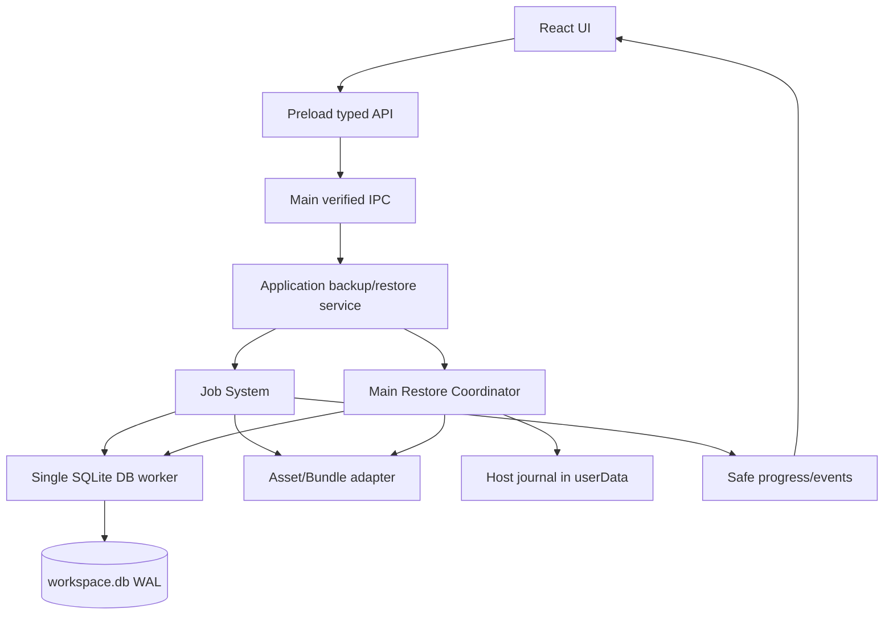
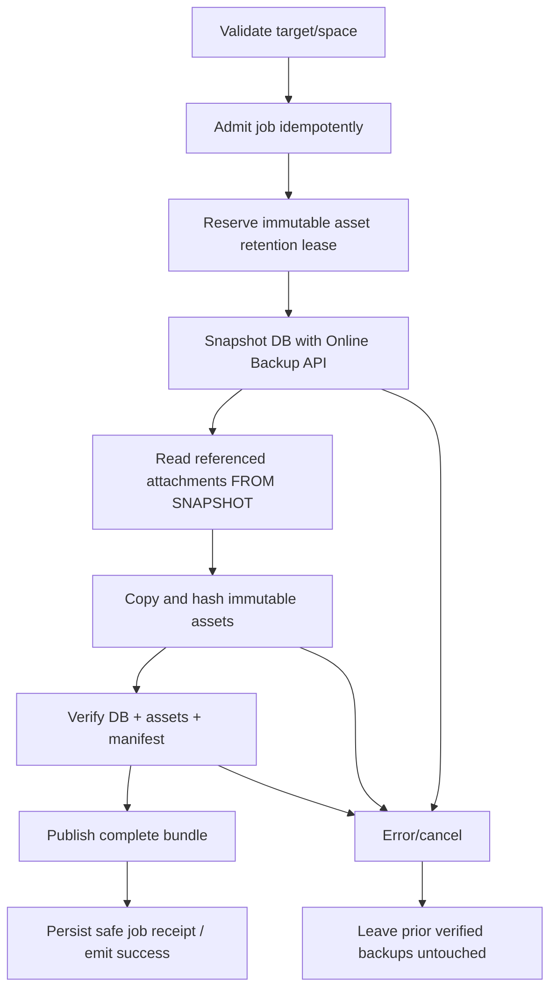

# Iterkeep — Yedekleme, Geri Yükleme ve Kurtarma Sözleşmesi

> **Normatif amaç:** `workspace.db`, bu veritabanından referans verilen asset'ler ve geri yükleme için gerekli metadata'nın **tutarlı, doğrulanabilir, geri alınabilir** bir yedeğini üretmek; hatalı disk/uygulama/migration durumunda kullanıcı verisini sessizce değiştirmeden kurtarmak. Geliştirme ajanı bu belgeyi implementasyon, test ve gözlemlenebilirlik sözleşmesi olarak uygulamalıdır.
>
> **Yetki hiyerarşisi:** Domain tipleri, ID ve durum geçişleri `DOC-08`; fiziksel SQL tabloları ve migration `DOC-09`; DB connection, online backup ve transaction semantiği `DOC-10`; public IPC isimleri / DTO ve security envelope `DOC-11`; job state ve iş orkestrasyonu `DOC-12`; Markdown import/export `DOC-16`; genel güvenlik `DOC-30`; performans hedefleri `DOC-31`; kullanıcıya açık hata kodları `DOC-32`; test/CI `DOC-33/34`. **Bu belge backup bundle formatı, dosya snapshot koordinasyonu, restore, cleanup, retention, koruyucu recovery point ve restore ekranı davranışlarının kanonik kaynağıdır.** Başka dokümandaki SQL'i değiştirip yeni tablo eklemez.
>
> **Kanıt düzeyi:** Buradaki kodlar uygulanabilir referans kalıplarıdır; gerçek Electron/Windows `better-sqlite3`, paketleme, antivirüs ve fiziksel disk arızası testleri yapılmış sayılmaz. `draft` statüsü ancak belirtilen bütün kalite kapıları karşılandığında değiştirilebilir.

---

## 0. Ürün garantileri, kapsam ve terminoloji

**Kullanıcı vaadi:** Kullanıcı, Iterkeep'in veriyi hangi noktadan geri getireceğini görebilmeli; yedek oluşturma başarısızsa başarılı sanmamalı; geri yüklemeden önce mevcut verisinin neyle değişeceğini anlayabilmeli; araç kapanırsa önceki sağlam veri korunmalıdır. Fiziksel disk arızası halinde yalnız aynı diskte duran yedekler kurtarma garantisi vermez.

- `backup`: SQLite Online Backup API ile alınan DB snapshot'ı ve aynı mantıksal snapshot'a ait **immutable asset** byte'larından oluşturulmuş, doğrulanmış bundle.
- `recovery point`: Geri yüklenebilirliği önceden test edilmiş backup; migration/restore öncesi ayrıca **pinned** olarak saklanır.
- `portable export`: `DOC-16`'daki Markdown/YAML transfer biçimi; **tam backup değildir**. Agent geçmişi ve operasyonel ayarlar export'a dahil olmayabilir.
- `restore preview`: Diskteki adayı doğrulayan, kullanıcı verisini değiştirmeyen, zamana bağlı önizleme işi.
- `restore commit`: Etkisi açıkça onaylanmış, **Main Restore Coordinator** tarafından yönetilen ayrı bir iş.
- `quarantine`: Şüpheli/bozuk geçici veya kaynak dosyanın güvenli inceleme için korunması; hiçbir zaman sessizce normal workspace'in yerine geçmez.
- `asset`: `attachments.relative_asset_path` tarafından işaret edilen ve yönetilen `assets/` içindeki dosya. Model ağırlıkları ve geçici ham ses kayıtları asset değildir.
- `success`: DB snapshot + asset seti + manifest + hash + doğrulama + yayın adımlarının hepsi bitmiştir; sadece `db.backup()` resolve olması **yetmez**.

### 0.1 Kapsam

| İçerik | Varsayılan bundle | Açıklama |
|---|---|---|
| `workspace.db` | **Evet** | Bütün kalıcı domain/ayar/agent tabloları dahil; DB tutarlı snapshot'tır |
| Yönetilen ekler `assets/**` | **Evet** | DB snapshot'ında referans edilen dosyalar; hash + boyut kontrolü |
| `manifest.json` | **Evet** | Kimlik, format/sürüm, dosya hash'leri, kaynak snapshot bilgisi |
| `workspace.db-wal`, `workspace.db-shm` | **Hayır** | Canlı yan dosyalar kopyalanmaz; Online Backup API içerik üretir |
| `backups/`, `exports/` | **Hayır** | Rekürsif yedekleme ve hassas veri çoğaltması engellenir |
| TTS/STT ham kayıtları, model ağırlıkları | **Hayır** | Opsiyonel servis dosyaları; gerekli metadata DB içindedir, model yeniden kurulabilir |
| Electron cache / loglar / temp | **Hayır** | Yeniden üretilebilir veri; hassas ayrıntılar riskli |
| Git `.git/` | **Hayır** | DOC-16'nın ayrı export/Git işlem hattı |
| Kullanıcı hesabı OS keychain sırları | **Hayır** | Yeniden yetkilendirme gerekebilir; hiçbir secret sızdırılmaz |

**Gizlilik:** V1 yedekleri **şifreli değildir**. SHA-256 hata/tesadüfi değişim kontrolüdür; **gizlilik veya saldırgana karşı kimlik doğrulaması sağlamaz**. UI bunu açıkça gösterir. Varsayılan hedef kullanıcı özel klasörüdür; harici disk veya bulut senkronizasyon klasörü seçilmişse bu risk kullanıcıya bildirilir. Yol permission'ları Windows/macOS/Linux platform adaptörüne göre sınanır.

---

## 1. Değişmez mimari kararlar (`BKR-I-001–040`)

| ID | Zorunlu invariant |
|---|---|
| BKR-I-001 | Canonical workspace yalnız SQLite `workspace.db`'dir; backup/export ikinci write-store olmaz. |
| BKR-I-002 | Canlı WAL modunda `copyFile(workspace.db)` backup sayılmaz. |
| BKR-I-003 | Online Backup API çağrısı **tek DB owner worker** tarafından yapılır. |
| BKR-I-004 | Bundle üretimi Main'in güvenli seçme yetkisi ve sınırlı job runner ile yapılır. |
| BKR-I-005 | Sadece `complete + verified` bundle kullanıcıya geri yüklenebilir gösterilir. |
| BKR-I-006 | `.partial` / staging / journal dosyaları geçerli yedek olarak listelenmez. |
| BKR-I-007 | Tek başarılı backup kaynağı `db.backup()` promise sonucu + bağımsız açma/doğrulamadır. |
| BKR-I-008 | Bundle yolları yalnız sabit relative path, traversal/symlink/junction reddi. |
| BKR-I-009 | DB snapshot'ın işaret ettiği her live attachment hash/byte karşılığıyla yer alır. |
| BKR-I-010 | Asset blob'ları immutable'dır; eski blob in-place değiştirilmez. |
| BKR-I-011 | Backup boyunca referenced asset garbage collection engellenir (lease/pin). |
| BKR-I-012 | Preflight disk alanı kontrolü gereklidir ama tek başına yeterli başarı garantisi değildir. |
| BKR-I-013 | Kaynak DB bozuksa backup başarı diye yayınlanamaz; read-only recovery önerilir. |
| BKR-I-014 | `quick_check` ve `integrity_check` farklıdır; backup yayınında **full** integrity uygulanır. |
| BKR-I-015 | `foreign_key_check` ayrıca çalışır; `integrity_check` bunu kapsamaz. |
| BKR-I-016 | Schema checksum, workspace identity, Inbox invariant doğrulanır. |
| BKR-I-017 | Backup'ın üretilme zamanı ve kapsamı manifestte açıkça yazılır. |
| BKR-I-018 | Temp dosya son hedefin mevcut doğrulanmış yedeğini asla overwrite etmez. |
| BKR-I-019 | Aynı bundle ID'si ve manifest sürümü tekil ve immutable'dır. |
| BKR-I-020 | Hash verilere son hal üzerinden hesaplanır; published bundle sonra değiştirilemez. |
| BKR-I-021 | Retention başarısız, eksik ve tek son sağlam yedeği gizlice silemez. |
| BKR-I-022 | Pre-migration ve pre-restore recovery point, sıradan günlük cleanup tarafından silinmez. |
| BKR-I-023 | Restore için ayrı, güncel user approval gerekir; preview onay sayılmaz. |
| BKR-I-024 | Preview içerik/hash/workspace/revision snapshot'ı commit öncesi tekrar doğrulanır. |
| BKR-I-025 | Restore **workspace-exclusive**, AI ve modellerden bağımsızdır. |
| BKR-I-026 | Eski DB bağlantısı açıkken üzerine kopyalama/rename yapılmaz. |
| BKR-I-027 | Mevcut DB için onaydan sonra, swap'tan önce yeni bir koruyucu recovery point alınır. |
| BKR-I-028 | Restore host journal, değişen DB'nin içinde değil güvenli userData altında tutulur. |
| BKR-I-029 | Restore state machine kayıtları yeniden başlatmada deterministik yorumlanır. |
| BKR-I-030 | Yeni DB doğrulanmadan eski DB ve rollback materyali silinmez. |
| BKR-I-031 | OS/FS atomic rename davranışı doğrulanmayan yerde atomicity iddia edilmez. |
| BKR-I-032 | WAL/SHM dosyaları belirsiz durumda keyfî olarak silinmez. |
| BKR-I-033 | Restore sonrası schema uyumsuzluğu sessiz auto-downgrade/upgrade yaratmaz. |
| BKR-I-034 | UI cache, jobs ve IPC abonelikleri restore sonrası eski DB sonucunu göstermez. |
| BKR-I-035 | Restore başlangıç job ID'si eski DB'de kaybolabilir; host receipt authoritative'dir. |
| BKR-I-036 | Kayıp ACK otomatik ikinci restore veya backup başlatmaz; receipt uzlaştırılır. |
| BKR-I-037 | AI/agent hiçbir gizli serbest dosya/restore komutu kullanamaz. |
| BKR-I-038 | Başarısızlığı teşhis için özel belge/konuşma metni sistem loglarına yazılmaz. |
| BKR-I-039 | Bozuk DB'de varsayılan davranış boş workspace oluşturmak değil, kurtarma ekranıdır. |
| BKR-I-040 | Başarı metni yalnız commit + doğrulama + görünür receipt tamamlanınca gösterilir. |

---

## 2. Modül sorumlulukları ve repo yolları

```text
apps/desktop/src/main/
  restore/restore-coordinator.ts       # exclusive lifecycle, close/open handoff
  restore/host-journal.ts              # state machine, fsync/safe atomic write
  security/selection-handle-store.ts   # renderer path değil, trusted handle
  ipc/handlers/backup-handlers.ts      # DOC-11 public routes
packages/application/src/
  backup/backup-service.ts             # create/list/preview/commit authorization
  backup/backup-policy.ts              # retention + current workspace policy
packages/storage-sqlite/src/
  operations/backup.ts                 # only DB worker calls better-sqlite3 backup
  operations/integrity.ts              # PRAGMA, schema+Inbox checks
  operations/migrations.ts             # forward-only pre-migration verified point
packages/job-system/src/
  runners/backup-job.ts
  runners/restore-preview-job.ts
  runners/restore-commit-job.ts
packages/import-export/src/
  backup/manifest.ts                   # bundle format is NOT DOC-16 export format
  backup/asset-snapshot.ts
  backup/bundle-verifier.ts
  backup/retention.ts
packages/contracts/src/
  backup/backup-contracts.ts           # typed DTO, Zod schemas (DOC-11 names)
apps/desktop/src/renderer/features/backups/
  BackupListPage.tsx
  RestorePreviewDialog.tsx
  RestoreProgressView.tsx
  RecoveryPage.tsx
tests/integration/backup/
tests/resilience/restore/
tests/e2e/backups/
```

`DOC-07` klasörleri katı paket sınırıdır: Yeni top-level paket açılmaz; bunlar mevcut paketlerde modül/dizinlerdir. Renderer Node `fs`, `better-sqlite3`, `child_process` veya gerçek dosya yolu almaz. `application` repository, asset store, workspace lock ve job portlarıyla çalışır. Host journal açık bir domain store değildir; yalnız restore commit kurtarılabilirliği içindir.

### 2.1 Tekil işlem grafiği



### 2.2 Kamuya açık mevcut IPC çağrıları (yeni rota YOK)

| API | Kanal (`iterkeep:v1:` önekli) | Önemli koşul |
|---|---|---|
| `backups.create({destinationHandle?})` | `backups.create` | Kullanıcı yetkili kaynağa ve hedefe sahip; `{jobId}` döner |
| `backups.list({cursor?,limit?})` | `backups.list` | Yalnız doğrulanmış kayıtlar + güvenli hata özetleri; bounded page |
| `backups.previewRestore({selectionHandle})` | `backups.restore.preview` | Salt preview job, canlı domain'e mutation yok |
| `backups.commitRestore({previewJobId,approvalId})` | `backups.restore.commit` | Tek kullanımlık etki onayı, exclusive job |
| `jobs.get({jobId})` | `jobs.get` | İş durumu; restore host receipt özel yolu |
| `jobs.list(...)` | `jobs.list` | Page, sensible enum ve sınır |
| `jobs.cancel({jobId})` | `jobs.cancel` | Güvenli faz dışında `accepted:false` veya too-late |
| `files.chooseExportTarget(...)` | `files.chooseExportTarget` | Belgeye göre backup destination seçimi; UI path değil handle alır |
| `files.choose...` | `DOC-11 SelectionHandle` | Restore için purpose=`restore` yetkili dosya/klasör chooser; yeni generic fs API açılmaz |

`backups.previewRestore` ve `commitRestore` aynı request'in farklı aşamaları değildir; zaman/snapshot koşulları ayrıca kontrol edilir. Gerçek public route şemaları yalnız `DOC-11`'de tutulur. `backups.list` kullanıcının manually seçtiği herhangi bir klasörü recursively tarayan general filesystem endpoint değildir.

---

## 3. Bundle biçimi — `iterkeep-backup/1`

### 3.1 Dosya ağacı ve isimlendirme

```text
<user-selected-backup-root>/
  2026-10-10T14-28-33Z__<backup-uuid>/
    manifest.json
    workspace.sqlite
    assets/
      <sha256-prefix>/<sha256>.bin     # yalnız referanslanan immutable bytes
  .staging/
    <backup-uuid>.partial/             # başarılıya dönmeden görünmez

<electron-userData>/
  restore-journal/
    <workspace-uuid>.json              # kısa süreli host operation receipt
  recovery-receipts/
    <restore-uuid>.json                # bounded, non-sensitive outcome
```

- Bundle klasör adı yalnız okunabilir metadata'dır; asıl kimlik `manifest.json.backup_id`.
- `workspace.sqlite`, SQLite Online Backup API'den üretilmiş bağımsız DB snapshot'ıdır. `workspace.db-wal/-shm` bu pakette bulunmaz.
- Asset dosyaları DB'de referans edilen relative path'leri **manifest mapping** ile kazanır; kesinlikle DB'den gelen path doğrudan hedef path'e birleştirilmez.
- Geçici staging **aynı dosya sistemi** üzerindeki hedef klasörde tutulur; cross-volume rename atomik varsayılmaz.
- UserData host journal ve recovery receipt, workspace'in restore edilecek DB'sinden bağımsızdır ve işletim sistemi kullanıcı erişimine kapalı tutulur.

### 3.2 Kanonik manifest sözleşmesi

```json
{
  "format": "iterkeep-backup/1",
  "format_version": 1,
  "backup_id": "e37781d4-2190-4fdb-a079-81c6f2b9a747",
  "created_at": "2026-10-10T14:28:33.000Z",
  "reason": "manual",
  "workspace": {
    "id": "9f5e17d8-a8f5-4de1-8c65-782db2f4dd85",
    "schema_version": 1,
    "display_name": "My Workspace"
  },
  "database": {
    "path": "workspace.sqlite",
    "sha256": "<64-char SHA-256 HEX>",
    "bytes": 1048576,
    "application_id": null
  },
  "assets": [
    {
      "owner_relative_path": "images/diagram.png",
      "bundle_path": "assets/ab/<sha256>.bin",
      "sha256": "<64-char SHA-256 HEX>",
      "bytes": 12345
    }
  ],
  "counts": { "projects": 4, "tasks": 72, "documents": 18, "decisions": 9, "activity_logs": 34 },
  "verification": {
    "full_integrity_check": "ok",
    "foreign_key_violations": 0,
    "schema_checksum_verified": true,
    "inbox_verified": true,
    "asset_hashes_verified": true
  },
  "producer": { "app": "iterkeep", "version": "0.1.0" }
}
```

`<sha256>` alanları burada açıklama işaretidir; **gerçek JSON fixture değil**. Gerçek kod `z.strictObject` ile alanları ve liste boyutlarını sınırlar. SHA-256 lowercase 64 hex, UUID v4, UTC tarih ve `backup_id` benzersizliği doğrulanır. `application_id` kullanılmıyorsa `null` sabitlenir ve SQL pragma değeri varmış gibi uydurulmaz. Boyutlar nonnegative safe integer olur. `counts` tamamı salt snapshot'tan okunur. Manifest serialize edildiğinde kararlı UTF-8 JSON ve sıralı asset yolu kullanılmalıdır; backup ID ve timestamp doğal olarak her backup'ta farklıdır.

**Dosya sahipliği/tutarlılık:** `assets` listesi **backup DB snapshot'ının** `attachments` tablosundan türetilir. Kaynak DB'nin backup sonrası canlı `attachments` tablosunu okuyarak liste üretmek yasaktır; o sırada referans kümesi değişmiş olabilir. Bundle'daki image asset'leri varsayılan olarak hash adreslidir. Farklı iki attachment aynı byte hash'i gösteriyorsa tek blob dosyası saklanabilir; iki mapping korunur. `owner_relative_path` için Unicode normalize, slash ve case-collision kontrolü zorunludur.

**Manifest bütünlüğü:** SHA hash'leri bundle'ın içeriğini accidental corruption'a karşı doğrular; kötü niyetli bir saldırgan hem içeriği hem manifesti değiştirebilir. V1 kendi kendine üretilmiş manifesti **dijital imzalı** diye sunmaz. İleride şifreleme/imzalama eklemek `iterkeep-backup/2` veya backward-compatible extension + ayrı güvenlik ADR gerektirir.

### 3.3 Sürüm/uyumluluk kuralları

| Kaynak | V1 davranışı |
|---|---|
| `iterkeep-backup/1`, desteklenen schema `1` | Restore preview devam eder |
| Bilinmeyen `format` veya `format_version` | `BACKUP_FORMAT_UNSUPPORTED`, mutasyon yok |
| `schema_version` uygulamadan yüksek | `SCHEMA_TOO_NEW`; otomatik downgrade yok |
| Desteklenebilir daha eski schema | Önce staged DB üzerinde migration planı + doğrulanmış migration recovery point; canlı DB dokunulmaz |
| Manifest workspace ID farklı | Otomatik başka workspace üzerine restore yok; açık policy kararı gerekir; V1 varsayılan **reddet** |
| Bundle plaintext | Kullanıcıya açık uyarı; parola sorup sahte encryption izlenimi verilmez |
| Manifestte beklenmedik dosya/çifte yol | Salt-okuma preflight sırasında reddedilir, dosya çalıştırılmaz |

---

## 4. Backup oluşturma — durum makinesi ve ayrıntılı algoritma

### 4.1 İş aşamaları



1. `backups.create()` Main tarafından sender/SelectionHandle doğrulaması ve mevcut workspace yetkisiyle kabul edilir. Varsayılan backup root daha önce yapılandırılmış kullanıcı erişimli dizindir. Workspace içindeki `backups` varsayılan konumu, DB/WAL veya export path'inin alt klasörü değildir.
2. Hedefte recursive symlink/junction kontrolü, sahiplik, yazılabilirlik, path çakışması ve tahmini boş alan incelemesi yapılır. **Tahmini alan**: SQLite `page_count*page_size` + live asset'lerin byte toplamı + güvenlik payı; bu değer hard guarantee değildir.
3. İş `DOC-12`'deki kalıcı job + idempotency receipt ile kaydedilir. Backup `job.status=running` olunca `started_at` yazılır; progress UI eventleri ayrı yayınlanır.
4. `AssetStore` immutable content-addressed dosyalar için GC lease/pin kurar ve bu lease backup sonuna kadar sürer. V1 asset yerinde değiştirilebiliyorsa **başarısız fail-closed**: backup feature bu invariant sağlanmadan açılmaz.
5. DB worker, aktif kısa transaction'ları bitirdikten sonra backup başlangıç eşiğini belirler. DOC-10 politikası gereği backup tutarlılığı için mutation admission kısa süreli dondurulabilir; ancak **backup süresince UI'nın kilitli kalması** varsayılan değildir. Her doğrulanmış snapshot, kendi consistent committed state'ini temsil eder. Kaynak bağlantının backup sırasında yazma üretmesi snapshot zamanını etkileyebilir; V1 için aynı connection'da yazma admission backup bitene kadar durdurulur veya veri anlık sınırı tutarlı başka bir snapshot yaklaşımıyla kanıtlanır.
6. Aynı backup UUID'li benzersiz `*.partial` staging klasörü yaratılır. DB worker `db.backup(stage/workspace.sqlite)` çağırır; **backend worker sorumluluğu** nedeniyle `Main` yeni ikinci SQL bağlantısı açıp canlı DB'ye ulaşmaz.
7. Snapshot DB ayrı güvenilir verifier bağlantısıyla **yalnız read-only** açılır. `PRAGMA integrity_check`, `foreign_key_check`, migration hash/sürüm, workspace+Inbox ve temel semantik invariants doğrulanır. Read-only verifier, snapshot DB'yi yanlışlıkla değiştirmez. Bağımsız verifier'ın nasıl izole edileceği `DOC-10` worker protokolüyle uyumlu olmalıdır.
8. Snapshot `attachments` satırları okunur. Her referenced blob fiziksel olarak bulunur, kaynakta symlink/reparse point değildir, manifest path allowlist içinde kalır, boyutu ve SHA-256'sı beklenen doğrulamayı geçer. DB metadata hash'i yoksa trusted read sırasında hesaplanır; ancak DB'nin referans ettiği dosyanın anlık tutarlılığı immutable/pin sözleşmesiyle sağlanır.
9. Bloblar stage'e `O_EXCL`/benzersiz dosya mantığıyla yazılır, hash ve byte sınırı tekrar ölçülür. Kopya tamamlanmadan başarılı progress `100%` olmaz.
10. Manifest ile dosya listesi final stage üzerinden ikinci kez doğrulanır. Manifest kendisini hash ile sonsuz döngüye sokmaz; hash doğrulaması DB + asset seti üzerindedir. Manifest schema, path, sort ve bütünlük durumu ayrıca validate edilir.
11. Stage dosyaları uygun platformda flush/fsync edilir; bundle immutable isimle, desteklenen aynı-filesystem rename koşuluyla publish edilir. Windows AV/lock ve cross-volume hataları ele alınır. Publish sonrası manifest hash'i ve bundle kimliği doğrulanır.
12. Yalnız tam publish + verify sonrasında `background_jobs.status='succeeded'` ve kullanıcıya görünür güvenli receipt kaydedilir. Bu veritabanı mutation'ı backup snapshot'ında olmayabilir; backup'ın semantiği o andaki workspace durumudur. **Backup metadata DB'ye eklenirken yeni backup'a yazma** diye sonsuz döngü yaratılmaz.
13. Stage temizliği ve asset lease release yapılır. Beklenmedik process ölümünde lease process belleğinden kaybolmuş olabilir; asset GC, startup'ta incomplete backup işlemi ve staging journal taraması bitmeden agresif silme yapmaz.
14. İptalde/hatada eski yedekler aynen korunur. Stage ya güvenli silinir ya bounded quarantine'a alınır; sanki başarılı yedekmiş gibi kullanıcıya sunulmaz.

### 4.2 Online Backup API örnek kodu

```ts
// packages/storage-sqlite/src/operations/backup.ts
// Bu fonksiyon sadece DB worker içinde; temp yolunu Main onaylı FS adapter üretir.
import type Database from 'better-sqlite3';

export interface BackupProgress { totalPages: number; remainingPages: number }

export async function snapshotSqlite(
  db: Database.Database,
  stagedSqlitePath: string,
  signal: AbortSignal,
  report: (p: BackupProgress) => void,
): Promise<void> {
  if (signal.aborted) throw new Error('JOB_CANCELLED');
  await db.backup(stagedSqlitePath, {
    progress(p) {
      if (signal.aborted) throw new Error('JOB_CANCELLED');
      report({totalPages: p.totalPages, remainingPages: p.remainingPages});
      return 100; // benchmark ile belirlenecek event-loop-friendly pages/step
    },
  });
  if (signal.aborted) throw new Error('JOB_CANCELLED');
}
```

`db.backup()` kaynak bağlantı üzerinden restore **yapmaz**. Worker kodu, exception/failure durumunda stage'i hatalı backup diye raporlamaz ve tamamlanmış hedef yolunu overwrite etmez. `progress` callback'i UI event throttle'ına doğrudan bağlı olmamalı; ilerleme olayları `DOC-12` batching ile iletilir.

### 4.3 Bağımsız snapshot integrity fonksiyonu

```ts
// packages/storage-sqlite/src/operations/integrity.ts
import Database from 'better-sqlite3';

export function verifySnapshotSqlite(filename: string, expectedWorkspaceId: string) {
  const db = new Database(filename, { readonly: true, fileMustExist: true });
  try {
    const integrity = db.pragma('integrity_check', { simple: false }) as Array<{ integrity_check: string }>;
    if (integrity.length !== 1 || integrity[0]?.integrity_check !== 'ok') {
      throw new Error('BACKUP_DB_INTEGRITY_FAILED');
    }
    const violations = db.pragma('foreign_key_check') as unknown[];
    if (violations.length) throw new Error('BACKUP_FK_INVALID');
    const rows = db.prepare('SELECT id, inbox_project_id FROM workspaces').all() as Array<{
      id: string; inbox_project_id: string;
    }>;
    if (rows.length !== 1 || rows[0].id !== expectedWorkspaceId) {
      throw new Error('BACKUP_WORKSPACE_MISMATCH');
    }
    const inbox = db.prepare(
      "SELECT id FROM projects WHERE id=? AND workspace_id=? AND kind='inbox' AND deleted_at IS NULL"
    ).get(rows[0].inbox_project_id, expectedWorkspaceId);
    if (!inbox) throw new Error('BACKUP_INBOX_INVALID');
    // NORMATİF EK: schema_migrations SHA-256 manifest kontrolü, user_version,
    // record_registry + assets references semantic checks ayrı helper'larda.
    return { valid: true as const, workspaceId: rows[0].id };
  } finally {
    db.close();
  }
}
```

Bu örnek temel DB kontrolünü gösterir; yukarıdaki yorumla işaretli şema hash ve asset kontrolleri **gerçek uygulamada zorunlu**dur. Eksik alanları sessizce `valid=true` olarak yayınlamak yasaktır; final bundle verifier bütün kapıları tek fonksiyonda birleştirmelidir.

### 4.4 Backup sonucu ve idempotency

- `backups.create()` job ID döner, başarı değil. Sonuç `jobs.get`/event ile izlenir.
- Aynı kullanıcı tıklaması tekrar iletildiyse aynı idempotency key aynı job'a döner.
- Commit timeout'unda önce receipt incelenir; yeni job veya yeni backup ID kör oluşturulmaz.
- Backup başka DB olaylarından dolayı farklı zamanda snapshot alabilir; birden çok manuel yedek aynı veri anlamına gelse de ayrı backup ID'si olabilir.
- `APP_CLOSED` veya `INTERRUPTED_BY_RESTART` kaydı eski job'u terminal duruma çekebilir, fakat diskte complete bundle bulunmuşsa doğrulanmış artifact'ten güvenli reconciliation yapılır; eski DB job status geriye doğru uydurulmaz.

---

## 5. Backup metadata, listeleme ve retention

### 5.1 Backup kataloğu nerede saklanır?

`DOC-09` şemasına yeni `backups` tablosu **eklenmez**. V1 manifest dosyaları filesystem'de bulunur; `backups.list` yalnız kullanıcı tarafından belirlenmiş managed backup root'larındaki kayıtları **bounded**, lazy ve indekslenebilir liste olarak döndürür. `userData` altındaki küçük salt metadata/cache yeniden üretilebilir; kaynak, doğrulanmış bundle manifestleridir. UI'ya raw mutlak yol/secret gösterilmez; gösterim etiketi ve güvenli seçme handle'ı kullanılır. Belirsiz veya bozuk manifestli klasörler restore listesinde `verified` olarak gösterilmez; diagnostics/failed listesinde ayrı görünür.

İlk kurulumda varsayılan `backupRoot` workspace ile aynı fiziksel disk üzerinde olabilir. Bu yüzden UI, **“Aynı diskteki yedek disk arızasına karşı korumaz”** uyarısını gösterir ve ikinci diske manuel hedef seçme seçeneğini sunar. Otomatik internet/cloud sync yapılmaz.

### 5.2 Otomatik tetikleme politikası

| Trigger | V1 varsayılan davranış |
|---|---|
| Kullanıcı `Yedek oluştur` seçer | Hemen job kabulü; kapasite ve izin kontrolleri |
| Düzenli kullanım | Kullanıcı onayıyla etkinleşen otomatik günlük kontrol: son başarılı yedekten beri değişiklik varsa, uygulama açıkken ve en az 24 saat arayla bir yedek |
| Uygulama kapalıyken | Hiçbir background daemon veya gizli otomasyon çalışmaz |
| Migration öncesi | **Zorunlu doğrulanmış** pre-migration recovery point |
| Restore öncesi | **Zorunlu doğrulanmış** pre-restore recovery point |
| Kullanıcı AI'yı kapatır | Backup ve restore çalışmaya devam eder; modeller yüklenmez |
| Kullanıcı uzun süre hiç değişiklik yapmaz | Gereksiz günlük disk yazımı yok; son doğrulanmış yedek saklanır |

**Önemli:** İlk sürüm otomatik yedeklemeyi varsayılan olarak etkinleştirmez; sihirbaz/Settings üzerinden **açık opt-in** sunar. Özelliği isteyen kullanıcı yedek root seçer ve boş alan/retention politikası görür. Migration ve restore koruyucu yedekleri, otomatik günlük tercihinden bağımsız zorunludur. Otomatik job'lar `DOC-12` job türü `backup` olarak çalışır; yeni job enum'u icat edilmez.

### 5.3 Retention

Önerilen başlangıç profili, kullanıcı tarafından değiştirilebilir:

| Bucket | Korunan nokta | Kural |
|---|---|---|
| Daily | Son 7 takvim günü | Her günün en yeni başarılı backup'ı |
| Weekly | Son 4 ISO hafta | Haftadaki en yeni başarılı backup (daily ile ortak olabilir) |
| Monthly | Son 3 takvim ayı | Aydaki en yeni başarılı backup (ortak olabilir) |
| Pinned | Pre-migration/pre-restore | Otomatik silinmez; kullanıcıya ayrı yönetim |
| Safety floor | En az 1 son doğrulanmış | Hiçbir koşulda otomatik cleanup ile silinmez |

Temizlik algoritması: (1) tüm manifestleri parse et, (2) `verified` durumunu tekrar kontrol et (en az hash, tam içerik testi planlı), (3) bucket/pinned/safety-floor birleşimini `keep` kümesi yap, (4) yalnız managed root içindeki sahip olunan complete bundle'larda deletion planı üret, (5) kullanıcı yedek temizleme tercihi açıksa, hedef hâlâ aynı fingerprint'e sahipse güvenli sil. Bağlantısız harici disk üzerinde başarısız erişim `empty backup list` sayılmaz. Kullanıcının manuel oluşturduğu veya pinlediği klasörler sınır dışında silinmez.

V1 retention **disk boyutu kotası nedeniyle otomatik zorla eski yedek silmez**. Disk yetersizse önce kullanıcı bilgilendirilir; son sağlam/pinned yedek otomatik silinmez. Bir backup başarısız olduğunda eski yedeği silerek yer açmak yasaktır.

### 5.4 Manual deletion

- Backup silme **açık onay** gerektirir; özellikle `last verified` ve `pinned` otomatik silinmez.
- Kullanıcı son tek recovery point'i manuel silmek isterse ikinci, açık veri kaybı uyarısı gerekir; varsa önce harici diske kopyalama önerilir.
- Silme yalnız bizim ürettiğimiz `.staging` veya manifest ile sahipliği kanıtlanmış backup bundle içinde gerçekleşir; keyfî klasör recursive-delete izni UI'ya verilmez.
- Dosya değişmiş/symlink hâline gelmişse silme işlemi durur ve yeni preview gerekir.
- Dosya silme API'si `DOC-11`'de ayrıca tanımlanmadığından **V1'de arayüz üzerinden genel `deleteBackup` route'u yoktur**. Kullanıcıya retention tercihi ve managed cleanup sunulabilir; manuel deletion UI'sı eklenmek istenirse önce `DOC-11` için ADR + statik yeni route/test gerekir. Bu belge tek başına IPC ismi icat etmez.

---

## 6. Restore preview: veri değiştirmeden doğrulama

### 6.1 Aşamalar

1. Kullanıcı Backup ekranında yedek seçer veya güvenli dosya/klasör seçim diyaloğunu açar.
2. Main yalnız `purpose=restore` selection handle'ını kabul eder; kullanıcı tarafından gönderilmiş raw path reddedilir.
3. Preview job, manifesti kısıtlı boyutta okur ve `iterkeep-backup/1` şemasını doğrular. Symlink, path traversal, duplicate path, aşırı asset sayısı ve zip-bomb benzeri yoğunlaşmalar reddedilir. V1 native backup formatı **dizin tabanlıdır**; dışarıdan gelen rastgele ZIP bu rotada doğrudan açılmaz.
4. Veritabanı ve asset hash'leri yeniden hesaplanır. DB read-only bağlantıda `PRAGMA integrity_check`, `PRAGMA foreign_key_check`, migration metadata, expected workspace/Inbox kontrol edilir.
5. Aktif workspace DB identity, schema version ve user-visible counts okunur. Bu sırada aktif DB salt-okuma snapshot'ından ölçüm yapılır; restore önizlemesi aktif veri yazmaz.
6. Restore'a uygun değilse belirgin bir hata kodu ve güvenli teknik gerekçe verilir. Bozuk backup'ı `ignore checks` seçeneğiyle yükleme V1'de yoktur.
7. Geçerli aday için **etki önizlemesi** hazırlanır: workspace adı, backup tarihi, aktif verinin son güncelleme zamanı, backup/aktif proje-görev-not sayıları, tahmini düşürülecek kayıt farkı ve schema uyumu. Diff hesaplanamıyorsa *tam diff var* diye iddia edilmez.
8. Kullanıcıya yeni veri eklendiğinde backup zamanına geri dönüleceği açıkça söylenir. Kullanıcının mevcut verileri korumak için koruyucu yeni yedek alınacağı ve onun da başarısız olursa restore başlamayacağı belirtilir.
9. Preview sonucu `previewJobId`, server-owned path/fingerprint, workspace identity, TTL (varsayılan 15 dakika), expiry ve ilgili UI context'e bağlanır. Aday değişirse preview geçersiz olur.
10. `approvalId` policy service'den üretilir, immutable operation summary ve fingerprint ile eşleşir; UI'dan gelen `approved:true` doğrudan yetki değildir.

### 6.2 Önizleme UI örneği

```text
Geri yüklemeyi gözden geçir
----------------------------------------------
Yedek:       10 Ekim 2026, 17:28 (yerel saat)
Workspace:   My Workspace
Durum:       Tam bütünlük kontrolü başarılı
İçerik:      4 proje · 72 görev · 18 not
Şema:        v1 (destekleniyor)

Şu anki çalışma alanı bu yedekle değiştirilecek.
Yedekten sonraki değişiklikler aktif çalışma alanında görünmeyecek.
Önce mevcut verinin koruyucu yedeği alınacak.

[İptal]                      [Onayla ve geri yükle]
```

Yukarıdaki örnek sayılar temsildir; **runtime değerleri snapshot'dan** gelmelidir. Screen-reader label, keyboard focus trap, Escape/Cancel ve progress `DOC-21–23` ile bütünleşir. Restore sırasında başka workspace'e geçme engellenir ve seçilen workspace adı görünür olur.

### 6.3 Preview receipt

```ts
export interface RestorePreviewReceipt {
  previewJobId: string;               // UUID v4
  backupId: string;                   // UUID v4
  backupManifestHash: string;         // SHA-256
  sourceWorkspaceId: string;          // UUID v4
  targetWorkspaceId: string;          // UUID v4
  createdAtUtc: string;
  expiresAtUtc: string;
  compatible: boolean;
  warningCodes: readonly string[];
  counts: Readonly<Record<'projects' | 'tasks' | 'documents' | 'decisions', number>>;
  // NO raw absolute filesystem paths and NO renderer-controlled file references.
}
```

Persisted `background_jobs.result_json` yalnız bounded ve hassas olmayan özet saklar. Trusted candidate path/manifest snapshot ayrı Main scope'da yaşar; restart olduğunda preview geçersiz sayılır, kullanıcı tekrar önizleme alır. Uzun yaşamlı preview yetkisi yoktur.

---

## 7. Restore commit — güvenli dosya değişimi

### 7.1 Restore State Machine

`DOC-12` ile **aynı** adlar:

```text
preview_verified
  → confirmed
  → staged_verified
  → old_db_closed
  → replacement_attempted
  → replacement_verified
  → complete
```

Hata halinde ayrı `failed_needs_recovery`, `rolled_back`, `manual_intervention_required` gibi **host-journal sonuç sınıfları** saklanabilir; bunlar **`background_jobs.status` enum'una eklenmez**. `background_jobs` yine `queued/running/paused/succeeded/failed/cancelled` kullanır ve restore sonunda eski DB yerine yeni DB geçtiği için host receipt authoritative kalır.

### 7.2 Exclusive handoff ve transaction sınırları

- Coordinator `workspace_exclusive` kilidi alır; bütün yeni UI/agent/import veritabanı mutasyonlarını admission'da kapatır.
- Kısa mutasyonlar drain edilir. Kullanıcıya kaydedilmemiş draft bulunuyorsa önce kaydetme/koruma teklifi gösterilir. Kayıt başarısızsa restore otomatik sürdürülmez.
- Restore adayı tekrar checksum + integrity kontrolünden geçer. Onay TTL veya fingerprint farklıysa yeni preview istenir.
- Eski aktif DB, kullanıcı izni sonrasında **Online Backup API** ile `pre-restore` pinned recovery point'e alınır ve asset'leri doğrulanır. Bu işlem başarısızsa **swap yapılmaz**.
- Koruyucu yedeğin başarı metadata'sı DB değiştirmeden önce diskte duruyor olmalıdır; sadece backup job `queued` olması yeterli değildir.
- Restore edilen DB staging'e kopyalanır. Restore edilen asset'ler staging'de hash ve symlink kurallarıyla hazırlanır.
- UI/agent abonelikleri ve DB worker session'ları kapanır, `db.close()` onaylanır. Ana DB'ye ayrı bir gizli bağlantı açık kalamaz.
- `old_db_closed` durumu diske host journal'da durable yazılmadan eski dosyalar taşınmaz.
- Eski dosya seti (DB + varsa WAL/SHM) güvenli biçimde korunur; SQLite dosyası açıkken yalnız `.db` üzerine replace yapılmaz. İdeal olarak kaynak bağlantı **temiz kapandığı** doğrulanmalı; kalan WAL durumu SQLite'ın kendi kurtarma mekanizmasıyla güvenli olarak ele alınmalı. Yan dosyaları keyfî `unlink` etmek yasaktır.
- Staged candidate publish edilir ve yeni DB kontrollü olarak açılır. OS/filesystem semantics destekliyorsa rename/swap; desteklemiyorsa protected rollback copy + journal ile faz bazlı dosya seti taşıma uygulanır. **Çapraz dosya sisteminde atomik rename garantisi yoktur.**
- Yeni DB üzerindeki full integrity, FK, schema hash, workspace identity ve Inbox doğrulanır; asset pathleri bundle mapping ile güvenli konuma yayınlanmış olmalıdır.
- Yeni worker/application snapshot açılır, cache invalidation tamamlanır, `replacement_verified → complete` journal'a yazılır. Old DB rollback seti yalnız retention veya açık onay sürecinde temizlenir.
- Restore başarısızsa durumuna göre önceden korunmuş eski dosya setiyle **deterministik** rollback yapılır. Emin olunamıyorsa otomatik tamir iddiası yerine `manual_intervention_required` recovery ekranı gösterilir.

### 7.3 Dosya seti stratejisi

Maksimum güvenlik için doğrudan `workspace.db` üzerine overwriting yerine bütün seti koruyan staging gerekir:

```text
workspace-root/
  workspace.db           # active (connection closed before swap)
  assets/                # active immutable blob store
  .restore-staging/<id>/ # new restored DB/assets; verified before active publish
  .restore-rollback/<id>/# old DB/assets; never cleaned before verification
```

**Atomicity sınırı:** DB ve asset klasörü birlikte taşındığında iki path için evrensel atomik commit yoktur. Bu nedenle host journal her adımı korur. Asset'ler hash-addressed immutable ise eski/yeni referans kümelerinin ortak bloblarını korumak ve yeni blobları publish etmek daha ucuzdur; fakat stale/garbage collection **restore tamamlanmadan** çalışamaz. Metadata switch & app owner path aynı süreçte koordine edilir. İşlem bir adımda kesilirse başlangıçta host journal üzerinden hangi setin authoritative olduğu belirlenir.

**Windows:** Açık file handle/antivirus lock sebebiyle rename fail olabilir. Hata kodu ve `rollback` adımı test edilmeli; kullanıcıya uygulama yeniden başlatılmasını isteyebilir. “Tüm platformlarda atomic rename” iddiası yasaktır.

### 7.4 Host journal dosyası

```json
{
  "journal_version": 1,
  "restore_id": "60413230-6879-4572-bd61-105b9ae8fb94",
  "workspace_id": "9f5e17d8-a8f5-4de1-8c65-782db2f4dd85",
  "backup_id": "e37781d4-2190-4fdb-a079-81c6f2b9a747",
  "stage": "old_db_closed",
  "old_snapshot_sha256": "<sha256>",
  "candidate_sha256": "<sha256>",
  "started_at": "2026-10-10T14:28:33.000Z",
  "updated_at": "2026-10-10T14:29:13.000Z",
  "last_error_code": null
}
```

- **Journal path izinli** userData altında; gerçek staging/rollback paths, Main'in güvenli workspace path çözümleyicisinden veya OS-izinli ayrı host mapping dosyasından elde edilir. Dışarıya raw path, API key, metin, stack trace çıkarılmaz.
- Journal yazımı temp → fsync → atomic rename (uygun filesystem) → parent directory flush uygulanabiliyorsa flush. Journal'ın durable yazımı başaramadığı adım restore'a devam etmez.
- Her journal aşamasında hem DB hem asset'in kaynak/target checksum ve varlık koşulları kontrol edilir. Journal bozuksa veya fingerprint çelişiyorsa fallback “yeni boş DB oluştur” değildir.
- Stage `replacement_attempted` sonrası `cancel()` başarı iddiası taşımaz. Bu fazda UI “İşlem güvenli biçimde tamamlanıyor/kurtarılıyor” der, aktif swap aşamasında interruption'ı zorla başlatmaz.
- `jobs.get(restoreJobId)` için host receipt adapter `DOC-12` ile uyumludur. Eski DB'deki job satırının restore sonrasında kalacağı varsayılmaz.

### 7.5 Crash/restart deterministic reconciliation

| Son durable journal state | Açılışta doğrulanacaklar | Güvenli aksiyon |
|---|---|---|
| Journal yok | Normal DB sanity + schema kontrolü | Normal startup |
| `preview_verified` | Aktif DB değişmemiş | Preview invalidate; normal startup |
| `confirmed` | Eski DB hâlâ açık/kapanmamış olabilir | Yeni commit deneme yok; recovery point'i ve canlı DB'yi kontrol et |
| `staged_verified` | Eski DB aktif ve staged candidate geçerli mi? | Swap başlamadıysa stage quarantine, eski DB ile aç |
| `old_db_closed` | Old DB + stage + rollback dosya seti | Eski DB güvenliyse aç; swap hiç başlamamış olabilir |
| `replacement_attempted` | Hem eski hem yeni DB/asset fingerprint | Yeni doğrulanmışsa `replacement_verified`; değilse eski doğrulanmış rollback; belirsizde recovery UI |
| `replacement_verified` | Yeni DB ve asset full check | `complete` receipt ile finalize |
| `complete` | Yeni DB sağlam, receipts uyumlu | Workspace aç, caches temizle |
| Journal malformed / id mismatch | Hiçbir varsayım yapılamaz | **read-only recovery**, otomatik rename/delete yok |

Başlangıçta journal çözülene kadar Main **aynı workspace'i normal writable olarak başlatmaz**. Başka workspace kullanılıyorsa izolasyon kuralları ayrıca geçerlidir. Assistant/AI kapalı olsa dahi bu protokol aynıdır.

### 7.6 Restore sonrası tutarlılık

- `schema_migrations` checksum + `user_version` tutarlı, başlatılan app sürümüyle uyumlu olmalı.
- `PRAGMA integrity_check` tam olarak `ok`, `PRAGMA foreign_key_check` sıfır satır olmalı.
- Workspace ID, Inbox, aktif entity ilişki ve `record_registry` semantik kontrollere tabi.
- FTS5 indeks hatalıysa **canonical DB** doğru olmasına rağmen arama indeksini yeniden kurma `search_rebuild` işini güvenli zamanda tetikle; FTS bozulması tüm workspace'i sessiz restore etmeyi gerektirmez (`DOC-15`).
- Aktif DB'den referans edilen her managed asset için path ve hash doğrulanır. Eksik dosya varsa `replacement_verified` olmaz; rollback veya açık recovery gerekir.
- Renderer TanStack Query cache'ini ve proje seçimlerini yeniler, geçersiz conversation/agent run referansları eski workspace verisine dayanmaz.
- Agent/Ollama/STT/TTS otomatik başlatmak restore'un başarı şartı değildir.

---

## 8. Migration ve güncelleme öncesi kurtarma noktaları

1. Mevcut DB'nin gerçek schema version/hash ve temel integrity kontrolü çalışır.
2. Migration planı **resmî `DOC-09` dosyalarıyla** ilerlemeli; SQL doğrudan canlı şemaya göre uydurulmaz.
3. Yeni sürümün DB'de geri dönülemez şema değişikliği yapacağı kullanıcıya gerektiğinde bildirilir.
4. `pre-migration` reason koduyla **pinned, full doğrulanmış** snapshot alınır; yeterli boş alan yoksa migration durur.
5. Staged backup + asset metadata tamamlanmadan migration transaction'ı başlamaz.
6. Migration `DOC-10` tek DB worker ile, checksum ve `BEGIN IMMEDIATE` kurallarında yürütülür.
7. Migration commit sonrası schema hash, FK, `quick_check` ve gerektiğinde full integrity ile sonuç doğrulanır.
8. Hata halinde eski DB'yi korumak ve mevcut recovery point'e dönmek için Restore Coordinator kullanılır; sessiz downgrade olmaz.
9. Yalnız UI binary sürümünü düşürmek DB şemasını geri düşürmez; eski binary daha yeni DB'yi görürse `SCHEMA_TOO_NEW` ve güvenli yönlendirme sunar.
10. Koruyucu backup en az bir bağımsız uyumlu sürüm kurulana kadar pinned kalır; kullanıcı manuel silme kararı verebilir.

**Uzun migration'lar:** SQLite migration sırasında UI'ın donmaması gerekir; işlem DB worker'da, Main recovery view açıkken çalışır. Worker failure, Windows kill ve OS reboot testleri zorunludur. Migration atomik olsa bile runtime restart ve asset state ayrı restore koordinasyonu gerektirebilir.

---

## 9. Veri bozulması, disk hatası ve kurtarma yolu

### 9.1 Kategoriler

| Hata | Kesin davranış | Güvenli kullanıcı aksiyonu |
|---|---|---|
| DB yok, seçili workspace vardı | Otomatik yeni workspace oluşturma yok | Konumu yeniden bağla veya backup seç |
| DB path bulunamıyor / drive çıkmış | Daha önceki path kalır | Sürücüyü bağla veya backup göster |
| `SQLITE_CORRUPT`, integrity fail | Yazmalar bloke edilir | Read-only diagnostic + doğrulanmış restore |
| `SQLITE_FULL` | Başarısız transaction / backup; başka veri silme yok | Alan boşalt, aynı işlem niyetini güvenli şekilde tekrar dene |
| `SQLITE_BUSY` | Bounded retry; mutasyon sonucu belirsizse receipt | Kilitleyen programı kapat, yeniden kontrol et |
| İzin reddi / Windows AV kilidi | Güvenli durma + hedefi koruma | Path izinlerini/antivirüs kilidini çöz, tekrar dene |
| Backup hash uyuşmuyor | Restore reddi | Başka backup seç |
| Asset eksik / hash bozuk | Backup tamamlanmış sayılamaz | Asset kaynağını düzelt veya başka sağlam backup |
| Journal yarım/bozuk | Yazılabilir workspace açılmaz | Recovery mode, otomatik silme/overwrite yok |
| Migration sırasında crash | Checksum, DB journal, recovery point kontrolü | Onaylı kurtarma sürecine devam |
| FTS bozuk fakat DB sağlam | FTS yeniden oluşturulabilir | Restore değil, kontrollü reindex |
| Ollama/STT/TTS yok | **Core ve recovery etkilenmez** | AI ses ayarlarını sonra aç |

### 9.2 Kurtarma ekranı

Önerilen ekran bölümleri:

```text
Workspace açılamadı
Sorun: Veritabanı bütünlüğü doğrulanamadı.
Mevcut dosyalar korunuyor; hiçbir veri üzerine yazılmadı.

Son sağlam yedek:
10 Ekim 2026 · [Doğrula] [Önizle]

[Güvenli tanılama raporu oluştur]
[Başka yedek seç]
[Salt okunur incele (mümkünse)]
[Uygulamayı kapat]
```

Kullanıcıya doğrulanmamış “Verilerin tamamen güvende” veya “Kurtarıldı” yazısı gösterilmez. `read-only` açılma mümkün değilse seçenek disabled ve neden görünür. Recovery ekranı hareketleri önceden onaylanan snapshot/host journal verilerinden türetilir.

### 9.3 Kurtarma logu / tanılama

İzinli alanlar: `timestamp`, `correlationId`, `jobId`, `phase`, `errorCode`, `sourceSchemaVersion`, `targetSchemaVersion`, `durationMs`, `bytesScanned`, `integritySummary`, `redactedOsError`. Varsayılan olmayan alanlar: özel proje/not/günlük/konuşma içeriği, auth token, mutlak kullanıcı yolu, raw SQL parametreleri. Teknik raporda klasör adları gerektiğinde hassas veri olabileceği için kullanıcı önizlemesi gerekir.

Tanılama hiçbir zaman arka planda internete gönderilmez. Kullanıcı raporu dışa aktarırsa hassas olmayan özeti varsayılan verir, tam rapor isteyerek eklenebilir. Herhangi bir cloud telemetry gelecekte ayrı opt-in gerektirir.

---

## 10. İzin ve güvenlik sınırları

- Yedekleme hedefi Main güvenlik politikasından geçer, yalnız seçilen kullanıcı köküne; renderer/agent raw arbitrary path gönderemez.
- Backup source asla kullanıcıdan gelen `.db` yolu olarak değiştirilmez; aktif workspace DB locator tek yetkilidir.
- Restore candidate manifest yolları canonicalize edilir; `../`, absolute, NUL, UNC, Windows reserved name, symlink/junction/reparse point, farklı volume ve case-insensitive collision sınanır.
- Asset dosyaları isim+hash eşlemesiyle üretilir; kullanıcı dosyasına yürütme izni veya script çağrısı verilmez.
- İçe alınan SQLite trusted değildir: bağlantı read-only ve hiçbir extension load, `ATTACH` veya user-authored SQL yürütümü yoktur. Backup candidate üzerinde kontrollü pragma/sorgular yürütülür; SQLite motoruna karşı savunma process izolasyonu ayrıca test edilir.
- Backup manifest `format_version`, `files total`, `asset count`, `max filename length`, `max total bytes` için kabul limiti tanımlar. Üretim varsayılanı workspace/asset gereksinimlerinden hesaplanır; dış yedek için büyüklük limitini aşmak explicit error'dır.
- Restore approval belirli candidate hash'i, workspace ID, aktif veri snapshot'ı, create time ve onay süresine bağlanır. Replay veya başka candidate ID ile kullanım reddedilir.
- Agent read-only backup list/preview önerebilir; `restore.commit` yalnız gerçek kullanıcı approval'ıyla çalışır ve agent policy route'dan ayrı bir bypass yapamaz.
- Şifreleme özelliği desteklenmiyorsa mevcut UI'da encryption toggle bulunmaz; sadece açık plaintext uyarısı gösterilir.

---

## 11. Performans, bellek ve gözlemlenebilirlik

### 11.1 Kullanılabilirlik hedefleri

| İşlem | Ölçülecek metrik | Şart |
|---|---|---|
| Backup job kabulü | IPC acceptance latency p95 | Normal core işlemi, dosya kopyalama beklemez |
| Backup UI progress | Event gap / UI responsiveness | Uzun süren işte akış ve cancellation doğruluğu |
| 100 MB DB snapshot | MB/s, latency, memory peak | Referans SSD üzerinde baseline belirle |
| 1 GB DB snapshot | Süre + memory / disk temp | Ölçek testi, UI responsive |
| Asset hashing | Streaming memory peak | Tüm asset `Buffer`'a tek sefer yüklenmez |
| Restore preview | Manifest parse + checksum + SQL verify | Kullanıcıya kontrollü ilerleme |
| Restore commit | Exclusive lock hold time | Durumu göster; no false success |
| Startup recovery | Journal check time | Normal startup'ta ağır full verification zorlamaz |

Somut sayısal hedef ve benchmark ekipmanı `DOC-31`'de kesinleşir. Bu belgede gerçek benchmark yapılmadan 100MB veya 1GB için süre garantisi ilan edilmez.

### 11.2 İş ilerleme yüzdeleri

V1 UI yüzde bilgisi doğrulanabilir aşamalara bölünür: örnek `DB 0–50`, `assets 50–80`, `verify 80–95`, `publish 95–100`; ancak asset boyutu çok büyükse ağırlıklar toplam tahmini byte'a göre dinamik hesaplanabilir. `100%` sadece gerçek verified publish sonrasında gösterilir. Total pages veya bytes bilinmiyorsa belirsiz progress kullanılır; sahte tamamlama yoktur.

### 11.3 İş olayları ve metrikler

```ts
interface BackupJobSafeEvent {
  jobId: string;
  phase: 'prepare' | 'db_snapshot' | 'assets' | 'verify' | 'publish' | 'done';
  doneUnits: number | null;
  totalUnits: number | null;
  progressPercent: number | null;
  errorCode?: string;
}
```

`DOC-12` event envelope ile taşınır, event'ler committed durum yerine geçmez. UI olay kaçırırsa `jobs.get` ile canonical snapshot yeniden çekilir. Crash sonrası `queued/running` eski job otomatik replay edilmez. Backup `result_json` içinde tam manifest veya path değil `{backupId,verification:'passed',counts,bytes}` gibi bounded receipt olur.

---

## 12. Uçtan uca kullanıcı akışları (`BKR-F-001–010`)

| ID | Kullanıcı niyeti | Başarılı sonuç | Başarısızlık/iptal |
|---|---|---|---|
| BKR-F-001 | İlk kez manuel backup | Seçilen hedefte doğrulanmış bundle | Disk/izin hatasında eski içerik korunur |
| BKR-F-002 | Otomatik günlük backup aç | Opt-in ayar + düzenli uygun job | Uygulama kapalıysa hiçbir servis başlatılmaz |
| BKR-F-003 | Son sağlam yedekleri listele | Tarih, boyut, doğrulama ve reason | Offline harici disk false-empty olmaz |
| BKR-F-004 | Bozuk yedeği önizle | Restore reddedilir; hata açık | Workspace değişmez |
| BKR-F-005 | Sağlam backup'tan restore | Etki onayı → current point → verified switch | Onaysız hiçbir mutation yok |
| BKR-F-006 | Restore onayı reddet | Aktif workspace aynı kalır | Preview TTL sona erer |
| BKR-F-007 | Restore sırasında sistem kapanır | Host journal ile startup recovery | İki DB'den rastgele biri açılmaz |
| BKR-F-008 | Migration öncesi uygulama günceller | Pinned recovery + checksum'lı migration | Backup başarısızsa migration başlamaz |
| BKR-F-009 | DB bozuldu / workspace kayıp | Recovery UI + sağlam backup seçenekleri | Sessiz yeni boş workspace yok |
| BKR-F-010 | Yedek temizlik ayarlarını yönet | Bucket, pinned ve son iyi backup korunur | Hatalı/path değişmiş bundle silinmez |

### 12.1 Manuel backup akışı

1. Settings → Backup & Recovery → Create Backup.
2. Kullanıcı mevcut varsayılan backup root veya güvenli selection handle seçer; hedef tahmini boyut ve plaintext uyarısı görünür.
3. `backups.create()` pending job döndürür; UI ilerleme durumunu gösterir.
4. Job metadata manifest, asset ve integrity aşamalarını bildirir.
5. `verified` sonrasında backup listesinde görünür; kullanıcı restore preview veya dosya yöneticisinde açma eylemini seçebilir.
6. Başarısızlıkta hata kodu ve güvenli yeniden deneme; son sağlam bundle aynen kalır.

### 12.2 Restore akışı

1. Backup satırı → `Geri yükle` → preview job başlar.
2. Preview raporu ve aktif/backup farkı gösterilir; kullanıcı uygun disk/root görür.
3. Kullanıcı ayrıca onay verir; restore exclusive job başlar.
4. Mevcut çalışma alanına `pre-restore` recovery point alınır; hatalıysa işlem durur.
5. DB ve asset staging geçer; host journal ile swap/recovery yapılır.
6. Yeni DB doğrulanır, renderer cache sıfırlanır, yeni görev/not/proje listeleri görüntülenir.
7. Kullanıcı önceki aktif hâle dönmek isterse pinned pre-restore recovery point ayrı bir restore önizlemesinde sunulur.

### 12.3 Migration akışı

1. Uygulama `schema_version` uyumsuzluğunu bulur, migration planını ve hedef sürümü doğrular.
2. Değişim planı zorunlu pre-migration backup oluşturur; kullanıcı tercihleri backup'ı engelleyemez.
3. Başarılı backup sonrasında SQL migration transaction başlar.
4. Sonuç integrity ve checksum ile doğrulanır.
5. Başarıda kullanıcı yeni sürüme döner; başarısızlıkta kurtarma ekranı, canlı veriyi bozmadan bekler.

---

## 13. Test stratejisi ve test matrisi (`BKR-T-001–060`)

**Kural:** Her test benzersiz ID ile `DOC-33` test manifest'ine taşınır. P0 testler gerçek temp filesystem, SQLite dosyası, failpoint ve süreç ölümü içerir. Sadece mock green sonucu QG-007'yi geçirmez.

| ID | Test/fixture | Öncelik |
|---|---|---|
| BKR-T-001 | Boş workspace backup ve restore başarılı | P0 |
| BKR-T-002 | Gerçek 4 proje/72 görev snapshot restore | P0 |
| BKR-T-003 | WAL'de commit var, yalnız DB copy bozulur; online backup korur | P0 |
| BKR-T-004 | Backup sırasında yeni DB yazma admission policy | P0 |
| BKR-T-005 | Online API progress callback yüzde doğruluğu | P1 |
| BKR-T-006 | Backup tam bitmeden `succeeded` görünmez | P0 |
| BKR-T-007 | Yarım DB backup `.partial` yayımlanmaz | P0 |
| BKR-T-008 | `foreign_key_check` violation backup reddi | P0 |
| BKR-T-009 | `integrity_check` bozuk page tespiti | P0 |
| BKR-T-010 | Inbox yanlışsa backup invalid | P0 |
| BKR-T-011 | Schema checksum mismatch restore reddi | P0 |
| BKR-T-012 | Workspace ID mismatch varsayılan reddi | P0 |
| BKR-T-013 | Bütün referenced asset kopyalandı | P0 |
| BKR-T-014 | Referenced asset eksikse verified backup üretilmez | P0 |
| BKR-T-015 | Asset hash yanlışsa backup reddi | P0 |
| BKR-T-016 | Aynı hash'li iki asset dedup/reference mapping | P1 |
| BKR-T-017 | Asset path traversal kesin reddedilir | P0 |
| BKR-T-018 | Symlink/junction asset reddi | P0 |
| BKR-T-019 | Unicode/case path collision güvenli | P1 |
| BKR-T-020 | Manifest duplicate path / malformed JSON reddi | P0 |
| BKR-T-021 | Bilinmeyen backup format reddi | P0 |
| BKR-T-022 | Unsupported future schema'da writable restore olmaz | P0 |
| BKR-T-023 | Duplicate backup click aynı idempotency job | P0 |
| BKR-T-024 | ACK kaybında receipt reconciliation | P0 |
| BKR-T-025 | Job cancel sırasında partial cleanup | P1 |
| BKR-T-026 | Force kill DB snapshot sırasında partial quarantine | P0 |
| BKR-T-027 | Disk dolu/readonly destination eski yedeği bozmaz | P0 |
| BKR-T-028 | Windows AV lock/EBUSY branch | P1 |
| BKR-T-029 | Cross-volume rename atomik varsayılmaz | P0 |
| BKR-T-030 | Backup root başka drive çıkmışken false empty yok | P1 |
| BKR-T-031 | Retention 7 günlük/4 haftalık/3 aylık bucket | P1 |
| BKR-T-032 | Pinned pre-migration otomatik silinmez | P0 |
| BKR-T-033 | Son doğrulanmış yedek otomatik silinmez | P0 |
| BKR-T-034 | Failed backup retention sırasında replacement sayılmaz | P0 |
| BKR-T-035 | Backup list yalnız managed bounded root tarar | P1 |
| BKR-T-036 | Restore preview aktif DB'yi değiştirmez | P0 |
| BKR-T-037 | Preview hash değişirse onay invalidate | P0 |
| BKR-T-038 | Preview TTL expire commit reddi | P0 |
| BKR-T-039 | Onaysız restore reddi | P0 |
| BKR-T-040 | Approval replay/başka workspace reddi | P0 |
| BKR-T-041 | Pre-restore recovery point üretilemezse swap yok | P0 |
| BKR-T-042 | Restore active DB connection açıkken overwrite yok | P0 |
| BKR-T-043 | Stage verify fail active DB değişmez | P0 |
| BKR-T-044 | Old DB close fail restore durur | P0 |
| BKR-T-045 | Swap öncesi kill rollback korunur | P0 |
| BKR-T-046 | Swap aşaması ortasında kill deterministic recovery | P0 |
| BKR-T-047 | Replacement verified sonrası kill finalize | P0 |
| BKR-T-048 | Journal malformed recovery UI, otomatik overwrite yok | P0 |
| BKR-T-049 | Restore sonrası new DB full integrity + FK | P0 |
| BKR-T-050 | Restore sonrası attachments ve FTS okunur | P0 |
| BKR-T-051 | Restore sonrası React query cache sıfırlanır | P1 |
| BKR-T-052 | Restore job yeni DB'de bulunmasa host receipt gösterilir | P0 |
| BKR-T-053 | Pre-migration backup başarısızsa migration başlamaz | P0 |
| BKR-T-054 | Migration crash sonrası eski DB/recovery point korunur | P0 |
| BKR-T-055 | Restore çok yeni schema ile reddedilir | P0 |
| BKR-T-056 | AI/Ollama/STT/TTS kapalıyken backup/restore | P0 |
| BKR-T-057 | 100 MB, 1 GB backup bellek ve UI responsiveness | P1 |
| BKR-T-058 | Sensitive content logs/receipt'e sızmaz | P0 |
| BKR-T-059 | Offline, ağ olmadan bütün backup/restore akışları | P0 |
| BKR-T-060 | User-selected harici hedefte izin ve path doğrulaması | P0 |

### 13.1 Testlerin uygulanması

```text
tests/integration/backup/
  sqlite-online-backup.integration.test.ts
  manifest-and-assets.integration.test.ts
  retention.integration.test.ts
  migration-recovery.integration.test.ts

tests/resilience/restore/
  process-kill-before-swap.test.ts
  process-kill-during-swap.test.ts
  journal-corruption.test.ts
  windows-file-lock.test.ts

tests/e2e/backups/
  backup-from-settings.e2e.test.ts
  restore-preview-consent.e2e.test.ts
  restore-and-reload.e2e.test.ts
```

### 13.2 Örnek fixture — SQLite online backup davranışı

```python
# tests/fixtures/backup_online_smoke.py (diagnostic; does not replace better-sqlite3 tests)
from pathlib import Path
from tempfile import TemporaryDirectory
import sqlite3

with TemporaryDirectory() as root:
    live = Path(root) / 'live.db'
    snapshot = Path(root) / 'snapshot.db'
    src = sqlite3.connect(live)
    src.execute('PRAGMA journal_mode=WAL')
    src.execute('CREATE TABLE note(id INTEGER PRIMARY KEY, body TEXT NOT NULL)')
    src.execute("INSERT INTO note(body) VALUES ('korunan not')")
    src.commit()

    dst = sqlite3.connect(snapshot)
    src.backup(dst)
    dst.close()

    check = sqlite3.connect(snapshot)
    assert check.execute('PRAGMA integrity_check').fetchone()[0] == 'ok'
    assert check.execute('SELECT body FROM note').fetchone()[0] == 'korunan not'
    check.close()
    src.close()
```

Bu fixture SQLite'ın genel davranışını sınar. Native Electron `better-sqlite3` backup API, Windows installer ve fiziksel asset consistency testleri ayrıca P0/P1 olarak zorunludur.

### 13.3 Failpoint kataloğu

```ts
type RestoreFailpoint =
  | 'after_preview_verified'
  | 'after_user_confirmed'
  | 'after_protection_backup'
  | 'after_staged_candidate_verified'
  | 'after_old_db_closed'
  | 'after_original_db_moved'
  | 'after_candidate_db_published'
  | 'after_asset_publish'
  | 'after_new_db_integrity_check'
  | 'before_journal_complete';
```

Failpoint yalnız test build'de tanımlanabilir olmalı; production runtime gizli CLI veya UI parametresiyle keyfî restore aşamasına geçemez. Testler her failpoint'te process kill veya kontrollü exception üretir, cold restart ve data identity/asset hash sonrasında **bir tek authoritative workspace** kaldığını kanıtlar.

---

## 14. Release ve kalite kapıları

| Kapı | Normatif kaynak | Geçiş kriteri |
|---|---|---|
| `QG-006` | DOC-04, 09, 10, 17 | Migration preflight + crash recovery + schema uyumu kanıtlı |
| `QG-007` | DOC-04, 17 | Tam DB+asset backup, consent restore, verify ve rollback testleri geçti |
| `QG-022` | DOC-04, 32 | Disk, bozulma, kilit, kayıp ACK ve kullanıcıya doğru hata |
| `QG-026` | DOC-04, 33 | Failpoint/cold restart ve release evidence var |

**Yayın engelleri:** (1) backup partial iken success UI, (2) restore için current recovery point olmadan swap, (3) eski verinin üzerine açık DB ile copy, (4) crash sonrası yanlış DB açılması, (5) app veri yok diye sessizce boş DB yaratması, (6) agent'ın izinsiz restore yapabilmesi, (7) corrupt backup'ın `verified` olarak listelenmesi, (8) kaynak asset eksikken başarılı backup üretilmesi.

### 14.1 Ölçülebilir kabul kanıtları

- SQLite P0 testinde kaynak ve restore sonrası domain kayıt sayıları/hash karşılaştırması.
- Her backup paketinde `manifest.json`, gerçek DB ve referenced asset checksum denetimi.
- Her restore failpoint sonrası host journal + disk içeriği + UI durum raporu.
- Windows paketlenmiş app üzerinde en az bir backup → modify → restore → relaunch testi.
- Depolama yetersizliği, salt-okunur dizin ve antivirus kilidi test sonuçları.
- Yedek dosyalarının local plaintext olduğuna dair UI mesajı ve gizlilik denetimi.

### 14.2 Uygulama sırası ve sorumlu paketler

1. `@iterkeep/contracts`: BackupManifest + restore preview DTO + strict schemas (DOC-11 adlarını koru).
2. `@iterkeep/storage-sqlite`: Online backup ve bağımsız verifier + schema/inbox checks.
3. `@iterkeep/import-export`: Bundle asset hash staging/verifier; export formatıyla karıştırma.
4. `@iterkeep/application`: BackupService, retention policy, approval/identity rules.
5. `@iterkeep/job-system`: Existing `backup` / `restore` runners, progress/cancel.
6. `apps/desktop/src/main`: Trusted file selectors, host journal ve restore coordinator.
7. `apps/desktop/src/renderer`: Backup list, preview/consent/recovery screens.
8. `tests/integration`, `tests/resilience`, `tests/e2e`: Failpoint ve paketlenmiş uygulama kanıtları.
9. `DOC-31/33/34`: Benchmark ve CI'nin required gate haline gelmesi.

---

## 15. Belge kontrol listesi (Definition of Done)

- [x] `DOC-09`'a yeni SQLite tablo/sütunu icat edilmedi; `background_jobs.kind` mevcut `backup` ve `restore`.
- [x] `DOC-11`'deki dört `backups.*` API adı korundu; `jobs.*` ile progress izlendi.
- [x] `DOC-12`'deki host restore journal aşamaları birebir korundu.
- [x] Manifest, DB snapshot ve asset listesi tek tutarlı yedek paketi olarak tanımlandı.
- [x] WAL live copy, verified bundle, restore consent ve crash-recovery riskleri ele alındı.
- [x] Pre-migration/pre-restore pinned recovery point politikaları belirlendi.
- [x] Günlük/haftalık/aylık retention ve minimum sağlam yedek koruması tanımlandı.
- [x] Açılış, doğrulama, commit, rollback, UI ve health akışları belirtildi.
- [x] 40 invariant, 10 kullanıcı akışı ve 60 test ID'si tanımlandı.
- [ ] `better-sqlite3` kodu gerçek uygulamada derlendi/çalıştırıldı.
- [ ] Native Windows/packaged Electron bütünlüğü ve restore crash testleri geçti.
- [ ] QG-006/QG-007 ve diğer ilgili release kanıtları CI'de yeşil.

**Durum kararı:** `draft` → `approved` yalnız teknik inceleme/çapraz doküman tutarlılığı; `implemented/verified` yalnız gerçek kod ve test kanıtı sonrasında.

### 15.1 Sonraki belgelere aktarım

| Belge | Devralacağı zorunlu sözleşme |
|---|---|
| DOC-18/19 | Setup ayarları, automatic backup opt-in ve capability health ayrımı |
| DOC-20–23 | Backup/recovery ekranları, progress/confirmation, erişilebilirlik |
| DOC-24–29 | Optional AI/voice backup için blocking dependency olamaz |
| DOC-30 | Plaintext backups, ACL, symlink/path validation, consent/threat model |
| DOC-31 | 100 MB/1 GB benchmark ve responsive UI kanıtı |
| DOC-32 | Typed failure codes, recovery UI, interrupted restore UX |
| DOC-33 | 60 test ID'sinin fixture ve failpoint karşılıkları |
| DOC-34 | Windows installer update/migration recovery E2E |
| DOC-35 | Bu bölümün implementation PR sırası ve doğrulama kapıları |

---

## Kaynaklar ve inceleme notları

1. SQLite — [Online Backup API](https://www.sqlite.org/backup.html). Canlı DB için snapshot alma, file-copy sınırları.
2. SQLite — [WAL Mode](https://www.sqlite.org/wal.html). `-wal`/`-shm` ve crash recovery davranışları.
3. SQLite — [PRAGMA integrity_check, quick_check ve foreign_key_check](https://www.sqlite.org/pragma.html). Farklı bütünlük garantileri.
4. better-sqlite3 — [`.backup(destination, options)`](https://github.com/WiseLibs/better-sqlite3/blob/master/docs/api.md). Promise, progress ve tek writer sınırı.
5. Iterkeep `DOC-08–12`, `DOC-16`: Mevcut domain, physical SQL, IPC, job ve export sözleşmeleri. Üstteki invariant'lar çelişirse sözleşme sahibi doküman değiştirilmeden alternatif çözüm üretilmez.

**Şeffaflık:** Bu dokümanın varlığı veya SQLite smoke-fixture başarısı bir yedekleme ürününün üretime hazır olduğuna kanıt değildir. Gerçek disk sistemi ve installer/resilience testleri `DOC-04` kalite kapılarından geçmelidir.
