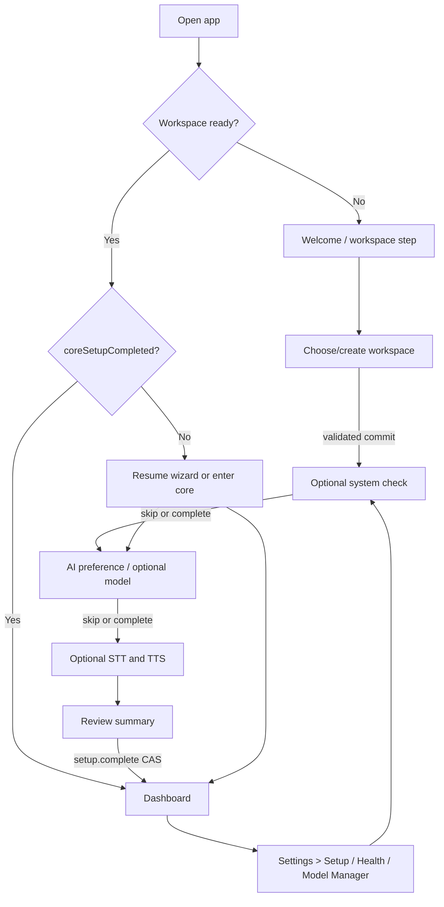

# Iterkeep — Kurulum Sihirbazı, Devam Etme ve İsteğe Bağlı Özellikler

> **Normatif amaç:** Windows öncelikli Electron uygulamasında kullanıcıya hesap, internet, Git, Ollama, Python, Whisper veya TTS gerektirmeden kullanılabilir bir workspace sunmak; isteğe bağlı yerel yapay zekâ ve ses servislerini açıklanabilir şekilde algılamak/kurmak; kesintileri ve yeniden yapılandırmayı veri kaybı olmadan yönetmek. Bu dosya, geliştirici ajanın ilk açılış ve yeniden kurulum ekranlarını spekülatif olarak tasarlamaması için ürün, state machine, API orchestration, UI ve doğrulama sözleşmesidir.
>
> **Yetki sınırları:** Domain enum/kimlikler DOC-08; fiziksel SQL/tables DOC-09; DB işlemleri DOC-10; IPC kanal isimleri, envelope ve DTO üst sınırları DOC-11; job türleri/durumları/restart politikası DOC-12; backup ve restore DOC-17; kullanıcı tercihi ve capability health kanonik modeli DOC-19; sağlayıcı tespiti/model değerlendirme/indirmenin ayrıntısı DOC-24/25; STT/TTS işletimi DOC-28/29; güvenlik DOC-30; performans DOC-31; E2E test altyapısı DOC-33. **Bu belge yalnız setup adımlarını, kullanıcı karar noktalarını, adım başına gözlenebilir sonuçları, hata/skip/geri dönüş semantiğini ve entegrasyon orkestrasyonunu sabitler.** Sayılan belgeleri ikame eden yeni enum, SQL kolon veya IPC kanalı üretmez.
>
> **Kanıt durumu:** Bu dosya tasarım sözleşmesidir. Kod örnekleri tip kontrolü ve Electron installer E2E geçene kadar referans/pseudocode olarak değerlendirilir; modellerin kurulu/sağlıklı olduğu, donanım optimizasyonunun doğrulandığı veya gerçek Windows kurulumunun test edildiği iddia edilmez.

---

## 0. Kabul edilebilir ürün davranışı

1. İlk başlangıç: uygulama saniyeler içinde kendi penceresini açar; workspace hazır değilse kullanıcı kurulum deneyimini görür.
2. Ağın, Ollama'nın, Python'un, Git'in, mikrofonun veya GPU'nun yokluğu proje/görev/not/arama işlevlerini engellemez.
3. Kurulumda AI ve ses seçenekleri **ayrı ayrı atlanabilir**. Kullanıcı ayarlardan daha sonra etkinleştirebilir; eski verilere dokunulmaz.
4. Uygulama bir modeli **kullanıcının açık talebi olmadan** indirmez, silmez veya üçüncü taraf servis başlatma/sonlandırma kararı vermez.
5. Workspace diske başarılı commit olmadan “Kurulum tamamlandı” yazmaz. Bir model indirme job'ının başarılı olması ise `setup complete` için ön şart değildir.
6. Kurulumun ortasında uygulama kapatılırsa sonraki açılışta **kalıcı adımlar** korunur; eski yarım işler olmuş gibi devam ettirilmez.
7. Kullanıcı kurulum ekranını kapattığında geri dönülebilir tercihleri korunur; çalışma alanı hazırsa “Uygulamaya geç” çalışır.
8. Servis yok veya arızalıysa durum dürüstçe gösterilir; asla sonsuz spinner ya da sessiz otomatik kurulum yoktur.
9. Donanım önerisi karar destek aracıdır, zorunlu hüküm değildir. Kötü doğruluk sergileyen küçük model sadece hafif olduğu için “en iyi” diye seçilmez.
10. Eski veritabanı/başka workspace bulunursa sessizce üzerine yazılmaz veya yeni boş workspace'e geçilmez.

## 1. Katmanlar ve sahiplik

| Bileşen | Tek sorumluluğu | Yasak davranış |
|---|---|---|
| `SetupWizard` React | Ekran, geçiş, local taslak, erişilebilir form | Filesystem, spawn, modele doğrudan HTTP |
| `SetupController` renderer | `window.iterkeep` metodlarını çağırma, tek-flight UI işlemleri, event aboneliği | Kalıcı gerçeği React state sanma |
| Preload bridge | DOC-11'deki açık metotlar ve filtreli olaylar | Genel amaçlı raw `ipcRenderer`/Node açma |
| Electron Main `SetupCoordinator` | OS dialog, bootstrap, IPC sender yetkisi, provider/Job/DB orchestration | DB'ye kendi SQL yazma |
| `Application Core` | `setup`, prefs, workspace command/use case | Ollama/Python/Git'e zorunlu bağımlılık |
| `DB Worker` | `setup_state`, `feature_preferences`, workspace ve model profile transaction | Kullanıcı adına model indirme |
| `Capability Manager` (DOC-19) | Canlı health snapshot, TTL, on-demand probe | `available` sonucunu kalıcı sonsuz gerçek sayma |
| `provider-ollama` (DOC-25) | Yerel Ollama API probe, model kataloğu | Kontrolsüz harici URL / shell string |
| `JobManager` (DOC-12) | Kullanıcı onaylı download ve benchmark işlerini izleme | Restart'ta gizli replay |
| `voice-client` & sidecar | STT/TTS kurulum/sağlık adaptörleri | Çekirdek açılışını engelleme |

Önerilen dosya yerleşimi **DOC-07**'deki paket ağacı içine yapılır; yeni workspace paketi yaratılmaz. Olası uygulama dosyaları:

```text
apps/desktop/src/renderer/features/setup/
  SetupWizard.tsx
  SetupLayout.tsx
  steps/WelcomeStep.tsx
  steps/WorkspaceStep.tsx
  steps/SystemCheckStep.tsx
  steps/AiStep.tsx
  steps/VoiceStep.tsx
  steps/FinishStep.tsx
  hooks/useSetupSnapshot.ts
  hooks/useProviderProbe.ts
  hooks/useDownloadJob.ts
  ui/StepProgress.tsx
  ui/DetectionRow.tsx
  ui/ModelChoiceCard.tsx
  ui/RecoveryNotice.tsx
apps/desktop/src/main/composition/setup-coordinator.ts
packages/application/src/use-cases/setup/
  get-setup.ts
  save-setup-step.ts
  complete-setup.ts
packages/contracts/src/setup/
  setup-contracts.ts
  setup-view-model.ts
packages/provider-ollama/src/
  ollama-detection.ts
  hardware-profile.ts
```

Bu yollar repo klasörlerini tanımlar; gerçek implementation'da DOC-07'nin zaten atadığı eşdeğer dosya yolu mevcutsa **ikincisini oluşturma**. Yeni tipler DOC-08 kanonik enum'ları tekrar tanımlamaz. Başka belgeler `models.download` job runner modülünü farklı path'e sabitlemişse DOC-07 yetkilidir.

## 2. Kanonik adımlar ve görsel akış

| Step key (presentation) | Başlık (TR) | Zorunlu mu? | Kalıcı sonuç | Çıkış |
|---|---|---|---|---|
| `welcome` | Iterkeep'e hoş geldiniz | Bilgilendirme | Yok | İleri |
| `workspace` | Çalışma alanı | **Evet** | Workspace + Inbox + preferences DB transaction | Kaydet / mevcut aç |
| `system_check` | Sistem kontrolü | Hayır | Uygun olduğunda yalnız geçici probe | Tara / atla |
| `ai` | Yerel yapay zekâ | Hayır | `aiSetupChoice` ve `feature_preferences(ai)` | Seç / sonra / atla |
| `voice` | Ses özellikleri | Hayır | `voiceSetupChoice`, bağımsız STT/TTS prefs | Seç / sonra / atla |
| `finish` | Hazırsınız | Evet (core) | `coreSetupCompleted` CAS | Dashboard'a git |

Adım anahtarları **sunum seviyesindedir**; DB'de `last_completed_step` bir `TEXT` olduğu için mevcut kanonik DB sözleşmesine uyumlu yazılabilir. `lastCompletedStep`, adımın işlenmiş ve doğrulanmış olduğunun göstergesidir; ekranda bulunmak tamamlamak değildir. `system_check` ile `ai` sırasında yapılan indirme/benchmark, core setup completion için beklenmez.



**Geri butonu:** Mevcut ekran taslağı korunur; geçilmiş `workspace` adımına dönmek workspace'i sessizce taşımak anlamına gelmez. Workspace değiştirme ayrı izin/kilit/backup akışına tabidir. Geri dönmek model indirmesini veya onaylı bir backup işini otomatik iptal etmez; ilgili job açıkça kontrol edilir.

## 3. State ayrımı: kurulmuş ≠ etkin ≠ sağlıklı

### 3.1 Mevcut domain'i kullan

```ts
// DOC-08 semantic state; duplicated enum yaratılmamalı.
type FeatureKey = 'ai' | 'stt' | 'tts' | 'git';
type PreferenceMode = 'enabled' | 'disabled';
type CapabilityState =
  | 'unknown' | 'checking' | 'available'
  | 'unavailable' | 'incompatible' | 'error';

interface SetupStateShape {
  workspaceId: string;            // UUID v4; DOC-08
  coreSetupCompleted: boolean;
  lastCompletedStep: string | null;
  aiSetupChoice: 'unselected' | 'enabled' | 'skipped';
  voiceSetupChoice: 'unselected' | 'enabled' | 'skipped';
  updatedAt: string;               // UTC RFC3339 .sssZ
  revision: number;
}
```

> Bu tanım **açıklama amaçlı excerpt**'tir; üretim import kaynağı `@iterkeep/domain`/`@iterkeep/contracts` olacaktır.

**Durum boyutları birbirinden bağımsızdır:**

| Durum | Persist? | Kaynak | Örnek |
|---|---|---|---|
| Workspace hazır mı? | Evet | DB + path/lock bootstrap | DB başarıyla açıldı |
| `coreSetupCompleted` | Evet | `setup_state` | İlk akış bitirildi |
| AI setup tercihi | Evet | `setup_state` | `skipped` |
| AI aktif kullanıcı tercihi | Evet | `feature_preferences` | `enabled` |
| Ollama canlı mı? | Hayır (TTL gözlem) | Capability Manager | `unavailable` |
| Model kayıt/profil seçimi | Evet | `model_profiles` | `selected_for_agent=1` |
| Model fiziksel olarak var mı? | Hayır (provider query) | `/api/tags` + doğrulama | Model silinmiş |
| Model işe yarıyor mu? | Test kanıtı kalıcı olabilir | `model_benchmark_receipts` | tool test passed |
| Model indirme işi | Evet (job metadata) | `background_jobs` | `running` |
| Kurulumdaki geçici form alanı | Hayır | React | Seçilmiş henüz kaydedilmemiş tema |

**Geçerli kombinasyon:** `coreSetupCompleted=true`, `aiSetupChoice=enabled`, `feature_preferences(ai)=enabled`, `Capability(ai)=unavailable`. UI Dashboard'u açar, agent yanında “Ollama bağlantısı yok” mesajı gösterir. `enabled` otomatik indirme yetkisi değildir.

### 3.2 Presentation state machine

`SetupWizard` içindeki **geçici** controller state'i; SQLite tablo enum'larını genişletmez.

```ts
export type SetupViewPhase =
  | 'bootstrapping'
  | 'editing'
  | 'validating'
  | 'saving'
  | 'checking_capabilities'
  | 'reviewing'
  | 'completing'
  | 'completed'
  | 'recoverable_error';

export interface SetupViewModel {
  phase: SetupViewPhase;
  activeStep: 'welcome' | 'workspace' | 'system_check' | 'ai' | 'voice' | 'finish';
  snapshotRevision: number | null;
  busyAction: string | null;
  fieldErrors: Readonly<Record<string, string>>;
  inlineDiagnosticCode: string | null;
}
```

Bunlar UI için lokal durumdur. `queued`, `running`, `failed` gibi `JobStatus` adlarına dönüştürülmez. Geçiş ilkeleri:

- `bootstrapping → editing`, yalnız `system.bootstrap`/workspace keşfi sonuçları doğrulandıktan sonra.
- `editing → saving → editing`, yalnız server receipt ve güncel revision döndükten sonra.
- `editing → checking_capabilities → editing`, probe sonucu/timeout/abort ile; timeout UI'yı asla kilitlemez.
- `editing → reviewing → completing → completed`, yalnız `setup.complete` başarılı olursa.
- `saving` sırasında aynı butondan ikinci çağrı gönderme. Sunucu tarafında da idempotency/revision şarttır.
- `recoverable_error` görünümünde aynı değişikliğe yeni commit diye başlamadan `setup.get` ve gerekirse `operations.getReceipt` ile uzlaştırma yap.
- Sayfa navigasyonu kapanırken event subscription temizlenir; job kendiliğinden başarı veya iptal ilan edilmez.

## 4. İlk açılış kararı, workspace yaratma ve yarım kurulum

### 4.1 Açılışta öncelik sırası

1. Electron Main pencereyi gösterir; UI tema ve dil skeleton'ı ile açılır (DOC-06/20).
2. Kullanıcının seçtiği son workspace **yalnız Main'in kontrollü userData pointer'ından** bulunur; renderer tam path'e ihtiyaç duymaz.
3. Pointer bozuksa veya dosya yoksa yeni boş workspace oluşturma. `WORKSPACE_UNAVAILABLE` ve `Choose Existing / Create New / Recovery` seçeneklerini göster.
4. DB güvenle açılır, migration/recovery başarılı olursa `system.bootstrap` DTO'su üzerinden `coreReady` elde edilir.
5. `setup.get` okunur. `coreSetupCompleted=true` ise Dashboard'a; false ise ilgili setup akışına yönlenir.
6. Yalnız seçilmiş/etkin isteğe bağlı modüllerde ve **çekirdek hazır olduktan sonra** kısıtlı health probe planlanabilir.
7. `coreSetupCompleted=false` ama sağlam Inbox/DB mevcutsa ilk kurulum yeniden girişte devam eder; mevcut kayıtlar silinmez. Kullanıcıya “Kurulumu sonra tamamla / Workspace'e geç” seçeneği gösterilebilir; bunu kabul etmek `coreSetupCompleted=true` sahte yazdırmaz.

### 4.2 Workspace klasörü

- İlk önerilen hedef `app.getPath('documents')/Iterkeep` ya da yetkili kullanıcı veri dizininde oluşturulan öneridir; platform API'si dışında sabit `C:\Users\...` yolu yazılmaz.
- UI yalnız kısa isim ve insan tarafından okunabilir lokasyon gösterir; güvenli IPC `workspace.chooseFolder({purpose:'create'})` sonucunda bir **SelectionHandle** verir.
- `workspace.create({selectionHandle,displayName})` Main altında gerçek yol resolve/canonicalize eder; symlink/shortcut/junction, UNC paylaşımları, izin ve disk boşluğu `DOC-06/30` politikasıyla kontrol edilir.
- Var olan `workspace.db` tespit edildiğinde Create işlemi onun üzerine yazamaz. Kullanıcıya `workspace.open()` için mevcut-workspace akışı önerilir.
- Workspace bootstrap tek transaction içinde `workspaces` + Inbox `projects` + preferences + `setup_state` + `feature_preferences` satırlarını oluşturur (DOC-09 §bootstrap).
- `workspace.create` başarı receipt'i dönerse **çekirdek kaydı vardır**; sonradan sistem taraması başarısız olsa bile bu workspace geçerlidir.
- `workspace.create` isteği zaman aşımında response lost olabilir; aynı handle ile ikinci workspace oluşturmadan önce bootstrap/receipt sorgula.
- İlk workspace açılmadan uygulama varsayılan bir rastgele DB yaratmaz; `on-disk unknown` durumunda kullanıcı onayı ister.

### 4.3 Geçici kurulum/veri güvenliği

- `last_completed_step`, `ai_setup_choice`, `voice_setup_choice` ve `feature_preferences` yalnız `setup.saveStep()`/`capabilities.setPreference()` doğrulanmış command'larıyla değiştirilir.
- Her kaydetme transaction'ı `revision` artırır; stale revision için snapshot yenileme + kullanıcı kararını birleştirme sunulur.
- Bir adımda yazı alanı boşsa kaydı olmayan taslak geçicidir. Uygulama kapanması “kaydedildi” hissi vermemeli.
- Uygulamadan ayrılırken ekrandaki taslak kaydedilmemişse `Kaydedilmemiş tercihler` göstergesi; ancak sessiz veri silme yok.
- Kurulum ortasında agent/voice kapalı tercihleri DB'ye commit edilmişse yeniden açılış bunları okur.
- Setup onboarding ile “Sistem Sağlığı” aynı ekran değildir; sonraki açılışta onboarding'i sırf Ollama yok diye tekrar açma.

## 5. Adım 1 — Welcome ve dil/tema

**Birincil başlık:** “Projelerini kaybetmeden ilerle.”

- Kısa açıklama: “Görev, not ve kararların cihazında tutulur. Hesap veya internet gerekmez.”
- Ana eylem: `Devam et`; alternatif: `Mevcut çalışma alanını aç`.
- Hızlı dil seçimi: `Türkçe` / `English`; sistem dili desteklenmiyorsa `tr-TR`/`en-US` için öngörülebilir fallback.
- Dark/light/system tema, görsel kontrol önizlemesi; tek CSS token kaynağı DOC-20.
- Onboarding bu noktada telemetry, cihaz kimliği veya mikrofon izni istemez.
- Tüm metinler locale sözlüğüne taşınır; JSX içinde sert kodlu Türkçe kalmaz.

## 6. Adım 2 — Workspace oluştur / aç

### 6.1 Görünür alanlar

| Alan | Varsayılan | Validation | Davranış |
|---|---|---|---|
| Görünen ad | `My Workspace` veya çevrilmiş karşılığı | Trim, 1–120 karakter | Metin olarak saklanır |
| Depolama klasörü | Platform önerisi | Main güvenli path policy | Dosya diyaloğuyla değiştirilir |
| Mevcut workspace | Yok | `workspace.db` sağlam + compat | Aç/onar; sessiz overwrite yok |
| İçe aktar | Seçim gerektirir | DOC-16 preview/commit | Yeni veya açılmış workspace için sonradan da yapılabilir |

### 6.2 Anlık durumlar

- `idle`: “Çalışma alanının kaydedileceği klasörü seç.”
- `checking`: “Klasör denetleniyor…”; kararlı progress spinner + cancel yoksa kısa timeout.
- `folder_not_writable`: “Bu klasöre yazılamıyor. Başka klasör seçin.”
- `already_exists`: “Burada mevcut bir Iterkeep çalışma alanı var. Açmak ister misiniz?”
- `db_incompatible`: “Bu çalışma alanı uygulamanın desteklediğinden daha yeni bir sürümle oluşturulmuş.”; **otomatik downgrade yasak**.
- `db_corrupt`: Recovery seçenekleri DOC-17/32; “Yeni boş alan oluştur” işlemi eski veriyi silmez.
- `created`: “Çalışma alanın hazır.”; yalnız DB commit sonrası.

### 6.3 Erişilebilirlik

Form alanlarına `label`, hata açıklamaları için `aria-describedby`, birincil eylemlere `aria-busy`; otomatik focus zorlaması dosya seçme diyaloğunu kesmez. Bir hata oluştuğunda focus ilk geçersiz alana gider.

## 7. Adım 3 — Kısa, tamamen opsiyonel sistem kontrolü

### 7.1 Kapsam

| Algılama | Kaynak | Sınır | Sonuç |
|---|---|---|---|
| OS / mimari | Main Node/Electron | Basit local read | Windows x64/arm64 vb. |
| RAM | OS/Node | Kullanıcı izni olmadan minimum metadata | Toplam bellek bucket'ı |
| GPU/VRAM | Onaylı OS adapter | Eksik olabilir, başarısızlık normal | Bucket + belirsizlik |
| Depolama | Workspace disk/indirmenin hedef diski | Yerel free-space API | Yaklaşık kullanılabilir alan |
| Ollama servis | İzinli loopback endpoint | Timeout ve abort | Çalışıyor/kapalı/erişilemiyor |
| Mevcut modeller | Ollama `/api/tags` | Servis çalışıyorsa | Model/digest/size listesi |
| Whisper/TTS | Yerel sidecar manifest/dosya | Yalnız seçili/kurulu modüller | Hazır/değil/bilinmiyor |

Donanım algılama zorunlu değildir. GPU marka/model bilgisi tam anlaşılamazsa uydurma değer üretme. RAM/VRAM bucket'ları öneriyi etkiler fakat kullanılabilir bellek anlık yük ile değişebilir. `ModelRecommendation` bir tahmindir; model yükleme testi ayrı doğrulamadır.

### 7.2 Probe bütçesi

| Probe | İlk görünüm hedefi | Başarısızlık |
|---|---:|---|
| OS/RAM | 500 ms hedef | `unknown` |
| Disk free | 750 ms hedef | `unknown`, indirmeye başlarken yeniden kontrol |
| Ollama API | Toplam 1.5 s hedef; timeout ayarlanabilir | `unavailable`, mesaj+Retry |
| Modeller | Yerel API 2 s hedef | `error`/kısa snapshot, UI bloklanmaz |
| GPU | 2 s hedef (deferred) | Manuel seçenek |
| Sidecar health | 1.5 s hedef / yalnız gerekirse | `unavailable` |

Bu değerler henüz ölçülmüş sonuç **değildir**, DOC-31 performans bütçesi adaylarıdır. Yavaş Windows sistemlerinde keskin küresel zaman aşımı yüzünden yanlış sağlıksız kararı verilmemesi için retry ve doğru tanı kodu zorunludur. Sistem kontrolü `Skip` ile anında geçilebilir; devam eden probe abort edilebilir.

### 7.3 Detay gösterimi

Kullanıcı gördüğü sonucu `CPU`, `RAM`, `GPU`, `Depolama`, `Ollama` satırlarında inceler. Bilinmeyen değerler “Algılanamadı” diye gösterilir; **0 GB VRAM** olarak çevrilmez. Tam donanım serisi/loglar otomatik internet'e gönderilmez.

## 8. Adım 4 — AI / Ollama kurulum akışı

### 8.1 Kullanıcı seçenekleri

1. **Yerel AI'yi etkinleştir**: `feature_preferences(ai)=enabled` için bilinçli tercih; bağlantı/model uygun değilse “kurulum eksik” durumu.
2. **Şimdilik atla**: `aiSetupChoice=skipped`, tercih `disabled`; kullanıcı otomatik yükleme almaz.
3. **Yüklü modellerimi kullan**: Çalışan Ollama ve doğrulanabilir aday varsa mevcut kayıttan seçim.
4. **Önerilen modeli indir**: Paket adı, büyüklük ve kaynak doğrulaması göster; tıklama sonrası `models.startDownload({modelId,consent:true})`.
5. **Manuel model seç**: Öneri dışı ancak uyumluluğu ölçülebilir model; riskler açıklanır.
6. **Ollama nasıl kurulur?**: DOC-11 `system.openExternalUrl` ile yalnız allowlist resmi HTTPS sayfası; otomatik executable indirme/çalıştırma yok.

### 8.2 Ollama algılama karar tablosu

| Durum | Doğrulama kanıtı | UI başlığı | Birincil eylem | İkincil |
|---|---|---|---|---|
| Hizmet yok / bağlanılamıyor | Loopback API timeout/refused | Ollama'ya bağlanılamadı | Tekrar tara | Nasıl kurulur / Atla |
| Program var ama servis kapalı | OS kurulumu görüldü, API yok | Ollama çalışmıyor | Kullanıcı kontrollü başlatma yönergesi | Tekrar tara / Atla |
| API var, model listesi boş | `/api/tags` boş | Model bulunamadı | Modelleri incele | Atla |
| API var, model listesi dolu | Valid `/api/tags` | Kurulu modeller bulundu | Uygun modeli seç | Önerilenleri incele |
| Kurulu model profilinde fakat API'de yok | Profil var, `/api/tags` eşleşmiyor | Seçili model artık bulunamıyor | Başka model seç | Atla |
| API yanıtı uyumsuz / yetkisiz | Geçersiz shape/status | Ollama sürümü veya bağlantısı uyumlu değil | Ayrıntı / yeniden tara | Atla |
| Proxy/uzak adres | Loopback dışı config | Güvenlik doğrulaması gerekiyor | Güvenli yerel ayar | AI olmadan devam |
| İlgisiz bağımsız Ollama işlemi | Servis başka app tarafından da kullanılıyor | Yerel Ollama aktif | Model seç | Atla |

Bir Ollama GUI ikonu/executable dosyası bulmak **API çalışıyor** anlamına gelmez. İkinci aşamada API `/api/tags` gibi küçük çağrılarla doğrula. Modellerin yüklü olması da tool calling kalitesine veya GPU'da sorunsuz çalışmaya kanıt değildir.

### 8.3 Ağ politikası

Varsayılan Ollama adresi `http://127.0.0.1:11434`. `localhost` çözümlenmesinde adres ailesi belirsizliğini ve yanlış hedefi azaltmak için loopback pinleme ve yanıt kontrolü yapılır. Main tarafındaki adapter, socket bağlantısında proxy env / DNS bypass/passthrough varsayımlarını test eder; interneti veya LAN'ı otomatik taramaz. Kullanıcının yapılandırdığı `provider_configs.base_url` güvenlik sınırı DOC-30'a göre kontrol edilir. V1 UI uzaktaki Ollama'ya doküman içeriğini otomatik yollamaz. İçerik transferi ancak model chat başlayınca kullanıcının seçtiği yerel sağlayıcıya yapılır.

### 8.4 Model öneri / boyut / benchmark

- **Kanonik sıralama algoritması DOC-25'te olacak.** Setup sadece `models.listRecommended()` sonucunu güvenilir UI kartlarına çevirir.
- Aday model adları/indirme boyutları zamanla değişebilir; sabit “her zaman en iyi Qwen3 4B” kodlanmaz.
- Kartlar: model adı, yaklaşık indirme boyutu, depolama gereksinimi, tahmini bellek uyumu, tool calling yeteneği, varsa son benchmark, önerinin nedeni, belirsizlik ve `İndir`/`Seç`.
- Boş öneri listesi hata değildir; “Uygun otomatik öneri bulunamadı. Manuel seçim veya AI olmadan devam.”
- `models.setActive` seçimi ancak kurulu/uyumlu modelin doğrulanması ve gerekli policy kontrolü ardından gerçekleşir; `selected_for_agent=1` fiziksel bulunurluğun yerine geçmez.
- Kullanıcının daha önce seçtiği model başlangıçta taranmadan `available` etiketlenmez. Silinmiş/bozulmuş model `MODEL_UNAVAILABLE` durumuna geçer.
- `models.runBenchmark` modelin doğru tool kullanımını, gecikmeyi ve başarısızlığı ölçer. Benchmark kullanıcı açıkça başlatmadıkça ağır GPU işi çalıştırmaz.

### 8.5 Model indirme ve iş durumu

1. Kullanıcı model kartında indir düğmesine basar.
2. Modal/inline özet: resmî sağlayıcı, tam model ID, tahmini network boyutu, hedef disk, mevcut boş alan, internet ihtiyacı. `İndir` ile açık onay.
3. `models.startDownload` bir `model_download` job ID döndürür; veri bir Ollama modelini fiziksel kurar; SQLite içerik DB'sine model binary yazmaz.
4. React `jobs.get` + event subscribe üzerinden durum ve ilerleme gösterir. Bir event kaybolduğunda snapshot tekrar okunur.
5. İlerleme bilinmiyorsa yüzde gösterme; “İndiriliyor” ve sayısal ölçü varsa byte/total. İndirme %100 görünse dahi gerçek model tekrar listelenip doğrulanana dek `succeeded` gösterme.
6. `models.cancelDownload` veya `jobs.cancel` yanıtındaki `accepted=true` **nihai iptal değildir**. Kesin status `jobs.get`/doğrulanmış runner sonucudur.
7. Hata durumunda kullanıcıya `Tekrar dene` görünür; tekrar deneme **yeni job ID** ve yeniden kullanıcı niyeti ile yapılır. Yeni işlemi eski job `failed` durumuna çevirmeyiz.
8. Ağ kesilmesi/kapanma sonrasında JobManager DOC-12'ye göre eski `queued/running` satırlarını `failed/INTERRUPTED_BY_RESTART` yapar. Yeni açılışta otomatik job replay yoktur.
9. Ollama'nın kısmi indirmeleri kendi cache'inde durabilir ve bir sonraki `pull` bazı parçaları kullanabilir; **Iterkeep ilerlemenin nereden başlayacağını garanti etmez.** Sonraki pull kullanıcı eylemiyle yeniden başlatılır.
10. Üçüncü taraf Ollama sunucusunu veya başka uygulamanın indirmelerini yönetme/silme yetkisi varsayılmaz.

### 8.6 Ollama kaynak sözleşmesi

Resmî Ollama API: `GET /api/tags` yüklü model kataloğu, `GET /api/ps` bellekte çalışmakta olan modeller, `POST /api/pull` onaylı indirme stream'i, `POST /api/show` model ayrıntıları için kullanılabilir; endpoint ve payload ayrıntıları DOC-25'te kesinleştirilecektir. API örnekleri yalnız Main provider adapter içinde yer alır. Renderer bu URL'lere fetch atmaz.

```text
https://docs.ollama.com/api/tags
https://docs.ollama.com/api/ps
https://docs.ollama.com/api/pull
https://docs.ollama.com/api/show
https://www.electronjs.org/docs/latest/tutorial/security
```

### 8.7 İndirme ve kuruluma ait kullanıcı metinleri

| Durum | Başlık | Alt metin | CTA |
|---|---|---|---|
| Model yok | Model seçilmedi | İstersen şimdi indir, sonra da kurabilirsin. | Modelleri gör |
| İndirme sürüyor | Model indiriliyor | Kapanış durumunda işlemin yeniden doğrulanması gerekir. | İş ayrıntısı |
| Ağ koptu | İndirme tamamlanamadı | İnterneti kontrol et ve yeniden deneyebilirsin. | Yeniden dene |
| Disk alanı az | Yeterli alan yok | İndirme ve çalışma için ek depolama gerekir. | Alan aç / Atla |
| Kurulu model artık yok | Seçili model bulunamadı | Yeni model seç veya AI olmadan devam et. | Yeniden tara |
| Benchmark başarısız | Model değerlendirmesi başarısız | Model yine listelenir ancak varsayılan için önerilmeyebilir. | Ayrıntılar |
| AI kapalı | Yerel AI devre dışı | Projeler ve arama normal şekilde çalışıyor. | Etkinleştir |

## 9. Adım 5 — Sesli giriş ve TTS

### 9.1 İki bağımsız seçim

- **STT (Whisper):** Kullanıcı tuşla kayıt başlatır, tekrar basarak durdurur, transkript önizlemesi alır. `feature_preferences(stt)` ayrı tutulur.
- **TTS (EMA Lightning):** Metin yanıtını isteğe bağlı seslendirir; model yoksa metin görüntülenmeye devam eder. `feature_preferences(tts)` ayrı tutulur.
- `voice_setup_choice` tek alanı ilk onboarding özet tercihidir; STT/TTS'nin kalıcı gerçeği **iki farklı feature preference** satırıdır.
- STT etkin TTS kapalı; STT kapalı TTS etkin; ikisi kapalı; ikisi açık kombinasyonları desteklenir.
- İlk kurulum **mikrofon kaydı başlatmaz**, kullanıcı açık eylem yapmadıkça ses almaz veya örnek ses toplamaya kalkmaz.
- Ses sidecar binary/model paketlerinin tam kaynağı, hash'i, platformları, kurulum/yeniden kurulum yöntemi ve imzalama kuralları DOC-28/29/30/34'te kesinleştirilir.

### 9.2 STT kurulum ekranı

| Alan | Davranış |
|---|---|
| İsteğe bağlı etkinleştirme | `capabilities.setPreference({capability:'stt',enabled:true})` |
| Servis durumu | `voice.getStatus()` verisindeki gerçek STT health |
| Model yoksa | Gereken bileşen, kaynak, boyut ve kurulum yönlendirmesi |
| Mikrofon izinleri | **İlk gerçek kayıt başlangıcında** istenir; kurulumda zorunlu değil |
| Model önerisi | Çok dilli Türkçe kalite/hız adayları DOC-28'e bağlı |
| Test | Kullanıcı isterse kısa test; otomatik konuşma kaydı yok |
| Kurulumdan ayrılma | AI/STT/TTS bağımsız; uygulama erişilebilir kalır |

**VOICE-ADR-001 uyumu (2026-10-10):** DOC-11’e `voice.listComponents` ve `voice.startComponentInstall` eklendi; tek `voice_component_install` job türü DOC-08/09/12 ile uyumlandı. Bu iki metot yalnız **imzalı ve allowlist katalogdaki STT/TTS runtime veya model paketleri** için açıktır. Sihirbaz, kullanıcı “İndir” dediğinde `consent:true` ile iş başlatır; `jobs.get`/`jobs.cancel` ve `job.progress` ile ilerleme gösterir. Kurulum onayı ve hash doğrulaması olmadan hazır durumu gösterilmez. Ollama indirmesi kendi `models.startDownload` yolunu kullanır. Paket kataloğu ve binary kurulum uygulama kodunda test edilmeden özellik hazır sayılmaz.

### 9.3 TTS kurulum ekranı

- EMA Lightning bir model **ve** uygun izole inference runtime gerektirir. “Model küçük, o yüzden Python paket boyutu 34 MB” yanıltıcıdır.
- TTS servisi bulunmuyorsa metin chat işlevi devam eder; `Seslendir` aksiyonu devre dışı veya kurulum yönlendirmeli olur.
- Test sesi yalnız açık butonla çalınır; otomatik hoparlör açılışı yok.
- TTS başarısızlığı mesajı veya agent run'ı başarısız saydırmaz. Sonuç ses yerine metinde kalır.
- Varsayılan ses paketi yüklenmiş olarak garantilenmez; `voice.getStatus()` sonucuna dayanılır.

## 10. Adım 6 — Son gözden geçirme ve tamamlama

Özet, kullanıcıya gerçek veriyi gösterir; “hazır” ile “etkin ama kurulmadı” ayrılır:

| Satır | Örnek değer | Kaynak |
|---|---|---|
| Workspace | `My Workspace · Yerel` | `workspace.get` |
| Core | `Hazır` | DB bootstrap health |
| AI tercihi | `Atlandı / Açık` | `setup.get` + prefs |
| Ollama | `Bağlı değil / Bağlı` | Son runtime probe |
| Model | `Seçilmedi / Qwen3 ...` | Model profile + API varlığı |
| Mikrofon/STT | `Atlandı / Etkin ama eksik / Hazır` | prefs + `voice.getStatus` |
| TTS | Aynı | prefs + `voice.getStatus` |
| Git | Opsiyonel, gerekli değil | `feature_preferences(git)` |

**Bitir butonu:** `setup.complete({expectedRevision})` kullanır. DB transaction `coreSetupCompleted=true` yapar. Başarılı IPC receipt alınmadan UI tamamlanmış göstermez. Response kaybolursa `setup.get`/receipt ile uzlaştırılır. `CONFLICT_REVISION` olursa kullanıcının son tercihleri kaybolmadan snapshot yenilenir.

**`setup.complete` preflight:** Workspace hazır/uyumlu; Inbox bulunuyor; DB read/write doğrulanmış; core prefs var; yetkisiz restore/migration yok. AI/voice/Git mevcut olması önkoşul değildir. Completion sırasında varsa aktif `model_download` job devam edebilir; kullanıcıya “Arka plan işi devam ediyor” denir. Ekran kapatma değil, pencere/uygulama kapanışı için DOC-12 yaşam döngüsü geçerlidir.

## 11. Sonradan yeniden kurulum ve ayarlar

1. `Settings → System Health` gerçek `CapabilitySnapshot` gösterir; bunun sözleşmesi DOC-19'dadır.
2. `Settings → AI → Setup / Manage Models` kurulumun `system_check` ve `ai` alt akışlarını açabilir; tüm onboarding'i sıfırlamaz.
3. `Settings → Voice` STT/TTS'yi birbirinden bağımsız açar/kapatır.
4. `Settings → Workspace` çalışma alanını gösterir; DB taşıma işlemi setup step navigasyonu değil, güvenli data move/backup akışıdır.
5. `AI disabled` olduğunda yeni agent job başlamaz; başlamış run güvenli iptale yöneltilir. Mevcut konuşma geçmişi, projeler ve yerel veriler korunur.
6. `AI enabled` işlemi Ollama'yı indirmez veya başlatmaz. Tercih `enabled` olur, async probe başlayabilir, yoksa yönerge gösterilir.
7. `TTS` kapatılması geçmiş sohbet metnini silmez. `STT` kapatılması kayıtları sessizce saklamaz; mevcut aktif kaydın sonlandırılması ve kullanıcı onayı DOC-28'e bağlıdır.
8. Sonradan yeniden açılan setup ekranı kullanıcının eski adımlarını olduğu gibi okur; `skipped` tercihini kurulum hatası saymaz.
9. Health snapshot TTL süresi dolduğunda ikon `Bilinmiyor / yeniden kontrol ediliyor` olabilir; önceki “healthy” rozetini doğrulanmadan koruyamaz.
10. Provider'ın tekrar bağlanması otomatik model setActive kararı üretmez; kullanıcının seçili profilini koru, yoksa anlamlı seçim iste.

## 12. Hata kodları, kurtarma ve öncelik

Bu kodlar kullanıcı metni değil; mevcut DOC-11 hata envanterinden eşlenir. Aşağıda kullanılan `UX_*` ifadeleri **lokalizasyon anahtarlarıdır**, yeni IPC hata enum'u değildir.

| Kaynak durum | Kullanıcıya gösterilen eylem | Core etkisi | Recover |
|---|---|---|---|
| `WORKSPACE_UNAVAILABLE` | Yeniden seç / mevcut aç / kurtarma | Core blocked, eski DB korunur | Workspace aç |
| `CONFLICT_REVISION` | Değişikliği gözden geçir / son durumu yenile | Eski commit korunur | Reload + explicit save |
| `SQLITE_BUSY` / geçici DB hata | Kaydetmeyi tekrar dene / receipt kontrol | Başarı iddia edilmez | Safe retry |
| `PROVIDER_UNAVAILABLE` | Yeniden tara / AI olmadan devam | Core unaffected | Health check |
| `MODEL_UNAVAILABLE` | Model seç / indir | Agent unavailable | Model manager |
| `CAPABILITY_DISABLED` | Ayarlardan etkinleştir | İlgili capability kapalı | Set preference |
| İnternet kesik | Ağ sorununu düzelt / atla | Model download işinde hata | Yeni job |
| Disk yetersiz | Alan aç / hedefi gözden geçir | Başarısız job; yarım binary hazır sayılmaz | Yeni preflight |
| `INTERRUPTED_BY_RESTART` | İş yarıda kesildi / sonuç tekrar denetlensin | Eski job failed | New user-triggered job |
| Permission denied (mic) | OS ayarlarından izin ver / yazmaya devam | Yalnız ses girişi yok | Explicit retry |
| TTS process crash | Ses oynatılamıyor / metin hazır | Chat intact | Restart voice optional |
| Invalid provider payload | Sağlayıcı yanıtı geçersiz | Sağlık unknown/error | Probe/log |
| Restore/migration in progress | Veritabanı geçici meşgul | Mutasyonlar koordinatör policy'ye göre ertelenir | İş bitince yenile |

**Öncelik sırası:** Korunan workspace/kullanıcı verisi > güvenli core erişimi > mutasyon receipt doğruluğu > opsiyonel provider sağlığı > estetik/animasyon. UI hata mesajlarında ham exception, API secret, tam iç path veya kullanıcı notu yazdırılmaz.

### 12.1 Kapanma ve çökme matrisi

| Kesinti | Persist edilen bilgi | Tekrar açılış davranışı | Otomatik yapılmayacak şey |
|---|---|---|---|
| Welcome/tema | Henüz kaydedilmemiş lokal taslak | Varsayılan veya kalıcı preference | Sahte “kaydedildi” |
| Workspace commit öncesi | Geçerli DB yok ya da eski DB sağlam | Kullanıcıya önceki seçim | Sessiz overwrite |
| Workspace commit sonrası | DB+Inbox+setup mevcut | İlgili setup adımından devam | İkinci Inbox |
| AI skip sonrası | `skipped` tercihi | Kurulumu zorlamadan devam | Otomatik AI kurulumu |
| Model indirme `running` | background_jobs | DOC-12 reconciliation: failed+interrupted | Otomatik yeniden pull |
| İndirme sonuçlandı, cevap ulaşmadı | Ollama model listesi + job state | `models.listInstalled`/job snapshot ile reconcile | Kör tekrar indirme |
| Model benchmark ortasında | job status | interrupted, receipt yoksa sonuç yok | Sahte benchmark geçişi |
| STT/TTS seçimi sonrası | saved feature prefs | Yeniden health check | Otomatik mikrofon açma |
| `setup.complete` timeout | DB row belirsiz | `setup.get` + receipt ile doğrula | Yeni workspace yaratma |
| AI disabled sonra app crash | Preference disabled | Chat unavailable; core normal | Run yeniden başlatma |

## 13. TypeScript orkestrasyon referansı

> Aşağıdaki parçalar gerçek repo sözleşmesine uyar; üretime alınmadan önce DOC-11 DTO tipleri ve timeout/cancel adapter'larıyla tamamlanıp derlenmelidir. `window.iterkeep` API'si dışında renderer'a Node/Electron yetkisi verilmez.

### 13.1 UI kurulumu okuma ve ayırma

```ts
// apps/desktop/src/renderer/features/setup/hooks/useSetupSnapshot.ts
// Illustrative orchestration; generated typed bridge is source of truth.
export async function getSetupForDisplay(api: Window['iterkeep']) {
  const [bootstrap, setup] = await Promise.all([
    api.system.bootstrap({}),
    api.setup.get({}),
  ]);
  // Bootstrap failure is distinct from an optional capability failure.
  return { bootstrap, setup };
}
```

`system.bootstrap` coreError dönerse UI recovery shell'e geçer. `setup.get` workspace yokken uygun typed error döndürebilir; ilk kurulum ekranı bunu gerçek `no_workspace` durumuna map eder. Tüm IPC çağrılarında DOC-11 envelope içerik ve sonuç `Result` biçimi korunur; burada success unwrap işlemleri şematik gösterilmiştir.

### 13.2 Step kaydetme / conflict reconcile

```ts
// Pseudocode — intentionally not redefining the IPC envelopes.
async function persistSetupStep(api: TypedIterkeepApi, step: string, patch: unknown) {
  const before = await api.setup.get({});
  const saved = await api.setup.saveStep({
    step,
    preferencePatch: patch,
  });
  // Gateway stores idempotencyKey/actor/correlationId in DOC-11 envelope.
  // Never announce success until commit receipt is verified.
  if (!saved.ok && saved.error.code === 'CONFLICT_REVISION') {
    return { kind: 'needs_reconcile' as const, latest: await api.setup.get({}) };
  }
  if (!saved.ok) return { kind: 'failed' as const, error: saved.error };
  return { kind: 'saved' as const, snapshot: saved.value };
}
```

`TypedIterkeepApi` burada biçim anlatır; kodlama ajanı bunu mevcut oluşturulan contract type ile değiştirmelidir, yeni paralel API yaratmamalıdır. `setup.saveStep` tam yükünün `DOC-11` geçerli Zod DTO sözleşmesine uygun şekillendirilmesi zorunlu; bu belgede sembolik `patch` herhangi keyfi DB alanına geçiş izni vermez.

### 13.3 Sağlık taraması ve stale result koruması

```ts
// Controller-level pattern. No raw fetch from renderer.
let scanSequence = 0;

async function refreshOllama(api: TypedIterkeepApi) {
  const myScan = ++scanSequence;
  const probe = await api.models.detectOllama({ explicit: true });
  // An older request must not overwrite more recent displayed health.
  if (myScan !== scanSequence) return { kind: 'stale' as const };
  return probe;
}

function invalidatePendingScans() {
  scanSequence += 1;
}
```

Bu seq yöntemi UI'da stale response göstermeyi önler; gerçek kaynak/timeout iptali ve güvenli HTTP handle'ı Main'dedir. Gerçek uygulamada React component unmount cleanup, link health TTL ve rate limit DOC-19 ile entegre edilir.

### 13.4 Download job'u gözleme

```ts
// Pseudocode — subscriptions & envelopes defined exclusively in DOC-11.
async function watchModelDownload(api: TypedIterkeepApi, jobId: string) {
  const latest = await api.jobs.get({ jobId });
  // subscribe only for jobId; clean up on dialog close/unmount.
  // On every event gap/app wake, re-read jobs.get() as canonical state.
  // status === 'succeeded' only after provider verified installed model.
  return latest;
}
```

Model indirme kullanıcı pencere değiştirince bitirilmiş sayılmaz; event aboneliği yalnız görünür ekranla ilgilidir. Job'a ilişkin terminal gerçek DOC-12 ve provider kanıtından çıkar.

### 13.5 `complete` server preflight

```ts
// Application Core illustrative policy; all writes through DB repository port.
interface SetupCompletionDeps {
  workspace: { assertReadyWithInbox(): Promise<void> };
  setup: {
    readRevision(): Promise<number>;
    completeWithRevision(expectedRevision: number): Promise<void>;
  };
}

export async function completeCoreSetup(
  deps: SetupCompletionDeps,
  expectedRevision: number,
): Promise<void> {
  await deps.workspace.assertReadyWithInbox();
  // Repository uses atomic revision CAS and commit receipt (DOC-10).
  await deps.setup.completeWithRevision(expectedRevision);
  // No AI, Ollama, STT, TTS, Git or network checks in completion preflight.
}
```

İki await tek DB transaction yapıyor gibi yorumlanamaz; `assertReadyWithInbox` ile `completeWithRevision` arasında workspace değişebilir. **Gerçek implementation** aynı DB worker işleminde workspace/inbox kontrolü + setup CAS + commit yapmalı; burada use-case'in **policy bağımlılıkları** örneklenmiştir. Ardından `setup.get` latest snapshot ile UI onaylanır.

## 14. Figma/React davranışı düzeyinde UI sözleşmesi

### 14.1 Yerleşim

```text
┌──────────────────────────────────────────────────────────────┐
│  Iterkeep                                        Step 4 of 6 │
│  ━━━━━━━━━━━━━━━━━━━━━━━━━━━━━━━──────────────             │
│                                                              │
│                       Local AI                               │
│            No account. Your data stays local.                │
│                                                              │
│  [ ] Enable local AI                                         │
│  Ollama                   Connected / Retry                  │
│  Installed models        2 found / Browse                    │
│  Recommended model       Name · size · compatibility        │
│                                                              │
│  [← Back]                  [Skip for now] [Continue →]       │
└──────────────────────────────────────────────────────────────┘
```

- Windows ilk açılışta merkezde responsive diyalog/panel; pencere daralınca tek sütun, yatay scroll yok.
- Adım ilerleme çubuğu **tamamlanma oranını**, provider download bar'ı **ayrı indirme oranını** gösterir. Bu iki ilerleme birbirine karışmaz.
- Kullanıcıya gösterilen `Step 4 of 6` görsel sayıdır; gerçek saved `lastCompletedStep` ayrı kalıcı değer olabilir.
- Her step başlığı h1/h2 hiyerarşisi; açıklama kısadır. Gelişmiş sistem bilgisi varsayılan kapalı `Details` alanında.
- `Skip` butonu görsel olarak bulunabilir ve gerçek aksiyon çalıştırır; indirme uyarısı gibi ikincil metinler harfiyen okunabilir.
- Tüm button'ların hover, focus, pressed, disabled, loading ve error durumları DOC-22 ile ortak UI kit'inden gelir.
- `useReducedMotion`: animasyon sıfıra yakın veya kapalı. Ekran geçişi temel istek/yanıtı yavaşlatamaz.
- Theme tek token sisteminden gelir (DOC-20); setup için ikinci palette/renk hardcode'u yok.
- UI açıklamaları tr-TR ve en-US çevirilerinde eşdeğer sonuç üretir; ekran boyutları İngilizce uzun metinde taşmaz.

### 14.2 Odak/focus ve klavye

| Kullanıcı eylemi | Davranış |
|---|---|
| `Tab`/`Shift+Tab` | Mantıksal kontrol sırası |
| `Enter` | Odağı olan düğmeyi tetikler; iki kez submit koruması |
| `Escape` | Önizleme modalını kapatır; kritik transferi iptal ettiğini iddia etmez |
| `Alt+Left` veya Geri | Kaydedilmemiş taslak uyarısı gerektiğinde gösterilir |
| İndirme sırasında dialog kapanışı | Job devam ediyor/iptal isteği durumu açıklanır |
| Hata ortaya çıkması | Alert live region ve etkili ilk çözüm eylemi |
| Toast kapanması | Kalıcı hata/sorun Sistem Sağlığı'nda bulunabilir |

### 14.3 Kontrol kütüphanesi ve yüklenme

- Geliştirici ekranlarda ad hoc spinner'lar yerine ortak `AsyncStatus` / `StatusRow` / `Progress` bileşenleri kullanır (DOC-22).
- İlk açılışta 5 ayrı ağır endpoint'e `Promise.all` ile bekleyip beyaz ekran oluşturmak yasaktır; sırayla önce core, sonra opsiyonel health.
- Model listesi paginated/virtualized uygun UI; temel ilk adım yalnız birkaç küçük kart gösterir.
- Network/probe boşsa skeleton kısa ömürlü ve timeout sonrasında çözüm eylemli boş duruma dönüşür.
- `Download` tıklanınca kullanıcı iki kere indirmeyi başlatamaz; her fiziksel model + provider için tek-flight guard.

## 15. İzlenebilirlik ve gizlilik

**Yerel telemetri:** Setup aşamasında gereklilikler yerine getirildi mi, hangi işlem ne kadar sürdü, hangi hata kodu oluştu gibi **hassas içerik içermeyen** olaylar üretilir. Opt-in dış telemetri V1'in zorunlu özelliği değildir.

| Event family (diagnostic, NOT IPC) | İzin verilen alanlar | Yasak alanlar |
|---|---|---|
| `setup.step_opened` | step key, elapsed bucket | gerçek path, kullanıcı adı |
| `setup.step_saved` | step key, success, duration | form içeriği, not |
| `setup.probe_completed` | provider, code, duration bucket | token, tam URL, raw response |
| `setup.model_choice` | public model family, selected flag | kişisel prompt |
| `setup.download_finished` | jobId (internal), status, safe error | HTTP body, secret |
| `setup.completed` | success and version | workspace adı/konumu |

Device fingerprint model önerisi için yalnız privacy-safe, kaba donanım bilgisi içerir; MAC adresi, seri numarası, gerçek kullanıcı adı, tam Windows profil yolu, ip adresi ve diğer kalıcı kişisel tanımlayıcılar çıkarılır. Her tanı kaydının saklama ve otomatik temizleme sınırı DOC-30/32'de tanımlanır.

## 16. Test fixture matrisi

Her fixture farklı workspace dizini, izole geçici OS kullanıcı data dizini, fake clock ve kontrollü fake provider kullanır; ortak kalıcı kullanıcı yoluna yazılmaz.

| Fixture | Workspace | Ollama | STT/TTS | Network | Amaç |
|---|---|---|---|---|---|
| `setup_clean_offline` | Yok | Yok | Yok | Kapalı | Temel no-AI kurulum |
| `setup_existing_db` | Sağlam | Yok | Yok | Kapalı | Mevcut workspace açma |
| `setup_incomplete` | Hazır, setup=false | Var/yok | Yok | Var/yok | Restart ve devam |
| `setup_ollama_closed` | Hazır | Kurulu fakat API yok | Yok | Yerel | Yönerge/retry |
| `setup_empty_models` | Hazır | API, model yok | Yok | Yerel | Öneri/skip |
| `setup_models_ready` | Hazır | API + modeller | Yok | Yerel | Mevcut seçme |
| `setup_deleted_model` | Hazır | API + eksik seçili model | Yok | Yerel | Profile/health ayrımı |
| `setup_pull_interrupt` | Hazır | Progress stream yarıda | Yok | Flaky | Job recovery |
| `setup_stt_only` | Hazır | Yok | STT var, TTS yok | Kapalı | Bağımsız preference |
| `setup_tts_only` | Hazır | Yok | STT yok, TTS var | Kapalı | Bağımsız preference |
| `setup_disk_full` | Hazır | Var | Yok | Var | Safe failure |
| `setup_corrupt_db` | Bozuk | Yok | Yok | Kapalı | Recovery/no overwrite |

## 17. Kabul test kataloğu (`SET-T-001–060`)

**Her test:** fixture + eylem + kontrol edilen UI + commit/job/health snapshot + log redaction kanıtı ile CI raporuna yazılır. P0 başarısızsa sürüm yayınlanamaz. Kodlama ajanı test ID'lerini otomatik test adlarına bağlar.

| ID | Sev. | Senaryo ve kesin beklenen sonuç |
|---|---|---|
| SET-T-001 | P0 | Temiz makinede internet/Ollama/Git/Python olmadan setup açılır. |
| SET-T-002 | P0 | Welcome ekranında hesap/giriş talebi bulunmaz. |
| SET-T-003 | P0 | Geçerli workspace seçimi başarılı DB commit ve Inbox oluşturur. |
| SET-T-004 | P0 | Workspace başarıdan sonra AI probu başarısızsa projeler erişilebilir. |
| SET-T-005 | P0 | Aynı workspace'te ikinci Inbox oluşmaz. |
| SET-T-006 | P0 | Var olan workspace üzerine Create yazmaz, Open önerir. |
| SET-T-007 | P0 | DB bozuksa sessiz yeni workspace yaratılmaz. |
| SET-T-008 | P0 | Hatalı/yazılamaz klasör seçimi kullanıcı verisini değiştirmez. |
| SET-T-009 | P0 | Core hazır ve AI ses skip edildiğinde `setup.complete` başarılıdır. |
| SET-T-010 | P0 | `coreSetupCompleted=true` sonraki açılışta zorunlu wizard göstermez. |
| SET-T-011 | P0 | Setup yarıda kapanırsa DB ve kaydedilmiş adım korunur. |
| SET-T-012 | P0 | Setup tamamlanması model varlığına bağlı değildir. |
| SET-T-013 | P0 | `skipped` AI seçimi otomatik indirme başlatmaz. |
| SET-T-014 | P0 | `skipped` ses seçimi otomatik mikrofon izni istemez. |
| SET-T-015 | P0 | `enabled` AI tercihi provider available sonucunu uydurmaz. |
| SET-T-016 | P0 | Ollama timeout olunca UI asılı kalmaz; skip ve retry görünür. |
| SET-T-017 | P0 | API bağlantısı başarı ve boş model listesi farklı gösterilir. |
| SET-T-018 | P0 | Program kurulu ama servis kapalı hâli “model yok” diye gösterilmez. |
| SET-T-019 | P0 | Kullanıcı onayı olmadan hiçbir model pull çağrısı yoktur. |
| SET-T-020 | P0 | Download dialogunda disk/boyut/model/kaynak açıklanır. |
| SET-T-021 | P0 | Aynı model için hızlı çift tık tek iş yaratır. |
| SET-T-022 | P0 | `jobs.cancel.accepted=true` terminal cancelled diye sunulmaz. |
| SET-T-023 | P0 | İndirme ortasında crash, yeni açılışta otomatik replay yaratmaz. |
| SET-T-024 | P0 | Başarısız download gerçek model listesinde yoksa kurulu denmez. |
| SET-T-025 | P0 | İndirme sonucu belirsizken kör ikinci pull başlamaz. |
| SET-T-026 | P0 | Model silinince AI unavailable olur; CRUD çalışır. |
| SET-T-027 | P0 | AI kapatıldığında yeni agent işi çalışmaz; DB kayıtları korunur. |
| SET-T-028 | P0 | AI tekrar açıldığında yeniden kurulum zorunlu olmaz. |
| SET-T-029 | P0 | TTS çökmesi metin sohbetini kaybettirmez. |
| SET-T-030 | P0 | STT mikrofonu kullanıcı kayıt tuşuna basmadan açılmaz. |
| SET-T-031 | P0 | Değişken ilk açılış probe'ları temel Dashboard render'ını bloklamaz. |
| SET-T-032 | P0 | Kaydetme yanıtı kaybolunca geçmiş receipt ile durum doğrulanır. |
| SET-T-033 | P0 | Eşzamanlı `setup.complete` stale revision reddedilir. |
| SET-T-034 | P0 | Renderer path/command/localhost keyfi API'si elde edemez. |
| SET-T-035 | P0 | Uyumsuz/gelecek schema sessizce downgrade veya silme yapmaz. |
| SET-T-036 | P0 | Import/restore/migration lock sırasında setup veri mutasyonu güvenle reddedilir/ertelenir. |
| SET-T-037 | P1 | GPU algılanamıyorsa manuel model seçenekleri görüntülenir. |
| SET-T-038 | P1 | RAM bilgisi eksikse `0 GB` değil bilinmiyor sunulur. |
| SET-T-039 | P1 | Model öneri listesinde gerekçe ve belirsizlik bulunur. |
| SET-T-040 | P1 | Kurulu olmayan modelin profili var diye active seçimi başarılı sayılmaz. |
| SET-T-041 | P1 | Kurulu model benchmark olmadan “test edildi” gösterilmez. |
| SET-T-042 | P1 | Model benchmark açık kullanıcı eylemi olmadan ağır GPU çalıştırmaz. |
| SET-T-043 | P1 | Model indirme bilinmeyen total'da sahte yüzde göstermez. |
| SET-T-044 | P1 | Download progress subscriber unmount sonrası temizlenir. |
| SET-T-045 | P1 | Event kaybı sonrası `jobs.get` ile kanonik durum gösterilir. |
| SET-T-046 | P1 | İndirme %100 sonrası verify bitmeden `succeeded` sunulmaz. |
| SET-T-047 | P1 | İndirme disk doluluğunda açıklayıcı hata ve safe retry vardır. |
| SET-T-048 | P1 | Kısmi Ollama cache ikinci istekte garanti resume iddiasına neden olmaz. |
| SET-T-049 | P1 | STT açık/TTS kapalı kurulumu bağımsız olarak saklanır. |
| SET-T-050 | P1 | TTS açık/STT kapalı kurulumu bağımsız olarak saklanır. |
| SET-T-051 | P1 | `voice_setup_choice` anlık ses sağlığı yerine geçmez. |
| SET-T-052 | P1 | Ayarlardan setup alt akışı açılınca eski workspace korunur. |
| SET-T-053 | P1 | Health TTL dolunca yeniden kontrol sağlıklı sonucu sessiz varsaymaz. |
| SET-T-054 | P1 | Klavye ile tüm step/skip/retry/continue kontrolleri ulaşılabilir. |
| SET-T-055 | P1 | Screen reader progress, validation ve hata durumlarını duyurur. |
| SET-T-056 | P1 | Dark/light/system üç seçenekte tüm setup aynı tokenları kullanır. |
| SET-T-057 | P1 | tr-TR/en-US tüm metinlerde taşma ve eksik key yoktur. |
| SET-T-058 | P1 | Reduced motion sistem tercihinde dekoratif hareket kapalıdır. |
| SET-T-059 | P1 | Loglarda ham workspace path, mikrofon sesi, prompt veya token bulunmaz. |
| SET-T-060 | P1 | Windows gerçek installer testinde Ollama olmadan setup+görev+restart geçer. |

### 17.1 Kabul senaryolarıyla izlenebilirlik

| Üst seviye kabul | Bu dokümandaki kanıt | Diğer yetkili belgeler |
|---|---|---|
| AC-001 — temiz offline setup | SET-T-001–015, 031–036 | DOC-02/03/09/10/11 |
| AC-010 — Ollama sonradan açma | SET-T-015–018, 026–028, 052–053 | DOC-19/24/25 |
| AC-011 — yarım model indirme | SET-T-019–025, 043–048 | DOC-12/25 |
| AC-013 — ses girişi | SET-T-014, 030, 049–051 | DOC-28 |
| AC-014 — sesli yanıt bozulması | SET-T-029, 050–051 | DOC-29 |
| AC-018 — erişilebilir ayarlar | SET-T-052–058 | DOC-20–23 |

`AC-018` adının DOC-02/03 doğrulama testlerinde tam eşleşmesi ayrıca kontrol edilmelidir; farklıysa test mapping dokümanında kanonik AC'nin adı kullanılır, rastgele yeni AC eklenmez.

## 18. Kalite ve performans kapıları

- **P0**: Offline setup, DB tutarlılığı, bilgi kaybının engellenmesi, kullanıcı onaysız indirme yapılmaması, core'un AI bağımsızlığı.
- **P1**: Donanım önerisi, model benchmark, wizard deneyiminin tüm ekranlarda/erişilebilirlikte kalitesi.
- Sihirbazın render hızı, kullanıcı yanıt süresi, prob timeout oranı, `model_download` throughput'u ve memory baselines DOC-31 üzerinden ölçülür; burada yazılan milisaniye bütçeleri release kanıtı değildir.
- İyi bir demo tek makinede geçmesi yeterli değil. En az temiz Windows sanal makine + Ollama kurulu makine + no-network fixture + düşük RAM fixture gerekir.
- Playwright/Electron testinde fake provider ve gerçek provider birbirinden raporda açıkça ayrılır. Fake başarılıyken gerçek model başarısı iddia edilmez.
- Her yeni setup/prefs alanı için migration ve DOC-08/09/11 güncellemesi gerekir; renderer kendi başına DB şemasını genişletemez.

## 19. Agent'ın geliştirme sırasi

| Sıra | Paket/iş | Teslim kanıtı |
|---|---|---|
| 1 | `system.bootstrap`, workspace Create/Open, DB bootstrap doğrulama | Offline workspace + Inbox E2E |
| 2 | `setup_state`/feature preference repository ve use case | CAS/idempotency unit/integration |
| 3 | SetupController + Welcome/Workspace/Finish | Ekran/klavye E2E |
| 4 | Runtime capability probe adapter + sağlık snapshot | Timeout/abort/mock provider tests |
| 5 | Ollama detection + installed list UI | No-provider / empty / installed fixtures |
| 6 | Model önerisi ve indirme job entegrasyonu | Consent, progress, crash/reopen tests |
| 7 | STT/TTS setup preferences ve guided install | Independent toggles, no hidden binary downloads |
| 8 | Settings re-entry ve dynamic health state | Disable/enable/reopen tests |
| 9 | Erişilebilirlik/i18n/kontrast/performance | DOC-04 quality-gates evidence |
| 10 | Windows installer smoke ve kapalı ağ testleri | Actual packaged app evidence |

**Geliştirme durdurma koşulları:** DOC-11'de yeni method ihtiyacı gerçekse ADR + contract update olmadan kullanma; DOC-09 alanı yoksa renderer tarafında gölge kalıcı state tasarlama; STT/TTS indirme altyapısı yoksa “İndir” kontrolü göstermeme; provider erişimi için rastgele `exec`/shell kullanmama; kullanıcıdan habersiz indirme başlatmama.

## 20. Tamamlanma tanımı (Definition of Done)

- [ ] İlk kurulum penceresi gerçek Windows installer build'inde çalıştı.
- [ ] Mevcut workspace'e geçiş ve yeniden başlatma veri kaybetmeden çalıştı.
- [ ] Core, Ollama/Git/Python/STT/TTS ve ağ olmadan test edildi.
- [ ] Skip ve yeniden kurulum seçenekleri kalıcı preferences ile doğrulandı.
- [ ] `setup.complete` yalnız workspace hazır olunca commit ediyor.
- [ ] Setup preferences/CAS/idempotency conflict testleri geçti.
- [ ] Ollama yok/kapalı/model yok/model var ayrımı gerçek adapter ile doğrulandı.
- [ ] Onaysız model pull yapılmadığı network spy ile doğrulandı.
- [ ] Model indirme progress, cancel, retry, crash/open senaryoları geçti.
- [ ] Provider sağlığı önceki `enabled` tercihiyle karıştırılmadı.
- [ ] STT/TTS bağımsız seçenekleri ve sesin isteğe bağlılığı kanıtlandı.
- [ ] Kurulum re-entry sonrası mevcut proje/görev/not verisi aynen kaldı.
- [ ] Sağlık snapshot TTL ve stale scan koruması test edildi.
- [ ] WCAG/klavye/kontrast/reduced-motion ve iki dil ekranları test edildi.
- [ ] `SET-T-001–060` otomatik test kimlikleri raporlandı; başarısız P0 yok.
- [ ] İlgili bütün DOC-04 quality gate kanıtlarına bağlantı eklendi.
- [ ] Model kurulumu/sonradan TTS indirme için mevcut kontrat boşluğu, DOC-11/12 ADR olmadan sahte API ile aşılmadı.

## 21. Açık riskler ve sonraki belgelerin ödevleri

1. **DOC-19 ile çözüldü:** `capabilities.get({refresh?:boolean}) → CapabilityOverview` (4 feature snapshot + preference), TTL/backoff/single-flight ve `setup.get` workspace yokken `WORKSPACE_UNAVAILABLE` davranışı DOC-19 §5–6, §13 ve güncellenmiş DOC-11 §8.1 ile belirlendi. Gerçek kod/test doğrulaması hâlâ gereklidir.
2. **DOC-25:** CPU/GPU probe taşınabilirliği, model katalog kaynağı, öneri skorunun deterministik hesabı, tool-calling benchmark, Ollama çekirdek API ve download receipt protokolü kesinleşsin.
3. **DOC-28/29:** `VOICE-ADR-001` kapsamında ortak `voice.listComponents`/`voice.startComponentInstall` ve `voice_component_install` tanımlandı. STT/TTS paketlerinin resmî manifestleri, checksum/izin/güncelleme politikası ve gerçek install E2E kanıtları oluşmadan çalışan indirme butonu veya başarı iddiası yayınlanamaz.
4. **DOC-21/22:** Adım ekranlarının route/screen ID'leri, focus, form component, toast, modal ve loading davranışı kesinleştirilsin.
5. **DOC-30:** Loopback dışı Ollama konfigürasyonunun kapsamı ve dış bağlantı yasakları somutlaştırılsın; OS executable detection programı kullanıcının izni olmadan çalıştırmak değildir.
6. **DOC-31/33/34:** Gerçek Windows installer, GPU bilinmezliği, Windows Defender/AV gecikmesi, disk doluluğu, ağ kesilmesi, model benchmark performansı ölçülsün.

## 22. Kaynaklar ve kanıt notu

- Ollama installed models: https://docs.ollama.com/api/tags
- Ollama running models: https://docs.ollama.com/api/ps
- Ollama pull operation: https://docs.ollama.com/api/pull
- Electron context isolation: https://www.electronjs.org/docs/latest/tutorial/context-isolation
- Electron sandbox: https://www.electronjs.org/docs/latest/tutorial/sandbox
- Electron security checklist: https://www.electronjs.org/docs/latest/tutorial/security

Bu kaynaklar endpoint ve Electron güvenlik davranışlarının dış referansıdır. Teknoloji/ürün sözleşmesinin tekil kaynağı Iterkeep DOC-05/08/09/11/12'dir; sürüm yenilendiğinde kaynaklar ve integration test yeniden doğrulanır.

## 23. Değişiklik günlüğü

| Sürüm | Tarih | Açıklama |
|---|---|---|
| 0.1.0 | 2026-10-10 | İlk kurulum UX, workspace bootstrap, adım/durum ayrımı, provider deteksiyonu, model indirme, STT/TTS bağımsızlığı, recovery matrisi ve 60 test senaryosu tanımlandı. |

> **VOICE-ADR-001 uyum güncellemesi (2026-10-10):** İsteğe bağlı STT/TTS runtime ve model paketlerinin uygulama içinden, güvenli katalog üzerinden kullanıcı onaylı indirilmesi için `voice_component_install` job / `voice.listComponents` ve `voice.startComponentInstall` sözleşmesi gerektiği yerde eşlendi. Bu tasarım değişikliği henüz çalışır kod kanıtı değildir.
