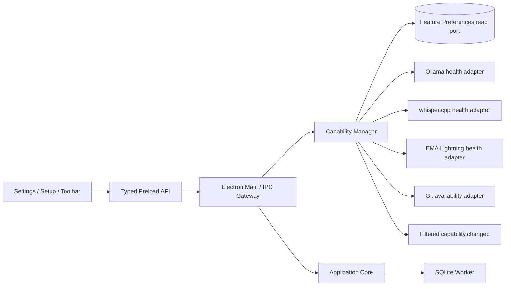
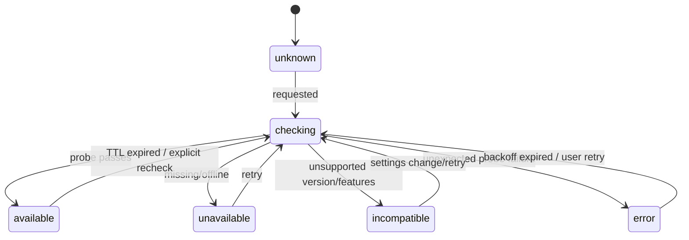

# Iterkeep — Ayarlar, Sistem Sağlığı, Capability Manager ve Kaynak Politikası

> **Amaç:** Kullanıcının Iterkeep tercihlerinin kalıcılığını; opsiyonel Ollama/Whisper/EMA Lightning/Git yeteneklerinin **tercih / kurulum / mevcut çalışabilirlik** ayrımını; yeniden kontrol, model kaybolması, işlem iptali, CPU/GPU kaynak rekabeti ve Sistem Sağlığı görünümünü aynı kesin sözleşmede tanımlamak. Kullanıcı AI'yı atladığında veya kapattığında çekirdek planlama ürünü eksiksiz çalışır. Kullanıcı AI'yı sonra açarsa sihirbazı tekrar geçirmek zorunda değildir.
>
> **Yetki sınırı:** `DOC-08` domain enum'ları ve model anlamı; `DOC-09` fiziksel SQL sütunları; `DOC-10` transaction/idempotency; `DOC-11` IPC adları/wire transport; `DOC-12` job durum makinesi/kaynak kilidi; `DOC-18` wizard sırası; `DOC-20–23` görsel tokenlar ve erişilebilir bileşenler; `DOC-24–29` AI, model ve ses sağlayıcı davranışı; `DOC-30` güvenlik/SSRF; `DOC-31` benchmark eşikleri konularında yetkilidir. **DOC-19** settings bilgi mimarisi, capability health orkestrasyonu, TTL/backoff, kullanıcıya görünen özellik durumları ve resource-user-experience politikası için kanoniktir. Bu belgedeki örnekler gerçek uygulama test edilene kadar referans niteliğindedir.
>
> **Kanıt durumu:** Sözleşmeler mevcut `08–12` ve `18` belgelerine göre derlenmiştir. Bu belgedeki TypeScript **henüz derlenmedi**, Windows/Ollama/Whisper/EMA Lightning entegrasyonu denenmedi. `status: draft` korunur.

---

## 1. V1 davranışının kısa sözleşmesi

- Uygulama ana ekranını açmak için AI, ses, Git, internet veya model kontrolü **beklemez**.
- **Kullanıcı tercihi** SQLite'da kalır; **anlık servis sağlığı** TTL'li Main süreci belleğinde kalır. `enabled` ≠ `available`.
- Sistemin `ai=enabled` tercihini hatırlaması otomatik model indirme, servis başlatma veya buluta veri gönderme izni **değildir**.
- Kullanıcı `ai=disabled` seçince yeni agent run'ları `CAPABILITY_DISABLED` alır, mevcut uygulama-sahipli işler DOC-12/27'ye göre iptal edilir; dış Ollama servisi durdurulmaz.
- `stt` ve `tts` birbirinden bağımsızdır. TTS yoksa yazılı yanıt; STT yoksa metin giriş her zaman vardır.
- Git yalnız kullanıcı tarafından yapılandırılan export profili üzerinden çalışır. Git bulunmaması planlama ve Markdown export'u engellemez.
- Model profili seçilmiş olması modelin cihazda yüklü veya RAM'e sığabilir olduğunu kanıtlamaz.
- Sistem Sağlığı, kaynağı ve zamanı bilinen **ölçümleri** gösterir; bilinmeyen RAM/VRAM için tahmin uydurmaz.
- Yeniden deneme yalnız gerçek nedeni düzeltebilir. Bağımsız servis arızası SQLite servisinin çalışabilirliğini düşürmez.
- Ana UI'da aynı anda tek bir zorlayıcı modal/dialog gösterilir; pasif health değişimi sessiz ve erişilebilir durumla aktarılır.

## 2. Değişmez kurallar (SET-I-001–040)

| Kimlik | Zorunlu kural |
|---|---|
| SET-I-001 | Workspace'in kalıcı tercihlerinde tek kaynak `workspace_preferences`, `feature_preferences`, `provider_configs` ve `model_profiles` tablolarıdır. |
| SET-I-002 | `SetupState.coreSetupCompleted` kullanıcı kurulum ilerlemesidir; runtime capability sonucu değildir. |
| SET-I-003 | `CapabilitySnapshot` kalıcı sağlıklı sayılmaz; Main her başlangıçta geçersiz sayar. |
| SET-I-004 | Renderer kesin yetenek durumu hesaplamaz; Main yalnız doğrulanmış sonuçları raporlar. |
| SET-I-005 | Core açılışı opsiyonel provider probe'unu `await` etmez. |
| SET-I-006 | `ai`, `stt`, `tts`, `git` domain feature enum'u yalnız DOC-08'den import edilir. |
| SET-I-007 | Provider `enabled` bayrağı ile kullanıcıya ait feature tercihi farklıdır. |
| SET-I-008 | OS üzerinde Ollama bulunması kullanıcı AI tercihinin `enabled` olmasını tetiklemez. |
| SET-I-009 | Ollama model adını/manifest'i ve model digest'ini provider doğrular; kaydedilmiş profil buna üstün gelmez. |
| SET-I-010 | İndirmenin başlangıcı, tekrarı ve model benchmark'ı kullanıcı eylemine ve DOC-12 job'a bağlıdır. |
| SET-I-011 | Kullanıcı kapatınca dışarıdan açılmış Ollama/başka uygulama prosesleri öldürülmez. |
| SET-I-012 | Uygulamanın sahip olduğu sidecar kapatılırken bağlı diğer işlerin sahipliği hesaba katılır. |
| SET-I-013 | Health kontrolleri Main'de tek-flight/cancellation destekler; yarışan eski cevap yeni durumu ezemez. |
| SET-I-014 | Health kontrolü uzarsa uygulama `checking`/son geçerli gözlem bilgisini gösterir; sonsuz spinner yoktur. |
| SET-I-015 | `unknown` asla `available` gibi davranmaz. |
| SET-I-016 | `unavailable` (erişilemiyor), `incompatible` (sürüm/özellik uyuşmaz) ve `error` (kontrol hatası) ayrıdır. |
| SET-I-017 | Health TTL dolunca gerçek durum yeniden doğrulanmalıdır; UI stale ölçümü yeni gibi göstermez. |
| SET-I-018 | Probe backoff'u arayüzü kilitlemez ve ağ/CPU kullanımını kontrol altında tutar. |
| SET-I-019 | Probe başarısızlıklarından dolayı veritabanı migration, backup veya core CRUD iptal edilmez. |
| SET-I-020 | UI event'i doğrulanmış state'e ait olsa bile her zaman yeniden sorgulanabilir snapshot sunar. |
| SET-I-021 | Tema/dil/zaman dilimi tercihi doğrulanmış command ile ve revision CAS ile saklanır. |
| SET-I-022 | Boşta duran model/sidecar başlangıçta yüklenmez; eager GPU tahsisi yasaktır. |
| SET-I-023 | Gerçek ölçüm olmadan CPU/GPU yüzdesi, VRAM, hız veya model uyumluluğu uydurulmaz. |
| SET-I-024 | GPU kaynağı DOC-12 Resource Manager üzerinden tahsis edilir, ses/agent kendi özel kilidini uydurmaz. |
| SET-I-025 | Core UI, kaynak kuyruğunda kalan optional job yüzünden bloke edilmez. |
| SET-I-026 | Kullanıcının açıkça başlattığı model indirme ya da restore sırf Ayarlar sayfası kapandı diye iptal edilmez. |
| SET-I-027 | AI'ı kapatmak bitmiş sohbetleri, görevleri, kararları, logları ya da model profillerini silmez. |
| SET-I-028 | `setPreference` sonucu DB commit sonrası başarılı olur; hata durumunda UI geçici state'i geri alır. |
| SET-I-029 | Modeli kaldıran dış değişiklik health'de görünür; geçmiş benchmark yeni digest için kullanılmaz. |
| SET-I-030 | Renderer'ın sağladığı base URL, binary path veya shell parametresi doğrulama olmadan çalıştırılmaz. |
| SET-I-031 | Sağlık raporları varsayılan olarak yerelde kalır; uzaktan telemetri gönderilmez. |
| SET-I-032 | Tanılama dışa aktarımı kullanıcı notlarını, sohbet içeriğini, tokenları ve tam özel path'leri otomatik içermez. |
| SET-I-033 | Renderer `fs`, `child_process`, `better-sqlite3` veya raw provider HTTP çağrısı yapmaz. |
| SET-I-034 | Ayarlar sayfası kapatılıp açılsa bile kayıtlı tercih ve job receipt aynı kalır. |
| SET-I-035 | Workspace yoksa ayarlar sorgusu yeni workspace'i sessizce oluşturmaz. |
| SET-I-036 | Her yeniden dene düğmesi izinli ve mevcut kanonik IPC metodunu kullanır. |
| SET-I-037 | Pencere gizleme/focus değişimi model indirme durumunu başarılı veya başarısız ilan etmez. |
| SET-I-038 | Model önerisi donanımı “kesin uyumlu” ilan etmek yerine DOC-25 benchmark ile doğrular. |
| SET-I-039 | Aynı feature'a yönelik iki toggle isteği serileştirilir ve son başarılı commit UI'ya uzlaştırılır. |
| SET-I-040 | Ayarlar bütün ekranları klavyeyle kullanılabilir, ekran okuyucuda anlamlı ve reduced-motion uyumludur. |

## 3. Veri yerleşimi ve tek kaynaklar

| Veri | Kalıcı? | Yetkili kaynak | Erişim | Not |
|---|---|---|---|---|
| `locale`, `theme`, `timezone` | Evet | `workspace_preferences` | `workspace.getPreferences` / `.updatePreferences` | Beklenen revision gerekir |
| `last_selected_project_id`, `last_view` | Evet | `workspace_preferences` | Aynı API | UI navigasyon tercihi |
| `ai`, `stt`, `tts`, `git` tercihi | Evet | `feature_preferences` | `capabilities.get`, `setPreference` | DOC-08 enum |
| `core_setup_completed`, setup choices | Evet | `setup_state` | `setup.get/saveStep/complete` | Modelden bağımsız |
| `ollama`, `whisper_cpp`, `ema_lightning` konfigürasyonu | Evet | `provider_configs` | Application service; public bridge erişimi sınırlı | `base_url`/revision kullanımı DOC-30 ile |
| Seçili yerel agent modeli | Evet | `model_profiles` | `models.setActive/listInstalled` | Kurulu olduğunu kanıtlamaz |
| Model benchmark kanıtı | Evet | `model_benchmark_receipts` | `models.runBenchmark`, `jobs.get` | Digest + cihaz profiliyle bağlanır |
| Model indirme/backup/transkript iş durumları | Evet | `background_jobs` | `jobs.get/list/cancel` | İş durumu ≠ provider sağlık |
| Servis canlılık ve kullanılabilirlik | Hayır | Main `CapabilityManager` | `capabilities.get` | TTL + probe result |
| Mikrofon kaydı/playback geçici hali | Hayır | Renderer + Main voice session | `voice.*` | Kullanıcı kayıt demeden DB'ye geçmez |
| GPU kaynak sahibi/lease | Hayır | Main `ResourceManager` | Job/agent/voice internal API | Process restart ile yeniden kurulur |
| Erken açılış tema/last workspace locator | Minimal bootstrap | `application-settings.json` | Main boot only | Workspace DB'ye rakip truth değil |

### 3.1 SQL'e uyumlu veri okuma

```sql
-- Query yalnız DB worker içinde çalışır; dışarıya SQL geçmez.
SELECT workspace_id, locale, theme, timezone,
       last_selected_project_id, last_view, revision
FROM workspace_preferences WHERE workspace_id = ?;

SELECT feature, preference, updated_at, revision
FROM feature_preferences WHERE workspace_id = ?
ORDER BY feature ASC;

SELECT provider, base_url, enabled, updated_at, revision
FROM provider_configs WHERE workspace_id = ?
ORDER BY provider ASC;

SELECT id, provider, provider_model_name, model_digest,
       context_window, selected_for_agent, revision
FROM model_profiles WHERE workspace_id = ?
ORDER BY selected_for_agent DESC, provider_model_name ASC;
```

`feature_preferences` için her workspace'in ilk transaction'ında dört satır (`ai`, `stt`, `tts`, `git`) oluşturulur. Kaydı olmayan eski dosya V1 migration ile onarılır; sessizçe yanlış `enabled` tahmin edilmez. Git export profili `export_profiles.git_enabled` ayrıca **hedefin Git ile kullanılacağını** tanımlar; feature preference global izin katmanıdır.

### 3.2 Tercih güncellemesinin transaction sınırı

- `workspace.updatePreferences({patch,expectedRevision})` yalnız izin verilen alanları günceller.
- `revision` uyuşmazsa `CONFLICT_REVISION`; eski kayıt üzerine yazılmaz.
- `theme='system'` olduğunda sistem OS teması değişirse UI anında uyum sağlar; veritabanı değeri hâlâ `'system'` kalır.
- `timezone` gerçek IANA timezone olmalıdır (`Europe/Istanbul` gibi). Geçersiz timezone kaydedilmez.
- `last_view` için DOC-09 `CHECK` kümesi korunur; UI'daki `settings` route'u yeni DB enum olarak eklenmez. Ayarlar modalı/paneli son içerik view'ını değiştirmez.
- Feature toggle `capabilities.setPreference` üzerinden idempotent uygulanır. Aynı değeri yeniden seçmek `revision` artırmadan `no-op` olabilir; sonuç beklenen state'i döndürür.
- `provider_configs` yazma UI API'si V1'de mevcut manifestte **yoktur**: Kullanıcı base URL değiştirebilen kontrol V1 ekranında gösterilemez; güvenli varsayılan loopback yapılandırması/kurulum adapter'ı kullanılır. Yeni ayar istenirse önce DOC-11 + DOC-30 ADR gereklidir.

## 4. Ayarlar bilgi mimarisi ve ekran sözleşmesi

**Tek rota:** `Settings` modal/yan panel; `System Health` alt sayfası; sekmeler istemci state'idir. Tam route ID'leri DOC-21'de tanımlanacak. İlk V1 düzeni:

| Panel | Kontroller | Kalıcılık/yenileme | Yüklenemezse |
|---|---|---|---|
| Genel | Dil: Türkçe/English, Tema: Sistem/Açık/Koyu, Saat dilimi | `workspace_preferences` | Kaydetme hatası inline; önceki değer korunur |
| Çalışma alanı | Workspace adı/yolu görüntüle, dosya konumuna yönlendirme, mevcut workspace seçimi | `workspace.get/open/listRecent` | Dış DB bulunamazsa kurtarma sayfası |
| Yapay zekâ | Etkinleştir, Ollama durumunu gör, model seç, model indir, benchmark | `feature_preferences`, `model_profiles`, jobs | Offline/kurulu değil durumu; çekirdek çalışır |
| Ses | STT/TTS ayrı tercih, mikrofon izni ve sağlayıcı durumu | `feature_preferences`, `voice.getStatus` | Ses özelliği kullanılamaz, notlar kullanılabilir |
| Git ve dışa aktarma | Export hedefleri, Git status, son export, push onayı | `git.listProfiles/status` | Git opsiyonel uyarı; export bozulmaz |
| Yedekleme & kurtarma | Son yedek, manuel yedek, geri yükleme önizleme | `backups.*`, jobs | İşlem yüzeyi güvenli disable edilir |
| Sistem Sağlığı | Çekirdek DB sağlığı, servis kartları, job kuyruğu, tanılama | `system.health/diagnostics`, capabilities, jobs | En azından genel hata sayfası |
| Hakkında | Sürüm, lisans, güncelleme bilgisi, destek ve gizlilik | `system.bootstrap` | Statik uygulama sürümü gösterilebilir |

**V1'de olmayanlar:** Bulut hesap girişi, uzak Ollama host editörü, otomatik Git push, ham sistem shell ayarı, gizli telemetri toggle'ı, modelin kontrolsüz silinmesi, tüm ses dosyalarını otomatik kaydetme.

### 4.1 Settings açıldığında çağrı sırası

1. Renderer tek istekle `workspace.getPreferences()` ve mümkünse `capabilities.get({refresh:false})` sorgularını birbirini bekletmeden yapar.
2. `system.health()` ana ekranın sağlıklı olduğunu zaten belirtmişse ilave ağır DB quick_check otomatik koşturulmaz.
3. Ollama sekmesi açıldığında `models.listInstalled()` gerekirse canlı sağlayıcı sorgusu olarak çalışır; sekme kapalıyken tekrar tekrar taranmaz.
4. Ses sekmesinde `voice.getStatus()` ile son gözlem alınır; mikrofon izni kontrolü otomatik kayıt **başlatmaz**.
5. Tüm sayfalar iskelet durum + son başarılı değer + açık stale etiketi kullanır; boş beyaz alan göstermez.

### 4.2 Ayar kaydı: kural ve UI

- Tercih anlık olarak *önizlenebilir* (ör. tema), ancak başarılı kalıcı kayıt bildirimi **yalnız transaction commit sonrası** gösterilir.
- Kaydetme sırasında ilgili kontrol geçici kilitlenir; tüm settings paneli bloke edilmez.
- `CONFLICT_REVISION` alınırsa yeni server snapshot okunur ve “başka yerde değişti” bildirimiyle kullanıcı seçimi karşılaştırılır.
- `DATABASE_BUSY` veya `DB_WORKER_UNAVAILABLE` olduğunda başarısız gösterilir, doğrulanmamış başarı yazılmaz.
- Dil değişiminde form metinleri, aria-live mesajları, hata kodlarının UI çevirileri güncellenir; log kodları İngilizce anahtarları korur.
- Karanlık/açık mod geçişinde yalnız CSS tokenları değişir; komponent ağacı yeniden mount edilmez, aktif editör metni veya cursor konumu korunur.
- Ana uygulama yanında başka pencere desteklenirse event + fresh query ile değişiklikler yeniden eşlenir (DOC-11/12).

## 5. Capability Manager — sahiplik ve yaşam döngüsü

### 5.1 Çalışma sınırları



`CapabilityManager` Main sürecinde singleton hizmettir; **core CRUD'ün constructor'ında mandatory dependency olarak bulunmaz**. `get()` önce mevcut state'i döndürür; gerekirse arka planda probe planlar. Agent'a prompt veya tool yürütme yetkisi vermek onun işi değildir.

### 5.2 State makinesi

`DOC-08 CapabilityState` enum'u birebir kullanılır:



`disabled` bir CapabilityState **değildir**; kullanıcı tercihi `preference='disabled'` olarak döner. `readyForUse = preference==='enabled' && health.state==='available' && requiredSelectionValid && resourceAdmissionAllowed` biçimindeki türetilmiş kural **kalıcı duruma yazılmaz**. Kaynak geçici dolu ise health `available` kalabilir ama istek `queued` olur; kaynak beklemek `unavailable` değildir.

### 5.3 Ortak wire görünümü (DOC-11'e uyum)

`DOC-08` içindeki `CapabilitySnapshot` tek bir feature içindir; `capabilities.get()` ise `CapabilityOverview` taşır:

```ts
// contracts içindeki tipler; semantic FeatureKey/CapabilityState domain'den gelir.
import type {
  CapabilitySnapshot, FeatureKey, FeaturePreference,
} from '@iterkeep/domain';

export interface CapabilityOverview {
  readonly features: Readonly<Record<FeatureKey, {
    readonly preference: FeaturePreference;
    readonly health: CapabilitySnapshot;
    readonly stale: boolean;
    readonly nextEligibleProbeAt: string | null;
  }>>;
  readonly sampledAt: string; // UTC RFC3339 .sssZ
}
```

- `capabilities.get({refresh?:boolean})` ile **aynı statik IPC kanalı** kullanılır. `refresh=false` normal hızlı snapshot'tır.
- `refresh=true` uzun provider çağrılarını senkron beklemez; tek-flight probe'ları başlatır ve `checking`/eldeki durum snapshot'ını hemen döndürür.
- Yeni durumu `capability.changed` event'i bildirir, UI güvenilir son durum için tekrar `capabilities.get()` çağırır.
- `features` dört sabit anahtar (`ai`, `stt`, `tts`, `git`) içerir. Belirsiz provider/kurulu değil durumları `unknown` veya `unavailable` olarak belirtilir.
- `checkedAt` ilgili feature için son gerçek probe zamanıdır. `sampledAt`, wrapper oluşturma zamanıdır; ikisini birbirine karıştırma.
- `details` yalnız izinli küçük veri kümesi içerir; gizli token, kullanıcı dosya yolu, process command line ya da kişisel içerik yoktur.

**Önemli:** `DOC-11` önceki sürümünde dönüş değeri tekil `CapabilitySnapshot` diye kısaltılmıştır. V1 kontrat düzeltmesi: **`capabilities.get({refresh?:boolean}) → CapabilityOverview`**. Bu değişiklik yeni rota/kanal oluşturmaz. `DOC-11` güncellemesi bu belgeyle birlikte yapılmalıdır.

### 5.4 Capabilities truth matrix

| Preference | Health | Seçim/ek gereksinim | Sonuç | UI |
|---|---|---|---|---|
| disabled | herhangi | herhangi | feature kapalı | “Kapalı” + Aç düğmesi |
| enabled | unknown | bilinmiyor | henüz kullanılamaz | “Kontrol edilmedi” |
| enabled | checking | önceki sonuç var | yeni işe geçiş yok | “Kontrol ediliyor” |
| enabled | available | model seçilmemiş (AI) | agent kullanılamaz | “Model seçin” |
| enabled | available | model silinmiş | agent kullanılamaz | “Model bulunamadı” |
| enabled | available | hepsi geçerli | kullanılabilir | “Hazır” |
| enabled | unavailable | servis yok | kullanılamaz | “Kurulu değil / Erişilemiyor” |
| enabled | incompatible | sürüm/özellik yanlış | kullanılamaz | “Uyumsuz” |
| enabled | error | kontrol hata verdi | kullanılamaz | “Kontrol başarısız” + Detay |

`ai` provider sağlığının `available` oluşu tek başına tool-capable seçilmiş agent modeli için yeterli değildir; modelin varlığı/digest/özellikleri DOC-25'e göre ayrıca doğrulanır. `tts` için `stt` veya mikrofon izni gerekli değildir. `git` yalnız uygun export profilinde değerlendirilir.

## 6. Probe TTL, tetikleyiciler ve backoff

**Varsayılan V1 politika değerleri** üretim benchmark ile değiştirilebilir; bunlar runtime varsayımlarıdır, garantili gecikme değil:

| Probe | Başarı TTL | Başarısızlık TTL | Tek deneme deadline | Trigger |
|---|---:|---:|---:|---|
| Ollama servis / capabilities | 30 sn | 10 sn | 1,5 sn | AI ekranı, agent isteği, explicit refresh |
| Ollama installed model listesi | 30 sn | 10 sn | 2,5 sn | Model Manager, seçim/run öncesi |
| Whisper sidecar availability | 60 sn | 15 sn | 1,5 sn | STT paneli veya bas-konuş öncesi |
| EMA Lightning sidecar availability | 60 sn | 15 sn | 1,5 sn | TTS paneli veya speak öncesi |
| Git CLI availability | 120 sn | 30 sn | 1 sn | Git paneli, commit/push öncesi |
| Sistem health (core/DB) | 15 sn UI snapshot | Gerektikçe | DB özet: 300 ms hedefi | Health sayfası / hata |

Bu süreler kesin timeout ve politika için placeholder'dır; `DOC-31` ölçüm raporu ile revize edilebilir. Hiçbir probe 30 saniyelik UI açılışı bloke etmez; `Promise.race` gibi yöntemler işlem iptal edilmiş gibi gösteremez, gerçek abort/timeout bağlantı seviyesinde uygulanır.

- **Single-flight key:** `provider + probeKind + normalizedConfigVersion`; aynı anda aynı probe için ikinci ağ isteği açılmaz.
- **Sequence monotonic:** Her probe yeni `generation` alır. Eski generation tamamlandıysa sonuç yalnız en yeni generation ile eşleşirse uygulanır.
- **Stale handling:** Başarılı son gözlem gösterilebilir ama `stale:true` olduğunda düğmeleri aktif etmek için yeniden doğrulama gerekir.
- **Retry:** İlk arıza sonrası 1s, 2s, 4s, 8s, 16s, en fazla 60s + ±%20 jitter. Kullanıcı explicit retry ile cooldown bekleme ekranını aşabilir ama saniyede tekrar basma için 2s lokal rate limit uygulanır.
- **Focus:** Pencere focus'a dönünce son probe çok eskiyse *yalnız etkin, o sırada görünür ilgili feature* için kontrol planlanır; her sekmede bütün servisleri taramak yasaktır.
- **Background:** AI ve ses devre dışıysa uygulama açılışında arka planda servisleri aktif probe etmek zorunlu değildir; `unknown` makul durumdur.
- **Network:** Yalnız izinli `127.0.0.1` ve doğrulanmış provider endpoint; internete “en iyi model ne?” sorgusu yapılmaz. Model kataloğu ve download ayrı kullanıcı eylemidir.
- **UI:** Son kontrol zamanı ve `Yeniden kontrol et` affordance gösterilir; kullanıcı düzeltme adımına yönlendirilir.

### 6.1 Capability Manager referans TypeScript

```ts
import type { CapabilitySnapshot, FeatureKey } from '@iterkeep/domain';

export interface ProbeAdapter {
  readonly feature: FeatureKey;
  probe(signal: AbortSignal): Promise<CapabilitySnapshot>;
}
export interface Clock {
  nowMs(): number;
}
export interface CapabilityCacheEntry {
  readonly value: CapabilitySnapshot;
  readonly expiresAtMs: number;
  readonly generation: number;
}

export class CapabilityManager {
  private readonly cache = new Map<FeatureKey, CapabilityCacheEntry>();
  private readonly inFlight = new Map<FeatureKey, Promise<void>>();
  private readonly sequence = new Map<FeatureKey, number>();

  constructor(
    private readonly adapters: ReadonlyMap<FeatureKey, ProbeAdapter>,
    private readonly clock: Clock,
    private readonly publishChanged: (feature: FeatureKey) => void,
  ) {}

  snapshot(feature: FeatureKey): CapabilityCacheEntry | undefined {
    return this.cache.get(feature);
  }

  requestProbe(feature: FeatureKey, timeoutMs: number, ttlMs: number): void {
    if (this.inFlight.has(feature)) return;
    const adapter = this.adapters.get(feature);
    if (!adapter) return;
    const generation = (this.sequence.get(feature) ?? 0) + 1;
    this.sequence.set(feature, generation);
    const controller = new AbortController();
    const deadline = setTimeout(() => controller.abort(), timeoutMs);
    const run = (async () => {
      try {
        const value = await adapter.probe(controller.signal);
        if (this.sequence.get(feature) !== generation) return;
        this.cache.set(feature, {
          value, expiresAtMs: this.clock.nowMs() + ttlMs, generation,
        });
      } catch {
        // Production: classify unavailable vs incompatible vs error,
        // retain a safe diagnostic code; NEVER default to available.
        // See section 6.2; no secrets / raw errors in UI.
      } finally {
        clearTimeout(deadline);
        this.inFlight.delete(feature);
        this.publishChanged(feature);
      }
    })();
    this.inFlight.set(feature, run);
  }
}
```

**Kodun kapsamı:** Bu sadece **algoritmik iskelet**tir; production'da `checking` snapshot, başarısız probe'u `error/unavailable/incompatible` diye sınıflandırma, backoff/jitter, preference disable olduğunda cancel, emitter cleanup, generation-safe `finally`, bütün feature overview ve testable timer injection **mutlaka** tamamlanacaktır. Özellikle `catch` boş kalarak sonsuza kadar eski `available` durumunu döndürmek kabul edilemez. Zod model ve IPC DTO'ları `@iterkeep/contracts`tan alınır; bu bölüm gerçek modülün birebir kopyası sayılmaz.

### 6.2 Hata sınıflandırma sözleşmesi

| Kanıt | State | Diagnostic code | Güvenli kullanıcı metni |
|---|---|---|---|
| TCP connection refused / binary yok | `unavailable` | `PROVIDER_NOT_RUNNING` | “Servis çalışmıyor veya kurulu değil.” |
| Model endpoint var ama gereken araç API'si yok | `incompatible` | `PROVIDER_UNSUPPORTED` | “Bu servis sürümü gerekli özelliği desteklemiyor.” |
| Probe deadline aşıldı | `unavailable` veya `error` (kanıta göre) | `PROVIDER_TIMEOUT` | “Servis yanıt vermedi.” |
| JSON beklenen şemaya uymuyor | `incompatible` | `PROVIDER_BAD_RESPONSE` | “Sağlayıcı yanıtı uyumsuz.” |
| Process ani kapandı | `unavailable` | `SIDECAR_EXITED` | “Ses servisi kapandı.” |
| İzin/denetim hatası | `error` | `PROBE_INTERNAL_ERROR` | “Kontrol sırasında hata oluştu.” |
| Dosya/model fiziksel olarak kayıp | provider `available`, model ayrı `missing` | `MODEL_MISSING` | “Seçilen model bulunamadı.” |
| GPU meşgul | provider `available`, job queued | `RESOURCE_BUSY` | “Kaynak boşalması bekleniyor.” |

Bunlar `CapabilitySnapshot.diagnosticCode` içindeki güvenli reason key'lerdir; mevcut `DOC-11 FailureCodeSchema` içindeki yeni IPC hata enum'ları **değildir**. IPC servis cevapları `PROVIDER_UNAVAILABLE` gibi kanonik hata kodlarını kullanmaya devam eder.

## 7. Modül bazında runtime davranışı

### 7.1 AI ve Ollama

1. Ayar kapalıyken `agent.startRun` reddedilir; eski sohbetler okunabilir.
2. Ayar açık + provider unreachable → “Bağlantı yok”, `models.detectOllama({explicit:true})` düğmesi etkin.
3. Provider var + model yok → önerilen modeller ve `models.startDownload` yalnız kullanıcı onayıyla.
4. Model listesi canlı /api/tags türü provider sorgusuyla doğrulanır; profil ve digest eşleştirilir.
5. Model seçilince `models.setActive` transaction içinde tek seçili model invariant'ını korur; indirme başlatmaz.
6. Agent başlamadan **kısa** preflight yapılır; TTL'li health eskiyse ilgili provider kontrol edilir, gerekirse kullanıcıya yeniden deneme sunulur.
7. Model benchmark başarı sonucu `ModelBenchmarkReceipt` olarak gösterilir; ölçülmemiş hız için “—”.
8. Seçili model dışarıdan silinirse UI seçili tercihi kaybetmez; `missing` hata durumuyla yeniden kurulum/model değiştirme sunar.
9. Kullanıcı AI'yı kapatırken devam eden uygulama-owned run varsa açık onay/iptal bildirimi gösterilir; DB preference commit sonrasında yeni run girişi kapanır.
10. Kullanıcı yeniden açınca tamamlanmış eski job veya benchmark'ı otomatik yeniden çalıştırma yok.

### 7.2 Whisper STT

- `stt=disabled` ise mikrofon düğmesi bilgi/etkinleştirme önerisi gösterir, kayıt başlamaz.
- `stt=enabled` ancak sidecar/model yoksa `voice.getStatus` bunu bildirir; kaydı başlatmadan kullanıcıya eksik bileşen gösterilir.
- Kullanıcının açık düğme eylemi → OS microphone permission → `voice.startCapture` → chunk → `voice.stopCapture` → transkript önizlemesi (DOC-28).
- Sağlık kontrolü otomatik mikrofon erişim izni istemez ve ses kaydı almaz.
- İşleme sırasında kaynak doluysa DOC-12 kuyruğu kullanılır; job ID ile ilerleme izlenir.
- Transkripsiyon metni kullanıcı onaylamadan Task/Log/Chat'e otomatik commit edilmez.
- Audio temp cleanup ve izin yönetimi DOC-28/30'a aittir.

### 7.3 EMA Lightning TTS

- `tts=disabled` olduğu sürece TTS sidecar yüklenmez; yazılı agent yanıtı aynı kalır.
- `tts=enabled` olduğunda TTS kullanılabilirliği `voice.getStatus` ile doğrulanır; model/binary yoksa seslendirme butonu uygun durumla disable olur.
- Kullanıcı sesi başlattığında `voice.speak` job açar; başarısızlık veya iptal assistant'ın tamamlanmış metnini silmez.
- Ses için mikrofon izni istenmez; STT'den bağımsız çalışır.
- CPU/GPU backend seçimini DOC-29 ve ResourceManager belirler; cihazda ölçülmemiş ses gecikmesi vaat edilmez.

### 7.4 Git

- Git CLI algılama komutu yan etkisiz olmalı (ör. kurulum sürümünü okumak); keyfî shell komutu kullanılmaz.
- Git sağlık kartı, export hedefi ve repo durumunu birbirinden ayırır. `git installed` ≠ `repo initialized` ≠ `remote push safe`.
- V1 `git.profiles.list/getStatus` üzerinden read-only durum sunar; `git.pushExport` kullanıcı onayı + DOC-16 güvenli remote şartlarını korur.
- Git aktif tercihi `feature_preferences(git)` içinde bulunsa bile V1 kanal kataloğunda ayrı Git enable/disable UI mutasyonu yoktur; Git kullanımı export profili üzerinden başlatılır. **Geliştirme ajanı genel bir Git toggle'ı uyduramaz**. Gerekiyorsa DOC-11 açık ADR ile `setPreference` kapsamını genişletir.
- Git bulunmasa bile Markdown export kullanılabilir, core etkilenmez.

## 8. Kaynak yönetimi ve performans

### 8.1 Resource admission politikası

`DOC-12` JobManager tek scheduler ve `resource-manager.ts` tek lease sahibidir. DOC-19, hangi isteğin kullanıcı deneyimi açısından öncelikli olduğunu belirler:

| İşlem | Sınıf | Kaynak türü | Varsayılan davranış |
|---|---|---|---|
| Core CRUD / Settings save | Etkileşimli kritik | DB writer | AI'dan bağımsız; kısa transaction |
| Arama / proje listesi | Etkileşimli kritik | DB reader / worker | Geciktirilmez, büyük liste sayfalanır |
| Mikrofon capture | Kullanıcı anlık | Audio I/O, hafif CPU | Model yüklemek capture başlangıcını bloke etmemeli |
| STT transcribe | Kullanıcı bekliyor | CPU/GPU voice lane | Görünür progress, gerektiğinde sıraya al |
| Agent streaming | Kullanıcı bekliyor | Ollama, GPU lease | Aktif yanıt varsa öncelikli; güvenli iptal |
| TTS synthesize | Kullanıcı bekliyor | CPU veya GPU voice lane | Yazılı yanıtı bloklama |
| Model download | Arka plan | Network/disk | Darboğazda düşük öncelik |
| Model benchmark | Arka plan ağır | CPU/GPU | Aktif voice/agent ile rekabetten kaçın |
| Backup/restore | Veri güvenliği kritik | Disk + DB coordination | Backup kuyruklanabilir, restore özel kilit/onay |

### 8.2 GPU ve model yaşam döngüsü

- Donanım tespitinde `totalVRAM`, `freeVRAM`, GPU ismi ve backend destek bilgisi **ayrı alanlardır**. Sadece toplam VRAM, modelin çalışacağına garanti değildir.
- VRAM ölçümü erişilemiyorsa sınırlı / düşük kaynak profili önerilir, “uyumlu” damgası verilmez.
- Aynı anda iki ağır GPU işinin otomatik açılması varsayılan olarak engellenir; CPU fallback kullanıcı deneyimi ve DOC-25/28/29 doğrulamasıyla seçilir.
- Uygulama başka süreçlerin GPU belleğini sahiplenmez; Ollama sistem genelinde paylaşılan bir servis olabilir.
- Model `keep_alive` benzeri Ollama politikaları provider adapter sorumluluğudur; kullanıcıya açık “hızlı yanıt / düşük RAM” tercihine dönüşecekse V1 IPC ve kalıcılık sözleşmesi için yeni ADR gerekir.
- Uygulamanın yönettiği local sidecar, son aktif işlem tamamlanınca kısa bekleme penceresi sonrası kapatılabilir; **varsayılan 60 sn** başlangıç politikasıdır. OS süreçleriyle ilgili gerçek kapanma güvenliği test edilmelidir.
- GPU erişilemiyor veya GPU driver uyumsuzsa core olduğu gibi devam eder. Ses ve AI paneli feature-specific çözüm gösterir.

### 8.3 Önerilen servis ölçümleri

| Metrik | Kaynak | Pencere/format | Yasak |
|---|---|---|---|
| `capability_probe_duration_ms` | Main monotonic timer | Feature, sonuç kodu | Kullanıcı metni eklemek |
| `capability_state_change` | CapabilityManager | Geçiş + diagnosticCode | Gizli URL/IP eklemek |
| `job_queue_wait_ms` | JobManager | JobKind, sınıf | Model prompt'u eklemek |
| `sidecar_start_ms` | Voice client | Provider türü | Model içeriği/logu eklemek |
| `db_query_p95_ms` | DB Worker summary | Sorgu sınıfı | SQL parametrelerini tanı loguna basmak |
| `gpu_memory_report` | OS provider (varsa) | Bytes/unknown | Ölçülmeyen freeVRAM uydurmak |
| `settings_commit_latency_ms` | Application Core | Komut türü | Tam kullanıcı ayarı/path'i loglamak |

DOC-31'de fixture cihaz/senaryo ve pass/fail eşiği tanımlanmadan “çok hızlı” doğrulandı denmez.

## 9. Uçtan uca akışlar (SET-FLOW-001–012)

### SET-FLOW-001 — İlk başlatma, AI atlandı

1. Workspace + Inbox + varsayılan `feature_preferences(disabled)` oluşur.
2. `setup.complete` yalnız core gereksinimleri ile commit olur.
3. Dashboard açılır; AI/voice kartları kapalı, butonlar etkinleştirilebilir.
4. Hiçbir sağlayıcı auto-install/auto-download yapmaz.
5. Kullanıcı görev ekler, not alır; tüm işlemler SQLite'da başarılı olur.

### SET-FLOW-002 — Ayarlar'dan AI'ı sonradan açma

1. Kullanıcı Settings > AI'da feature toggle'a basar.
2. `capabilities.setPreference({capability:'ai',enabled:true})` DB commit olur.
3. UI feature enabled bilgisini alır; Main tek-flight probe'u planlar.
4. Ollama yoksa `unavailable` gösterilir ve kuruluma yönelik açıklama sunulur.
5. Ollama kurulduktan sonra `models.detectOllama({explicit:true})` ile durum yenilenir.
6. Model bulunursa kullanıcı seçer; yoksa açık onayla indirir.
7. Agent yalnız provider + model preflight başarıyla çalışır.

### SET-FLOW-003 — Kapatıp yeniden açma

1. `ai=enabled`, provider geçici olarak unavailable varsayılır.
2. Uygulama kapanınca `feature_preferences` değişmez.
3. Yeni açılış core UI'yı açar, health `unknown` olur.
4. AI paneli açılınca yeniden probe; gerekli model listesi doğrulanır.
5. Eski failed download job'u gizlice yeniden çalışmaz.

### SET-FLOW-004 — Başka program Ollama'yı durdurdu

1. Kullanıcı AI panelinde sohbet yürütürken provider bağlantısı kesilir.
2. Sadece bu run `PROVIDER_UNAVAILABLE`/provider-specific failed duruma geçer.
3. Capability cache `unavailable` yapılır, ilgili badge yenilenir.
4. SQLite ve görevler çalışmaya devam eder.
5. Kullanıcı servis geri gelince explicit retry yapabilir.

### SET-FLOW-005 — Seçilen model silindi

1. `model_profiles.selected_for_agent=1` kaydı kalır.
2. `models.listInstalled` sonucu modelin olmadığını gösterir.
3. UI “Seçili model bulunamadı” kartı gösterir; geçmiş konuşmalar kaybolmaz.
4. Kullanıcı başka model seçebilir veya eski modeli tekrar indirebilir.
5. Benchmark eşleşmesi digest değişince geçersiz hale gelir.

### SET-FLOW-006 — GPU yük altında STT ve agent isteği

1. STT capture kesintisiz toplanır, kısa özet job kaydı açılır.
2. Aynı anda agent model benchmark çalışıyorsa ResourceManager önceliği uygular.
3. Düşük öncelikli iş kuyruğa alınır, UI tahmini süre uydurmaz.
4. Kaynak açılınca görev çalışır ve event ile kullanıcı haberdar olur.
5. Core CRUD gecikme limiti benchmark edilir.

### SET-FLOW-007 — Tema kaydı başarısız

1. Kullanıcı light→dark geçişi seçer, UI geçici önizleme uygular.
2. `workspace.updatePreferences` DB_BUSY ile başarısız olur.
3. UI eski doğrulanmış tema seçimine döner, kısa hata metni gösterir.
4. Sıradaki başarılı deneme yalnız güncel revision ile yazılır.

### SET-FLOW-008 — Ayarlar sekmesi kapatıldı; download devam ediyor

1. Kullanıcı açık onayla `models.startDownload` başlatmıştır.
2. Job id `background_jobs` içinde kalır.
3. Ayarlar paneli kapanır; istenirse mini job göstergesi görünür.
4. Panel yeniden açılınca `jobs.get(jobId)` gerçek durumdan devam eder.
5. İndirme tamamlandı sayılmadan provider kataloğu yeniden doğrulanır.

### SET-FLOW-009 — Ses modeli yokken TTS etkin

1. `tts=enabled`, TTS health `unavailable`.
2. Kullanıcı yazılı sohbeti kullanır; ses düğmesinde kurulum bilgisi çıkar.
3. Kullanıcı modeli uygun şekilde kurar, `voice.getStatus()` yenilenir.
4. Başarılıysa `voice.speak()` çalışır; ses başarısızsa metin korunur.

### SET-FLOW-010 — Git yok, export var

1. Kullanıcı Markdown export oluşturabilir.
2. `git.getStatus` Git yoksa `GIT_UNAVAILABLE` verir.
3. Git commit/push butonları gerekçeli disable edilir.
4. Kullanıcının proje verisi ve okunabilir export dosyaları korunur.

### SET-FLOW-011 — Sistem Sağlığı raporu

1. Kullanıcı Ayarlar > Sistem Sağlığı açar.
2. `system.health`, `capabilities.get`, `jobs.list` paralel çalışır.
3. Database health tek güvenilir Core raporundan gelir; browser heuristics kullanılmaz.
4. “Tanılama detayları” yalnız `system.getDiagnostics({level:'safe'})` ile gelir.
5. Kullanıcı kopyalama/dışa aktarma yapmadan rapor üçüncü tarafa gönderilmez.

### SET-FLOW-012 — Workspace bulunamadı / hasarlı

1. `system.bootstrap` önceki locator'un kayıp olduğunu fark eder.
2. Yeni boş workspace yaratmak yerine kurtarma yüzeyi açılır.
3. `setup.get` workspace yoksa `WORKSPACE_UNAVAILABLE` tipli hata döndürür; `setup_state` uydurmaz.
4. “Mevcut aç”, “yedekten kurtar”, “yeni oluştur” bilinçli seçeneklerdir.
5. Restore sonucu DOC-17 bütünlük kontrollerine bağlıdır.

## 10. Sistem Sağlığı bileşenlerinin veri sözleşmesi

### 10.1 Ekran blokları

| Blok | Gösterilen veri | UI kaynakları | Stale davranışı |
|---|---|---|---|
| Core | Workspace okunabilir, DB worker yanıtı, schema uyumu | `system.health` | Hata varsa kurtarma görünümü |
| AI | Kullanıcı tercihi, provider, model seçimi, last probe | `capabilities.get`, `models.listInstalled` | Tekrardan doğrula |
| STT | Tercih, sidecar/model durumu, mikrofon izni | `capabilities.get`, `voice.getStatus` | Kayıt başlatmadan kontrol |
| TTS | Tercih, sidecar/model, playback uygunluğu | `capabilities.get`, `voice.getStatus` | Metin fallback |
| Git | Program kurulu, export profil durumları | `capabilities.get`, `git.*` | Push için canlı remote kontrol |
| Background Jobs | Son ve çalışan işler | `jobs.list/get` | Event gap olunca re-fetch |
| Storage/Backup | Workspace konumu, son yedek, kullanılan alan (varsa) | `system.health`, `backups.list` | Bilinmiyorsa sayı yok |
| Diagnostics | Sürüm, güvenli hata kodları, son probe zamanı | `system.getDiagnostics` | Ham log görüntüleme yok |

**Sağlık göstergesi kuralı:** Koyu kırmızı bir “Tüm sistem çöktü” durumunu opsiyonel AI arızasından üretme. Core hazırsa genel durum **Çekirdek hazır**, bağımsız AI kartı **Bağlantı yok** olarak görünür. Erişilebilir metin rengi tek kanıt değildir; icon + söz de gerekir.

### 10.2 Erişilebilir kullanıcı metni sözleşmesi

| Olay | Türkçe varsayılan | Teknik panel |
|---|---|---|
| İlk health probe yapılmadı | “Henüz kontrol edilmedi” | `unknown` |
| Probe devam ediyor | “Kontrol ediliyor…” | `checking` |
| Ollama kapalı | “Ollama yanıt vermiyor” | `PROVIDER_NOT_RUNNING` |
| Seçili model eksik | “Seçili model bulunamadı” | `MODEL_MISSING` |
| Feature disabled | “Bu özellik kapalı” | Preference disabled |
| STT mikrofon izni yok | “Mikrofon izni gerekli” | `AUDIO_PERMISSION_DENIED` |
| Git kurulu değil | “Git bulunamadı” | `GIT_UNAVAILABLE` |
| Health bilgisi eski | “Son kontrol sonucu; yeniden doğrulayın” | `stale:true` |
| Model kaynak bekliyor | “Kaynak bekleniyor” | Job queued, resource wait |
| Tercih kaydedilemedi | “Değişiklik kaydedilemedi” | `DATABASE_BUSY` vb. |

## 11. Olaylar, state ve cache entegrasyonu

- Kalıcı tercihler: TanStack Query'de `['workspace','preferences',workspaceId]`, `['feature','preferences',workspaceId]` gibi key'ler; server event ile re-fetch.
- Anlık health: `['capabilities','overview',workspaceId]`. TTL üzerinde stale bilgisi UI'da kalır, ready guard yeniden doğrular.
- Model listesi: `['models','installed',providerConfigVersion]`, provider yeniden başladıysa invalidate.
- Job listesi: `['jobs','list',filterFingerprint]`, single job `['jobs','detail',jobId]`.
- UI geçici state: açık sekme, animasyon durumu, dropdown, toggle pending map → Zustand/local React; SQLite kanonik state yapılmaz.
- `capability.changed`: Notification, guaranteed ordered delivery değil; event gap / renderer resume sonrası `capabilities.get` ile uzlaştır.
- `domain_events` kalıcı sıraya sahipken capability health ephemeral'dır; iki olay dizisini aynı sequence gibi kullanma.
- Event unsubscribe React effect cleanup içinde kesin; çoklu render/update sonrası duplicate dinleyici kalmaz.
- Read operations short timeout ve AbortSignal ile iptal edilebilir; IPC transport cancel ile DB commit cancellation farklıdır (DOC-10/11).

### 11.1 React hook referansı

```ts
// Pseudocode; gerçek bridge return envelope DOC-11 ile unwrap edilecek.
import { useQuery } from '@tanstack/react-query';

export function useCapabilityOverview(visible: boolean) {
  return useQuery({
    queryKey: ['capabilities', 'overview'],
    queryFn: () => window.iterkeep.capabilities.get({ refresh: false }),
    enabled: visible,
    staleTime: 10_000, // UI cache süresi; provider TTL farklıdır.
    retry: false,        // Main backoff'u yeniden üretme.
    refetchOnWindowFocus: false,
  });
}
```

`queryFn` gerçek uygulamada `ApiResult<T>` unwrap edip gerekli hata yakalama/discriminated union üretmelidir; bu blok sadece lifecycle örneğidir. React `QueryClient` oluşturulurken pencere başına tek instance kullanılır; global query invalidation yüksek sıklıklı job progress için tam app render tetiklemez.

## 12. Hata davranış matrisi

| Arıza | Kullanıcı görünümü | Otomatik yapılabilir | Otomatik YASAK |
|---|---|---|---|
| Ollama timeout | Bağlantı yok, retry | Kısa backoff, health invalidation | İnternetten model indirmek |
| Ollama model yok | Model seç/indir | Model listesi okuyabilir | Varsayılan büyük modeli indirmek |
| Provider incompatible | Sürüm açıklaması | İzinli sürüm read-only kontrol | Kullanıcıdan habersiz yükseltme |
| STT sidecar crash | Ses kullanılamıyor | App-owned sidecar safe cleanup | Kayıt varmış gibi transkript |
| TTS sidecar crash | Ses okunamadı, metin korunur | Safe one-shot restart (user-triggered) | Yanıt metnini silmek |
| GPU kapasite yok | İş kuyrukta | Resource release ile yeniden dene | Başka uygulamanın GPU işini sonlandırmak |
| Mikrofon izni yok | İzin yönergesi | İzin status sorgusu | Kendiliğinden mikrofon kaydı |
| Ayarlar DB conflict | Değişiklik kaydedilmedi | Güncel revision re-fetch | Sessiz overwrite |
| Ayarlar disk full | Kalıcılık başarısız | Hata göster ve backup opsiyonu | Başarı toast'u |
| Workspace yok | Kurtarma | Son path locator doğrulama | Yeni boş workspace açıp eskisini gizlemek |
| Git repo conflict | Ayrıntılı konflikt | Status okuma | Force push / reset --hard |
| Tanılama hata verdi | Kısmi sağlık ekranı | Retry | Ham logları internete yüklemek |

## 13. IPC ve DB sözleşmelerini değiştirmeme / uyumluluk kuralı

1. `capabilities.get()` mevcut IPC kanalını kullanır; yalnız dönüş tipi `CapabilityOverview`, opsiyonel `{refresh?:boolean}` argümanı ile netleştirilir.
2. `setup.get()` workspace henüz seçilmediyse `WORKSPACE_UNAVAILABLE` `ApiError` döndürür; `system.bootstrap` ayrıca ilk kurulum yönlendirmesi yapar.
3. `capabilities.setPreference` şimdilik yalnız `ai | stt | tts` enum'una sahiptir. Git global tercihine UI toggle'ı eklemek V1'de **yasaktır**; `git_enabled` hedef profil ile ilgilidir.
4. `modelDownload` kullanıcı tarafından başlatılır, `jobs.get` progress döndürür; capability event job receipt yerine geçmez.
5. `voice.*` API'leri var olmak zorundadır ama feature disabled durumda typed error verebilir; renderer bunu genel “bozuldu” olarak sunmaz.
6. DOC-08/09 tablosuna yeni alan veya enum **eklemiyoruz**. Ayarlar ekranının ihtiyaç duyduğu fazladan UI bilgisi yalnız transient derived view-model'dir.
7. Yeni provider configuration düzenleme, voice model kurulum API'leri veya donanım sınıfı editörü V1'de eklenirse önce ADR + DOC-11 güncellemesi ve DOC-30 tehdit incelemesi zorunludur.

## 14. Test kataloğu — `SET-T-001–060`

| ID | Test | Doğrulanan sonuç |
|---|---|---|
| SET-T-001 | İlk kurulum / AI atlandı | Dashboard + CRUD, Ollama olmadan açılır |
| SET-T-002 | Default feature satırları | Dört feature DB'de disabled, duplicate yok |
| SET-T-003 | AI sonradan etkinleştir | Preference commit, probe async; setup tekrarlanmaz |
| SET-T-004 | AI devre dışı bırak | Yeni agent run `CAPABILITY_DISABLED`, eski sohbet kalır |
| SET-T-005 | STT ve TTS bağımsızlığı | STT açık / TTS kapalı mümkün |
| SET-T-006 | Ollama kurulu değil | `unavailable`, core ready kalır |
| SET-T-007 | Ollama durdurulmuş | Sağlık nedeni, retry ve core CRUD birlikte çalışır |
| SET-T-008 | Ollama servis geri geldi | Explicit refresh `available` sonucuna geçebilir |
| SET-T-009 | No model | Model seçim ekranı, otomatik indirme yok |
| SET-T-010 | Seçili model silindi | Profil korunur, çalıştırma öncesi missing tespit edilir |
| SET-T-011 | Model digest değişti | Eski benchmark yeni modele uygulanmaz |
| SET-T-012 | Provider incompatible | `incompatible`, desteklenmeyen tool çağrısı yapılmaz |
| SET-T-013 | Provider malformed response | Safe diagnostic; raw body UI/log'a çıkmaz |
| SET-T-014 | Health unknown | Hazır olarak görünmez |
| SET-T-015 | Health checking | Açılış bloke olmaz; belirsiz yüzde gösterilmez |
| SET-T-016 | Health TTL doldu | Stale rozeti; hazır guard tekrar doğrular |
| SET-T-017 | Fail TTL dolmadan | Arka arkaya isteklerin gereksiz probe üretmemesi |
| SET-T-018 | Aynı anda 10 probe | Tek-flight sonucu 1 provider isteği |
| SET-T-019 | Eski probe cevabı | Son generation snapshot'ı korunur |
| SET-T-020 | Probe deadline | Bounded timeout; UI spinner sonsuz kalmaz |
| SET-T-021 | Backoff tırmanma | 1/2/4/8/16/60 saniye sınırları ve jitter |
| SET-T-022 | Kullanıcı manual retry | Cooldown/rate limit uygulanır, tek-flight bozulmaz |
| SET-T-023 | Pencere focus | Yalnız görünür enabled feature için re-probe |
| SET-T-024 | AI kapalı açılış | Opsiyonel servis otomatik GPU/model yüklemez |
| SET-T-025 | Yeni run öncesi preflight | Provider/model uyumunu tekrar doğrular |
| SET-T-026 | Provider run sırasında çöktü | Sadece run başarısız, core görev kaydı başarıyla yapılır |
| SET-T-027 | TTS provider yok | Yazılı chat kullanılabilir kalır |
| SET-T-028 | STT provider yok | Metin girişi çalışır, sahte capture başlamaz |
| SET-T-029 | Mikrofon izni reddi | Teknik hata ile kullanıcı mesajı eşleştirilir |
| SET-T-030 | TTS için mikrofon izni | İstenmez |
| SET-T-031 | STT kayıt sonucu | Transkript commit edilene kadar task/log oluşmaz |
| SET-T-032 | TTS hata sonrası | Assistant mesajı silinmez |
| SET-T-033 | Git kurulu değil | Markdown export başarılı olabilir |
| SET-T-034 | Git repo remote eksik | Push reddedilir; core etkilenmez |
| SET-T-035 | Git forced push talebi | V1 genel settings kontrolünden yapılamaz |
| SET-T-036 | Tema açık→koyu | UI değişir, editor state korunur |
| SET-T-037 | Tema commit başarısız | Eski kayıtlı tercihe rollback |
| SET-T-038 | OS teması değişiyor | `theme=system` takip eder, DB preference aynı kalır |
| SET-T-039 | Locale switch | TR/EN metin ve aria güncellenir |
| SET-T-040 | Invalid timezone | Zod/app validation reddeder |
| SET-T-041 | Two-window setting race | CAS `CONFLICT_REVISION`, silent overwrite yok |
| SET-T-042 | Repeated same setting | Idempotent no-op mümkündür, sahte event yok |
| SET-T-043 | Settings page close | Running download job etkilenmez |
| SET-T-044 | App restart | Preference kalır; health unknown/needs probe |
| SET-T-045 | Unknown job state after restart | DOC-12 reconciliation, succeeded varsayımı yok |
| SET-T-046 | GPU resource contention | STT/agent/benchmark kaynak planı, deadlock yok |
| SET-T-047 | GPU telemetry unavailable | UI freeVRAM uydurmaz |
| SET-T-048 | Sidecar başka app'e ait | Uygulama onu sonlandırmaz |
| SET-T-049 | App-owned sidecar idle cleanup | Job varsa process öldürülmez |
| SET-T-050 | Disabled AI / DB stress | Arama ve CRUD performansı baseline içinde |
| SET-T-051 | Snapshot event gap | `capabilities.get` ile tam yeniden senkron |
| SET-T-052 | Renderer unmount | Event unsubscribe, duplicate listener yok |
| SET-T-053 | Diagnostics export | Prompt/path/token/ham stack gizlenir |
| SET-T-054 | Offline first launch | Core kurulur, provider taraması geciktirebilir |
| SET-T-055 | Workspace path missing | `WORKSPACE_UNAVAILABLE`, boş DB sessizce yaratılmaz |
| SET-T-056 | DB corrupted | Recovery branch, ayar toggle yeni DB üretmez |
| SET-T-057 | Native packaged Windows | Main/worker health vs optional failure ayrımı |
| SET-T-058 | Accessibility keyboard | Tüm toggle, retry, model eylemleri odak/Enter/Space |
| SET-T-059 | Reduced motion and high contrast | Health durumu yalnız renk/animasyona bağlı değil |
| SET-T-060 | Security hostile base URL | SSRF/path/shell bypass yok; provider bağlantısı güvenli |

### 14.1 Test katmanları ve fixture'lar

| Katman | Test grubu | Fake/gerçek zorunluluk | Kanıt |
|---|---|---|---|
| Unit | `SET-T-002–025`, `036–042`, `051–052` | Fake clock, fake provider, in-memory repository port | Vitest JUnit + coverage |
| DB integration | `002–005`, `036–045`, `055–056` | Gerçek temporary SQLite file + migration | DB transaction logs (sanitize) |
| Electron integration | `014–023`, `043–044`, `051–052`, `057` | Gerçek typed preload + Main + test worker | Electron integration report |
| Provider contract | `006–013`, `025–035`, `046–049` | Mock errors + zaman zaman gerçek Ollama/sidecar | Provider contract receipts |
| E2E UI | `001`, `003–009`, `027–045`, `054–059` | Paketlenmiş uygulama smoke test dahil | Screenshots/Playwright traces |
| Security | `013`, `048`, `053`, `055–056`, `060` | Malformed IPC, poisoned provider, path attack | Security report |
| Performance | `015`, `017–020`, `024`, `046`, `050` | Referans cihaz + düşük cihaz, P50/P95/P99 | Benchmark JSON + ortam metadatası |

Testler bağımsız fixture workspace üzerinde çalışır; gerçek kullanıcının `workspace.db` dosyası testte açılmaz. Provider olmayan CI koşullarında yalnız mock sonuçlarla **gerçek Ollama/Whisper/TTS uyumluluğu doğrulandı** denemez. Provider testleri release pipeline'da uygun donanıma sahip işleyicilerde ayrıca işaretlenir (`DOC-33/34`).

### 14.2 Doğrudan çalıştırılabilir model dışı test örneği

```ts
// Unit contract example: test IDs remain the source for final test file names.
import { describe, expect, it } from 'vitest';

describe('SET-T-014 / capability unknown guard', () => {
  it('does not treat unknown health as ready', () => {
    const preference = 'enabled';
    const health = 'unknown';
    const ready = preference === 'enabled' && health === 'available';
    expect(ready).toBe(false);
  });
});
```

Bu örnek bir mantık doğrulamasıdır; gerçek `CapabilityManager` ve IPC entegrasyonunu kanıtlamaz. `SET-T-014` ancak `available` olmayan gerçek provider kontrolü ve UI gate birlikte test edilince tamamlanır.

## 15. Kesin kod yerleşimi ve dosya sorumlulukları

Kanonik paketler DOC-07'deki **14 workspace paketi** olarak kalır; yeni monorepo paketi yaratılmaz. `capability-manager` ve `resource-manager`, Main'de iç servislerdir.

```text
apps/desktop/src/main/
├── capabilities/
│   ├── capability-manager.ts      # TTL, single-flight, generation, cache, probe events
│   ├── capability-probe.ts        # Probe adapter port + result classification
│   ├── capability-policy.ts       # Preference + health -> enabled/ready gate
│   ├── resource-manager.ts        # DOC-12 ortak resource lease implementation
│   └── diagnostics-presenter.ts   # sanitized health DTO
├── composition/
│   └── setup-coordinator.ts       # DOC-18 orchestrator integration
└── ipc/
    └── ...                        # DOC-11 canonical registry; duplicate ipc router yasak

apps/desktop/src/renderer/features/settings/
├── SettingsShell.tsx
├── GeneralSettings.tsx
├── WorkspaceSettings.tsx
├── AiSettings.tsx
├── VoiceSettings.tsx
├── GitSettings.tsx
├── BackupSettings.tsx
├── SystemHealth.tsx
├── AboutSettings.tsx
├── hooks/
│   ├── useWorkspacePreferences.ts
│   ├── useCapabilityOverview.ts
│   ├── useFeaturePreference.ts
│   └── useSystemHealth.ts
└── components/
    ├── HealthStatusRow.tsx
    ├── FeatureToggleRow.tsx
    └── DiagnosticDetails.tsx

packages/application/src/use-cases/
├── workspace/                  # mevcut preference use-case'leri
└── setup/                      # DOC-18 service use-case'leri

packages/contracts/src/
└── ...                         # DOC-11 registry ve DTO tek kaynaktan

packages/provider-ollama/src/   # HTTP provider probe, model API (DOC-25)
packages/voice-client/src/      # STT/TTS sidecar status (DOC-28/29)
packages/job-system/src/        # DB jobs/resources queue (DOC-12)
```

DOC-07'de konum farklı yazılmışsa aynı dosyayı farklı dizinde iki kez oluşturma; DOC-07'yi kanonik dosya yerleşimi referansı alıp gerekirse bu bölümde açık yol uzlaştırması yap. `ResourceManager` hem DOC-12 hem DOC-19 kod yolu olduğu için **tek sınıf / tek instance** olmalıdır.

## 16. Kullanıcı deneyimi, kullanılabilirlik ve gizlilik

### 16.1 Sağlık kartları

Her kart için: kullanıcı tercihi, anlık durum metni, son doğrulama zamanı, ayrıntılı hata kodu (gerekirse açılır), “Yeniden kontrol et” eylemi ve gerekli olduğunda `Yardım` / `Model seç` / `Ayarı aç` işlemi.

- Durum başına kısa, insan anlaşılır metin; kullanıcıya doğrudan teknik stack trace gösterilmez.
- Başarı ve arıza ikonları bağımsız açıklama metnine sahiptir; yalnız renk kullanılmaz.
- Kullanıcı istemediği sürece bildirim, toast, modal ve popup yağmuru oluşmaz. UI bildirim ağırlığı: kritik veri kaybı > kalıcı ayar hatası > optional provider uyarısı.
- Ekran okuyucu için `aria-live="polite"` kullanılabilir, yüksek sıklıklı sağlık/progress event'leri gruplanır; kritik veri koruma hatası ayrı `assertive` olabilir.
- `prefers-reduced-motion` ile spinning ve dekoratif animasyonlar kaldırılır.
- Açıklamalar TR/EN i18n key'lerinden gelir; provider İngilizce hata mesajını direkt kullanıcı yüzeyine ham basmaz.

### 16.2 Tanılama ve gizlilik

- Başlangıçta network telemetrisi **off**; analiz için dış servise otomatik gönderim yok.
- `system.getDiagnostics({level:'safe'})` yalnız uygulama sürümü, OS family, schema version, sanitised error code, feature health state ve gerekiyorsa önemsiz süre/ölçüm bilgisi döndürür.
- Otomatik tanı çıktısına kullanıcı adı, tam workspace path'i, IP, prompt, sohbet içeriği, ses dosyaları, özel URL veya auth header girmez.
- Kullanıcı tanı raporunu manuel kopyalamak istediğinde hangi alanların bulunduğu gösterilir.
- AI provider'a gönderilen proje bağlamı DOC-24/27 policy ile sınırlıdır; ayarlar health probe'u *hiçbir proje içeriği* göndermez.

## 17. Güvenlik, izin ve tehdit modelinin V1 sınırı

1. Renderer istediği local IP veya path üzerinden provider probe başlatamaz; Main allowlist + URL canonicalization ve request timeout uygular.
2. Local Ollama HTTP API'si yerel ağda bile başkalarınca erişilebilir olabilir. V1 varsayılan adres loopback `127.0.0.1:11434`; kullanıcıya uzak provider açma UI'sı sunulmaz.
3. OS process/kütüphane varlığını tespit ederken shell-string interpolation kullanılmaz; spawn yalnız sabit binary/arg allowlist ile.
4. Model indirirken disk boyutu, sağlayıcı kimliği ve kullanıcı rızası doğrulanır; model güvenilir/verified kataloğu DOC-25 yönetir.
5. App-owned sidecar process sinyalleri PID reuse/güvenli instance handle kurallarıyla yönetilir. Dış süreçler durdurulmaz.
6. Tanılama logları içeriği sızdırmamalı; çok fazla log disk doldurmamalıdır. Ring buffer/rotasyon politikası DOC-30/32'de.
7. Dinamik provider yeni bağımlılık getirecekse native binary lisansı, imzası, hash doğrulaması, paket boyutu ve update politikası yayın öncesi doğrulanır.
8. Gizli otomatik benchmark veya model indirme, kullanıcı tercihi `enabled` olsa bile yasaktır.

## 18. Performans bütçesi ve kalite kapıları

| Operasyon | İlk bütçe | Ölçüm | Kaynak |
|---|---:|---|---|
| Settings açılışında görsel ilk iskelet | 100 ms altında görsel yanıt | Performance.mark / UI trace | DOC-31 |
| Kayıtlı tercihi gösterme | P95 150 ms | IPC + query span | DOC-31 |
| Feature toggle görsel tepki | 50 ms altında | Input-to-paint | DOC-31 |
| Feature toggle disk commit | P95 250 ms | DB worker commit span | DOC-10/31 |
| `capabilities.get` cache yanıtı | P95 50 ms | Main IPC span, provider çağrısı olmadan | DOC-31 |
| Ollama probe timeout sınırı | 1,5 sn/deneme | Network abort test | DOC-25/31 |
| Settings scroll | 60 fps hedef | FPS trace | DOC-31 |
| AI kapalı boşta CPU | ~%1 veya altı hedef | OS monitor referans cihaz | DOC-31 |

Bütçeler gerçek ölçümlerle onaylanmadı; hardware, antivirus, disk ve Windows scheduler yüzünden tutturulamayabilir. Test `DOC-31` profiline göre tekrarlanmalı; P95 sonucu olmayan tek ölçüm “geçti” sayılmaz. Ana ekran UI açılışı için önceki performans kapıları `DOC-04/31` geçerlidir.

## 19. Belge kanıtları ve tamamlanma tanımı

### 19.1 Dokümanın hazır sayılması

- [ ] `DOC-08` feature/capability enum adları birebir doğru.
- [ ] `DOC-09` settings/feature/provider/model sütunları birebir doğru.
- [ ] `DOC-11` capability overview DTO güncellemesi aynı IPC manifest'inde mevcut.
- [ ] `DOC-12` job ve resource state'lerine uydurma status eklenmedi.
- [ ] `DOC-18` setup yeniden giriş/skip ile çelişki yok.
- [ ] Ana core startup isteğe bağlı health probe'u beklemiyor.
- [ ] AI/STT/TTS/Git yokken hata matrisi tamam.
- [ ] Settings ekranında kayıt/kurtarma ve erişilebilirlik akışları belirtildi.
- [ ] Test kataloğu `SET-T-001–060` eksiksiz ve benzersiz.
- [ ] Kod örneklerinin referans olduğu, build testinin henüz yapılmadığı açık.

### 19.2 Yazılımın gerçekten tamamlanması

- [ ] DB migration + runtime preference CRUD testleri geçti.
- [ ] Tip güvenli IPC sözleşmeleri derlendi; UI ve Main ortak registry kullanıyor.
- [ ] Health state machine, TTL, single-flight, timeout, backoff fake-clock testlerini geçti.
- [ ] Provider eksik, model kayıp, mikrofon izni reddi, sidecar crash UI testleri geçti.
- [ ] Core görev/not sistemi bütün optional servisler yokken çalışıyor.
- [ ] Packaged Windows app SQLite worker + Settings + System Health smoke testlerini geçti.
- [ ] Performans sonuçları raporlandı; başarısız eşik varsa istisna kararı kaydedildi.
- [ ] Accessibility, i18n, security ve privacy testleri geçti.
- [ ] `DOC-04` kalite kapısı kanıtlarıyla `SET-T-001–060` eşleştirildi.

## 20. Diğer belgelere devir ve açık kararlar

| Takip | Yetkili belge | Açık gereksinim / karar |
|---|---|---|
| SET-OD-001 | DOC-20–22 | Design token, kart varyantları, ayarlar route kimliği, eylem menüleri |
| SET-OD-002 | DOC-23 | TR/EN çeviriler, tarih/saat biçimi, erişilebilir açıklamalar |
| SET-OD-003 | DOC-25 | Ollama modeli listesi, recommendation score, digest ve benchmark preflight |
| SET-OD-004 | DOC-28/29 | STT/TTS sidecar lifecycle ve güvenli binary/model kurulum köprüsü |
| SET-OD-005 | DOC-30 | Provider güvenlik allowlist, process izin sınırları, tanı güvenliği |
| SET-OD-006 | DOC-31 | Gerçek donanım testleri, TTL/deadline tuning, Resource Manager performansı |
| SET-OD-007 | DOC-33 | Fake clock, IPC, packaged E2E, CI fixture ve test raporları |
| SET-OD-008 | DOC-34 | Windows güncelleme ve varsa sidecar paketleme/güvenli indirme |

### 20.1 Teknik tasarım borcunu gizlememe

V1 public IPC manifest'inde **provider base URL edit API'si yoktur** ve Git feature toggle yoktur. UI bunları varmış gibi çizmez. Ses bileşenleri için `VOICE-ADR-001` ile `voice.listComponents`/`voice.startComponentInstall` ve `voice_component_install` artık sözleşmede tanımlıdır (`DOC-11/12/28/29`). Ancak manifest, checksum doğrulaması, gerçek Windows yükleyici ve son kullanıcı E2E testleri tamamlanmadan "kurulum çalışıyor" denmez. Eksik paket hâlinde kullanıcıya açık manuel kurulum/atlama yolu da sunulur.

## 21. Geliştirme ajanı için uygulama sırası

1. DOC-08/09/11/12/18 bağımlılıklarının değer, enum, hata sözleşmesi audit'ini yap.
2. `@iterkeep/contracts` içine `CapabilityOverview` wire schema'sını, DTO mapper ve unknown/error sınırlarını ekle.
3. `@iterkeep/application` içine preference query/mutation use-case'lerini ve CAS testlerini ekle.
4. Main `CapabilityManager` + fake clock/test provider adapter'larını oluştur; initialization core'u bloke etmesin.
5. `provider-ollama` ve `voice-client` health adapter'larını bağla; eksik kurulum testlerini geçir.
6. Main IPC existing method mapping'ini doğrula ve `capability.changed` event'lerini yayınla.
7. Renderer Settings ekranlarını ve health kartlarını, yalnız kanonik preload metodlarıyla oluştur.
8. `ResourceManager` lease paylaşımını DOC-12 ile entegre et; storage ve UI'ı model işlerinden ayır.
9. Test `SET-T-001–060` kanıtlarını ilişkilendir; eksik doğrulamaları açık riskte tut.
10. DOC-04 gate'leri geçmeden “hazır”, “production”, “tamamlandı” deme.

## 22. Kaynaklar / bağlantılar

- Electron security: https://www.electronjs.org/docs/latest/tutorial/security
- Electron context isolation: https://www.electronjs.org/docs/latest/tutorial/context-isolation
- Ollama API (tags): https://docs.ollama.com/api/tags
- Ollama API (running models): https://docs.ollama.com/api/ps
- Ollama API (pull): https://docs.ollama.com/api/pull
- SQLite transactions and WAL: https://www.sqlite.org/wal.html
- TanStack Query guides: https://tanstack.com/query/latest/docs/framework/react/overview

## 23. Değişiklik geçmişi

| Tarih | Sürüm | Değişiklik |
|---|---|---|
| 2026-10-10 | 0.1.0 | V1 ayarlar/capability/cache/health/resource ve test taslağı oluşturuldu. |

> **VOICE-ADR-001 uyum güncellemesi (2026-10-10):** İsteğe bağlı STT/TTS runtime ve model paketlerinin uygulama içinden, güvenli katalog üzerinden kullanıcı onaylı indirilmesi için `voice_component_install` job / `voice.listComponents` ve `voice.startComponentInstall` sözleşmesi gerektiği yerde eşlendi. Bu tasarım değişikliği henüz çalışır kod kanıtı değildir.
