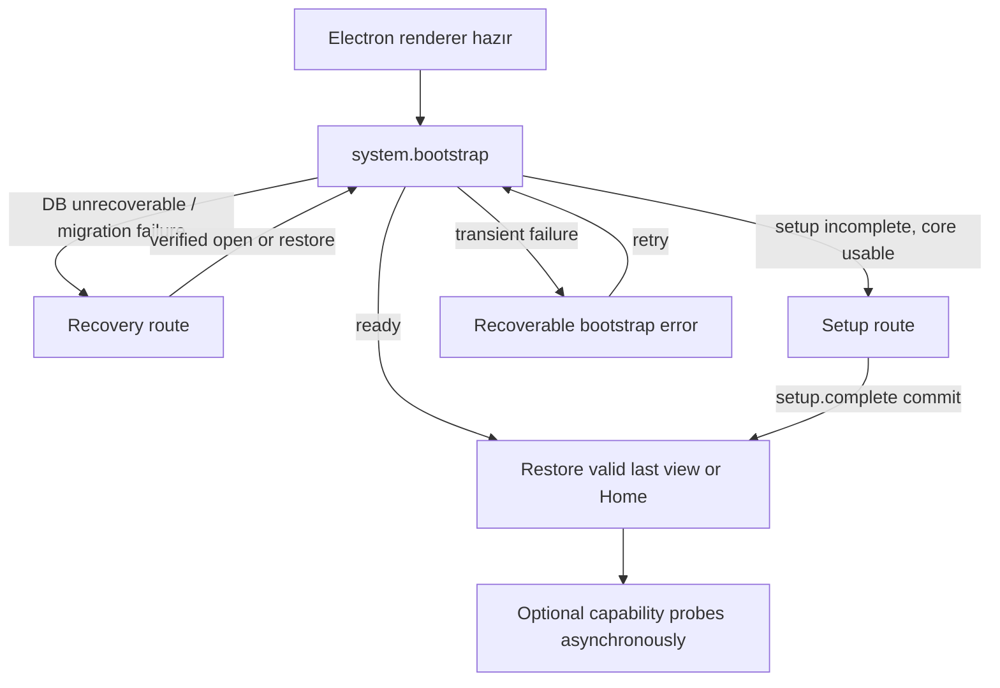

# Iterkeep — Ekranlar, Navigasyon, Layout ve Arayüz Durumları

> **Normatif amaç:** Iterkeep V1'in bütün ana ekranlarını, bilgi mimarisini, yönlendirme modelini, pencere/panel davranışlarını, görünür durumları, klavye navigasyonunu ve kullanıcı akışlarında ekranlar arası bağlam aktarımını kesinleştirmek. Geliştirme ajanı burada tanımlanmamış ayrı sayfalar, başka bir navigasyon kalıcı deposu veya isteğe bağlı AI'ya bağlı ana ekran üretmemelidir.
>
> **Yetki ve bağımlılık:** Ekran kimlikleri ve gezinme/yerleşim **DOC-21**'in yetkisindedir. Renk, CSS token değeri ve tema başlangıcı **DOC-20**; UI bileşeni prop'ları ve mikro etkileşim **DOC-22**; erişilebilirlik ve i18n ayrıntıları **DOC-23**; domain davranışı **DOC-08/13/14**; IPC yöntem/DTO isimleri **DOC-11**; setup ve capability **DOC-18/19**; işleri izleme **DOC-12**; import/export, Git ve backup **DOC-16/17**; hata metni sınıflaması **DOC-32**; gerçek ölçüm hedefleri **DOC-31** ile sabittir. Bu belge DB tablosu veya alan icat etmez. Tekil günlük kaydı navigasyonu için eksik kalan **`activity.get`** okuma metodu, kanonik DOC-11 kataloğuna eşzamanlı olarak eklenmiştir; bunun dışındaki tüm IPC yöntemleri önceden tanımlıdır.
>
> **Kanıt düzeyi:** Bu belge bir uygulama sözleşmesidir; gösterilen React/TypeScript parçaları referans iskelettir. Gerçek Electron, Windows, klavye, screen reader veya performans testleri henüz yapılmamıştır. `status: draft` sürdürülmelidir.

---

## 1. Kullanıcının 10 saniyede cevaplaması gereken sorular

1. Hangi projelerim var ve hangisinde çalışıyordum?
2. Açık veya bugün yapılması gereken işler hangileri?
3. Son kararı neden vermiştim ve ne zaman değişmiş?
4. Aklımdaki işi en az etkileşimle nasıl kaydedebilirim?
5. Aradığım not/görev/karar hangi kaynak kayıtta?
6. Bir işlem gerçekten kaydedildi mi, yoksa yalnızca ekranda mı göründü?
7. Agent hangi aracı çalıştırdı ve sonucu ne oldu?
8. AI/voice devre dışıysa temel uygulamayı engellemeden devam edebilir miyim?

Bu soruların yanıtına ulaşmak için uygulama gereksiz açılır pencere, bekleyen model kontrolü veya gizli menü zorunlu kılmayacaktır.

## 2. Değişmez gezinme ve ekran ilkeleri (`NAV-I-001–044`)

| ID | Kural |
|---|---|
| NAV-I-001 | Tek aktif workspace ve tek ana Electron pencere V1 varsayımıdır. |
| NAV-I-002 | Yerel uygulama, hesap/giriş/internet olmadan dashboard'a ulaşır. |
| NAV-I-003 | Ana gezinme proje, Inbox, global görev, arama ve opsiyonel chat'i içerir. |
| NAV-I-004 | AI yoksa core navigasyonundan hiçbir zorunlu adım eksilmez. |
| NAV-I-005 | Ekranlarda kaynak referansları başlık/slug değil UUID v4 ile taşınır. |
| NAV-I-006 | `last_view` yalnız DOC-09 değerlerini kullanır: dashboard/projects/tasks/search/chat. |
| NAV-I-007 | Settings, Health, Setup ve Recovery `last_view` için yeni DB enum'u değildir. |
| NAV-I-008 | Navigasyon kullanıcı taslağını sessizce silmez; kaydedilmemiş içerik korunur veya açık karar istenir. |
| NAV-I-009 | UI `saved` durumunu ancak doğrulanmış commit/receipt sonrası gösterir. |
| NAV-I-010 | Ekran data loader'ları yalnız `window.iterkeep` adlandırılmış yöntemlerini çağırır. |
| NAV-I-011 | Sidebar kapalı olsa bile tüm core özellikler command palette/menüden erişilebilir. |
| NAV-I-012 | Agent paneli dar pencerede ana içeriğin genişliğini sıfırlayamaz. |
| NAV-I-013 | Modal, popover ve toast farklı layer tokenları kullanır; keyfî z-index yasaktır. |
| NAV-I-014 | UI kodu domain/DB/SQL veya model executable import etmez. |
| NAV-I-015 | Boş, filtre boş, yükleniyor, hata, engellenmiş ve unavailable ayrı durumlardır. |
| NAV-I-016 | Liste ve Kanban aynı kanonik görevleri gösterir; farklı kayıt yaratmaz. |
| NAV-I-017 | Kullanıcı proje değiştirdiğinde devam eden indirme/backup gizlenmez, job panelinden ulaşılır. |
| NAV-I-018 | Görev/karar/not açılırken derin bağlantı ID doğrulamasından geçer. |
| NAV-I-019 | Silinmiş/erişilemeyen kayıtta uygulama çökmez; dönüş adresi gösterir. |
| NAV-I-020 | React route değişimi uygulamayı reload etmez. |
| NAV-I-021 | Window dışı URL ve `file://` navigasyonu renderer'a bırakılmaz; DOC-11/30 policy uygulanır. |
| NAV-I-022 | Setup tamamlanmamışsa ana içerik yerine SetupPage açılır, ama kurtarma daha yüksek önceliklidir. |
| NAV-I-023 | DB erişilemezse sahte boş workspace açılmaz; RecoveryPage gösterilir. |
| NAV-I-024 | İsteğe bağlı özellik kayıp ise bulunduğu yüzeyde inline çözüm sunulur. |
| NAV-I-025 | Proje/Not/Görev/Arama içerikleri sayfalanır; 1000 kaydı tek render etme yoktur. |
| NAV-I-026 | Navigasyonda bellek cache'i kaydedilme kanıtı sayılmaz. |
| NAV-I-027 | Liste→detay→geri dönüşte makul filtre, scroll ve seçim durumları korunur. |
| NAV-I-028 | Güvenlik/onay dialogu klavye odağını içeride tutar ve kapanınca mantıklı yere döndürür. |
| NAV-I-029 | Aktif mikrofon kaydı panel kapanınca gizlice devam etmez; açık bırakılacaksa görünür global durum gerekir. |
| NAV-I-030 | Agent çalışması chat paneli kapatılınca otomatik olarak başarılı/iptal edilmiş sayılmaz. |
| NAV-I-031 | Route geri/ileri history her geçişte veri yeniden yazma işlemi yapmaz. |
| NAV-I-032 | Dar görünümde panel içerikleri yatay viewport taşması üretmez; kendi iç scroll'u vardır. |
| NAV-I-033 | Temalar aynı DOM ve component ağacını kullanır; tema değişimi route reset yapmaz. |
| NAV-I-034 | Üçüncü taraf web içeriği uygulama içi renderer olarak açılmaz. |
| NAV-I-035 | Her ana ekranın focus başlangıcı ve yükleme duyurusu belirlenir. |
| NAV-I-036 | Global hızlı ekleme varsayılan Inbox'a gider, son açık proje olduğu varsayılmaz. |
| NAV-I-037 | İşlem önizlemesi ile gerçekten commit edilen sonuç görsel olarak ayrılır. |
| NAV-I-038 | Sistem Sağlığı, yerel modellerin varlığını aktif olma durumu ile karıştırmaz. |
| NAV-I-039 | Ayarlar ve iş akışı drawer'ları ekran içeriğiyle aynı yürütmeyi tekrar başlatmaz. |
| NAV-I-040 | Geri alınamayan işlem daha önce açıkça onaylanmadan tetiklenmez. |
| NAV-I-041 | Büyük modal'larda başlık, ilerleme ve temel eylemler klavyeyle erişilebilir kalır. |
| NAV-I-042 | Router query parametresi güvenlik, actor veya onay yetkisi vermez. |
| NAV-I-043 | Widget içi scroll ile pencere scroll'u birbiriyle yarışmaz; scroll sahipliği açıktır. |
| NAV-I-044 | Başlatma, kurulum ve toparlanma yolculukları hem tam AI'lı hem AI'sız test edilir. |

## 3. Bilgi mimarisi ve görünür ekran kataloğu

DOC-03'te tanımlanan 14 `SC-*` ekranı korunur. V1 uygulamasında Settings/Health/Transfer/Backup, **alt route ile açılan panel/sayfa** olabilir; bu farklı bir veri katmanı oluşturmaz.

| ID | Yüzey | Kanonik route (önerilen hash adresi) | Sahip sayfa / feature |
|---|---|---|---|
| `SC-SETUP` | İlk kurulum | `#/setup` | `SetupPage` / `setup` |
| `SC-HOME` | Dashboard | `#/home` | `DashboardPage` |
| `SC-PROJECTS` | Projeler | `#/projects` | `ProjectsPage` |
| `SC-PROJECT` | Proje özeti/sekme | `#/projects/:projectId/:tab?` | `ProjectDetailPage` |
| `SC-INBOX` | Inbox | `#/inbox` | `InboxPage` |
| `SC-TASKS` | Global görevler | `#/tasks` | `TasksPage` (feature `tasks`) |
| `SC-DOCUMENT` | Not / karar / log detayı | `#/records/:kind/:id` | `RecordDetailPage` (feature owner'a delegasyon) |
| `SC-SEARCH` | Birleşik arama | `#/search` | `SearchPage` |
| `SC-CHAT` | Agent tam ekran | `#/chat/:conversationId?` | `ChatPage` |
| `SC-TRANSFER` | Markdown/ZIP/Git | `#/workspace/transfer` | `TransferPage` (`import-export`,`backup` ile ortak altyapı) |
| `SC-BACKUP` | Yedek/geri yükle | `#/workspace/backups` | `BackupPage` (feature `backup`) |
| `SC-SETTINGS` | Genel ayarlar | `#/settings/:section?` | `SettingsPage` |
| `SC-HEALTH` | Sistem Sağlığı / modeller | `#/settings/health` | `SettingsPage` içinde `SystemHealthSection` |
| `SC-RECOVERY` | Workspace kurtarma | `#/recovery` | `RecoveryPage` |

**İsim uyarlaması:** DOC-07'de adı henüz sıralanmamış `TasksPage`, `RecordDetailPage`, `TransferPage`, `BackupPage` dosyaları ilgili feature'ların mevcut `apps/desktop/src/renderer/pages/` klasörüne eklenir. Bu bir **yeni paket/iş mantığı katmanı** değil, route-level sunum bileşenidir. DOC-07'nin `features/tasks`, `features/backup`, `features/notes`, `features/decisions`, `features/logs` dizinleri aynen kalır. Repo dosya listesi kapalı liste kabul edilmez; dependency sınırları kapalıdır.

### 3.1 Proje sekmelerinin kesin değerleri

`tab`: `overview | tasks | notes | decisions | timeline | links`. Varsayılan `overview`. `links` yüzeyi ilgili ek dosyaları ve ilişkili kayıtları da barındırır; bağımsız kanonik tablolar yaratılmaz. Geçersiz tab `overview`'a kontrollü yönlendirilir ve bozuk parametre tanılamaya ham içerik olarak yazılmaz.

### 3.2 Kayıt türü route sözleşmesi

`kind`: `task | document | decision | activity`. `project` detayı için `#/projects/:projectId`; attachment için güvenli `attachments.reveal()` seçimi; `agent_run` için `#/chat/:conversationId` + UI'da run seçimi. Link tıklaması `record_registry`/ilgili `get()` üzerinden doğrulanır; `kind` yalnız istemci URL'sinden güvenilir sayılmaz.

### 3.3 URL modeli / güvenlik

- V1 renderer **hash tabanlı SPA route** kullanır. `file://` paketleme koşullarında web sunucusunun history fallback'ine bağımlı değildir.
- Hash route, **sadece renderer içindeki gezinme durumudur**; API çağrısındaki `projectId` ayrıca Zod ile doğrulanır.
- UUID parametreleri açık, küçük harfli canonical UUID v4 biçimindedir. Yanlış, çok uzun veya bilinmeyen ID kullanıcıya “Kayıt bulunamadı” görünümü verir; `fs` yoluna dönüştürülmez.
- `#/search?q=...` query parametresi paylaşılabilir yerel UI bağlamıdır; burada gizli not metninin otomatik URL'ye yazılmasını varsayılan yapma. Serbest metin otomatik history push yapmaz; arama formu state'i ve yalnız kullanıcı onaylı share/copy ayrılmalıdır.
- `state.from` veya query parametresindeki `returnTo` yalnız doğrulanmış dahili route whitelist'i üzerinden kabul edilir; `javascript:` ve dış origin yoktur.
- `#/setup` ve `#/recovery` kendi durum guard'ına tabidir; UI route yazmak güvenli workspace açma yetkisi değildir.

### 3.4 Tekil günlük kaydı IPC uyum düzeltmesi

`SC-DOCUMENT` kapsamındaki `#/records/activity/:id` doğrudan bağlantılar, sayfalı `activity.list` çıktısını sınırsız taramaya zorlamamalıdır. DOC-11 v0.1 taslağına `activity.get({activityId}) → ActivityLogDetail` sorgusu eklenmiştir. Bu yalnız **salt okuma** metodudur; DOC-09'un `activity_logs` mevcut tablosundan ve kayıt registry'sinden veri okur, şemaya ek kolon gerektirmez. DOC-14'te aynı query komutu eşleştirilmiştir. Böylece kaynak arama sonucundan tek loga navigasyon, doğrudan ID ile doğrulanabilir.

## 4. Başlatma ve korumalı navigasyon

Başlatma sırası DOC-06/18'e bağlıdır; `system.bootstrap()` tek üst seviye kararı sağlar. React route'ları provider probe'ları beklemez.



Route guard sonucu `setup` ise model/voice eksikliği recovery olarak gösterilmez. Öte yandan bozuk DB olduğunda sihirbaz otomatik yeni boş DB oluşturamaz. `setup.complete` tamamlanınca var olan DB'nin Inbox, workspace ve preference kontrolleri geçilmelidir.

### 4.1 RouteGuard giriş türleri

```ts
// apps/desktop/src/renderer/app/route-model.ts
// UI-only navigation discriminant; gerçek backend DTO DOC-11'den gelir.
export type CoreBootPhase =
  | { kind: 'booting' }
  | { kind: 'ready'; initialView: 'dashboard' | 'projects' | 'tasks' | 'search' | 'chat' }
  | { kind: 'setup_required' }
  | { kind: 'recovery_required'; reasonCode: string }
  | { kind: 'recoverable_error'; errorCode: string };

export function bootDestination(phase: CoreBootPhase): string | null {
  if (phase.kind === 'setup_required') return '/setup';
  if (phase.kind === 'recovery_required') return '/recovery';
  if (phase.kind !== 'ready') return null;
  return ({dashboard:'/home',projects:'/projects',tasks:'/tasks',search:'/search',chat:'/chat'} as const)[phase.initialView];
}
```

**Not:** Bu saf fonksiyon UI modelidir. `system.bootstrap` DTO alanları DOC-11'e göre adapte edilir; doğrudan backend çıktısıymış gibi cast yapılmaz. Bootstrap `ready` olsa bile geçmiş route yanlış/soft-deleted ise dashboard güvenli fallback'tır.

## 5. Ana uygulama çerçevesi (App Shell)

Varsayılan masaüstü düzeni üç bölgedir: sol sidebar, merkez içerik, **isteğe bağlı** agent paneli. Agent varsayılan olarak zorunlu ve açık değildir; panel tercihi geçici UI state'idir.

```text
┌────────────────────────────────────────────────────────────────────────────────┐
│ Iterkeep  [≡]   Search / Command palette [Ctrl+K]       Jobs  ●   Theme/Menu │
├───────────────────┬────────────────────────────────────┬───────────────────┤
│ Sidebar           │ Main Content                       │ Optional Agent    │
│ Home              │ Breadcrumb · Heading · Toolbar    │ Chat / Tool steps │
│ Inbox             │                                    │                   │
│ Projects          │ Context: Project / List / Editor   │ Optional          │
│ Tasks             │                                    │ independent       │
│ Search            │ Save state / Feedback              │ scroll            │
│ Chat (if enabled) │                                    │                   │
│ Settings          │                                    │                   │
├───────────────────┴────────────────────────────────────┴───────────────────┤
│ Screen-reader announced status / optional transient job notifications      │
└────────────────────────────────────────────────────────────────────────────────┘
```

### 5.1 Düzenin ölçüleri

DOC-20'nin tokenları kullanılacak: sidebar varsayılan `--ik-sidebar-width` = 256px; agent paneli `--ik-agent-panel-width` = 352px; header 52px; standart içerik max 1120px ve uzun yazı max 760px. **Bu dokümanda tanımlanan responsive eşikler CSS px / kullanılabilir renderer viewport genişliği içindir**, fiziksel ekran çözünürlüğü değildir.

| Kullanılabilir genişlik | Sidebar | Agent | Main |
|---|---|---|---|
| ≥1440 CSS px | Docked, 256px, kapatılabilir | Docked yalnız kullanıcı açık tuttuysa 352px | En az 600px, akışkan |
| 1100–1439 | Docked, kapatılabilir | Varsayılan overlay/drawer; açıkça dock edilemez | En az 600px |
| 760–1099 | Collapsed icon rail 56px veya kullanıcı isteğiyle overlay drawer | Overlay/drawer | Kalan alan tek içerik sütunu |
| <760 | Sidebar overlay/drawer | Agent full-height overlay/drawer, aynı anda tek overlay | Tek sütun, yatay viewport scroll yok |

Eşikler tercih değil arayüz geometrisidir: kullanıcı 200% zoom veya pencere küçültme sonucu yeni CSS viewport'a geçince de doğru davranır. Uygulama, panelleri örtüştürerek iki interaktif overlay'i aynı anda açmaz. Modal açıkken drawer odak alamaz. Genişleyen panel CSS `minmax(0, 1fr)` kullanır ve `min-width:0` korunur. Uzun kod bloğu kendi yatay scroll alanına sahiptir.

### 5.2 Shell bölümleri

| Bölüm | İçerik | Veri kaynağı | Durum |
|---|---|---|---|
| Başlık / Title bar | Ürün adı, sidebar toggle, search açma, opsiyonel job indicator | Static + jobs list | F5/full reload görevi değildir |
| Sol navigasyon | Dashboard, Inbox, Projects, Tasks, Search, AI mevcutsa Chat, Settings | Router state + capability preference | Öğeler klavyeyle erişilebilir |
| Son projeler | `projects.list` kısa sayfa | TanStack Query | Skeleton → list/empty/error |
| Main | Route outlet + feature sayfası | İlgili IPC | Hatası diğer panellere yayılmaz |
| Agent | Chat akışı ve görünür tool logları | `conversations.*`, `agent.*`, `events.*` | AI yoksa non-blocking setup CTA |
| Global jobs | Aktif ve geçmiş işlere geçiş | `jobs.list`, `jobs.get`, event | İş bittiğinde badge/duyuru |
| Toast host | Kaydedilmiş sonuç, kısa hata uyarısı | Mutasyon receipt | Etkileşimi engellemez |

### 5.3 Overlay ve klavye sahibi

Öncelik: Recovery/Setup blocking flow > destructive confirmation dialog > normal modal > popover > drawer > base route. Basılı `Esc` yalnız en üst, kapanabilen katmanı kapatır; sessizce bekleyen approval veya değişmiş bir editörün kaydını iptal etmez. `Ctrl/Cmd+K` modal ve recovery içinde etkisizdir; input'a yazma anında kısayol metni üretmez.

### 5.4 Navigasyon durumlarının sahipleri

| Durum | Sahip | Saklama yöntemi |
|---|---|---|
| Route path/UUID/tab | Hash router | URL/history; DB gerçeği değildir |
| `last_view` | `workspace_preferences` | DOC-09 enum + `workspace.updatePreferences` revision |
| Sidebar açık/kapalı, drawer, panel genişliği | Zustand UI state | Oturumluk; V1'de ek DB column yok |
| Tablo filtreleri/sıra/sayfa cursor | Route+feature state / TanStack Query | Geçici; geri dönüş için history state |
| Açık kayıtların gerçek içeriği | TanStack Query + IPC | Kalıcı yetki SQLite |
| Düzenlenmekte olan not taslağı | Editor-local state | Commit edilmemiş; crash-recovery özelliği ayrıca gerektirir |
| Job progress | Jobs service ve event snapshot | Kalıcı `background_jobs`, cache kopya |
| Agent stream tokenları | Agent stream cache | `AgentRun` truth, kalıcı mesaj DB'de |
| Tema tercihi | DB preferences ve DOC-20 erken mirror | UI state kalıcı kaynak değildir |

**`last_view` yazma politikası:** Her tab/scroll/keystroke için DB mutasyonu yapılmaz. Kullanıcının kasıtlı ana bölüm geçişlerinde debounce/son değer yazılır; bekleyen yazı navigasyonu bloklamaz. `last_view` güncellemesi başarısız olsa bile kullanıcı görüntülediği sayfadan atılmaz; yeniden açılış güvenli dashboard fallback'ı kullanır.

## 6. Ortak sayfa durum sözleşmesi

Her sayfa `initial-loading`, `ready`, `empty`, `filtered-empty`, `stale`, `recoverable-error`, `blocking-error` durumlarını gerektiği gibi modeller. Çalışmayan isteğe bağlı özellik için `unavailable`; mutasyonlarda `editing/saving/saved/conflict/unknown-outcome` ayrıca gereklidir.

| Durum | Görünen metin/desen | Eylem | Yapılmayacak şey |
|---|---|---|---|
| `initial-loading` | Hedef içeriğin hafif skeleton'ı | Güvenli geri | Boş tabloya geçiş olarak yorumlamak |
| `ready` | Kaynak veriler | Normal işlemler | Gereksiz polling |
| `empty` | “Henüz kayıt yok” + ilk eylem | Oluştur | Hata mesajı gizlemek |
| `filtered-empty` | “Filtreyle eşleşen kayıt yok” | Filtre temizle | Tüm veri silinmiş mesajı |
| `stale` | Son bilinen veriler + hafif güncelleme göstergesi | Yenileme, güvenli okuma | Stale veriyle yıkıcı commit |
| `recoverable-error` | Net hata, `Tekrar dene` | Retry | Sahte başarılı toast |
| `blocking-error` | Gerekçe ve kurtarma | Backup/Recovery | Yeni boş DB oluşturarak örtmek |
| `unavailable` | Özellik neden kapalı / hazır değil | Ayarlar, kurulum | Ana içeriği bloke etmek |
| `conflict` | Yerel vs. güncel veri diff | Karşılaştır/yeniden uygula | Last-write-wins |
| `unknown-outcome` | “İşlem durumu doğrulanıyor” | Receipt sorgula | Aynı komutu yeni idempotency ile tekrar etmek |

Arayüz bileşenleri (ErrorState, EmptyState, SaveStatus, Skeleton, Toast) DOC-22'ye göre standardize edilir; her feature ayrı bir sahte toast/mutasyon mantığı yazmaz.

## 7. SC-HOME — Dashboard / Resume

**Amaç:** Kullanıcının son çalıştığı projeye güvenle dönmesi. **Yerleşim:** başlık, “Kaldığın yer”, bugün/açık görevler, son aktiviteler, son kararlar, kısa proje listesi. İlk açılışta bu bölümler birbirinden bağımsız skeleton'larla açılır.

**Veri:** `projects.list({limit:...})`, seçili proje için `projects.getResume({projectId})`, `tasks.list` kısa sayfası; gerektiğinde `activity.list` ve `decisions.list`. `projects.getResume` zaten özet sağlıyorsa UI ayrı ayrı fazladan aynı veriyi çekmez. Workspace `Inbox` projesi, kullanıcının gerçek projeleriyle karıştırılmaz. AI analizi burada **zorunlu değildir**.

**Eylemler:** Son proje → `#/projects/:id/overview`; görev → `#/records/task/:id`; hızlı ekleme → Inbox, son proje içeriği açma, birleşik arama. Tek bir “devam et” eylemi görünür olmalıdır.

**Empty:** Henüz gerçek proje yoksa “İlk projenizi oluşturun” + Inbox hızlı yakalama görünür. `Inbox` proje olarak teknik olarak mevcut olduğundan dashboard *yanlışlıkla* “çalışma alanı bozuk” dememelidir. **Stale:** Silinen son proje yerine geçerli projeye yönlendirme öner; UUID uydurma.

## 8. SC-PROJECTS — Projeler listesi

**Yerleşim:** sayfa başlığı, `Yeni proje`, arama/etiket/durum/sıra filtreleri, kompakt satır/kart liste, sayfalama. Tek tık satır seçimi; çift tıklama veya Enter ile açma; tıklanabilir elemanların iç içe klavye tuzakları yasak.

**IPC:** `projects.list`, `projects.create`, `projects.update`, `projects.changeStatus`, `projects.trash`, `projects.restore`. Durum değiştirmede revision kullanılır. Silme onayında etkilenen öğeler belirtilir. Inbox listede özel sistem projesidir; silme/arşivleme görünmez veya disabled ve açıklamalı.

**Uç durumlar:** `filtered-empty` ile `empty` ayrılır. Bir proje dışarıdan/agent ile değişmişse cache güncellenir. Son sayfadaki tek kayıt silindiğinde önceki geçerli sayfaya dönülür.

## 9. SC-PROJECT — Proje detayı ve alt sekmeleri

Header: proje adı (otomatik kırpılabilir), durum, öncelik, proje eylemleri, breadcrumb. Alt sekmeler `overview`, `tasks`, `notes`, `decisions`, `timeline`, `links`. Proje ID her sekmede korunur. Sekme geçişi proje get sorgusunu yeniden başlatmaz; gerekli alt veri lazy yüklenir.

| Sekme | Birincil bileşen | API | Ana davranış |
|---|---|---|---|
| Overview | `ProjectResumeSection` | `projects.getResume` | Nerede kalmıştım? |
| Tasks | TaskList / KanbanToggle | `tasks.list`, `tasks.*` | İş takibi |
| Notes | DocumentList / editor | `documents.list/get/save` | Not oluştur/düzenle |
| Decisions | DecisionList / RevisionHistory | `decisions.list/get/revise/supersede` | Karar ve gerekçe |
| Timeline | ActivityTimeline / QuickLog | `activity.list/append` | Append-only çalışma geçmişi |
| Links | LinkedRecordsPanel / AttachmentList | `records.*`, `attachments.*` | Kaynaklar arası gezinme |

**Hata:** Proje `404/trashed` ise tab bileşenleri paralel veri çekmeye devam etmez; “Bu proje artık erişilebilir değil” + projelere dön açılır. Görevi başka projeye taşımak eski ve yeni proje sayaçlarını event ile günceller.

## 10. SC-INBOX ve SC-TASKS — Hızlı yakalama / görev listesi / Kanban

### 10.1 Inbox

Varsayılan kayıt hedefi Inbox; kısa tek satır alan, ekle butonu, Enter submit, opsiyonel öncelik. Kullanıcı proje seçmek zorunda kalmaz. Kaydedilene kadar lokal taslak korunur. `tasks.create({title})` veya belirli Inbox `projectId` ile aynı use-case çalışır. Çift tıklama/Enter tekrarı yeni UUID ve idempotency anahtarı üretmemelidir. “Kaydedildi” ancak başarılı commit sonrası görünür.

### 10.2 Global görev görünümü

Liste/board toggle, proje filtresi, durum/öncelik/tarih, sıralama ve sayfalama. `blocked`, `cancelled` gibi DOC-08 durumları görünmez olmamalı; board `DOC-13` sütun semantiğini izler. Kullanıcı `done` seçtiğinde zaman ve geçmiş bilgisi sunucudan döner; istemci geçici durum tarihini uydurmaz.

### 10.3 Kanban sıralama

Düşük gecikmeli drag preview tamamen UI içinde; drop sonrasında `tasks.move` / `tasks.reorder` komutu. Reorder sınırı 250 ve filtreli/virtualized tahtada yeniden sıralamanın izin kuralları DOC-13'ten gelir. Eşzamanlı çakışmada kullanıcı son doğru durumu yeniden alır; bir başka kullanıcının güncellemesi varsayılmaz (V1 tek kullanıcı), fakat agent aynı anda görev değiştiriyor olabilir.

### 10.4 Task detail

Tam ekran `#/records/task/:id`, geniş ekranda drawer önizlemesi olabilir. Checkbox/status, açıklama, etiket, tarih, bağlı karar/not, geçmiş. Tekil görevin düzenlemesi `expectedRevision` olmadan commit edilmez. Drawer'da yapılan değişiklik route değiştirildiğinde kaybolmaz; geçiş öncesi form koruma uygulanır.

## 11. SC-DOCUMENT — Not, karar, log ve kayıt detayları

### 11.1 Not editörü

`#/records/document/:id`: Üst araç çubuğu (başlık, kaydetme durumu, önizleme), CodeMirror 6 editor, önizleme ayrı aç/kapa (varsayılan tek sütun). Metin odaklı sayfada 760px okuma sınırı; kod blokları yatay scroll. DOC-14 autosave süresi ve revision CAS politikası burada değiştirilmez.

`Ctrl/Cmd+S` açık notu kaydeder; kapanan panel/değişen route sırasında pending save için kullanıcı onayı veya kaydın tamamlanmasını bekleyen açık UI gerekir. `saved` durumu son sunucu revision ve timestamp ile eşleştirilir. `unknown-outcome` sonrası receipt/re-fetch yapılır; farklı idempotency anahtarıyla otomatik ikinci kayıt yok.

### 11.2 Karar detayı

`#/records/decision/:id`: karar kodu, başlık, status, bağlam, seçim, gerekçe, etkiler, ilişkili görev/not ve revision geçmişi. Önceki kabul edilmiş kararın içeriğini gizleyecek “sadece son sürüm” kurgusu yapılmaz. Supersede akışı yeni kararın kimliğini ve eski kararın durumunu açıkça gösterir. `decisions.supersede` atomik transaction'dır.

### 11.3 Günlük kaydı

`#/records/activity/:id`: zamana göre satır, kaynak proje/ilgili kayıtlar, orijinal metin ve varsa correction zinciri. Aktivite silme/güncelleme genel editör eylemi değildir; düzeltme için `activity.append({correctionOfId,...})`. Günlük tarih filtresi timezone kurallarına göre uygulanır, ham `occurredAt` UI local formatter ile gösterilir.

### 11.4 Güvenli ek gösterimi

Ek satırı `attachments.list`; reveal `attachments.reveal` üzerinden. Kullanıcı içeriğinden gelen Markdown link'leri direkt sistem komutu veya yerel dosya yolu çalıştıramaz; DOC-30 policy izlenir. PDF/görsel önizlemesi güvenli uygulama resource protokolü ile yapılır, genel unrestricted `file://` kullanılmaz.

## 12. SC-SEARCH — Birleşik arama

**Yerleşim:** arama input'u odaklı başlık, tür/proje/tarih filtreleri, kaynak gösteren sonuç listesi, her sonuca kayıt türü ve proje bağlamı. İsteğe bağlı highlight snippet kullanıcı verisini HTML olarak çalıştırmaz; güvenli React text nodes + mark semantiği. Klavyeyle yukarı/aşağı ve Enter açma; Escape seçimi kaldırır.

**Veri:** `search.query({query,types?,projectIds?,cursor?,limit?})`; query parser/ranking/FTS5 ve Türkçe kurallarının tek sahibi `DOC-15`'tir. V1 `search.query` DTO'sunda açık `dateRange` yoktur; DOC-15'teki güvenli kullanıcı sorgu dilinde tarih tokenları desteklenir, UI keyfî yeni API alanı göndermez. Tarih filtresi için ayrı chip varsa token parser'a çevrilir. Gerçek `MATCH` ifadesi kullanıcıdan aynen SQL'e geçirilemez.

**Kullanıcı metni:** “geçen ay karar” gibi aramalar deterministik filtre ve metin eşleşmesiyle değerlendirilir; AI yokken doğal dilin bütünüyle anlamsal olarak anlaşıldığı iddia edilmez. `0 sonuç` ayrı, `arama yürütülemedi` ayrı görünür.

## 13. SC-CHAT — Agent paneli ve tam sohbet ekranı

Chat kapalıyken kullanıcı proje notlarını ve görevlerini kullanmaya devam eder. AI etkin ama Ollama yoksa panelde “Yerel model hazır değil” ve Model Manager'a yönlendirme görünür; backend işlem başlamış gibi gösterilmez.

**Yerleşim:** mesaj listesi (uzun konuşmalarda virtualized), composer, aktif run göstergesi, açılabilir **araç adımı** listesi, approval kartları, kaynak bağlantıları, güvenli çıktı özetleri. Tam ekran `#/chat/:conversationId?`; dar ekranda drawer görünümü aynı veri kaynağını kullanır.

**Veri:** `conversations.list/get/create`, `agent.startRun/getRun/getToolCalls/getApprovals/decideApproval/cancelRun`, `events.*`. Streaming event kaybolunca yeniden bağlanma ve `agent.getRun` ile doğrulama yapılır. Gizli chain-of-thought veya internal prompt izleri görünür kılınmaz; gerçek araç adı, durum, süre ve güvenli sonuç gösterilir.

**Approval:** Riskli eylemde hedef + etki + neden + reddet/onayla. Onay butonu `agent.decideApproval` ile zorunlu server-side doğrulamadan geçer. Modal kapatmak onay değildir. Kullanıcı onaylamadıysa agent sonucu “tamamlandı” denemez. İşlem başarısı ilgili mutasyon receipt'ine dayanır.

**Çoklu run:** Aynı konuşmada yürüyen/sonlandırılmış run'lar ayrıştırılır; seçili `runId` kaybolmaz. Panel kapansa bile job/agent yürütmesi DOC-12 yaşam döngüsüne göre devam veya açıkça iptal edilir; UI kapatma “iptal” komutu değildir.

## 14. SC-SETUP — İlk kurulum

Altı adımın semantiği DOC-18'de. Bu doküman yalnız **yerleşim/navigasyon** sağlar: ortalanmış, tek odaklı kurulum yüzeyi, adım ilerleme göstergesi, geri/devam/atla, bağımsız model indirme ilerlemesi ve kurulumu sonradan yeniden açma. Provider kurulumu başarısız diye Next kapatılmaz, AI atlanabilir. Core workspace yaratılmamışsa `Continue` uygulama ana ekranına atlayamaz.

**Yarım kalma:** sayfayı yeniden açma veya uygulama kapanması `setup.get` üzerinden son kalıcı adımı bulur; React local step index'e güvenilmez. Model indirme için `jobs.get/list` kullanılır. `setup.complete` başarılı commit'inden önce homepage'e yönlendirilmez.

## 15. SC-SETTINGS ve SC-HEALTH — Ayarlar / Model Manager

**Navigasyon:** `#/settings/general|workspace|ai|voice|git|backup|health|about`; `SC-HEALTH` = `#/settings/health`. Bu sayfa responsive ayar navigasyonuna sahiptir; geniş pencerede solda bölümler, dar pencerede açılır bölüm menüsü. DOC-19'daki ayar kategorileri normatiftir.

`capabilities.get({refresh:false})` ve `workspace.getPreferences()` aynı anda istenir; `refresh=true` ancak kullanıcı yeniden taramayı seçince veya DOC-19 TTL/backoff gerektirince. Kullanıcı `ai` tercihini kapatırsa aktif modelin silindiği anlamına gelmez. `models.listInstalled`, `models.listRecommended`, `models.startDownload` ve `jobs.*` aynı model yöneticisi kartlarına bağlanır.

**Health kartı durumları:** checking, available, missing, disabled, degraded, failed veya DOC-19'un türetilmiş kullanıcı dostu etiketleri; anlık resource yoksa `disabled` gibi yalan durum kullanılmaz. DB sağlığı kritikse Recovery CTA; Ollama/Whisper/TTS sorunu varsa non-blocking düzeltme.

**Ayar kaydı:** Anlık UI seçimi başarı sanılmaz; workspace tercihi revision uyumu, feature tercihi `capabilities.setPreference` sonucuyla doğrulanır. Tema değişimi DOM'da CSS tokenları değiştirir, CodeMirror veya konuşma paneli yeniden mount olmaz.

## 16. SC-TRANSFER ve SC-BACKUP — Yüksek etkili iş akışları

### 16.1 Aktarım

`#/workspace/transfer` üç görünüm barındırır: `Export`, `Import`, `Git` (UI segment state). Import: seçim → async preview → riskler/çakışmalar → kullanıcı seçimleri → `transfer.commitImport` job → sonuç/receipt. Export: hedef seçim → seçenekler → job ilerlemesi → tamamlandığında manifest/hash/sayılar. Git: export profile, status, commit, push; push için açık onay. Git yoksa normal export kullanılabilir.

`transfer.getImportPreview` sayfalıdır; render 1000 kaydı açmaz. `SelectionHandle` geçici bir yetki referansıdır, path'i kontrolsüz React input'una dönüştürülmez. ZIP/PDF/Markdown içindeki link ve kod asla otomatik çalıştırılmaz.

### 16.2 Yedekleme

`#/workspace/backups`: var olan yedek listesi, yeni yedek oluşturma, restore preview, restore etki/onay ve sonuç. `backups.previewRestore` başarı öncesi etkin DB değiştirmez. `backups.commitRestore` tam onaylı; başladıktan sonra ekran iş bilgisi kaybolmadan ilerler. Kurtarma gerekiyorsa recovery flow primary olur. Bir indirme işinin progress'i ile veritabanı restore progress'i aynı badge içinde gizlenmez.

## 17. SC-RECOVERY — Güvenli kurtarma ekranı

**Tetik:** Workspace DB bulunmuyor, açılamıyor, migration veya checksum uyumsuzluğu, ya da storage güvenli devam edemiyor. **Hedef:** kullanıcıya kanıtlanabilir kurtarma yolu sunmak, yanlışlıkla boş veritabanı yaratmamak. Core DB kullanılamadığında RecoveryPage çok sınırlı host API üzerinden açılmalıdır; UI yalnız var olan `system.bootstrap/health/diagnostics`, `workspace.chooseFolder/open/listRecent`, `backups.*` sözleşmelerini ve DOC-17 recovery koordinatörünü kullanır. Bu yöntemlerden biri devre dışı ise UI hata ve güvenli manuel yönerge gösterir; hayalî `recovery.forceFix()` eklemez.

Düzen: tek ana uyarı, hata kodu, “Başka çalışma alanı aç”, “Doğrulanmış yedek seç”, “Tanılama oluştur”, “Yeniden dene” eylemleri. Her zaman geri dönüş/kapatma mümkündür. Yedek restore öncesi mevcut veri korunur, kullanıcıya onay ekranı gösterilir. `system.getDiagnostics` kullanıcı notlarını veya secret'ları dökmez.

## 18. Global Command Palette / Quick Capture / Jobs yüzeyleri

Bunlar bağımsız 15. ekran değildir; herhangi bir route üzerinde açılabilen UI yüzeyleridir.

| Yüzey | Varsayılan tetik | İşlem | Kısıt |
|---|---|---|---|
| Command Palette | `Ctrl/Cmd+K` | Dahili sayfa veya kayıt aç, filtreli arama | Dinamik shell komutu yürütmez |
| Quick Task Capture | `Ctrl/Cmd+Shift+N` | Yeni Inbox görevi | Tekil idempotent submit, focus return |
| Quick Log | Proje içi `+ Log` | Append-only log | Proje ID açıkça görünür |
| Job Drawer | Header job indicator | Job listesi, detay, izinliyse iptal | UI kapanması job'u iptal etmez |
| Global Toasts | Commit/event | Durum bildirimi | Tek doğruluk kaynağı değil |
| Unsaved Changes Guard | Editörden uzaklaş | Kaydet, düzenlemeye dön, güvenli vazgeç | Sessiz taslak kaybı yok |
| Approval Dialog | Agent/restore/push | Tam etkiyle onay/reddet | Kapatma ≠ onay |

Windows/Linux `Ctrl`, macOS `Cmd` kullanır. `Ctrl/Cmd+S` yalnız ilgili not/uyumlu editöre yöneliktir; genel uygulamada yanlışlıkla tarayıcı sayfası kaydetme penceresi açılmaz. Kısayollar IME composing sırasında tetiklenmez. Tuş kombinasyonu başka uygulama/OS kısayolunu ezmemelidir; global OS-level shortcut kayıt edilmez.

## 19. Uygulanabilir React router / route resolver referansı

V1 router paketi DOC-05'e göre seçilir; burada `react-router-dom` bağımlılığı **zorunlu ilan edilmez**. Hash route eşlemesi kütüphaneden bağımsız tipli bir konfigürasyondur; kendi router'ını yazmak yerine stabil kütüphane kullanmak uygundur.

```ts
// apps/desktop/src/renderer/app/navigation/route-types.ts
export const projectTabs = [
  'overview', 'tasks', 'notes', 'decisions', 'timeline', 'links',
] as const;
export type ProjectTab = (typeof projectTabs)[number];

export const recordKinds = ['task', 'document', 'decision', 'activity'] as const;
export type RecordKind = (typeof recordKinds)[number];

export type InternalLocation =
  | { name: 'home' }
  | { name: 'inbox' }
  | { name: 'projects' }
  | { name: 'tasks' }
  | { name: 'project'; projectId: string; tab: ProjectTab }
  | { name: 'record'; kind: RecordKind; recordId: string }
  | { name: 'search' }
  | { name: 'chat'; conversationId?: string }
  | { name: 'transfer' }
  | { name: 'backups' }
  | { name: 'settings'; section?: string }
  | { name: 'setup' }
  | { name: 'recovery' };

export function serializeInternalLocation(loc: InternalLocation): string {
  switch (loc.name) {
    case 'home': return '/home';
    case 'inbox': return '/inbox';
    case 'projects': return '/projects';
    case 'tasks': return '/tasks';
    case 'project': return `/projects/${encodeURIComponent(loc.projectId)}/${loc.tab}`;
    case 'record': return `/records/${loc.kind}/${encodeURIComponent(loc.recordId)}`;
    case 'search': return '/search';
    case 'chat': return loc.conversationId ? `/chat/${encodeURIComponent(loc.conversationId)}` : '/chat';
    case 'transfer': return '/workspace/transfer';
    case 'backups': return '/workspace/backups';
    case 'settings': return `/settings/${loc.section ?? 'general'}`;
    case 'setup': return '/setup';
    case 'recovery': return '/recovery';
  }
}
```

**Güvenlik:** Yukarıdaki fonksiyon yalnız serialize yapar; **parse** aşaması tüm segmentleri `@iterkeep/contracts` UUID, `kind`, `tab`, whitelist section şemalarıyla doğrulayacak, geçersiz input için `NotFoundRoute` üretecek. `decodeURIComponent` hatası uygulamayı crash ettiremez. Route parametreleri dosya adı veya URL kaynağı olarak doğrudan kullanılmaz.

### 19.1 React sayfa yükleme / lazy boundaries

```tsx
// apps/desktop/src/renderer/app/route-pages.tsx (referans)
import { lazy } from 'react';

export const pageComponents = {
  home: lazy(() => import('../pages/DashboardPage')),
  projects: lazy(() => import('../pages/ProjectsPage')),
  project: lazy(() => import('../pages/ProjectDetailPage')),
  inbox: lazy(() => import('../pages/InboxPage')),
  chat: lazy(() => import('../pages/ChatPage')),
  search: lazy(() => import('../pages/SearchPage')),
  setup: lazy(() => import('../pages/SetupPage')),
  settings: lazy(() => import('../pages/SettingsPage')),
  recovery: lazy(() => import('../pages/RecoveryPage')),
  // Diğer küçük route sayfaları ihtiyaç olduğunda bölünür.
} as const;
```

`Suspense` fallback tüm ekranı beyazlatmak yerine route alanında skeleton gösterir; shell sabittir. Chat ve voice bileşenleri ilk başlangıç bundle'ına zorunlu girmemelidir. Model import'unun olması model subprocess'ini çalıştırma yetkisi vermez.

## 20. Komponent yaşam döngüsü ve cache bütünlüğü

- **TanStack Query:** DB'den okunmuş data snapshot ve cursor'lu sayfaların cache'i. Query key'e workspace identity, entity ID, filtre, cursor girer. Workspace değişince eski workspace data cache'i kesin temizlenir.
- **Zustand:** Panel, drawer, seçili local tab ve geçici UI tercihleri. Kanonik görev/not listesi olarak kullanılmaz.
- **Editor-local state:** Kirli taslak, seçim, undo geçmişi. Görev/karar/snippet context sağlayan component yeniden mount olursa yanlış kayıt gösterilmemeli; key `recordId` gibi kararlı identity kullanır.
- **Events:** `events.subscribe` yalnız gerekli konu/ID filtreleriyle kurulur; cleanup `events.unsubscribe`. Arka plan/foreground değişimlerinde güvenilir `events.getSince` veya snapshot refetch. Olay sırasından emin olunmadığında cache invalidate edilir.
- **Out-of-order fetch:** Eski proje için başlayan istek, daha yeni seçilen projenin ekranını overwrite edemez. Query key ve generation counter/abort uygulanır.
- **Mutasyonlar:** Önce local pending, commit ACK sonra saved. Conflict kodu ise diff/yenileme; unknown outcome ise receipt check. Optimistic update varsa geri alma ve cache uzlaştırması kanıtlanır.
- **Keep mounted:** Çok büyük tüm route bileşenlerini sonsuza kadar mount etme yok. Taslak korunması ihtiyacı kontrollü editor state veya taslak guard ile çözülür; yanlışlıkla gizlenmiş mikrofon/agent çalışması yaratılmaz.

## 21. Responsive, zoom, scrollbar ve overlay sınır durumları

1. 640×480 fiziksel pencere ve 200% OS/Chromium zoom birleşimi test edilir; CSS px azaldığında tek sütuna düşer, scroll erişilebilirliği korunur.
2. Sidebar ve Chat drawer aynı anda açılamaz; ikinci açılınca önceki kapanır, taslak chat composer korunur.
3. Modal arka plan scroll'u kilitler; drawer kendi scroll konteynerine sahiptir.
4. Tooltip/Popover modalın dışına yanlış layer ile çıkmaz; DOC-20 z-index sözleşmesi.
5. Kullanıcı panele klavyeyle erişebilir: açma, ilk odak, Tab sırası, Escape, geri dönüş.
6. Uzun proje adlarında breadcrumb `min-width:0`, ellipsis ve erişilebilir tam ad kullanır.
7. Türkçe daha uzun UI metni ve 200% metin büyütme tüm primary CTA'ları erişilebilir tutar.
8. Kontrast ve reduced-motion DOC-20/23'ün sorumluluğundadır; route davranışları bu ayarlarda değişmez.
9. Yatay scroll yalnız uzun kod/pre görünümü gibi kontrollü içerik alanında olabilir, tüm window kökünde yasaktır.
10. Electron pencere sınırları OS güvenli minimum ile uyumlu belirlenir; metin zoom'unda içerik kesildiği için minimum boyut artırma yerine responsive reflow uygulanır.

## 22. Odak, erişilebilirlik ve çeviri navigasyonu

| Olay | Odak / duyuru kuralı |
|---|---|
| Route değişti | Main heading `tabIndex=-1` ile programatik focus; screen reader duyurusu |
| Drawer açıldı | Drawer başlığı/ilk etkileşime focus; kapatılınca çağıran kontrole dönüş |
| Ayarlar bölümü değişti | Bölüm başlığı focus; form taslakları gereksiz sıfırlanmaz |
| Komut paleti | Arama input focus; sonuçlar `aria-activedescendant` veya semantik listbox pattern |
| Filtre boş sonuç | Sonuç sayısı/empty state duyurulur; arama alanı atılmaz |
| Agent onay | Dialog focus trap, hedef/etki okunabilir, varsayılan tehlikeli “Onayla” focus olmaz |
| Save success | Kısa polite status; yalnız toast rengiyle bildirme yok |
| Save failure | Alan yakınında alert + hatalı kontrol odaklanabilir |
| Model indirme | Her token/yüzde için live announce yok; aşamalı, throttle edilmiş durum |
| Ses kaydı | Aktif kayıt metni ve durdurma butonu her zaman erişilebilir |

Metinler `tr-TR.json` / `en-US.json` anahtarlarıyla tanımlanır; doğrudan UI sabit string tekrarı yasaktır. Kullanıcıya gösterilen tarih/zaman IANA zone ve locale üzerinden formatlanır; SQLite UTC veri değişmez.

## 23. Kullanıcı akışlarının ekranlara izlenebilirlik matrisi

| JRN / AC | Giriş → hedef | Kritik kontrol |
|---|---|---|
| JRN-001 / AC-001 | `setup → home` | AI olmadan başlangıç |
| JRN-002 / AC-002 | `home/inbox → inbox task` | Varsayılan Inbox, commit |
| JRN-003 / AC-003 | `home → project/overview` | Resume kartı |
| JRN-004 / AC-004 | `project/decisions → record/decision` | Karar history |
| JRN-005 / AC-005 | `project/tasks ↔ tasks Kanban` | Tek Task veri gerçeği |
| JRN-006 / AC-006 | `search → record` | FTS kaynak referansı |
| JRN-007 / AC-007 | `workspace/transfer` | Export/import manifest |
| JRN-008 / AC-008 | `workspace/transfer` | Güvensiz import reddi |
| JRN-009 / AC-009 | `workspace/backups → recovery` | Restore preview/onay |
| JRN-010 / AC-010 | `settings/ai → chat` | AI sonradan açma |
| JRN-011 / AC-011 | `settings/ai → jobs` | İndirme yarıda kalma |
| JRN-012 / AC-012 | `chat → approval/tool` | İzlenebilirlik ve ret |
| JRN-013 / AC-013 | `record/task → voice transcript` | Transkript edit/onay |
| JRN-014 / AC-014 | `chat → settings/voice` | TTS olmadan metin yanıtı |
| JRN-015 / AC-015 | `home/projects/search` | Offline temel işlevler |
| JRN-016 / AC-016 | `record/document → error` | Taslak korunur |
| JRN-017 / AC-017 | `bootstrap → recovery` | Migration başarısızlığı |
| JRN-018 / AC-018 | `settings/general → same route` | Tema/dil değişimi |

## 24. Ekran uygulama dosyaları ve sınırlar

```text
apps/desktop/src/renderer/
├── app/
│   ├── Router.tsx                    # URL eşleştirme, route guard
│   ├── App.tsx                       # Shell + routing outlet
│   ├── bootstrap-query.ts            # system.bootstrap snapshot
│   └── navigation/                   # DOC-21 uzantısı
│       ├── route-types.ts
│       ├── route-parser.ts
│       ├── route-pages.tsx
│       ├── navigation-guards.ts
│       └── use-navigation-memory.ts
├── pages/
│   ├── DashboardPage.tsx
│   ├── ProjectsPage.tsx
│   ├── ProjectDetailPage.tsx
│   ├── TasksPage.tsx                  # DOC-21 route facade
│   ├── InboxPage.tsx
│   ├── RecordDetailPage.tsx           # DOC-21 route facade
│   ├── SearchPage.tsx
│   ├── ChatPage.tsx
│   ├── TransferPage.tsx               # DOC-21 route facade
│   ├── BackupPage.tsx                 # DOC-21 route facade
│   ├── SetupPage.tsx
│   ├── SettingsPage.tsx
│   └── RecoveryPage.tsx
├── features/                           # DOC-07 sınırı sabit
│   ├── projects/
│   ├── tasks/
│   ├── notes/
│   ├── decisions/
│   ├── logs/
│   ├── search/
│   ├── setup/
│   ├── ai-chat/
│   ├── voice/
│   ├── backup/
│   └── settings/
└── shared/
    ├── components/
    │   ├── AppShell.tsx
    │   ├── Sidebar.tsx
    │   ├── AgentDrawer.tsx
    │   ├── GlobalJobDrawer.tsx
    │   ├── CommandPalette.tsx
    │   ├── RouteLoadingState.tsx
    │   └── SafeNavigationDialog.tsx
    └── hooks/
        ├── useRouteFocus.ts
        └── useUnsavedChangesGuard.ts
```

`shared/components` DOC-07'deki `shared/` dizininin altıdır; yeniden adlandırma veya katman ayrılığı gerekmez. `packages/ui` **saf** genel UI primitive'lerini barındırır: AppShell benzeri feature-aware komponentler `renderer/shared` altında kalabilir. Ayrı Redux store, route altına SQLite, genel SQL IPC API eklenmez.

## 25. Reference: route state ve bağımlılıkları ayrıştıran selector

```ts
// Şematik örnek. React veya frameworke bağlanmayan saf karar fonksiyonu.
type CapabilityPreference = 'enabled' | 'disabled';
type SidebarAction =
  | { key: 'home'; labelKey: 'nav.home'; href: '/home' }
  | { key: 'inbox'; labelKey: 'nav.inbox'; href: '/inbox' }
  | { key: 'projects'; labelKey: 'nav.projects'; href: '/projects' }
  | { key: 'tasks'; labelKey: 'nav.tasks'; href: '/tasks' }
  | { key: 'search'; labelKey: 'nav.search'; href: '/search' }
  | { key: 'chat'; labelKey: 'nav.chat'; href: '/chat' }
  | { key: 'settings'; labelKey: 'nav.settings'; href: '/settings/general' };

export function sidebarActions(aiPref: CapabilityPreference): SidebarAction[] {
  const core: SidebarAction[] = [
    {key:'home',labelKey:'nav.home',href:'/home'},
    {key:'inbox',labelKey:'nav.inbox',href:'/inbox'},
    {key:'projects',labelKey:'nav.projects',href:'/projects'},
    {key:'tasks',labelKey:'nav.tasks',href:'/tasks'},
    {key:'search',labelKey:'nav.search',href:'/search'},
  ];
  // Görünürlük tercihi değildir: kullanıcı Chat'i kendisi açarsa unavailable
  // metni yerinde gösterilir. Bu liste UX keşfedilebilirliği için kullanılır.
  if (aiPref === 'enabled') core.push({key:'chat',labelKey:'nav.chat',href:'/chat'});
  core.push({key:'settings',labelKey:'nav.settings',href:'/settings/general'});
  return core;
}
```

**Örnek kodların normatif sınırı:** DTO/feature preference backend'den şema doğrulanmış olarak gelir; TypeScript örnekleri tüm uygulamayı çalıştıran kod olarak değil, doğrudan aktarılabilir contract taslağı olarak değerlendirilir. DOC-22 component prop API kesinleşince UI primitive isimleri oradan alınır.

## 26. Navigasyon / UI test kataloğu (`NAV-T-001–NAV-T-064`)

| ID | Başlangıç ve işlem | Beklenen sonuç / kanıt |
|---|---|---|
| NAV-T-001 | İlk kurulum, AI atlandı | Setup→Dashboard; temel navigasyon eksiksiz |
| NAV-T-002 | DB yok/bozuk, boot | Recovery; yeni DB sessiz yaratılmaz |
| NAV-T-003 | Migration hata verdi | Setup yerine Recovery |
| NAV-T-004 | Workspace seçimi bitmedi | Setup dışı route guard engeller |
| NAV-T-005 | Geçersiz UUID hash route | Kontrollü Not Found; crash yok |
| NAV-T-006 | Geçersiz tab/route segmenti | Güvenli fallback ve kullanıcı bilgisi |
| NAV-T-007 | Silinmiş proje deep link | Silinmiş/bulunamadı durumundan geri dönüş |
| NAV-T-008 | Proje listesi boş | Empty + oluştur |
| NAV-T-009 | Filtre sonucu boş | Filtered empty + filtre temizle |
| NAV-T-010 | Proje listesi istek hatası | Error + retry, yanlış empty yok |
| NAV-T-011 | Dashboard son proje aç | Project overview doğru ID |
| NAV-T-012 | Inbox hızlı görev Enter | Tek commit ve Inbox bağlamı |
| NAV-T-013 | Hızlı görev çift Enter | Idempotency ile tek kayıt |
| NAV-T-014 | Task liste→detay→geri | Filtre ve scroll geri yüklenir |
| NAV-T-015 | Task list/board toggle | Aynı kaydı gösterir |
| NAV-T-016 | Kanban 251 ID reorder | UI güvenli reddetme veya kapsamlı alt işlem |
| NAV-T-017 | Kanban revizyon çatışması | Diff/refetch, yanlış tamamlandı yok |
| NAV-T-018 | Projeler arası görev taşıma | Her iki görünüm doğru yenilenir |
| NAV-T-019 | Task detail yanlış ID | 404, diğer sayfalar çalışır |
| NAV-T-020 | Not editöründe Ctrl+S | Commit doğrulandıktan sonra saved |
| NAV-T-021 | Not kaydetme timeout | Receipt doğrulaması; sahte saved yok |
| NAV-T-022 | Not eşzamanlı revizyon | Yerel taslak diff ile korunur |
| NAV-T-023 | Not draft varken navigasyon | Kaydet/geri/vazgeç seçimi |
| NAV-T-024 | Not preview zararlı HTML | Script çalışmaz, güvenli render |
| NAV-T-025 | Karar geçmişi aç | Eski revizyon görülebilir |
| NAV-T-026 | Kabul edilmiş kararı supersede | Eski gerekçe korunur |
| NAV-T-027 | Günlük düzeltme kaydı | Eski içerik değişmez, düzeltme bağlı |
| NAV-T-028 | Tek günlük kaydına link | activity.get ile ID doğrulanır |
| NAV-T-029 | Ek dosya reveal | attachments.reveal policy uygulanır |
| NAV-T-030 | Arama 0 sonuç | Filtered-empty, hata gösterilmez |
| NAV-T-031 | Arama FTS hatası | Error, indeks onarım yönü |
| NAV-T-032 | Arama sonuç kaydına git | Doğru kind/id route |
| NAV-T-033 | Arama çok uzun snippet | Kontrollü kırpma ve güvenli render |
| NAV-T-034 | Arama route sorgu parametresi | SQL/shell/path enjeksiyonu yok |
| NAV-T-035 | Ayarlar tema değiştirme | Editor mount/route korunur |
| NAV-T-036 | Sistem tema geçişi | DOM tema güncellenir, içerik aynı |
| NAV-T-037 | Ayar preference CAS çatışması | Önceki kalıcı tercih korunur |
| NAV-T-038 | AI kapalı, chat menü | Core tam çalışır, chat isteğe bağlı |
| NAV-T-039 | AI açık ama Ollama yok | Unavailable + setup CTA, false loading yok |
| NAV-T-040 | AI run streaming sırasında panel kapa | Run terminal durumu değişmez |
| NAV-T-041 | AI tool approval reddet | Mutasyon çalıştırılmaz |
| NAV-T-042 | AI tool event kaçırma | getRun/reconcile ile doğru sonuç |
| NAV-T-043 | Agent tool failure | Hata adımı, sahte başarı yok |
| NAV-T-044 | Setup indirme yarıda kapat | Resume UI gerçeği job snapshot ile eşleşir |
| NAV-T-045 | Setup skip ses | Not/task core çalışır |
| NAV-T-046 | Ses kaydı sırasında chat route | Kayıt göstergesi/güvenli stop |
| NAV-T-047 | Mikrofon reddedildi | Metin edit ve chat kullanılabilir |
| NAV-T-048 | TTS servis çöktü | Metin yanıtı sürer |
| NAV-T-049 | Import preview başarısız | DB değişmez; hata ve retry |
| NAV-T-050 | Git yok | Markdown export çalışır |
| NAV-T-051 | Git push onayı kapatıldı | Push tetiklenmez |
| NAV-T-052 | Backup restore preview | Mevcut DB değişmez |
| NAV-T-053 | Restore onay iptali | Mevcut DB korunur |
| NAV-T-054 | Jobs drawer kapat | İş kendiliğinden iptal olmaz |
| NAV-T-055 | Event subscription unmount | unsubscribe çalışır; leak yok |
| NAV-T-056 | 1000 proje listesi | Pagination/virtual list, UI donmaz |
| NAV-T-057 | Büyük chat geçmişi | Virtualization ve stable scroll |
| NAV-T-058 | 200% zoom 640x480 | Erişilebilir CTA; window horizontal scroll yok |
| NAV-T-059 | 720px viewport | İki panel aynı anda açık olmaz |
| NAV-T-060 | 1600px viewport | Sidebar + isteğe bağlı dock agent |
| NAV-T-061 | Klavye: Ctrl/Cmd+K | Command palette açılır; escape kapatır |
| NAV-T-062 | Klavye: nested modal | Odak trap/return çalışır |
| NAV-T-063 | TR/EN uzun metin | Başlık/menü/CTA kesilmez |
| NAV-T-064 | Reduced motion modu | Anlam kaybı olmadan geçişler kısılır |


### 26.1 Otomasyon düzeyi ve kanıt

| Test sınıfı | Öncelik | Kanıt | Repo konumu |
|---|---|---|---|
| Saf route parser / guard | P0 | Vitest table-driven, fuzz invalid input | `tests/integration/navigation/` |
| UI state, modal, keyboard | P0 | React Testing Library + axe | `apps/desktop/src/renderer/**/__tests__/` |
| E2E navigasyon, reboot, installer | P0 | Packaged Electron Playwright/screenshots | `tests/e2e/` |
| Electron CSP/navigation | P0 | Security boundary test | `tests/security/` |
| Zoom/tema/locale viewport | P0 | Screenshot/DOM/accessibility assertions | `tests/e2e/` |
| Long list/chat/route transitions | P1 | Profiler, memory, p95 interaction | `tests/performance/` |

Test fixture'larında ağ, Ollama ve mikrofon **mock** edilerek route işlevleri deterministik test edilir; gerçek model/gerçek ses/Windows installer entegrasyonu daha sonraki kalite kapılarında ayrı doğrulanır. Screenshot yenileme tek başına test başarısı sayılmaz. Her akış `DOC-03` JRN ve `DOC-04` kalite kapısı kimliğiyle izlenebilir olmalıdır.

## 27. Uygulama sırası ve geliştiriciye kesin görevler

1. `route-types.ts`, `route-parser.ts`, `navigation-guards.ts` ve geçersiz girdiler için saf Vitest testlerini oluştur.
2. Bootstrap koşullarını `system.bootstrap` ile bağla; recovery/setup önceliğini kanıtla.
3. `AppShell`, `Sidebar`, header, main route outlet, global jobs ve toast host temelini uygula.
4. Sidebar/agent responsive collapse ve modal layering testlerini yaz.
5. Dashboard, Projects, Inbox, Tasks ve ProjectDetail core sayfalarını (AI'sız) bağla.
6. Document, Decision, Activity ve Search kayıt navigasyonunu/404 durumunu bağla.
7. Ayarlar, Health, Transfer, Backup ve Recovery yüzeylerini bağla; mevcut IPC dışına çıkma.
8. Chat/Agent ve Voice modüllerini lazy yükle; unavailable durumlarını doğrula.
9. Unsaved guard, focus restore, last_view ve event revalidation kurallarını tamamla.
10. 64 NAV-T senaryosunun kanıtını `tests/` altında topla; DOC-04 gate eşlemesini yap.

### 27.1 Yapılmayacak kestirme çözümler

- Tüm ekranları tek `App.tsx` içerisine yüzlerce koşulla gömmek.
- Her route için ayrı SQLite bağlantısı açmak.
- Liste üzerinden görevi silip sonucu yalnız UI state'inde güncellemek.
- Agent'ın veya model indirme sayfasının bütün application render'ını bloke etmesi.
- Route `:id` değerini doğrudan dosya yolu veya SQL string'i olarak kullanmak.
- Hata ekranında otomatik boş workspace oluşturmak.
- Taslak kaybı önlemek için bütün editörleri süresiz gizli mount tutmak.
- Tema ve feature ayrımlarına göre kopya UI ağaçları yaratmak.
- Yalnız screenshot testi geçince erişilebilirlik ve performansın doğrulandığını söylemek.

## 28. Açık noktalar, gelecekteki belgeler ve kabul koşulu

| Konu | Sahip belge | Bu dokümanın kararı |
|---|---|---|
| Kesin bileşen props API | DOC-22 | Tüm yerleşimler aynı UI kit'i kullanır |
| i18n, WCAG tam eşleme | DOC-23 | Her route/surface klavye ve ekran okuyucu erişimini korur |
| Agent tool render/güvenlik | DOC-26/27 | Gerçek iz, onay ve safe output; gizli reasoning gösterilmez |
| Voice capture/transcript | DOC-28/29 | Push-to-record, durum görünürlüğü, opsiyonel TTS |
| Performans eşikleri / cihazlar | DOC-31 | UX aşırı render/ana thread bloklama yaratmaz |
| Errors/recovery metinleri | DOC-32 | Error/empty/unavailable açıkça ayrılır |
| Test ve CI ekran kapsamı | DOC-33/34 | Matrix gate'leri geçmedikçe release-ready değil |

**Definition of Done (belge seviyesi):** 14 ekran ID'si DOC-03 ile eşleşir, route parser `kind` ve UUID'leri doğrular, `last_view` DOC-09 ile uyumludur, tüm kullanılan IPC yöntemleri DOC-11'de vardır, 64 NAV-T id'si benzersizdir, DOC-20 ölçülerine aykırı ikinci token sistemi yoktur. **Definition of Done (kod seviyesi):** İlgili component/route testleri, packaged Windows smoke, erişilebilirlik testleri, ölçülmüş etkileşim/gezinme performansı ve kullanıcı senaryoları başarıyla tamamlanmadan `implemented` veya `verified` statüsü kullanılmaz.

---

**Sonraki belge:** [`22-COMPONENTS-INTERACTIONS.md`](./22-COMPONENTS-INTERACTIONS.md) — UI primitive'leri, prop/event sözleşmeleri, menü/form/modal davranışları ve her bileşenin durum matrisi.
