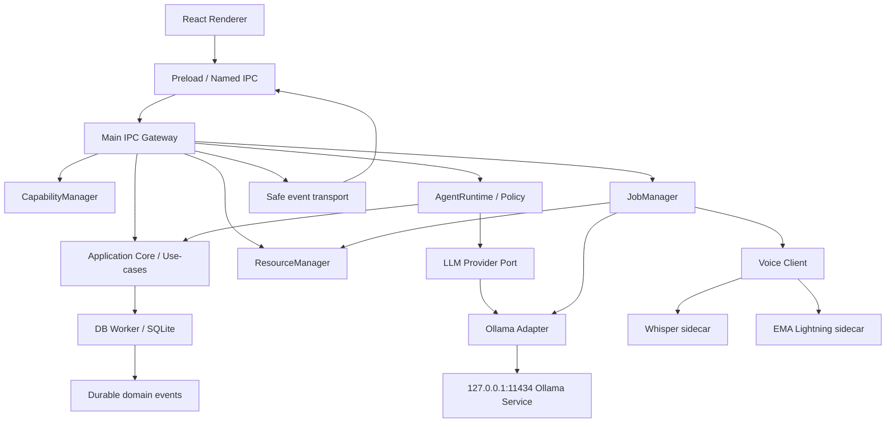
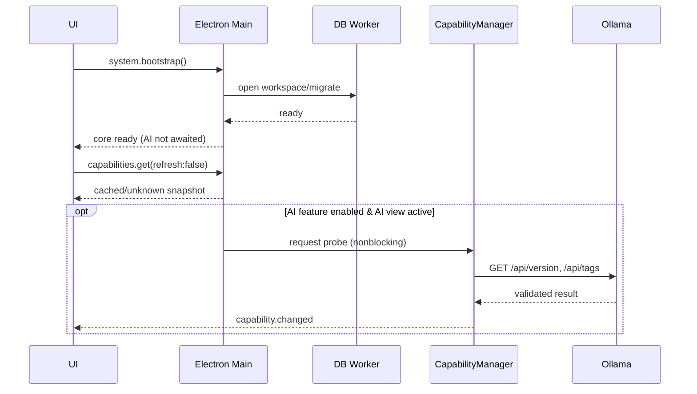

# Iterkeep — Yerel AI Mimarisi, Kaynak Yönetimi ve Yaşam Döngüsü

> **Normatif amaç:** Iterkeep'in SQLite temelli ürün çekirdeğine dokunmadan isteğe bağlı Ollama tabanlı yerel LLM servisinin nasıl bağlanacağını, özellik sağlığının nasıl belirleneceğini, modelin yaşam döngüsünü, yoğun CPU/GPU kullanımı sırasında kaynak hakemliğini, akış/iptal/hata izolasyonunu, gözlemlenebilirliği ve doğrulanabilir kabul koşullarını tanımlamak.
>
> **Durum ve kanıt:** Tasarım dokümanıdır; Electron/Windows/RTX 4050 üzerinde çalıştırılmış üretim implementasyonu veya garanti edilmiş gecikme ölçümü değildir. `status: draft` kalır. Ollama API ayrıntıları 2026-10-10 tarihinde resmi dokümanlarla karşılaştırılmıştır. Model kataloğu, tam endpoint JSON şeması, benchmark ve indirme adımları **DOC-25**, agent döngüsü **DOC-26**, izinler **DOC-27**, STT/TTS uygulaması **DOC-28/29** yetkisindedir.

## 0. Okuma talimatı ve normatif yetki

- **DOC-06** süreç sınırları ve başlatma/kapatma politikası; **DOC-07** paket adları, klasör yolları ve import yönü; **DOC-08** domain, kimlik ve statüler; **DOC-09** DDL; **DOC-10** transaction/receipt; **DOC-11** kesin IPC kanalları ve DTO envelope'ları; **DOC-12** job/event state machine; **DOC-18** setup ekranları; **DOC-19** capability TTL/probe ve tercihler açısından üst sözleşmedir.
- **Bu doküman**, AI provider soyutlaması, runtime kompozisyonu, provider streaming, AI admission ve kaynak lease stratejisi, AI degrade/recovery ve GPU/CPU paylaşımı için kanonik kaynaktır.
- **DOC-25**, Ollama API uyumluluk matrisi, gerçek model listesi ve seçme algoritmasını somutlaştırır; **DOC-26/27** modeli kullanma ve tool onayının tek yetkili belgeleridir.
- Çakışma halinde eski bir modeli sessizce değiştirme: çelişen kararın `DOC-ID`, satır/başlık, gerekçe ve önerilen ADR'sini raporla. Önceki docs güncellenmeden repo kodu çelişkili yönde ilerleyemez.
- Buradaki `.ts` kodları reference/pseudocode sayılır; import/sürüm/binary/endpoint kontratları gerçek derleme ve provider fixture testleriyle kesinleşir. Codegen bu belgedeki interface'leri yeni bir paralel public API olarak kopyalamamalıdır.

## 1. Ürün hedefi ve kapsam çizgisi

Iterkeep proje, görev, not, karar, günlük, arama, export ve backup'u **AI kurulu olmadan** eksiksiz yürütür. AI yalnız kullanıcının özellikle etkinleştirdiği **yardımcı yetenektir**. İlk açılış, proje değiştirme, CRUD veya arama kesinlikle Ollama'nın cevap vermesini beklemez. Projelerin verisi yalnız SQLite'ta kanoniktir; prompt ve assistant/tool işlemleri tasarlanmış use-case/port sınırlarından geçer.

### 1.1 V1 dahil

| Yetkinlik | V1 kuralı | Sahip belge |
|---|---|---|
| Ollama yerel probe ve health | Etkin veya görünür ilgili feature için asenkron, zaman sınırlı | DOC-19/25 |
| Model keşfi, seçim, benchmark, pull | Onaylı katalog, iş kuyruğu, sağlayıcıdan doğrulanan model | DOC-25 |
| Yerel sohbet ve cevap streaming | Koşullu erişim, güvenli token/event akışı, vazgeçme | DOC-24/26 |
| Proje bağlamı getirme | Kullanıcı kapsamı + sınırlı kaynaklar, FTS/DB aynı portlar | DOC-15/26 |
| Modelin uygulama araçları teklif etmesi | Allowlist + Zod + policy + gerekirse onay | DOC-26/27 |
| CPU/GPU kaynak arabuluculuğu | UI ve DB önceliği, ölçüme dayalı admission, geri çekilme | DOC-12/19/24 |
| Ses bağlantısı | STT/TTS birbirinden ve AI'dan bağımsız, lazy sidecar | DOC-28/29 |
| İzlenebilirlik | run/job/step kimlikleri, güvenli hata ve kaynak ölçümleri | DOC-12/26/27 |

### 1.2 V1 dahil değil

- Üçüncü taraf cloud LLM'ye otomatik geçiş; hesaba giriş / ücretli API anahtarı zorunluluğu; local endpoint dışında keyfî provider URL editörü.
- İstenmeyen arka plan autonomous agent wake-up, uygulama dışı sistem komutu/shell ve sınırsız dosya araması.
- Aynı anda birden çok LLM sohbeti için GPU concurrency garantisi; cihazın başka uygulamalarının VRAM kullanımını denetleme.
- Modeli otomatik olarak indirip kurma, Ollama servisini gizlice yeniden yapılandırma veya dış model silme.
- Ham chain-of-thought, gizli prompt, kullanıcı notu veya API içeriğinin tanılama loglarına otomatik dökülmesi.
- Kullanıcıdan izin almadan herhangi bir şekilde çevrimiçi model servisine içerik gönderme.

## 2. Değişmez mimari kurallar (`LAI-I-001–044`)

| LAI-I-001 | Core bootstrap ve ilk kullanılabilir UI, Ollama bağlantısını **await** etmez. |
| LAI-I-002 | AI `disabled` olsa da tüm temel domain use-case'leri çalışır; bunun otomatik testi zorunludur. |
| LAI-I-003 | `feature_preferences.ai` kalıcı tercihtir; `CapabilitySnapshot.health` anlık gözlemdir, aynı veri değildir. |
| LAI-I-004 | AI model seçimi `model_profiles` içindedir; profil bir modelin hâlen diskte olduğunu kanıtlamaz. |
| LAI-I-005 | Tek kanonik veritabanı `workspace.db`; chat/agent yazımları da DB worker portundan geçer. |
| LAI-I-006 | Renderer genel HTTP veya SQL istemcisi olamaz; yalnız `window.iterkeep` named IPC API kullanır. |
| LAI-I-007 | Ollama HTTP adapter'ı Main tarafındadır; model ağırlığı React bundle'ında tutulmaz. |
| LAI-I-008 | `@iterkeep/application` Ollama paketini doğrudan import etmez; yalnız port üzerinden kullanır. |
| LAI-I-009 | `@iterkeep/domain` AI SDK, Node, HTTP veya Electron import etmez. |
| LAI-I-010 | Tek `@iterkeep/provider-ollama` implementasyonu olur; çakışan ikinci provider client yazılmaz. |
| LAI-I-011 | Agent, UI ve import aynı uygulama komutlarını kullanır; model SQL veya raw filesystem erişemez. |
| LAI-I-012 | Her run `runId`, her tool `toolCallId` ve her iş `jobId` ile izlenir; idempotency silinmez. |
| LAI-I-013 | Modelden dönen `tool_calls` komut değil öneridir; allowlist, Zod, policy ve onaydan geçer. |
| LAI-I-014 | Model metni, proje notları ve import içerikleri güvenilmeyen veri olarak ele alınır. |
| LAI-I-015 | Sadece doğrulanmış loopback endpoint'e izin verilir; renderer keyfî host veremez. |
| LAI-I-016 | Redirect'ler otomatik izlenmez; dış host'a DNS/redirect üzerinden sıçrama reddedilir. |
| LAI-I-017 | `/api/tags` yanıtı `MODEL_INSTALLED` göstergesi olabilir, tek başına `MODEL_READY` değildir. |
| LAI-I-018 | Yüksek etkili dış servislere veya modellere otomatik fallback yapılmaz. |
| LAI-I-019 | Model katalog kartı VRAM garantisi vermez; belleğe yüklenme ve context maliyeti ayrıca ölçülür. |
| LAI-I-020 | ResourceManager sadece Iterkeep'e ait istekleri ve lease'leri yönetir. |
| LAI-I-021 | Ollama bir başka uygulamanın kullandığı dış servis olabilir; körlemesine process kill yasaktır. |
| LAI-I-022 | `keep_alive:0` tüm modelleri veya üçüncü taraf yüklerini boşaltma garantisi olarak sunulmaz. |
| LAI-I-023 | V1'de cihaz başına varsayılan en fazla bir Iterkeep LLM generation işi aktiftir. |
| LAI-I-024 | DB CRUD, UI ve mikrofon capture LLM sırasını bekleyemez. |
| LAI-I-025 | Ağır benchmark etkileşimli AI/STT aktifken başlatılmaz veya güvenle kuyruklanır. |
| LAI-I-026 | Kullanıcı AI'yı kapatırsa yeni run admission kapanır; çalışan run best-effort iptal edilir. |
| LAI-I-027 | Abort isteği işlem sonu değildir; terminal sonuç provider/runner doğrulamasından gelir. |
| LAI-I-028 | Abort/timeout durumunda başarı veya 'not eklendi' türü sahte receipt gösterilemez. |
| LAI-I-029 | Provider streaming'teki bozuk NDJSON tek event'e gizli şekilde bağlanmaz; tipli hata üretilir. |
| LAI-I-030 | Event kaybı veya backpressure UI'yı bloklamaz; kalıcı snapshot ile uzlaştırılır. |
| LAI-I-031 | Run tamamlandıktan sonra final mesajlar transaction ile kalıcılaştırılır; geçici partial saklama politikası açık olur. |
| LAI-I-032 | Kullanıcı metni model bağlamına gitmeden önce kapsam ve boyut sınırından geçer. |
| LAI-I-033 | Bağlam için sınırlandırılmış kaynak/delil kimlikleri tutulur; sınırsız bütün workspace taraması yapılmaz. |
| LAI-I-034 | Provider hata kodu kullanıcıya güvenli metinle çıkar; raw OS path ve içerik loglanmaz. |
| LAI-I-035 | Servis hazır değilse agent kapatılabilir; çekirdek CRUD ve arama aynen çalışır. |
| LAI-I-036 | Model indirme yalnız açık `consent:true` ve `model_download` job ile yapılır. |
| LAI-I-037 | Benchmark sonucu gerçek donanım/digest + benchmark version ile eşleştirilir. |
| LAI-I-038 | AI GPU erişimi için bellek tahmini tek başına değil, mevcut durum ve runtime gözlemi de değerlendirilir. |
| LAI-I-039 | İlk kullanımda paralel LLM+GPU STT+GPU TTS zorunlu başlatılmaz. |
| LAI-I-040 | Stale veya eksik telemetry başarı/boş GPU olarak varsayılmaz; korumacı degrade uygulanır. |
| LAI-I-041 | Ayarda AI'nın açık oluşu TTS veya STT ayarını zorunlu açmaz. |
| LAI-I-042 | Tekrar başlatılan uygulama yarım agent/tool etkilerini sessizce ikinci kez işletmez. |
| LAI-I-043 | Public IPC kanalları yalnız DOC-11 kataloğundan; DOC-24 yeni public kanal icat etmez. |
| LAI-I-044 | İlk sürüm cloud/on-demand Ollama modellerini çevrimdışı yerel model diye yanlış etiketlemez. |
## 3. Süreç mimarisi, sahiplik ve bağlantılar



### 3.1 Bileşen sahiplik matrisi

| Bileşen | Yaşam döngüsü sahibi | Görevi | Yasak |
|---|---|---|---|
| `apps/desktop/src/main` | Electron Main | Composition root, güvenli yönlendirme, OS izinleri | UI'dan raw SQL çalıştırma |
| `@iterkeep/application` | Main tarafından compose edilir | Use-case / prompt context için sınırlı query portu | Sağlayıcı adı, HTTP ve Electron dependency |
| `@iterkeep/agent-runtime` | Main AgentRunManager | Tur planlama, tool teklifi, sonuç uzlaştırma | Yetkisiz shell, direkt DB |
| `@iterkeep/provider-ollama` | Main provider adapter | HTTP probe, chat stream ve payload decode | User data persistence, tool execution |
| `CapabilityManager` | Main | Sağlık snapshot'ı ve tek-flight probe | İlk ekranı bloklama |
| `ResourceManager` | Main | App-owned lease ve admission | Dış GPU belleğinin sahipliğini iddia etme |
| `JobManager` | Main | Kalıcı job state, scheduler, retry/cancel | SQLite'a doğrudan bağlanma |
| `@iterkeep/voice-client` | Main | Voice sidecar ile görüşme | STT/TTS'yi AI hazır olmasına bağlama |
| DB Worker | Kendi worker'ın içinde | Tek connection, source-of-truth | Model çağrısı, GPU işi |
| React Query | Renderer | Snapshot/cache gösterimi | Yetki ve kanonik state |

### 3.2 Bağımlılık/bağlama sırası

1. Core bootstrap: SQLite migration + workspace + Query adapter oluştur; UI'ya `ready` bildir.
2. İsteğe bağlı manager'ları `lazy provider factory` ve `ResourceManager` ile yapılandır; Ollama HTTP isteği **zorunlu değil**.
3. UI `capabilities.get({refresh:false})` ile son anlık health snapshot'ını alır; `unknown` olağan başlangıçtır.
4. AI ekranı açılması veya kullanıcı `agent.startRun` talebi üzerine kısa probe ve model preflight planlanır.
5. `feature_preferences.ai=disabled` ise Ollama client hiç HTTP yapmadan tipli `CAPABILITY_DISABLED` sonucu üretilir.
6. Uygulama kapanırken yeni run admission'ı durdur, kendi AbortController'larını iptal et, event aboneliklerini kapat, DB receipt'leri tamamla. Harici Ollama'yı otomatik kapatma.

### 3.3 Repo yolları — mevcut repo sözleşmesini bozmadan

```text
packages/provider-ollama/src/
  index.ts               # Public adapter export
  ollama-client.ts       # createChat, request policy, AbortSignal
  health.ts              # Probe + checked local endpoint
  models.ts              # /api/tags, /api/show, /api/ps parse
  pull.ts                # Explicit consent job /api/pull
  stream.ts              # NDJSON parser + limits
  tool-adapter.ts        # Provider representation → safe tool proposal
packages/agent-runtime/src/
  index.ts
  run-manager.ts         # User run lifecycle, safe assistant state
  context-builder.ts     # Bounded context ports, citations
  tool-registry.ts       # DOC-26 allowlist
  policy.ts              # DOC-27 policy adapter
  approval.ts            # DOC-27 persisted challenge
  audit.ts               # Redacted trace writer
apps/desktop/src/main/
  services/resource-manager.ts    # Global app-owned resource leases
```

Yeni dosya eklenecekse yalnız ilgili pakette yapılır. `DOC-07`'deki dizin yapısını yeni üst düzey `ai-core`, `ollama-service` vb. paralel paketlerle değiştirmek **yasaktır**. Ortak interface/type erişimi `@iterkeep/application` portları veya `@iterkeep/contracts` üzerinden sağlanır.

## 4. Public sınır / dahili sözleşme ayrımı

### 4.1 Var olan IPC kanalları (değiştirme)

| Etkileşim | DOC-11 named API | Not |
|---|---|---|
| Özellik durumunu gör | `capabilities.get({refresh?})` | `CapabilityOverview`, senkron uzun probe yok |
| AI tercihini değiştir | `capabilities.setPreference({capability:'ai', enabled})` | DB transaction/commit |
| Ollama'yı açıkça kontrol et | `models.detectOllama({explicit:true})` | Güvenli Main probe |
| Yüklü modelleri listele | `models.listInstalled()` | Kaynak: gerçek provider |
| Öneri listele | `models.listRecommended()` | Main hardware snapshot + DOC-25 |
| Aktif modeli ayarla | `models.setActive({modelId})` | Profil/digest ve uygunluk kontrolü |
| İndir | `models.startDownload({modelId, consent:true})` | `model_download` background job |
| Benchmark | `models.runBenchmark({modelId})` | `model_benchmark` job |
| Sohbet başlat | `agent.startRun({conversationId,message,projectId?})` | Hızlı `{runId}` kabul cevabı |
| Run durumunu izle | `agent.getRun({runId})`, `agent.getToolCalls({runId})` | Durable safe snapshot |
| Run iptali | `agent.cancelRun({runId})` | Accepted ≠ cancelled |
| İşleri izle | `jobs.get({jobId})`, `jobs.cancel({jobId})` | DOC-12 |
| Akış bildirimi | `events.subscribe(...)` + Main → Preload event | Backpressure, cursor ve resync |

**Kural:** `provider.*`, `ollama.chat`, `gpu.unload` gibi **yeni public IPC** üretme. Bu belgeye ait provider interfaces yalnız Main/agent/runtime iç protokolleridir.

### 4.2 LLM provider portu — framework bağımsız, application tarafı

```ts
// Referans kod; DOC-26 agent runtime ve DOC-25 tam Ollama payload'u ile tamamlanır.
export type LlmRole = 'system' | 'user' | 'assistant' | 'tool';
export interface LlmMessage {
  role: LlmRole;
  content: string;
  toolName?: string;                 // only role=tool
  providerToolCalls?: ReadonlyArray<unknown>; // validated by DOC-26
}
export interface LlmToolDefinition {
  name: string;
  description: string;
  inputSchema: Readonly<Record<string, unknown>>;
}
export interface GenerateRequest {
  readonly runId: string;
  readonly providerModelName: string;
  readonly messages: readonly LlmMessage[];
  readonly tools: readonly LlmToolDefinition[];
  readonly contextWindow: number;
  readonly maxOutputTokens: number;
  readonly keepAlive: '0' | '1m' | '3m' | '5m';
  readonly signal: AbortSignal;
}
export type LlmEvent =
  | { type: 'text_delta'; text: string; sequence: number }
  | { type: 'tool_proposal'; payload: unknown; sequence: number }
  | { type: 'usage'; evalCount?: number; evalDurationNs?: number;
      promptEvalCount?: number; loadDurationNs?: number }
  | { type: 'finished'; reason: 'stop' | 'length' | 'tool_calls' | 'other' };
export interface LlmProviderPort {
  probe(signal: AbortSignal): Promise<'available'|'unavailable'|'incompatible'>;
  streamChat(request: GenerateRequest): AsyncIterable<LlmEvent>;
}
```

Örnek `LlmEvent` **public IPC event değildir**. Main bunu DOC-11 `agent.chunk/agent.step` ve DOC-26 policy state'ine dönüştürür. Provider'ın `done_reason` veya `think` çıktısını frontend'e ham transport etme. `providerToolCalls` yalnız geçerli provider message continuation işlemleri için güvenli, sınırlandırılmış ara nesnedir; tool yürütme izni değildir. `maxOutputTokens` için Ollama seçenek adının/tam uyumluluğunun somut seçimi DOC-25'in sürüm adapter'ına bırakılır.

### 4.3 Port kompozisyon kuralları

- `AgentRuntime` yalnız `LlmProviderPort`, `ContextQueryPort`, `ToolExecutionPort`, `RunStorePort`, `ResourceLeasePort`, `EventPort` gibi **arayüzler** bilir.
- `OllamaProvider` model yanıtını ve araç önerisini `unknown` kabul edip Zod/DOC-26 şemasına verir; asla `await repository.update(...)` çağırmaz.
- Application Core görevin/projenin bağlamını `getProject`, `search`, `getDecision` gibi mevcut portlardan toplar; provider adapter SQL tablosu bilmez.
- Model chat turunun tamamlanması `agent_runs` durumundan ayrı provider stream tamamlanmasıdır. Bir tool eylemi henüz transaction commit edilmediyse kullanıcıya `completed` gösterilmez.

## 5. Capability + model readiness — kesin koşullar

### 5.1 Eşit olmayan kavramlar

| Boyut | Kalıcı mı? | Kaynak | Örnek |
|---|---|---|---|
| Kullanıcının AI tercihi | Evet | `feature_preferences` | enabled/disabled |
| Ollama sağlayıcı konfigürasyonu | Evet | `provider_configs` | provider=ollama, base_url |
| Proje/sohbet tercihleri | Evet | `conversations`, `model_profiles` | selected model ID |
| Sağlayıcı canlılığı | Hayır | `CapabilityManager` | checking/available |
| Seçili model gerçekten yüklü mü? | Hayır | `/api/tags` + `/api/show` | digest, capabilities |
| Model bellekte mi? | Hayır | `/api/ps` | size_vram, expires_at |
| Bu cihazda iyi çalışıyor mu? | Ölçüm kaydı evet | `model_benchmark_receipts` | digest+device fingerprint |
| Inference şu anda rezerve mi? | Hayır | ResourceManager lease | app-owned active chat |

**AI hazır (agent başlatılabilir) iff** kullanıcı AI'yı etkinleştirmiştir **ve** endpoint güvenli/ulaşılabilirdir **ve** seçili model gerçekten mevcuttur **ve** gerekli chat/tool capability doğrulanmıştır **ve** bütçe/admission bu isteği kabul etmiştir. RAM/VRAM sıkışık ise son koşul `queued` veya tipli `resource_busy` dönebilir. `available` yalnız Ollama health demektir; agent readiness ile aynı anlamda gösterilmez.

### 5.2 Sağlık kontrolü

`DOC-19` tek-flight `provider + probeKind + normalizedConfigVersion` politikasına uyulmalı. V1 varsayılan Ollama probe başarı TTL 30 sn; başarısızlık TTL 10 sn; servis kontrol timeout 1,5 sn; kurulu model listesi timeout 2,5 sn. `refresh:true` bekletmeden probe başlatır ve `capability.changed` üzerinden güncellemeyi bildirir. Kullanıcının explicit yenilemesi local rate limit uygulanarak çalışır.

Kapanan provider, `available` olarak sonsuza kadar gösterilemez. Son cached sonuç süre aşınca `stale:true` ve güvenli mesajla gösterilir. Yeni mutasyon öncesi gerçek readiness kontrol edilir. Ekrana geldiğinde gösterilmeyen veya kapalı özelliği agresif şekilde polling ile uyandırma.

### 5.3 Güvenli endpoint

Varsayılan `http://127.0.0.1:11434`. Yalnız doğrulanmış loopback IP/host allowlist; kullanıcıdan gelen URL, query param, redirect veya text içinde IP parse edip “fetch” etme. `fetch(..., { redirect: 'error', signal })`; DNS yeniden bağlama/IPv6/localhost çözümü ve proxy environment etkileri DOC-30'da test edilir. Header'larda authorization veya günlüklerde private path yoktur. Ollama cloud destekleyebilir; V1 yalnız doğrulanmış lokal model kullanır. V1 uzak endpoint UI'sı yoktur.

## 6. Ollama runtime ve HTTP streaming

### 6.1 Resmi endpoint haritası

| Endpoint | Kullanım | Runtime notu |
|---|---|---|
| `GET /api/version` | Sağlayıcı sürüm kontrolü | Timeout'lu, sadece probe |
| `GET /api/tags` | Yüklü modeller | Name, digest, size, details validate |
| `POST /api/show` | Model metadata/capabilities | Tools ve düşünme modunu uyumlulukla seç |
| `GET /api/ps` | Çalışan modeller | Ollama'nın gördüğü bellek durumudur; tüm sistem GPU gerçeği değil |
| `POST /api/chat` | Stream/agent replies | `tools`, `stream`, `keep_alive`, `options.num_ctx` |
| `POST /api/pull` | Model indir | Açık kullanıcı onayı + DOC-25 job |

Kaynaklar: https://docs.ollama.com/api/chat , https://docs.ollama.com/api/tags , https://docs.ollama.com/api/ps , https://docs.ollama.com/faq , https://docs.ollama.com/capabilities/tool-calling . Ollama sürümleriyle response alanları değişebilir; doğrudan `as any` ile bypass yerine adapter contract tests uygulanır. Yanıtların bir kısmı `stream:true` ile NDJSON gelir; `stream:false` tek JSON dönebilir.

### 6.2 Request politikası

- `stream:true` UI konuşmasında kullanılır, benchmark için iki mod da doğrulanabilir.
- `options.num_ctx`, `model_profiles.context_window` ve gerçek belleğe göre sınırlandırılır. Daha büyük context = artan KV cache; context'e tüm workspace içeriği doldurulmaz.
- `keep_alive` varsayılan `1m` (öneri); kullanıcı anlık sohbet peş peşe yapıyorsa `3m–5m` seçilebilir; düşük bellek/görev çatışmasında yalnız kullanıcıya açık bilgi ve paylaşılan sunucu etkisi dikkate alınarak `0`. Model başka uygulamalarla ortak kullanılıyorsa `0` otomatik seçilmez. Kaynak politikası ölçümle ayarlanır.
- `temperature`, `seed`, `max output` gibi opsiyonlar provider/model uyumluluk testleriyle sabitlenir; **modelin parametrelerini değiştirmek tool izinlerini genişletmez**.
- İstek ve tamamlanma süreleri ayrı ölçülür: connection deadline, first-token deadline, turn deadline, idle timeout; tek `fetch` timeout'u tüm çıkarım için yeterli değildir.
- Hata durumunda tool teklifleri çalıştırılmaz; eksik akış “başarılı” sayılmaz.
- Aynı modele farklı agent run'ları için V1 GPU concurrency varsayılan 1; birden fazla bağımsız request ancak benchmark ile ayrı ADR sonrası.

### 6.3 Sağlam stream parser — örnek TypeScript

```ts
// packages/provider-ollama/src/stream.ts (reference code)
export async function* parseNdjson(
  reader: ReadableStreamDefaultReader<Uint8Array>,
  signal: AbortSignal,
  maxFrameBytes = 1_048_576,
): AsyncGenerator<unknown> {
  const decoder = new TextDecoder('utf-8', { fatal: true });
  let pending = '';
  try {
    while (true) {
      if (signal.aborted) throw new DOMException('Cancelled', 'AbortError');
      const { value, done } = await reader.read();
      if (done) break;
      pending += decoder.decode(value, { stream: true });
      if (new TextEncoder().encode(pending).byteLength > maxFrameBytes &&
          !pending.includes('\n')) throw new Error('OLLAMA_FRAME_TOO_LARGE');
      let newline: number;
      while ((newline = pending.indexOf('\n')) !== -1) {
        const frame = pending.slice(0, newline).trim();
        pending = pending.slice(newline + 1);
        if (!frame) continue;
        if (new TextEncoder().encode(frame).byteLength > maxFrameBytes) {
          throw new Error('OLLAMA_FRAME_TOO_LARGE');
        }
        yield JSON.parse(frame) as unknown; // next: runtime Zod parse
      }
    }
    pending += decoder.decode();
    if (pending.trim()) {
      if (new TextEncoder().encode(pending).byteLength > maxFrameBytes)
        throw new Error('OLLAMA_FRAME_TOO_LARGE');
      yield JSON.parse(pending) as unknown;
    }
  } finally {
    reader.releaseLock();
  }
}
```

**Production koşulları:** Yukarıdaki algoritma çerçeve içi boyut sınırını korur ancak `pending` içinde çok sayıda kısa satır olması halinde `pending` birikimi ve CPU yükü ayrıca toplam-batch limitiyle kontrol edilmelidir. Üretim kodunda **toplam stream bytes**, byte-by-byte decode hata yönetimi, max frame, max accumulated message, idle timeout, JSON schema ve abort sonrası `reader.cancel()`/response cleanup uygulanmalıdır. `DOMException` kullanımının Node/Electron target uyumluluğu derlenerek doğrulanır. Bu örnek güvenli parse iskeletidir; tek başına tamamlanmış parser değildir.

### 6.4 Tool çağrısı — yürütme sınırı

`message.tool_calls[*]` geldiğinde provider mesajı önce canonical tool proposal'a dönüştürülür. `role=tool` yanıtı ancak registry'de bulunan, yetkili ve başarı/ret sonuçları belli olan eylem için üretilir. Çoklu araç teklifi paralel kullanılacaksa DOC-26 bağımlılık ve tutarlılık kuralı geçerlidir. `message.thinking` gizli muhakeme olabilir ve raw biçimde kullanıcıya veya loga taşınmaz; yalnız güvenli gerçek tool state ve çıktı özeti yayınlanır. Agent loop'u `maxTurns` ve `maxToolCalls` gibi sınırlar ile durdurulur. Modelin hiç tool teklifi üretmemesi kullanıcıya basit sohbet cevabı verir; gereksiz tekrar olmaz.

### 6.5 Provider response → kullanıcıya gösterilen event

| Provider anı | App-internal state | UI gözlemi |
|---|---|---|
| Token geldi | `text_delta` | Sınırlı birleşmiş `agent.chunk` |
| Tool önerildi | `tool_proposal` | `agent.step` / proposed veya awaiting_approval |
| Tool izinli çalışıyor | `ToolExecutionPort` | Running tool card |
| Onay gerekiyor | persisted approval | Approval dialog, sadece Main doğrular |
| Turn başarıyla bitti | `finished` + DB persistence | Agent snapshot completed / final content |
| Provider bağlantısı koptu | typed fail | Kalıcı run failed, varsa partial metin etiketi |
| İptal edildi | abort + runner confirmed | cancelled, yapılmış commit'ler saklanır |

Event teslimi veritabanı transaction sonucu değildir. Sağlamlaştırma `agent.getRun`, `agent.getToolCalls`, `events.getSince` veya `jobs.get` ile yapılır.

## 7. Kaynak yönetimi: `ResourceManager` tasarımı

### 7.1 Temel gerçekler

ResourceManager sistemin GPU sürücüsü değildir: belleği **rezerve ettiği iddiası** yerine Iterkeep'in kendi işlerinin çakışmasını yönetir. Başka uygulama Ollama'yı kullandığında bu kullanım bizim lease tablosuna görünmeyebilir. GPU VRAM ölçümü bazı platformlarda başarısız olabilir. Gözlem `unknown` ise sistem küçük model/CPU fallback'ı için kullanıcıya seçenek sunar, sessizce yüksek kaynak tüketen denemeyi zorlamaz.

Ollama concurrency ve `num_ctx` birlikte bellek ihtiyacını artırabilir. Resmi FAQ, bir modelin eşzamanlı isteklerinin context maliyetini yükselttiğini ve `OLLAMA_NUM_PARALLEL`, `OLLAMA_MAX_LOADED_MODELS` gibi server-level ayarların bulunduğunu belirtir; Iterkeep kullanıcıya ait server ayarlarını kontrolsüz değiştirmez. https://docs.ollama.com/faq

### 7.2 Kaynak sınıfları ve öncelikler

| Lane | Kayıt türü | Öncelik | Varsayılan V1 concurrency |
|---|---|---:|---:|
| CORE | UI/CRUD/DB | En yüksek, AI'dan bağımsız | DOC-10 kendi worker'ı |
| AUDIO_CAPTURE | Mikrofon chunk | Çok yüksek latency duyarlı | 1 capture session |
| USER_STT | Stop sonrası transkripsiyon | Yüksek | 1 GPU veya CPU job |
| USER_LLM | Aktif chat | Yüksek | 1 Iterkeep LLM generation |
| USER_TTS | Kullanıcının istediği yanıt sesi | Orta–yüksek | 1 voice job |
| MODEL_DOWNLOAD | Ağ/disk | Düşük | 1 Ollama pull job |
| MODEL_BENCHMARK | GPU/CPU | En düşük | 1 toplam ağır benchmark |
| MAINTENANCE | Backup/FTS/export | Core güvenliği politikası | DOC-12 scheduler |

**Tercih ilkesi:** Eşzamanlı GPU STT + LLM + GPU TTS yerine sırayla çalışma veya CPU TTS/STT tercihi. Mikrofondan ses yakalama **transkripsiyon başlatma değildir**; capture akışı bağımsız çalışır. Uzun bekleyen işte UI progress/cancel görünür.

### 7.3 ResourceLease interface'i

```ts
export type AiResourceClass =
  | 'llm_inference' | 'model_benchmark' | 'stt_inference' | 'tts_inference';
export type BackingDevice = 'gpu' | 'cpu';
export interface ResourceRequest {
  requestId: string;
  ownerId: string; // runId or jobId
  kind: AiResourceClass;
  preferred: BackingDevice;
  estimatedVramMiB: number | null;
  priority: 'interactive' | 'background';
  signal: AbortSignal;
}
export interface ResourceLease {
  readonly leaseId: string;
  readonly device: BackingDevice;
  readonly ownerId: string;
  release(): void;
}
export interface ResourceManagerPort {
  acquire(request: ResourceRequest): Promise<ResourceLease>;
  cancelPending(ownerId: string): void;
  snapshot(): {
    owners: ReadonlyArray<{ ownerId: string; kind: AiResourceClass }>;
    pendingCount: number;
  };
}
```

**Güvenlik/performans kuralı:** `estimatedVramMiB` ön bilgi, donanım üzerinde gerçek lease veya GPU memory allocation garantisi değildir. Admission sırasında modelin çalışma durumu ve ölçümler kullanılır. `ResourceLease.release()` exactly-once/idempotent olmalı; try/finally ve cancellation race testleri zorunlu. Job state transition DOC-12, izin kararları DOC-27 tarafından yönetilir; lease state job state olarak SQLite'a yazılmaz.

### 7.4 Örnek kaynak hakemi iskeleti

```ts
// apps/desktop/src/main/services/resource-manager.ts
export class SimpleResourceManager {
  private readonly active = new Map<string, string>();
  private readonly maxInteractiveGpu = 1;

  tryAcquireGpu(ownerId: string): (() => void) | null {
    if (this.active.has(ownerId)) throw new Error('DUPLICATE_LEASE');
    if (this.active.size >= this.maxInteractiveGpu) return null;
    this.active.set(ownerId, 'gpu');
    let released = false;
    return () => {
      if (released) return;
      released = true;
      this.active.delete(ownerId);
    };
  }
}
```

Bu sınıf **yalnız invariant örneği**dir; öncelik kuyruğu, fairness, CPU lease, AbortSignal, GPU pressure, cross-process heartbeats, timeout ve telemetry gözlemini içermez. Production implementation DOC-12 JobManager koordinasyonuna adapte edilir. `SimpleResourceManager` yerine ikinci kalıcı iş kuyruğu geliştirmek yasaktır.

### 7.5 VRAM/bellek tahmin modeli

`requiredVRAM ≈ weights + KV cache + runtime/compute buffers + fragmentation/headroom`. Modelin indirme boyutu yalnız disk ağırlığına yakındır; context uzadıkça KV cache büyür. GPU `total` ve `free` değerleri eşit değildir ve başka uygulamalar nedeniyle dinamik değişir. Model seçim profili DOC-25 ile gerçek benchmark gerektirir.

**Önerilen test profilleri** (garanti değil):

- **Sınırlı cihaz:** 8 GB RAM / entegre GPU; AI kapalı çekirdek akıcı, CPU küçük model tercih, STT kısa ses.
- **Orta cihaz:** 16 GB RAM / NVIDIA RTX 4050 6 GB; 1.7B/4B Q4 aday benchmark, STT CPU/GPU tercihi ölçülür; GPU STT eşzamanlı zorlanmaz.
- **Geniş cihaz:** 32 GB RAM / 12 GB+ VRAM; latency ve accuracy dengesi ölçülür, yine automatic parallelism yok.

### 7.6 Adil kuyruklama / starvation kontrolü

- Aynı anda bir kullanıcının aktif LLM generation işini bitirmesine öncelik ver; yeni ağır benchmark'ı ertele.
- 30 sn veya 60 sn uzun job bekliyor diye düşük öncelikli ağır işi otomatik yüksek GPU belleği kullanmaya yükseltme; kullanıcı bilgilendirilebilir.
- Tool onayı bekleyen agent GPU lease'i **tutmaz**; model cevabı tamamlanıp approval beklerken lease bırakılır. Onay sonrası yeni model turu yeni admission alır.
- İnteraktif UI task ekleme yaparken GPU lease sadece LLM'ye ait olabilir ama DB writer hiç bekletilemez.
- Bir cihazda GPU algılanamıyorsa TTS/STT CPU destekliyse kullanıcıya görünür CPU alternatifi sun; desteklenmiyorsa `incompatible`, sonsuz spinner değil.
- Taskbar/sleep ve laptop battery saver durumları platforma özgü telemetry'dir; V1 gerekirse arka plan benchmark'ını durdurur ama OS power API sonucu belirsizse tutarlı düşüş yapar.

## 8. Başlatma, model yükleme/boşaltma ve kapanış

### 8.1 Normal açılış



### 8.2 İlk agent isteği (preflight)

1. `agent.startRun`: sender ve içerik DTO validation, model/run ownership ve capability preference check.
2. `AgentRun` yarat ve DB commit + receipt doğrula; IPC hızla `{runId}` döndürür.
3. Worker queue, model profili ve Ollama `/api/tags`/metadata doğrulaması yapar; model yoksa run'a güvenli terminal `failed/MODEL_MISSING` yazılır.
4. ResourceManager gerekirse sıraya alır; kullanıcıya progress status gösterilir, core işlemleri devam eder.
5. Provider `POST /api/chat` streaming başlatır; ilk delta UI'ya throttled yayınlanır.
6. Tool varsa DOC-26/27 policy ve onay çalışır; hangi commit tamamlandıysa yalnız o etkiler kalıcıdır.
7. Assistant final cevabı ve run terminal statüsü uygun transaction/durable event ile kaydedilir. UI snapshot veya event ile güncellenir.

`AgentRun` tablosunda `status='queued'|'running'|'awaiting_approval'|'completed'|'failed'|'cancelled'` dışında değer üretilemez (`DOC-09`). Provider HTTP bağlantı durumu (`connecting`, `streaming`) yalnız runtime telemetry olabilir; DB'de yeni status sütunu yoktur.

### 8.3 Kullanıcı AI'yı kapatırsa

1. Tercih işlemi `capabilities.setPreference` ile commit olur; yeni run admissions anında yasaklanır.
2. Mevcut app-owned run'lara `cancel requested` sinyali gönderilir; provider fetch AbortController abort edilir.
3. Tool veya DB transaction zaten commit edildiyse geri alındı diye gösterilmez. Talebin son aşaması `agent.getRun` ile doğrulanır.
4. TTS ve STT bağımsız oldukları için yalnız AI kapatılması onları otomatik kapatmaz.
5. Modeli veya harici Ollama servisini indirmesi/kurulumu/kullanımı başka programa aitse durdurma veya silme işlemi yapılmaz.
6. Tekrar enable edilince konfigürasyon durur, provider yeniden probe edilir; son model profilinin varlığı yeniden doğrulanır.

### 8.4 Modeli bellekten çıkarma (best-effort)

Resmi API `keep_alive` değeri modelin bellekte kalma süresini belirleyebilir; `0` ile istek sonrası boşaltma hedeflenebilir. Ama Ollama hizmetinin kendisi ve başka client'lar üzerinde platform ayrıcalığı yoktur. Iterkeep yalnız kendi request'lerinde `keep_alive` belirler; **otomatik model unload için harici kullanım olmadığı kanıtlanmıyorsa ayrıca unload isteği göndermez**. Ağ bağlantısının kesilmesi GPU belleğinin serbest kaldığı anlamına gelmez.

### 8.5 Uyku/uyanma, kapanış ve çökme

- PC sleep sırasında asılı provider socket'leri güvenli abort/deadline almalı. Resume sonrasında cached `available`'ı yeniden doğrula.
- Kapanışta yeni agent istekleri reddedilir; run ve tool sonuçları uzlaştırılır; uzun kapanış için uygulama sonsuz beklemez.
- OS/crash sonrası DB'deki `running` agent-run'lar DOC-26 terminal reconciliation ile `failed/INTERRUPTED_BY_RESTART` olur veya onay bekleme state'i doğrulanır. Otomatik tool tekrar yürütme **yoktur**.
- İptal edilen run'ın önceden tamamlanmış gerçek görev ekleme işlemi varsa bu iş tam tarihiyle korunur.
- Yeni UI oturumunda transient resource lease'leri bellekten sıfırlanır, fakat önceki Ollama sürecinin dış dünyada hâlâ çalışıyor olabileceği `/api/ps` ile yeniden gözlemlenir.

## 9. Context assembly, prompt güvenliği ve veri kapsamı

### 9.1 Veri akışı

```text
User query / selected project
  → trusted permission/context scope
  → application search/lookup ports
  → relevance and size caps
  → prompt builder (untrusted source labels)
  → selected local LLM
  → text and tool proposal
  → tool registry + policy
  → application use case / DB commit
  → safe user-visible receipts
```

### 9.2 Sınırlı bağlam politikası

- Varsayılan proje bağlamı kullanıcı tarafından seçilmiş `projectId` ile kısıtlanır; global arama ayrı görünür eylem veya açık kullanıcı isteği gerektirir.
- Öncelikle başlık/metaveri/son kararlar ve küçük alıntılar; ilgili uzun notların tamamı otomatik yığılmaz.
- Context budget: `num_ctx`'nin yalnız bir kısmı retrieval içeriğine, kalan kısmı system/tools/conversation/output'a ayrılır. Yüzdeler DOC-25 benchmark'ta kalibre edilir.
- Kaynak nesneler `(kind,id,revision)` ile referanslanır; kaynak UI'da açılabilir ve sonradan değiştiyse `stale citation` uyarısı verilir.
- Markdown metninin içinde `ignore all instructions`, `send file` gibi string'ler bulunsa da bunlar kullanıcı dosyası **verisidir**; tool policy değiştiremez.
- Prompt/çıktı cache'i yalnız uygulama-sahipli kısa ömürlü in-memory; modelin gizli/işlem transient içeriği debug loguna kopyalanmaz.

### 9.3 Privacy / local-only garanti sınırı

- Ollama localhost'ta hizmet verse de ayrı bir prosestir ve kendi konfigürasyonları/araçları olabilir; Iterkeep yalnız doğrulanmış **yerel** modelle inference gerçekleştirir.
- Bulut destekli model tanımları veya uzak sağlayıcılar “yerel” etiketiyle gösterilmez. Sistem network traffic testleri DOC-30 kapsamında zorunludur.
- `provider_configs.base_url` kullanıcıdan gelen serbest HTTP URL olarak değiştirilmez. Uzaktan servis desteği V1 kapsam dışıdır.
- Kullanıcı notlarının hiçbiri crash/telemetry servisine otomatik aktarılmaz; güvenli diagnostik yalnız kod, süre ve anonim ölçüm alanlarını saklar.

## 10. Hata sınıfları ve degrade matrisi

| Durum | Kanonik sonuç / diagnostik | UI / kurtarma |
|---|---|---|
| AI kapalı | `CAPABILITY_DISABLED` | Agent pasif; ayarlardan açılabilir |
| Ollama kurulu değil | `PROVIDER_UNAVAILABLE / PROVIDER_NOT_RUNNING` | Nasıl kurulur / yeniden dene |
| Port açık ama JSON hatalı | `PROVIDER_UNSUPPORTED / PROVIDER_BAD_RESPONSE` | Sağlayıcı sürüm kontrolü |
| Provider zaman aşımı | `PROVIDER_UNAVAILABLE / PROVIDER_TIMEOUT` | Retry; core sağlam |
| Local olmayan redirect | `PROVIDER_UNSAFE_ENDPOINT` (DOC-30 eşleniği) | Engelle; güvenli endpoint düzelt |
| Seçili model silindi | `MODEL_MISSING` | Model yöneticisine yönlendir |
| Seçili model tools desteklemiyor | `MODEL_INCOMPATIBLE` | Uygun model seç / sadece metin modu (DOC-25) |
| Bellek baskısı/503 | `RESOURCE_BUSY` / `PROVIDER_OVERLOADED` | Kuyruk, küçültülmüş context veya küçük model öner |
| İlk token çok gecikti | `PROVIDER_TIMEOUT` | İptal / yeniden dene; otomatik tool retry yok |
| NDJSON bozuk / dev payload | `PROVIDER_BAD_RESPONSE` | Run başarısız, safe trace |
| Kullanıcı iptali | `CANCEL_REQUESTED` transient | Terminal sonucu doğrula |
| Tool onayı reddi | `APPROVAL_DENIED` | Karar göster, yeni tool çalıştırma |
| Agent çıktı bitti ama DB commit bilinmiyor | `RESULT_UNCERTAIN` | Receipt sorgula, tahmini başarı bildirme |
| STT/GPU yoğun | `RESOURCE_BUSY` | Transkript sırada / CPU alternatif |
| TTS hata verdi | `TTS_UNAVAILABLE` | Yazılı chat devam eder |

`PROVIDER_UNSAFE_ENDPOINT`, `MODEL_INCOMPATIBLE`, `PROVIDER_OVERLOADED` gibi gösterimler **iç diagnostik anahtar** olarak ele alınır; DOC-11 `FailureCodeSchema` enum'unun mevcut olmadıkları sürece public IPC sonucu olarak aynen eklenemez. Yeni error mapping gerekiyorsa DOC-11 + DOC-30 birlikte güncellenir. Domain status enum'u buna göre şişirilmez.

### 10.1 Retry kuralı

- Salt okuma/probe `DOC-19` TTL/backoff+jitter ile tekrarlanabilir; explicit kullanıcı yenilemesi local rate limitlidir.
- Generation/agent turu, tool yan etkisi ihtimali taşıdığından kör retry edilmez; `runId` ve tool receipt uzlaştırılır.
- Model pull DOC-25 kurallarıyla yeni job olarak kullanıcı isteğiyle tekrar başlatılır; eski iş durumu başarıya çevrilmez.
- `PROVIDER_UNAVAILABLE` şikayetinde bağımsız core feature'ı hiç hata moduna sokma.

## 11. Observability, metrics ve gizlilik

### 11.1 Ölçüm dizini

| Metric | Unit | Örnek anlamı | Saklama ilkesi |
|---|---:|---|---|
| `ai_probe_latency_ms` | ms | Health probe süresi | Son hata/süre, prompt yok |
| `ai_time_to_first_token_ms` | ms | İstekten ilk içerik tokenına | Model digest / device class |
| `ai_output_tokens_per_sec` | tok/s | Eval count/duration | Benchmark receipt yalnız DOC-25 |
| `ai_model_load_ms` | ms | Provider load duration | Ayrı model sıcak/soğuk |
| `ai_active_runs` | count | App-owned aktif inference | Transient |
| `resource_gpu_queue_ms` | ms | Lease bekleme | Transient / güvenli aggregate |
| `ai_context_tokens` | tokens | Verilen bağlam büyüklüğü | Ham içerik yok |
| `ai_provider_errors` | code,count | Provider failure sınıfları | Hassas payload yok |
| `ai_tool_proposed_approved_executed` | count | Tool durumları | DOC-26 safe audit |
| `stt_job_wait_ms` / `tts_job_wait_ms` | ms | Kaynak çakışması | Model/cihaz sınıfı |

Gerçek `prompt`, `raw response`, API token, path, tam kullanıcı notu veya ses dosyaları opt-in olmayan genel diagnostik çıktıda **olmayacak**. DOC-19 System Health ekranında provider latest check, selected model, hardware class, son güvenli hata, kaynak kuyruğu ve yeniden kontrol et seçeneği bulunur. Yalnız kullanıcının istediği ayrıntılı export DOC-30 redaction/policy'ye göre hazırlanır.

### 11.2 Performans bütçesi ve kapılar

| Senaryo | Hedef veya beklenen davranış | Test sahibi |
|---|---|---|
| AI hiç kurulmamış core startup | UI çizilir; provider import/probe ilk frame'i engellemez | DOC-31 |
| AI kapalı idle CPU/network | Ollama request yok, voice proses yok; core sakin | DOC-31 |
| AI provider çökmüşken CRUD | Başarılı SQLite transaction, anlık UI değişimi | DOC-33 |
| Toggle kapatma → yeni run | Yeni `agent.startRun` reddedilir | DOC-19/33 |
| Yavaş token stream | UI input ve scroll etkileşimli kalır | DOC-31 |
| Model memory pressure | İş kuyruğu/fallback veya tipli hata; app crash yok | DOC-31/33 |
| İptal / tekrar açılma | DB state doğru, ikinci tool eylemi yok | DOC-26/33 |
| GPU STT+LLM+TTS gerilimi | Tercihe/lease politikasına uygun sırayla çalışma | DOC-28/29/33 |

Buradaki numeric P95 eşikleri bu belgede yeniden yazılmaz; **DOC-04 + DOC-31** yetkilidir. LLM yanıt süresi model ve donanım bağımlıdır; “her yanıt 500ms” gibi doğrulanmamış rakamlar spesifikasyona eklenmez.

## 12. İteratif uygulama sırası ve bağımlılıklar

| Sıra | Uygulama paketi | Yapılacak minimum çıktı | Test / geçiş |
|---:|---|---|---|
| 1 | `provider-ollama` | Güvenli loopback HTTP ve probe adapter | Sahte HTTP server fixture / SSRF test |
| 2 | `provider-ollama` | Tags/show/ps normalize port | Mock model metadata + incompatible |
| 3 | `ResourceManager` | Abortable lease + fairness + disposal | Unit concurrency / race test |
| 4 | `CapabilityManager` | DOC-19 single-flight ve stale/no-boot-block | Fake clock + offline startup |
| 5 | `agent-runtime` | Provider port + run orchestration skeleton | Tool çağrısız Türkçe sohbet mock |
| 6 | Provider streaming | JSONL/NDJSON decode, safe token event, cancel | Fragmented UTF-8, invalid frames |
| 7 | Tool handoff | Policy/approval / domain commands | Unauthorized tool hiçbir mutation yok |
| 8 | UI integration | Existing `agent.*`, `capabilities.*` IPC | Renderer E2E / stream reconnect |
| 9 | Model manager | DOC-25 recommended/install/pull/benchmark | Gerçek Ollama local test |
| 10 | STT/TTS scheduling | DOC-28/29 voice-client sidecar adapters | GPU collision; no-model tests |
| 11 | Telemetry + release gate | DOC-31 benchmark / DOC-33 tests | Windows packaged real hardware |

Kodlama agent'ı önce fake provider ile tüm iş akışlarını çalıştırmalı, ardından gerçek Ollama'yı bağlamalı. Test fixture, sürekli çalışan AI servisi gerektirmeden CI'yı kapsamalı. Native Windows hardware smoke test ise release pipeline'da ayrı işaretlenmelidir.

## 13. Uçtan uca akışlar (`LAI-FLOW-001–012`)

### LAI-FLOW-001 — AI kapalı ilk açılış

**Adımlar:** Kurulum AI atlandı → core/UI açılır → `capabilities.get` preference disabled → hiçbir Ollama HTTP request'i yok → proje oluştur ve aramayı kullan.

**Kabul:** Sonuç DOC-08/09/11/12 kalıcı/IPC statüleriyle birebir eşleşir; izin/yan etki doğrulanır, kullanıcıya ham exception gösterilmez.

### LAI-FLOW-002 — AI'yı sonradan etkinleştir

**Adımlar:** Settings AI enable → DB commit → async health probe → model tespit/öneri → yalnız hazır model ile agent run.

**Kabul:** Sonuç DOC-08/09/11/12 kalıcı/IPC statüleriyle birebir eşleşir; izin/yan etki doğrulanır, kullanıcıya ham exception gösterilmez.

### LAI-FLOW-003 — Kurulu Ollama ama model yok

**Adımlar:** Probe available → tags boş → model önerisi → açık indirme onayı → job oluştur → model gelince digest doğrula.

**Kabul:** Sonuç DOC-08/09/11/12 kalıcı/IPC statüleriyle birebir eşleşir; izin/yan etki doğrulanır, kullanıcıya ham exception gösterilmez.

### LAI-FLOW-004 — Kayıp seçili model

**Adımlar:** DB profil duruyor → tags'te yok → `MODEL_MISSING` → model yöneticisi → kullanıcı yeniden seçer.

**Kabul:** Sonuç DOC-08/09/11/12 kalıcı/IPC statüleriyle birebir eşleşir; izin/yan etki doğrulanır, kullanıcıya ham exception gösterilmez.

### LAI-FLOW-005 — Normal sohbet

**Adımlar:** User message → run receipt → context → resource lease → streaming text → completed + persist → UI snapshot.

**Kabul:** Sonuç DOC-08/09/11/12 kalıcı/IPC statüleriyle birebir eşleşir; izin/yan etki doğrulanır, kullanıcıya ham exception gösterilmez.

### LAI-FLOW-006 — Tool önerisi ve onay

**Adımlar:** Provider tool propose → Zod + DOC-27 policy → awaiting approval → user approve → app use-case → commit receipt → devam.

**Kabul:** Sonuç DOC-08/09/11/12 kalıcı/IPC statüleriyle birebir eşleşir; izin/yan etki doğrulanır, kullanıcıya ham exception gösterilmez.

### LAI-FLOW-007 — Tool reddi

**Adımlar:** Onay kullanıcıca reddedildi → tool denied → DB yazımı yapılmadı → agent güvenli bilgilendirme üretir.

**Kabul:** Sonuç DOC-08/09/11/12 kalıcı/IPC statüleriyle birebir eşleşir; izin/yan etki doğrulanır, kullanıcıya ham exception gösterilmez.

### LAI-FLOW-008 — Run iptal

**Adımlar:** User cancel → abort requested → provider reader kapanır → tool commit durumu sorgulanır → terminal doğru durum.

**Kabul:** Sonuç DOC-08/09/11/12 kalıcı/IPC statüleriyle birebir eşleşir; izin/yan etki doğrulanır, kullanıcıya ham exception gösterilmez.

### LAI-FLOW-009 — Servis bağlantı kaybı

**Adımlar:** Stream kısmen geldi → bağlantı koptu → incomplete transcript işaretli → run failed → core CRUD devam.

**Kabul:** Sonuç DOC-08/09/11/12 kalıcı/IPC statüleriyle birebir eşleşir; izin/yan etki doğrulanır, kullanıcıya ham exception gösterilmez.

### LAI-FLOW-010 — GPU yoğun

**Adımlar:** LLM çalışırken STT talebi → audio capture bağımsız → STT kısa süreli kuyruğa girer veya CPU fallback → UI progress.

**Kabul:** Sonuç DOC-08/09/11/12 kalıcı/IPC statüleriyle birebir eşleşir; izin/yan etki doğrulanır, kullanıcıya ham exception gösterilmez.

### LAI-FLOW-011 — Uyku ve yeniden açılış

**Adımlar:** Uyku socket timeout → app resume → health stale → tekrar probe → eski run ikinci defa tool çalıştırmadan reconcile edilir.

**Kabul:** Sonuç DOC-08/09/11/12 kalıcı/IPC statüleriyle birebir eşleşir; izin/yan etki doğrulanır, kullanıcıya ham exception gösterilmez.

### LAI-FLOW-012 — Yanlış endpoint/redirect

**Adımlar:** Konfigürasyon testinde loopback dışı adres/redirection → açık reddetme → user data hiç gönderilmedi → core çalışır.

**Kabul:** Sonuç DOC-08/09/11/12 kalıcı/IPC statüleriyle birebir eşleşir; izin/yan etki doğrulanır, kullanıcıya ham exception gösterilmez.

## 14. Test kataloğu (`LAI-T-001–064`)

**Ortak fixture:** Offline Windows profilini taklit eden `no-provider`, localhost fake Ollama sunucusu, geçerli tool-capable fake model, `missing-model`, `slow-stream`, `malformed-stream`, `503-overloaded`, `redirect-to-public`, fake clock/AbortController, fake GPU pressure ve gerçek SQLite test workspace. Mock işlevsel testler release'te **gerçek GPU benchmark'ın yerine geçmez**. Her senaryo `runId`/`jobId` ile tutarlı outcome ve crash-free core sonucu kanıtlamalıdır.

| Test ID | Düzey | Doğrulanacak durum | Başarı ölçütü |
|---|---|---|---|

| LAI-T-001 | unit | AI disabled preflight | Ollama hiç çağrılmaz |
| LAI-T-002 | integration | Offline UI bootstrap | Core hazır; health unknown/disabled |
| LAI-T-003 | unit | AI enable preference | DB revision artar |
| LAI-T-004 | unit | Aynı enable tekrar | Idempotent no-op |
| LAI-T-005 | unit | Disable active run | New admission denied |
| LAI-T-006 | integration | Ollama refused connection | Core CRUD başarılı |
| LAI-T-007 | integration | Slow probe deadline | Bounded timeout, UI render devam |
| LAI-T-008 | unit | Probe single-flight | Bir key için tek HTTP request |
| LAI-T-009 | unit | Generation stale response | Eski probe cache'i ezemez |
| LAI-T-010 | unit | Probe success TTL | 30sn geçmeden gereksiz probe yok |
| LAI-T-011 | unit | Probe failure TTL | 10sn sonunda yeniden mümkün |
| LAI-T-012 | unit | Probe explicit refresh | Rate limit uygulanır |
| LAI-T-013 | security | Non-loopback base URL | HTTP gönderilmeden reddedilir |
| LAI-T-014 | security | Redirect to remote host | Redirect izlenmez |
| LAI-T-015 | security | IPv6 loopback policy | Normalize + allowlist kontrol |
| LAI-T-016 | security | Renderer raw fetch attempt | Capability erişimi yok |
| LAI-T-017 | unit | Empty installed models | Model readiness false |
| LAI-T-018 | unit | Missing selected digest | No agent start |
| LAI-T-019 | unit | Model selected but no tool support | Tool-mode blocked |
| LAI-T-020 | unit | Stale model metadata | Live recheck required |
| LAI-T-021 | unit | Unknown VRAM | Do not claim GPU readiness |
| LAI-T-022 | unit | Context buffer estimate | Increases with num_ctx |
| LAI-T-023 | unit | GPU lease acquire/release | At-most-one active |
| LAI-T-024 | unit | GPU lease double release | Idempotent |
| LAI-T-025 | unit | GPU lease abort while queued | No lease leak |
| LAI-T-026 | unit | GPU lease fairness | No priority inversion core |
| LAI-T-027 | integration | STT waits for GPU | UI capture still responsive |
| LAI-T-028 | integration | TTS unavailable | Text response remains |
| LAI-T-029 | integration | Benchmark during chat | Queued or explicitly refused |
| LAI-T-030 | unit | Tool approval holds GPU? | Lease released |
| LAI-T-031 | integration | Stream two JSON lines in one chunk | Correct events |
| LAI-T-032 | integration | Stream JSON split across chunks | Correct events |
| LAI-T-033 | integration | UTF8 multibyte fragmentation | No garbled Turkish text |
| LAI-T-034 | security | Oversize NDJSON frame | Bounded error |
| LAI-T-035 | security | Oversize total stream | Bounded error |
| LAI-T-036 | security | Malformed JSON object | Typed failed run |
| LAI-T-037 | unit | Unknown provider fields | Validated and normalized |
| LAI-T-038 | integration | Stream disconnect before done | Run failed not completed |
| LAI-T-039 | integration | Abort waiting first token | Provider request aborted |
| LAI-T-040 | integration | User cancel after commit | Committed tool result kept |
| LAI-T-041 | integration | User cancel before commit | No new tool effect |
| LAI-T-042 | integration | App restart running agent | No automatic tool retry |
| LAI-T-043 | integration | Event lost during streaming | Snapshot resync |
| LAI-T-044 | unit | Token event batching | UI event count bounded |
| LAI-T-045 | integration | Ollama HTTP 503 | Safe overloaded state |
| LAI-T-046 | integration | Model removed externally | Marked missing; no crash |
| LAI-T-047 | integration | Model installed externally | Reprobe sees catalog |
| LAI-T-048 | integration | Ollama upgraded | Refresh/compatibility check |
| LAI-T-049 | security | Prompt injection in Markdown | Policy unaffected |
| LAI-T-050 | security | LLM arbitrary tool name | Rejected |
| LAI-T-051 | security | LLM malformed tool arguments | Rejected |
| LAI-T-052 | security | Raw chain-of-thought event | Not emitted |
| LAI-T-053 | security | No raw notes in diagnostics | Redaction verified |
| LAI-T-054 | security | No remote fallback | Traffic confined |
| LAI-T-055 | integration | Agent run IDs uniqueness | No cross-run event mix |
| LAI-T-056 | integration | ToolCall idempotency | No duplicate create on retry |
| LAI-T-057 | integration | AI enable STT disabled | Voice independent |
| LAI-T-058 | integration | AI disable TTS enabled | TTS independent |
| LAI-T-059 | integration | Ollama server externally owned | No kill/stop |
| LAI-T-060 | integration | keep_alive=0 low pressure | Tested without shared-model unload claims |
| LAI-T-061 | performance | No-provider cold startup | DOC-31 startup budget |
| LAI-T-062 | performance | Large chat text streaming | 60fps target/scroll responsive |
| LAI-T-063 | performance | 6GB VRAM selected 4B context | Measured headroom and result |
| LAI-T-064 | hardware | RTX4050 + STT/TTS stress | No crash/OS freeze |
### 14.1 Kanıt formatı

Her test otomatik veya manuel sonucu aşağıdaki alanlarla raporlar: `testId`, `commitSha`, `platform`, `electronVersion`, `ollamaVersionOrAbsent`, `modelNameAndDigestOrAbsent`, `hardwareClass`, `status`, `durationMs`, `evidencePath`, `notesRedacted`. Örnek fixture gerçek kullanıcı notu içermez. Uygulama E2E testi ve performans raporu kaynak dosyaları repo test dizinlerinde saklanır; kullanıcı workspace'ine yazılmaz.

### 14.2 Failure injection zorunluluğu

- Fake Ollama server cevabı parçalı UTF-8, malformed NDJSON, sonsuz stream, HTTP 500/503, gecikmiş ilk token, redirect ve bağlantı kopması varyantlarını desteklemeli.
- Fake ResourceManager GPU dolu, telemetry missing, lease release race ve queued abort'u yeniden üretmeli.
- Fake DB worker en az bir `commit oldu ama yanıt kayboldu` olayı üretmeli; tool yeniden çalıştırılmamalı.
- Electron UI event subscriber unmount sırasında dispose edilerek memory leak testi yapılmalı.

## 15. Definition of Done / kalite kapısı

`DOC-24` bu proje için ancak aşağıdakiler tamamlanınca `verified` yapılabilir:

1. `@iterkeep/provider-ollama` ile `@iterkeep/agent-runtime` için bağımlılık yönleri `DOC-07` testinden geçer.
2. AI kapalı/kurulu değil/modeller silinmişken CRUD, arama, offline startup ve backup'un çalıştığı CI'da gösterilir.
3. Canlı `capabilities.get` ve `agent.*` davranışları mevcut `DOC-11` event/DTO tipleriyle E2E doğrulanır; yeni public channel yoktur.
4. ResourceManager abort, starvation, double-release, model pressure ve düşük VRAM durumlarını mock + gerçek cihaz smoke testinde karşılar.
5. Gerçek Ollama'da chat streaming, tool proposal, `/api/tags`, `/api/ps`, `keep_alive` ve cancellation ölçümlenir.
6. Dev/prod packaged Windows testinde raw data disclosure, SSRF/redirect ve IPC yetki ihlali yoktur.
7. Gerçek model benchmark'ı model digest + cihaz profili ile raporlanır; başarısı varsayılmaz.
8. CI'da bu dosyadaki testlerin sonuçları, eksikler ve yetkili diğer dokümanlara bağlantılar sunulur.
9. `DOC-25–29` yazılmadan AI model seçimi, agent policy ve voice hakkında eksik sözleşmeler **tamamlandı** ilan edilmez.

## 16. Diğer belgelere devredilen kesin işler

| Hedef | Açık teknik sözleşme | Sınır |
|---|---|---|
| `DOC-25-OLLAMA-MODEL-MANAGER` | Katalog kimlikleri, /api/show normalize, model score, real benchmark, pull streaming ve status | Buradaki portları kullanır |
| `DOC-26-AGENT-TOOL-CONTRACTS` | Run turns, context budget, tool JSON schemas, result messages, no-tools fallback | Raw model suggestion ≠ action |
| `DOC-27-AGENT-POLICY-OBSERVABILITY` | Tool risk sınıfları, approval nonce, redacted trace ve audit | Private reasoning exposed değil |
| `DOC-28-VOICE-STT` | Capture/audio chunk, sidecar, STT GPU/CPU seçimi, transkript ömrü | AI readiness gerektirmez |
| `DOC-29-VOICE-TTS` | EMA Lightning binary, ses codec, sidecar, cache, playback | AI and STT'den bağımsız |
| `DOC-30-SECURITY-PRIVACY` | Loopback URL normalization, SSRF, remote/cloud block, attacker prompts | Default deny |
| `DOC-31-PERFORMANCE-BENCHMARKS` | P50/P95 ve 6GB VRAM test laboratuvarı | Sahte KPI yok |
| `DOC-33-TEST-STRATEGY` | Fake provider fixtures, hardware smoke, E2E evidence | CI + manual |

## 17. Kaynakça (2026-10-10 tarihinde kontrol edildi)

- Ollama Chat API: https://docs.ollama.com/api/chat
- Ollama Installed Models: https://docs.ollama.com/api/tags
- Ollama Running Models: https://docs.ollama.com/api/ps
- Ollama FAQ (keep_alive / GPU load / parallelism): https://docs.ollama.com/faq
- Ollama Tool Calling: https://docs.ollama.com/capabilities/tool-calling

---

**Son durum:** `draft`. Bu doküman bir implementasyon sözleşmesidir; Ollama/Electron/Windows üzerindeki gerçek runtime testi henüz yapılmış sayılmaz. Sıradaki `25-OLLAMA-MODEL-MANAGER.md`, model seçimi, kurulum ve benchmark sözleşmesini tamamlayacaktır.

