# Iterkeep — Voice Input / Speech-to-Text (V1)

> **Normatif amaç:** Kullanıcının mikrofona bir kez basarak kayıt başlatması, ikinci kez basarak kaydı durdurması, yerelde `whisper.cpp` ile Türkçe ağırlıklı konuşmayı yazıya dönüştürmesi, sonucu **düzenlenebilir taslak** olarak görmesi ve ancak açık kullanıcı eylemiyle göreve, nota, günlüğe veya agent mesajına aktarması. V1'de sürekli dinleme, uyandırma kelimesi, canlı konuşma ajanı ve otomatik sesli komut yürütme **yoktur**.
>
> **Yetki:** Domain `VoiceCaptureStatus` ve `TranscriptionDraft` yalnız `DOC-08`; SQL şeması ve `stt_transcribe` job türü `DOC-09`; transaction ve receipt `DOC-10`; 6 capture/transkript metodu ve 2 isteğe bağlı kurulum metodu `DOC-11`; job makinesi ve crash recovery `DOC-12`; kurulum adımı `DOC-18`; capability TTL/feature preference ve kaynak yönetimi `DOC-19/24`; UI davranışları `DOC-21/22/23`; agent tool/onay `DOC-26/27`; TTS **ayrı** `DOC-29` kapsamındadır. Bu dosya, bu sözleşmelerin üzerine **STT capture, PCM transport, sidecar, model doğrulama, transcript review ve ses verisi yaşam döngüsü** ayrıntılarını koyar. Yeni SQL tablo, enum veya IPC kanalı uydurmaz.
>
> **Kanıt:** Referans tasarımıdır, çalışan ürün değildir. `whisper.cpp` ve Electron kaynakları 2026-10-10 tarihinde incelenmiştir. Gerçek Windows mikrofonu, RTX 4050, kurulum paketi, sandbox, native binary imzası ve STT doğruluk/latency testleri henüz koşulmamıştır; `draft` statüsü korunur.

---

## 1. Amaç, başarı tanımı ve ürün sınırı

### 1.1 Kullanıcıya gösterilen temel akış

1. Kullanıcı herhangi bir desteklenen metin girişinde mikrofon düğmesine basar.
2. Feature preference `stt=enabled`, STT model/runtime hazır ve mic erişimi mümkünse kullanıcı izni istenir; izin verilmeden ses yakalanmaz.
3. Kullanıcı ekranda açık kayıt göstergesi, süresi, iptal ve durdur kontrolünü görür. Ses cihaz dışına gönderilmez.
4. İkinci basış **önce mikrofonu susturur**, son chunk ACK'lerini bitirir, ardından capture'ı seal ederek `stt_transcribe` işi açar.
5. `JobManager` kaynak uygunluğunda yerel `whisper.cpp` yürütmesini başlatır; tamamlanan metin düzenlenebilir önizlemeye gelir.
6. Kullanıcı metni düzenler ve **Göreve ekle / Not olarak kaydet / Günlüğe ekle / Agent'a gönder / Vazgeç** seçeneklerinden birini seçer.
7. Bu açık seçim olmadan proje verisi, sohbet, agent aracı veya karar kaydı **oluşturulmaz**.

**Kabul ölçütü:** STT etkin değilken dahi metin tabanlı görev/not/agent özellikleri eksiksiz çalışır. STT açık ve hazırken her kullanıcı eylemi anlaşılır bir durum, iptal veya retry yolu sağlar; sessiz veri kaybı ve yetkisiz agent yürütmesi yoktur.

### 1.2 V1 kapsamı

| Dahil | Hariç / sonraki sürüm |
|---|---|
| Açık düğmeyle push-to-record / push-to-stop | Arka planda sürekli mikrofon dinleme |
| Yerel cihaz mikrofonu ve OS izinleri | Sistem sesi, telefon çağrısı, başka uygulama dinleme |
| 16 kHz mono PCM yakalama hattı | Çok kanallı profesyonel kayıt stüdyosu |
| `whisper.cpp` çok dilli Türkçe transkripsiyon | Gerçek zamanlı kelime-kelime streaming STT |
| CPU varsayılanı, doğrulanmışsa GPU seçeneği | Garantili her cihazda eşzamanlı GPU STT + LLM |
| İsteğe bağlı STT kurulumu/algılama | Zorunlu Python/Ollama/cloud bağımlılığı |
| Düzeltilebilir transkript taslağı | Kullanıcı onaysız otomatik agent eylemi |
| Tek aktif capture, iptal, güvenli temp temizliği | Kalıcı ses arşivi ve konuşmacı ayrımı |
| Türkçe ve İngilizce kullanım, `tr`/`auto` | V1'de her dil için kalite garantisi |

### 1.3 Kaynak ve ürün gerçekleri

- Resmî `whisper.cpp` CLI, örnek kullanımda 16-bit WAV ve `whisper-cli` ile çalışır; WAV/PCM dönüşümü uygulama katmanında sağlanacaktır. Çok dilli modellerde `.en` uzantısı **kullanılmayacak**. [Kaynak](https://github.com/ggml-org/whisper.cpp), [modeller](https://github.com/ggml-org/whisper.cpp/blob/master/models/README.md).
- `whisper-stream` örneğinin bulunması, Iterkeep V1'in canlı transkripsiyon yapacağı anlamına **gelmez**. V1 stop-sonrası toplu iş akışıdır. [Kaynak](https://github.com/ggml-org/whisper.cpp/blob/master/examples/stream/README.md).
- Mikrofon `getUserMedia` ile alınır; Electron `desktopCapturer` bu kullanım için tercih edilmez. Kamera ve ekran kaydı talep edilmez. [MDN](https://developer.mozilla.org/en-US/docs/Web/API/MediaDevices/getUserMedia).
- IPC `voice.startCapture`, `appendChunk`, `stopCapture`, `cancelCapture`, `getTranscript`, `getStatus` adları **DOC-11'de olduğu gibi** kullanılacaktır. Diğer ses API'si `voice.speak` TTS'ye aittir.

## 2. Mimari bileşenler ve sahiplik

```mermaid
flowchart TD
  U[User mic button] --> UI[React VoiceCaptureControl]
  UI --> GUM[MediaDevices.getUserMedia]
  GUM --> AW[AudioWorklet: downmix/resample/PCM16]
  AW --> PB[Renderer bounded chunk queue]
  PB -->|window.iterkeep.voice.appendChunk| PRE[Preload bridge]
  PRE --> M[Electron Main / voice IPC gateway]
  M --> CAP[CaptureSessionManager]
  CAP --> TMP[Private temporary WAV spool]
  M -->|stop after ACK drain| JM[JobManager stt_transcribe]
  JM --> RM[ResourceManager CPU/GPU lease]
  RM --> VC[@iterkeep/voice-client STT adapter]
  VC --> WH[Verified whisper-cli process]
  WH --> PR[Strict result parser + normalization]
  PR --> RES[Ephemeral TranscriptionDraft by jobId]
  RES -->|voice.getTranscript| UI
  UI -->|explicit user acceptance| APP[Existing Application Core command]
  APP --> DB[SQLite DB Worker]
```

| Parça | Repo sahibi | Yapacağı işler | **Yapamayacağı** işler |
|---|---|---|---|
| `VoiceCaptureControl` | `apps/desktop/src/renderer/features/voice/` | User gesture, microphone MediaStream, record UI | SQL, shell, ham disk erişimi |
| `AudioWorklet` | `apps/desktop/src/renderer/features/voice/audio/` | Float32 → mono/16k/PCM16; kısa frame aktarımı | Model açma, kullanıcı dosyası yazma |
| Capture transport | `packages/contracts/src/ipc/` + preload | Named typed IPC, bounded ACK | Generic `ipcRenderer` açma |
| `CaptureSessionManager` | `apps/desktop/src/main/voice/` | Capture oturumu, sequence, quota, temp handle | Kullanıcı içeriğini tanılama loguna dökme |
| `SttJobExecutor` | `packages/voice-client/src/` | Job admission, model/binary çözümleme, process | SQLite bağlantısı |
| `WhisperCppAdapter` | `packages/voice-client/src/stt-client.ts` | Kontrollü CLI çağrısı, parse, timeout | İnternete veya rastgele executable'a bağlanma |
| Voice sidecar manifest | `sidecars/stt-whisper/` | Platform binary bilgisi, lisans, checksum | Binary'yi repo değişikliği gibi paketleme |
| Job/result manager | `packages/job-system/` ve Main | Job kimliği, progress, güvenli sonuç | Ses içeriğini DB `background_jobs.result_json`'a koyma |
| ResourceManager | `DOC-24` modülü | CPU/GPU lease, admission, release | Haricî Ollama yüklerini izinsiz öldürme |

**Bağımlılık yönü:** Renderer → named preload API → Main → `voice-client`/JobManager; ses dosyası path'i renderer'a hiç dönmez. DB yalnız kalıcı job metadata'sını tutar. STT kapalıyken `voice-client` lazy-import edilir, child process başlatılmaz.

## 2.1 Normatif STT değişmezleri (`STT-I-001–048`)

| Kimlik | Kural |
|---|---|
| STT-I-001 | STT varsayılan olarak kapalıdır; AI olmadan core çalışır. |
| STT-I-002 | Mikrofon kullanımı her zaman açık kullanıcı eylemi gerektirir. |
| STT-I-003 | Uygulama açılışı, model probe ve health check mikrofon başlatamaz. |
| STT-I-004 | V1 aynı anda en fazla bir aktif capture session kabul eder. |
| STT-I-005 | Kullanıcı onayı olmadan transkript kanonik proje verisi olmaz. |
| STT-I-006 | Transkript agent tool authorization bypass sağlayamaz. |
| STT-I-007 | Mikrofon yetkisi renderer ve Main sınırında doğrulanır. |
| STT-I-008 | Capture owner doğrulaması yalnız captureId değerine dayanmaz. |
| STT-I-009 | Ses kaynak URI veya path renderer’a dönmez. |
| STT-I-010 | STT provider yalnız yerel, imzalı/doğrulanmış binary ve modelle çalışır. |
| STT-I-011 | Sistem sesinin yakalanması V1 kapsamında değildir. |
| STT-I-012 | Codec wire formatı `pcm_s16le`, 16000Hz, mono olarak sabittir. |
| STT-I-013 | Resampler anti-alias filtering gerektirir; sabit aralıklı örnek atlama yasaktır. |
| STT-I-014 | Her chunk 65536 baytı geçemez, 16-bit örnek hizalıdır. |
| STT-I-015 | Chunk sequence sırası ve duplicate hash kontrolü zorunludur. |
| STT-I-016 | Her oturumun ses süresi en fazla 10 dakikadır. |
| STT-I-017 | Backpressure durumunda sessiz byte/frame kaybı yasaktır. |
| STT-I-018 | ACK commit edilmiş temp append sonucunu temsil eder. |
| STT-I-019 | Stop, kalan chunk ACK’lerinden önce job başlatmaz. |
| STT-I-020 | Aynı capture için iki STT job oluşturulamaz. |
| STT-I-021 | Geçersiz, bozuk veya değişmiş WAV sidecar’a verilmez. |
| STT-I-022 | STT inference yalnız `stt_transcribe` job üzerinden yürür. |
| STT-I-023 | Pause/resume V1 job state olarak kullanılmaz. |
| STT-I-024 | Worker/sidecar yoksa typed unavailable sonuç verilir. |
| STT-I-025 | Model eksikliği temel proje ekranını bloke etmez. |
| STT-I-026 | `.en` Whisper modeli Türkçe profil için önerilmez. |
| STT-I-027 | İndirilen model SHA-256 ve kaynak politikasıyla doğrulanır. |
| STT-I-028 | Model/sidecar indirme kullanıcı iznine tabidir. |
| STT-I-029 | DOC-11 dışında yeni public IPC metodu sessizce eklenmez. |
| STT-I-030 | STT sonucu ilgili job sahibi tarafından görüntülenebilir. |
| STT-I-031 | Ham audio ve transkript tanılama loglarında saklanmaz. |
| STT-I-032 | Geçici ses kayıtları ve JSON çıktıları iş bitiminde silinir. |
| STT-I-033 | Sahipsiz geçici kayıtlar açılış temizliğine tabidir. |
| STT-I-034 | Başarısız iptalde kullanıcıya sonucun belirsizliği gösterilir. |
| STT-I-035 | Dosya silinemediyse gizli kalıntı cleanup sırasında izlenir. |
| STT-I-036 | GPU inference DOC-24 ResourceManager izniyle başlar. |
| STT-I-037 | Başka programın Ollama süreci asla zorla durdurulmaz. |
| STT-I-038 | STT capture, GPU tahsisi beklerken mikrofonu bekleterek bloke etmez. |
| STT-I-039 | CPU fallback gerçek smoke testi olmadan hazır sayılmaz. |
| STT-I-040 | Sağlayıcı stdout/stderr ölçülür; içeriği loglanmaz. |
| STT-I-041 | User-generated voice-derived text kötü niyetli talimat olarak yetkili sayılmaz. |
| STT-I-042 | Kayıt sırasında görünür active state zorunludur. |
| STT-I-043 | Pencere kapanınca track, worklet, session ve temp temizlenir. |
| STT-I-044 | Ağ bağlantısı olmadan transkripsiyon çalışabilir olmalıdır. |
| STT-I-045 | Durdur/iptal için klavye alternatifi ve ekran okuyucu metni sunulur. |
| STT-I-046 | Boş/sessiz transkript sahte görev olarak yazılmaz. |
| STT-I-047 | Kaydedildi bildirimi yalnız gerçek Application Core commit receipt sonrası gösterilir. |
| STT-I-048 | Release-ready ancak gerçek paketli uygulama + izin + inference testleriyle ilan edilir. |

## 3. Durum makineleri

### 3.1 Capture UI state (DOC-08'e birebir)

```mermaid
stateDiagram-v2
  [*] --> idle
  idle --> recording: mic press + permission + preflight
  recording --> processing: stop; drain; seal; jobId
  recording --> cancelled: cancel/device lost/window close
  processing --> review: successful, nonempty result
  processing --> failed: failed job, empty/invalid result
  processing --> cancelled: user cancels job
  review --> idle: accepted/discarded
  failed --> idle: dismiss
  cancelled --> idle: cleanup
```



`requesting_permission` ve `stopping` gibi ara UI aşamaları `VoiceCaptureStatus` enum'una yazılmaz: yerel `operationPhase` göstergesi olabilir. `idle → recording` yalnız kullanıcı izni ve Main capture receipt'i alındıktan sonra olur. Mikrofon açılmış ancak Main session başlatılamamışsa stream hemen stop edilir; `recording` başarılı gösterilmez. İzin diyaloğu açıkken ikinci basış yeni kayıt başlatmaz.

### 3.2 Job state (DOC-12'ye birebir)

- Capture oturumu **SQLite job değildir**. `voice.stopCapture` başarılı olduğunda `background_jobs.kind='stt_transcribe'`, `status='queued'` yazılır; sonra `running → succeeded|failed|cancelled`.
- `paused` V1'de kullanılmaz. `processing` UI durumu job `queued` ve `running` boyunca sürebilir; yanlış yüzde hesaplanmaz.
- Bir iş `succeeded` ise en az bir normalleştirilmiş transkript taslağı geçici result store'da mevcut olmalı. Job metadata'sında ham metin tutulmaz. `getTranscript` sonucu sonuç TTL'si dolunca güvenli `TRANSCRIPT_EXPIRED` hatası alır; iş geçmişi hâlâ `succeeded` olabilir ama eski metin geri getirilmez.
- Uygulama kapanırsa aktif capture ve transient transkript kaybolabilir; bu **V1 gizlilik tercihi**dir. Kullanıcıya kayıt sırasında çıkış uyarısı verilir. İşe başlanmış gibi davranıp yeniden açılışta sahte transkript üretme.
- STT ve TTS işleri birbirinden bağımsızdır. `stt=disabled` iken STT start reddedilir; geçmiş görev/metin kayıtları etkilenmez.

### 3.3 Geçiş koşulları

| İstek | Önkoşul | Başarı | Hata / yarış davranışı |
|---|---|---|---|
| Start | Explicit gesture, `stt=enabled`, ready provider, idle | `captureId`, quota ve `recording` | Permission denied → idle + rehber |
| Chunk | Active ID, expected `seq`, strict PCM16, quota | `{nextSeq}` | Duplicate same digest → aynı ACK; farklı digest → reject |
| Stop | Active ID, mic susturulmuş, ACK queue empty | sealed WAV + `{transcriptionJobId}` | Hızlı ikinci stop → aynı oturumu iki kez commit etme |
| Cancel | Active ID veya running STT job | mic/worker cleanup | Late success gerçekten oluştuysa job status'u geriye çekme |
| Get transcript | `stt_transcribe` job successful + result within TTL | `TranscriptionDraft` | expired/unavailable → açık hata; DB yazma yok |
| Accept | Kullanıcının açık kaydet/gönder eylemi | Existing `tasks.create` vb. | CAS/validation hatası → taslak korunur |

## 4. Public IPC ve DTO uyumu

**Kanonik kaynak `DOC-11`.** Bu belge capture parametrelerinin doğrulamasını ve VOICE-ADR-001 altında resmen eklenen iki kurulum metodunun STT davranışını tarif eder; bunların dışında yeni renderer API’si varsaymaz.

| IPC | Kanal suffix | Request | Result | Capability |
|---|---|---|---|---|
| `voice.getStatus()` | `voice.status` | `{}` | `VoiceCapabilitySummary` | safe read |
| `voice.startCapture()` | `voice.capture.start` | `{format,channelCount,sampleRate}` | `{captureId,limits}` | stt enabled |
| `voice.appendChunk()` | `voice.capture.chunk` | `{captureId,seq,bytes:Uint8Array}` | `{nextSeq}` | live capture |
| `voice.stopCapture()` | `voice.capture.stop` | `{captureId}` | `{transcriptionJobId}` | live capture |
| `voice.cancelCapture()` | `voice.capture.cancel` | `{captureId}` | `{discarded}` | live capture |
| `voice.getTranscript()` | `voice.transcript.get` | `{transcriptionJobId}` | `TranscriptionDraft` | job owner |

- `format='pcm_s16le'`, `channelCount=1`, `sampleRate=16000` V1 capture profilidir. Bu değerler **Zod enum/number literals olarak `@iterkeep/contracts` içinde** kısıtlanır; genel dosya yükleme formatı veya alternatif bitrate desteksiz olarak kabul edilmez.
- `captureId`, Main'in oluşturduğu rastgele UUID v4'tür; UUID tahmin edilse bile Main kendi `webContents`/workspace owner bağını tekrar doğrular. `captureId` tek başına yetki değildir.
- `seq` ilk chunk için `0`, devamında 1 artar. `bytes` uzunluğu 2'nin katı ve `0 < byteLength <= 65536` olmalıdır; daha büyük veya boş chunk reddedilir.
- `DOC-11`'deki 5 saniye chunk dispatch süresi bir üst sınırdır; bu süre dolunca chunk'ın yazılmadığı varsayılmaz. Session aynı `(captureId,seq,hash)` ile ACK/receipt uzlaştırması yapar.
- Normal `Result<T,AppError>` wire envelope'u korunur; raw `Error`, Buffer, File, stream, `AbortSignal`, dosya yolu veya native Electron nesnesi dönmez.
- `voice.stopCapture` istek zaman aşımında yeni bir capture/job otomatik başlatılmaz; aynı sealed session'ın durumu Main ile uzlaştırılır. Yeniden başlama sonrası ephemeral capture olmadığı için kullanıcı açıkça yeni kayıt başlatır.
- `voice.getTranscript` sadece Main'in sahip olduğu transient result'tan veya kontrol edilen iş metadata'sından dönmelidir; DB'den keyfî SQL sorgusu yapmamalıdır.

**VOICE-ADR-001 (2026-10-10) onaylı tasarım kararı:** `REQ-127` için DOC-08/09/11/12/18/19 birlikte güncellendi: `voice.listComponents()` ve `voice.startComponentInstall({componentId,consent:true})` **iki yeni named IPC** metodu, kalıcı `voice_component_install` job türü kullanılır. Ollama `models.startDownload` yalnız Ollama içindir. İndirme yine kullanıcı onaylı, ayrı paketler hâlinde, güvenli manifest/checksum/atomik kurulumla gerçekleşir. Sözleşmenin yazılmış olması indiricinin geliştirildiği anlamına gelmez; gerçek binary indirme ve kurulum testleri yayın kapısıdır.

## 5. Mikrofona erişim, izin ve kullanıcı kontrolü

### 5.1 Web API akışı

1. Tıklama/klavye eylemi gelmeden `getUserMedia` çağrılmaz; setup, health check, hover ve app startup mikrofon açamaz.
2. Main, kendi Electron oturumu için `setPermissionCheckHandler` ve `setPermissionRequestHandler` ile yalnız beklenen **ana frame/origin ve audio input** iznini değerlendirir. `media` izni genel `true` kabul edilmez.
3. Renderer `navigator.mediaDevices.getUserMedia({audio:{echoCancellation:true,noiseSuppression:true,autoGainControl:true},video:false})` çağırır; tarayıcının gerçek örnekleme hızını `AudioContext.sampleRate` üzerinden ölçer.
4. `deviceId` zorunlu değildir; kullanıcı isterse mevcut cihazlar arasından seçim yapabilir, cihaz kimliği anonim tanıya yazılmaz. Sistem OS izinlerini tekrar isterse davranış platforma göre farklı olabilir.
5. Başarılı capture'da tarayıcı/işletim sistemi mikrofon göstergesine ek olarak uygulama kendi belirgin kaydı gösterecek. Kayıt kullanıcı eylemiyle veya hata/uygulama kapanışıyla daima durur.
6. Stream'deki bütün audio track'leri her terminal çıkışında `.stop()` ile durdurulur. AudioWorklet node bağlantıları, event listener'lar ve AudioContext kapatılır.

**Electron notu:** macOS üretim paketinde `NSMicrophoneUsageDescription` gerekir. Windows gizlilik izni reddi ve macOS `denied/restricted` durumları için yardım metinleri platforma özeldir. `desktopCapturer` sistem sesini toplamak için kullanılamaz. Electron'un izin davranışları gelecekte değişebilir: uygulamanın desteklediği sürümde paketli E2E şarttır. [Electron security](https://www.electronjs.org/docs/latest/tutorial/security/), [systemPreferences](https://www.electronjs.org/docs/latest/api/system-preferences/).

### 5.2 İzin kontrolünün örnek kalıbı (Main)

```ts
// apps/desktop/src/main/security/media-permission.ts
// Referans kalıp: gerçek Electron sürümünün callback imzasıyla derlenecek.
import type { Session, WebContents } from 'electron';

export function registerMediaPermissionHandlers(
  ses: Session,
  isTrustedMainFrame: (wc: WebContents, requestingOrigin?: string) => boolean,
  hasExplicitCaptureIntent: (wcId: number) => boolean,
): void {
  ses.setPermissionCheckHandler((wc, permission, origin, details) => {
    if (permission !== 'media') return false;
    if (details?.mediaType && details.mediaType !== 'audio') return false;
    return isTrustedMainFrame(wc, origin) && hasExplicitCaptureIntent(wc.id);
  });
  ses.setPermissionRequestHandler((wc, permission, callback, details) => {
    const requested = (details as { mediaTypes?: string[] }).mediaTypes ?? [];
    const allowed = permission === 'media'
      && requested.includes('audio')
      && !requested.includes('video')
      && isTrustedMainFrame(wc)
      && hasExplicitCaptureIntent(wc.id);
    callback(allowed);
  });
}
```

Örnek **çalışan ürün kodu değildir**; Electron 44'te izin ayrıntılarının çalışma zamanı doğrulaması yapılmalıdır. İstek kontrolü tek başına OS onayı değildir. Trusted main frame/origin ve user gesture TTL, `DOC-11/30` ile belirlenen Main güven sınırında doğrulanır. `hasExplicitCaptureIntent` kontrolünün renderer kaynaklı kolayca sahte boolean olmaması gerekir.

### 5.3 Kayıt yaşam döngüsünde mutlak durdurma nedenleri

- Kullanıcı stop/cancel, pencere kapanması veya uygulama çıkışı.
- Ses track'inin `ended`, cihazın çıkarılması, ses girişinin sistem tarafından devre dışı bırakılması.
- Mikrofon izninin iptali veya güvenilir pencerenin navigation/origin değiştirmesi.
- 10 dakikalık maksimum kayıt süresi ya da sabit toplam örnek/byte kotasının dolması.
- Bounded chunk kuyruğunda telafi edilemeyen overflow veya worker bağlantısı kaybı.
- Kullanıcı STT özelliğini kapattığında aktif capture'ı bırakmadan önce uyarı ve güvenli sonlandırma. Kapatma komutu önce kayıt iptalini ve temizliği uygular; tamamlanmayan durumda UI gizlice recording gösteremez.

## 6. Ham ses formatı, filtre ve aktarım

### 6.1 Kanonik format ve boyut sınırı

| Alan | V1 değeri | Gerekçe |
|---|---|---|
| Kaynak | Sistem varsayılanı veya seçili mikrofon | `getUserMedia` |
| Renderer native sample rate | `AudioContext.sampleRate`, dinamik | 44,1/48 kHz olabilir; sabit varsayma |
| Wire PCM | `pcm_s16le` | `whisper-cli` için net dönüşüm |
| Wire sample rate | **16000 Hz** | Çok dilli Whisper hattı |
| Kanallar | **1 mono** | Stereo gereksiz kaynak tüketimi |
| Chunk payload | en fazla **65536 byte** | DOC-11 IPC limiti |
| Minimum kayıt | **300 ms** | Çok kısa kayıt/hatalı algı için ön denetim |
| Maksimum kayıt | **600000 ms (10 dk)** | DOC-11 üst sınırı |
| Maks. ham PCM | **19.200.000 byte** | 16.000 örnek/s × 2 byte × 600 s |
| Chunk ACK window | **en fazla 4 outstanding**, Main hard cap | Renderer birikmesini önler |
| Temp storage | Kontrollü app cache, izin kısıtlı | Kullanıcı DB'sinden ayrı |
| WAV file | RIFF/WAVE PCM16 mono 16000 | Sidecar input |

`MediaRecorder` çoğunlukla Opus/WebM gibi sıkıştırılmış segmentler oluşturur; bunlar doğrudan PCM kabul edilemez. V1 `AudioWorklet` ve resampler tercih eder. Girdide mono olmayan kaynak varsa uygun ağırlıklı downmix yapılır. Yüksek frekanslardan 16 kHz'e inerken yalnız örnek atlamak **aliasing** yaratır; anti-alias düşük geçiren FIR/polyphase resampler kullanılır. İleride kapsüllenmiş decoder seçilse bile IPC wire formatı aynı kalır.

### 6.2 Örnek PCM16 enkoderi

```ts
// packages/voice-client/src/audio/pcm16.ts veya ortak saf codec
// Bu fonksiyon yalnız *zaten* 16 kHz'e doğru resample edilmiş float mono
// örneklerini dönüştürür; tek başına downsampling YAPMAZ.
export function encodePcm16Le(samples: Float32Array): Uint8Array {
  const bytes = new Uint8Array(samples.length * 2);
  const view = new DataView(bytes.buffer);
  for (let i = 0; i < samples.length; i++) {
    const value = Number.isFinite(samples[i]) ? samples[i] : 0;
    const clamped = Math.max(-1, Math.min(1, value));
    const s16 = clamped < 0
      ? Math.round(clamped * 32768)
      : Math.round(clamped * 32767);
    view.setInt16(i * 2, s16, true);
  }
  return bytes;
}
```

**Dikkat:** `encodePcm16Le` çalışması AudioWorklet/worker'da yapılmalı; her küçük frame için yeni IPC veya setState göndermek yasaktır. Renderer UI yalnız süre/RMS gibi seyrek özetleri alır; waveform ham sesini React state'e yazmaz.

### 6.3 Chunk protokolü ve backpressure

```ts
interface CaptureChunk {
  captureId: string; // Main-issued UUID
  seq: number;       // 0-based monotonic
  bytes: Uint8Array; // signed PCM16, little endian
}
interface CaptureAck { nextSeq: number }

// Pseudocode; UI controller only. Kullanılan API'ler DOC-11 named bridge'dir.
async function sendChunk(api: VoiceBridge, chunk: CaptureChunk) {
  const ack = await api.appendChunk(chunk);
  if (ack.nextSeq !== chunk.seq + 1) {
    throw new VoiceProtocolError('AUDIO_SEQUENCE_MISMATCH');
  }
}
```

- Main tek capture için **tam bir** `nextSeqExpected` tutar ve sequenced append yapar; chunk sırası yanlışsa dosyaya yazmaz.
- Aynı `seq` ve hash yeniden gelirse idempotent ACK; aynı `seq`, farklı bytes ise `AUDIO_CHUNK_CONFLICT`. İzin verilen dedupe geçmişi bounded tutulur.
- Renderer en fazla 4 gönderilmemiş chunk tutabilir; 5. chunk geldiğinde örnekleri sessizce drop etmez. Önce küçük ring buffer ve kontrollü geri basınç, limit aşılırsa kaydı güvenli biçimde durdurur ve `AUDIO_BACKPRESSURE` gösterir.
- Stop sırası: `AudioWorklet` stop → geriye kalan PCM frame flush → ack'leri await → `voice.stopCapture` → `jobId`. Stop başlamışken yeni chunk kabul edilmez.
- Main ACK dönmeden temp dosyasının `fs.write` başarısı doğrulanmış olmalı; ancak tam disk dayanıklılığı için seal anında file flush/sync politikası uygulanır.
- IPC kısa süresi dolduğunda sahte ilerleme çubuğu gösterilmez. UI kayıt kurtarmak için yalnız aynı session, sequence ve payload ile kontrollü retry yapabilir.

### 6.4 WAV başlığı ve doğrulama

- Main seal anında 44 byte PCM RIFF/WAVE header + payload yaratır veya önceden ayrılmış başlığı son sample uzunluğuna göre günceller.
- `RIFF` toplam uzunluğu `36 + payloadByteLength`, `fmt` mono/16000/16bit, byte rate `32000`, block align `2`, `data` boyutu gerçek PCM uzunluğu olmalıdır.
- Little-endian ve veri boyutları doğrulanmadan sidecar başlatılmaz; 2 kanallı veya 48 kHz diye yanlış etiketlenmiş dosya reddedilir.
- 10 dakikalık sınır 4 GiB RIFF limitinin çok altındadır. Uygulama dosyayı belleğe bütünüyle almak yerine stream ederek işler.

## 7. CaptureSessionManager — gerçek oturum güvenliği

### 7.1 Session metadata (ephemeral)

```ts
export interface ActiveCaptureSession {
  readonly captureId: string;
  readonly ownerWebContentsId: number;
  readonly workspaceId: string;
  readonly startedMonotonicMs: number;
  readonly format: 'pcm_s16le';
  readonly channelCount: 1;
  readonly sampleRate: 16000;
  readonly tempHandle: string; // Main-only opaque filesystem mapping
  nextSeqExpected: number;
  pcmBytesWritten: number;
  state: 'open' | 'sealing' | 'sealed' | 'aborted';
  readonly recentChunkHashes: Map<number, string>;
}
```

Bu **yalnız Main belleği** içindir; `DOC-08` kalıcı domain varlığı veya SQLite tablosu değildir. Tek oturum/tek pencere ilkesi V1'de tüm uygulama için geçerlidir. Monoton saat yalnız süre hesaplar; günlük timestamp'leri ayrı UTC `Clock` ile üretilir. `tempHandle` IPC ile UI'ya dönmez.

### 7.2 Kota ve erişim kontrolleri

- Temp kökü `app.getPath('userData')/runtime/voice-tmp/` veya OS kontrolündeki özel temp alt dizini; kesin yol platform adapter'ı belirler. Repo, ASAR ve workspace export içine asla koyma.
- Session bazında kriptografik rastgele alt dizin; kullanıcı tarafından seçilen path oluşturma API'si yok.
- Unix file mode `0600`/directory `0700`; Windows'ta mevcut kullanıcıya göre ACL. Symlink/reparse-point ve path traversal koruması yapılır.
- 19.2 MB ses + header üst sınırı, yeterli disk headroom, her capture için toplam temp kota kontrolü ve silme başarısızsa izlenebilir güvenli retry.
- Capture kapatılıp dosya seal edilince immutable/read-only input olarak sidecar'a verilir. Dosya adı ham konuşma veya proje adı içermez.
- Audio stdout/stderr, log, crash dump veya exception nesnesine yazılmaz. Sadece byte count, süre, anonim job/capture ID, error code tutulur.

### 7.3 Temp dosyası yaşam döngüsü

| Olay | Dosya davranışı |
|---|---|
| Kayıt başlatma | Yeni özel temp, WAV header placeholder |
| Chunk alındı | Doğrulanmış sırada append |
| Stop | Append kapatılır, header güncellenir, job'a immutable handle |
| Transkripsiyon başarılı | Sonuç parse edilir, kaynak WAV ve raw JSON silinir |
| Transkripsiyon başarısız/iptal | Process durdurulur, output+WAV temizlenir |
| Uygulama crash | Sonraki açılışta sahipsiz temp taranıp kullanıcı içeriği okunmadan güvenli silinir |
| Silme başarısız | Özel cleanup queue; System Health'de yalnız boyut/hata kodu |

**TTL:** Tamamlanmamış, sahipsiz temp sesleri yeniden açılışta temizle; başarılı transient transcript sonucu oturum süresince ya da en fazla 30 dakika sakla. Diskte transkript yazılması gerekiyorsa yalnız geçici özel dizine ve en fazla 30 dakika TTL ile yaz; varsayılan tercih Main bellek içi küçük transcript store'dur. Model kapalıyken temp temizleme yine çalışır. OS'nin SSD üzerinde fiziksel güvenli silme garantisi verilemez; bu nedenle metin/ham ses mümkün olduğunca diskte kısa süre tutulur.

## 8. whisper.cpp çalışma zamanı ve model seçimi

### 8.1 Sağlayıcı tespiti

`voice.getStatus()` STT için aşağıdaki üç ayrı gerçeği ayırt eder:

1. Kullanıcı `feature_preferences.stt` tercihinde etkin mi?
2. Doğrulanmış, platforma uygun `whisper.cpp` runtime mevcut ve yürütülebilir mi?
3. Çok dilli STT model dosyası sağlam ve yüklenebilir mi?

`ready = preference enabled AND runtime verified AND multilingual model verified AND admission possible` yalnız bu koşulların birleşimidir. `VoiceCapabilitySummary`, `DOC-11/19`'daki genel sağlık tipine uyar; yeni `CapabilityState` enum'u eklenmez. Sebep kodları (`runtime_missing`, `model_missing`, `permission_denied`, `resource_busy`, `binary_untrusted`) yalnız ayrıntı metadatasıdır.

### 8.2 V1 model adayları

| Model | Model dosyası yaklaşık | Rol | Türkçe |
|---|---:|---|---|
| `ggml-tiny.bin` | 75 MiB | Düşük donanım / acil fallback | Çok dilli; doğruluğu test edilmeli |
| `ggml-base.bin` | 142 MiB | **Başlangıç varsayılan adayı** | Çok dilli |
| `ggml-small.bin` | 466 MiB | Kalite odaklı alternatif | Çok dilli |

Kaynak: [whisper.cpp models](https://github.com/ggml-org/whisper.cpp/blob/master/models/README.md). **`.en` modelleri Türkçe için seçilmez.** Model dosyası boyutu gerçek runtime RSS/VRAM değildir. Kullanıcının mevcut modelini sadece isim/uzantıya güvenip çalıştırma; manifest sürümü, boyut, tam SHA-256 ve gerçek kısa inference smoke doğrulaması gereklidir. SHA-256 değeri build/release sırasında doğrulanmış kaynaktan pin'lenir; dokümanda sahte hash verilmez. Lisanslar paket manifestinde ayrıca belirtilir.

### 8.3 Dil modu ve kalite

- Varsayılan konuşma dili `tr`; kullanıcı İngilizce kullanım için `en`, karma ses için `auto` seçebilir. Dil kodları CLI'nin pin'lenmiş sürümünde destekleniyorsa aktarılır.
- `tr` seçili iken translation/English'e çevirme modu **devre dışıdır**. Whisper'ın konuştuğu dile sadık transkripsiyon beklenir.
- Kod, marka ve terimlerin yazımı otomatik güvenilir kabul edilmez: `Kaiwen`, `SQLite`, `Ollama`, Türkçe özel isimler yanlış çıkabilir. Kullanıcıya düzeltilebilir taslak sunulur.
- Silence-only ve gürültülü kayıtlarda Whisper halüsinasyonu olabileceğinden boş/sessiz kontrolü + sonuç doğrulama zorunludur. V1'de sesin transcript'e eşleştirilmiş “doğruluk yüzdesi” uydurulmaz.
- `auto` mode sonucu `detectedLanguage` bir olasılık tahmini olabilir; kullanıcının seçtiği UI diliyle aynı olmak zorunda değildir.

### 8.4 CPU/GPU seçimi

- CPU çalışan fallback ilk referans konfigürasyondur. GPU backend ancak **paketli binary + CUDA/Vulkan/Metal** gerçek cihaz testlerinden geçtiyse etkinleştirilir.
- GPU lease'i `DOC-24 ResourceManager` üzerinden verilir; donanım algısı kesin başarı garantisi değildir.
- RTX 4050 6 GB gibi sistemde LLM hâlihazırda VRAM kullanıyorsa STT CPU'ya yönlenebilir veya GPU sırasını bekler; UI bekleme nedenini söyler.
- Son isteğin veya agent işlem geçmişinin silinmesi model bellek tahsisini anında boşaltacağı anlamına gelmez. Yalnız Iterkeep'e ait süreçler kontrol edilir.
- Kullanıcı tarafından zaten açılmış Ollama sunucusunu veya başka programların GPU işlerini kapatmak yasaktır.

### 8.5 Runtime ve model edinimi — V1 sınırı

### 8.5 Uygulama içinden isteğe bağlı STT indirme (VOICE-ADR-001)

**REQ-127 normatif davranışı:** Kullanıcı ses kurulumunda `STT` sekmesini açar; `voice.listComponents({feature:'stt'})` kataloğu çalışma zamanı ve modelleri **ayrı satırlar** olarak döndürür. Her bileşen `componentId`, gösterim adı, `kind='runtime'|'model'`, `feature='stt'`, platform, yaklaşık indirme boyutu, SHA-256 doğrulama sürümü, `installed|missing|invalid|incompatible`, lisans etiketi ve varsa `requires` referanslarını gösterir. URL, dosya yolu veya shell argümanı renderer'a aktarılmaz.

**Pin'lenmiş STT katalog örnekleri (gerçek indirme URL/hash'leri release manifest'inde):**

| componentId | Amaç | Bağımlılık | Durum |
|---|---|---|---|
| `stt.whisper.runtime.win-x64.cpu` | Win x64 CPU whisper-cli | Windows x64 | V1 release manifest'te imzalanıp doğrulanacak |
| `stt.whisper.model.base` | Çok dilli 142 MiB model | Verified runtime | Default kalite/hız adayı |
| `stt.whisper.model.small` | Çok dilli 466 MiB model | Verified runtime | İsteğe bağlı alternatif |
| `stt.whisper.runtime.win-x64.cuda` | Opsiyonel GPU hızlandırmalı executable | Driver/compatibility smoke | Deneysel; başarılı ölçüm gerektirir |

**Yürütme:** Kullanıcı “İndir” tıklar → Main `componentId` sabit allowlist ve `consent:true` doğrular → `voice_component_install` job oluşturur → private staging alanına HTTPS allowlist source'tan bounded indirme → SHA-256 ve varsa imza doğrulama → arşiv açma güvenliği/zip-slip koruması → atomik active swap → `--help` + fixture smoke → health probe → `succeeded` → `voice.getStatus()` yeniden alınır. `runtime` ve `model` birbirinden bağımsız paketlerdir; eksik runtime otomatik, gizli indirilmez; UI bağımlılığı açık gösterir ve birden çok paketin kurulumu için ayrı kullanıcı onaylarını toplar.

- İlerleme yalnız `jobs.get`/`job.progress` üzerinden izlenir. Normal job `jobs.cancel` ile iptal edilebilir. Uygulama restart sonrasında kesilen install kendiliğinden tekrarlanmaz; staged dosya temizlenir veya güvenli yeniden doğrulamaya alınır.
- `componentId` allowlist dışı, uyuşmayan platform, indirme boyutu/boş disk kotası yetersiz, digest/signature hatası, paket path traversal veya smoke başarısızsa kurulum `failed` olur ve mevcut çalışan paket korunur.
- Manifest dosyası `sidecars/manifests/provider-catalog.json` konumunda, release ile versiyonlu ve hash'li. İndirilen dosya yürütülecekse ayrıca uygulama publisher signature/platform doğrulamasından geçer. SHA-256 kayıtları **manifestte gerçek artifact'ten** üretilir; bu dokümanda sahte digest yoktur.
- Kullanıcı dilediğinde kurulum adımını atlar; eksik STT hiçbir core ekranını bloke etmez. TTS için aynı `voice.listComponents`/`voice.startComponentInstall` route'ları kullanılır; TTS manifest ayrıntıları `DOC-29` sahibidir.
- Kullanıcının mevcut, uyumlu yerel binary/modelini algılama yolu devam edebilir; harici çalıştırılabilir dosya güveni ve imza politikası DOC-30'dan geçer.

## 9. Sidecar çalıştırma ve güvenli protokol

### 9.1 V1 adaptör kararı

**Birincil:** `@iterkeep/voice-client` üzerinden kontrol edilen, release sırasında doğrulanmış `whisper-cli` child process; ayrı port açan HTTP sunucusu zorunlu değildir. `whisper-server` yalnız ileride alternatif provider olarak eklenebilir; varsayılan olarak port/localhost servisi kurulmaz. Süreç çalışırken `shell:false`, executable absolute path, hardcoded allowlisted argv, `cwd` özel temp klasörü ve minimum environment kullanılır.

**Süreç izolasyonu:** `spawn()` sadece Main'in trusted adapter'ında. `stderr` diagnostik satırlarının uzunluğu ve sayısı sınırlandırılır; kullanıcı transcript'i console'a basılan loglardan parse edilmez. Makinece okunabilir çıktı pin'lenmiş `-oj -of` JSON dosyasından alınır. CLI flag desteği her release'te `whisper-cli -h` ile doğrulanır. [Upstream CLI argümanları](https://github.com/ggml-org/whisper.cpp/blob/master/examples/cli/cli.cpp).

### 9.2 TypeScript referans kodu — güvenli `spawn`

```ts
// packages/voice-client/src/stt-client.ts
import { spawn } from 'node:child_process';
import { readFile } from 'node:fs/promises';

export interface LocalSttRequest {
  executable: string; // validated, absolute, app-owned binary
  modelPath: string;  // validated, app-owned or explicitly trusted
  wavPath: string;    // sealed Main-owned temp path
  outputPrefix: string; // controlled temp path without extension
  lang: 'tr' | 'en' | 'auto';
  cpuOnly: boolean;
  threads: number;
  signal: AbortSignal;
}

export async function runLocalWhisper(req: LocalSttRequest): Promise<unknown> {
  const args = [
    '-m', req.modelPath,
    '-f', req.wavPath,
    '-l', req.lang,
    '-t', String(req.threads),
    '-oj', '-of', req.outputPrefix,
    ...(req.cpuOnly ? ['-ng'] : []),
  ];
  const child = spawn(req.executable, args, {
    shell: false,
    windowsHide: true,
    stdio: ['ignore', 'ignore', 'pipe'],
    signal: req.signal,
    cwd: undefined, // real adapter supplies validated private temp cwd
    env: { PATH: process.env.PATH ?? '' },
  });
  let stderrBytes = 0;
  child.stderr?.on('data', (chunk: Buffer) => {
    stderrBytes += chunk.byteLength;
    // Only bounded process health diagnostic; raw stderr not persisted.
  });
  await new Promise<void>((resolve, reject) => {
    child.once('error', reject);
    child.once('close', (code, signal) => {
      if (signal) return reject(new Error('STT_INTERRUPTED'));
      code === 0 ? resolve() : reject(new Error('STT_PROCESS_FAILED'));
    });
  });
  if (stderrBytes > 1_048_576) throw new Error('STT_EXCESS_OUTPUT');
  const raw = await readFile(`${req.outputPrefix}.json`, 'utf8');
  if (Buffer.byteLength(raw, 'utf8') > 512_000) throw new Error('STT_OUTPUT_TOO_LARGE');
  return JSON.parse(raw) as unknown; // caller validates schema and segments
}
```

**Örnek kodun üretim eksiği (zorunlu iş kalemi):** Gerçek adapter, `executable/modelPath/wavPath/outputPrefix` path doğrulamasını, `cwd` sınırlamasını, process runtime timeout'unu ve kill→hard-kill escalasyonunu, stdout/stderr drain politikasını, output JSON Zod şemasını ve cleanup'ı `DOC-30/32` güvenlik kurallarına göre tamamlamalıdır. Örnek kod **bu doğrulamalar yokken** doğrudan güvenli üretim kodu değildir. Windows child process tree kill davranışı packaged ortamda test edilmelidir.

### 9.3 JSON ayrıştırma ve `TranscriptionDraft`

- JSON output'un yapısı çalıştırılan `whisper.cpp` sürümüne göre değişebilir. Provider adapter **pin'lenmiş CLI sürümüyle eşlenen şemayı** doğrular; bilmediği alanları zorunlu saymaz, eksik `transcription` alanını uydurmaz.
- Tipik segmentlerden metin doğru sırayla birleştirilir; süreler negatif/ters olamaz, segment metni toplam 64 KiB UTF-8 limitini aşamaz, yersiz tekrar ve whitespace normalize edilir.
- `TranscriptionDraft.sourceJobId`, `durationMs`, `createdAt` Main tarafından üretilir; modelin döndürdüğü `detectedLanguage` doğrulanır ve bulunamıyorsa `null` kalır.
- `editedByUser=false` ilk sonuçta; kullanıcı metni değiştirdikten sonra UI kopyasında `true`. Agent promptuna veya DB'ye kaydetme, sadece açık `Accept` eyleminde çalışır.
- Uygulama içi transkript içeriğinin FTS'ye girme zamanı `Accept` + seçilen domain command'in **başarılı commit** anıdır; geçici taslak indekslenmez.

## 10. Konuşma doğruluğu ve dil testi

### 10.1 Referans fixture seti (telif ve gizlilik)

| Set | Örnek sayısı | İçerik | Beklenti |
|---|---:|---|---|
| `tr_clean_short` | 20 | Kısa net Türkçe görev/not | Tamamlanabilir Türkçe metin |
| `tr_numbers_dates` | 15 | Tarih, sayı, saat ve teknik terim | Tarihleri otomatik komuta dönüştürmeme |
| `tr_names_technical` | 15 | Git, SQLite, Ollama, ürün adları | Düzenlenebilir taslak; karşılaştırmalı WER |
| `tr_noisy` | 15 | Fan/sokak gürültüsü, düşük ses | Hata ya da düşük kalite görünürlüğü |
| `tr_silence` | 10 | Sessizlik veya konuşma olmayan ortam | Sahte görev üretmeme |
| `en_clean_short` | 10 | İngilizce test cümleleri | Dil seçimi tutarlılığı |
| `mixed` | 10 | Türkçe-İngilizce kod geçişi | Belirgin kalite düşüşü test raporu |
| `edge` | 5 | <300ms, >10dk, corrupted WAV | Deterministik ret/limit |

Toplam **100 fixture**. Kişisel veya telif hakkıyla sınırlı kayıtlar Git'e konmaz; izinli/açık lisanslı veri veya test ekiplerince rızayla üretilen kayıtlar kullanılır. Her fixture: `reference.txt`, ses dosyası, dil, süre, cihaz profili, lisans/kaynak metadata; anonim dosya adı. WER/CER hesapları ses tanıma karşılaştırması içindir, bütün seslerde tek başarı garantisi değildir.

### 10.2 Ölçüm standardı

- **WER**: `(substitutions + deletions + insertions) / referenceWords`; Türkçe ekler ve noktalama için normalize/transkript karşılaştırma kuralı sürümlenir.
- **CER**: Unicode normalizasyonu ve Türkçe `I/İ/ı/i` kuralları korunarak karakter hatası.
- **RTF**: `transcriptionWallTime / audioDuration`, düşük daha hızlı. CPU ve GPU cihaz sınıfları ayrı ölçülür.
- **Latency**: stop tuşundan ilk kullanılabilir transkript ekranına kadar P50/P95; GPU soğuk yükleme ve CPU warm ayrılır.
- **Never invent confidence**: modele/adaptera özgü logprob değerlerinden kalibre edilmemiş “%98 doğru” etiketi üretme.
- İki model karşılaştırılırken aynı cihaz, aynı test seti, aynı sessiz/gürültülü grup, aynı normalizasyon ve aynı warm-up koşulu kullanılır.

## 11. Performans ve kaynak bütçeleri

| Ölçüt | Referans hedef | Nasıl ölçülür |
|---|---|---|
| Mikrofon UI geri bildirimi | Tıklamadan sonra 100 ms içinde `requesting_permission`/`starting` göstergesi | React performance mark |
| İzin verildikten sonra capture hazır | P95 500 ms hedefi; OS diyalog süresi hariç | Windows 11 referans |
| PCM processing kaybı | Sıra numarası atlama / sessiz drop **0** | 10 dk 48kHz synthetic |
| Stop sonrası seal | Son ACK ardından P95 ≤ 300 ms (disk durumuna bağlı) | FS temp benchmark |
| 10 sn Türkçe base inference | Isınmış CPU/GPU profillerinde RTF ≤ 1 hedefi | RTX 4050 + CPU ayrı |
| Agent/LLM aktifken STT | Kaynak beklemesi kullanıcıya görünür; UI hiç donmaz | Load test |
| Renderer mic çizimi | 60 FPS hedefi, JS main-thread 50ms+ long task yok | Performance trace |
| Model yokken startup | STT işlemi/bloklama olmadan temel UI açılır | Clean machine E2E |
| RAM kullanım kotası | Kuyruk + converter bounded, 10 dk sesi tek JS array'de biriktirme | Heap snapshots |
| Process cleanup | İptal sonrası child/session sahibi kaynak sızıntısı 0 | Kill/restart soak |

**Hedefler benchmark bütçesidir, bugünden ölçülmüş sonuç değildir.** `DOC-31` toplu performans kanıtlarının tek otoritesidir. Çok düşük donanımda RTF hedefine ulaşılamıyorsa UI kalite/hız modeli önerir; yanlış başarı vermez.

## 12. Güvenlik ve gizlilik

### 12.1 Veri sınıflandırma

| Veri | Nerede | Kalıcılık | Günlükleme |
|---|---|---|---|
| Mikrofon PCM | Renderer ring buffer / Main özel temp | Job bitiminde kaldır | **Yasak** |
| WAV input | Yalnız app-owned temp | En kısa süre | **Yasak** |
| Model JSON output | Sidecar özel geçici çıktı | Parse sonrası kaldır | **Yasak** |
| Düzenlenmemiş transkript | Main transient result | 30 dk / uygulama kapanışı | **Yasak** |
| Kullanıcının kaydettiği metin | SQLite ilgili entity/message | Normal retention | İçerik telemetrisinde yok |
| STT job metadata | `background_jobs` | DOC-12 retention | Job ID, süre, tipli hata |
| STT model dosyası | Kullanıcı uygulama veri/cache alanı | Kullanıcı kaldırana kadar | Hash/sürüm, kişisel veri yok |

- V1 *offline by default*. Ağ üzerinden STT servis isteği, external transcription upload veya otomatik analytics gönderimi **yapılmaz**.
- Mikrofonun çevrimdışı çalışması, mikrofona açık rızasız erişim hakkı vermez; user gesture + OS izinleri şarttır.
- Transcript metinleri **untrusted text**: not içerikleri gibi model politikası/role talimatına yükseltilemez (`DOC-27`).
- STT hataları kullanıcı cümlesini “başarısız örnek” diye telemetriye kopyalayamaz. Tanılama raporu varsayılan yalnız sürüm, hata kodu, süre ve anonim sayacı içerir.
- `fs` erişimleri sadece kontrollü temp ve doğrulanmış model/binary köklerinde yapılır; symlink, race, arbitrary argv, shell injection, output-prefix traversal test edilir.
- `--prompt` gibi Whisper CLI parametreleri kullanılırsa kullanıcı içeriğini veya uzun süreli özel bilgi koleksiyonunu otomatik ekleme yasaktır. V1 varsayılanı boş prompt.

### 12.2 Hata kodları ve güvenli kullanıcı mesajı

| İç hata | Kullanıcı mesajı | İşlem |
|---|---|---|
| `AUDIO_PERMISSION_DENIED` | “Mikrofona izin verilmedi. Sistem ayarlarından açabilirsin.” | Ayar rehberi / metinle devam |
| `AUDIO_DEVICE_LOST` | “Mikrofon bağlantısı kesildi.” | Capture discard; tekrar dene |
| `AUDIO_TOO_SHORT` | “Kayıt çok kısa. En az 0,3 saniye konuş.” | Tekrar kayıt |
| `AUDIO_LIMIT_EXCEEDED` | “En fazla 10 dakika kayıt yapılabilir.” | Güvenli kapat / gerekiyorsa işleme |
| `AUDIO_SEQUENCE_MISMATCH` | “Ses aktarımında hata oluştu.” | Kayıt iptali, temizle |
| `AUDIO_BACKPRESSURE` | “Ses işleme yetişemedi; kayıt durduruldu.” | Tekrar kayıt |
| `PROVIDER_UNAVAILABLE` | “Yerel transkripsiyon motoru bulunamadı.” | Kurulum rehberi |
| `MODEL_UNAVAILABLE` | “Seçili ses modeli hazır değil.” | Model kontrolü |
| `STT_PROCESS_FAILED` | “Ses yazıya dönüştürülemedi.” | Teknik detay sadece güvenli kod |
| `STT_OUTPUT_INVALID` | “Transkripsiyon sonucu okunamadı.” | Adapter sürümü/tekrar |
| `TRANSCRIPT_EXPIRED` | “Geçici transkript artık mevcut değil.” | Yeni kayıt |
| `RESOURCE_BUSY` | “Ses modeli kaynak sırasını bekliyor.” | Bekleme / CPU seçimi |
| `DISK_FULL` | “Kayıt alanı dolu.” | Kayıt iptal ve depolama yardımı |
| `CAPABILITY_DISABLED` | “Sesli giriş kapalı.” | Ayarlardan etkinleştir |

Bu iç kodlar `DOC-11` public `AppError.code` enum'una birebir eklenmek zorunda **değildir**. Bilinmeyen STT-specific hata `INTERNAL_ERROR`/desteklenen genel public kod + güvenli `reasonCode` üzerinden taşınır. Public hata kataloğu genişletilecekse önce DOC-11 sözleşmesi güncellenir. UX mesaj anahtarları `DOC-23 i18n` kataloglarına eklenir.

## 13. UI bileşenleri ve erişilebilirlik

### 13.1 `VoiceCaptureControl`

- Idle: mikrofon ikonu, “Sesli not ekle”, `aria-label`, klavye Space/Enter ile aktivasyon.
- Permission: açık spinner/açıklama; ikinci kayda izin yok; OS izin diyalog zaman aşımı ürün hatası değildir.
- Recording: kırmızı aktif sinyal (yalnız renk değil, “Kayıt sürüyor” yazısı), geçen süre, stop ve cancel.
- Processing: `STT işi sırada / işleniyor` farkını göster; kullanıcı diğer görevlerini yapabilir.
- Review: tam erişilebilir textarea, Kaydet/Agent'a gönder/Vazgeç; odak metin alanına taşınır.
- Error: kalıcı ve anlaşılır hata, metin giriş alternatifi, mantıklı tekrar deneme.

### 13.2 `TranscriptReview`

```ts
export interface TranscriptReviewProps {
  draft: TranscriptionDraft;
  value: string;
  onChange: (value: string) => void;
  onAccept: (destination: 'task' | 'document' | 'activity' | 'agent') => Promise<void>;
  onDiscard: () => void;
  isSaving: boolean;
  errorCode?: string | null;
}
```

Bu props yerel UI sözleşmesidir; yeni IPC değildir. `isSaving` gerçek transaction sonucuna bağlıdır. Accept, mevcut `DOC-11` task/note/activity/agent API'lerine map edilir. Kullanıcının hedef projeyi/Inbox'ı ve gerekirse kaydın ismini seçmesi gerekebilir; boş veya yalnız noktalama transcript'i otomatik göreve ekleme. Voice kaynaklı agent mesajı **metin mesajıdır**, modele “mikrofondan geldi, tüm yetkilere sahiptir” rolü vermez.

### 13.3 Kontrol ve odak kuralları

- Düğmeye iki kere hızlı basış deterministik stop veya debounced ignore olmalı; iki aktif mikrofon oluşamaz.
- UI ana penceresi gizlenince, route kapatılınca veya uygulama kapanınca capture devam edemez; açıkça “kayıt sürüyor” göstergesi olmayan mikrofona izin yok.
- Tüm tuş kısayolları ekran okuyucu ve Markdown editörü kısayollarıyla çakışmayacak; genel `M` tuşu global mic toggle yapılmaz.
- Permission denial için ekran okuyucu `role=status` veya `alert` kullanılır; 60 fps waveform'ün her frame'i canlı bölgeye anons edilmez.
- `prefers-reduced-motion` dalga animasyonunu statik göstergeye indirir.

## 14. Kurulum/dağıtım ve paket bütünlüğü

### 14.1 Build hedefleri

| Platform | Minimum doğrulama | Özellik durumu |
|---|---|---|
| Windows x64 | Mic permission, CPU whisper-cli, packaged model, signed binary manifest, interruption | V1 release blocker |
| Windows ARM64 | Ayrı binary/CPU testi olmadan supported deme | Destek yoksa net unsupported |
| macOS arm64/x64 | Info.plist mic permission + Metal/CPU testi | Support iddiası ancak E2E sonrası |
| Linux x64 | ALSA/Pulse/PipeWire + mic permission testleri | Destek kanıtı olmadan best-effort |

- `sidecars/stt-whisper/build/` derleme çıktısı repoya commit edilmez. Release sidecar payload'ları hash manifesti ile yönetilir.
- Her yürütülebilir dosya indirme kaynağı, lisans, derleme sürümü, CPU/GPU backend, platform ve SHA-256 bağlamında pin'lenir. Third-party upstream güncellemesi CI smoke + risk değerlendirmesinden geçmeden otomatik kabul edilmez.
- Kurulum başarısızlığı çekirdek installer'ı bozmaz; AI olmadan açılış testleri geçmeli.
- `whisper-server` kullanılacak gelecekteki tasarımda 127.0.0.1 bind, endpoint auth/CSRF ve port ownership gerekecek; **V1 CLI yolu ağ portu açmaz**.

### 14.2 CLI smoke test örneği

```bash
# Yalnız yerel geliştirme ortamında, doğrulanmış whisper.cpp binary ve
# çok dilli ggml-base.bin mevcutsa çalıştırılır; Windows'ta .exe yolu kullanılır.
whisper-cli \
  -m /path/to/ggml-base.bin \
  -f /path/to/test-tr-16k-mono-pcm16.wav \
  -l tr \
  -oj \
  -of /private/temp/stt-fixture
```

Kabul: exit 0; beklenen output JSON okunabilir; segment sayısı, dil/süre ve içerik doğrulanabilir; temp temizlenir. Test `whisper-cli -h` üzerinden release binary argümanlarını doğrular. Sadece İngilizce `base.en` modeliyle çalışan test, Türkçe STT testinin yerine geçmez.

## 15. Entegrasyon iş paketleri ve uygulama sırası

| Paket | Bağımlılık | Çıktı | Engelleyici test |
|---|---|---|---|
| STT-WP-01 | DOC-08/11 | `capture` contract literal'ları ve typed bridge | Zod/IPC typecheck |
| STT-WP-02 | STT-WP-01 | Renderer mic permission + clean stop | Mic mock/Windows test |
| STT-WP-03 | STT-WP-02 | AudioWorklet 16k mono PCM, frame queue | Golden PCM fixtures |
| STT-WP-04 | STT-WP-03 | Main CaptureSessionManager + temp/WAV seal | Chunk reorder/dedupe tests |
| STT-WP-05 | STT-WP-04 | voice-client/whisper-cli adapter | CLI smoke + JSON parse |
| STT-WP-06 | STT-WP-05 | `stt_transcribe` job + ResourceManager lease | Crash/cancel/restart tests |
| STT-WP-07 | STT-WP-06 | TranscriptReview + destination action | Zero unauthorized mutations |
| STT-WP-08 | STT-WP-07 | Setup/Settings ready/skip/disabled | Optional AI/STT clean install |
| STT-WP-09 | STT-WP-08 | `voice_component_install` secure catalog, downloader, manifest verification | Interrupted download + valid SHA-256 |
| STT-WP-10 | STT-WP-09 | Packaged Windows model/binary smoke | Real packaged installer |
| STT-WP-11 | all | 100 fixture transcription/bench/privacy report | DOC-04/DOC-31 gates |

**Dependency gap register** (`DOC-18` ile uyumlu):

- `STT-GAP-01`: `VOICE-ADR-001` ile kurulum IPC/job sözleşmesi **tasarlandı**. Şimdi gerçek release manifest'i, SHA-256 değerleri, imzalı runtime, indirme/iptal/yeniden deneme ve paketli Windows E2E testleri eksik; bunlar tamamlanmadan one-click yükleme başarıyla uygulanmış sayılmaz.
- `STT-GAP-02`: `voice.startCapture` ile OS izin sırasının platform bazlı doğrulanması gerek. UI doğru lifecycle göstermeden erişim prompt'u sırasında success kabul etmemeli.
- `STT-GAP-03`: `whisper-cli` JSON şeması ve backend flags pin'li binary üzerinden fixture test edilmeden runtime `ready` sayılmamalı.
- `STT-GAP-04`: Job terminalden sonraki geçici transcript TTL ve uygulama kapanış davranışı DOC-12 job metadata'sına içerik kopyalanmadan uygulanmalı.
- `STT-GAP-05`: DOC-29 TTS paylaşımı sonucunda tek ResourceManager lease matrisi; STT capture bu leasing'den bağımsızdır.

## 16. Sınırlar arası kabul senaryoları

| Acceptance | STT karşılığı | Kanıt |
|---|---|---|
| `AC-013` | Kullanıcı açık mic kaydı ile taslak görür; onaysız veri değişmez | Windows real microphone + IPC + core E2E |
| `AC-014` | TTS ayrı olduğundan STT metni ses çıkışı olmasa da kullanılabilir | TTS disabled E2E |
| AI kurulmadan kullanım | STT bağımsız çalışır veya atlanır | Clean machine E2E |
| Performans | Capture UI ve DB ana işlem bloke olmaz | Trace + p95 report |
| Güvenlik | Mic permission, path/chunk validation, no shell | Security suite |
| Veri kaybı | Başarısız accept taslağı korur, açık kullanıcıya hata | Conflict/DB-failure E2E |

## 16.1 STT doğrulama matrisi (`STT-T-001–072`)

Her test, tekil kimlik, fixture, beklenen durum, fail/pass ve kanıt bağlantısı ile `DOC-33` test runner’a bağlanır. **Bu listede PASS beyan edilmiyor; kod yazıldıktan sonra çalıştırılacak testlerdir.**

| Test ID | Senaryo | Beklenen kanıt / sonuç |
|---|---|---|
| STT-T-001 | İlk kurulumda STT kapalı | Mikrofon açılmaz, core çalışır |
| STT-T-002 | Ollama kurulu değil, STT kurulu | Ses taslağı bağımsız çalışır |
| STT-T-003 | STT açık ama Whisper yok | Unavailable + setup rehberi |
| STT-T-004 | Whisper var, çok dilli model yok | No recording + model missing |
| STT-T-005 | Model `.en` sadece yüklü | Türkçe model olarak seçilmez |
| STT-T-006 | STT toggle kapat→aç | Health yeniden doğrulanır |
| STT-T-007 | TTS kapalı, STT açık | Ses girişi bağımsız çalışır |
| STT-T-008 | TTS açık, STT kapalı | Metin/ses çıkışı etkilenmez |
| STT-T-009 | User gesture olmadan `getUserMedia` | İzin isteği tetiklenmez |
| STT-T-010 | OS microphone denied | Typed error ve metin alternatifi |
| STT-T-011 | OS microphone restricted | Ayar rehberi, sonsuz spinner yok |
| STT-T-012 | Permission prompt iptali | Başarılı recording gösterilmez |
| STT-T-013 | Prompt sırasında ikinci mic press | Çift capture yok |
| STT-T-014 | Mic open fakat Main start fail | Track hemen stop edilir |
| STT-T-015 | Ana pencere dışı frame erişimi | Denied |
| STT-T-016 | Kamera istendiğinde | Denied; audio-only |
| STT-T-017 | Kullanıcı cihazı çıkarır | Capture güvenli sonlanır |
| STT-T-018 | Permission capture sırasında kaldırılır | Capture sonlanır, temp silinir |
| STT-T-019 | Window hide/close | Mic track stopped |
| STT-T-020 | App quit sırasında capture | Uyarı ve cleanup |
| STT-T-021 | Start-stop çok hızlı iki basış | Tek seal ve job |
| STT-T-022 | Üçlü stop tıklaması | Yeni ikinci job açılmaz |
| STT-T-023 | Recording 200 ms | Too short error |
| STT-T-024 | Recording tam 300 ms | Geçerli sample/test sınırı |
| STT-T-025 | Recording 600 s | Hard cap, güvenli stop |
| STT-T-026 | Recording 600 s üstü | Quota enforcement |
| STT-T-027 | Device 44100Hz input | Resampler 16k output |
| STT-T-028 | Device 48000Hz input | Resampler 16k output |
| STT-T-029 | Stereo kaynak | Downmix mono |
| STT-T-030 | DC/clip/nonfinite input | Safe PCM16 clipping |
| STT-T-031 | FIR anti-alias golden fixture | Yüksek frekans aliasing kontrolü |
| STT-T-032 | Chunk 65536 bayt | Accept |
| STT-T-033 | Chunk 65538 bayt | Reject |
| STT-T-034 | Chunk tek sayıda bayt | Reject |
| STT-T-035 | Chunk sıra atlaması | Reject & no append |
| STT-T-036 | Aynı chunk tekrar aynı hash | Idempotent ACK |
| STT-T-037 | Aynı seq farklı bytes | Conflict; no append |
| STT-T-038 | Chunk ACK timeout | Unknown durum/reconcile |
| STT-T-039 | Birikmiş 4 in-flight chunk | Kuyruk sınırına uyum |
| STT-T-040 | 5. chunk overflow | Sessiz frame drop yok; fail/stop |
| STT-T-041 | Stop ACK drain öncesi | İş start edilmez |
| STT-T-042 | Seal sonrası chunk | Reject |
| STT-T-043 | WAV header 16k mono PCM16 | RIFF içerik kontrolü |
| STT-T-044 | Bozuk WAV magic | Job fail; no process |
| STT-T-045 | Truncated WAV | Reject; temp cleanup |
| STT-T-046 | Disk full temp append | No false success |
| STT-T-047 | Symlink temp saldırısı | Dizin dışına yazılmaz |
| STT-T-048 | Rastgele executable path | Spawn reddedilir |
| STT-T-049 | Binary checksum uyuşmazlığı | Runtime unavailable |
| STT-T-050 | Model checksum uyuşmazlığı | Model unavailable |
| STT-T-051 | whisper-cli --help flag drift | Compatibility fail |
| STT-T-052 | Whisper process exit 1 | Typed error, cleanup |
| STT-T-053 | Whisper hang, timeout | Child kill escalation |
| STT-T-054 | Whisper SIGTERM race | Job gerçek terminal durumu |
| STT-T-055 | Whisper malformed JSON | Invalid output, no draft |
| STT-T-056 | Whisper empty result | No fabricated task |
| STT-T-057 | Whisper huge JSON | Bounded rejection |
| STT-T-058 | Transcript detects tr language | Draft model fields correct |
| STT-T-059 | Mixed Turkish/English | Recorded WER/CER, review possible |
| STT-T-060 | Silence recording | No hallucinated auto action |
| STT-T-061 | User edits transcript | editedByUser true |
| STT-T-062 | Accept as task | Task commit then success toast |
| STT-T-063 | Accept DB CAS conflict | Draft survives, clear error |
| STT-T-064 | Accept as agent input | No auto tool authorization |
| STT-T-065 | Discard transcript | No domain mutation |
| STT-T-066 | TTL transcript expired | Explicit expiry, no stale text |
| STT-T-067 | Temp leftover after crash | Cold-start cleanup |
| STT-T-068 | STT CPU and LLM GPU | No unleased GPU contention |
| STT-T-069 | STT GPU lease denied | Queue/CPU fallback visible |
| STT-T-070 | No network connection | Local speech-to-text works |
| STT-T-071 | Packaged Win x64 smoke | Mic→Whisper→draft→save end-to-end |
| STT-T-072 | Accessibility keyboard/screen reader | Record/stop/cancel/review available |

### 16.2 STT bileşen kurulum kabul testleri (`STT-T-073–080`)

| Test ID | Senaryo | Beklenen sonuç |
|---|---|---|
| STT-T-073 | Model/servis yokken katalog sorgusu | `voice.listComponents` offline yerel katalog gösterir; core çalışır |
| STT-T-074 | Geçerli runtime için kullanıcı “İndir” onayı | `voice_component_install` job başlar; sırada/indiriliyor state doğru |
| STT-T-075 | Bilinmeyen `componentId` | Ret, HTTP indirme başlamaz |
| STT-T-076 | SHA-256 eşleşmeyen model | Job failed, mevcut kurulu model etkilenmez |
| STT-T-077 | Model indirirken uygulama kapanır | Job reconcile failed; otomatik resume yok; staging temizlenir |
| STT-T-078 | Arşivde `../` path traversal | Ret, app dizini dışına yazılamaz |
| STT-T-079 | Model başarılı indirilir, runtime eksiktir | Model `installed`, STT `unavailable`, kullanıcı doğru gerekçe görür |
| STT-T-080 | Runtime ve model doğrulanır, fixture smoke başarır | `voice.getStatus` gerçek `ready` verir; transkript testi çalışır |

## 17. Önceki ve sonraki belgelerle izlenebilirlik

| Kaynak | Bağ |
|---|---|
| DOC-02 | Ses özellikleri ve V1 scope |
| DOC-03 | Voice user journeys |
| DOC-04 | Release ve kalite kapıları |
| DOC-06/07 | Main, renderer, voice-client ve sidecar sınırları |
| DOC-08 | VoiceCaptureStatus / TranscriptionDraft ve tercih ayrımı |
| DOC-09 | `background_jobs.kind='stt_transcribe'`; kalıcı ses içeriği tablosu yok |
| DOC-11 | 6 capture/transkript + 2 kurulum IPC metodu, chunk 64 KiB |
| DOC-12 | Job transition ve restart reconciliation |
| DOC-18 | Skip/reconfigure/setup install gap |
| DOC-19 | STT ready/health/preference/GPU budget |
| DOC-20–23 | Tema, ekranlar, komponent ve erişilebilirlik |
| DOC-24 | Lease/admission ve local AI/voice kaynak çatışması |
| DOC-26/27 | Transkript açık user intent olmadan tool'a dönüşmez |
| DOC-29 | TTS voice output, bağımsız kurulum ve shared resources |
| DOC-30/31/32/33 | Privacy, benchmark, recovery UX ve test runner |

## 18. Referanslar

1. `whisper.cpp` resmî kaynak ve örnekler: https://github.com/ggml-org/whisper.cpp
2. Çok dilli GGML model kataloğu: https://github.com/ggml-org/whisper.cpp/blob/master/models/README.md
3. Whisper CLI flag'leri: https://github.com/ggml-org/whisper.cpp/blob/master/examples/cli/cli.cpp
4. Chromium mikrofon izni: https://developer.mozilla.org/en-US/docs/Web/API/MediaDevices/getUserMedia
5. Electron güvenliği ve izin denetimi: https://www.electronjs.org/docs/latest/tutorial/security/
6. Electron systemPreferences: https://www.electronjs.org/docs/latest/api/system-preferences/

## 19. Definition of Done — DOC-28

- [x] V1 kullanıcı akışı ve kapsam dışı alanlar yazıldı.
- [x] DOC-08/09/11/12 model, job ve IPC uyumu korundu.
- [x] Capture, stop, cancel, permission ve review state'leri tanımlandı.
- [x] PCM16 16kHz mono, WAV, chunk ACK/backpressure ve boyut kotaları tanımlandı.
- [x] Temp retention, kullanıcı gizliliği, process spawn ve resource lease güvenlik sınırları yazıldı.
- [x] Whisper çok dilli model adayları ve CPU/GPU fallback açıklandı.
- [x] Entegrasyon paketleri ve bloklayıcı açık kararlar yazıldı.
- [ ] Gerçek TypeScript/Electron çalışma ve paketleme testleri (uygulama kodu yazılınca).
- [ ] Windows/macOS/Linux gerçek mic permission ve STT kalite testleri.
- [x] `VOICE-ADR-001` model install IPC/job sözleşmesi ve ilgili DOC-08/09/11/12/18/19 güncellemesi.
- [ ] Gerçek model/binary indirme manifesti ve paketli kurulum testleri.
- [ ] 100 fixture, performans ve güvenlik testlerinin gerçek sonuçları.

**Belgeye dokümantasyon düzeyinde tamamlandı denebilir; uygulama doğrulaması olmadan ürüne release-ready denmez.**

## 20. Değişiklik geçmişi

| Version | Date | Not |
|---|---|---|
| 0.1.0 | 2026-10-10 | İlk STT güvenlik, capture, whisper.cpp adaptörü, PCM, resource ve kalite sözleşmesi; VOICE-ADR-001 ile isteğe bağlı bileşen indirme sözleşmesi. |
