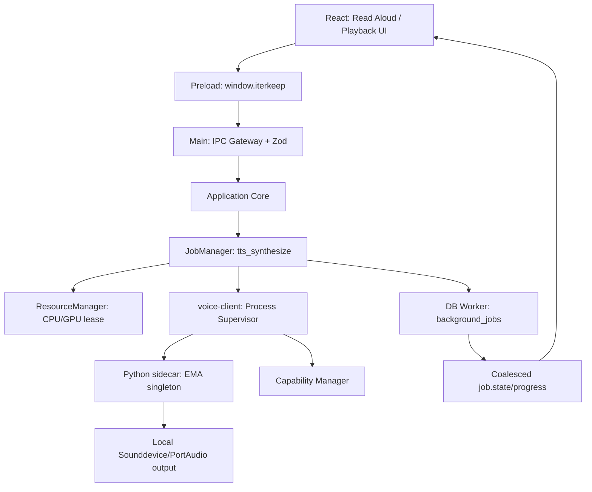

# Iterkeep — Yerel Türkçe Text-to-Speech / EMA Lightning (V1)

> **Normatif amaç:** İsteğe bağlı TTS açıkken kullanıcının mevcut bir metni bir düğmeyle **yalnızca kendi cihazında** seslendirmesi; sentez, oynatma, iptal, durum bildirimi, model kurulumu ve hata kurtarmanın deterministik olması. Yapay zekâ, STT, mikrofon, internet bağlantısı veya Python kurulumu temel Iterkeep işlevlerinin önkoşulu **değildir**.
>
> **Yetki sınırı:** `DOC-08` domain semantiği; `DOC-09` SQL/`background_jobs`; `DOC-10` transaction; `DOC-11` public IPC; `DOC-12` job durumları; `DOC-18/19` setup/capability; `DOC-24` ResourceManager; `DOC-28` mikrofon/STT; `DOC-30` güvenlik; `DOC-33/34` test ve release için tek kanonik kaynaktır. Bu belge **TTS sidecar, EMA runtime, ses akışı, oynatma politikası, kurulum kataloğu ve hata sözleşmeleri** için yetkilidir. Yeni DB tablo, job türü veya public IPC kanalı yaratmaz.
>
> **Kanıt durumu:** EMA Lightning resmi GitHub/PyPI belgeleri 2026-10-10 tarihinde incelendi. Buradaki TypeScript/Python parçaları referans taslaktır; Windows installer, RTX 4050/6 GB VRAM ve gerçek ses sürücüsü üzerinde çalıştırıldıkları ileri sürülmez. `status: draft` korunur.

---

## 1. V1 ürün kararı, kapsam ve amaç

### 1.1 Kullanıcı akışı

1. Kullanıcı agent mesajı, not veya seçili metin yanında **Seslendir** düğmesine basar.
2. `tts` tercihi `disabled` ise düğme yönlendirme gösterir; hiçbir TTS süreci başlatılmaz.
3. `tts=enabled` fakat runtime/model eksikse **Eksik bileşen** ekranı ve indirme/atlama seçenekleri görünür.
4. TTS hazırsa `voice.speak({text, voiceId?})` çağrılır ve mevcut `tts_synthesize` background job kimliği döner.
5. Main, kaynak sırası ve aktif oynatma kuralını uygular; doğrulanmış Python sidecar sesi sentezler ve **yerel ses aygıtından** oynatır.
6. Kullanıcı ilerleme, oynatılıyor, iptal ve hata durumlarını görür; `jobs.cancel({jobId})` iptal isteğidir, onay beklenmeden kesin bitti sayılmaz.
7. İptal/bitirme sonrası ses aygıtı, ephemeral tamponlar ve ResourceManager lease serbest bırakılır.
8. Her aşamada mevcut metin, tamamlanmış assistant yanıtı, not veya görev **değişmeden kalır**.

### 1.2 Kapsam

| V1 var | V1 yok |
|---|---|
| Türkçe metni tek mevcut EMA sesiyle seslendirme | Ses klonlama, custom ses eğitimi |
| Tek tıklama ile oynatma; `jobs.cancel` ile durdurma | Uyandırma kelimesi, sürekli konuşma |
| AI ve STT'den bağımsız TTS | Zorunlu cloud TTS veya kullanıcı verisinin uzak API'ye gönderimi |
| İsteğe bağlı runtime/model indirme | Uygulama kurulumu esnasında sessiz Python/pip download |
| Sınırlı parça bazlı akış ve hata yalıtımı | Tam-dupleks gerçek zamanlı konuşma / barge-in |
| CPU temel yolu ve ölçülmüş GPU optimizasyonu | Test edilmeyen cihaz için milisaniye gecikme garantisi |
| Tek aktif oynatma oturumu; yeni komut policy ile reddedilir | Sınırsız paralel ses çıkışı |
| Erişilebilir durdurma ve durum etiketleri | Kullanıcı onayı olmadan yazılı içeriği otomatik okuma |

### 1.3 Kaynak gerçekleri (ürün kararı değil)

- Resmî paket `ema-lightning` Python 3.11–3.13 ister, PyTorch >= 2.1 kullanır ve yaklaşık **34 MB** ağırlık indirir. Paket ve bağımlılıklarının **tam diskteki boyutu** 34 MB değildir.
- `from ema_lightning import EMA; tts = EMA()` modeli yükler. `tts.say(text, path=...)` ses dosyası oluşturabilir; `tts.stream(text)` float32 PCM ses parçaları üretir.
- Varsayılan ses 48 kHz mono; API ayrıca 24/16/8 kHz destekler. `speed` 0.25–4, `seed` sıfır veya pozitif tam sayı. V1 public IPC yalnız `{text,voiceId?}` sunduğu için bu seçenekler **UI tarafından değiştirilemez**; iç varsayılanlar kullanılır.
- `.lightning()` GPU'ya özel compile/CUDA graph hazırlığı yapar ve açılış maliyeti vardır. V1 varsayılanı `EMA()` ve doğrulanmış CPU/normal yol; `.lightning()` yalnız uygun donanımda başarılı benchmark/ayar kararıyla kullanılır.
- Tek konuşmacı vardır; İngilizce/yabancı sözcükler Türkçe kurallarına göre okunabilir. `en-US` UI dilinin kullanılması İngilizce sentez garantisi değildir.
- Projenin kendi raporladığı RTX 4090 ilk parça gecikmeleri **kullanıcının RTX 4050 cihazı için SLA değildir**.

Kaynaklar: https://github.com/canberk7/ema-lightning ; https://pypi.org/project/ema-lightning/1.0.3/ ; https://huggingface.co/canberkkkkkk/ema-lightning ; https://www.electronjs.org/docs/latest/tutorial/security/ .

---

## 2. Tasarım kararları (`TTS-I-001–048`)

| ID | Değişmez kural |
|---|---|
| TTS-I-001 | Yapay zekâ olmadan `tts=enabled` geçerlidir; TTS olmadan tüm çekirdek özellikler çalışır. |
| TTS-I-002 | `tts=disabled` durumunda sidecar başlatılmaz ve model indirme yapılmaz. |
| TTS-I-003 | Mikrofon/STT izni TTS için istenmez. |
| TTS-I-004 | TTS başlatan tek public metod `voice.speak()`; ek public kanal uydurulmaz. |
| TTS-I-005 | Kullanıcı durdurması `jobs.cancel()` üzerinden iletilir; `accepted` tamamlanmış iptal değildir. |
| TTS-I-006 | `tts_synthesize` kalıcı job türü SQL `background_jobs` ile birebir eşleşir. |
| TTS-I-007 | Job başarı durumu ses sentezi ve gerçekten tamamlanan oynatmayı kapsar. |
| TTS-I-008 | Audio hatası tamamlanmış yazılı yanıtı veya görevleri geri almaz. |
| TTS-I-009 | Renderer süreç başlatamaz ve sidecar dosya yolunu seçemez. |
| TTS-I-010 | Yalnız allowlist ve bütünlüğü doğrulanmış runtime çalıştırılır. |
| TTS-I-011 | Yalnız doğrulanmış model ağırlıkları okunur; başlatmada gizli network download yasaktır. |
| TTS-I-012 | Runtime, model ve ses backend ayrı capability alt koşullarıdır. |
| TTS-I-013 | Kurulum için `voice.listComponents` ve `voice.startComponentInstall` kullanılır. |
| TTS-I-014 | Kurulum explicit user consent, katalog allowlist ve SHA-256 gerektirir. |
| TTS-I-015 | Dosyaların yükleme öncesi disk ve kaynak uygunluğu test edilir. |
| TTS-I-016 | TTS sidecar ana Electron veya DB worker sürecini bloke etmez. |
| TTS-I-017 | Sidecar Python runtime uygulamanın normal yükleyicisine zorunlu gömülmez. |
| TTS-I-018 | Sidecar protokolü JSONL kontrol, yerel proses sahipliği ve boyut limiti içerir. |
| TTS-I-019 | JSONL stdout protokole ayrılır; normal log ve traceback stderr üzerinden redakte edilir. |
| TTS-I-020 | Yanlış protokol sürümü veya geçersiz yanıt, sessiz retry değil hata üretir. |
| TTS-I-021 | Ses chunk içerikleri, metin veya kullanıcı adı tanı loguna yazılmaz. |
| TTS-I-022 | Audio tamponlarında üst sınır vardır; üretici consumer kapasitesini aşamaz. |
| TTS-I-023 | Bozuk float32, NaN, Inf, kanal veya sample rate reddedilir. |
| TTS-I-024 | Ses aygıtından sesin duyulacağı garanti edilemez; başlangıç hatası kullanıcıya bildirilir. |
| TTS-I-025 | Audio çıktı seviyesi işletim sistemi ses tercihlerine saygı duyar. |
| TTS-I-026 | Birden fazla aynı anda konuşma V1 için reddedilir veya açık kuyruğa alınır. |
| TTS-I-027 | Dahili metin bölme deterministiktir, kelimeleri ortadan keyfî ayırmaz. |
| TTS-I-028 | Başka uygulamanın Ollama modeli veya GPU süreçleri zorla sonlandırılmaz. |
| TTS-I-029 | GPU lease verilemezse CPU seçimi veya `RESOURCE_BUSY` uygulanır. |
| TTS-I-030 | GPU OOM ana uygulama çökmesi sayılmaz; TTS failed ve gerekirse CPU önerisi sunulur. |
| TTS-I-031 | `lightning()` sonucu güvenilir benchmark olmadan otomatik hızlı ilan edilmez. |
| TTS-I-032 | Yalnız bu uygulamanın başlattığı subprocess durdurulabilir. |
| TTS-I-033 | İptal, playback kuyruğunun yeni parça üretmesini durdurur ve audio stream kapatır. |
| TTS-I-034 | Quit veya force-close sonrası transient PCM ve kısa ömürlü WAV dosyaları temizlenir. |
| TTS-I-035 | Varsayılan olarak ses dosyası veya konuşulan metin kullanıcı DB’sine ayrıca kaydedilmez. |
| TTS-I-036 | Sidecar kullanıcı DB’sine, Git’e veya proje dosyalarına doğrudan erişemez. |
| TTS-I-037 | Sidecar yalnız gerekli temp/cache dizinlerini kullanır; path traversal engellenir. |
| TTS-I-038 | TTS kapalıyken ayar yeniden açılışta korunur; sağlık yeniden ölçülür. |
| TTS-I-039 | Model/runtime kaybolduysa eski hazır durumu kullanılmaz. |
| TTS-I-040 | Bir isteğin timeout olması `succeeded` kabul edilmez; job snapshot yeniden okunur. |
| TTS-I-041 | Geçişler yalnız DOC-12’deki gerçek job durumlarına yapılır. |
| TTS-I-042 | UI olayları güncel durumun yerine geçmez; `jobs.get` snapshot kanoniktir. |
| TTS-I-043 | Parça/iş sınırı ve kullanıcı oran sınırı modelin sınırsız metin almasını engeller. |
| TTS-I-044 | Model lisans/attribution ve üçüncü taraf bağımlılıklar dağıtım çıktısında yer alır. |
| TTS-I-045 | Kurulum ve gerçek audio playback Windows cihaz testlerinden geçmeden `verified` sayılmaz. |
| TTS-I-046 | TTS altyapısı herhangi bir uzak hosta kendi başına HTTP isteği atamaz. |
| TTS-I-047 | Sadece gerçek kullanıcı tıklaması ya da onun açık tercihi TTS oynatmasını başlatır. |
| TTS-I-048 | Yeni public özellik isteği önce DOC-11 ve ilgili ADR ile sözleşmeye eklenir. |

---

## 3. Bileşen mimarisi ve sahiplik



### 3.1 Sorumluluk dağılımı

| Modül | Tam yol | Sorumluluk | Kesin yasak |
|---|---|---|---|
| UI | `apps/desktop/src/renderer/features/voice/` | `ReadAloudControl`, durum ve hata ekranı | Python, subprocess, SQL, raw file path |
| Public IPC | `packages/contracts/src/ipc/` | mevcut named API + Zod | keyfî kanal açma |
| Electron Main | `apps/desktop/src/main/` | kullanıcı etkileşimi doğrulama, process ownership | model inference, ana thread'de audio decode |
| Application | `packages/application/` | `SpeakText`, `CancelBackgroundJob` | native audio işlemek |
| JobManager | `packages/job-system/` | `tts_synthesize`, cancel, status, retry policy | DB haricinde ikinci kayıt sistemi |
| ResourceManager | `apps/desktop/src/main/` ve `DOC-24` | lease, fairness, CPU/GPU kararı | başka uygulamanın süreçlerini kapatmak |
| Voice adapter | `packages/voice-client/src/tts-client.ts` | local sidecar protokolü, lifecycle | bilinmeyen binary çalıştırmak |
| Sidecar | `sidecars/tts-ema/service/` | EMA singleton, PCM synthesis, yerel ses oynatma | DB, Git, app Core'a yazmak |
| Catalog | `sidecars/manifests/provider-catalog.json` | runtime/model/platform/hashes | Git'e gerçek kişisel ses eklemek |

**V1 playback kararı (TTS-ADR-002):** Çıkış sesini **Python TTS sidecar içindeki kontrollü `sounddevice`/PortAudio adaptörü** çalar. Bu, public IPC'den megabaytlarca PCM aktarılmasını ve Renderer'a özel ses URL'si açılmasını gerektirmez. Windows üzerinde PortAudio dağıtımı ve seçili Python sürümüyle uyumluluk release testi ile ispatlanmalıdır. Çıkış aygıtı V1 için sistem varsayılanıdır; aygıt seçme ayrı özellik olur. `sounddevice` bağımlılığı yalnız **opsiyonel TTS runtime** içindedir.

Sidecar yalnızca Main tarafından spawn edilir; shell `false`, sabit executable yolu, statik argüman listesi ve private stdin/stdout pipe. Loopback HTTP server veya herkese açık WebSocket portu açılmaz. Uygulama `tts=disabled` ise hiçbir ses backend hazırlığı yapmaz.

### 3.2 Güvenli süreç sınırları

```text
Electron Renderer --named IPC--> Main / Application
                                    |
                             JobManager + leases
                                    |
                             voice-client adapter
                                    |
                    verified executable + scoped env
                                    |
                       Python JSONL stdin/stdout
                                    |
                      EMA model + PortAudio output
```

- Main `spawn` için yalnız manifestte sabitlenen interpreter/binary adreslerini kullanır. Renderer'dan `pythonPath`, `cwd`, URL, argv veya ses aygıtı adı alınmaz.
- `stdin` ve `stdout` kontrol protokolü taşır; her satır `<=64 KiB`, toplam bekleyen kontrol çıkışı `<=256 KiB` başlangıç limitidir. Metin isteği de bu limiti aşamaz.
- `stderr` gizli metin/stack trace yakalama riskine karşı güvenli koda/son durum bilgisine indirgenir; kullanıcı metni aynen loglanmaz.
- Çocuk proses yaşama süresi Main'e bağlıdır; closing/quit sırasında belirli grace sonrasında process tree yalnız **sahip olunan PID'ler** için kapatılır.
- İndirilen Python paketlerinin PyPI kaynağından doğrudan run-time içinde yüklenmesi kabul edilmez; kurulum aşamasında hashes ve lockfile kontrol edilir.

---

## 4. Kullanıcı arayüzü ve davranış sözleşmesi

### 4.1 Etkileşimler

| Kullanıcı eylemi | Görünen durum | Yönlendirme |
|---|---|---|
| 'Seslendir' | Hazırlanıyor / Sırada / Seslendiriliyor | `voice.speak` → `{jobId}` |
| 'Durdur' | Durduruluyor | `jobs.cancel` → snapshot poll |
| TTS kapalı | Ses kapalı | Ayarlar > Ses > Etkinleştir |
| Runtime yok | Kurulum gerekiyor | `voice.listComponents({feature:'tts'})` |
| Model yok/bozuk | Model indir / onar | Manifest üzerinden onaylı install |
| Kaynak meşgul | Sırada / CPU alternatifi | DOC-24 lease policy |
| Ses aygıtı yok | Ses oynatılamıyor | Metni koru; aygıt/sistem sesi yönergesi |
| AI çalışmıyor | Manuel metin seslendirme mümkün | AI'dan bağımsız |
| STT kapalı | TTS her zamanki gibi | Mikrofon gerekmez |

### 4.2 Metin seçimleri

- Agent mesajında **Seslendir** yalnız seçilen, halen görünür assistant/user metnine uygulanır; kaynak metin DB'ye tekrar yazılmaz.
- Notta 'Seçili metni seslendir' veya 'Bu parçayı seslendir' V1'de mevcut `voice.speak` kapasitesini kullanır; çok uzun notlarda kullanıcıya bölüm seçtirilir.
- Metin UI'da değişmişse eski job'un seslendirdiği metin ile yeni içeriği eşitlemeye çalışma; yeni ses için yeni kullanıcı eylemi gerekir.
- AI yanıtı **kendiliğinden** seslendirilmez. Ayrı otomatik okuma tercihi eklenmesi gelecekte ADR/UI/IPC ve erişilebilirlik gözden geçirmesi gerektirir.
- Düğme ikonunun yanında `Durdur` ve `Yeniden seslendir` için ekran okuyucu etiketi bulunur; `aria-live` sadece büyük durum değişimlerinde kullanılır, her PCM parçasında değil.
- `readAloudText` hammadde Markdown veya HTML etiketlerini doğrudan seslendirmez; görünen metnin kontrollü plain-text temsilini üretir. Kod blokları V1'de otomatik atlanır veya UI'da seçimle dahil edilir; bu kural yerel, deterministiktir.
- İçeriği değiştirebilecek agresif yeniden yazım yok; EMA'nın içindeki `normalizer-tr` normalizasyonu uygulanır. Hassas URL, token veya gizli kod içeriğinin kazara yüksek sesle okunması için açık içerik/seçim kapsamı UI'da görünür.

### 4.3 Minimal tasarım ve erişilebilirlik

- `20-DESIGN-TOKENS-THEMES.md` semantik tokenlarını kullan; yeni hardcoded dark/light palette üretme.
- `21-SCREENS-NAVIGATION.md` panel hiyerarşisini koru; TTS için bütün pencereyi bloke eden modal açma.
- `22-COMPONENTS-INTERACTIONS.md` Button/Tooltip/Toast sözleşmelerini, `23-ACCESSIBILITY-I18N.md` focus/shortcut kurallarını kullan.
- Ses aygıtı bulunmasa dahi metin içerik erişilebilir kalır; sadece ses çıkışı devre dışı görünür.
- Görsel animation duration or playback status token üretme; erişilebilir durum etiketleri gerçek job snapshot'ına bağlanır.

---

## 5. Metin sınırları, segmentleme ve Türkçe

### 5.1 Kesin IPC kabul sınırı (V1)

- `voice.speak({text,voiceId?})` boş/yalnız boşluk metni reddeder.
- `text` uzunluğu: **en çok 2.000 Unicode code point** ve **8 KiB UTF-8**; ikisi birlikte sağlanır. Bu değerler `DOC-11`'deki genel envelope boyutunu aşmaz. `DOC-29` bu metoda özel limitin kaynağıdır.
- İç normalizer/sentez segmenti: **en çok 240 code point**, toplam en çok **16 segment**, tek cümle çok uzunsa kelime sınırından böl. Birleştirildiğinde baştaki ve sondaki boşluk dışında kullanıcı metninin semantiği korunmalı.
- Input NUL / kontrol karakterlerini (satır sonu/tab hariç), invalid Unicode surrogate ve açıkça aykırı toplam boyutları reject et; satır sonlarını normalize et.
- `voiceId` verilmezse **`tr-TR-ema-default`** seçilir; belirtilirse V1'de yalnız aynı ID geçerlidir. Uydurulmuş EMA ses listesi sunma.
- Kullanıcı bu API'de `speed`, `seed`, `sampleRate`, `device`, `outputPath` veya keyfî `voiceId` belirleyemez. Bu yeni alanlar ancak DOC-11 sürümlü sözleşmesiyle eklenebilir.
- Rate limit başlangıcı: bir pencere başına aynı anda 1 aktif TTS; saniyede en çok 2 yeni TTS isteği; aşım `RATE_LIMITED`. İlk hedef değerleri `DOC-31` benchmark ve kullanıcı testiyle kesinleştirilir.

### 5.2 Segmentleyici algoritma

```ts
// packages/voice-client/src/tts-text.ts (referans)
const MAX_TOTAL_POINTS = 2000;
const MAX_BYTES = 8 * 1024;
const MAX_PART_POINTS = 240;
const MAX_PARTS = 16;

export function normalizeTtsInput(value: string): string {
  const normalized = value.replace(/\r\n?/g, '\n').trim();
  const points = [...normalized];
  if (!points.length || points.length > MAX_TOTAL_POINTS ||
      new TextEncoder().encode(normalized).byteLength > MAX_BYTES ||
      /[\u0000-\u0008\u000B\u000C\u000E-\u001F\u007F]/u.test(normalized)) {
    throw new Error('TTS_INVALID_TEXT');
  }
  return normalized;
}

export function segmentTtsText(text: string): string[] {
  const tokens = text.match(/\S+\s*/gu) ?? [];
  const parts: string[] = [];
  let current = '';
  for (const token of tokens) {
    if ([...token].length > MAX_PART_POINTS) throw new Error('TTS_TOKEN_TOO_LONG');
    if ([...(current + token)].length > MAX_PART_POINTS && current) {
      parts.push(current.trim());
      current = token;
    } else current += token;
  }
  if (current.trim()) parts.push(current.trim());
  if (parts.length === 0 || parts.length > MAX_PARTS) throw new Error('TTS_SEGMENTS_EXCEEDED');
  return parts;
}
```

Bu algoritma **başlangıç referansıdır**. Satır sonu/whitespace açısından seslendirilen metni etkileyebilir ve çok uzun bitişik URL'leri reddeder. Bunlar güvenli V1 davranışlarıdır. Metin bölünmesinde noktalama/cümle sonuna öncelik veren geliştirme, birim testler eşliğinde yapılabilir; içerik kaybı veya karakter sınırı ihlaline yol açamaz. `normalizeTtsInput` UTF-16 surrogate doğrulamasını ayrıca Zod sınırında uygular; JS `TextEncoder` replacement karakterine güvenilmez.

### 5.3 Ses kalitesi ve normalizasyon

| Girdi | V1 davranışı | Test |
|---|---|---|
| `Merhaba, nasılsın?` | Türkçe netlik ve akıcılık | Gold audio dinleme |
| `12,5 kg` | EMA normalizer-tr çözümler | Türkçe sayı testleri |
| `15 Ekim 2026` | Tarih doğal okunuşu | Manuel dinleme |
| `API / URL / SQL` | Belirsiz kısaltmalar telaffuz edilir | Kullanıcıya düzeltme önerisi |
| `Ç,Ğ,İ,Ö,Ş,Ü` | Türkçe fonem/karakter doğruluğu | Farklı sözcüklerden fixture |
| İngilizce kaynak | Türkçe kurallarıyla telaffuz edilebilir | `unsupported_language_quality` açıklaması |

Modelin belgelendirilmiş tek ses sınırı kullanıcıya doğru açıklanır. `Speech.words` gibi sürüm spesifik alanlara V1 çalışma mantığı bağımlı değildir; gelecekte caption highlight için ayrıca capability probe gerekir.

---

## 6. Oynatma, akış ve iptal protokolü

### 6.1 Dahili JSONL kontrol sözleşmesi — public IPC değildir

```json
{"v":1,"kind":"hello","requestId":"uuid","token":"private-process-token"}
{"v":1,"kind":"speak","requestId":"uuid","jobId":"uuid","text":"Merhaba","voiceId":"tr-TR-ema-default"}
{"v":1,"kind":"cancel","requestId":"uuid","jobId":"uuid"}
{"v":1,"kind":"shutdown","requestId":"uuid"}
```

Cevap örnekleri:

```json
{"v":1,"kind":"ready","requestId":"uuid","runtime":"ema-lightning","device":"cpu"}
{"v":1,"kind":"started","jobId":"uuid"}
{"v":1,"kind":"playing","jobId":"uuid","progressMs":1000}
{"v":1,"kind":"ended","jobId":"uuid","playedMs":2120}
{"v":1,"kind":"cancelled","jobId":"uuid"}
{"v":1,"kind":"error","jobId":"uuid","code":"AUDIO_OUTPUT_UNAVAILABLE"}
```

`uuid` burada **örnek yer tutucu**dur; gerçek mesajlarda DOC-08 UUID v4 kullanılır. `token` gizli yalnız parent→child handshakede kullanılabilir; asla UI'a, loga veya dosyaya gönderilmez. Parent'ın PID/pipe sahipliği birincil güven sınırıdır. Çocuk proses için karşılıklı doğrulama gerektiğinde token yalnız inherited pipe üzerinde taşınır ve tek oturuma özeldir.

### 6.2 Worker state ve job state farkı

| Gözlenen aşama | DB job status | UI sunumu |
|---|---|---|
| Kuyruk | `queued` | Hazırlanıyor / Sırada |
| Resource lease | `queued` | Kaynak bekleniyor |
| Sidecar açıldı/sentez başladı | `running` | Ses hazırlanıyor |
| Ses cihazında çıkış başladı | `running` | Seslendiriliyor |
| Oynatma tamamlandı | `succeeded` | Tamamlandı |
| Kullanıcı iptali tamamlandı | `cancelled` | Durduruldu |
| Hata | `failed` | Seslendirilemedi |

SQL şemasında `synthesizing`, `playing`, `cancelling`, `waiting_resource` gibi status değerleri **yoktur**; bunlar yalnız ephemeral UI reason/progress değerleri olabilir. `jobs.cancel(...).accepted=true` doğrudan `cancelled` üretmez; sidecar ACK veya process kill/reconciliation sonrası terminal sonuç kesinleşir.

### 6.3 Oynatma politikası

- Aynı pencere/uygulamada V1 tek aktif TTS job sahibi vardır. İkinci istek `RESOURCE_BUSY` ile reddedilir; gizlice üst üste ses oynatılmaz.
- Ses output buffer'ı hedef en çok **2 saniyelik PCM**; yavaş ses çıkışında üretici backpressure ile durur. RAM'de tüm uzun sesi biriktirme.
- `tts.stream(...)` PCM float32 mono chunks üretir; `sounddevice.OutputStream` 48 kHz mono float32 açılır. Çalışan sistemin output API desteği startup smoke'unda ölçülür.
- İlk chunk çalınmadan kullanıcıya `playing` gösterilmez; `started` sentez başlangıcıdır, duyulabilir playback ispatı değildir.
- Kullanıcı iptal edince Main → sidecar `cancel`; aktif stream jeneratörü kesilir, output kapatılır, pending chunk atılır, ACK beklenir. Grace aşılırsa yalnız owned child kapatılır.
- Output aygıtının sonradan kaybolması terminal failure üretir; metin kalır.
- `tts_synthesize` V1 için **sentez + playback** yaşam döngüsünü kapsar; yeni `tts_playback` job enum'u eklenmez.
- Çekirdek kapanıyorsa yeni TTS kabul edilmez; önce cancel, sonra owned sidecar terminate, ardından resource lease release ve temizleme.

### 6.4 Backpressure ve uzun cevaplar

- Uzun kullanıcı metni tek bir `voice.speak` isteğinde 2.000 code point'i aşarsa güvenli doğrulama hatası üretilir. Renderer sessizce ilk 2.000 karakteri kesip seslendirmez.
- `tts.stream()` ile chunk bazlı üretimin Python tarafında arka plan thread içinde durdurulabilir olması gerekir. stdin JSONL parser bloklansa bile aktif stream'i iptal edebilecek event/flag bulunmalıdır.
- Her PCM parçası bounded output stream üzerinden ilerler; ses backend geride kalırsa asıl üretici basınç altında durur; UI'da her parçayı React state'e sokmayız.
- `job.progress` istek bazlı olarak en fazla 4 Hz yayınlanır; `done/total` kesin bilinemiyorsa `null` olabilir, hayalî yüzde gösterilmez.

---

## 7. Python sidecar — kurulum, API ve referans kodu

### 7.1 Python/PyTorch dağıtım stratejisi

- Doğrulanan Python aralığı **3.11–3.13**. Windows için ilk öneri ürün release'inde sabitlenen **Python 3.11** runtime'ıdır. Sonradan minor upgrade ancak smoke/regression ile.
- İndirilen runtime yalnız uygulamanın özel dizinine konur; kullanıcının sistem Python/PATH ayarlarına yazılmaz.
- `requirements.lock` bütün Python wheels'in exact version + SHA-256 hash'lerini içerir. Repo içinde `pip install ema-lightning` komutu yalnız geliştirici notu olarak yer alabilir; release runtime'ında otomatik network pip install yoktur.
- TTS runtime bileşeni PyTorch, `normalizer-tr`, `ema-lightning`, PortAudio/sounddevice ve bağımlılıklarını kapsar. Bağımlılıklar yüzünden toplam paket yüzlerce MB veya daha fazla olabilir; **ölçmeden boyut vaat edilmez**.
- Windows CPU ve NVIDIA CUDA paketleri ayrı manifest profilleridir. GPU profili ancak gerçek CUDA/PyTorch uyumu, imza, bütünlük ve cihaz testi sonrası yayınlanır.
- Model cache, pinned Hugging Face revision + SHA-256 doğrulanmış dosyalarla kurulur. Yanlış hash veya cache eksikliği `MODEL_UNAVAILABLE`; sessiz internet indirmesi yoktur.
- Ağ bağlantısı runtime yüklerken kapalı tutulur: `HF_HUB_OFFLINE=1` ve `TRANSFORMERS_OFFLINE=1` *savunma katmanı*dır; ek olarak sidecar process ağ erişimi test edilir. EMA'nın offline cache davranışı gerçek testle kanıtlanmalıdır.
- Release manifest imzası trusted uygulama release kökünden doğrulanır. Yerel manifest tek başına güven zinciri sayılmaz; imza/doğru publisher ve artifact hash kontrolleri sağlanır.

### 7.2 Sağlayıcı API kullanımı

```python
# sidecars/tts-ema/service/synthesis.py — referans, paket sürümünde doğrulanmalı
from ema_lightning import EMA

class EmaEngine:
    def __init__(self, prefer_gpu: bool = False):
        # Üst katman manifest/cache sağlık doğrulamasını çoktan yapmış olmalı.
        engine = EMA()
        # `.lightning()` GPU compile + CUDA graph hazırlığı yapar.
        # CPU veya benchmark geçersizse asla çağrılmaz.
        self.engine = engine.lightning() if prefer_gpu else engine

    def stream(self, text: str):
        # EMA stream() 48kHz mono float32 NumPy chunk döndürür.
        yield from self.engine.stream(text, sample_rate=48000)
```

**Bu kod tek başına güvenli yükleme kanıtı değildir.** `EMA()` model cache doğrulamasını kendisi yapıyor sayılmaz; Main tarafı ağırlık hash'lerini ve runtime'ı önceden doğrulamalı, sidecar network izolasyonu ve cache smoke testleri geçmelidir. `prefer_gpu=True` ancak DOC-24 lease + gerçek cihaz GPU eligibility + benchmark receipt sonucu olabilir. GPU yokken `EMA()` PyTorch device seçimini doğrulamak için runtime probe gerekir.

### 7.3 TTS oynatıcı referansı

```python
# sidecars/tts-ema/service/playback.py — referans, paketlenmiş Windows'ta test edilmeli
from threading import Event
import numpy as np
import sounddevice as sd

class PlaybackCancelled(Exception):
    pass

def speak_to_default_device(engine, text: str, cancelled: Event) -> int:
    frames = 0
    with sd.OutputStream(samplerate=48000, channels=1, dtype='float32') as out:
        for chunk in engine.stream(text):
            if cancelled.is_set():
                raise PlaybackCancelled()
            pcm = np.asarray(chunk, dtype=np.float32)
            if pcm.ndim != 1 or not np.all(np.isfinite(pcm)):
                raise ValueError('AUDIO_CHUNK_INVALID')
            # sounddevice write bloklayarak doğal akış baskısı sağlar.
            out.write(pcm.reshape(-1, 1))
            frames += len(pcm)
            if cancelled.is_set():
                raise PlaybackCancelled()
    return round(frames * 1000 / 48000)
```

`OutputStream` kapanınca oynatma backend'i izin verdiği ölçüde drain olur. Kullanıcı iptalinde açık buffer'ı hızlıca kesmek için özel `abort`/`stop` yolunun kullanıldığı üretim adaptörü gerekir; yukarıdaki örnek **gerçek zamanlı hard-stop garantisi vermez**. OutputStatus/underrun raporları ve cihaz kaybı exception mapping'i üretim adaptöründe tamamlanır. Metni/buffer'ı debug loguna basmak yasaktır.

### 7.4 Main ↔ Python process supervisor — TypeScript taslağı

```ts
// packages/voice-client/src/tts-client.ts — iskelet sözleşme
import { spawn, type ChildProcessWithoutNullStreams } from 'node:child_process';

type SidecarEvent =
  | { v: 1; kind: 'ready'; requestId: string; runtime: 'ema-lightning'; device: 'cpu' | 'cuda' }
  | { v: 1; kind: 'started'; jobId: string }
  | { v: 1; kind: 'playing'; jobId: string; progressMs: number }
  | { v: 1; kind: 'ended'; jobId: string; playedMs: number }
  | { v: 1; kind: 'cancelled'; jobId: string }
  | { v: 1; kind: 'error'; jobId: string; code: string };

export function startEmaProcess(config: {
  trustedExecutable: string;
  trustedEntrypoint: string;
  privateCache: string;
}): ChildProcessWithoutNullStreams {
  // trustedExecutable/Entrypoint yalnız doğrulanmış kurulum manifestinden gelir.
  return spawn(config.trustedExecutable, ['-I', config.trustedEntrypoint], {
    shell: false,
    windowsHide: true,
    stdio: ['pipe', 'pipe', 'pipe'],
    env: {
      PATH: process.env.PATH ?? '',
      SYSTEMROOT: process.env.SYSTEMROOT ?? '',
      HF_HUB_CACHE: config.privateCache,
      HF_HUB_OFFLINE: '1',
      TRANSFORMERS_OFFLINE: '1',
      PYTHONNOUSERSITE: '1',
      PYTHONDONTWRITEBYTECODE: '1',
    },
  });
}

export function parseSidecarLine(line: string): SidecarEvent {
  if (Buffer.byteLength(line, 'utf8') > 64 * 1024) throw new Error('TTS_PROTOCOL_OVERSIZE');
  // Üretimde Zod şema ayrıştırması zorunludur; type cast geçerli doğrulama değildir.
  return JSON.parse(line) as SidecarEvent;
}
```

**Önemli:** Yukarıdaki `parseSidecarLine` yalnız **şematik iskelet**tir; gerçek kod, bilinmeyen alanı reddeden Zod schema doğrulaması ve request/job ID correlation'ı tamamlanmadan merge edilemez. Python `-I` izolasyonunun kurulu site-packages/env yerleşimine etkisi test edilmelidir; çalışmıyorsa ayrı güvenli interpreter başlatma biçimi ADR ile düzenlenir. Child input framing, stdout partial-lines, `
` escape, PID ownership, stderr redaction ve process termination `DOC-06/07/30` testleriyle kapatılmalıdır.

### 7.5 Sidecar stdin döngüsü ve iptal

- Python tarafında control reader, synthesis/playback worker thread'den ayrıdır; `cancel` paketi ses oynatma bloklaması sırasında bile okunabilir.
- Tek aktif TTS job; `jobId` key’iyle `threading.Event` iptal bayrağı tutulur. Başka job aynı anda istenirse typed `RESOURCE_BUSY`.
- Eşzamanlı `cancel`, `shutdown` ve doğal `ended` yarışını *terminal once* state machine çözer. Job'ın tek bir terminal DB state'i olur.
- Sidecar `error` ham exception mesajı değil allowlisted code döndürür; stack trace yalnız güvenli geliştirme modundaki redakte edilmiş tanılama logunda bulunabilir.
- Sidecar yanıt vermediğinde Main önce gentle cancel, ardından owned process kill yolunu uygular; sonrasında feature health `degraded` veya `unavailable` olur.
- Yeni bir synthesis job sidecar yeniden başlatılırken kuyruğa alınabilir ancak uygulama bu işi izinsiz otomatik ikinci kez oynatmaz.

---

## 8. Kurulum bileşenleri ve güven zinciri (`VOICE-ADR-001`)

### 8.1 V1 katalog mantığı

`voice.listComponents({feature:'tts'})` aşağıdaki iki mantıksal kategoride giriş döndürür: `runtime` ve `model`. Kataloglar **platforma/architecture'a göre filtrelenir**; ortak ID'ler sabit, manifest version'ı ayrı tutulur.

| Component ID (önerilen stable key) | Kind | İçerik | `requires` |
|---|---|---|---|
| `tts.ema.runtime.windows-x64-cpu` | runtime | Python 3.11 + `ema-lightning`/PyTorch CPU + PortAudio backend | none |
| `tts.ema.runtime.windows-x64-cuda` | runtime | Doğrulanmış CUDA destekli runtime | desteklenen NVIDIA GPU |
| `tts.ema.model.tr-default` | model | Sabit pinned revision EMA Türkçe ağırlıkları | `tts.ema.runtime.*` profilinden biri |

Bu tablo **katalog kimliği önerisidir**, yayımlanmış indirilebilir binary varlığı iddiası değildir. Gerçek indirme URL'leri, bütün artefakt digest'leri, lisanslar ve disk bütçeleri `sidecars/manifests/provider-catalog.json` içine **gerçek release build'inden** yazılır; uydurma hash ve model URL'si verilmez.

### 8.2 Kurulum akışı

1. Kullanıcı `tts` kartında modeli görür; `voice.listComponents` kurulum ve sağlık durumunu döndürür.
2. Mevcut runtime/model eksikse `Kur` eylemi `consent:true` ile `voice.startComponentInstall` çağırır.
3. Main kullanıcı eylemini ve allowlisted `componentId`yi doğrular; boyut ve disk boşluğu sınırlarını uygular.
4. `voice_component_install` job'u belirli sürüm/hash manifestini pin'ler.
5. İndirme yalnız onaylı HTTPS hedefinden private staging dizinine ve sınırlandırılmış boyutta yapılır.
6. Byte tamamlandığında hash ve imza/publisher kontrolleri; arşiv açmada path traversal, symlink ve decompression bomb kontrolleri yapılır.
7. Geçerli paket yalnız staging→active atomik taşıma sonrası 'installed' olur; disk üstündeki mevcut sağlıklı eski sürüm bozulmaz.
8. `python --version`, import, engine offline model load, kısa ses üretimi ve gerçek playback smoke (uygun cihazda) yapılır; smoke başarısızsa kurulum `failed`.
9. `voice.getStatus()` ve `capabilities.get({refresh:true})` tazelenir; kullanıcıya kullanılabilirlik görünür.

**Dağıtım önkoşulu:** İmzalı hazır runtime paketleri hazırlanmadıysa kullanıcıya uygulama içinden indirme **çalışıyor** denemez. Bu aşamada TTS atlanabilir ve belgelenmiş manuel kurulum yolu, yalnız desteklenen/safe binary doğrulama koşullarıyla sunulabilir. V1 release kalitesi için paketle birlikte indirilebilir, doğrulanmış runtime yayını gerçek CI iş paketidir.

### 8.3 Model/kurulum kaldığı yerden devam etme

- Uygulama yeniden açıldığında `voice_component_install` eskiden `running` kaldıysa DOC-12 uyarınca doğrudan otomatik tekrar başlamaz. Var olan staged bytes yeniden hash/manifest doğrulamasına alınabilir ve kullanıcıya 'devam/temizle' sunulur.
- Partial archive doğrudan çalıştırılmaz; başka manifest revizyonundaki paketle birleştirilmez.
- CPU runtime varsa ancak CUDA runtime kurulu değilse CPU yolu kullanılabilir; 'GPU yoksa kapalı' hatası verilmez.
- Runtime/model paketi başka uygulamalarca silindiyse capability `missing/invalid` olur, ses düğmesi yeniden kurulum ekranı gösterir. Eski `ready` cache'i güvenilir sayılmaz.

---

## 9. Capability ve ResourceManager entegrasyonu

### 9.1 Ready hesabı

```text
ready(TTS) = userPreference('tts') == enabled
          AND runtimeManifestVerified
          AND modelWeightsVerified
          AND sidecarHandshakePassed
          AND audioBackendAvailable
          AND currentPolicyAllowsUse
```

`ready` zaman içinde geçici olarak `degraded` olabilir (örneğin ses aygıtı takılı değil). `resource_busy`, yetenek kurulu değil demek değildir; o anda yeni job kabul edilmeyebilir. `DOC-19 CapabilitySnapshot` tek feature için kullanılır; `CapabilityOverview` AI/STT/TTS/Git sonuçlarını birlikte döndürür.

### 9.2 VRAM planı ve lease

| Durum | Öncelik / davranış |
|---|---|
| TTS başlatma | Kullanıcı tıklaması: interactive voice lane |
| STT aynı anda GPU istiyor | DOC-24 admission; tek yüksek-bellek workload öncelikli |
| Ollama model GPU'da | Ollama kapatılmaz; TTS CPU veya sıralama |
| `.lightning()` GPU compile gerekiyor | Kullanıcıya hazırlık; bellek uygunsa idle ön hazırlık veya ilk talepte |
| CUDA OOM | Model job failed; CPU tekrar yalnız açık kullanıcı eylemiyle |
| Uzun sessizlik / TTS disabled | EMA/sidecar kapatılır, lease release edilir |
| GPU bellek ölçümü yok | Muhafazakâr CPU varsayılanı; yanlış kesin VRAM hesabı yok |

RTX 4050 6 GB hedefinde Ollama+Whisper+EMA aynı anda VRAM'e kesin sığar denmez. Kullanıcıya 'GPU hızlandırması deneysel / ölçüm gerekiyor' etiketi sunulabilir. Test edilmemiş `.lightning()` compile avantajını ilk kullanım süresine dahil etmeden pazarlamak yasaktır.

### 9.3 Yaşam döngüsü

- Core boot → AI/STT/TTS servis çağrısı **yok** → React hazır.
- Kullanıcı TTS etkinleştirir → Main hızlı sağlık snapshot'ı döndürür; model load UI'ı bloke etmez.
- Speak → job queued → resource lease → sidecar spawn/handshake → warmup → playback.
- TTS başarı/iptal → gerektiğinde kısa idle grace (ör. 30 sn; benchmark ile ayarlanır) → child/lease bırakma.
- GPU modeli harici uygulama için unload etme; Main yalnız kendi sidecar process'ini yönetir.
- Window close, updater restart, app quit → aktif TTS önce bounded cancel, sonra owned process terminate; interrupted job state DOC-12 recovery'ye girer.

---

## 10. Güvenlik, gizlilik ve sürdürülebilirlik

- Metin, ses ve agent içeriği varsayılan olarak yerel kalır. Runtime yalnız kullanıcının açık kurulum isteği sırasında izinli ağ adreslerine erişebilir.
- Sintetize ses `workspace.db`, chat message veya `activity_logs` içine otomatik eklenmez. Kullanıcının notu seslendirildi diye kaynak içerik güncellenmez.
- Kullanıcı metni, TTS metni ve ham PCM telemetriye dahil edilmez. Tanı kayıtları yalnız job ID, sonuç kodu, süre ve anonim provider ID içerir.
- Kaynak metin sansürlenmese bile politika engine, seçilen metnin gerçekten kullanıcının o anda seslendirmek istediği görünür içerik olduğuna güven sınırında dikkat eder. Not içeriğindeki prompt injection, ayrı audio komutu başlatamaz.
- Sadece uygulama imzalı binary'leri veya hash doğrulanan allowlist bileşenleri çalıştırılır; `pip install` veya güvenilmeyen import otomatik yapılmaz.
- EMA/normalizer-tr ve bağımlılıkların lisans bildirimleri installer içinde sunulur; otomatik güncellemede release artefact hash zinciri sürdürülür.
- Ham notlar, özel proje adları, kullanılan cümleler ve `Speech` örnekleri crash dump'ta bulunabileceği için crash raporlayıcı varsayılan olarak content-free yapılandırılır.
- TTS çıktısı ekran okuyucu (NVDA) ile çakışabilir; kullanıcının sesi kolayca durdurması ve yerleşik OS ses düzeyini kullanabilmesi zorunludur. Özel erişilebilirlik ses cihazı müdahalesi yapılmaz.
- Çevrimdışı runtime smoke testi en az bir kez ağ kesikken çalıştırılmalı; 'offline' iddiası `HF_HUB_OFFLINE` env değişkeninden ibaret değildir.

---

## 11. Hata kodları ve kurtarma matrisi

| Koşul | Hata (typed) | UI | Veri etkisi |
|---|---|---|---|
| Kullanıcı TTS kapatmış | `CAPABILITY_DISABLED` | 'Sesli yanıt kapalı' | Yok |
| Runtime/model eksik | `MODEL_UNAVAILABLE` | 'Model kur' | Yok |
| Provider açılamıyor | `PROVIDER_UNAVAILABLE` | 'Yeniden dene / Kurulumu kontrol et' | Yok |
| CPU/GPU meşgul | `RESOURCE_BUSY` | 'Sırada / CPU ile dene' | Yok |
| Çok hızlı tekrar | `RATE_LIMITED` | 'Kısa süre sonra tekrar deneyin' | Yok |
| Boş/aşırı uzun metin | `VALIDATION_ERROR` + `TTS_INVALID_TEXT` detail | 'Metni kısalt' | Yok |
| Ses aygıtı kullanılamıyor | `PROVIDER_UNAVAILABLE` + `AUDIO_OUTPUT_UNAVAILABLE` reason | 'Çıkış aygıtını kontrol et' | Yok |
| Model derleme/OOM | `PROVIDER_UNAVAILABLE` + `TTS_GPU_OOM` reason | 'CPU modunu dene' | Yok |
| Sidecar protokol uyumsuz | `PROVIDER_UNAVAILABLE` + `TTS_PROTOCOL_MISMATCH` reason | 'Güncelle / Onar' | Yok |
| İptal tamamlandı | Job `cancelled` | 'Durduruldu' | Yok |
| Timeout sonucu belirsiz | `JOB_STATE_UNKNOWN` veya DOC-11 envelope eşdeğeri | 'İş durumunu kontrol et' | Metin korunur |

**Kurallar:** Yeni public error enum oluşturulması gerekiyorsa önce `DOC-11` updated contract ve ADR gerekir. Yukarıdaki TTS hata detayları (reason) kullanıcı güvenli alan olup public yüksek seviye `ApiError.code` enum'unu **genişletmez**. İptal isteği job snapshot alınmadan başarı olarak gösterilmez.

---

## 12. Performans hedefleri ve ölçüm metodolojisi

| Ölçüm | V1 başlangıç hedefi (benchmark sonrası sabitlenir) | Test yöntemi |
|---|---|---|
| AI/TTS disabled iken boot overhead | TTS import/spawn=0; boot'u bloke etmez | Process spawn trace |
| Status snapshot | Ön cache yanıtı kullanıcıyı bekletmez | TTS olmayan Windows fixture |
| İstekten UI busy/queued bildirimine | P95 <150 ms | 100 iterasyon E2E |
| CPU kısa cümle sentezi | CPU gerçek cihazda ölçülür; başarısızsa feature readiness degrade | 20 Türkçe örnek |
| İlk duyulabilir ses | Warm/cold ayrı ölçülür, sahte milisaniye SLA yok | Loopback capture / onset detector |
| Cancel → playback stop | P95 <300 ms hedef; test edilmeden garanti değil | 50 tekrar output capture |
| RAM sızıntısı | 100 turda sürekli artış olmamalı | Process RSS graph |
| GPU bellek | Model lease bitince owned allocations release | NVIDIA telemetry ölçümü |
| 2.000 code point ile input | UI donmadan bounded iş | CPU/GPU, low RAM profili |
| Streaming audio | Buffer ≤2 sn; drop/underrun sayısı raporlanır | Simulated slow output |

**Gereksinimler:** `DOC-31` metodolojisi, referans cihaz bilgisi, OS build, ses aygıtı, sürücü, PyTorch wheel ve EMA model revision manifesti benchmark raporuna bağlanır. Bir geliştiricinin RTX 4090 raporu RTX 4050 performansı olarak sunulmaz.

---

## 13. Uçtan uca akışlar (`TTS-FLOW-001–012`)

| ID | Akış | Beklenen bitiş |
|---|---|---|
| TTS-FLOW-001 | TTS kapalıyken uygulama açılır | Core, tema ve veritabanı çalışır; Python sidecar başlatılmaz; Seslendir düğmesi etkinleştirmeye yönlendirir. |
| TTS-FLOW-002 | TTS açık ama model kurulu değil | `voice.getStatus` unavailable; katalog yüklenir; kullanıcı indirme onayı vermedikçe ağ trafiği olmaz. |
| TTS-FLOW-003 | Windows CPU runtime kurulumu | Runtime ve model ayrı onaylanır; hash/imza/staging/smoke sonrası installed ve ready doğrulanır. |
| TTS-FLOW-004 | Kurulum yarıda kesilir | Job terminal durumu görünür; staged artifact doğrulanmadan çalıştırılmaz; restart otomatik sessiz devam ettirmez. |
| TTS-FLOW-005 | Agent metninin seslendirilmesi | Yanıt değişmeden kalır; `voice.speak` job açar; ready->playing->succeeded, ses metni DB’ye tekrar yazılmaz. |
| TTS-FLOW-006 | Not seçili parçasını seslendir | UI text preview seçimini gösterir; uzunluk sınırı; kullanıcı eylemi; job cancellation mümkün. |
| TTS-FLOW-007 | TTS başlamadan CPU/GPU meşgul | DOC-24 lease bekler veya CPU/RESOURCE_BUSY bildirir; Electron renderer responsive kalır. |
| TTS-FLOW-008 | Oynatma sırasında kullanıcı durdurur | `jobs.cancel` accepted; sidecar cancel; PCM kesilir; terminal cancelled snapshot. |
| TTS-FLOW-009 | Ses çıkış aygıtı kaybolur | PortAudio hata kodu safe error; job failed, mesaj/not içerik korunur. |
| TTS-FLOW-010 | Sidecar kapanır veya protokol yanıtı eksik | Watchdog -> failed/reconciliation, owned child cleanup, core unaffected. |
| TTS-FLOW-011 | TTS disable / enable tekrar | Disable active job için cancel; sonraki enable gerçek probe; eksik modelde setup bağımsız. |
| TTS-FLOW-012 | STT/Ollama olmadan TTS | Yalnız TTS installed ve enabled; not metnini okuyabilir; mikrofona ya da model sağlayıcısına dokunmaz. |

---

## 14. Önerilen uygulama iş paketleri

| Paket | Önkoşul | Çıktı | Kabul kanıtı |
|---|---|---|---|
| TTS-WP-01 | DOC-11/24/28 | TTS component catalog + capability provider | missing/invalid/ready fixture |
| TTS-WP-02 | TTS-WP-01 | Native CPU runtime lockfile, release manifest, hashes | offline package validation |
| TTS-WP-03 | TTS-WP-02 | Python EMA singleton + CPU synthesis smoke | gerçek offline ses WAV fixture |
| TTS-WP-04 | TTS-WP-03 | PortAudio output + cancelable playback | Windows duyulur onset/stop testi |
| TTS-WP-05 | TTS-WP-04 | Sidecar JSONL protocol + process supervisor | malformed/oversize/kill test |
| TTS-WP-06 | TTS-WP-05 | JobManager `tts_synthesize` + ResourceManager | state reconciliation ve race tests |
| TTS-WP-07 | TTS-WP-06 | `voice.speak`, `jobs.cancel/get`, public Zod boundaries | IPC E2E |
| TTS-WP-08 | TTS-WP-07 | React ReadAloudControls + themes/I18n | accessible UI tests |
| TTS-WP-09 | TTS-WP-02 | `voice_component_install` genuine downloader + recovery | corrupted/partial download test |
| TTS-WP-10 | TTS-WP-08/09 | GPU optional compile benchmark, complete distribution | RTX 4050 + Windows installer gate |

İş paketleri iteratif ve birbirinden geri alınabilir olmalıdır. CI'da TTS runtime olmayan runner için mock testler koşturulur; gerçek audio/GPU sonucu yalnız uygun runner'da doğrulanır. STT modeli yüklemesi TTS için dolaylı dependency yaratamaz.

---

## 15. Test senaryoları (`TTS-T-001–080`)

Her test raporunda `test_id`, `commit`, `platform`, `runtime/profile`, `result`, `artifact/evidence` bulunur. Fixture'lar özel kullanıcı metni veya geçmiş ses kaydı kullanmaz; sentetik Türkçe örneklerden oluşur.

| ID | Kategori | Test/kanıt |
|---|---|---|
| TTS-T-001 | Preference | tts disabled: voice.speak typed CAPABILITY_DISABLED; no process spawn |
| TTS-T-002 | Preference | tts enabled independent of ai disabled |
| TTS-T-003 | Preference | tts enabled independent of stt disabled |
| TTS-T-004 | Preference | enable persisted across restart |
| TTS-T-005 | Preference | disable stops owned active playback; core stays ready |
| TTS-T-006 | Preference | disabled startup no Python/PyTorch import |
| TTS-T-007 | Preference | re-enabled with missing runtime remains unavailable |
| TTS-T-008 | Preference | capability snapshot cached but probe refresh invalidates |
| TTS-T-009 | IPC | voice.speak accepts valid Turkish short text |
| TTS-T-010 | IPC | voiceId omitted resolves only canonical default |
| TTS-T-011 | IPC | unknown voiceId rejected |
| TTS-T-012 | IPC | empty whitespace input rejected |
| TTS-T-013 | IPC | >2000 Unicode codepoints rejected |
| TTS-T-014 | IPC | >8KiB UTF-8 rejected |
| TTS-T-015 | IPC | NUL/control char and unpaired surrogate rejected |
| TTS-T-016 | IPC | renderer cannot choose executable or output path |
| TTS-T-017 | IPC | jobs.cancel ACK not immediately shown as cancelled |
| TTS-T-018 | IPC | malformed response typed rejection |
| TTS-T-019 | IPC | origin/sender mismatch rejected |
| TTS-T-020 | IPC | rate-limit bound and reset behavior |
| TTS-T-021 | Text | Turkish diacritics ÇĞİÖŞÜ survive |
| TTS-T-022 | Text | decimal/amount/date normalization fixture audible |
| TTS-T-023 | Text | CRLF to LF normalized deterministically |
| TTS-T-024 | Text | long paragraph split <=240 codepoints |
| TTS-T-025 | Text | too-long word token fails safely |
| TTS-T-026 | Text | punctuation and UTF-8 emoji accepted or safely rejected |
| TTS-T-027 | Text | normalization does not mutate source document |
| TTS-T-028 | Text | English disclaimer and no false English voice list |
| TTS-T-029 | Text | Markdown code selection explicit and previewed |
| TTS-T-030 | Text | two simultaneous window requests obey one-active rule |
| TTS-T-031 | Install | unsigned manifest rejected |
| TTS-T-032 | Install | wrong sha256 rejected |
| TTS-T-033 | Install | untrusted download host rejected |
| TTS-T-034 | Install | zip-slip path traversal blocked |
| TTS-T-035 | Install | decompression bomb blocked |
| TTS-T-036 | Install | unknown componentId rejected |
| TTS-T-037 | Install | install without explicit consent rejected |
| TTS-T-038 | Install | CPU runtime and weights separately listed |
| TTS-T-039 | Install | insufficient disk space aborts before download |
| TTS-T-040 | Install | interrupted install never marked installed |
| TTS-T-041 | Install | offline model loading no network access |
| TTS-T-042 | Install | pinned EMA/PyTorch/PortAudio compatibility smoke |
| TTS-T-043 | Install | missing weights not downloaded during inference |
| TTS-T-044 | Install | previous working runtime preserved on failed update |
| TTS-T-045 | Install | license notice and third-party attributions bundled |
| TTS-T-046 | Sidecar | valid hello handshake and v1 match |
| TTS-T-047 | Sidecar | bad protocol version fails closed |
| TTS-T-048 | Sidecar | oversized JSONL line fails closed |
| TTS-T-049 | Sidecar | malformed JSON output fails closed |
| TTS-T-050 | Sidecar | stdout binary contamination fails closed |
| TTS-T-051 | Sidecar | stderr never contains user text |
| TTS-T-052 | Sidecar | child cannot access workspace DB or arbitrary path |
| TTS-T-053 | Sidecar | restart after owned process crash only on user action |
| TTS-T-054 | Sidecar | sidecar non-response watchdog terminates owned process |
| TTS-T-055 | Sidecar | unauthorized external process never killed |
| TTS-T-056 | Audio | 48k mono float32 stream order stable |
| TTS-T-057 | Audio | NaN/Inf PCM rejected |
| TTS-T-058 | Audio | speaker unavailable generates safe failure |
| TTS-T-059 | Audio | device disconnected during playback stops job |
| TTS-T-060 | Audio | stream output bounded to <=2s queued audio |
| TTS-T-061 | Audio | cancel before first chunk |
| TTS-T-062 | Audio | cancel during PCM playback |
| TTS-T-063 | Audio | double cancel idempotent / terminal exactly once |
| TTS-T-064 | Audio | quit during playback releases output handle |
| TTS-T-065 | Audio | headphones/speakers OS default device respected |
| TTS-T-066 | Audio | 100 repeated jobs no persistent temp audio files |
| TTS-T-067 | Jobs | queued -> running -> succeeded only after playback |
| TTS-T-068 | Jobs | queued -> cancelled never starts audio |
| TTS-T-069 | Jobs | running -> failed on crash without text mutation |
| TTS-T-070 | Jobs | resource busy does not hang renderer |
| TTS-T-071 | Jobs | retry requires user action, no surprise replay |
| TTS-T-072 | Jobs | job progress coalesced <=4 Hz |
| TTS-T-073 | Jobs | restart interrupted job reconciliation correct |
| TTS-T-074 | Performance | UI busy acknowledgment P95 target |
| TTS-T-075 | Performance | first audio latency cold vs warm measured |
| TTS-T-076 | Performance | cancel to silence P95 <300ms target |
| TTS-T-077 | Performance | CPU-only inference measured with realistic fixtures |
| TTS-T-078 | Performance | RTX4050 6GB with Ollama/STT contention measured |
| TTS-T-079 | Performance | 100-run RSS and VRAM leak check |
| TTS-T-080 | Accessibility | NVDA/keyboard controls and I18n status tested |

---

## 16. Kabul kriterleri ve çapraz doküman bağlantıları

### 16.1 Kabul kapıları

- [ ] Kullanıcı TTS olmadan tüm temel ürün ekranlarını açabiliyor; Electron açılışı Python/PortAudio'nun kurulmasını beklemiyor.
- [ ] Windows'ta doğrulanmış CPU runtime ve model **açık izinle** indiriliyor, offline yükleniyor ve duyulabilir ses üretiyor.
- [ ] Yüklü model bozuksa otomatik tamir/yeni indirme yapılmıyor; kullanıcı kontrollü yeniden kurulum ekranı var.
- [ ] Birden fazla `voice.speak` çağrısı aynı anda kontrolsüz ses karıştırmıyor.
- [ ] `jobs.cancel` durumuna bağlanan gerçek iptal sesi durduruyor; test edilen hedefler belgeleniyor.
- [ ] GPU opsiyonu eksik/uyumsuz olduğunda CPU fallback veya doğru hata görünür; ana UI sağlıklı kalır.
- [ ] Ses çalınamasa bile kaynak chat mesajı/not/görev silinmiyor veya yeniden yazılmıyor.
- [ ] Gerçek ses aygıtı, Windows installer ve güncelleme sonrası tekrar açılış testleri geçiyor.
- [ ] Gizlilik/süreç/manifest güvenlik testleri geçiyor; offline ağ izolasyonu kanıtlanıyor.
- [ ] `DOC-04/31/33/34` kalite raporları sürümün gerçek durumuna bağlanıyor.

### 16.2 Kanonik eşleştirme

| Doküman | TTS entegrasyon sınırı |
|---|---|
| DOC-08 | `FeatureKey=tts`, `BackgroundJob=tts_synthesize`; domain durumları |
| DOC-09 | `feature_preferences`, `provider_configs(provider='ema_lightning')`, `background_jobs` |
| DOC-10 | Sonuç receipt, transaction, DB health |
| DOC-11 | `voice.speak`, `voice.getStatus`, `voice.listComponents`, `voice.startComponentInstall`, `jobs.get/cancel` |
| DOC-12 | Job lifecycle, cancel ve non-automatic recovery |
| DOC-18 | Setup skip/reconfigure, download explicit consent |
| DOC-19 | Capability health, `tts=enabled`, TTL ve source of truth ayrımı |
| DOC-20–23 | Tema/UI/a11y/çeviri |
| DOC-24 | ResourceManager GPU/CPU lease ve Ollama izolasyonu |
| DOC-25 | Ollama model manager; TTS bileşen indirmesi bu manager'a bağlanmaz |
| DOC-26/27 | Tool-call yetki politikası, otomatik okuma için izin ve gözlemlenebilirlik |
| DOC-28 | STT ortak manifest yaklaşımı; mikrofon TTS önkoşulu değil |
| DOC-30/31/32 | Gizlilik, ölçüm ve kurtarma ekranları |
| DOC-33/34 | Test/CI/GitHub Release/Windows installer gates |

### 16.3 Açık doğrulama riskleri

| ID | Risk | İlerleme şartı |
|---|---|---|
| TTS-GAP-01 | Python `-I` paket yerleşimi | Windows runtime smoke pass |
| TTS-GAP-02 | EMA model yerel cache ile ağsız açılıyor mu? | Firewall/proxy block ve offline fixture |
| TTS-GAP-03 | PortAudio uygun cihazlarda paket içinde çalışıyor mu? | Signed Windows installer end-to-end |
| TTS-GAP-04 | Hızlı iptal gerçekten ses çıkışını durduruyor mu? | Loopback capture timing |
| TTS-GAP-05 | GPU `.lightning()` RTX4050/6GB bellek sınırını geçiyor mu? | Cold/warm, OOM, VRAM benchmark |
| TTS-GAP-06 | Güvenli runtime/model dağıtım artefaktları hazır mı? | Hashed/signed provider-catalog release |
| TTS-GAP-07 | Ana uygulama/DB, Python sidecar çökünce sağlam kalıyor mu? | Process crash injection E2E |

Bu riskler çözülene kadar TTS V1 `implemented` veya `release-ready` diye işaretlenemez. Geliştirici ajan mock test ile gerçek cihaz doğrulamasını eşdeğer kabul edemez.

---

## 17. Referanslar, sürüm ve değişiklik yönetimi

- EMA Lightning proje ve Python API: https://github.com/canberk7/ema-lightning
- PyPI sürüm 1.0.3 bilgileri: https://pypi.org/project/ema-lightning/1.0.3/
- Model lisansı/örnekler: https://huggingface.co/canberkkkkkk/ema-lightning
- Electron security: https://www.electronjs.org/docs/latest/tutorial/security/
- Kurum içi kanonik sözleşmeler: `docs/08-DOMAIN-MODEL.md`, `docs/09-DATABASE-SCHEMA.md`, `docs/11-IPC-CONTRACTS.md`, `docs/12-STATE-JOBS-EVENTS.md`, `docs/19-SETTINGS-CAPABILITY.md`, `docs/24-LOCAL-AI-ARCHITECTURE.md`, `docs/28-VOICE-STT.md`.

Değişiklik yönetimi: yeni public API, SQL kolon, model API parametresi, yeni voice engine veya global GPU policy değişikliği önce ADR ile gerekçelendirilir, ilgili yetkili belgeyle eşlenir, migration/IPC ve tests eş zamanlı güncellenir.

## 18. Definition of Done — DOC-29

Dokümanın *hazırlanmış* sayılma koşulları: 48 tekil `TTS-I-*`, 12 `TTS-FLOW-*`, 80 `TTS-T-*`, bütün birincil dependency referansları, güvenli varsayılanlar, örnek kodlarda sınır uyarıları ve linklenebilir kaynaklar. Bu durum **ürün veya gerçek TTS entegrasyonunun tamamlandığı** anlamına gelmez.

Üründe *tamamlanmış* sayılma koşulları: yukarıdaki `16.1` kapılarının gerçek Windows cihazında, release modunda, bütün hash ve lisans kanıtlarıyla geçmesi. Bunların sonuçları `DOC-33/34` test artefaktlarında saklanır.

## 19. Değişiklik geçmişi

| Tarih | Sürüm | Açıklama |
|---|---|---|
| 2026-10-10 | 0.1.0 | EMA Lightning V1 TTS sözleşmesi, sidecar, kurulum, playback, kaynak yönetimi ve test matrisi |

