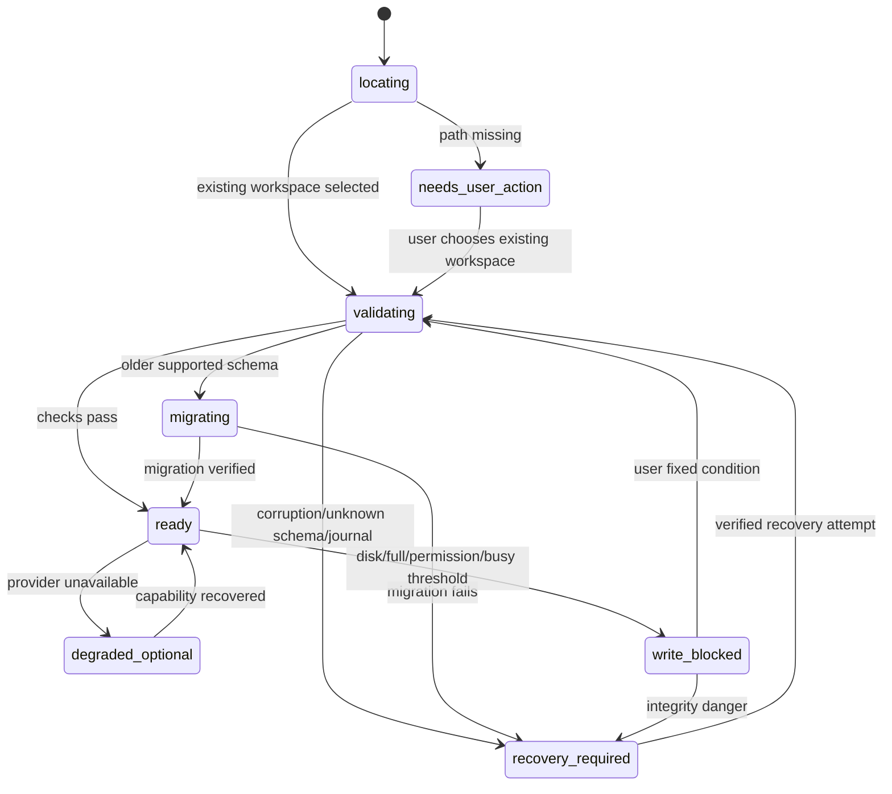

# Iterkeep — Hata Taksonomisi, İşlem Sonucu Uzlaştırma ve Kurtarma Sözleşmesi

> **Normatif hedef:** Iterkeep V1'de başarısızlık, süre aşımı, veri bütünlüğü riski, süreç çökmesi ve servis kesintilerinin **kullanıcı verisini koruyarak, yanlış başarı bildirmeden ve ana arayüzü gereksiz engellemeden** ele alınması. Geliştirici ajan yeni hata kanalını veya kullanıcıya teknik hata metnini kendi başına icat edemez.
>
> **Yetki sınırı:** Bu belge hata sınıflandırması, kullanıcıya yansıtma, kurtarma eylemlerinin sırası, çökme/yeniden açılış koordinasyonu ve failpoint senaryolarında kanoniktir. Gerçek SQL/trigger için DOC-09; transaction ve idempotency için DOC-10; public IPC kodları/rotaları için DOC-11; BackgroundJob geçişleri için DOC-12; restore/swap journal protokolü için DOC-17; capability health için DOC-19; agent onayları için DOC-27; güvenlik için DOC-30; performans eşikleri için DOC-31 yetkilidir. **Yeni SQLite tablosu, yeni IPC kanalı veya yeni public FailureCode tanımlamaz.**
>
> **Kanıt sınırı:** Buradaki TypeScript/SQL test taslakları uygulama için referanstır, henüz Electron/Vitest/Windows üzerinde çalıştırılmış ürün kanıtı değildir. `status: draft` korunur. Önceki belgelerde belirlenen kritik güvenlik ve veri bütünlüğü kuralları bu belgeyle gevşetilemez.

## 0. Kapsam ve davranış sözleşmesi

Iterkeep tek kullanıcıya yönelik, local-first, SQLite kanonik kaynaklı bir Electron uygulamasıdır. Kullanıcı AI, STT ve TTS hiç kurmadan proje/görev/not/karar/log kullanabilir. Sistem çöktüğünde başarıyı uydurmak, veritabanını kendiliğinden sıfırlamak, başkalarının Ollama süreçlerini öldürmek veya onaysız restore/Git push denemek yasaktır.

**Ana kullanıcı vaadi:** 1) Kaydedilmiş veri durumu gerçeği yansıtır; 2) kurtarma gerektiğinde birincil veri korunur; 3) opsiyonel modül bozulursa çekirdek ayakta kalır; 4) kullanıcı bir sonraki güvenli eylemi bilir; 5) destek raporları özel içerik taşımaz.

### 0.1 Hata terimleri

| Terim | Kesin anlam |
|---|---|
| `failed` | Eylemin uygulanmadığı / geri alındığı güvenilir biçimde doğrulandı |
| `unknown` | İşlem uygulanmış **olabilir**; timeout/IPC kesintisi tek başına rollback kanıtı değildir |
| `saved` | DB transaction commit ve ilgili receipt kesin olarak doğrulandı |
| `pending` | UI niyeti gönderildi; veri kalıcılığı henüz doğrulanmadı |
| `recoverable` | Kanıtlı, güvenli eylemle aynı çalışma alanında devam edilebilir |
| `degraded` | Bir capability yok/hatalı; temel CRUD çalışır |
| `recovery_required` | Yazma bloklu; doğrulama, restore veya kullanıcı eylemi gerekir |
| `read_only` | Açıkça izin verilmiş güvenli okuma yolu; bozuk DB üzerinde başarılı çalışma garantisi değil |
| `correlationId` | İşlemi UI, Main, Application ve worker arasında bağlayan UUID |
| `idempotencyKey` | Aynı niyetin tekrarında çift yazmayı engelleyen anahtar; `requestId` değildir |

### 0.2 Kesin hata sahipliği

- Renderer: geçici form/draft durumunu ve kullanıcıya görünen hata sunumunu yönetir; teknik hata nedenlerini tahmin etmez.
- Main IPC gateway: origin/sender, input Zod, timeout ve güvenli hata dönüşümünü yönetir.
- Application Core: domain invariant, komut semantiği, capability politika ve transaction durumunu yönetir.
- DB Worker: SQLite hatalarının orijinal kodunu **içeride** sınıflandırır, commit/receipt gerçeğini raporlar.
- JobManager: kalıcı job durumları, kontrollü retry ve restart reconciliation yapar; job kabulü iş sonucu değildir.
- RestoreCoordinator: host journal ve doğrulanmış aday üzerinden tek karar verir; Main/UI kendi başına DB değişimi yapmaz.
- CapabilityManager: Ollama/STT/TTS durumunu probe eder; hata nedeniyle core'u `failed` yapamaz.
- Security/Diagnostics: kullanıcı içeriği, absolute path ve secret sızmadan ölçüm ve tanılama sağlar.
## 1. Değişmez güvenilirlik kuralları (`ERR-I-001–048`)

| ID | Normatif kural | Doğrulama sonucu |
|---|---|---|
| `ERR-I-001` | Kalıcı mutation sonucu ancak transaction commit + receipt ile `saved` olur. | Sahte başarı yok. |
| `ERR-I-002` | IPC timeout, abort veya worker cevabı kaybı = otomatik `failed` değildir. | `unknown` olarak uzlaştır. |
| `ERR-I-003` | Aynı niyet retry edilirken `idempotencyKey` değişmez. | İkinci kayıt oluşmaz. |
| `ERR-I-004` | Aynı key ile farklı payload yeni komut olarak çalıştırılmaz. | `IDEMPOTENCY_CONFLICT`. |
| `ERR-I-005` | DB bozukken otomatik yeni workspace.db oluşturulmaz. | Recovery zorunlu. |
| `ERR-I-006` | Son kullanılan workspace yolu bulunamazsa yeni boş DB açılmaz. | Kullanıcı seçim yapar. |
| `ERR-I-007` | `SQLITE_CORRUPT` ve `SQLITE_NOTADB` için yazma bloke edilir. | İntegrite/restore. |
| `ERR-I-008` | `SQLITE_FULL` için kör otomatik tekrar yapılmaz. | Alan açma yönlendirmesi. |
| `ERR-I-009` | `SQLITE_BUSY` kontrollü ve sonlu süre bütçesinde ele alınır. | DOC-10 limitleri. |
| `ERR-I-010` | `SQLITE_READONLY` ayar/permission sorunu olmadan yeniden denenmez. | Yazma başarılı gösterilmez. |
| `ERR-I-011` | Constraint ihlali sistem yeniden başlatılarak gizlenmez. | Domain kodu/safe mesaj. |
| `ERR-I-012` | İç hata kodu public `FailureCodeSchema` dışında UI’ya aktarılmaz. | DOC-11 authoritative. |
| `ERR-I-013` | `ApiError` içinde `outcome` sadece `failed|unknown` olur. | Farklı durum ekleme yok. |
| `ERR-I-014` | `retryable:true` kullanıcı tekrarının güvenli olduğu anlamına tek başına gelmez. | Önkoşul kontrol et. |
| `ERR-I-015` | UI önbelleği kalıcı veri kaynağı değildir. | Snapshot + receipt. |
| `ERR-I-016` | Geçici editör metni DB kaydı sanılmaz. | Ayrı `unsaved` göstergesi. |
| `ERR-I-017` | Hata ekranlarında her zaman eylem ve güvenli çıkış bulunur. | Çıkmaz modal yok. |
| `ERR-I-018` | Hata oluşunca modal/overlay odağı kullanıcıdan koparılmaz. | DOC-23 klavye. |
| `ERR-I-019` | Hassas kullanıcı metni hata loguna otomatik girmez. | Redaksiyon zorunlu. |
| `ERR-I-020` | Tool argümanları ve ham model yanıtı tanılama raporuna kopyalanmaz. | DOC-27/30. |
| `ERR-I-021` | `system.getDiagnostics({level:"safe"})` dışına gizli diagnostic API açılmaz. | DOC-11 mevcut rota. |
| `ERR-I-022` | Ollama yok/kapalı ise core CRUD ve arama engellenmez. | Capability degraded. |
| `ERR-I-023` | STT hatası kaydedilmiş transkript varmış gibi gösterilmez. | Kayıt iptali/temizlik. |
| `ERR-I-024` | TTS hatası sohbet metnini silmez veya mesajı yeniden üretmez. | Text-only devam. |
| `ERR-I-025` | GPU/CPU baskısında otomatik tüm süreçleri öldürme yok. | Sadece app-owned iş yönetimi. |
| `ERR-I-026` | Model indirmesi yarım kalırsa tamamlandı/kuruldu etiketi gösterilmez. | Job status verify. |
| `ERR-I-027` | Yarım job varsayılan olarak yeniden yürütülmez. | DOC-12 reconciliation. |
| `ERR-I-028` | Git push/restore açık kullanıcı onayı; migration ise doğrulanmış sürüm yükseltme akışı gerektirir. | No silent replay. |
| `ERR-I-029` | Restore sırasında mevcut DB+asset koruması doğrulanmadan swap yok. | DOC-17. |
| `ERR-I-030` | Restore host journal bozuksa otomatik karar verilmez. | Recovery UI. |
| `ERR-I-031` | Migration checksum uyuşmazlığında eski SQL değiştirilmez. | Safe stop. |
| `ERR-I-032` | İleri sürüm şemaya eski binary yazmaz. | No silent downgrade. |
| `ERR-I-033` | FTS indeks bozulması kanonik kaydı silmez. | Rebuild projection. |
| `ERR-I-034` | Domain event kaçırılınca sessiz eski liste kullanılmaz. | `events.getSince` veya refetch. |
| `ERR-I-035` | İşlem başarısı `job accepted` ile karıştırılmaz. | Job sonucu takip. |
| `ERR-I-036` | İptal isteği `accepted` olsa bile tamamlanmış side effect tersine çevrilmiş sayılmaz. | Verify. |
| `ERR-I-037` | Renderer crash DB restart gerektirmez; yeniden yüklemede durum yeniden sorgulanır. | No duplicate mutation. |
| `ERR-I-038` | Worker Thread native crash izolasyonu garanti değildir. | Cold-start recovery. |
| `ERR-I-039` | Uncaught Main error sonrası kontrolsüz devam edilmez. | Controlled shutdown + startup. |
| `ERR-I-040` | Process exit sırasında senkron uzun IO/event döngüsü yapılmaz. | Bounded cleanup. |
| `ERR-I-041` | Uygulama açılamasa dahi kullanıcıya veriyi dışarı aktarma/kurtarma yolu sunulur. | Core safe route. |
| `ERR-I-042` | Açılışta tüm DB için ağır integrity_check bloklayıcı şekilde zorlanmaz. | Quick/conditional full. |
| `ERR-I-043` | Yanlış workspace üzerine restore/içe aktarma sadece seçimle değiştirilir. | Cross-workspace guard. |
| `ERR-I-044` | Tanılama raporları network üzerinden otomatik gönderilmez. | Manual opt-in. |
| `ERR-I-045` | Kritik hata için kullanıcı aksiyonu ve hata kodu yerelleştirilir. | TR/EN. |
| `ERR-I-046` | Hata mesajları yüksek kontrast, screenreader ve klavye uyumlu olur. | A11y. |
| `ERR-I-047` | P0 veri kaybı/izin bypass/false saved sürüm engelidir. | DOC-04. |
| `ERR-I-048` | Tüm recovery failpoint testleri saf mock değil, dosya/worker ve paketli uygulama katmanını içerir. | DOC-33. |
## 2. Hata sınıflandırma modeli

### 2.1 Sınıflar ve etkiler

| Sınıf | Etki alanı | Örnek | İlk tepki | Güvenli kullanıcı eylemi |
|---|---|---|---|---|
| `INPUT` | Tek form/istek | invalid date, oversized markdown | Form odağı korunur; çalıştırılmaz | Alanı düzelt |
| `CONFLICT` | Tek kayıt | eski revision, Inbox koruması | Yeni snapshot/diff al | Kararı gözden geçir |
| `TRANSIENT_DB` | Tek sorgu veya kuyruk | busy/locked, backpressure | Bounded retry veya queued UI | Yeniden dene / bekle |
| `UNKNOWN_OUTCOME` | Mutasyon kesinliği | IPC timeout after commit | Başarı/başarısızlık deme; receipt sorgula | Sonucu doğrula |
| `STORAGE_BLOCKED` | Workspace yazma | full, readonly, permission | Yazmayı güvenle durdur; draft koru | Disk/izin durumunu çöz |
| `STORAGE_INTEGRITY` | Workspace | corrupt, FK, invalid schema | Yazmayı kapat; recovery UI | Doğrulanmış yedek |
| `MIGRATION` | Boot | hash mismatch, schema too new | Eski dosyayı değiştirme | Uyumlu sürüm / kurtarma |
| `OPTIONAL_PROVIDER` | Sadece AI/STT/TTS | Ollama down, missing model | Capability degraded | Sonra yapılandır |
| `BACKGROUND_JOB` | Belirli iş | download fail, export fail | Job terminal code; artifact doğrula | Yeniden başlat (onaylı) |
| `SECURITY` | İstek/işlem | IPC forged approval, unsafe path | Deny, private log metadata | Güvenli işlemi yeniden seç |
| `PROCESS` | Renderer/Main/worker | crash, OOM, native segfault | Sahipliğe göre isolate veya restart | Kurtarma ekranına git |
| `RESTORE` | Workspace dosya seti | corrupt manifest, failed swap | Host journal + old set preserve | Önizlemeyi tekrar yap |

### 2.2 Dört ayrı boyut

1. **Şiddet:** `P0` kullanıcı veri kaybı, güvenlik sınırı veya sahte başarı; `P1` temel kullanım blokajı; `P2` opsiyonel işlev kaybı; `P3` kozmetik. Önceden DOC-04 kalite terminolojisiyle eşleştirilir.
2. **Kesinlik:** `failed` (uygulanmadığı biliniyor) veya `unknown` (uygulanmış olabilir); bu alan `ApiError.outcome`'dur, UI state değildir.
3. **Yeniden deneme:** `automatic_safe`, `manual_safe_after_verify`, `manual_after_change`, `never_automatic` (iç planlama; public enum DEĞİL).
4. **Kapsam:** `request`, `document`, `workspace`, `optional_provider`, `entire_process`. Yanlış kapsam, örneğin TTS çökmesinde workspace'i read-only yapma, hatadır.

**Öncelik:** İki hata eşzamanlıysa veri bütünlüğü/güvenlik riski her zaman servis kullanılabilirliğinden ve performanstan önce değerlendirilir. Örn. `DATABASE_CORRUPT` ve `MODEL_UNAVAILABLE` birlikteyse öncelikli ekran workspace recovery'dir; model kurulumu asla önce gösterilmez.

### 2.3 Kanonik public hata kodları, yeni enum YOK

DOC-11 `FailureCodeSchema` tek kaynaktır. Aşağıdaki mapping **var olan** kodları kullanır; daha ince iç nedenler `details` allowlist veya geliştirici tanılama katmanında kalır.

| Dahili hata / durum | Public `ApiError.code` | `outcome` | `retryable` | Not |
|---|---|---|---|---|
| Zod parse failure | `VALIDATION_FAILED` | `failed` | false | Alan doğrulaması |
| Request byte sınırı | `PAYLOAD_TOO_LARGE` | `failed` | false | Metin kısaltma/asset yolu |
| Optimistic CAS zero rows | `CONFLICT_REVISION` | `failed` | false | Yeni revision gerekir |
| SQLite `BUSY` / `LOCKED` | `DATABASE_BUSY` | `failed` veya `unknown` | yalnız doğrulanmış güvenli retry | COMMIT kesildiyse receipt |
| SQLite disk-full | `DATABASE_DISK_FULL` | `failed` veya `unknown` | false | Önce disk kontrolü |
| SQLite corrupt / not-a-db | `DATABASE_CORRUPT` | `failed` | false | Yazma engellenir |
| DB worker no reply / exit | `DB_WORKER_UNAVAILABLE` | `unknown` mutasyon; `failed` salt okuma | false | Native crash olabilir |
| DB queue doldu | `DB_BACKPRESSURE` | `failed` (kuyruğa alınmadıysa) | true | Yeni gönderim sınırlı |
| IPC hard timeout | `OPERATION_OUTCOME_UNKNOWN` | `unknown` mutasyon | false | Receipt sorgula |
| Sorgu timeout, hiçbir yan etki yok | `TIMEOUT` | `failed` | true | Sadece salt okuma |
| DB schema later than app | `SCHEMA_INCOMPATIBLE` | `failed` | false | Otomatik downgrade yok |
| Workspace missing | `WORKSPACE_UNAVAILABLE` | `failed` | false | Seçim/kurtarma |
| Ollama unreachable | `PROVIDER_UNAVAILABLE` | `failed` | true | Optional only |
| Model missing | `MODEL_UNAVAILABLE` | `failed` | false | Model Manager |
| Feature user-disabled | `CAPABILITY_DISABLED` | `failed` | false | Preferences |
| Microphone denied | `AUDIO_PERMISSION_DENIED` | `failed` | false | Sistem izinleri |
| Git remote ambiguous | `GIT_REMOTE_OUTCOME_UNKNOWN` | `unknown` | false | Remote durum doğrula |
| Import preview version stale | `IMPORT_PREVIEW_STALE` | `failed` | false | Yeniden preview |
| Restore rejected/failed | `RESTORE_FAILED` | `failed` veya `unknown` | false | DOC-17 host journal |
| Forged approval | `PERMISSION_DENIED` | `failed` | false | Gizli ayrıntı yok |
| Event gap / lost stream | `EVENT_GAP` | `failed` (event delivery) | true | `events.getSince`/refetch |
| Unknown internal bug | `INTERNAL_ERROR` | gerçeğe göre | false | Bug tracking |

- Native SQLite'ın **extended** error code'unu mümkünse Main içinde güvenli normalize et; `SQLITE_BUSY` `COMMIT` aşamasında çıktıysa kesin başarısız varsayma.
- `MIGRATION_CHECKSUM_MISMATCH`, `SCHEMA_TOO_NEW`, `INTERRUPTED_BY_RESTART` gibi DOC-10/12 dahili alt nedenler doğrudan yeni public `FailureCode` değildir; örneğin `SCHEMA_TOO_NEW → SCHEMA_INCOMPATIBLE`. Job satırındaki güvenli dahili `error_code` ile IPC `ApiError.code` birbiriyle karıştırılmaz.
- `OPERATION_OUTCOME_UNKNOWN` kesin bir **işlem kesinliği** göstergesidir; `retryable=false` iken kullanıcıya yeniden deneme butonu değil **Sonucu kontrol et** gösterilir.

### 2.4 Kapsam/durum matrisi

| Core DB | Opsiyonel servis | Renderer | Gösterilecek sistem hali |
|---|---|---|---|
| ready | healthy | ready | normal |
| ready | missing | ready | core normal; capability badge / settings |
| ready | crashed | ready | core normal; mevcut iş failed, kontrollü tekrar |
| ready | healthy | crashed | renderer reload, önce request result reconcile |
| busy | any | ready | write pending/failed; status ve retry |
| corrupt | any | ready | recovery UI; optional servis başlatma yok |
| missing | any | ready | workspace chooser; sessiz yeni DB yok |
| migrating | any | ready | migration/recovery loading; yeni write yok |
| unknown (Main crash) | any | gone | sonraki launch journal + receipt + integrity |
## 3. Yaşam döngüsü ve kurtarma durum makinesi

### 3.1 Workspace erişim modları



`degraded_optional`, `ready` ile kalıcı veri açısından **aynı** core yeteneğe sahiptir; capability ayrı bir overlay olarak uygulanmalı, DB status kolonuna yazılmamalıdır. `write_blocked` kalıcı domain enum'u değil, Main startup/storage health durumudur. `read_only` yalnız gerçekten açılıp doğrulanmış bir salt-okunur bağlantı için UI seçeneğidir.

### 3.2 Startup karar sırası (öncelikli)

1. Tekil uygulama örneği kilidi ve güvenli app origin doğrulanır (DOC-06/30).
2. Host restore journal var mı? Varsa DOC-17 coordinator **önce** kararı verir; işlemi tahmin etme.
3. Son workspace locator ve izinleri kontrol edilir. Yol bulunamıyorsa yaratma yok; kullanıcı seçim ekranı.
4. DB worker başlatılır; `foreign_keys`, WAL, schema manifest, `user_version` doğrulanır (DOC-09/10).
5. Migration gerekiyorsa önce **doğrulanmış pre-migration backup** (DOC-17), sonra transaction migration ve doğrulama.
6. İlgili kritik yol için `quick_check`/`foreign_key_check` yapılır; şüpheli durumda tam `integrity_check` bakıma ertelenebilir ancak bozulmuş DB yazılabilir açılmaz.
7. `background_jobs` kesintili işler DOC-12'deki V1 politikasına göre `failed/INTERRUPTED_BY_RESTART` olur; **otomatik yeniden yürütme yok**.
8. Pending `agent_runs`/onaylar DOC-27 ile uzlaştırılır; önceki onay asla yeniden etkinleştirilmez.
9. Ana UI, temel CRUD ve arama hazır olur; opsiyonel Ollama/STT/TTS health probe arka planda başlar.
10. Olay aboneliği `events.subscribe` kurulur; görünür listeler başlangıç snapshot ile güncellenir; önceki renderer cache'i kanıt sayılmaz.

**Önkoşul:** Açılışta DB dosyası yoksa yalnız `workspace.create` açık kullanıcı niyetiyle yeni kurulum yapılır. Başka workspace'e geçiş veri kaybı hatasını çözmek için otomatik kullanılmaz.

### 3.3 Uygulama çökmesi ayrımı

| Kaynak | Gözleme | Güvenli davranış |
|---|---|---|
| Renderer | `render-process-gone`, `webContents.isDestroyed` | Kritik mutation sonucunu receipt ile uzlaştır; UI'yı yeniden yükle; mevcut DB korunur |
| Electron child / utility | `child-process-gone` (uygun türlerde) | Etkilenen bağımsız yeteneği degraded; core durumu ayrıca kontrol |
| JS worker exception | `worker.on('error'|'exit')` | Yeni DB request kabul etme; pending writes `unknown`, worker yeniden başlatılırsa startup protokolü |
| Native SQLite segfault | Worker Thread aynı OS process | Main de düşebilir; sonraki launch'ta integrity/recovery gerekir, “izole edildi” iddiası yok |
| Main fatal error | Startup host receipt korunur | Güvenli çıkış, kullanıcıya restart/kurtarma yolu |
| Model/voice sidecar | Process ownership + exit code | Yalnız ilgili capability/job failed; metin ve core korunur |
| Windows power loss | Process event yok | Sonraki açılış journal, SQLite recovery, idempotency/host receipts |

`uncaughtException` sonrası uygulamanın güvenle çalışmaya devam edeceği varsayılmamalı. Diagnostic cleanup minimum ve bounded olmalı; işletim sistemi kapanışında kullanıcı veri garantileri transactional mekanizmalardan gelmelidir, `before-quit` callback'inden değil.

### 3.4 Kaydetme durumları

```text
User edits -> draft/dirty
  -> mutation accepted into transport: pending
  -> DB COMMIT/receipt success: saved
  -> explicit failure before commit: failed + editable draft retained
  -> timeout / lost ACK / worker exits: verifying
       -> receipt committed & payload match: saved
       -> receipt definitely absent + no pending execution & safe adjudication: failed
       -> status unresolved: unknown, block duplicate and preserve draft
```

- Autosave'de kullanıcı metni renderer'da kaybolabilecek kadar uzun süre sadece bellekte tutmak risklidir. DOC-14'e uygun bounded local **draft recovery** mekanizması kullanılmalı; bu mekanizma SQLite'ın kanonik kayıtlarıyla otomatik birleşmez.
- `saved` geri alınamaz bir UI övgüsü değildir; commit gerçekten doğrulanmış olmalıdır. `pending` göstergesi sessizce kaybolmaz.
- Crash sonrası eski React Query cache'i 'saved' ispatı değildir.

## 4. Retry, iptal, deadline ve idempotency

### 4.1 Retry karar tablosu

| Operasyon | Durum | Otomatik retry | Güvenli yol |
|---|---|---|---|
| Salt okuma | Timeout / transient provider | Bounded ve iptal edilebilir | Sorgu, snapshot veya callback tekrar |
| DB write | `SQLITE_BUSY` transaction başlamadıysa | DOC-10 toplam süre sınırında evet | Aynı key ve payload |
| DB write | IPC yanıtı kayıp | Hayır | `operations.getReceipt` → reconcile |
| Task CAS conflict | Stale revision | Hayır | Yeni snapshot/diff → kullanıcı kararı |
| Agent low-risk tool | İlk işlem başarılı, ikinci başarısız | Hayır (başarılı adım) | Kısmi sonuç raporla |
| Model indirme | Ağ kesildi | V1 otomatik resume garantisi yok | Sağlayıcı durumu/manifest verify → kullanıcı yeniden başlat |
| Git commit | İşlem sonucu belirsiz | Hayır | Yerel HEAD/status incele |
| Git push | Remote sonucu belirsiz | Hayır | Remote durum, git ref doğrula; yeni push onayı |
| Restore | Host journal mevcut | Hayır | DOC-17 deterministic recovery |
| Migration | Ortada crash | Hayır | Önce backup/journal/schema doğrula |
| TTS | Oynatma tamamlandı ama status kayıp | Hayır | Yanıt metni korunur, isteğe bağlı tekrar çal |
| STT | Kayıt/iş kesildi | Hayır | Geçici capture verisi doğrulanır; kullanıcıya yeni kayıt opsiyonu |

- **Retry budget:** IPC sorguları için DOC-11 timeout/limit; DB busy için DOC-10 3 saniye interaktif toplam bütçe; provider için DOC-19 backoff ve health TTL. Bu belge yeni agresif tekrar parametresi tanımlamaz.
- **Jitter:** Aynı kaynak üzerindeki concurrent retry'larda küçük jitter uygulanabilir; ancak toplam timeout bütçesi aşılmaz.
- **Cancel:** UI `AbortController` sadece request/stream iptali bildirir. Commit başlamış veya dış dünya yan etkisi tamamlanmış olabilir; iptal bir rollback garantisi değildir.

### 4.2 Kanonik receipt uzlaştırması

```ts
// packages/application/src/recovery/reconcile-mutation.ts
// Referans tipler; gerçek DTO importları DOC-11 manifestinden alınır.
type ReceiptState =
  | { state: 'committed'; result: unknown; payloadHash: string }
  | { state: 'not_found' }
  | { state: 'in_progress' }
  | { state: 'inconclusive' };

type MutationRecovery =
  | { status: 'saved'; result: unknown }
  | { status: 'failed'; messageKey: string }
  | { status: 'unknown'; showVerifyAction: true };

async function reconcileMutation(input: {
  commandName: string;
  idempotencyKey: string;
  expectedPayloadHash: string;
  lookup: (arg: { commandName: string; idempotencyKey: string }) => Promise<ReceiptState>;
}): Promise<MutationRecovery> {
  let receipt: ReceiptState;
  try {
    receipt = await input.lookup({
      commandName: input.commandName,
      idempotencyKey: input.idempotencyKey,
    });
  } catch {
    return { status: 'unknown', showVerifyAction: true };
  }
  if (receipt.state === 'committed') {
    if (receipt.payloadHash !== input.expectedPayloadHash) {
      return { status: 'failed', messageKey: 'errors.idempotencyConflict' };
    }
    return { status: 'saved', result: receipt.result };
  }
  // `not_found` tek başına commit edilmediğinin evrensel kanıtı değildir:
  // worker hâlâ çalışıyor/response gecikti, receipt retention dolmuş olabilir.
  if (receipt.state === 'not_found' || receipt.state === 'in_progress' || receipt.state === 'inconclusive') {
    return { status: 'unknown', showVerifyAction: true };
  }
  return { status: 'unknown', showVerifyAction: true };
}
```

Bu örnek **yeni public IPC değil**, Application/UI orkestrasyon algoritmasıdır. Gerçek `ReceiptStatus` türleri, receipt retention/GC ve request bound DOC-10/11'e uydurulacaktır. `receipt.not_found` sonrasında aynı payload+key ile kontrollü retry ancak komutun başarı durumuna dair **ayrıca** kesin negatif kanıt ve write/queue state kontrolü varsa mümkündür.

### 4.3 Job durum uzlaştırması

1. `jobs.get(jobId)` terminal durumu ve beklenen artifact fingerprint alınır.
2. `queued/running` eski process işiyse DOC-12'deki `INTERRUPTED_BY_RESTART` kuralına göre güvenle sonlandırılır; yarım dosyalar `.partial` olarak tutulur veya temizlenir.
3. `succeeded` ancak artifact/yan etki doğrulandıysa söylenir; aksi halde kullanıcıya `unknown`/recovery yazılır.
4. `failed` iş ile kalıcı veritabanı işleminin başarısı farklıdır; ör. model indirme başarısız olabilir ama proje notu başarılıdır.
5. Aynı job ID eski process'ten doğan artifact ile eşleşmiyorsa yeni job üretmeden önce uzlaştırma zorunludur.

## 5. Hata → kullanıcı arayüzü sözleşmesi

### 5.1 Mesaj modeli

```ts
// packages/contracts/src/ui/recovery-notice.ts (DTO example)
// NOT: public IPC Response yerine geçmez, renderer presentation type.
export type RecoveryNotice = {
  key: string;                // i18next message key
  severity: 'info' | 'warning' | 'critical';
  scope: 'operation' | 'screen' | 'workspace' | 'capability';
  correlationId: string;      // safe support reference
  actions: Array<
    | { id: 'retry_safe'; labelKey: string }
    | { id: 'verify'; labelKey: string }
    | { id: 'refresh'; labelKey: string }
    | { id: 'open_settings'; labelKey: string }
    | { id: 'open_recovery'; labelKey: string }
    | { id: 'dismiss'; labelKey: string }
  >;
};
```

Bu eylemler yalnız presentation ID'leridir; mevcut DOC-11 IPC komutlarına veya dahili güvenli navigasyona bağlanır. Kullanıcıdan bağımsız `recovery.executeArbitraryAction` adlı IPC rotası icat edilmez. Hata detayında kullanıcı içeriğini göstermek gerekiyorsa mevcut editörün yerel taslağı kullanılır, diagnostics'e kopyalanmaz.

### 5.2 Mesaj anahtarları (önerilen katalog)

| `messageKey` | TR metin | EN metin | Kullanıcı eylemi |
|---|---|---|---|
| `errors.validation` | Bilgilerden bazıları geçersiz. | Some values are invalid. | Alanı düzelt |
| `errors.revisionConflict` | Bu kayıt başka bir işlemde değişmiş. | This item changed elsewhere. | Değişiklikleri karşılaştır |
| `errors.savePending` | Kaydetme sonucu henüz doğrulanamadı. | Save result has not been verified. | Sonucu kontrol et |
| `errors.databaseBusy` | Çalışma alanı şu anda meşgul. | Workspace is busy. | Sonra tekrar dene |
| `errors.diskFull` | Disk alanı yetersiz. Kayıt tamamlanmadı. | Storage is full. Save did not complete. | Alan boşalt |
| `errors.databaseCorrupt` | Veri bütünlüğü sorunu algılandı. Yazma durduruldu. | Data integrity issue detected. Writes are blocked. | Kurtarma ekranını aç |
| `errors.workspaceMissing` | Çalışma alanı bulunamadı. | Workspace could not be found. | Dosya seç / yedekten kurtar |
| `errors.schemaIncompatible` | Veriler bu uygulama sürümüyle uyumlu değil. | Data is incompatible with this app version. | Uyumlu sürümü aç |
| `errors.ollamaUnavailable` | Yerel yapay zekâya ulaşılamıyor. | Local AI is unavailable. | Ayarlar |
| `errors.voiceUnavailable` | Ses servisi şu anda kullanılamıyor. | Voice service is unavailable. | Yazıyla devam et |
| `errors.microphoneDenied` | Mikrofon izni verilmedi. | Microphone permission was denied. | Sistem izinleri |
| `errors.restoreReview` | Geri yükleme tamamlanamadı. Önceki verilerin durumu doğrulanıyor. | Restore could not complete. Previous data is being verified. | Kurtarmayı incele |
| `errors.gitPushUnknown` | Uzak Git işleminin sonucu doğrulanamadı. | Git remote outcome could not be verified. | Uzağı kontrol et |
| `errors.internal` | Beklenmeyen bir hata oluştu. | An unexpected error occurred. | Tanılama kodunu kopyala |

**Duruma göre metin doğruluğu:** `unknown` durumundaki kaydetme için “Kayıt tamamlanmadı” yazılmaz; `failed` durumundaki işlem için “Belki kaydedilmiştir” yazılmaz. Yerel erişilebilirlik duyurularında aynı ayrım korunur.

### 5.3 Hata ekranı hiyerarşisi

| UI modeli | Kullanım | Özellikler |
|---|---|---|
| Inline field error | Tek alan validation | Field id ilişkili, odak sahasında |
| Inline operation notice | Komut sonucu | Kaydetme durumu, action, correlation ID |
| Nonblocking toast | Kullanıcı işini sürdürebildiğinde | Kısa ve tekrar edilmeyen |
| Capability status | AI/STT/TTS degraded | Normal proje alanı kapanmaz |
| Recovery panel | DB/backup/migration riski | Yedek seçim, integrity özeti, açık onay |
| Fatal safe screen | Core açılamıyorsa | Reopen, diagnostics, exit; sessiz data reset yok |

`Dialog` kapanınca hata bilgisinin de kaybolması veri kaybı riski yaratıyorsa kurtarma durumu görünür ekranda veya persistent notification alanında korunur. Screenreader canlı duyuruları (`aria-live`) tekrarlanan token/progress güncellemeleri ile spam edilmez.

## 6. Özelleşmiş kurtarma senaryoları

### 6.1 SQLite veri bütünlüğü

- `SQLITE_CORRUPT`, `SQLITE_NOTADB`: Main `writeBlocked` durumuna geçer, normal otomatik repair veya `VACUUM` başlatılmaz. Safe verified backup listesi açılır.
- `SQLITE_IOERR`, `SQLITE_CANTOPEN`: OS error sınıfına göre sürücü, izin, yol kaybı incelenir; salt-okunur mümkün değilse yanlış ‘read-only’ etiketi verilmez.
- `SQLITE_FULL`: Açık editör taslağını koru, yeterli boş alan olmadan aynı mutasyon başlatma; yedek alınamadıysa migration/restore'a geçme.
- `SQLITE_BUSY`: DOC-10 busy_timeout 3000ms ve IPC deadline ortak bütçe; transaction sonucunun belirsiz olduğu anlarda receipt sorgulanır.
- `PRAGMA quick_check`: başlatma için seçili hızlı kontrol; şüpheli corruption/restore sonrası `PRAGMA integrity_check` ve `PRAGMA foreign_key_check` uygula. Kontrol SQL'i DB worker'da çalışır; renderer SQL çalıştıramaz.
- `FTS5`: `search_fts` sanal tablosu ana kaynak değildir; kanonik domain tabloları sağlam olduğunda DOC-15 `search_rebuild` runner ile yeniden kurulur; bu işlem commit/data kaybı başarısı gibi sunulmaz.

### 6.2 Backup / restore / migration

1. Restore için kullanıcı `backups.previewRestore` çağırır; manifest/hash/assets/schema/limits doğrulanır.
2. Etki özeti görünür; `backups.commitRestore` yalnız geçerli preview + approval ile başlar.
3. RestoreCoordinator aktif DB'yi kapatma, pre-restore backup, staging ve verified switch adımlarını host journal'da izler (DOC-17).
4. Hata varsa hangi setin authoritative olduğu fingerprint ve journal ile kanıtlanmadan yeni DB açılmaz.
5. Yeni DB doğrulandıktan sonra ancak çalışma alanı `ready` olur; arama indeksi dahil restore post-check çalışır.
6. Rollback dosyaları retention ve kullanıcı onayı olmadan erken silinmez.
7. Migration checksum uyuşmazlığında sessiz yeni migration yazılmaz. Kullanıcıya destek/uyumlu sürüm seçeneği sunulur.

### 6.3 Proje / not / görev çakışmaları

- UI eski `revision` ile yazarsa servis `CONFLICT_REVISION` döndürür. Yerel editör taslağı aynen kalır.
- Kullanıcıya mevcut kayıt ve taslak diff gösterilir; `Overwrite` tuşu mevcut revision'ı kör geçemez.
- Çözülen niyet yeni `idempotencyKey` ve güncel expectedRevision ile uygulanır; eski bilinmeyen işlem önce uzlaştırılır.
- Karar revizyonları ve activity logs append-only politikası çakışma çözümünde ihlal edilemez.
- Task drag/reorder sırasında başka client güncellerse optimistic görünüm rollback, yeniden sorgu ve net uyarı uygulanır.

### 6.4 Agent ve kullanıcı onayı

- `approvals.status='pending'` penceresi kapanırsa onay verilmiş varsayılmaz.
- Bekleyen onay süresi dolduğunda `APPROVAL_EXPIRED`; eski fingerprint başka eylemde yeniden kullanılamaz.
- `tool_calls` sonucu kesin değilse modelin sonraki mesajına success bağlanmaz; `needs verification` sunulur.
- Kısmi çok-adımlı agent akışında yalnız gerçekten tamamlanan araçlar listelenir; otomatik toplu geri alma yapılmaz.
- LLM cevabı içine koyulan `tool completed` satırı veri kaynağı değildir: gerçek commit receipt ve `tool_calls` durumudur.
- Untrusted Markdown veya web/import metni agent policy ya da UI hata mesajı davranışını değiştiremez.

### 6.5 Ollama / STT / TTS

- Ollama yok: `capabilities.get` AI’yı unavailable olarak raporlar; `models.detectOllama({explicit:true})` kullanıcı isteğinde yeniden probe yapar.
- İndirilen model görünür ama hash veya provider listesi uyumsuz: `MODEL_UNAVAILABLE` ve model yöneticisi; sahte available yok.
- Model indirme sırasında process kapandı: `jobs.get` sonrası eski job otomatik devam ettirilmez; sağlayıcı tarafındaki indirmenin tamamlanması yeni kullanıcı niyeti değildir.
- Mikrofon izni yok: kayıt başlamaz; kayıt indicator açık gibi kalmaz.
- PCM sırası / byte size bozuk: `voice.appendChunk` reddeder; güvenli capture cleanup ve session state uygulanır.
- STT sidecar çöktü: capture geçici dosyalarının silinip silinmediği doğrulanır; transkript uydurulmaz.
- TTS ses oynatma çöktü: text response ve conversation ID korunur; kullanıcı tekrar okumayı seçebilir.
- GPU baskısı: resource manager yalnız app-owned GPU görevlerini koordine eder; dış Ollama işleri kapatılmaz.

### 6.6 Import/export/Git

- Güvenilmeyen ZIP/YAML: manifest, boyut, path, hash ve sayfa sınırları DOC-16'ya göre; tehlikeli dosya açılmaz.
- Import preview stale olduysa otomatik commit yasak; yeni preview gerekir.
- Export başarı etiketi yalnız tüm dosyalar+manifest verifiye edildiğinde görünür; kısmi dizin `.partial` olur.
- Git commit sonrası dönüş kaybolursa HEAD doğrulanır; `git.commitExport` otomatik ikinci kez yapılmaz.
- Git push sonucu belirsizse `GIT_REMOTE_OUTCOME_UNKNOWN`; git ref/remote doğrulaması ve yeni kullanıcı onayı gerekir.
- `git.pushExport` agent tool kataloğunda yoktur; asla agent'ın doğrudan yapabildiği komuta dönüştürülmez.

## 7. Gözlemlenebilirlik ve redaksiyon

### 7.1 `RecoveryDiagnostic` dahili şeması

```ts
// packages/application/src/recovery/recovery-diagnostic.ts
export type RecoveryDiagnostic = {
  timestamp: string;              // UTC string
  correlationId: string;          // UUID v4
  scope: 'ipc' | 'db' | 'job' | 'renderer' | 'provider' | 'restore' | 'security';
  safeCode: string;               // known allowlist
  outcome: 'failed' | 'unknown';
  phase: string;                  // bounded allowlisted token, not user text
  durationMs?: number;
  retryAttempt?: number;
  jobId?: string;
  appVersion?: string;
  schemaVersion?: number;
  // NO prompt, text, raw path, API key, SQL args, command, stack trace, audio bytes
};
```

- Diagnostik *public* çıktı `system.getDiagnostics({level:'safe'})` DTO'sundan üretilir; bu iç şema herkese verilmez.
- Log seviyeleri: `debug` (varsayılan kapalı), `info` (sanitised), `warn`, `error` (sanitised). Log rotasyonu ve saklama DOC-27/30 ile uyumlu.
- Kullanıcı isterse **önizleyerek** bir raporu kendisi kopyalar; otomatik telemetri, mail veya ağ gönderimi yoktur.
- Her P0 olayına `correlationId`, uygulama sürümü, şema sürümü ve kırmızılaştırılmış OS error summary eklenir.
- Privacy redaction testinde fixture not, email, telefon, mutlak Windows yolu, Ollama prompt ve transcript sentinel kelimeleri loglarda bulunmamalı.
- Analiz için denetim logları ve `activity_logs` farklıdır: teknik hata `activity_logs` içine otomatik yazılmaz.

### 7.2 Ölçülebilir dayanıklılık göstergeleri

| Metrik | Tanım | Kalite ölçütü |
|---|---|---|
| `false_saved_count` | Commit kanıtı olmadan `saved` görünmesi | **0**, P0 |
| `unauthorized_action_count` | Politika bypass'ıyla gerçek side effect | **0**, P0 |
| `lost_committed_record_count` | Recoverable transaction sonrası kayıp | **0** fixture'larda, P0 |
| `duplicate_effect_count` | Aynı idempotency ile iki kayıt | **0**, P0 |
| `unreconciled_unknown_count` | Güvenli doğrulama olmayan belirsiz işlemler | Sıfır gibi gizlenmez; ayrı raporlanır |
| `provider_crash_core_impact` | Optional provider çökerken core işlem blokajı | **0**, P0 |
| `restore_data_loss_count` | Restore sırasında önceki iyi veri kaybı | **0**, P0 |
| `recovery_time_ms` | Kullanıcı eylemiyle usable duruma dönüş | DOC-31 cihaz bazlı ölçüm; uydurma eşik yok |
| `diagnostic_privacy_leaks` | Sensitive fixture marker loglarda | **0**, P0 |

## 8. Repo dosya konumları ve somut implementasyon

Yeni paket açmak yerine DOC-07'nin sınırlarına uyulacak:

```text
packages/application/src/
  recovery/
    error-classifier.ts
    reconcile-mutation.ts
    startup-recovery-orchestrator.ts
    recovery-policy.ts
    recovery-diagnostic.ts
    recovery-notices.ts
packages/storage-sqlite/src/
  repositories/idempotency.repository.ts
  worker/worker-entry.ts
  connection/pragmas.ts
packages/job-system/src/
  reconciliation.ts
  job-manager.ts
apps/desktop/src/main/
  lifecycle/renderer-crash-handler.ts
  lifecycle/shutdown-coordinator.ts
  restore/restore-coordinator.ts       # DOC-17 owns the implementation
  restore/host-journal.ts             # DOC-17 owns the implementation
  ipc/ipc-gateway.ts                 # DOC-11 owns the implementation
apps/desktop/src/renderer/src/
  features/recovery/
    RecoveryScreen.tsx
    RecoveryNotice.tsx
    RecoveryActions.tsx
    useMutationReconciliation.ts
  features/settings/
    SystemHealthScreen.tsx
tests/
  integration/recovery/
  resilience/recovery/
  e2e/recovery/
```

Yolların **kullanıcıya sunulacak mutlak workspace path'i** olmadığını unutma. DOC-07'de aynı bileşen için farklı isim varsa DOC-07 kanoniktir; yeni dosya adları özel kaynak değil, önerilen konumlardır. Öğeler mevcut bir pakete yerleştirilir; yeni dependency döngüsü kurulmaz.

### 8.1 Sınıflandırıcı örneği

```ts
// packages/application/src/recovery/error-classifier.ts
// Pseudocode-ish TS: SQLite native errors are parsed at the storage boundary.
export type SafeFailureCode =
  | 'DATABASE_BUSY'
  | 'DATABASE_DISK_FULL'
  | 'DATABASE_CORRUPT'
  | 'DB_WORKER_UNAVAILABLE'
  | 'OPERATION_OUTCOME_UNKNOWN'
  | 'INTERNAL_ERROR';

export type NormalizedFailure = {
  code: SafeFailureCode;
  outcome: 'failed' | 'unknown';
  retryable: boolean;
  messageKey: string;
};

export function classifyStorageFailure(
  sqliteCode: string | undefined,
  context: { mutation: boolean; commitAcknowledged: boolean; phase: 'before_begin' | 'during_transaction' | 'during_commit' | 'after_commit' },
): NormalizedFailure {
  if (context.mutation && !context.commitAcknowledged) {
    // Commit may have succeeded even when IPC acknowledgement failed.
    if (context.phase === 'during_commit' || context.phase === 'after_commit' || sqliteCode === 'SQLITE_IOERR' || sqliteCode === undefined) {
      return {
        code: 'OPERATION_OUTCOME_UNKNOWN',
        outcome: 'unknown', retryable: false,
        messageKey: 'errors.savePending',
      };
    }
  }
  switch (sqliteCode) {
    case 'SQLITE_BUSY':
    case 'SQLITE_LOCKED':
      return { code: 'DATABASE_BUSY', outcome: 'failed', retryable: false,
        messageKey: 'errors.databaseBusy' };
    case 'SQLITE_FULL':
      return { code: 'DATABASE_DISK_FULL', outcome: 'failed', retryable: false,
        messageKey: 'errors.diskFull' };
    case 'SQLITE_CORRUPT':
    case 'SQLITE_NOTADB':
      return { code: 'DATABASE_CORRUPT', outcome: 'failed', retryable: false,
        messageKey: 'errors.databaseCorrupt' };
    default:
      return { code: 'INTERNAL_ERROR', outcome: 'failed', retryable: false,
        messageKey: 'errors.internal' };
  }
}
```

**Sınırlama:** Kod örneği yalnız belirli sınıfları gösterir. Prod mapping `SQLITE_IOERR` extended code, transaction safhası (`before_begin`, `during_transaction`, `during_commit`, `after_commit`) ve receipt kanıtını kullanmalıdır. `BUSY` commit aşamasında olursa doğrudan `failed` değil `unknown` dönmek gerekebilir. Kapsamlı mapping repo testleriyle doğrulanmadıkça örnek birebir production'a kopyalanmamalıdır.

### 8.2 Renderer pencere çökmesi — örnek

```ts
// apps/desktop/src/main/lifecycle/renderer-crash-handler.ts
// DOC-06 windows management with safe allowlisted app URL.
import type { BrowserWindow } from 'electron';

export function installRendererCrashHandler(win: BrowserWindow, onCrash: (reason: string) => void): void {
  win.webContents.on('render-process-gone', (_event, details) => {
    onCrash(details.reason);
    // Do not treat pending mutations as rolled back.
    // Main shows a safe reload action with reconciliation on next renderer start.
  });
}
```

`onCrash` log'a raw `details` veya kullanıcı metnini dökmez; olayın sebebini allowlist reason'a eşler. Renderer reload gerekirse preload ve subscription'lar sıfırdan bağlanır; eski `AbortController`/IPC listener referansları yeniden kullanılamaz.

### 8.3 Bootstrap karar örneği

```ts
// packages/application/src/recovery/startup-recovery-orchestrator.ts
export type BootstrapGate =
  | { mode: 'ready'; workspaceId: string }
  | { mode: 'needs_user_action'; reason: 'workspace_missing' }
  | { mode: 'recovery_required'; reason: string }
  | { mode: 'migrating'; migrationVersion: number };

export async function classifyBootstrap(input: {
  workspaceExists: boolean;
  restoreJournalPending: boolean;
  schemaIsCompatible: boolean;
}): Promise<BootstrapGate | { mode: 'continue_validation' }> {
  if (input.restoreJournalPending) {
    return { mode: 'recovery_required', reason: 'restore_journal_pending' };
  }
  if (!input.workspaceExists) {
    return { mode: 'needs_user_action', reason: 'workspace_missing' };
  }
  if (!input.schemaIsCompatible) {
    return { mode: 'recovery_required', reason: 'schema_incompatible' };
  }
  return { mode: 'continue_validation' };
}
```

Bu fonksiyon DB açmaz veya migration çalıştırmaz; **yalnız karar tablosu referansıdır**. Gerçek akış DOC-17 host journal'ı çözdükten sonra DOC-10 migration'ına ve DOC-19 capability probe'una devreder.

## 9. Hata enjeksiyonu ve yürütme sözleşmesi

### 9.1 Failpoint listesi

| Failpoint | Uygulanacak sahne | Beklenen sonuç |
|---|---|---|
| `after_intent_before_db` | UI optimistic update sonrası kill | saved değil; taslak korunur |
| `after_begin_before_mutation` | SQLite işleminde kill | Rollback/deterministic state |
| `after_mutation_before_commit` | Transaction kill | Atomic rollback |
| `after_commit_before_reply` | Receipt yazılıp dönüş kaybı | Duplicate yok; reconcile saved |
| `worker_exit_mid_query` | DB worker JS exit | Pending reads fail; mutation unknown |
| `native_sqlite_process_crash` | Electron process kill simulated | Cold-start integrity/receipt, reset yok |
| `renderer_restart_mid_save` | UI render crash | Refetch + receipt |
| `event_drop_after_commit` | Event subscription gap | Snapshot/event cursor recovery |
| `disk_full_during_wal` | Disk/quota limit | DB mutasyonu false saved olmaz |
| `corrupt_db_on_open` | Tamper copy of fixture | Recovery required |
| `migration_kill_before_commit` | Migration transaction kill | Önceki verified backup korunur |
| `restore_kill_during_swap` | Host journal intermediate phase | Deterministic restore/rollback |
| `backup_partial_asset` | Asset hash failure | No verified backup |
| `ollama_restart_mid_stream` | Provider kill | Core devam, model run failed |
| `whisper_crash_mid_transcript` | STT kill | Text-only; no invented transcript |
| `tts_crash_after_first_chunk` | TTS kill | Metin kalır, playback temiz |
| `git_push_ack_lost` | Push remote ACK loss | Unknown, no auto retry |
| `approval_timeout_during_tool` | Tool approval stale | No new side effects |

- Failpoint yalnız test build'inde allowlisted kontrolle aktif; üretim renderer'ına `injectCrash()` veya SQL injection test endpoint'i açılmaz.
- Kill testleri disposable çalışma alanlarında koşturulur. Gerçek kullanıcı verisi veya model cache'inde bozuk dosya testi yapılmaz.
- Her senaryoda hem önceki committed records hem yedek/host receipts hem ekran metni kontrol edilir.

### 9.2 Çalıştırma matrisi

| Ortam | Amaç | Zorunluluk |
|---|---|---|
| Vitest + fake clock | Mapping, retry budget, state transitions | PR G1 |
| Temp SQLite DB + gerçek DDL | Transaction, FK, FTS, receipt | Feature G2 |
| Spawned worker | Worker death, pending IPC | G2/G3 |
| Windows packaged Electron | Renderer crash, native ABI, file lock | RC G3/G4 |
| Windows gerçek dosya sistemi | Restore crash, atomic rename sınırları | RC G3/G4 |
| Ollama/STT/TTS available hardware | Capability crash/fallback | İlgili feature G3 |
| No Ollama/Python/GPU | Core açılış ve CRUD | **P0**, tüm release'ler |

**Kritik:** Test fixture'ında hata üretmek, otomatik başarı kanıtı değildir; failpoint gerçekten hedeflenen fazı vurmalı, receipt/fingerprint veri kümesinde beklenen kanıtlar kıyaslanmalı.
## 10. Uçtan uca kurtarma akışları (`ERR-F-001–016`)

Her senaryo `Given/When/Then`, gösterilen tam TR/EN mesaj, IPC çağrısı, DB/job/host receipt ve gözlemlenebilirlik kanıtıyla E2E'ye çevrilir.

| ID | Senaryo | Eylem dizisi | Kabul kanıtı |
|---|---|---|---|
| `ERR-F-001` | İlk açılış, tüm isteğe bağlı servisler kapalı | Workspace doğrula → core aç → provider probe atla → proje/görev oluştur | Kullanılabilir core; AI/voice için eksik uyarısı değil isteğe bağlı buton |
| `ERR-F-002` | Son çalışma alanı kayıp | Locator boş → yeni DB oluşturma → recovery/klasör seç | Var olan başka DB üzerine yazılmaz |
| `ERR-F-003` | Hızlı Inbox task sonucu kayıp | Send idempotent create → commit → IPC reply drop → receipt query | Aynı ID ve tek task ile saved |
| `ERR-F-004` | Not autosave sırasında disk doldu | Draft düzenle → commit fails → visible dirty → disk free | Taslak korunur; yeni niyet kontrollü |
| `ERR-F-005` | Kanban revision yarışması | Drag → başka edit → CAS 0 rows → refetch/diff | Sessiz overwrite yok |
| `ERR-F-006` | SQLITE_BUSY interaktif yazma | Harici lock → bounded deadline → abort/busy | UI responsive, false saved 0 |
| `ERR-F-007` | FTS projeksiyon bozuldu | FTS integrity fail → search degraded → rebuild job | Source kayıtlar sağlam, rebuild progress görünür |
| `ERR-F-008` | DB bozuk açılış | Corrupt fixture → integrity fail → recovery screen | Yeni boş workspace sessiz açılmaz |
| `ERR-F-009` | Migration checksum uyuşmazlığı | Older DB + modified migration hash | Write blocked; backup retained; diagnostic |
| `ERR-F-010` | Restore yarıda Windows kapanması | Stage verified → swap attempted → kill → restart journal | Deterministic old/new validated outcome |
| `ERR-F-011` | Agent onayı süresi doldu | Pending approval → clock past expiry → submit | No tool execution; expired gösterilir |
| `ERR-F-012` | Agent çok-adımlı kısmi başarı | Task created → decision fails | Sadece ilk adım successful, ikinci failed |
| `ERR-F-013` | Ollama stream kesildi | Model run token stream → provider exits | Core usable; run failed / text partial labelled |
| `ERR-F-014` | Whisper sidecar çökmesi | Mic stop → STT crash | Transcript yok, yeniden deneme kullanıcı kontrollü |
| `ERR-F-015` | TTS playback çıkış hatası | Text rendered → TTS first chunk → crash | Text retained, audio stopped |
| `ERR-F-016` | Git remote push belirsiz | Push accepted remote → client ACK lost | No automatic second push; verify remote |
### 10.1 Örnek senaryo: kaydetme cevabı kayboldu (`ERR-F-003`)

**Given:** Workspace id `W`, task oluşturma niyeti için immutable payload hash `H` ve idempotency key `K`; task count `N`.

**When:** UI `tasks.create` gönderir; DB `tasks`, `task_history`, `domain_events`, `idempotency_receipts` transaction'ını commit eder ama IPC başarılı yanıtı düşürülür.

**Then:** UI `saved` göstermez. `operations.getReceipt({idempotencyKey:K,commandName:'tasks.create'})` ile commit `H` doğrulanır, task ID alınır, query cache invalidation/refetch yapılır, ardından `saved` gösterilir. `tasks` sayısı `N+1`; history/event/receipt tek adet olur. Aynı key'e farklı payload verilirse `IDEMPOTENCY_CONFLICT`.

### 10.2 Örnek senaryo: disk dolu (`ERR-F-004`)

**Given:** Not editöründe henüz kaydedilmemiş değişiklikler var ve test quota limiti konmuş.

**When:** Autosave commit `SQLITE_FULL` ya da dosya yazma hatasıyla başarısız olur.

**Then:** UI `dirty` ve açık kurtarma mesajını gösterir. Editör içerik kaybolmaz, `saved` etiketi yoktur. Alan boşaltıldıktan sonra eski niyetin sonucu receipt ile kontrol edilir; gerekirse yeni güvenli komut çalıştırılır. Restore/migration aynı diskte doğrulanmış recovery point olmadan başlamaz.

### 10.3 Örnek senaryo: restore ortasında kill (`ERR-F-010`)

**Given:** Valid candidate backup ve bozulmamış aktif DB/asset kümesi, DOC-17 doğrulanmış pre-restore point.

**When:** `replacement_attempted` host journal fazında süreç öldürülür.

**Then:** Sonraki başlangıç host journal'ı algılar; yeni set doğrulanmışsa yeni seti active ilan eder, değilse korunan eski sete döner. İki setten hiçbiri kanıtlanamıyorsa kullanıcı kurtarma ekranına alınır. **Yeni boş DB oluşturulmaz, veri silinmez.**
## 11. Test kataloğu (`ERR-T-001–080`)

Tüm testler önce kodlanacak ve ilgili gerçek fixture/runner tamamlanmadan `passed` işaretlenmeyecek. `P0` emniyet senaryoları DOC-04 uyarınca yayın engelidir. Her test ID'si için kanıt `artifacts/tests/recovery/<test-id>/` altında, özel veri içermeyen JSON/rapor olarak saklanır.

| Test ID | Seviye | Hazırlık / eylem | Geçiş kriteri |
|---|---|---|---|
| `ERR-T-001` | Unit | Geçersiz girişte alan odak ve validation text | Receipt/job state and row counts verified |
| `ERR-T-002` | Unit | Payload sınırı ihlalinde istek DB’ye gitmez | No sensitive logs; no unauthorized side effects |
| `ERR-T-003` | Unit | Kaydetme pending iken toast success yok | No false saved or destructive replay |
| `ERR-T-004` | Unit | Pencere yeniden yüklendiğinde unsaved draft uyarısı | UI/DB state and message checked |
| `ERR-T-005` | Unit | Locale TR/EN hata anahtarları eksiksiz | Receipt/job state and row counts verified |
| `ERR-T-006` | Unit | Klavye-only recovery action erişilebilir | No sensitive logs; no unauthorized side effects |
| `ERR-T-007` | Unit | Screenreader kayıt sonucu bildirimi | No false saved or destructive replay |
| `ERR-T-008` | Unit | Hata modal kapanınca durum unutulmaz | UI/DB state and message checked |
| `ERR-T-009` | Integration | Commit sonrası ACK düşür; receipt success | Receipt/job state and row counts verified |
| `ERR-T-010` | Integration | Commit öncesi kill; no record | No sensitive logs; no unauthorized side effects |
| `ERR-T-011` | Integration | Aynı key+same hash tek kayıt | No false saved or destructive replay |
| `ERR-T-012` | Integration | Aynı key+different hash conflict | UI/DB state and message checked |
| `ERR-T-013` | Integration | Receipt lookup unavailable => unknown | Receipt/job state and row counts verified |
| `ERR-T-014` | Integration | Not found receipt => otomatik failed çıkarma | No sensitive logs; no unauthorized side effects |
| `ERR-T-015` | Integration | Cancel after commit => saved verified | No false saved or destructive replay |
| `ERR-T-016` | Integration | Çift hızlı tıklama idempotent | UI/DB state and message checked |
| `ERR-T-017` | Integration | Busy bounded deadline | Receipt/job state and row counts verified |
| `ERR-T-018` | Integration | Busy commit ambiguity reconciliation | No sensitive logs; no unauthorized side effects |
| `ERR-T-019` | Integration | Disk full no false saved | No false saved or destructive replay |
| `ERR-T-020` | Integration | Readonly workspace write blocked | UI/DB state and message checked |
| `ERR-T-021` | Integration | Corrupt db no empty fallback | Receipt/job state and row counts verified |
| `ERR-T-022` | Integration | Missing path user selection required | No sensitive logs; no unauthorized side effects |
| `ERR-T-023` | Integration | Future schema no downgrade | No false saved or destructive replay |
| `ERR-T-024` | Integration | FK fail transaction rolls back | UI/DB state and message checked |
| `ERR-T-025` | E2E | Renderer kill + reconnect snapshot | Receipt/job state and row counts verified |
| `ERR-T-026` | E2E | Worker JS exit pending writes unknown | No sensitive logs; no unauthorized side effects |
| `ERR-T-027` | E2E | Native crash simulation cold restart | No false saved or destructive replay |
| `ERR-T-028` | E2E | Main kill before transaction commit | UI/DB state and message checked |
| `ERR-T-029` | E2E | OS power loss via hard kill | Receipt/job state and row counts verified |
| `ERR-T-030` | E2E | Pending old jobs mark interrupted | No sensitive logs; no unauthorized side effects |
| `ERR-T-031` | E2E | Pending agent approvals not resurrected | No false saved or destructive replay |
| `ERR-T-032` | E2E | Startup optional probe cannot block | UI/DB state and message checked |
| `ERR-T-033` | E2E | Staged restore no approval rejected | Receipt/job state and row counts verified |
| `ERR-T-034` | E2E | Pre-restore backup fails -> no swap | No sensitive logs; no unauthorized side effects |
| `ERR-T-035` | E2E | Staging asset hash mismatch | No false saved or destructive replay |
| `ERR-T-036` | E2E | Kill before DB file switch | UI/DB state and message checked |
| `ERR-T-037` | E2E | Kill during DB+assets switch | Receipt/job state and row counts verified |
| `ERR-T-038` | E2E | Malformed host journal => recovery UI | No sensitive logs; no unauthorized side effects |
| `ERR-T-039` | E2E | Old set not deleted before verify | No false saved or destructive replay |
| `ERR-T-040` | E2E | Migration checksum mismatch restore point kept | UI/DB state and message checked |
| `ERR-T-041` | E2E | Ollama missing core CRUD works | Receipt/job state and row counts verified |
| `ERR-T-042` | E2E | Ollama streaming disconnect | No sensitive logs; no unauthorized side effects |
| `ERR-T-043` | E2E | Model download app restart | No false saved or destructive replay |
| `ERR-T-044` | E2E | STT permission denied status reset | UI/DB state and message checked |
| `ERR-T-045` | E2E | STT sidecar exits no transcript | Receipt/job state and row counts verified |
| `ERR-T-046` | E2E | TTS crash text preserved | No sensitive logs; no unauthorized side effects |
| `ERR-T-047` | E2E | App only terminates owned sidecar | No false saved or destructive replay |
| `ERR-T-048` | E2E | GPU contention core responsiveness | UI/DB state and message checked |
| `ERR-T-049` | E2E | Event dropped then getSince/refetch | Receipt/job state and row counts verified |
| `ERR-T-050` | E2E | Duplicate domain event dedup | No sensitive logs; no unauthorized side effects |
| `ERR-T-051` | E2E | Job accepted is not succeeded | No false saved or destructive replay |
| `ERR-T-052` | E2E | Cancel queued job no side effect | UI/DB state and message checked |
| `ERR-T-053` | E2E | Cancel running job outcome verified | Receipt/job state and row counts verified |
| `ERR-T-054` | E2E | Job status unknown no auto replay | No sensitive logs; no unauthorized side effects |
| `ERR-T-055` | E2E | Partial export not marked complete | No false saved or destructive replay |
| `ERR-T-056` | E2E | FTS rebuild fail leaves domain records | UI/DB state and message checked |
| `ERR-T-057` | E2E | Forged approval denied | Receipt/job state and row counts verified |
| `ERR-T-058` | E2E | Expired approval denied | No sensitive logs; no unauthorized side effects |
| `ERR-T-059` | E2E | Prompt injection cannot reroute recovery | No false saved or destructive replay |
| `ERR-T-060` | E2E | Diagnostics redact private marker | UI/DB state and message checked |
| `ERR-T-061` | E2E | Raw Windows path omitted from error | Receipt/job state and row counts verified |
| `ERR-T-062` | E2E | No arbitrary IPC recovery endpoint | No sensitive logs; no unauthorized side effects |
| `ERR-T-063` | E2E | No auto telemetry network | No false saved or destructive replay |
| `ERR-T-064` | E2E | Git unknown remote no auto repush | UI/DB state and message checked |
| `ERR-T-065` | Release | Workspace launch no AI performance budget | Receipt/job state and row counts verified |
| `ERR-T-066` | Release | Busy retry no main thread block | No sensitive logs; no unauthorized side effects |
| `ERR-T-067` | Release | 100k fixture corruption detection behavior | No false saved or destructive replay |
| `ERR-T-068` | Release | Backpressure bounded memory | UI/DB state and message checked |
| `ERR-T-069` | Release | Renderer crash 3x no listener leak | Receipt/job state and row counts verified |
| `ERR-T-070` | Release | System recovery no uncontrolled crash loop | No sensitive logs; no unauthorized side effects |
| `ERR-T-071` | Release | Packaged Windows restore smoke | No false saved or destructive replay |
| `ERR-T-072` | Release | P0 failure prevents release gate | UI/DB state and message checked |
| `ERR-T-073` | Release | Stale revision edit draft preserved | Receipt/job state and row counts verified |
| `ERR-T-074` | Release | Task reordering concurrent CAS | No sensitive logs; no unauthorized side effects |
| `ERR-T-075` | Release | Unverified search index no incorrect source | No false saved or destructive replay |
| `ERR-T-076` | Release | Import preview stale rejects commit | UI/DB state and message checked |
| `ERR-T-077` | Release | Git commit lost response HEAD verified | Receipt/job state and row counts verified |
| `ERR-T-078` | Release | Restore candidate wrong workspace denied | No sensitive logs; no unauthorized side effects |
| `ERR-T-079` | Release | Error code whitelist contract test | No false saved or destructive replay |
| `ERR-T-080` | Release | Error receipt outcome matches UI state | UI/DB state and message checked |
### 11.1 Kanıt formatı

```json
{
  "documentId": "DOC-32",
  "testId": "ERR-T-009",
  "status": "not_run",
  "buildSha": "REPLACE_WITH_BUILD_SHA",
  "platform": "windows-x64",
  "fixtureId": "FIX-RECOVERY-MUTATION-001",
  "failpoint": "after_commit_before_reply",
  "observedErrorCode": null,
  "expectedOutcome": "saved_after_receipt",
  "evidencePaths": [],
  "privacyScan": "not_run"
}
```

`status: not_run` kasten verilmiştir; bu belgenin yazılmış olması kodun/testin geçtiği anlamına gelmez. CI yalnız çalıştırdığı testten `passed` üretebilir. Mock'lu test, native crash veya paketli restore testi yerine geçmez.

### 11.2 Test fixture ilkeleri

- Test workspace'i geçici dizinde, benzersiz `workspaceId` ve deterministik seed'le oluşturulur.
- Hata enjekte edilen her mutation için `before snapshot`, `after snapshot`, `idempotency` ve `domain_events` tutarlılığı saklanır.
- Restore için DB yanında en az 2 farklı ek asset ve referans/hash eşleşmesi gerekir.
- Windows file lock, antivirüs hold, network disconnected, readonly mount/dizin, düşük disk ve process kill ayrı test edilir.
- Model download testlerinde gerçek provider ve network gerekliyse feature-specific test ayrı; base CI mock'un geçtiği sonucu gerçek servis için genişletmez.
- `app.getPath('userData')` testte gerçek kullanıcı verisine yönlendirilmez; yalnız ephemeral test profili.

## 12. Kalite kapıları ve yayın kararı

| Öncelik | Başarısızlık | Yayın sonucu | Sahibin eylemi |
|---|---|---|---|
| P0 | Veri kaybı, yetkisiz agent, yanlış saved, bozuk restore, gizlilik sızıntısı | **BLOCK** | Fix + yeniden crash/failpoint matrisi |
| P0 | AI kapalı veya Ollama yüklü değilken core kullanılamıyor | **BLOCK** | Zorunlu optional bağımlılığı ayır |
| P0 | Kaybolan DB sessizce yeni oluşturuluyor | **BLOCK** | Workspace locator ve startup düzelt |
| P0 | İleri şema sürümü eski binary ile değiştiriliyor | **BLOCK** | Version guard |
| P1 | Kritik ekranda recovery aksiyonu yok | **BLOCK** RC için | Kullanıcı akışı düzelt |
| P1 | Gözlemlenebilirlik ID yok | **BLOCK** RC için | Correlation/test evidence |
| P2 | Bir provider hata mesajı kötü ama core sağlam | Özellik özel release kararı | DOC-04 waiver kriteri |
| P3 | Görsel ayrıntı veya metin biçimi | Issue açılır | RC kararına göre |

`QG-022` (hata izolasyonu), `QG-004/006/007` (DB/recovery), `QG-003/020` (güvenlik), `QG-011/013` (AI optional) ve `QG-021` (performans) kanıtları DOC-04'e bağlanır. Gerçek test script'leri DOC-33'te; CI iş grafiği ve release blokajı DOC-34'te nihai hâle gelir.

### 12.1 Teslim komutları (DOC-33'te kesinleştirilecek)

```bash
# Komutlar önerilen runner isimleridir; package.json oluşturulana kadar yürütülebilir değildir.
npm run typecheck
npm run lint
npm run test:unit
npm run test:integration
npm run test:e2e
npm run test:resilience
npm run package:win
npm run test:packaged
```

## 13. İzlenebilirlik matrisi

| Önceki / sonraki belge | Bu dokümana aktarılan kesin gereksinim | Geçiş kanıtı |
|---|---|---|
| DOC-02/03 | Kullanıcı beklentileri ve kabul yolculukları | ERR-F akışları |
| DOC-04 | P0/quality gate / waiver | Bölüm 12 |
| DOC-06 | Process isolation ve startup order | Bölüm 3.2–3.3 |
| DOC-08 | Domain revision, append-only | Bölüm 6.3 |
| DOC-09 | Fiziksel schema / integrity | Bölüm 6.1 |
| DOC-10 | Transaction, receipt, WAL, checkpoint | Bölüm 4.2 |
| DOC-11 | Existing FailureCode, named IPC, error wire | Bölüm 2.3 ve 5 |
| DOC-12 | Job restart/cancel/final states | Bölüm 4.3 |
| DOC-14/15 | Editor draft/FTS recovery | Bölüm 3.4 ve 6 |
| DOC-16 | Import/export/Git | Bölüm 6.6 |
| DOC-17 | Restore host journal/asset protection | Bölüm 6.2 |
| DOC-18/19 | Setup/capability fallback | Bölüm 3.2 ve 6.5 |
| DOC-24–29 | Agent/Ollama/STT/TTS errors | Bölüm 6.4–6.5 |
| DOC-30 | Security/privacy | Bölüm 7 |
| DOC-31 | Performance budget | Bölüm 7.2 ve 9 |
| DOC-33 | Unit/Integration/E2E plan | ERR-T-001–080 |
| DOC-34 | Release & CI gate | Bölüm 12 |
| DOC-35 | Implementation playbook | Belgenin iş paketleri |

## 14. Uygulama iş paketleri ve sırası

| Adım | Paket/sorumlu | Çıktı | Test referansı |
|---|---|---|---|
| `ERR-IMP-01` | `@iterkeep/contracts` | Hata DTO & i18n key codegen kontrolü | 001–008, 079 |
| `ERR-IMP-02` | `@iterkeep/application` | RecoveryPolicy + classifier | 009–016, 065–072 |
| `ERR-IMP-03` | `@iterkeep/storage-sqlite` | Receipt reconcile port | 009–024 |
| `ERR-IMP-04` | Electron Main | Startup/panic/worker/renderer hooks | 025–032 |
| `ERR-IMP-05` | RestoreCoordinator | Host journal recovery; DOC-17'den reuse | 033–040 |
| `ERR-IMP-06` | JobManager | Interrupted job & cancellation | 049–056 |
| `ERR-IMP-07` | CapabilityManager | Optional provider degraded/fallback | 041–048 |
| `ERR-IMP-08` | React UI | Inline messages, recovery route, diff | 001–008, 073 |
| `ERR-IMP-09` | Diagnostics | Redaction, bounded logs, manual export | 057–064 |
| `ERR-IMP-10` | Test harness | Failpoint real-process / Windows package | 017–080 |

Bağımlılık sırası: contracts → application policy + storage receipt → Main crash startup → Job/Capability reconciliation → UI → real failpoint E2E → packaged smoke. Önce kodun hata üretmesini değil, **hata halinde kalıcı verinin durumunu kanıtlayan testi** yaz.

## 15. Açık sınırlamalar / karar kayıtları

1. **Native SQLite crash sınırı:** Worker Threads native segfault'u process'ten izole etmez; DOC-06 alternatif `utilityProcess` için ayrı ADR/POC gerekir. Bu belge izolasyon garantisi vermez.
2. **Bütünlük kontrol süresi:** Başlangıçta her seferinde tam DB `integrity_check` yapmak startup bütçesini bozabilir. Risk-temelli doğrulama DOC-10/31 verisine dayanır.
3. **Power-loss durability:** OS/filesystem ve `synchronous` politikası önemlidir. DOC-10'daki seçilmiş `FULL` ayarı uygulanmadan dayanıklılık iddiası yükseltilemez.
4. **Disk encryption:** V1 SQLite varsayılan olarak şifresizdir; bu belge onu şifreli varsaymaz (DOC-30).
5. **Tamamen otomatik model indirme sürdürme:** V1 background job'da checkpoint/input persistence bulunmadığı için zorunlu özellik değildir (DOC-12).
6. **Debug dumps:** Native crash dump özel verileri içerebilir; üretimde ham otomatik gönderim yoktur. Yerel rapor da gizlilik sınırıyla incelenir.
7. **Akıllı self-healing:** Sistemin veri bozulmasını LLM'e düzelttirmesi yasaktır. Kurtarma, doğrulanmış kurallar ve kullanıcı onayıyla yapılır.

## 16. Definition of Done — DOC-32

### Belge düzeyi

- [x] DOC-09/10/11/12/17/19/27/30/31 ile hata ve kurtarma sahipliği tanımlandı.
- [x] 48 invariant, 16 end-to-end akış ve 80 test ID'si belirlendi.
- [x] Yeni public IPC/SQL sözleşmesi icat edilmedi.
- [x] TypeScript mimari örnekleri ve failpoint planı yazıldı.
- [x] AI/STT/TTS kapalı kullanım ve veri bütünlüğü yayın engelleri açıklandı.

### Uygulama düzeyi — henüz tamamlanmadı

- [ ] `@iterkeep/application` recovery ve storage adapter kodları gerçek repo içinde derleniyor.
- [ ] `npm ci`, `typecheck`, `lint`, `test:unit`, `test:integration` kanıtları üretildi.
- [ ] Paketli Windows Electron crash/restore/sidecar kill testleri geçti.
- [ ] Gerçek `workspace.db` üzerinde kill/IO/power-loss senaryoları disposable fixture ile doğrulandı.
- [ ] Error DTO ile UI `saved/failed/unknown` semantiği eşleşti.
- [ ] Doküman statüsü kanıtlı inceleme sonrası `approved` / `implemented` olarak güncellendi.

## 17. Kaynaklar ve teknik doğrulama düzeyi

- SQLite resmî result/extended error codes: https://www.sqlite.org/rescode.html
- SQLite Online Backup: https://www.sqlite.org/backup.html
- SQLite WAL: https://www.sqlite.org/wal.html
- Electron `app` lifecycle / `render-process-gone` / `child-process-gone`: https://www.electronjs.org/docs/latest/api/app
- Electron güvenlik: https://www.electronjs.org/docs/latest/tutorial/security

Bu referanslar davranış tasarımını destekler. Buradaki `ERR-T` senaryoları yazılmış olmasına karşın çalıştırılmış değildir.

## Değişiklik geçmişi

| Sürüm | Tarih | Değişiklik |
|---|---|---|
| `0.1.0` | `2026-10-10` | İlk normatif error/recovery sözleşmesi, failpoint ve test matrisi |
