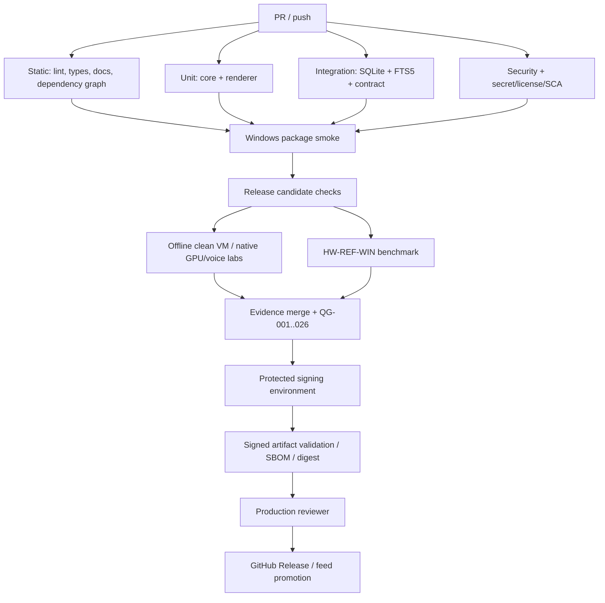

# Iterkeep — CI/CD, Windows Dağıtımı, Kod İmzalama ve Güvenli Güncelleme Sözleşmesi

> **Normatif amaç:** V1.0 için her PR'da tekrarlanabilir test; onaylı bir commit'ten Windows 11 x64 kurulum paketi; imzalama, bütünlük, sürüm kanıtı, otomatik güncelleme ve geri dönüş prosedürlerini somut iş akışlarıyla belirlemek. Geliştirme ajanı "CI yeşil" demek için başarılı *gerçek workflow run* ve manifest sunar. YAML örneklerinin bu Markdown içinde bulunması, GitHub üzerinde çalıştırılmış oldukları anlamına gelmez.
>
> **Yetki:** Teknoloji sürümleri **DOC-05**, repo/workflow konumları ve kök script'ler **DOC-07**, kalıcı veri/migration **DOC-09/10/17**, test matrisi **DOC-33**, güvenlik **DOC-30**, performans **DOC-31**, hata semantiği **DOC-32**, yayın HARD kapıları **DOC-04** kanoniktir. Bu belge yalnız **CI/CD işi, paketleme, yayımlama, kod imzalama, güncelleme ve geri çekme** davranışlarının nihai sözleşmesidir. Yeni iş kuralları, SQL tabloları, IPC kanalları veya alan adları uydurulmaz.
>
> **Kanıt durumu:** 2026-10-10 tarihinde kamuya açık Electron / Electron Forge / GitHub Actions dokümanları incelenmiştir. Bu repo henüz uygulanmış bir uygulama değildir: hiçbir GitHub Actions iş akışı, installer, SmartScreen, gerçek sertifika, Windows update feed, Windows GPU/mikrofon veya release yükseltme testi geçilmiş sayılmaz. Bu belge `draft` kalır.

## 0. Yayın tanımı ve destek sınırları

| Konu | Iterkeep V1 sözleşmesi |
|---|---|
| Ürün | Yerel, tek kullanıcı, SQLite ana veri kaynağı, AI/STT/TTS isteğe bağlı |
| İlk resmi OS | **Windows 11 x64**; diğer platformlar tasarım hazırlığı, destek sözü değil |
| Kurulum | Electron Forge 7.x + **Squirrel.Windows maker** (seçili sürümler DOC-05) |
| Güncelleme | Windows: Electron `autoUpdater` / Squirrel akışı; yalnız imzalı ve gerçek uçtan uca testli dağıtımda etkin |
| GitHub | Source repo + protected branches/environments + GitHub Releases; private repo senaryosu için updater ayrı plan ister |
| macOS / Linux | V1 GA hedefi değildir; ayrı imzalama/dağıtım kararına tabi. Linux'ta Electron yerleşik autoUpdater yoktur |
| Kullanıcı verisi | `%AppData%` gibi uygun userData/workspace yolu; uygulama paketinin altına yazılmaz (`DOC-07`) |
| AI & ses | Kullanıcının izni olmadan model/sidecar yüklenmez; eksikse çekirdek çalışır |
| V1 yayın kanıtı | G0–G5 + QG-001–026 + gerçek Windows installer/upgrade + gerekli hardware-lab kanıtları |

Bu belge, 'ücretsiz indirilebilir' ile 'imzasız binary tüm kullanıcılar için güvenle çalışır' ifadelerini eş tutmaz. Sertifika/Windows imzalama maliyeti veya erişimi yoksa paket yalnız **internal preview** olarak işaretlenir; kamuya açık güvenilir otomatik güncelleme aktif edilmez.

## 1. Değişmez release ilkeleri (`REL-I-001–048`)

| Kimlik | Kural |
|---|---|

| `REL-I-001` | Her çıktı tek source commit SHA ve tek lockfile SHA-256 ile izlenir. |
| `REL-I-002` | PR workflow'ları secrets/signing key almaz ve yayın oluşturamaz. |
| `REL-I-003` | GitHub Actions token izinleri iş başına minimum tutulur; varsayılan `contents: read`. |
| `REL-I-004` | Üçüncü taraf GitHub Actions üretimde tam commit SHA ile pinlenir; kayan `@main`/`@v*` ile GA release yok. |
| `REL-I-005` | `npm ci`, commit edilmiş tek `package-lock.json` ile çalışır; `npm install` CI'da lockfile güncellemez. |
| `REL-I-006` | Windows native `better-sqlite3` Electron ABI smoke sonucu olmadan paket onaylanmaz. |
| `REL-I-007` | Electron Main/Preload/DB Worker gerçek *packaged* sürümde açılmadan release yok. |
| `REL-I-008` | Release CI aynı Git SHA'dan belirlenen testleri ve installer kanıtını birleştirir. |
| `REL-I-009` | Commit/tag ile artifact manifest SHA uyuşmazsa yayın durdurulur. |
| `REL-I-010` | Tag adları `vMAJOR.MINOR.PATCH[-prerelease]` kalıbına uyar; build iç sürüm numarasıyla uyuşur. |
| `REL-I-011` | Release candidate ile GA'nın kanal/uyumluluk ayrımı açıktır; prerelease GA feed'e karışmaz. |
| `REL-I-012` | Yalnız `main` üzerinde korunmuş, gözden geçirilmiş commit yayın adayı olabilir. |
| `REL-I-013` | Yayın işlerinin eşzamanlı koşması engellenir; aynı version iki kez yayımlanmaz. |
| `REL-I-014` | Üretim imzalama kimlik bilgileri yalnız onaylı environment'da bulunur; runner loguna basılmaz. |
| `REL-I-015` | Sertifika/imza/doğrulama hatası GA'yı bloklar; sessizce unsigned sürüme düşülmez. |
| `REL-I-016` | GitHub asset SHA-256 tek başına yayıncı doğruluğu değildir: imza ve güvenilir kaynak gerekir. |
| `REL-I-017` | SBOM, lisans bilgisi, bağımlılık taraması ve kaynağı bilinen binary envanteri olmadan GA yok. |
| `REL-I-018` | Özel model dosyaları ve Python runtime varsayılan installer'a gömülmez; onaylı ayrı kurulum yolu vardır. |
| `REL-I-019` | Ollama, Git, Whisper veya TTS yokluğu kurulum, ilk açılış ve çekirdek CRUD'u engellemez. |
| `REL-I-020` | İsteğe bağlı servisler kullanıcı izni olmadan indirilmez veya kendiliğinden yükseltilmez. |
| `REL-I-021` | Sidecar'lar allowlist manifest, lisans ve hash doğrulaması geçmeden çalıştırılmaz. |
| `REL-I-022` | Üretilen EXE/NuGet/Squirrel metadata dosyaları tam bir sürüm seti olarak ele alınır. |
| `REL-I-023` | GitHub Release'e yüklenen şey test edilmiş/imzalanmış mevcut artifact'tır; publish aşamasında yeniden build yapılmaz. |
| `REL-I-024` | Artifacts staging'de tutulur; farklı runner'da alınırsa hash ile doğrulanır. |
| `REL-I-025` | Squirrel install/uninstall event işlemleri erken ve doğru ele alınır; fazladan app instance doğmaz. |
| `REL-I-026` | Squirrel ilk açılışta kilitli iken update sorgusu zorlanmaz. |
| `REL-I-027` | `app.setAppUserModelId` Squirrel uygulama kimliğiyle uyumludur. |
| `REL-I-028` | Windows güncelleme kontrolü ana ekran ve SQLite bootstrap'i bloklamaz. |
| `REL-I-029` | Update check varsayılan olarak disabled/offline ise ağa çıkılmaz; kullanıcı politikası uygulanır. |
| `REL-I-030` | Update başarısı yalnız güncelleme sonrası doğrulanan paket sürümü ve veri bütünlüğüyle raporlanır. |
| `REL-I-031` | Otomatik restart/paket değiştirme aktif yazma veya restore sırasında yapılmaz. |
| `REL-I-032` | Migration öncesinde DOC-17 ile doğrulanmış kurtarma noktası olmadan yeni DB şemasına geçilmez. |
| `REL-I-033` | Eski uygulamanın yeni şemayı açması güvenli değilse downgrade otomatik yapılmaz. |
| `REL-I-034` | Başarısız update durumunda eski kullanıcı verisi korunur; DB ve asset geri yükleme ayrı kontrollü karardır. |
| `REL-I-035` | Rollback hotfix stratejisidir; downgrade ve DB restore semantik olarak farklı süreçlerdir. |
| `REL-I-036` | Model/sidecar binary sürümü app sürümünden ayrı bağımlılık manifest'inde tutulur. |
| `REL-I-037` | İndirme devam/iptal durumu sadece `DOC-12/25/28` job sözleşmesiyle yönetilir. |
| `REL-I-038` | CI'a gerçek kullanıcı workspace'i, ses kaydı, transkript veya chat içeriği yüklenmez. |
| `REL-I-039` | Trace/screenshot/artifact yüklenmeden önce gizlilik redaksiyon kontrolünden geçer. |
| `REL-I-040` | Test çalıştırılmadıysa `NOT_RUN`, donanım yoksa `BLOCKED`; sırf mock test nedeniyle PASS yok. |
| `REL-I-041` | Özellikle QG-003–008, 011, 014, 020, 022, 025–026 gibi HARD kapılar bypass edilemez. |
| `REL-I-042` | Release sonrasında yayınlanan check-sum, signer, SBOM ve URL'ler manifest içinde saklanır. |
| `REL-I-043` | İmzalanmış artifact'ın byte'ları publish öncesi veya sonrası değiştirilmez. |
| `REL-I-044` | Manifestin hash'i yayın dosyalarıyla karşılaştırılmadan asset indirme bağlantısı paylaşılmaz. |
| `REL-I-045` | Reproducible build hedeflenir ancak code signing/timestamp yüzünden byte-identical çıktı garanti edilmez. |
| `REL-I-046` | Güvenlik açığı gelirse eşleşen eski imzalı artifact geri döndürülmez; güvenli yeni ileri düzeltme gerekir. |
| `REL-I-047` | Private repo, beta channel ve çok platform sürümleri onaysız üretim yoluna eklenmez. |
| `REL-I-048` | Her release için insan tarafından onaylanan, kanıt bağlantılı yayın kararı bulunur. |

## 2. Kararlar, seçenekler ve açık bağımlılıklar

### 2.1 Neden Squirrel.Windows?

V1 için `@electron-forge/maker-squirrel`: Windows'ta kullanıcı seviyesinde kurulum, Forge'un oluşturduğu `Setup.exe`, `*-full.nupkg` ve `RELEASES` seti, Electron'un Windows'taki Squirrel update mekanizmasıyla bütünleşir. Güncelleme için **sadece installer yüklemek yeterli değildir**; erişilebilir ve doğrulanmış update endpoint/feed gerekir. Windows hedefi GitHub-hosted Windows runner'da üretilir.

Alternatifler: MSI ve MSIX kurumsal hedefli gelecek aşamaya bırakılır. `electron-updater`/NSIS ile karma bir çözüm **yasaktır**: bu, mevcut `Forge + Squirrel + Electron autoUpdater` kararını çiğner. Yeniden seçim gerekiyorsa ADR, proof-of-concept, paket migration ve kullanıcı update geçişi yazılır.

### 2.2 İmzalama kararı (GA engeli)

- Üretim Windows Authenticode imzalama (EXE ve dağıtımda gereken ek yürütülebilir dosyalar) + timestamp + doğrulama olmadan **GA yok**.
- Sertifika ve private key materyali hiçbir Git commit'inde, artifact'ta veya PR job ortamında bulunmaz.
- Yerel `.pfx` ve donanım token seçeneklerinde anahtar saklama koşulları sağlayıcıya bağlıdır; cloud signing ancak yayıncının ülkesi/uygunluğu/onayına göre seçilir. **Türkiye'den Azure Artifact Signing erişilebilirliği varsayılmaz.**
- Kapalı/imzasız `internal-preview` build, yalnız kontrollü test makinelerinde, kullanıcıya açık "imzasız test paketi" ibaresiyle dağıtılır; ürünün release feed'i sayılmaz.
- İmza veren sağlayıcı yoksa `SIGNING_UNAVAILABLE` → GA gate `BLOCKED`; script `exit 0` ile bunu saklayamaz.

### 2.3 Platform ve sürüm uyum matrisi

| Kombinasyon | PR | RC | GA |
|---|---|---|---|
| Windows 11 x64, AI kapalı | Unit+integration | Paket + temiz VM | Zorunlu |
| Windows 11 x64, gerçek Ollama | Mock protocol | Lab + version/digest testleri | Zorunlu özellik iddiası için gerçek kanıt |
| Windows 11 x64, Whisper/TTS yok | Fallback mock | Gerçek uygulamada fallback | Zorunlu |
| Windows 11 x64, gerçek STT/TTS | Mock protocol | Windows ses lab | İlgili özellikler destekleniyorsa gerçek kanıt |
| macOS/Linux | İsteğe bağlı compile check | Ayrı platform imza/lab | V1 kapsam dışı |

## 3. Repo dosya ve owner kataloğu

```text
.github/
  workflows/
    pr-checks.yml             # PR/ana dal: static + unit + integration + security
    windows-package.yml       # Windows x64 native ABI ve paketli smoke
    nightly-bench.yml         # Scheduled benchmark / non-release telemetry-free
    release.yml               # Onaylı tag, imzalama, kanıt, immutable publish
  dependabot.yml              # Sadece kontrollü dependency PR
apps/desktop/
  forge.config.ts             # Maker / packager / signing konfigürasyonu
  src/main/services/updater.ts # Güncelleme yöneticisi; Main process
  src/main/index.ts           # Squirrel startup event / appUserModelId
scripts/
  native-smoke.mjs
  verify-artifact-layout.mjs
  generate-sbom.mjs
  verify-release-manifest.mjs  # DOC-34 ile eklenir
  validate-tag.mjs            # DOC-34 ile eklenir
  prepare-release-evidence.mjs # DOC-34 ile eklenir
  verify-workflow-security.mjs# DOC-34 ile eklenir
  create-sha256-manifest.mjs  # DOC-34 ile eklenir
  verify-signatures.ps1       # DOC-34 ile eklenir
tests/e2e/packaged/           # Squirrel install/open/upgrade smoke
.artifacts/release/<sha>/     # CI-generated, **Git ignore**
```

Yeni `scripts/*` dosyaları DOC-07'deki mevcut isimleri değiştirmez; DOC-34'e ait tamamlayıcı release araçlarıdır. Workflow dosyaları DOC-07 ile birebir aynıdır. `out/`, `.artifacts/`, `models/`, `workspace.db*`, signing secret ve makineye özgü indirmeler commit edilmez.

## 4. Git akışı, tag politikası, branch koruması

- `main`: PR zorunlu, en az bir bağımsız review; status checks `lint`, `typecheck`, `unit`, `integration`, `security`, `docs`, `package-smoke` (gerçek iş isimleri uygulanırken aynen senkronlanır).
- `release/vX.Y.Z`: geçici release-candidate çalışması için açılabilir; GA tag'i **korunmuş main commit'ine** işaret eder.
- `vX.Y.Z-rc.N`: GitHub prerelease, GA update feed dışında; `vX.Y.Z`: GA.
- `vX.Y.Z+build`: build metadata içeren tag yasak (Squirrel sürüm parse uyumu için); build SHA manifest'te tutulur.
- SemVer MAJOR: kalıcı veri/export uyumluluğu değişen kırıcı sürüm; MINOR: geriye uyumlu özellik; PATCH: hata düzeltmesi.
- Sürüm kaynağı `apps/desktop/package.json` `version` alanıdır; kök paket `0.0.0-development` kalabilir. Installer adındaki sürüm ile manifest uyumlu olmalı.
- GA sadece açıklanmış kullanıcı değişikliklerini ve güncelleme/migration etkisini `CHANGELOG.md` / release notunda taşır.
- Korunan release environment: `release-signing` (imza), `production` (son yayın). `required reviewers` zorunludur.
- Tag silinip yeniden etiketlenmez. Hatalı release için yeni sürüm ve açık güvenlik bildirimi yayımlanır.

### 4.1 Tag doğrulama — referans uygulama

```js
// scripts/validate-tag.mjs — gerçek npm workspace çözümlemesiyle test edilir
import fs from 'node:fs';
const tag = process.argv[2];
const version = JSON.parse(fs.readFileSync('apps/desktop/package.json', 'utf8')).version;
const parsed = /^v(0|[1-9]\d*)\.(0|[1-9]\d*)\.(0|[1-9]\d*)(?:-rc\.([1-9]\d*))?$/.exec(tag ?? '');
if (!parsed || tag.slice(1) !== version) {
  console.error('RELEASE_TAG_VERSION_MISMATCH');
  process.exit(1);
}
console.log(JSON.stringify({tag, version, channel: parsed[4] ? 'rc' : 'stable'}));
```

### 4.2 Değişiklik incelemesi

Her PR: etkilenen `REQ-*`, `AC-*`, `TEST-*`, `QG-*`; migration farkı; dependency lisans farkı; güvenlik sınırı; gizlilik; Electron native ABI; kullanıcı deneyimi; performans etkisi; gerekiyorsa `ADR`. Release workflow değişikliği **review'suz** birleştirilemez.

## 5. CI iş grafiği ve güven sınırı



**Güvenlik:** `pull_request_target` içinde PR kodu çalıştırılmaz. Fork PR'larda imzalama, public release ve cloud signing kimlik bilgileri **ulaşılamaz**. CI/GitHub Actions'a kendi kullanıcı verilerimiz otomatik yüklenmez; yalnız sentetik fixtür ve redakte edilmiş test kanıtları kullanılır. Üretim tokenları public log'dan gizlenir.

### 5.1 Pipeline tablo sözleşmesi

| Tetikleyici | Workflow | Runner | Yetki | Temel gate |
|---|---|---|---|---|
| PR / main push | `pr-checks.yml` | ubuntu-latest + gerekirse windows-latest | `contents: read` | QG-001–004/020/024 ve etkilenen testler |
| PR ve RC | `windows-package.yml` | windows-latest, x64 | `contents: read` | QG-003/025, Electron ABI |
| Gece / manuel | `nightly-bench.yml` | self-hosted referans cihaz (separate trust) | mümkünse read | QG-021 trend; release kanıtı yalnız doğrulanırsa |
| Tag, manual gate | `release.yml` | korumalı windows x64 | imza job secret, yalnız publish job `contents: write` | QG-001–026 |

## 6. Güvenli `pr-checks.yml` — referans YAML

Bu iskelet **çalıştırılabilir tasarımdır, repo henüz kurulmadığından doğrulanmış workflow değildir**. Aşağıdaki action tag'leri okunabilirlik için verilmiştir; **PR merge edilmeden önce `verify-workflow-security` aracı tüm `uses:` alanlarını incelediği full-length commit SHA'lara sabitlemeli**, aksi halde gate FAIL üretmelidir. Runner `-latest` imajı değişebildiğinden kanıt kaydına runner image versiyonu da eklenir.

```yaml
name: pr-checks
on:
  pull_request:
  push:
    branches: [main]
permissions:
  contents: read
concurrency:
  group: pr-${{ github.workflow }}-${{ github.ref }}
  cancel-in-progress: true
jobs:
  static:
    runs-on: ubuntu-latest
    timeout-minutes: 20
    steps:
      - uses: actions/checkout@v4 # PRE-MERGE: full-length SHA ile değiştir
        with:
          persist-credentials: false
      - uses: actions/setup-node@v4 # PRE-MERGE: full-length SHA ile değiştir
        with:
          node-version: '24'
          cache: npm
      - run: npm ci --ignore-scripts
      - run: npm run typecheck
      - run: npm run lint
      - run: npm run lint:boundaries
      - run: npm run format:check
      - run: npm run verify:docs
      - run: node scripts/verify-workflow-security.mjs
  unit:
    runs-on: ubuntu-latest
    timeout-minutes: 25
    steps:
      - uses: actions/checkout@v4 # PRE-MERGE PIN
        with:
          persist-credentials: false
      - uses: actions/setup-node@v4 # PRE-MERGE PIN
        with:
          node-version: '24'
          cache: npm
      - run: npm ci
      - run: npm test
  integration:
    runs-on: ubuntu-latest
    timeout-minutes: 25
    steps:
      - uses: actions/checkout@v4 # PRE-MERGE PIN
        with:
          persist-credentials: false
      - uses: actions/setup-node@v4 # PRE-MERGE PIN
        with:
          node-version: '24'
          cache: npm
      - run: npm ci
      - run: npm run test:integration
      - run: npm run test:resilience
  security:
    runs-on: ubuntu-latest
    timeout-minutes: 25
    steps:
      - uses: actions/checkout@v4 # PRE-MERGE PIN
        with:
          persist-credentials: false
      - uses: actions/setup-node@v4 # PRE-MERGE PIN
        with:
          node-version: '24'
          cache: npm
      - run: npm ci
      - run: npm run test:security
      - run: npm audit --omit=dev --audit-level=high
      - run: node scripts/generate-sbom.mjs
```

**Not:** `npm ci --ignore-scripts` yalnız *statik* job için kullanılabilir; native paket gerektiren unit/integration/install workflow'larında normal `npm ci` gerekir. `npm audit` bağlantı problemi yaşarsa başarısızlık kanıtı BLOCKED'dır, PASS değildir; geçerli tarayıcı yerine sadece `npm audit` kullanılacaksa ek lisans/SBOM kaynağı gerekir. `scripts/generate-sbom.mjs` dosyasının çıkış formatı `SPDX JSON` veya `CycloneDX` olarak birincil doğrulamada seçilip kilitlenir.

## 7. Windows `windows-package.yml` — referans akış

Bu job native binary rebuild, gerçek Electron ve dağıtım düzenini sınar. Test amaçlı unsigned paket **GA değildir**. Workflow hedefi `QG-025` için *temiz Windows VM* kanıtının yanında ayrı bir kanıt üretmektir; hosted runner tek başına temiz kurulumun bütün işlevlerini doğrulamaz.

```yaml
name: windows-package
on:
  pull_request:
  push:
    branches: [main]
permissions:
  contents: read
concurrency:
  group: win-${{ github.ref }}
  cancel-in-progress: true
jobs:
  package-smoke:
    runs-on: windows-latest
    timeout-minutes: 45
    steps:
      - uses: actions/checkout@v4 # PRE-MERGE PIN
        with:
          persist-credentials: false
      - uses: actions/setup-node@v4 # PRE-MERGE PIN
        with:
          node-version: '24'
          cache: npm
      - shell: pwsh
        run: npm ci
      - shell: pwsh
        run: npm run build
      - shell: pwsh
        run: npm run make
      - shell: pwsh
        run: node scripts/native-smoke.mjs
      - shell: pwsh
        run: npm run verify:artifact
      - shell: pwsh
        run: npm run test:e2e -- --project=packaged-windows
      - shell: pwsh
        run: node scripts/create-sha256-manifest.mjs out/make .artifacts/release/sha256.json
      - uses: actions/upload-artifact@v4 # PRE-MERGE PIN
        if: always()
        with:
          name: windows-unsigned-smoke-${{ github.sha }}
          path: |
            .artifacts/release/sha256.json
            .artifacts/tests/
          if-no-files-found: error
          retention-days: 7
```

`--project=packaged-windows` seçili `playwright.config.ts` dosyasında tanımlanmak zorunda. Native smoke yalnız `node` ile değil **Electron runtime process'i** içinde `better-sqlite3` açıp `STRICT/FTS/WAL` denemelidir. Windows package workflow'unun artifact yükleme adımında kullanıcı verisi bulunmamalı; signer secrets hiçbir PR job'ına geçmemeli.

## 8. Release workflow — iki kademeli, onaylı yayın

### 8.1 Adımlar

1. Release sahibi korumalı `v1.0.0-rc.1` / `v1.0.0` tag'i belirler. Tag SHA `main` üzerinde doğrulanır.
2. Tag / `apps/desktop/package.json` sürümü / changelog / lockfile / QG kanıtı birlikte doğrulanır.
3. Tüm zorunlu PR, Windows, security, migration, yedekleme ve kurtarma testleri **aynı SHA** üzerinde çalışır veya uygun süreli geçerli kanıt linkleriyle doğrulanır.
4. Donanım/gerçek provider laboratuvarları ve manuel erişilebilirlik/temiz VM kanıtları `PASS` değilse release `BLOCKED` kalır.
5. Protected `release-signing` environment reviewer onayı ile **tek kez** imzalı Windows artifact üretilir.
6. Aynı artifact imza, hash, paket içi app version, sidecar yokluğunda açılış, native SQLite ve malware/allowlist kontrolünden geçer.
7. SBOM, release manifest, changelog, checksums ve mümkünse GitHub provenance attestation artifact ile ilişkilendirilir.
8. Protected `production` ortamında release sahibi son imzalı artifact hash'ini kabul eder.
9. **Yeniden build yoktur.** Yalnız önceden doğrulanmış artifact draft GitHub Release'e yüklenir ve test edilen feed hazır olduğunda yayınlanır.
10. Yayın sonrası temiz VM'de yeni kurulum/güncelleme ve veri bütünlüğü tekrar sınanır; sorun varsa yeni release/hotfix prosedürü uygulanır.

### 8.2 Workflow sözleşmesinin çekirdeği

```yaml
name: release
on:
  workflow_dispatch:
    inputs:
      tag:
        description: 'Existing, protected tag e.g. v1.0.0'
        required: true
        type: string
permissions:
  contents: read
concurrency:
  group: release-${{ inputs.tag }}
  cancel-in-progress: false
jobs:
  verify-release:
    runs-on: windows-latest
    outputs:
      # Gerçek uygulamada release evidence hesaplanan output ile doldurulur.
      approved-sha: ${{ steps.resolve.outputs.sha }}
    steps:
      - id: resolve
        shell: pwsh
        run: |
          # Tag SHA ve main ancestry API/git ile doğrulanır.
          # Kopyala-yapıştır placeholder doğrulamayı GEÇMEZ.
          throw 'IMPLEMENT_RELEASE_TAG_SHA_VALIDATOR'
  sign-build:
    needs: verify-release
    if: ${{ needs.verify-release.result == 'success' }}
    runs-on: windows-latest
    environment: release-signing
    permissions:
      contents: read
      id-token: write # Cloud signer kullanılıyorsa, değilse kaldır
    steps:
      - name: Build, sign and verify
        shell: pwsh
        run: |
          throw 'IMPLEMENT_SIGNER_VERIFICATION_AND_PACKAGE_TEST'
  publish:
    needs: [verify-release, sign-build]
    runs-on: ubuntu-latest
    environment: production
    permissions:
      contents: write
    steps:
      - name: Publish verified bytes only
        run: |
          echo 'IMPLEMENT_ATTESTATION_MANIFEST_AND_EXISTING_ASSET_UPLOAD'
          exit 1
```

**Bilinçli engel:** Yukarıdaki `throw` / `exit 1` satırları *fail-closed* placeholder'lardır: gerçek tag/approval/signing/release doğrulaması yazılmadan workflow'un yanlışlıkla GA yayımlamasını önler. Yalnız `npm run make && forge publish` yazıp release geçilmiş saymak **yasaktır**. `DOC-35` bu placeholder'ların implementation ticket'larını oluşturmalıdır.

### 8.3 Geçmiş test kanıtı tekrar kullanımı

Bir önceki PR sonucu yalnız `gitSha`, `lockfileSha256`, build hash, fixture ID, test runner sürümü, ortam türü ve doküman/test revizyonları ile eşleşiyorsa ve o kapı için izin verilen yeniden kullanım süresi aşılmamışsa kullanılabilir. Native/installer smoke ve imza kontrolleri **oluşturulan nihai artifact** üzerinde her release yeniden koşulur. Secrets ortamı nedeniyle imzalı build yeniden oluşturuluyorsa eski unsigned dosyanın packaged smoke'ları, **imzalı dosyayı** doğrulama yerine geçmez.

## 9. Forge yapılandırması ve native paket sözleşmesi

### 9.1 Referans Forge yapılandırması

```ts
// apps/desktop/forge.config.ts (taslak; seçili Forge Vite/plugin sürümlerinde POC zorunlu)
import type { ForgeConfig } from '@electron-forge/shared-types';
import { MakerSquirrel } from '@electron-forge/maker-squirrel';
import { MakerZIP } from '@electron-forge/maker-zip';
import { AutoUnpackNativesPlugin } from '@electron-forge/plugin-auto-unpack-natives';

const config: ForgeConfig = {
  packagerConfig: {
    asar: true,
    executableName: 'Iterkeep',
    icon: './assets/iterkeep',
    // Windows signing config yalnız protected release-signing işi tarafından sağlanır.
  },
  rebuildConfig: { force: true },
  makers: [
    new MakerSquirrel({ name: 'Iterkeep', authors: 'Iterkeep contributors', description: 'Local-first project workspace' }),
    new MakerZIP({}, ['win32']), // Debug amaçlı ZIP; GA update aracı değildir
  ],
  plugins: [new AutoUnpackNativesPlugin()],
};
export default config;
```

- Gerçek config, DOC-05'te koşullu seçilmiş Vite plugin ve entrypoints'i korur; yukarıdaki kod **tam config'in yerine tek başına konmaz**. Forge 7.x `MakerSquirrel`/`MakerZIP` class export uyumu POC'de kanıtlanır.
- Electron `productName`, Squirrel maker `name`, `app.setAppUserModelId('com.squirrel.Iterkeep.Iterkeep')` Windows taskbar/shortcut testine göre birlikte doğrulanır. Paket kimliği bir kez kamuya çıkınca keyfî değiştirilmez.
- `better-sqlite3` native dosyası ASAR dışında unpack edilir, ABI ve doğru arch test edilir. `db.worker.js`, preload bundle, manifestler ve sidecar çalıştırıcı yolu paket içinde açıkça doğrulanır.
- Kurulum paketi runtime'da `npm`, `python`, `git` veya internet erişimini varsaymaz; isteğe bağlı özelliklerin yokluğu UI'da açık ve düzgün görünür.
- Icon, lisans, açıklama ve sürüm metadata alanları Squirrel paket üretimi öncesinde doğrulanır; sahte `authors` release sırasında gerçek yayıncı bilgisiyle değiştirilir.

### 9.2 Installer doğrulama tablosu

| Kontrol | Beklenen kanıt |
|---|---|
| Temiz Windows 11 x64 | Normal kullanıcı ile, admin zorlamadan kurulum ve açılış |
| Squirrel events | Setup/uninstall/upgrade sırasında ikinci UI açılmaması |
| Başlat menüsü / taskbar | Görünen isim, ikon ve AppUserModelId tutarlılığı |
| İlk açılış | Ollama, Git, Python yokken SQLite/bootstrap/setup çalışır |
| Native addon | `better-sqlite3` query ve FTS5 `MATCH` Electron build'de çalışır |
| Dosyalar | Kullanıcı DB/asset'leri app klasöründen bağımsız yerde kalır |
| Uninstall | Kullanıcı verisi silme açık ayrı talep yoksa silinmez |
| Upgrade | Eski sürüm projeleri kaybolmaz, backup/migration yapılır |
| İmza | EXE yayıncı zinciri, timestamp ve hash doğrulanır |
| Update | Sonraki sürüm feed aracılığıyla algılanır, güncellenir, doğrulanır |
| Offline | Ağ isteği zorunlu değildir; update sorunsuz skip edilir |
| Kırık update | Eski veri ve kurtarma seçeneği korunur |

## 10. Sürüm güncelleme mimarisi

### 10.1 Kanal ve kullanıcı kontrolü

- V1 varsayılan update: kapalı veya kullanıcıya açıkça anlatılan **opt-in** otomatik kontrol (gizlilik kararı). Ayar, önceki `settings` / `provider preferences` durumundan işletilir; sırf update kontrolü için yeni DB tablo ve IPC kanalı uydurulmaz. Gerekirse `DOC-08/09/11/19` ile açık ADR uyum güncellemesi yapılır.
- Kullanıcı `Check for updates` derse açık eylem; otomatik kontrol açılacaksa ayrı kullanıcı onayı.
- `stable` ve `rc` feed'leri ayrı; RC kuran kişinin GA'ya geçmesi ancak test edilmiş geçişle mümkündür.
- Güncelleme metadatası ve binary yalnız HTTPS üzerinden sabit allowlist host'tan gelir; başka siteye redirect kapsamı doğrulanır.
- Public GitHub repo ve GitHub Releases koşulları sağlanıyorsa `update.electronjs.org` değerlendirilebilir; private repo'da otomatik çalışacağını **varsayma**. CDN/feed güvenilirliği ve model/sidecar indirmeleri farklı konulardır.
- Otomatik update kontrolü işlem trafiğini, ses kaydını, chat içeriğini veya workspace bilgisini sunucuya göndermez.
- Kullanıcıya sürüm, boyut, yayın notu, yeniden başlatma etkisi gösterilir. Büyük veritabanı migration için uygun durma noktası aranır.

### 10.2 Main updater akışı (referans)

```ts
// apps/desktop/src/main/services/updater.ts — davranış kalıbı, tam code-sign verify değil
import { app, autoUpdater } from 'electron';

type UpdateStage = 'disabled' | 'idle' | 'checking' | 'available' | 'downloading'
  | 'ready' | 'applying' | 'error';

export function createUpdater(deps: {
  userOptIn(): Promise<boolean>;
  coreIsReady(): boolean;
  recoveryPoint(): Promise<{ verified: boolean }>;
  hasBlockingJob(): boolean;
  setStage(stage: UpdateStage): void;
  validateFeedUrl(url: string): void;
  feedUrl: string;
}) {
  let stage: UpdateStage = 'idle';
  const set = (next: UpdateStage) => { stage = next; deps.setStage(next); };
  const onError = (_error: Error) => set('error');
  autoUpdater.on('error', onError);
  return {
    async check() {
      if (!app.isPackaged || !await deps.userOptIn()) { set('disabled'); return; }
      if (!deps.coreIsReady() || stage === 'checking') return;
      deps.validateFeedUrl(deps.feedUrl);
      autoUpdater.setFeedURL({ url: deps.feedUrl });
      set('checking');
      try { autoUpdater.checkForUpdates(); } catch { set('error'); }
    },
    async restartToApply() {
      if (deps.hasBlockingJob()) return { ok: false, reason: 'BUSY' as const };
      const backup = await deps.recoveryPoint();
      if (!backup.verified) return { ok: false, reason: 'NO_BACKUP' as const };
      set('applying');
      autoUpdater.quitAndInstall();
      return { ok: true };
    },
    dispose() { autoUpdater.off('error', onError); }
  };
}
```

**Zorunlu ilave:** Yukarıdaki yalnız orkestrasyon şablonudur; `update-available`, `update-downloaded`, `update-not-available`, `before-quit-for-update` gibi olaylar gerçek uygulamada abonelik ve cleanup ile ele alınır. `ready` durumuna yalnız gerçekten indirilmiş, geçerli ve doğrulanmış paket geldiğinde geçilir. `autoUpdater.quitAndInstall()` öncesi paketin feed/signature/authenticity kanıtı dış doğrulama ve OS tarafından onaylanmış olmalıdır; Electron'un kendisinin tüm Windows imza kontrollerini yaptığı **varsayılmaz**. Kullanıcıya 'güncelleme başarılı' mesajı yalnız yeni versiyon açılışında gösterilir.

### 10.3 İlk kurulumda Squirrel lock / startup ayrımı

Resmî Electron dokümanına göre `--squirrel-firstrun` ile ilk açılışta güncelleme kontrolü geçici kilit nedeniyle başarısız olabilir. Bu durumda autoUpdate işini atlayıp sonraki uygun kontrolü bekle. `electron-squirrel-startup` gibi bir handler Main girişinin en başında çalışır, yalnız Squirrel özel eylemi için uygulama hızlıca kapanır. İlk normal GUI açılışı başka bir işlem gibi değerlendirilir.

### 10.4 Update ve migration'ın birlikte ele alınması

`AppVersion` ve `schema_version` ayrı. Her release manifest'inde `supportedSchemaMin`, `supportedSchemaMax`, `upgradeSchemaTo` açıklanır. Yeni uygulama açılışında mevcut DB sürümü üst sınırdan büyükse **yazma yapmaz**, kurtarma/versiyon uyarısı gösterir. Migration: manifest doğrulama → backup (DB + asset) → validate → kısa/işlenebilir migration → PRAGMA integrity_check, foreign_key_check → core bootstrap → isteğe bağlı servis kontrolü. Geri dönüşte eski uygulama otomatik olarak yeni şemaya yazmaya çalışmaz.

### 10.5 Offline / disabled / bad feed

- Kullanıcı update'i kapattıysa host'a ağ isteği çıkmamalı.
- DNS/TLS/proxy/fail timeout'ları temel uygulamayı bozmaz, aynı anda sonsuz retry yapmaz.
- İmzalı feed yoksa kullanıcının bilgisi dışında executable indirilmez.
- Disk yetersizse indirme başlamadan tahmini alan kontrolü; cleanup sadece uygulamaya ait staging dosyalarıyla sınırlıdır.
- `update` sırasında aktif DB restore/backup/purge varsa sessiz restart yasak.

## 11. Yayın artefakt sözleşmesi

### 11.1 Manifest örneği — şema kalıbı

```json
{
  "schemaVersion": 1,
  "product": "iterkeep",
  "channel": "stable",
  "tag": "v1.0.0",
  "version": "1.0.0",
  "gitSha": "FULL_40_CHAR_SHA_FROM_WORKFLOW",
  "lockfileSha256": "64_HEX_SHA_FROM_CI",
  "platform": "win32",
  "arch": "x64",
  "electronVersion": "FROM_LOCKFILE",
  "nodeBuildVersion": "FROM_RUNNER",
  "schemaCompatibility": { "min": 1, "max": 1, "upgradesTo": 1 },
  "artifacts": [
    {
      "name": "Iterkeep Setup.exe",
      "sha256": "64_HEX_SHA_OF_THE_FILE",
      "sizeBytes": 0,
      "signerSubject": "VERIFIED_PUBLISHER_SUBJECT",
      "signatureVerified": false
    }
  ],
  "sbomSha256": "64_HEX_SHA_OF_SBOM",
  "qualityDecisionSha256": "64_HEX_SHA_OF_EVIDENCE",
  "updateFeed": "HTTPS_ENDPOINT_VALIDATED_FOR_RELEASE",
  "releasedAtUtc": "GENERATED_AT_RELEASE_TIME"
}
```

Bu alanlardaki `FROM_*` / `VERIFIED_*` değerleri **placeholder'dır**; validator placeholder içeriyorsa yayın engellenir. `signatureVerified: false` örnektir, GA dosyasında `true` olmalıdır. `sizeBytes: 0` invalid örnektir; validator pozitif integer arar. Manifestin kendisinin güvenilir provenance ile bağlanması gerekir; tek başına kendini doğrulayan JSON güvenlik kanıtı değildir.

### 11.2 SHA-256 üretimi ve doğrulaması

```powershell
# İmzalanmış dosyalardan sonra; PowerShell referans
$files = Get-ChildItem 'out/make' -Recurse -File
$files | ForEach-Object {
  [pscustomobject]@{
    name = $_.Name
    length = $_.Length
    sha256 = (Get-FileHash -Algorithm SHA256 -Path $_.FullName).Hash.ToLowerInvariant()
  }
} | ConvertTo-Json -Depth 5 | Out-File '.artifacts/release/checksums.json' -Encoding utf8
```

Katalog içindeki iki aynı `Name` farklı path'te bulunabilir. **Gerçek üretim manifest'i** benzersiz relatif `path` içerir; path traversal ve duplicate kayıtları reddeder. Hash işlemi imzalama sonrasında yapılır. Publish aşamasında ikinci kez hesaplanıp eşleştirilir.

### 11.3 İmza doğrulama (Windows)

```powershell
# scripts/verify-signatures.ps1 — örnek çekirdek, allowlist issuer doğrulaması eklenecek
param([Parameter(Mandatory=$true)][string]$Path)
$auth = Get-AuthenticodeSignature -FilePath $Path
if ($auth.Status -ne 'Valid') { throw "SIGNATURE_INVALID: $Path / $($auth.Status)" }
if (-not $auth.SignerCertificate) { throw "SIGNER_MISSING: $Path" }
Write-Host "Signature status: $($auth.Status)"
# Üretimde beklenen publisher certificate identity + timestamp chain + revocation doğrulanır.
```

Bu kod sertifikanın beklenen yayımlayıcıya ait olduğunu tek başına doğrulamaz. İkinci aşama `signer subject` allowlist, zincir, süre/timestamp ve gerektiğinde kurum politikası doğrulaması ekler. SignTool ile ek kontroller yapılması önerilir; doğrulama olmadan GA PASS yoktur.

### 11.4 SBOM, provenance, lisans ve kaynak

- `npm` bağımlılıkları için SBOM ve paket listesi; native binary, Electron runtime ve indirilebilir ses model/binary kaynakları ayrıca listelenir.
- Üçüncü taraf lisanslar, dağıtım hakları, kullanılan model weight lisansı ve ticari kullanım kısıtları tek tek değerlendirilir.
- İmza ve checksum aynı şeyi çözmez: hash bütünlüğü; Authenticode yayıncı kimliği; provenance CI kaynak/iş akışı bağına yardımcıdır.
- GitHub artifact attestations, kullanılabilir plan/visibility ve doğru `permissions` varsa release eklentisi olabilir; repo planı engellerse `BLOCKED`, sahte PASS değil.
- `actions/attest@v4` kullanılırsa `id-token: write` + `attestations: write` (gerektiğinde `artifact-metadata: write`) izinleri protected sign/attest işine tanınır. Attestation tek başına kod imzasının yerine geçmez.

## 12. Tam release manifest doğrulayıcısı için API sözleşmesi

```ts
export interface ReleaseValidationInput {
  expectedGitSha: string;
  expectedTag: string;
  expectedLockSha256: string;
  artifactRoot: string;
  requireSignature: boolean;
  requireQualityGates: string[]; // gerçek tek tek QG-001..026
}
export interface ReleaseValidationResult {
  status: 'PASS' | 'FAIL' | 'BLOCKED';
  defects: { code: string; detail: string }[];
  manifestPath?: string;
}
// Test: gitSha mismatch, unsigned, artifact tamper, missing SBOM, missing QG,
// stale lab hardware evidence => FAIL/BLOCKED; never implicit PASS.
```

Validator ayrıca: manifest şeması, duplicate asset path, imza kimliği, `RELEASES`/NuGet/Setup seti, update feed stage, test provenance, supported DB schema bounds, GitHub repository URL ve release notu varlığını kontrol eder. Kanıt dosyaları `.artifacts/release/<sha>/` altında immutable ID ile tutulur.

## 13. Release kanıt zinciri ve gate değerlendirmesi

| Kapı | Kanıt | Yeniden kullanım |
|---|---|---|
| QG-001 / 002 | Gereksinim matrisi, typecheck/test runner, build SHA | Aynı kaynak revizyonu |
| QG-003 / 020 | Electron güvenlik testleri, dependency scan, gizlilik | Aynı kaynak + config + paket |
| QG-004–010 | SQLite/FTS/backups/import/E2E | Aynı kaynak + data migration versiyonu |
| QG-011 / 012 | AI yokken temiz kurulum ve setup skip | Final installer üzerinde tekrar |
| QG-013–017 | Mock protocol + gerçek Ollama/Whisper/EMA lab | Model digest / cihaz / build eşleşmeli |
| QG-018 / 019 | Erişilebilirlik ve TR/EN/dark-light | Final UI'da örnekleme |
| QG-021 | DOC-31 p95 referans makine ölçümleri | Final build ve runner profili |
| QG-022 / 023 | Recovery+18 kabul yolu | Final build etkili akışlar |
| QG-024 | Workflow SHA pin, SBOM, provenance, kanıt zinciri | Her tag |
| QG-025 | İmzalı Windows installer + clean VM | Her GA artifact |
| QG-026 | İmzalı update+rollback/upgrade uyumu | Her breaking değişiklik ve GA |

Tek bir pipeline'da bir `FAIL` ya da `BLOCKED` varken release kararı `PASS` olamaz. `continue-on-error` P0/P1 kapıda yasaktır. Tüm kapılar ve manifest SHA'ları son insan onayından **önce** görünür olmalıdır.

## 14. Performans / bakım / maliyet ilkeleri

- CI dakika yükünü azaltmak için Linux fast unit+integration ile Windows native/package ayrılır. Bu ekonomik optimizasyon release güvenliğini azaltamaz.
- Dependency ve compiler cache yalnız doğrulanmış lockfile key ile kullanılır; `node_modules` veya paketli binary PR'dan release'e doğrudan *güvenilir* sayılmaz.
- GitHub hosted benchmark yalnız regresyon trendi gösterir; `DOC-31` mutlak P95 gate'i kontrollü referans Windows donanımında kanıtlanır.
- `nightly-bench.yml` sentetik veriler üretir ve bunları run sonunda temizler; kullanıcı verisi ya da gerçek mikrofon konuşması toplamaz.
- Electron memory CPU/GPU ve disk büyüklüğü release manifest'te ölçülür; sınırsız model cache saklanmaz.
- CI storage retention: genel test logları 7 gün, release immutable evidence release lifetime/organizasyon politikasına göre kalıcı bir artifact deposu; gerçek uygulamada GitHub retention limiti belirlenir ve arşivleme yapılır.

## 15. Yayın sonrası gözlem ve geri alma politikası

V1 yerel uygulama olarak otomatik dış telemetri göndermez. Sağlık kontrolü, crash ve hata günlükleri yalnız yereldedir. Kullanıcının isteğe bağlı paylaştığı **redakte** destek paketiyle sorun tespit edilir. Yayın sonrası başka kullanıcıların hatalarını izinsiz toplayacak bir analitik ajan planlanmaz.

Hotfix sırası: bildirimi triage et → sorumlu sürümü işaretle → sorunlu update feed'i güvenli biçimde durdur (yayına erişimi kontrollü) → yeni **ileri uyumlu** sürüm üret → zorunlu kalite kapılarını geçir → kullanıcıya sürüm notuyla yayınla. Yaşanan veri bozulması varsa DOC-17 restore süreci, kullanıcının onayı ve mevcut verinin korunmasıyla yürür. Eski binary'yi bilinmeyen DB şemasına otomatik downgrade yapmak yasaktır.

Kullanıcıların yüklü binary sürümlerinin farklı olacağı unutulmaz. Minimum yükseltilebilir sürüm ve desteklenen DB schema manifest'te belirtilir; doğrudan eski sürümden yeni sürüme migration'ın desteklenmediği durumlarda güvenli ara yükseltme veya açık recovery akışı gerekir.

## 16. Hata kataloğu ve kullanıcı mesaj politikası

| Durum | Dahili kod | Kullanıcı deneyimi | Release etkisi |
|---|---|---|---|
| İmza yok/geçersiz | `RELEASE_SIGNATURE_INVALID` | Paket otomatik sunulmaz | HARD BLOCK |
| Paket hash uyuşmuyor | `RELEASE_HASH_MISMATCH` | Güncelleme iptal, eski sürüm kalır | HARD BLOCK |
| Native SQLite yüklenmiyor | `RELEASE_NATIVE_ABI_ERROR` | Kurtarma/rapor ekranı | HARD BLOCK |
| Feed TLS/URL reddedildi | `UPDATE_FEED_UNTRUSTED` | Güncelleme devre dışı, ana app devam | HARD BLOCK for updater |
| Release gate eksik | `RELEASE_EVIDENCE_MISSING` | Kullanıcıya GA ilan edilmez | HARD BLOCK |
| Donanım lab erişilemiyor | `RELEASE_HARDWARE_LAB_BLOCKED` | Modül özellik iddiası yok; RC bekler | BLOCKED |
| DB daha yeni şema | `UPDATE_SCHEMA_INCOMPATIBLE` | Yazma kapalı ve kurtarma seçenekleri | HARD BLOCK |
| Güncelleme indirilemedi | `UPDATE_DOWNLOAD_FAILED` | Tekrar dene, çalışma devam | Runtime degrade |
| Restore/backup etkin | `UPDATE_RESTART_DEFERRED` | İş bitince tekrar dene | Ertele |
| Squirrel ilk açılış kilidi | `UPDATE_FIRST_RUN_DEFERRED` | Daha sonra sessiz kontrol | Beklenen durum |

Bu hata kodları **release/adapter internal diagnostic labels**'dır; DOC-11 global IPC `ErrorCode` enum'una eklenmiş sayılmaz. UI'ya gerekiyorsa DOC-32 public code/translation mapping yapılır; yeni IPC hata tipi eklemek için DOC-11 yetkili metnini güncelle.

## 17. Uçtan uca sürüm akışları (`REL-F-001–016`)

### REL-F-001 — PR minimal değişiklik

**Adımlar:** Tetikleyiciyi izole fixture üzerinde üret; tüm ilgili `QG-*` ve `TEST-*` kanıtlarının build SHA ile eşleşmesini doğrula; negatif halde hiçbir riskli işleme izin verme.

**Beklenen:** Statik/unit/SQLite/security sonuçlarının SHA ile eşleşmesi, imza secret yokluğu. `PASS` yalnız çalıştırılmış ve hash ile ilişkilendirilmiş kayıtla verilir.

### REL-F-002 — PR zararlı workflow değişikliği

**Adımlar:** Tetikleyiciyi izole fixture üzerinde üret; tüm ilgili `QG-*` ve `TEST-*` kanıtlarının build SHA ile eşleşmesini doğrula; negatif halde hiçbir riskli işleme izin verme.

**Beklenen:** Pin/permission taraması ve review kuralı ihlalini reddetme. `PASS` yalnız çalıştırılmış ve hash ile ilişkilendirilmiş kayıtla verilir.

### REL-F-003 — Windows native paket

**Adımlar:** Tetikleyiciyi izole fixture üzerinde üret; tüm ilgili `QG-*` ve `TEST-*` kanıtlarının build SHA ile eşleşmesini doğrula; negatif halde hiçbir riskli işleme izin verme.

**Beklenen:** Yapılmış ve paketlenmiş better-sqlite3 FTS+WAL smoke. `PASS` yalnız çalıştırılmış ve hash ile ilişkilendirilmiş kayıtla verilir.

### REL-F-004 — Temiz offline install

**Adımlar:** Tetikleyiciyi izole fixture üzerinde üret; tüm ilgili `QG-*` ve `TEST-*` kanıtlarının build SHA ile eşleşmesini doğrula; negatif halde hiçbir riskli işleme izin verme.

**Beklenen:** Ollama/Git/Python yokken kurulum→Inbox→CRUD→yeniden başlatma. `PASS` yalnız çalıştırılmış ve hash ile ilişkilendirilmiş kayıtla verilir.

### REL-F-005 — İmzalama yok

**Adımlar:** Tetikleyiciyi izole fixture üzerinde üret; tüm ilgili `QG-*` ve `TEST-*` kanıtlarının build SHA ile eşleşmesini doğrula; negatif halde hiçbir riskli işleme izin verme.

**Beklenen:** Internal-preview üretilebilse bile GA release bloke. `PASS` yalnız çalıştırılmış ve hash ile ilişkilendirilmiş kayıtla verilir.

### REL-F-006 — İmzalama başarısız

**Adımlar:** Tetikleyiciyi izole fixture üzerinde üret; tüm ilgili `QG-*` ve `TEST-*` kanıtlarının build SHA ile eşleşmesini doğrula; negatif halde hiçbir riskli işleme izin verme.

**Beklenen:** Staging artifact yayınlanmadan başarısız ve private. `PASS` yalnız çalıştırılmış ve hash ile ilişkilendirilmiş kayıtla verilir.

### REL-F-007 — GA tam sürüm

**Adımlar:** Tetikleyiciyi izole fixture üzerinde üret; tüm ilgili `QG-*` ve `TEST-*` kanıtlarının build SHA ile eşleşmesini doğrula; negatif halde hiçbir riskli işleme izin verme.

**Beklenen:** Tag→QG→imza→manifest→insan onayı→Github Release. `PASS` yalnız çalıştırılmış ve hash ile ilişkilendirilmiş kayıtla verilir.

### REL-F-008 — RC paket

**Adımlar:** Tetikleyiciyi izole fixture üzerinde üret; tüm ilgili `QG-*` ve `TEST-*` kanıtlarının build SHA ile eşleşmesini doğrula; negatif halde hiçbir riskli işleme izin verme.

**Beklenen:** Prerelease isolated feed, GA kullanıcılarına görünmeme. `PASS` yalnız çalıştırılmış ve hash ile ilişkilendirilmiş kayıtla verilir.

### REL-F-009 — Aynı tag tekrar

**Adımlar:** Tetikleyiciyi izole fixture üzerinde üret; tüm ilgili `QG-*` ve `TEST-*` kanıtlarının build SHA ile eşleşmesini doğrula; negatif halde hiçbir riskli işleme izin verme.

**Beklenen:** idempotent refusal; tag değiştirmeden yeni dosya yayınlama yok. `PASS` yalnız çalıştırılmış ve hash ile ilişkilendirilmiş kayıtla verilir.

### REL-F-010 — İlk update

**Adımlar:** Tetikleyiciyi izole fixture üzerinde üret; tüm ilgili `QG-*` ve `TEST-*` kanıtlarının build SHA ile eşleşmesini doğrula; negatif halde hiçbir riskli işleme izin verme.

**Beklenen:** Squirrel firstrun kilidinde gecikmeli kontrol, core UI çalışıyor. `PASS` yalnız çalıştırılmış ve hash ile ilişkilendirilmiş kayıtla verilir.

### REL-F-011 — Offline update disabled

**Adımlar:** Tetikleyiciyi izole fixture üzerinde üret; tüm ilgili `QG-*` ve `TEST-*` kanıtlarının build SHA ile eşleşmesini doğrula; negatif halde hiçbir riskli işleme izin verme.

**Beklenen:** Ağ olmadan CRUD; update isteği yok. `PASS` yalnız çalıştırılmış ve hash ile ilişkilendirilmiş kayıtla verilir.

### REL-F-012 — Geçerli update

**Adımlar:** Tetikleyiciyi izole fixture üzerinde üret; tüm ilgili `QG-*` ve `TEST-*` kanıtlarının build SHA ile eşleşmesini doğrula; negatif halde hiçbir riskli işleme izin verme.

**Beklenen:** Eski sürüm→backup→install→startup→DB doğrulama. `PASS` yalnız çalıştırılmış ve hash ile ilişkilendirilmiş kayıtla verilir.

### REL-F-013 — Update paketinin hash hatası

**Adımlar:** Tetikleyiciyi izole fixture üzerinde üret; tüm ilgili `QG-*` ve `TEST-*` kanıtlarının build SHA ile eşleşmesini doğrula; negatif halde hiçbir riskli işleme izin verme.

**Beklenen:** Yükleme iptal, eski sürüm/veri korunur. `PASS` yalnız çalıştırılmış ve hash ile ilişkilendirilmiş kayıtla verilir.

### REL-F-014 — Migration sonrası downgrade

**Adımlar:** Tetikleyiciyi izole fixture üzerinde üret; tüm ilgili `QG-*` ve `TEST-*` kanıtlarının build SHA ile eşleşmesini doğrula; negatif halde hiçbir riskli işleme izin verme.

**Beklenen:** Yeni DB şemasına eski binary yazamıyor, güvenli kurtarma. `PASS` yalnız çalıştırılmış ve hash ile ilişkilendirilmiş kayıtla verilir.

### REL-F-015 — Ek dosyaları olan workspace

**Adımlar:** Tetikleyiciyi izole fixture üzerinde üret; tüm ilgili `QG-*` ve `TEST-*` kanıtlarının build SHA ile eşleşmesini doğrula; negatif halde hiçbir riskli işleme izin verme.

**Beklenen:** Upgrade ve uninstall öncesi/sonrası asset referansları sağlam. `PASS` yalnız çalıştırılmış ve hash ile ilişkilendirilmiş kayıtla verilir.

### REL-F-016 — Yayın sonrası hotfix

**Adımlar:** Tetikleyiciyi izole fixture üzerinde üret; tüm ilgili `QG-*` ve `TEST-*` kanıtlarının build SHA ile eşleşmesini doğrula; negatif halde hiçbir riskli işleme izin verme.

**Beklenen:** Eski kötü feed kapatılır, yeni signed patch doğrulanır. `PASS` yalnız çalıştırılmış ve hash ile ilişkilendirilmiş kayıtla verilir.

## 18. CI/CD test kataloğu (`REL-T-001–080`)

Her test için sonuç `PASS|FAIL|BLOCKED|NOT_RUN` + koşum zamanı + commit + runner environment + artifact SHA + stdout/stderr'nin gizlilik denetimli özeti oluşturulur. Yukarıdaki REL-F'lerin en az bir `REL-T` testi ve DOC-33 ana `TEST-*` haritası bulunmalıdır; bunlar **yeni ana TEST ID'lerinin yerine geçmez**.

| Kimlik | Doğrulama | Beklenen sonuç |
|---|---|---|

| `REL-T-001` | Workflow ve izinler: PR no publishing secrets | İzole gerçek harness/fixture; kanıt yoksa FAIL/BLOCKED, asla sahte PASS değil |
| `REL-T-002` | Workflow ve izinler: Repo default contents:read | İzole gerçek harness/fixture; kanıt yoksa FAIL/BLOCKED, asla sahte PASS değil |
| `REL-T-003` | Workflow ve izinler: Full SHA action pin | İzole gerçek harness/fixture; kanıt yoksa FAIL/BLOCKED, asla sahte PASS değil |
| `REL-T-004` | Workflow ve izinler: Dependency graph negative test | İzole gerçek harness/fixture; kanıt yoksa FAIL/BLOCKED, asla sahte PASS değil |
| `REL-T-005` | Workflow ve izinler: PR changes workflow review | İzole gerçek harness/fixture; kanıt yoksa FAIL/BLOCKED, asla sahte PASS değil |
| `REL-T-006` | Workflow ve izinler: No pull_request_target untrusted code | İzole gerçek harness/fixture; kanıt yoksa FAIL/BLOCKED, asla sahte PASS değil |
| `REL-T-007` | Workflow ve izinler: Tag branch ancestry | İzole gerçek harness/fixture; kanıt yoksa FAIL/BLOCKED, asla sahte PASS değil |
| `REL-T-008` | Workflow ve izinler: Tag SemVer and app version | İzole gerçek harness/fixture; kanıt yoksa FAIL/BLOCKED, asla sahte PASS değil |
| `REL-T-009` | Workflow ve izinler: Lockfile pinned | İzole gerçek harness/fixture; kanıt yoksa FAIL/BLOCKED, asla sahte PASS değil |
| `REL-T-010` | Workflow ve izinler: Single workflow run concurrency | İzole gerçek harness/fixture; kanıt yoksa FAIL/BLOCKED, asla sahte PASS değil |
| `REL-T-011` | Build ve paketleme: Node 24 setup | İzole gerçek harness/fixture; kanıt yoksa FAIL/BLOCKED, asla sahte PASS değil |
| `REL-T-012` | Build ve paketleme: npm ci deterministic | İzole gerçek harness/fixture; kanıt yoksa FAIL/BLOCKED, asla sahte PASS değil |
| `REL-T-013` | Build ve paketleme: Electron Forge POC | İzole gerçek harness/fixture; kanıt yoksa FAIL/BLOCKED, asla sahte PASS değil |
| `REL-T-014` | Build ve paketleme: Vite plugin bundling | İzole gerçek harness/fixture; kanıt yoksa FAIL/BLOCKED, asla sahte PASS değil |
| `REL-T-015` | Build ve paketleme: DB worker path packaged | İzole gerçek harness/fixture; kanıt yoksa FAIL/BLOCKED, asla sahte PASS değil |
| `REL-T-016` | Build ve paketleme: Preload bundled and isolated | İzole gerçek harness/fixture; kanıt yoksa FAIL/BLOCKED, asla sahte PASS değil |
| `REL-T-017` | Build ve paketleme: ASAR native unpack | İzole gerçek harness/fixture; kanıt yoksa FAIL/BLOCKED, asla sahte PASS değil |
| `REL-T-018` | Build ve paketleme: Native addon Electron ABI | İzole gerçek harness/fixture; kanıt yoksa FAIL/BLOCKED, asla sahte PASS değil |
| `REL-T-019` | Build ve paketleme: Squirrel Setup.exe output | İzole gerçek harness/fixture; kanıt yoksa FAIL/BLOCKED, asla sahte PASS değil |
| `REL-T-020` | Build ve paketleme: NuGet full package output | İzole gerçek harness/fixture; kanıt yoksa FAIL/BLOCKED, asla sahte PASS değil |
| `REL-T-021` | Installer / sürüm: Squirrel RELEASES exists | İzole gerçek harness/fixture; kanıt yoksa FAIL/BLOCKED, asla sahte PASS değil |
| `REL-T-022` | Installer / sürüm: Correct AppUserModelId | İzole gerçek harness/fixture; kanıt yoksa FAIL/BLOCKED, asla sahte PASS değil |
| `REL-T-023` | Installer / sürüm: Windows clean install | İzole gerçek harness/fixture; kanıt yoksa FAIL/BLOCKED, asla sahte PASS değil |
| `REL-T-024` | Installer / sürüm: Windows non-admin install | İzole gerçek harness/fixture; kanıt yoksa FAIL/BLOCKED, asla sahte PASS değil |
| `REL-T-025` | Installer / sürüm: No dependency on Ollama | İzole gerçek harness/fixture; kanıt yoksa FAIL/BLOCKED, asla sahte PASS değil |
| `REL-T-026` | Installer / sürüm: No dependency on Git | İzole gerçek harness/fixture; kanıt yoksa FAIL/BLOCKED, asla sahte PASS değil |
| `REL-T-027` | Installer / sürüm: No dependency on Python | İzole gerçek harness/fixture; kanıt yoksa FAIL/BLOCKED, asla sahte PASS değil |
| `REL-T-028` | Installer / sürüm: Project data after reboot | İzole gerçek harness/fixture; kanıt yoksa FAIL/BLOCKED, asla sahte PASS değil |
| `REL-T-029` | Installer / sürüm: Uninstall leaves user data | İzole gerçek harness/fixture; kanıt yoksa FAIL/BLOCKED, asla sahte PASS değil |
| `REL-T-030` | Installer / sürüm: Installer standard metadata | İzole gerçek harness/fixture; kanıt yoksa FAIL/BLOCKED, asla sahte PASS değil |
| `REL-T-031` | Security / supply chain: Authenticode verified | İzole gerçek harness/fixture; kanıt yoksa FAIL/BLOCKED, asla sahte PASS değil |
| `REL-T-032` | Security / supply chain: Signer publisher allowlist | İzole gerçek harness/fixture; kanıt yoksa FAIL/BLOCKED, asla sahte PASS değil |
| `REL-T-033` | Security / supply chain: Timestamp verified | İzole gerçek harness/fixture; kanıt yoksa FAIL/BLOCKED, asla sahte PASS değil |
| `REL-T-034` | Security / supply chain: Broken certificate chain blocked | İzole gerçek harness/fixture; kanıt yoksa FAIL/BLOCKED, asla sahte PASS değil |
| `REL-T-035` | Security / supply chain: Tampered installer blocked | İzole gerçek harness/fixture; kanıt yoksa FAIL/BLOCKED, asla sahte PASS değil |
| `REL-T-036` | Security / supply chain: SHA256 manifest after sign | İzole gerçek harness/fixture; kanıt yoksa FAIL/BLOCKED, asla sahte PASS değil |
| `REL-T-037` | Security / supply chain: Manifest matches uploaded asset | İzole gerçek harness/fixture; kanıt yoksa FAIL/BLOCKED, asla sahte PASS değil |
| `REL-T-038` | Security / supply chain: SBOM generated | İzole gerçek harness/fixture; kanıt yoksa FAIL/BLOCKED, asla sahte PASS değil |
| `REL-T-039` | Security / supply chain: Malicious dependency/license check | İzole gerçek harness/fixture; kanıt yoksa FAIL/BLOCKED, asla sahte PASS değil |
| `REL-T-040` | Security / supply chain: No secrets in logs | İzole gerçek harness/fixture; kanıt yoksa FAIL/BLOCKED, asla sahte PASS değil |
| `REL-T-041` | Update ve feed: Public feed precondition | İzole gerçek harness/fixture; kanıt yoksa FAIL/BLOCKED, asla sahte PASS değil |
| `REL-T-042` | Update ve feed: HTTPS allowlisted endpoint | İzole gerçek harness/fixture; kanıt yoksa FAIL/BLOCKED, asla sahte PASS değil |
| `REL-T-043` | Update ve feed: No update request when disabled | İzole gerçek harness/fixture; kanıt yoksa FAIL/BLOCKED, asla sahte PASS değil |
| `REL-T-044` | Update ve feed: Offline no-block | İzole gerçek harness/fixture; kanıt yoksa FAIL/BLOCKED, asla sahte PASS değil |
| `REL-T-045` | Update ve feed: First run Squirrel lock | İzole gerçek harness/fixture; kanıt yoksa FAIL/BLOCKED, asla sahte PASS değil |
| `REL-T-046` | Update ve feed: New version available event | İzole gerçek harness/fixture; kanıt yoksa FAIL/BLOCKED, asla sahte PASS değil |
| `REL-T-047` | Update ve feed: Downloaded verify ready state | İzole gerçek harness/fixture; kanıt yoksa FAIL/BLOCKED, asla sahte PASS değil |
| `REL-T-048` | Update ve feed: No restart during backup | İzole gerçek harness/fixture; kanıt yoksa FAIL/BLOCKED, asla sahte PASS değil |
| `REL-T-049` | Update ve feed: Upgrade preserves DB | İzole gerçek harness/fixture; kanıt yoksa FAIL/BLOCKED, asla sahte PASS değil |
| `REL-T-050` | Update ve feed: Migration backup verified | İzole gerçek harness/fixture; kanıt yoksa FAIL/BLOCKED, asla sahte PASS değil |
| `REL-T-051` | Kurtarma ve compatibility: Newer schema blocked on old app | İzole gerçek harness/fixture; kanıt yoksa FAIL/BLOCKED, asla sahte PASS değil |
| `REL-T-052` | Kurtarma ve compatibility: Failed update preserves data | İzole gerçek harness/fixture; kanıt yoksa FAIL/BLOCKED, asla sahte PASS değil |
| `REL-T-053` | Kurtarma ve compatibility: Restore guarded user approval | İzole gerçek harness/fixture; kanıt yoksa FAIL/BLOCKED, asla sahte PASS değil |
| `REL-T-054` | Kurtarma ve compatibility: Corrupt NuGet file blocked | İzole gerçek harness/fixture; kanıt yoksa FAIL/BLOCKED, asla sahte PASS değil |
| `REL-T-055` | Kurtarma ve compatibility: Existing asset references intact | İzole gerçek harness/fixture; kanıt yoksa FAIL/BLOCKED, asla sahte PASS değil |
| `REL-T-056` | Kurtarma ve compatibility: Upgrade with 100k records | İzole gerçek harness/fixture; kanıt yoksa FAIL/BLOCKED, asla sahte PASS değil |
| `REL-T-057` | Kurtarma ve compatibility: Failed signer blocks publish | İzole gerçek harness/fixture; kanıt yoksa FAIL/BLOCKED, asla sahte PASS değil |
| `REL-T-058` | Kurtarma ve compatibility: Tag re-run does not mutate release | İzole gerçek harness/fixture; kanıt yoksa FAIL/BLOCKED, asla sahte PASS değil |
| `REL-T-059` | Kurtarma ve compatibility: No silent downgrade | İzole gerçek harness/fixture; kanıt yoksa FAIL/BLOCKED, asla sahte PASS değil |
| `REL-T-060` | Kurtarma ve compatibility: Bad RC feed stable isolation | İzole gerçek harness/fixture; kanıt yoksa FAIL/BLOCKED, asla sahte PASS değil |
| `REL-T-061` | Test ve kanıt: Unit real result collected | İzole gerçek harness/fixture; kanıt yoksa FAIL/BLOCKED, asla sahte PASS değil |
| `REL-T-062` | Test ve kanıt: SQLite integration evidence | İzole gerçek harness/fixture; kanıt yoksa FAIL/BLOCKED, asla sahte PASS değil |
| `REL-T-063` | Test ve kanıt: IPC security evidence | İzole gerçek harness/fixture; kanıt yoksa FAIL/BLOCKED, asla sahte PASS değil |
| `REL-T-064` | Test ve kanıt: AI-disabled acceptance evidence | İzole gerçek harness/fixture; kanıt yoksa FAIL/BLOCKED, asla sahte PASS değil |
| `REL-T-065` | Test ve kanıt: Real Ollama lab evidence | İzole gerçek harness/fixture; kanıt yoksa FAIL/BLOCKED, asla sahte PASS değil |
| `REL-T-066` | Test ve kanıt: Real microphone STT lab evidence | İzole gerçek harness/fixture; kanıt yoksa FAIL/BLOCKED, asla sahte PASS değil |
| `REL-T-067` | Test ve kanıt: Real TTS playback lab evidence | İzole gerçek harness/fixture; kanıt yoksa FAIL/BLOCKED, asla sahte PASS değil |
| `REL-T-068` | Test ve kanıt: Perf reference machine evidence | İzole gerçek harness/fixture; kanıt yoksa FAIL/BLOCKED, asla sahte PASS değil |
| `REL-T-069` | Test ve kanıt: WCAG manual review evidence | İzole gerçek harness/fixture; kanıt yoksa FAIL/BLOCKED, asla sahte PASS değil |
| `REL-T-070` | Test ve kanıt: All 26 gates status checked | İzole gerçek harness/fixture; kanıt yoksa FAIL/BLOCKED, asla sahte PASS değil |
| `REL-T-071` | Yayın sonrası: Reviewed release draft | İzole gerçek harness/fixture; kanıt yoksa FAIL/BLOCKED, asla sahte PASS değil |
| `REL-T-072` | Yayın sonrası: Publish no rebuild | İzole gerçek harness/fixture; kanıt yoksa FAIL/BLOCKED, asla sahte PASS değil |
| `REL-T-073` | Yayın sonrası: Provenance linked to artifact | İzole gerçek harness/fixture; kanıt yoksa FAIL/BLOCKED, asla sahte PASS değil |
| `REL-T-074` | Yayın sonrası: Artifact retention policy | İzole gerçek harness/fixture; kanıt yoksa FAIL/BLOCKED, asla sahte PASS değil |
| `REL-T-075` | Yayın sonrası: Hash download verification | İzole gerçek harness/fixture; kanıt yoksa FAIL/BLOCKED, asla sahte PASS değil |
| `REL-T-076` | Yayın sonrası: False PASS rejected | İzole gerçek harness/fixture; kanıt yoksa FAIL/BLOCKED, asla sahte PASS değil |
| `REL-T-077` | Yayın sonrası: BLOCKED lab blocks claim | İzole gerçek harness/fixture; kanıt yoksa FAIL/BLOCKED, asla sahte PASS değil |
| `REL-T-078` | Yayın sonrası: Hotfix signed flow | İzole gerçek harness/fixture; kanıt yoksa FAIL/BLOCKED, asla sahte PASS değil |
| `REL-T-079` | Yayın sonrası: Revoked version safe response | İzole gerçek harness/fixture; kanıt yoksa FAIL/BLOCKED, asla sahte PASS değil |
| `REL-T-080` | Yayın sonrası: Support bundle excludes private content | İzole gerçek harness/fixture; kanıt yoksa FAIL/BLOCKED, asla sahte PASS değil |

## 19. Uygulama iş paketleri (`REL-WP-001–012`)

| Paket | Geliştirme ajanının teslim edeceği dosya(lar) | Çıkış testi |
|---|---|---|
| REL-WP-001 | Branch protection, `.github/CODEOWNERS` (onaylı), workflow review kuralları | REL-T-001–010 |
| REL-WP-002 | `pr-checks.yml`, root komutları, gerekli runner secrets policy | REL-T-011–020 |
| REL-WP-003 | `windows-package.yml`, native Electron packaged smoke | REL-T-021–030 |
| REL-WP-004 | Squirrel maker, startup handler, Windows installer metadata | QG-025 |
| REL-WP-005 | Signer adapter + `verify-signatures.ps1` | REL-T-031–040 |
| REL-WP-006 | SHA256 manifest, SBOM, license scan, provenance | QG-024 |
| REL-WP-007 | Release tag validator + immutable evidence verifier | QG-001,024 |
| REL-WP-008 | Protected `release.yml` gate, staging, manual approval | QG-024–026 |
| REL-WP-009 | `updater.ts` + user consent + event/state + stop/teardown | QG-026 |
| REL-WP-010 | Clean Windows VM install/upgrade + DB/asset smoke | QG-025–026 |
| REL-WP-011 | `nightly-bench.yml` + referans cihaz evidence importer | QG-021 |
| REL-WP-012 | RC/GA release rehearsal + rollback/hotfix drill | REL-T-071–080 |

Geliştirme sırası: static/pin → Windows smoke → license/security → native ABI → unsigned internal RC → signing ve verify → release gate → update acceptance → GA. İmza sağlayıcısı yoksa REL-WP-005 ve üzeri `BLOCKED` görünür; geri kalan çekirdek geliştirme devam edebilir.

## 20. Kalite ve teslim koşulları

### 20.1 Bu dokümanın tamamlanması

- [x] Kurulum/yayın formatı ve platform hedefi açıklandı.
- [x] 48 invariant, 16 akış, 80 test kimliği, 12 iş paketi tanımlandı.
- [x] Sürümleme, updater, sertifika/varlık bütünlüğü ve rollback ayrıştırıldı.
- [x] Korumasız test workflow örnekleri ile production full SHA pin zorunluluğu ayrıldı.
- [x] `DOC-04/05/07/17/30–33` atıflarıyla yetki ve bağımlılık sınırları çizildi.
- [ ] Gerçek npm/Electron/Squirrel/Windows runner/sertifika/autoUpdater uçtan uca testi yapıldı (**henüz yapılmadı**).
- [ ] Yayın sahibi gerçek sertifika ve GitHub repo/plan koşullarını belirledi (**açık bağımlılık**).

### 20.2 Gerçek ürünün GA kriterleri

- [ ] POC-STACK-001–008 geçildi, versions exact pinned ve temiz `npm ci` kanıtı var.
- [ ] QG-001–026 için gerçek, doğru platforma bağlı geçerli PASS kanıtı var.
- [ ] Windows 11 x64 clean/upgrade/uninstall smoke ve DB/asset koruma geçildi.
- [ ] Authenticode signer + timestamp + SHA256 + SBOM + source SHA + published asset eşleşiyor.
- [ ] Gerçek Ollama/Whisper/EMA destek iddiaları gerçek lab üzerinden kanıtlandı.
- [ ] Güncelleme açık izin, TLS, trusted feed, update-before-migration backup, restart kontrolünü geçiyor.
- [ ] Reviewer `release-signing` ve `production` ortamlarında imzalı kararı onayladı.
- [ ] Changelog/lisans/gizlilik açıklaması doğru; publish tested bytes without rebuild.

## 21. Açık kararlar (sahte kabul yerine bilinen durum)

| Konu | Karar / bağlayıcı aksiyon |
|---|---|
| Windows Authenticode sağlayıcı | Yayıncı ve ülke uygunluğu doğrulanacak; V1 GA bloke edici |
| GitHub repo public/private | Public ise update.electronjs.org uygunluğu, private ise alternatif feed kararı |
| Stable/RC feed endpoint | URL ve doğrulama mekanizması lab testi sonrası sabitlenir |
| `Forge 7 + Vite 8 + Electron 44` | POC geçmeden sürüm kombinasyonu `approved` olmaz |
| Native better-sqlite3 ABI | Windows packaged smoke çalışmadan doğrulanmış denmez |
| GitHub Actions action pinned SHA | Workflow merge öncesi tam 40-char SHA kilitlenecek |
| Model lisansları | Kullanıcıya indirme sunulmadan upstream izinleri/hashes ayrı manifestte doğrulanacak |
| Update privacy opt-in | DOC-19 ayar sözleşmesiyle uyum şartı; yeni persistent alan gerekiyorsa ADR |
| Provenance attestation | GitHub plan/visibility + permissions doğrulanacak; yoksa eşdeğer release kanıtı tanımlanacak |

## 22. Kaynaklar (10 Ekim 2026 erişimli resmî belgeler)

- Electron — `autoUpdater`: https://www.electronjs.org/docs/latest/api/auto-updater
- Electron Forge — Squirrel.Windows maker: https://www.electronforge.io/config/makers/squirrel.windows
- Electron Forge — GitHub publisher ve update: https://www.electronforge.io/config/publishers/github
- Electron Forge — Build lifecycle: https://www.electronforge.io/core-concepts/build-lifecycle
- Electron Forge — Windows code signing: https://www.electronforge.io/guides/code-signing/code-signing-windows
- GitHub Docs — Security hardening / full SHA pinning: https://docs.github.com/en/actions/reference/security/secure-use
- GitHub Docs — Artifact attestations: https://docs.github.com/en/actions/how-tos/secure-your-work/use-artifact-attestations/use-artifact-attestations
- GitHub Docs — GITHUB_TOKEN: https://docs.github.com/en/actions/concepts/security/github_token

### Değişiklik geçmişi

| Sürüm | Tarih | Not |
|---|---|---|
| 0.1.0 | 2026-10-10 | İlk CI/CD ve Windows distribution tasarımı, 48 kural, 16 akış, 80 test, 12 teslim paketi. |

