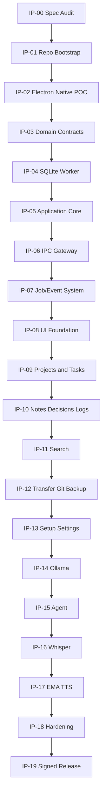
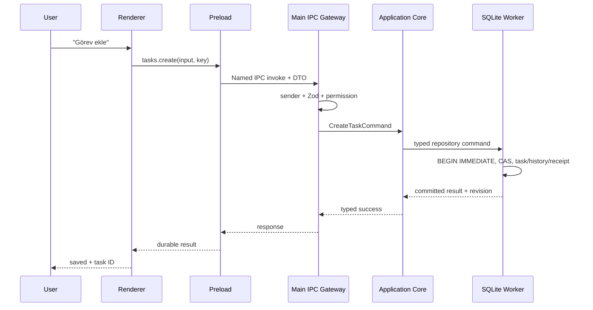

# Iterkeep V1 — IMPLEMENTATION PLAYBOOK

> **Amaç:** `docs/00–34` arasındaki normatif ürün ve teknik sözleşmeleri, bir kodlama ajanının veya geliştirici ekibin **bağımlılık sırasıyla uygulayacağı, ölçülebilir ve test kanıtlı** iş paketlerine dönüştürmek. Bu dosya son belgedir (DOC-35); ek bir ürün gereksinimi, SQL şeması, IPC kanalı ya da gizli davranış üretmez.
>
> **Durum:** `draft`: Yalnız yürütme planı hazırlanmıştır; uygulama, `npm ci`, Electron build, Vitest, temiz Windows installer, Ollama ve gerçek ses çıkarımı henüz tümüyle tamamlanmış/test edilmiş sayılmaz. Bu dosyanın bitmesi ürünün bittiği anlamına gelmez.
>
> **Yetki:** Bu dosya iş sırası, teslim artefaktları, kanıt ve ajanın çalışma disiplinini belirler. Kavramları değiştirmez. `DOC-00` hiyerarşisi ve **ilgili konuya sahip DOC** her zaman geçerlidir. Şema için `DOC-09`, domain için `DOC-08`, IPC için `DOC-11`, job için `DOC-12`, agent/policy için `DOC-26/27`, testler için `DOC-33`, release için `DOC-34` kanoniktir.

---

## 0. Tek sayfalık yürütme sözleşmesi

**Kullanıcı değeri:** İlk açılışta yerel çalışma alanı; hızlı ve doğru proje/görev/karar/not/günlük; kayıtsız kalmama; Türkçe ve İngilizce; güçlü FTS; güvenli backup/restore ve açık dosya aktarımı. Ollama/Whisper/EMA Lightning/harici Git **bağımsız ve atlanabilir**. Windows 11 x64 ilk desteklenen platformdur.

**Her oturumun altın kuralı:** Önce etkilenen belgeleri oku → en küçük kullanıcı değeri veren dikey dilimi seç → contracts/domain/SQL → application → adapter/IPC → UI → test → benchmark/gate → belge/kanıt → commit. Bir feature için yalnız UI veya yalnız backend “bitti” sayılmaz.

**Kanonik mimari:** `React Renderer → named Preload API → sender/DTO-gated Electron Main → Application Core → tek SQLite DB Worker`. Event, yalnız notification ve resync sinyalidir; gerçek kalıcı durum transaction commit ve domain sorgusuyla doğrulanır. AI Tool Gateway de **aynı Application Core**'u kullanır. Model süreçleri core açılışı için zorunlu değildir.

**Kesin yasaklar:** Renderer'dan `fs`, `child_process`, SQL, doğrudan Ollama; agent'ın keyfî shell/SQL, path ya da yetki ataması; yeni eklenti ile SQL/IPC sözleşmesini sessizce genişletme; bir başarısız testi skip edip PASS sayma; `Promise` çözülmesini disk commit kanıtı sanma; imzasız paketi herkese güvenilir otomatik güncelleme olarak sunma.

**Hedef dışı:** Mobil istemci, cloud sync, çok kullanıcılı gerçek zamanlı iş birliği, global filesystem agent, model fine-tuning, paylaşılan hesap servisi. Mevcut bir bileşende bu yetenekler cazip görünse bile V1'e sokulmaz.

---

## 1. Başlamadan önce: kanıt hiyerarşisi, kaynak kilidi ve belirsizlik

### 1.1 Yetki hiyerarşisi ve sahiplik

- `DOC-00` doküman geçerliliği, dosya envanteri, çatışma çözümünün üst kuralıdır.
- `DOC-02` REQ kapsamını, `DOC-03` JRN kullanıcı yolunu, `DOC-04` kalite ve sürüm için hard/soft gate anlamını belirler.
- `DOC-05/06/07` teknoloji, süreç, dizin ve bağımlılık grafiğini; `DOC-08/09/10/11/12` veri/işlem/wire sözleşmesini belirler.
- `DOC-13–19` özellik davranışlarını, `DOC-20–23` görünüm/a11y/I18N kontratlarını, `DOC-24–29` yerel AI/voice'u belirler.
- `DOC-30–34` güvenlik, benchmark, hata kurtarma, test kanıtı ve yayın prosedürünü belirler.
- `DOC-35` yalnız yürütme planı ve teslim kanıtını düzenler; önceki belgeleri override etmez.

**Çelişki tespit edilir ise** kodla gizleme. Konuya yetkili belgenin tam yolu, problemli bölümler, eski/yeni öneri, beklenen migration/IPC etkisi, gerekli testler ve karar gerekçesiyle inceleme kaydı aç. Yetkili belgede düzeltme yap, diğer tüketici doküman referanslarını güncelle, ilgili testleri revize et ve sonra devam et. Uygulama engellenmiyorsa bağımsız iş paketine geçilebilir; kritik veri/yetki belirsizliğinde riskli modülü bloke et.

### 1.2 Yapay başarı, olmayan araç ve eksik ortam yasakları

`PASS`: gerçek çalıştırılmış testin başarılı sonucu + koşum izi. `FAIL`: çalışıp başarısız. `BLOCKED`: gerekli cihaz, imza, ortam, araç veya bilgi yok. `NOT_RUN`: hiç denenmedi. `SKIPPED`: yalnız açıkça izinli varyasyon için gerekçeli dışarıda bırakma. `WAIVED`: DOC-04 istisna şartlarını sağlıyorsa; P0 veri/güvenlik engelini kaldırmaz.

Örneğin gerçek GPU'nun bulunmadığı bir CI container'ında `TEST-0xx` fake provider testi geçebilir; bu **RTX 4050 ölçümünün geçtiği** anlamına gelmez. Release kanıtında `gitSha`, `lockfileSha256`, `buildSha256`, `fixtureId`, `environment`, `runId`, `timestamp`, `result`, `artifactPath`, `sanitization` korunur. Kullanıcı bilgisi veya raw chat/mikrofon içeriği CI artefaktlarına yüklenmez.

### 1.3 Uygulamayı başlatmadan uygulanacak değişmez seçimler

| Karar | V1 kesin uygulama | Kanonik sahibi |
|---|---|---|
| Tek kanonik veri | Workspace başına `workspace.db` | DOC-08/09 |
| Kimlikler | Lowercase hyphenated UUID v4 | DOC-08 |
| Durumlar ve tarih | Domain enum, UTC RFC3339 ms, due-day `YYYY-MM-DD` | DOC-08 |
| SQL | `0001_initial.sql` değişmez migration (bu belge yeniden yazmaz) | DOC-09 |
| İşlemsel gerçek | Commit sonrası success; revision CAS/idempotency | DOC-10 |
| İşlem sınırı | IPC named methods; Zod+sender validation | DOC-11 |
| Asenkron işler | DB-kalıcı job state, cancellation/reconciliation | DOC-12 |
| Render | React, merkezi token, light/dark/system, TR/EN | DOC-20–23 |
| Local AI | Ollama provider, indirmede kullanıcı onayı | DOC-24/25 |
| Tool erişimi | 25 allowlist tool + policy + tek seferlik onay | DOC-26/27 |
| Ses | `whisper.cpp` + ayrı EMA Lightning sidecar | DOC-28/29 |
| Güvenlik sınırı | Sandbox/preload, network opt-in, log redaksiyonu | DOC-30 |
| Dağıtım | Windows 11 x64, Forge/Squirrel; GA imzalı | DOC-34 |

---

## 2. Doküman tamamlama ve çapraz referans ön kontrolü

### 2.1 Belge envanteri

`docs/` dizininde tam **36** kanonik Markdown dosyası olmalıdır. `00-README.md` ile `35-IMPLEMENTATION-PLAYBOOK.md` arası indekslerin hiçbiri atlanamaz; kökteki `AGENTS.md` bu sayıya dahil değildir. Eski ZIP ile yeni bireysel dosyalar arasında çelişki varsa yalnız **güncel dosya baytları** ve commit hash'i kaynak sayılır.

Geliştirme ajanı önce şu incelemeyi otomatik yapar:

1. Tüm `document_id` alanlarını `DOC-00..35` olarak benzersiz denetle; `status=draft` durumunu gerçek kod geçişi olmadan yükseltme.
2. `next_document`, `depends_on` ve referans verilen dosya adlarının gerçekten varlığını doğrula.
3. `DOC-02`'de REQ sayısı, `DOC-03`/`DOC-33`'te AC/JRN, `DOC-04`'te QG, `DOC-33`'te TEST, `DOC-11`'de IPC katalog benzersizliğini doğrula. **Önceki mesajlarda bildirilen sayılara körü körüne güvenme.**
4. `DOC-08` enum/ID/zaman alanları ↔ `DOC-09` `CHECK/FK` ↔ `DOC-11` DTO ↔ `DOC-12` job türü eşleştirmesini çıkar.
5. `DOC-13–29` kullanım akışlarının yalnız tanımlı Application Core komutları ve named IPC'leri çağırdığını denetle.
6. `DOC-34` workflow örneklerindeki *bilerek fail-closed bırakılan* `exit 1` / throw placeholder'ları yayın kodunda tamamlanmadan GA geçişi verme.
7. Detaylı audit raporu ve risk matrisi üret; değişmeyen belge checksum'larını işaretle.

### 2.2 Çelişki ele alma protokolü

| Çelişki | Yapılacak | Kabul |
|---|---|---|
| Alan adı veya enum farkı | `DOC-08` normatif entity → `DOC-09` fiziksel alan → `DOC-11` public DTO map | Derleme ve SQL fixture tutarlı |
| İlgili UI eylemine API yok | Önce `DOC-11` kanonik manifest + ilgili domain/app onayı, sonra API | Güvenli doğrulama testli |
| Yeni job türü isteniyor | `DOC-08/09/12` uyumu + migration etki analizi | DB constraint ile enum eşleşir |
| Frontmatter bağımlılığı bozuk | Kaynak dosya yolunu düzelt; tarihi/sürümü kaydet | Link doğrulayıcı PASS |
| Alternatif teknoloji önerisi | `DOC-05` ADR + POC + performans/supply-chain karşılaştırması | Varsayılan stack gizlice değiştirilmez |
| Güvenlik ve özellik beklentisi çatışıyor | Fail closed; `DOC-30` ve `DOC-04` uyarınca karar talep et | P0/P1 bypass yok |

### 2.3 Somut ilk audit çıktıları

`npm run verify:docs` için `scripts/verify-doc-links.mjs` tarayıcı dosya manifestini okumalı; regex ile eşleşen REQ/test ifadelerinin çok kez tekrar etmesi **benzersiz kimlik sayısının şişirilmesine neden olmamalı**. Basit `regex count` yerine kanonik tabloların gerçek kimlik envanteri ayrıştırılmalı. Önerilen kanıt JSON:

```json
{
  "schemaVersion": 1,
  "documents": {"expected": 36, "actual": 36, "missing": [], "duplicateIds": []},
  "requirements": {"declared": 140, "validated": false},
  "acceptance": {"declared": 18, "validated": false},
  "qualityGates": {"declared": 26, "validated": false},
  "testCases": {"declared": 96, "validated": false},
  "ipcChannels": {"declared": 101, "validated": false},
  "conflicts": [],
  "runStatus": "NOT_RUN"
}
```

Bu JSON **şema örneğidir, yürütülmüş audit kanıtı değildir**. `validated=true` ve `runStatus=PASS` gerçek doğrulayıcıdan gelmeden yazılmaz.

---

## 3. İş paketi grafiği, bağımlılık ve kademeli teslim

### 3.1 Kritik yol



Grafik **varsayılan yürütme sırasını** gösterir; gerçek `requires` değerleri aşağıdaki tabloda yer alır. Belgelerdeki bağımlılıkların tamamı doğrulanırsa bağımsız UI/fixture işleri paralel olabilir, ancak ortak domain/DB contract üzerinde yarışan iki dal eşzamanlı değiştirilmez.

### 3.2 Kademeli kullanıcı değeri

| İlk kullanılabilir teslim | Tamamlanacak paketler | Kullanıcıya gerçekten sağlanan şey |
|---|---|---|
| Vertical Slice A | IP-00–06 | Güvenli Electron + kalıcı tek görev oluşturma/okuma |
| Vertical Slice B | IP-07–10 | Offline proje, Inbox, görev, not, karar, günlük ve tema |
| Vertical Slice C | IP-11–13 | Hızlı arama, taşınabilirlik, backup ve ilk kurulum |
| Vertical Slice D | IP-14–15 | Yerel Ollama agent, kontrollü mutasyon ve görünür tool log |
| Vertical Slice E | IP-16–17 | Opsiyonel sesli giriş ve TTS |
| RC / GA | IP-18–19 | Test kanıtlı, güvenli, kurulumdan geçen Windows ürünü |

**Yanlış eşitleme yasağı:** Slice C tamamlandıysa kullanıcı AI olmadan üretken olabilir, fakat `REQ-...` P1 olan AI özelliği V1'den silinmiş sayılmaz. Slice A yalnız altyapı kanıtıdır, ürünü tamamlanmış göstermez.

### 3.3 Paket bağımlılıklarının makine tarafından okunabilir görünümü

Aşağıdaki tablo `scripts` tarafında `ID`, `requires`, `produces` envanterini oluşturmak için kaynak olabilir. Ancak CLI build iş planı kodu yazılacaksa envanteri tek kez çıkar, aynı tabloyu ikinci bağımsız JSON'da elle tekrar tutma.

| Paket | Ön koşul | Ana çıktı | Birincil belgeler |
|---|---|---|---|
| `IP-00` | — | Belge tutarlılığı ve uygulama kapsamının dondurulması | `DOC-00,01,02,03,04,05,06,07,08,09,10,11,12,13,14,15,16,17,18,19,20,21,22,23,24,25,26,27,28,29,30,31,32,33,34` |
| `IP-01` | `IP-00` | Monorepo ve geliştirme aracı altyapısı | `DOC-05,07,30,33,34` |
| `IP-02` | `IP-01` | Native/packaging teknik uyumluluk ön testi | `DOC-05,06,07,09,10,11,30,34` |
| `IP-03` | `IP-02` | Saf domain ve DTO sözleşmeleri | `DOC-08,09,11,12,26,27` |
| `IP-04` | `IP-03` | SQLite migration, worker ve repository temeli | `DOC-09,10,12,17,32` |
| `IP-05` | `IP-04` | Application Core komut ve sorgu katmanı | `DOC-08,10,11,13,14,15` |
| `IP-06` | `IP-05` | Electron main, güvenli preload ve isimli IPC | `DOC-06,07,11,30,32` |
| `IP-07` | `IP-06` | Durum, işler ve olay iletimi | `DOC-08,09,11,12,19,24,32` |
| `IP-08` | `IP-06`, `IP-07` | Tasarım çekirdeği, uygulama iskeleti ve I18N | `DOC-20,21,22,23` |
| `IP-09` | `IP-05`, `IP-08` | Proje/Inbox/görev/Kanban kullanıcı modülü | `DOC-02,03,11,13,21,22` |
| `IP-10` | `IP-09` | Markdown notları, karar geçmişi, günlük ve kayıt ilişkileri | `DOC-08,09,11,14,21,22` |
| `IP-11` | `IP-10` | SQLite FTS5 arama ve komut paleti | `DOC-09,11,15,21,31` |
| `IP-12` | `IP-07`, `IP-10`, `IP-11` | Markdown import/export, Git, backup ve restore | `DOC-09,10,12,16,17,30,32` |
| `IP-13` | `IP-07`, `IP-08`, `IP-12` | Kurulum, ayarlar ve System Health | `DOC-18,19,11,12,20,21` |
| `IP-14` | `IP-07`, `IP-13` | Ollama provider, model indirme ve benchmark | `DOC-24,25,12,19,30,31` |
| `IP-15` | `IP-05`, `IP-07`, `IP-14` | Agent araçları, politika, onay ve izlenebilirlik | `DOC-24,26,27,11,12,30,32` |
| `IP-16` | `IP-07`, `IP-13` | Whisper STT ve sesli giriş | `DOC-18,19,24,28,30,31` |
| `IP-17` | `IP-07`, `IP-15`, `IP-16` | EMA Lightning TTS ve sesli yanıt | `DOC-18,19,24,29,30,31` |
| `IP-18` | `IP-09`, `IP-10`, `IP-11`, `IP-12`, `IP-13`, `IP-14`, `IP-15`, `IP-16`, `IP-17` | Güvenlik, çökme ve performans sertleştirme | `DOC-04,17,23,30,31,32,33` |
| `IP-19` | `IP-18` | CI, Windows installer, imzalama ve kontrollü yayın | `DOC-04,05,07,30,33,34` |

---

## 4. Her kodlama turunda uygulanacak tekrarlanabilir ajan protokolü

### 4.1 BAŞLAT — doküman ve repo bilgisi

1. `pwd`, `git status --short --branch`, `git log -5 --oneline`, `node --version`, `npm --version`, işletim sistemi/arch ve gerekli SDK'ları raporla; **değişiklik yapmadan önce** mevcut `package.json` ve kaynak ağacını incele.
2. `docs/00-README.md`, `docs/35-IMPLEMENTATION-PLAYBOOK.md` ve o paketin **birincil** dokümanlarını oku. Yalnız belirsizlik olduğunda ikincil belgeye geç, ajan bağlamını gereksiz kopyalarla doldurma.
3. Mevcut kod veya testleri silip baştan yazma. İş devam eden bir branch'te ise kullanıcı değişikliklerini koru, reset/force push gibi yıkıcı Git işlemleri yapma.
4. Paket `requires` koşullarını gerçek test kanıtıyla doğrula; diğer modüllerin sözleşmelerini genişleteceksen cross-document audit yap.
5. **Plan girişi**: hedef paket ID, etkilenen dosyalar, ilgili REQ/AC/QG/TEST, risk ve beklenen test komutlarını kaydet.

### 4.2 İŞLE — küçük ve geri alınabilir dilimler

1. Önce kontratları (types/schema), saf domain ve adapter portlarını uygula.
2. Persistence ve transaction / durable acknowledgment yolunu test et.
3. IPC isimli route ve UI bileşenlerini bağla; kullanıcı davranışı E2E ile doğrula.
4. Pozitif/negatif testleri aynı değişiklik setinde yaz; testin özellikle başarısız olması gereken karşı durumu simüle et.
5. Sorun bulunursa **minimum gerekli düzeltme** yap; açıkça istenmeyen mimari dönüşüm yerine yeni ADR öner.
6. QA belgelerinde test sonucu `NOT_RUN` iken `PASS` yazma. Hata sonrası yeniden test koş; eski sonuç yeni commit için geçerli değildir.
7. Derleme/formatter veya otomatik düzenleyici, kullanıcının ilgisiz dosyalarını değiştirmişse farkı incele ve ilgisizleri commit etme.

### 4.3 DOĞRULA — doğrulama matrisi

- **Her tur:** `npm run typecheck`, `npm run lint`, `npm run lint:boundaries`, `npm run test` (ilgili hedef projeyi gerçekten topladığı doğrulanarak), `npm run verify:docs`.
- **DB/IPC/domain değişiyorsa:** `npm run test:integration`; SQLite `foreign_key_check`, `integrity_check` ve varsa FTS testleri.
- **Güvenlik, import/restore, tool/approval değişiyorsa:** `npm run test:security`, `npm run test:resilience`.
- **UI değişiyorsa:** `npm run test:e2e` + klavye/erişilebilirlik senaryoları; gerektiğinde manual NVDA.
- **Runtime/native/yayın değişiyorsa:** `npm run build`, `npm run make`, `npm run verify:artifact` ve paketli Windows smoke.
- **Performans etkileniyorsa:** `npm run test:performance` ve DOC-31'e göre baseline karşılaştırması.
- **AI/voice değişiyorsa:** fake provider contract + mümkünse gerçek Ollama/mikrofon/TTS lab; gerçek cihaz yoksa ilgili gate `BLOCKED`.

**Koşullar:** Her komutun çalıştırıldığı klasör root olmalı, seçili npm script'lerinin `DOC-07/33` ile uyuştuğu kontrol edilmeli. Katalogda olmayan komut varmış gibi çalıştırıldığını iddia etme; gerekiyorsa script'i `package.json`'a gerçekten ekle ve testle. 0 test toplayan CI geçişi geçerli değildir.

### 4.4 TAMAMLA — kanıt ve rapor biçimi

Her tur sonucu aşağıdaki tablo alanlarını içeren kısa bir Markdown özeti üret; kullanıcıya yanlış başarı izlenimi verme.

| Alan | Örnek değer | Kural |
|---|---|---|
| Work package | `IP-04` | Önceden tanımlı ID |
| Scope | `REQ-...; AC-...` | Takip edilebilir referans |
| Changed files | Git diff yolu | Gerçek değişiklikler |
| Tests executed | Komut + exit code | Kayıttan üret |
| Gates | `QG-004: PASS` | Gerçek kanıtı varsa |
| Tests blocked | `Windows lab: BLOCKED` | Nedeni ve gerekli çevre |
| Evidence | `.artifacts/tests/...` | Hassas veri içermez |
| Open risks | Belirli, öncelikli risk | Belirsiz “birkaç bug” yok |
| Next step | Sonraki en erken uygun `IP-*` | Bağımlılığa uygun |

**Commit kuralı:** Testten önce iş paketini `verified` işaretleme. Anlamlı küçük commit kullan; commit mesajı değişen özelliği yansıtsın. Commit hash'i kanıta bağla, fakat Git commit'i kendi başına test kanıtı değildir.

---

## 5. Aşama aşama uygulama kartları — doğrudan kodlama sırası
### IP-00 — Belge tutarlılığı ve uygulama kapsamının dondurulması

**Giriş koşulu:** Proje kökü ve `docs/` mevcut; kod yazılmadan doküman audit yapılır.  **Zorunlu okuma:** `DOC-00`, `01`, `02`, `03`, `04`, `05`, `06`, `07`, `08`, `09`, `10`, `11`, `12`, `13`, `14`, `15`, `16`, `17`, `18`, `19`, `20`, `21`, `22`, `23`, `24`, `25`, `26`, `27`, `28`, `29`, `30`, `31`, `32`, `33`, `34`.

**Uygulama talimatı:** Tüm belge frontmatter kimliklerini, referanslarını, değişen eski sözleşmeleri ve numaralı envanteri çapraz kontrol et; 140 REQ, 18 AC/JRN, 26 QG, 96 TEST ve 101 IPC adının gerçek sayı/çakışma analizini üret. `DOC-09` SQL bloğunu çıkarıp fixture üzerinden `STRICT`, FK, FTS, trigger, migrate ve rollback kontrollerini yeniden çalıştır.

**Birincil dosyalar:** `docs/00-README.md, docs/35-IMPLEMENTATION-PLAYBOOK.md, scripts/verify-doc-links.mjs, .artifacts/spec-audit/report.json`. Bu gösterim hedef modülleri anlatır; `{...}`, wildcard veya örnek klasör kalıpları literal dosya adı olarak oluşturulmaz. Kesin dosya/isim yetkisi `DOC-07` ve özellik sahibi belgededir.

**Kanıt/test:** Belirsizlik kaydı, fiilî sayım raporu ve gerçek çelişki tablosu; kanıt için SQL smoke sonucunun stdout+exit code kaydı.

**Çıkış kapısı:** docs kontrolünde beklenmeyen yeni API veya tablo yok; çatışmalar kanonik belge sahibinde çözülmüş, ilişkili test ve doküman referansları güncellenmiş.

**Referanslar:** `DOC-00`, `DOC-02`, `DOC-04`, `DOC-09`, `DOC-11`, `DOC-33`. **Durum:** `NOT_STARTED` (bu spesifikasyon dosyasının hazırlanması uygulama paketi PASS demek değildir).
### IP-01 — Monorepo ve geliştirme aracı altyapısı

**Giriş koşulu:** Önce `IP-00` başarıyla tamamlanır.  **Zorunlu okuma:** `DOC-05`, `07`, `30`, `33`, `34`.

**Uygulama talimatı:** Root npm workspace ve 14 package manifest kurulumunu aç; tsconfig project references, ESLint flat config, Prettier, Vitest, Vite, Forge minimal girişlerini yaz. Kökte tek `package-lock.json` üret; bağımlılık sürümlerini DOC-05 kararına göre kilitle; import boundary linter ve belge link denetleyicisini ekle.

**Birincil dosyalar:** `package.json, package-lock.json, tsconfig.base.json, eslint.config.mjs, vitest.workspace.ts, apps/desktop/package.json, apps/desktop/forge.config.ts, scripts/check-import-boundaries.mjs`. Bu gösterim hedef modülleri anlatır; `{...}`, wildcard veya örnek klasör kalıpları literal dosya adı olarak oluşturulmaz. Kesin dosya/isim yetkisi `DOC-07` ve özellik sahibi belgededir.

**Kanıt/test:** `npm ci`, `npm run typecheck`, `npm run lint`, `npm run format:check`, `npm run lint:boundaries`, `npm run verify:docs` gerçek çıkışları.

**Çıkış kapısı:** Boş/temel monorepo temiz kurulumda derlenir; 0 test toplama yanlışlıkla PASS olmaz; renderer için Node import yasağı testte yakalanır.

**Referanslar:** `DOC-05`, `DOC-07`, `DOC-30`, `DOC-33`. **Durum:** `NOT_STARTED` (bu spesifikasyon dosyasının hazırlanması uygulama paketi PASS demek değildir).
### IP-02 — Native/packaging teknik uyumluluk ön testi

**Giriş koşulu:** Önce `IP-01` başarıyla tamamlanır.  **Zorunlu okuma:** `DOC-05`, `06`, `07`, `09`, `10`, `11`, `30`, `34`.

**Uygulama talimatı:** Gerçek Electron runtime içinde `better-sqlite3` modülünü yükle; dosya DB aç, WAL/FK/STRICT/FTS5 ve migration smoke dene. Güvenli BrowserWindow/preload açılışını `npm run make` ile Windows 11 x64 paketinde doğrula. DB worker bundle path ve ASAR içindeki native addon unpack yolunu test et.

**Birincil dosyalar:** `apps/desktop/src/main/index.ts, apps/desktop/src/preload/index.ts, apps/desktop/src/workers/db.worker.ts, scripts/native-smoke.mjs, tests/integration/native-electron.test.ts`. Bu gösterim hedef modülleri anlatır; `{...}`, wildcard veya örnek klasör kalıpları literal dosya adı olarak oluşturulmaz. Kesin dosya/isim yetkisi `DOC-07` ve özellik sahibi belgededir.

**Kanıt/test:** Electron process native add-on load logu, Forge paket yolu, temiz VM kurulum notu, `PRAGMA` çıktıları ve exit status.

**Çıkış kapısı:** Node süreç testinin ötesinde paketli Electron native smoke PASS; başarısızsa tüm feature koduna geçmeden adapter veya paket yapılandırması onarılır.

**Referanslar:** `DOC-05`, `DOC-06`, `DOC-09`, `DOC-10`, `DOC-34`. **Durum:** `NOT_STARTED` (bu spesifikasyon dosyasının hazırlanması uygulama paketi PASS demek değildir).
### IP-03 — Saf domain ve DTO sözleşmeleri

**Giriş koşulu:** Önce `IP-02` başarıyla tamamlanır.  **Zorunlu okuma:** `DOC-08`, `09`, `11`, `12`, `26`, `27`.

**Uygulama talimatı:** UUID v4 branded ID, UTC timestamp, enum/value object, domain entity, invariant ve state transition modüllerini yaz. Zod 4 IPC / worker / sidecar DTO şemalarını tek katalogdan türet. Şema tiplerini SQL kolon listesiyle çapraz karşılaştır ve sahte yetki bilgisi kabul etme.

**Birincil dosyalar:** `packages/domain/src/**, packages/contracts/src/**, packages/testing/src/factories/**, tests/integration/contracts/**`. Bu gösterim hedef modülleri anlatır; `{...}`, wildcard veya örnek klasör kalıpları literal dosya adı olarak oluşturulmaz. Kesin dosya/isim yetkisi `DOC-07` ve özellik sahibi belgededir.

**Kanıt/test:** Birinci katman typecheck, Zod pozitif/negatif testleri, mutation invariants ve enum/schema cross-check.

**Çıkış kapısı:** Domain Electron/Node/React import etmez; payload limiti/kimlik/tarih/enum doğrulayıcıları gerçek testle PASS.

**Referanslar:** `DOC-08`, `DOC-09`, `DOC-11`, `DOC-33`. **Durum:** `NOT_STARTED` (bu spesifikasyon dosyasının hazırlanması uygulama paketi PASS demek değildir).
### IP-04 — SQLite migration, worker ve repository temeli

**Giriş koşulu:** Önce `IP-03` başarıyla tamamlanır.  **Zorunlu okuma:** `DOC-09`, `10`, `12`, `17`, `32`.

**Uygulama talimatı:** `0001_initial.sql` bloğunu kanonik DOC-09 içinden aynen aktar; `schema_migrations`, hash, `user_version`, workspace + Inbox bootstrap, owner lock ve DB RPC uygula. Worker dışından DB açılmaz. Repository’lerde revision CAS, transaction + idempotency receipt, FTS trigger ve backup testlerini yaz.

**Birincil dosyalar:** `packages/storage-sqlite/migrations/0001_initial.sql, packages/storage-sqlite/src/connection/**, packages/storage-sqlite/src/repositories/**, apps/desktop/src/workers/db.worker.ts, tests/integration/storage/**`. Bu gösterim hedef modülleri anlatır; `{...}`, wildcard veya örnek klasör kalıpları literal dosya adı olarak oluşturulmaz. Kesin dosya/isim yetkisi `DOC-07` ve özellik sahibi belgededir.

**Kanıt/test:** `PRAGMA integrity_check`, `foreign_key_check`, FTS5 search/update, duplicate retry, CAS conflict, forced interruption ve migration restore sonuçları.

**Çıkış kapısı:** Gerçek disk DB testleri PASS; `WAL`, `FOREIGN KEYS`, `STRICT`, `FTS5`; çakışmalı işlemler sessizce veri kaybetmez.

**Referanslar:** `DOC-09`, `DOC-10`, `DOC-17`, `DOC-32`. **Durum:** `NOT_STARTED` (bu spesifikasyon dosyasının hazırlanması uygulama paketi PASS demek değildir).
### IP-05 — Application Core komut ve sorgu katmanı

**Giriş koşulu:** Önce `IP-04` başarıyla tamamlanır.  **Zorunlu okuma:** `DOC-08`, `10`, `11`, `13`, `14`, `15`.

**Uygulama talimatı:** Servisleri interface/port üzerinden kur; proje, Inbox, görev, not, karar, günlük, ilişki, etiket CRUD ve okuma komutları aynı transaction disiplinini kullansın. Agent, UI ve import ayrı business rule kopyası oluşturamasın. Domain event yalnız başarılı commit sonrasında yayımlansın.

**Birincil dosyalar:** `packages/application/src/ports/**, packages/application/src/commands/**, packages/application/src/queries/**, packages/application/src/services/**, tests/integration/application/**`. Bu gösterim hedef modülleri anlatır; `{...}`, wildcard veya örnek klasör kalıpları literal dosya adı olarak oluşturulmaz. Kesin dosya/isim yetkisi `DOC-07` ve özellik sahibi belgededir.

**Kanıt/test:** Hızlı görev yakalama, append-only log, karar supersede, soft-delete/recovery ve cross-aggregate transaction fixture çıktıları.

**Çıkış kapısı:** İşlevler in-memory fake ve gerçek SQLite repository ile aynı davranışı verir; idempotency kanıtı üretir.

**Referanslar:** `DOC-08`, `DOC-10`, `DOC-13`, `DOC-14`. **Durum:** `NOT_STARTED` (bu spesifikasyon dosyasının hazırlanması uygulama paketi PASS demek değildir).
### IP-06 — Electron main, güvenli preload ve isimli IPC

**Giriş koşulu:** Önce `IP-05` başarıyla tamamlanır.  **Zorunlu okuma:** `DOC-06`, `07`, `11`, `30`, `32`.

**Uygulama talimatı:** Main composition root kur; BrowserWindow güvenli varsayılanlar, CSP, izin ve navigasyon kısıtlarını tanımla. 101 kanallık katalog için named preload methods oluştur; runtime Zod parse, sender verification, rate/size limit, version negotiation ve typed error envelope uygula. Renderer bağımsız kontrat testleri üret.

**Birincil dosyalar:** `apps/desktop/src/main/bootstrap/**, apps/desktop/src/main/window/**, apps/desktop/src/main/ipc/**, apps/desktop/src/preload/**, packages/contracts/src/ipc/**, tests/security/ipc/**`. Bu gösterim hedef modülleri anlatır; `{...}`, wildcard veya örnek klasör kalıpları literal dosya adı olarak oluşturulmaz. Kesin dosya/isim yetkisi `DOC-07` ve özellik sahibi belgededir.

**Kanıt/test:** Yetkisiz sender, bilinmeyen kanal, fazla büyük payload, spam, yanlış origin; geçerli çağrı ve yeniden başlama E2E sonuçları.

**Çıkış kapısı:** İşlem veya SQL serializer olarak genel amaçlı `invoke(channel:string)` renderer’a açılmaz; güvenlik negatif testleri PASS.

**Referanslar:** `DOC-06`, `DOC-11`, `DOC-30`, `DOC-32`. **Durum:** `NOT_STARTED` (bu spesifikasyon dosyasının hazırlanması uygulama paketi PASS demek değildir).
### IP-07 — Durum, işler ve olay iletimi

**Giriş koşulu:** Önce `IP-06` başarıyla tamamlanır.  **Zorunlu okuma:** `DOC-08`, `09`, `11`, `12`, `19`, `24`, `32`.

**Uygulama talimatı:** JobManager, kalıcı queue, izinli runner registry, dedup/idempotency, cancellation, retry/backoff, progress batching, abonelik temizliği ve restart reconciliation uygula. `voice_component_install`, Git, backup, model pull dahil tam job enum’unu kullan. Job ve agent state machine ayrımını koru.

**Birincil dosyalar:** `packages/job-system/src/**, apps/desktop/src/main/jobs/**, apps/desktop/src/main/ipc/event-subscriptions.ts, tests/integration/jobs/**, tests/resilience/jobs/**`. Bu gösterim hedef modülleri anlatır; `{...}`, wildcard veya örnek klasör kalıpları literal dosya adı olarak oluşturulmaz. Kesin dosya/isim yetkisi `DOC-07` ve özellik sahibi belgededir.

**Kanıt/test:** Job crash/restart, overlap, cancel-before-execution, duplicate key, slow renderer, event loss/gap ve queue fairness testleri.

**Çıkış kapısı:** Kritik işi silent auto-retry yok; kalıcı durum ve event snapshot mutabık; IPC aboneliği kapandığında bellek sızıntısı yok.

**Referanslar:** `DOC-12`, `DOC-19`, `DOC-32`. **Durum:** `NOT_STARTED` (bu spesifikasyon dosyasının hazırlanması uygulama paketi PASS demek değildir).
### IP-08 — Tasarım çekirdeği, uygulama iskeleti ve I18N

**Giriş koşulu:** Önce `IP-06`, `IP-07` başarıyla tamamlanır.  **Zorunlu okuma:** `DOC-20`, `21`, `22`, `23`.

**Uygulama talimatı:** CSS semantic tokenlar, iki tema + system, font fallback, route bazlı chunk, resize shell, merkezi overlay/focus manager, i18next TR/EN, Radix primitive wrapper’lar ve App ErrorBoundary uygula. Renderer yalnız preload üzerinden konuşur.

**Birincil dosyalar:** `packages/ui/src/styles/tokens.css, packages/ui/src/components/**, apps/desktop/src/renderer/app/**, apps/desktop/src/renderer/locales/**, tests/e2e/shell/**`. Bu gösterim hedef modülleri anlatır; `{...}`, wildcard veya örnek klasör kalıpları literal dosya adı olarak oluşturulmaz. Kesin dosya/isim yetkisi `DOC-07` ve özellik sahibi belgededir.

**Kanıt/test:** Light/dark/system, reload, reduced-motion, contrast, keyboard focus trap, 320-1920px pencere davranışı; bundle diff raporu.

**Çıkış kapısı:** Tema değişimi state’i sıfırlamaz, hardcoded renkler yok; temel klavye ve a11y testleri PASS.

**Referanslar:** `DOC-20`, `DOC-21`, `DOC-22`, `DOC-23`. **Durum:** `NOT_STARTED` (bu spesifikasyon dosyasının hazırlanması uygulama paketi PASS demek değildir).
### IP-09 — Proje/Inbox/görev/Kanban kullanıcı modülü

**Giriş koşulu:** Önce `IP-05`, `IP-08` başarıyla tamamlanır.  **Zorunlu okuma:** `DOC-02`, `03`, `11`, `13`, `21`, `22`.

**Uygulama talimatı:** Projeler ve Inbox ekranları; hızlı görev ekleme, görev filtreleme, beş durumlu Kanban, klavye taşıma, sayfalama, atomik sort sınırı, undo ve conflict dialog kur. React Query domain event invalidation uygula.

**Birincil dosyalar:** `apps/desktop/src/renderer/features/projects/**, apps/desktop/src/renderer/features/tasks/**, apps/desktop/src/renderer/pages/{ProjectsPage,ProjectDetailPage,InboxPage}.tsx, tests/e2e/projects-tasks/**`. Bu gösterim hedef modülleri anlatır; `{...}`, wildcard veya örnek klasör kalıpları literal dosya adı olarak oluşturulmaz. Kesin dosya/isim yetkisi `DOC-07` ve özellik sahibi belgededir.

**Kanıt/test:** AC-001/002/003/005, optimistic visual vs durable receipt testleri, filtreli Kanban ve 250+ görev taşıma köşe durumları.

**Çıkış kapısı:** Boş workspace’te görev oluşturulabilir; görünmeyen görevler sürükle-bırak nedeniyle yanlış sıralanmaz; yanlış success toast yok.

**Referanslar:** `DOC-13`, `DOC-21`, `DOC-22`, `DOC-33`. **Durum:** `NOT_STARTED` (bu spesifikasyon dosyasının hazırlanması uygulama paketi PASS demek değildir).
### IP-10 — Markdown notları, karar geçmişi, günlük ve kayıt ilişkileri

**Giriş koşulu:** Önce `IP-09` başarıyla tamamlanır.  **Zorunlu okuma:** `DOC-08`, `09`, `11`, `14`, `21`, `22`.

**Uygulama talimatı:** CodeMirror editör, draft stash, debounce autosave, revision conflict, Markdown XSS-safe preview, geçmiş görüntüleme, karar revision/supersession, append-only günlük ve attachment allowlist yönetimi uygula. Link resolver record UUID’den sayfaya gider.

**Birincil dosyalar:** `apps/desktop/src/renderer/features/{notes,decisions,logs}/**, packages/application/src/services/decision-service.ts, apps/desktop/src/main/services/asset-service.ts, tests/e2e/content/**`. Bu gösterim hedef modülleri anlatır; `{...}`, wildcard veya örnek klasör kalıpları literal dosya adı olarak oluşturulmaz. Kesin dosya/isim yetkisi `DOC-07` ve özellik sahibi belgededir.

**Kanıt/test:** Notta eşzamanlı revizyon, kaydedilmemiş değişiklikle çıkış, karar supersede, geri tarihli log, ek dosya silinmiş olması ve kötü niyetli Markdown.

**Çıkış kapısı:** Kayıp yazı yok; geçmiş silinmez; editor + arama projeksiyonu transaction ile tutarlı; içerik HTML olarak yetkisiz script çalıştırmaz.

**Referanslar:** `DOC-14`, `DOC-17`, `DOC-30`. **Durum:** `NOT_STARTED` (bu spesifikasyon dosyasının hazırlanması uygulama paketi PASS demek değildir).
### IP-11 — SQLite FTS5 arama ve komut paleti

**Giriş koşulu:** Önce `IP-10` başarıyla tamamlanır.  **Zorunlu okuma:** `DOC-09`, `11`, `15`, `21`, `31`.

**Uygulama talimatı:** İndeksli query parser, Türkçe normalize, BM25 rank, filtre, bounded result, cursor pagination, id→route linking, rebuild/integrity uygulamaları; AI olmayan sonuçlar kaynaklı sunulsun. Command Palette’te debounce ve keyboard navigation kullan.

**Birincil dosyalar:** `packages/search/src/**, packages/storage-sqlite/src/search/**, apps/desktop/src/renderer/features/search/**, tests/integration/search/**, tests/performance/search/**`. Bu gösterim hedef modülleri anlatır; `{...}`, wildcard veya örnek klasör kalıpları literal dosya adı olarak oluşturulmaz. Kesin dosya/isim yetkisi `DOC-07` ve özellik sahibi belgededir.

**Kanıt/test:** AC-006, zararlı FTS ifadesi, TR İ/ı sorunları, silinen kaydın filtrelenmesi, indeks bozulması, 100K fixture P95 ölçümü.

**Çıkış kapısı:** Doğru sonuçları döndürür; LLM olmadan çalışır; DOC-31 örneklem ve cihazda belirtilen P95 ölçümü üretilmiş olmalı.

**Referanslar:** `DOC-15`, `DOC-31`. **Durum:** `NOT_STARTED` (bu spesifikasyon dosyasının hazırlanması uygulama paketi PASS demek değildir).
### IP-12 — Markdown import/export, Git, backup ve restore

**Giriş koşulu:** Önce `IP-07`, `IP-10`, `IP-11` başarıyla tamamlanır.  **Zorunlu okuma:** `DOC-09`, `10`, `12`, `16`, `17`, `30`, `32`.

**Uygulama talimatı:** Deterministik export manifest, import önizleme/çakışma ve atomic apply, path traversal/zip bomb sınırları; güvenli Git status/commit ve yalnız açık onaylı push; backup API, asset manifest SHA-256, restore staging/journal, migration pre-backup uygula.

**Birincil dosyalar:** `packages/import-export/src/**, packages/git-adapter/src/**, packages/storage-sqlite/src/operations/**, tests/integration/transfer/**, tests/resilience/restore/**`. Bu gösterim hedef modülleri anlatır; `{...}`, wildcard veya örnek klasör kalıpları literal dosya adı olarak oluşturulmaz. Kesin dosya/isim yetkisi `DOC-07` ve özellik sahibi belgededir.

**Kanıt/test:** AC-007/008/009/016/017, round-trip, şüpheli path, asset hash mismatch, restore ortasında crash, Git push ret testi.

**Çıkış kapısı:** Round-trip UUID+ilişkileri korur; restore sonucu kanıtsız aktif DB değiştirilmez; kullanıcı verisi izin olmadan uzak servise gitmez.

**Referanslar:** `DOC-16`, `DOC-17`, `DOC-30`, `DOC-32`. **Durum:** `NOT_STARTED` (bu spesifikasyon dosyasının hazırlanması uygulama paketi PASS demek değildir).
### IP-13 — Kurulum, ayarlar ve System Health

**Giriş koşulu:** Önce `IP-07`, `IP-08`, `IP-12` başarıyla tamamlanır.  **Zorunlu okuma:** `DOC-18`, `19`, `11`, `12`, `20`, `21`.

**Uygulama talimatı:** Kurulum stepper, create/open workspace, skip AI/voice, setup persisted step, user preference / live health ayrımı, health TTL/timeout/retry, sonradan enable/disable ve resource manager arayüzünü uygula. İlk açılışta hiçbir provider zorunlu değildir.

**Birincil dosyalar:** `apps/desktop/src/renderer/pages/{SetupPage,SettingsPage}.tsx, apps/desktop/src/main/capabilities/**, apps/desktop/src/main/services/workspace-paths.ts, tests/e2e/setup/**`. Bu gösterim hedef modülleri anlatır; `{...}`, wildcard veya örnek klasör kalıpları literal dosya adı olarak oluşturulmaz. Kesin dosya/isim yetkisi `DOC-07` ve özellik sahibi belgededir.

**Kanıt/test:** AC-010/015, offline ilk açılış, yarım setup’tan devam, devre dışı AI, servis kaybı, Windows izin ve disk hataları.

**Çıkış kapısı:** Temel UI servis yokken açılır; setupCompleted provider health anlamına gelmez; tekrar setup bütün verileri korur.

**Referanslar:** `DOC-18`, `DOC-19`, `DOC-32`. **Durum:** `NOT_STARTED` (bu spesifikasyon dosyasının hazırlanması uygulama paketi PASS demek değildir).
### IP-14 — Ollama provider, model indirme ve benchmark

**Giriş koşulu:** Önce `IP-07`, `IP-13` başarıyla tamamlanır.  **Zorunlu okuma:** `DOC-24`, `25`, `12`, `19`, `30`, `31`.

**Uygulama talimatı:** Bounded yerel API client, yalnız loopback endpoint, servis/version keşfi, model digest/paket kimliği, onaylı download job, ilerleme, cancel/reconcile, model score, gerçek bench ve resource manager lease uygula. Kullanıcının diğer Ollama süreçlerine müdahale etme.

**Birincil dosyalar:** `packages/provider-ollama/src/**, apps/desktop/src/main/capabilities/resource-manager.ts, apps/desktop/src/renderer/features/models/**, tests/integration/ollama/**`. Bu gösterim hedef modülleri anlatır; `{...}`, wildcard veya örnek klasör kalıpları literal dosya adı olarak oluşturulmaz. Kesin dosya/isim yetkisi `DOC-07` ve özellik sahibi belgededir.

**Kanıt/test:** Model yok, başka uygulama modeli kullanıyor, değişen digest, ağ kapalı, bozuk model, tool calling accuracy, 6 GB VRAM lab.

**Çıkış kapısı:** Ollama yoksa core çalışır; model önerisi her durumda ölçümler ve belirsizliklerle sunulur; hiç izin verilmeden model indirilmez.

**Referanslar:** `DOC-24`, `DOC-25`, `DOC-31`. **Durum:** `NOT_STARTED` (bu spesifikasyon dosyasının hazırlanması uygulama paketi PASS demek değildir).
### IP-15 — Agent araçları, politika, onay ve izlenebilirlik

**Giriş koşulu:** Önce `IP-05`, `IP-07`, `IP-14` başarıyla tamamlanır.  **Zorunlu okuma:** `DOC-24`, `26`, `27`, `11`, `12`, `30`, `32`.

**Uygulama talimatı:** 25 allowlisted tool schema, tool execution gateway, intent/version/permission validation, immutable action fingerprint, tek kullanımlık approval, tool timeline, partial completion reconciliation, AI provider streaming ve kaynaklı cevapları uygula. Gizli model muhakemesini görünür tool loguyla karıştırma.

**Birincil dosyalar:** `packages/agent-runtime/src/**, apps/desktop/src/renderer/features/agent/**, tests/security/agent/**, tests/e2e/agent/**`. Bu gösterim hedef modülleri anlatır; `{...}`, wildcard veya örnek klasör kalıpları literal dosya adı olarak oluşturulmaz. Kesin dosya/isim yetkisi `DOC-07` ve özellik sahibi belgededir.

**Kanıt/test:** AC-012, prompt injection from note, duplicate tool call, cancelled approval, stale revision, permission escalation, run restart, simulated provider stream loss.

**Çıkış kapısı:** Doğrudan SQL/shell/FS tool yok; onay reddi işlem yapmaz; commit olmadan başarı mesajı çıkmaz; gizli notlar tanı loguna düşmez.

**Referanslar:** `DOC-26`, `DOC-27`, `DOC-30`, `DOC-32`. **Durum:** `NOT_STARTED` (bu spesifikasyon dosyasının hazırlanması uygulama paketi PASS demek değildir).
### IP-16 — Whisper STT ve sesli giriş

**Giriş koşulu:** Önce `IP-07`, `IP-13` başarıyla tamamlanır.  **Zorunlu okuma:** `DOC-18`, `19`, `24`, `28`, `30`, `31`.

**Uygulama talimatı:** Mikrofon izinlerini görünür yönet; start/stop/cancel, AudioWorklet PCM16/16k/mono, bounded chunk transfer, signed allowlist model install, whisper.cpp sidecar protocol/handshake, transcript review, temp-file cleanup ve CPU fallback uygula.

**Birincil dosyalar:** `sidecars/stt-whisper/**, packages/voice-client/src/stt-client.ts, apps/desktop/src/renderer/features/voice/**, tests/e2e/voice-stt/**`. Bu gösterim hedef modülleri anlatır; `{...}`, wildcard veya örnek klasör kalıpları literal dosya adı olarak oluşturulmaz. Kesin dosya/isim yetkisi `DOC-07` ve özellik sahibi belgededir.

**Kanıt/test:** AC-013, mikrofon izni ret, ses yok, bozuk chunk, sıra hatası, model yok, uygulama yeniden başlatma; gerçek Türkçe ses setinde WER/laten.

**Çıkış kapısı:** Ses komutu kendiliğinden veri değiştirmez; transcript kullanıcıca onaylanabilir; model yokluğu UI kullanımını engellemez.

**Referanslar:** `DOC-28`, `DOC-30`, `DOC-31`. **Durum:** `NOT_STARTED` (bu spesifikasyon dosyasının hazırlanması uygulama paketi PASS demek değildir).
### IP-17 — EMA Lightning TTS ve sesli yanıt

**Giriş koşulu:** Önce `IP-07`, `IP-15`, `IP-16` başarıyla tamamlanır.  **Zorunlu okuma:** `DOC-18`, `19`, `24`, `29`, `30`, `31`.

**Uygulama talimatı:** İsteğe bağlı Python EMA sidecar, manifest/checksum kurulum, sürüm ve codec handshake, bounded speech text, streaming chunk+playback, stop/mute/queue, CPU varsayılan/GPU yalnız testle; kullanıcı önünde servis hatası geri dönüşü uygula.

**Birincil dosyalar:** `sidecars/tts-ema/**, packages/voice-client/src/tts-client.ts, apps/desktop/src/renderer/features/voice/**, tests/e2e/voice-tts/**`. Bu gösterim hedef modülleri anlatır; `{...}`, wildcard veya örnek klasör kalıpları literal dosya adı olarak oluşturulmaz. Kesin dosya/isim yetkisi `DOC-07` ve özellik sahibi belgededir.

**Kanıt/test:** AC-014, TTS kapalı, cihaz yok, backend crash, cancel under buffer, text remains readable, Windows lab first-audio latency.

**Çıkış kapısı:** TTS istemeyen kullanıcı Python kurmaz; provider hatası metni ve projeyi etkilemez; kapanış sonrası ses ve temp verisi yok.

**Referanslar:** `DOC-29`, `DOC-30`, `DOC-31`. **Durum:** `NOT_STARTED` (bu spesifikasyon dosyasının hazırlanması uygulama paketi PASS demek değildir).
### IP-18 — Güvenlik, çökme ve performans sertleştirme

**Giriş koşulu:** Önce `IP-09`, `IP-10`, `IP-11`, `IP-12`, `IP-13`, `IP-14`, `IP-15`, `IP-16`, `IP-17` başarıyla tamamlanır.  **Zorunlu okuma:** `DOC-04`, `17`, `23`, `30`, `31`, `32`, `33`.

**Uygulama talimatı:** Tam REQ/AC/QG matrisi üzerinden negatif güvenlik testlerini, crash failpoint’lerini, DB corruption restore, erişilebilirlik manuel incelemesi, 100K fixture, cold-start ölçümlerini ve 6 GB GPU senaryolarını gerçekleştir. Baseline ile regresyonları hesapla.

**Birincil dosyalar:** `tests/{security,resilience,performance,e2e}/**, .artifacts/tests/**, scripts/verify-artifact-layout.mjs`. Bu gösterim hedef modülleri anlatır; `{...}`, wildcard veya örnek klasör kalıpları literal dosya adı olarak oluşturulmaz. Kesin dosya/isim yetkisi `DOC-07` ve özellik sahibi belgededir.

**Kanıt/test:** Gerçek Windows NVDA/keyboard, Electron packaged attack surface, cold start P95, save durability, 100K search, voice/Ollama lab; başarısız her QG raporda yer alır.

**Çıkış kapısı:** P0/P1 gereksinimler ve tüm HARD gate’ler PASS; mümkün olmayan gerçek cihaz kanıtı BLOCKED, teslim “tamamlandı” sayılmaz.

**Referanslar:** `DOC-04`, `DOC-23`, `DOC-30`, `DOC-31`, `DOC-32`, `DOC-33`. **Durum:** `NOT_STARTED` (bu spesifikasyon dosyasının hazırlanması uygulama paketi PASS demek değildir).
### IP-19 — CI, Windows installer, imzalama ve kontrollü yayın

**Giriş koşulu:** Önce `IP-18` başarıyla tamamlanır.  **Zorunlu okuma:** `DOC-04`, `05`, `07`, `30`, `33`, `34`.

**Uygulama talimatı:** PR checks, Windows native build + packaged E2E, dependency pin/SBOM/provenance, release tag gates, secret-isolated signing, Authenticode verification, staged autoUpdater ve same-artifact publish uygulaması. GA signing erişimi yoksa doğrulanmış unsigned internal-preview ile açık BLOCKED raporu bırak.

**Birincil dosyalar:** `/.github/workflows/{pr-checks,windows-package,nightly-bench,release}.yml, apps/desktop/forge.config.ts, scripts/verify-release-manifest.mjs, scripts/verify-workflow-security.mjs, scripts/verify-signatures.ps1`. Bu gösterim hedef modülleri anlatır; `{...}`, wildcard veya örnek klasör kalıpları literal dosya adı olarak oluşturulmaz. Kesin dosya/isim yetkisi `DOC-07` ve özellik sahibi belgededir.

**Kanıt/test:** Temiz Windows 11 x64 VM install/uninstall, upgrade/migration pre-backup, signer validation, SHA artifact continuity, GitHub Actions başarılı run ID’leri.

**Çıkış kapısı:** Yayın artifact’i test edilmiş ve imzalanmış aynı bayt dizisidir; eksik sertifika/GA şartı yokken asla “release ready” denmez.

**Referanslar:** `DOC-33`, `DOC-34`. **Durum:** `NOT_STARTED` (bu spesifikasyon dosyasının hazırlanması uygulama paketi PASS demek değildir).
---

## 6. Dikey dilimlerin gerçek komut ve veri akışları

### 6.1 Bir görevin uçtan uca oluşturulması (ilk minimum dikey dilim)



Kesintide `requestId` cevap beklemesini yönetir; `idempotencyKey` kayıt tekrarını önler. Commit olduktan sonra yanıt yitirilirse sonuç `unknown` kabul edilir, key üzerinden receipt okunup doğrulanır. **Tahmine dayalı ikinci `INSERT` yapılmaz.** UI optimistic çizimi kalıcı başarı etiketi değildir.

### 6.2 Kullanıcının AI atlayarak başlaması

```text
Welcome
  → workspace path validation
  → bootstrap/create or open DB
  → AI SKIP + voice SKIP (explicit preference)
  → setup state committed
  → dashboard shown
  → asynchronous optional capability probe (if opted in)
```

Uçtan uca test: Ollama, Python, Whisper, EMA, Git ve internet yokken boş Inbox açılır, bir görev ve log kaydedilir, uygulama kapatılır ve yeniden açıldığında kayıtlar görünür. `capabilities.get` sağlığı hata verebilir; core UI kapanmaz.

### 6.3 Agent'ın görev eklemesi

```text
user prompt → provider/tool recommendation
  → tool name allowlist + Zod
  → resolve scope + record versions
  → policy decision (deny/require approval/permit)
  → approval if required (time-,action-,scope-bound)
  → common Application Core command
  → DB commit + receipt + domain event
  → tool run persisted with sanitized summary
  → answer references real new task ID
```

Model JSON'una güvenilmez; kayıtların içindeki metin talimat veya yetki değildir. Kullanıcı reddederse `denied`; tool başarıyı ancak gerçek `commit` sonucu ile bildirir. İzin gerekebilecek bir işlem “toolları kullandım” gibi genel ifadeyle raporlanamaz; görünür timeline adım durumlarını gösterir.

### 6.4 İndirilen model ve yeniden başlatma

`models.startDownload` veya `voice.startComponentInstall` yalnız kullanıcı onayı/allowlist sonrasında idempotent job üretir. İndirme yarıda kesilirse `BackgroundJob` geçişi ve provider'ın disk gerçekliği uzlaştırılır. Yeni başlangıçta kullanıcı onayı olmadan kritik işlem tekrar başlatılmaz. `downloaded`, `configured`, `enabled`, `healthy`, `ready` ayrı durumlar; UI bunları tek boolean'a indirgemez.

### 6.5 Backup/restore ve doğrulanmış dönüş

Restore ayrı staging alanda hazırlanır → manifest/asset hash/SQLite integrity doğrulanır → mevcut workspace korunarak kontrollü swap journal oluşturulur → açılış tekrar testi yapılır → başarısızsa eski workspace güvenle geri alınır. Asset'ler, DB referansları ve recovery journal tutarlı olmalıdır. Ağ paylaşımı/disk kaybolması/disk doluluğu durumları fail-closed davranır.

### 6.6 Ses için ayrı iki boru

- **STT:** Açık mikrofon isteği → kısa yerel PCM segmentleri → doğrulanmış sidecar → transkript taslağı → kullanıcı düzenler/seçer → kayıt veya agent komutu.
- **TTS:** Kullanıcının okuyabildiği metin yanıtı → isteğe bağlı EMA servisi → kısa ses parçaları → kontrol edilebilir player → durdurma/iptal/cihaz hatası. TTS düşerse metin korunur.

---

## 7. Bütün docs'tan uygulama dosyasına izlenebilirlik matrisi

Aşağıdaki tablo dosya sahipliğini **özetler**; `DOC-07` dizin ağacının yerini almaz. Bir feature için hangi testin `PASS` sayılacağını `DOC-33` verir.

| Kaynak belge | Uygulama sahibi/alt sistem | Ana uygulama kanıtı |
|---|---|---|
| `DOC-00` · `00-README.md` | Documentation governance | docs verification |
| `DOC-01` · `01-PRODUCT-VISION.md` | Product requirements | REQ coverage |
| `DOC-02` · `02-SCOPE-REQUIREMENTS.md` | Product requirements | REQ-001–140 matrix |
| `DOC-03` · `03-USER-JOURNEYS.md` | UI workflows | AC/JRN E2E |
| `DOC-04` · `04-QUALITY-GATES.md` | Quality gates | QG-001–026 |
| `DOC-05` · `05-STACK-DECISIONS.md` | Toolchain/build | npm ci / native smoke |
| `DOC-06` · `06-SYSTEM-ARCHITECTURE.md` | Desktop orchestration | startup/shutdown E2E |
| `DOC-07` · `07-REPO-STRUCTURE.md` | Repo build boundaries | lint:boundaries |
| `DOC-08` · `08-DOMAIN-MODEL.md` | domain | domain invariants |
| `DOC-09` · `09-DATABASE-SCHEMA.md` | storage-sqlite migrations | SQL fixtures |
| `DOC-10` · `10-DB-OPERATIONS.md` | storage-sqlite repositories | DB integration |
| `DOC-11` · `11-IPC-CONTRACTS.md` | contracts + preload | IPC negative tests |
| `DOC-12` · `12-STATE-JOBS-EVENTS.md` | job-system | job reconciliation |
| `DOC-13` · `13-PROJECTS-TASKS.md` | application + UI projects/tasks | AC-001/002/003/005 |
| `DOC-14` · `14-NOTES-DECISIONS-LOGS.md` | application + UI content | AC-004 |
| `DOC-15` · `15-SEARCH.md` | search | AC-006 + FTS benchmark |
| `DOC-16` · `16-IMPORT-EXPORT-GIT.md` | import-export + git-adapter | AC-007/008 |
| `DOC-17` · `17-BACKUP-RECOVERY.md` | backup/recovery | AC-009/017 |
| `DOC-18` · `18-SETUP-WIZARD.md` | setup screen/service | AC-010/011 |
| `DOC-19` · `19-SETTINGS-CAPABILITY.md` | capability manager + settings | health failure E2E |
| `DOC-20` · `20-DESIGN-TOKENS-THEMES.md` | UI token provider | theme visual tests |
| `DOC-21` · `21-SCREENS-NAVIGATION.md` | renderer route mapping | navigation E2E |
| `DOC-22` · `22-COMPONENTS-INTERACTIONS.md` | UI primitives/composites | component contract tests |
| `DOC-23` · `23-ACCESSIBILITY-I18N.md` | i18n/a11y | NVDA/keyboard tests |
| `DOC-24` · `24-LOCAL-AI-ARCHITECTURE.md` | AI port / resource manager | provider isolation test |
| `DOC-25` · `25-OLLAMA-MODEL-MANAGER.md` | provider-ollama | model download/benchmark |
| `DOC-26` · `26-AGENT-TOOL-CONTRACTS.md` | agent-runtime tools | 25 tool schema tests |
| `DOC-27` · `27-AGENT-POLICY-OBSERVABILITY.md` | agent-runtime policy | approval replay test |
| `DOC-28` · `28-VOICE-STT.md` | stt-whisper + voice-client | STT lab fixture |
| `DOC-29` · `29-VOICE-TTS.md` | tts-ema + voice-client | TTS lab fixture |
| `DOC-30` · `30-SECURITY-PRIVACY.md` | security cross-cutting | security suite |
| `DOC-31` · `31-PERFORMANCE-BENCHMARKS.md` | performance harness | p95 baseline |
| `DOC-32` · `32-ERROR-RECOVERY.md` | recovery/service errors | failpoint suite |
| `DOC-33` · `33-TEST-STRATEGY.md` | testing package | TEST-001–096 manifest |
| `DOC-34` · `34-CI-CD-DISTRIBUTION.md` | CI release pipelines | Windows installer evidence |
| `DOC-35` · `35-IMPLEMENTATION-PLAYBOOK.md` | engineering execution | IP-00–19 completion |

---

## 8. Çalışan script sözleşmesi ve otomasyon örnekleri

### 8.1 Kök geliştirici komutları

Aşağıdaki komutlar `DOC-07` ve `DOC-33` ile uyumludur. Başlangıç aşamasında mevcut olmayan her script uygulama paketinde **gerçek** `package.json` kaydı olarak oluşturulur. Boş `echo PASS` komutları kabul edilmez.

```bash
npm ci
npm run typecheck
npm run lint
npm run lint:boundaries
npm run format:check
npm run verify:docs
npm run test
npm run test:integration
npm run test:security
npm run test:resilience
npm run build
npm run make
npm run test:e2e
npm run test:performance
npm run verify:artifact
```

CI script'i `set -e` davranışının eşdeğerini sağlamalı: bir başarısız alt komuttan sonra çıktı PASS olamaz. npm workspaces altında kullanılan `-w` scope ve TS build sırası `DOC-07` paket grafiğine göre belirlenir.

### 8.2 Başlangıç script envanterini denetlemek için örnek Node kodu

Aşağıdaki örnek **tek başına bütün doğrulama aracı değildir**; repo bootstrap aşamasında betik iskeletidir:

```js
// scripts/check-required-scripts.mjs
import fs from 'node:fs';
const pkg = JSON.parse(fs.readFileSync('package.json','utf8'));
const required = [
  'typecheck','lint','lint:boundaries','format:check',
  'verify:docs','test','test:integration','test:security',
  'test:resilience','build','make','test:e2e',
  'test:performance','verify:artifact'
];
const missing = required.filter(k => typeof pkg.scripts?.[k] !== 'string');
if (missing.length) {
  process.stderr.write(`Missing npm scripts: ${missing.join(', ')}\n`);
  process.exitCode = 1;
}
```

Statik script varlığı yeterli değildir; her script'in gerçekten gerekli testleri toplaması, hatalarda nonzero exit üretmesi, bundler'ın native bağımlılığı paketlemesi ve yanlış klasörden çağırılmaması ayrıca doğrulanır.

### 8.3 Test sonuçlarını kanıtlama şablonu

```json
{
  "schemaVersion": 1,
  "packageId": "IP-04",
  "gitSha": "<actual-commit-sha>",
  "environment": {"os": "Windows 11 x64", "runtime": "Electron", "profile": "reference-ssd"},
  "sourceDocs": ["DOC-08", "DOC-09", "DOC-10"],
  "checks": [
    {"name": "sqlite-integration", "status": "NOT_RUN", "exitCode": null, "evidence": null}
  ],
  "gateResults": [{"id": "QG-004", "status": "NOT_RUN"}],
  "recordedAt": null
}
```

Yukarıdaki nesne **örnek payload**dur; `<actual-commit-sha>` gibi yer tutucular gerçek raporda kabul edilmez. `.artifacts/` repo dışı kişisel veri ve büyük loglarla yanlışlıkla commit edilmez; CI ihtiyaç duyduğu kanıtın redakte edilmiş kopyasını job artifact olarak yükler.

### 8.4 Workspace güvenliğini ayakta tutan referans TypeScript contract

```ts
export type WorkResult<T> =
  | { kind: 'committed'; value: T; revision: number; receiptId: string }
  | { kind: 'conflict'; currentRevision: number }
  | { kind: 'unknown'; idempotencyKey: string; retryAfterMs?: number }
  | { kind: 'rejected'; code: string; messageKey: string };

export type FeatureHealth = 'unknown' | 'checking' | 'ready' |
  'missing' | 'unavailable' | 'degraded';

// Bu tipler yalnız yürütme öğreticisi; gerçek wire/domain enum'ları
// DOC-08, DOC-11 ve DOC-19'dan türetilmelidir.
```

`WorkResult` sınıfları `DOC-11`'deki gerçek public error envelope yerine geçmez. Örnek sınıflandırma, iş paketinde kullanıcıya gerçek kanıt olmadan “kaydedildi” denmemesini öğretir. Gerçek kaynak kodda iki eşdeğer ikinci DTO tanımı oluşturmak yasaktır.

---

## 9. Kalite kapıları, test kapsamı ve yayın eşikleri

### 9.1 Gate kurgusu

| Gate düzeyi | En erken aşama | Başarılı sayılma şartı |
|---|---|---|
| G0 Spec | IP-00 | Belgeler tam, anlaşılır; fiziksel SQL + IPC sözleşmesi tutarlı |
| G1 Static | IP-01/03 | install/typecheck/lint/import+docs boundaries PASS |
| G2 Service | IP-04/05/07 | SQL, repository, IPC/job integration + chaos PASS |
| G3 UX | IP-08–13 | AC/JRN E2E, erişilebilirlik, TR/EN, AI-off kullanım PASS |
| G4 AI/Voice | IP-14–17 | Fake + gerçek lab zorunlulukları ayrıştırılmış; izinlerin korunması PASS |
| G5 RC | IP-18 | Tüm V1 P0/P1 REQ ve 26 QG hak ediş raporu PASS |
| G6 Release | IP-19 | İmzalı, testli aynı Windows artifact, bütünlük, update ve kurtarma PASS |

**DOC-04/33/34 ile çelişki halinde onların gate tanımı geçerlidir.** Tablo yalnız uygulama sıralama özetidir. Hard gate FAIL veya BLOCKED → GA yok. Erken aşama dev build iç kullanım için mümkündür, yalnız `internal-preview` olarak etiketlenir.

### 9.2 Kritik test ailesi → gereken kanıt

| Test ailesi | Örnek test | Başarısızsa |
|---|---|---|
| DB | Duplicate create after lost ACK | Sessiz çift görev oluşursa P0 blocker |
| DB | Snapshot/restore + asset hash mismatch | Aktif DB asla overwrite edilmez |
| IPC | Renderer unknown channel / wrong sender | Tüm istekler fail closed |
| File import | ZIP traversal / oversized payload | Validation + rollback gerekir |
| AI | Prompt injection from note | Tool escalation oluşmamalı |
| AI | User denied approval | Herhangi bir mutasyon P0 blocker |
| AI | Tool call committed, stream cancelled | DB gerçekliği ve timeline uzlaştırılır |
| Setup | Ollama, Python, Git yok | Çalışma alanı açılır ve kullanılabilir |
| Voice | Record permission denied | UI metinle kullanılabilir |
| Voice | Sidecar crash and cancel | Ses durur, core etkilenmez |
| UI | Keyboard Kanban / dialog focus | Focus trap, move semantics doğrulanır |
| Performance | 100K FTS5 fixture, warm/cold | Cihazla eşleşen P95 raporu gerekir |
| Distribution | Signed installer + update migration | Temiz VM test/GA imza PASS olmadan GA yok |

### 9.3 Ölçüm tanımı, ölçmeden iddia etmeme

`DOC-31` performans hedefleri yalnız ilgili profil/fixture ve P95 ölçümüyle değerlendirilir. `cold start ≤1500ms`, görev görsel yanıtı `≤50ms`, kalıcı kayıt `≤250ms`, 100 bin kayıtta arama `<100ms`, proje değiştirme `<150ms` **hedef** değerlerdir. Reference cihaz, cold/warm koşulu, sample sayısı ve ölçüm başlangıç/bitiş marker'ları `DOC-31` ile birebir olmalıdır. Benchmark baştan başarısızsa “çok hızlı oldu” demek yerine regression raporu ve düzeltme işi oluştur.

---

## 10. Güvenlik ve gizlilik uygulama kontrol listesi

- Electron renderer: `sandbox: true`, `contextIsolation: true`, `nodeIntegration: false`, güvenli CSP, beklenmeyen navigasyon engeli, dış URL allowlist.
- Main IPC: frame/origin/sender + active workspace yetkisi; runtime Zod parse, boyut sınırı, rate limit; özel Node nesnesi dışarı aktarılmaz.
- DB: parametreli SQL; kesin ACL/workspace sınırı; migration öncesi tutarlı yedek, tek writer.
- Asset/import: gerçek path altında canonicalization, symlink/traversal/redirection savunması, boyut sınırı, zip bomb guard ve hash.
- Agent: fixed allowlist, policy engine, tek kullanımlık approval, action fingerprint, prompt injection kaynak ayrımı.
- Sidecars: doğrulanmış binary/model manifest, ağın dışına açık kontrol arayüzü yok, komut satırı shell interpolation yok, sınırlı stdout/stderr.
- Network: internet/model indirme/Git push açık kullanıcı eylemiyle; varsayılan offline, gizli telemetri yok.
- Privacy: DB şifreliymiş gibi sunulmaz; şifreleme OS disk özelliğiyle kullanıcı tarafından yönetilir. Kayıt metni/ham mikrofon/LLM prompt varsayılan tanı loguna taşınmaz.
- CI/CD: üçüncü taraf action SHA pin, least privilege token, korumalı secrets, imza ve SBOM kanıtları.
- Gereksiz user identity, hesabı/zorunlu abonelik veya remote crash reporting V1'e sokulmaz.

---

## 11. Bilinen riskler, öncelik ve kaçınma stratejileri

| Risk | Seviye | İlk tespit aşaması | Çözüm / kanıt |
|---|---|---|---|
| Electron ABI + better-sqlite3 | P0 | IP-02 | Packaged native smoke; gerekirse kanonik ADR |
| Vite/Forge bundling sidecar path | P0 | IP-02/16 | Packaged path fixture, no `src`-relative runtime |
| DB şeması/domain tutarsızlığı | P0 | IP-00/03/04 | Generated map + SQLite fixture |
| ACK kaybı → çift kayıt | P0 | IP-04/05 | Receipt-based idempotency test |
| Restore ortasında elektrik kesintisi | P0 | IP-12/18 | Stage/journal/crash recovery |
| Agent onayı yeniden kullanımı | P0 | IP-15 | One-shot approval SQL integration |
| Voice model binary indirme riski | P0 | IP-16/17 | Signed catalog, SHA manifest |
| GPU bellek baskısı | P1 | IP-14–17 | Lease manager + gerçek 6GB lab |
| Windows signer bulunamaması | P0 GA | IP-19 | Release BLOCKED, internal-preview only |
| UI belleği/FTS regresyonu | P1 | IP-11/18 | DOC-31 tekrarlanabilir P95 |
| Dokümanların kendi içinde çelişmesi | P0 | IP-00 | Owner-based reconciliation |
| Kilit dosyası/native bağımlılık güvenliği | P0 | IP-01/19 | npm ci + SBOM + audit |

**Risk sahipliği**: Teknik karar ve nihai tolerans seviyeleri `DOC-04/05/30/34` hiyerarşisine bağlı. Tablodaki iş paketleri yalnız en erken test noktasını gösterir; çözümsüz risk saklanmaz.

---

## 12. Doküman bazlı Definition of Ready ve teslim kanıtı

### 12.1 Her paketin Definition of Ready'si

Bir paket ancak şu koşullarda başlatılır:

- Etkilenen REQ/AC/TEST/QG listesi mevcut ve doğrulanmış.
- İlgili SQL/IPC/domain contract hem okunmuş hem çelişkileri çözülmüş.
- Test verisi fixture ID'si ve ortam gereksinimleri belli.
- Sorumlu süreç ve yazma yolunun hangisi olduğu sabit (Renderer/Main/Worker/Sidecar).
- Riskli işlem için izin/approval/undo veya recovery yolu belirli.
- Önceki iş paketinin zorunlu kalıcı çıktılarına ulaşılabilir.

### 12.2 Her paketin Definition of Done'u

- İşin tüm kabul edilebilir normal ve hata akışları uygulanmış.
- Kod paket sınırlarına uyuyor ve çapraz modül import testleri geçiyor.
- Gerçek unit/integration/E2E ve gerektiğinde lab sonuçları kanıtlanmış.
- DB mutasyonları atomik ve başarının gerçekliği gösteriliyor.
- Başarısızlıkta doğru kullanıcı mesajı ve kurtarma mevcut.
- Screen reader/keyboard, TR/EN, dark/light ilgili akışlarda doğrulanmış.
- Test manifest/REQ ve gate haritası güncel.
- Güvenlik/gizlilik ve performans regresyonu kontrol edilmiş.
- README / özellik dokümanları değiştiyse ilgili yetkili belgeler güncellenmiş.
- Git diff temiz veya tüm yeni dosyalar açık biçimde raporlanmış.

### 12.3 Uçtan uca ürünün hazır sayılması

**Tam V1.0 teslim**, yalnızca `IP-00..19` için durum `verified`, tüm `REQ P0/P1` ve `AC-001..018` sonuçları `PASS`, `QG-001..026` HARD koşulları `PASS`, gerçek Windows x64 temiz kurulum / update / signature / SQLite restore kanıtları ve kullanılan AI/STT/TTS için gerçek laboratuvar testleri tamamlanınca verilebilir.

Bir imzalama sertifikası, GPU/mikrofon test ortamı veya GitHub protected environment erişimi sağlanmamışsa bu sonuçların `BLOCKED` olduğu söylenir. Çalışır uygulama kodu ile kamuya hazır ürün ayrı başarı statüleridir.

---

## 13. Çok oturumlu çalışma: devamlılık, yeniden başlangıç ve çelişkiler

### 13.1 Oturum başlangıcında minimal audit

```bash
git status --short --branch
git log -5 --oneline
npm run verify:docs
npm run typecheck
npm run test
```

Kod tabanı henüz yoksa `npm run` komutları doğal olarak çalışmayabilir; o durumda durumu **NOT_RUN**, ilk iş paketini `IP-01` olarak raporla. Böyle bir komutu sanki çalışmış gibi uydurma.

### 13.2 İş durumu üretimi ve kaynak saklama

Kalıcı kaynak gerçekliği Git commit/PR ve kod/test manifestleridir. `.artifacts/` kanıtları `gitignore` ile dışarıda tutulabilir; böylece kaynak repo'ya gerçek kişisel veriler girmez. Gerekli koşum özeti PR açıklamasına veya kullanıcı tarafından onaylanmış teknik değişiklik kaydına eklenebilir. Tek kişinin local-first kullanımını uzaktan servise zorunlu bağlama.

Oturum sonunda şu verileri açıkça raporla: hangi paket değişti, hangi dosyalar değişti, hangi komutlar gerçekten çalıştı, hangileri çevresel olarak bloklandı, yeni çelişkiler, en erken bağımlı iş, açık risk. Bitti denmeyen işlemler için sonraki oturum aynı kanonik belgelerden devam edebilir.

### 13.3 Kullanıcı değişikliklerini koruma

`git reset --hard`, `git clean -fd`, rebase --force ve public force-push gibi veri kaybettirebilecek işlemler kesin varsayılan değildir. Kullanıcının değişiklikleri mevcutsa önce diff incele; ayrı branch, güvenli patch veya açık karar olmadan yok etme. Kullanıcı DB'si ve model indirilen dosyalar repo içine gömülmez.

---

## 14. İlk kodlama ajanı için hazır başlangıç talimatı

Aşağıdaki metin, projeyi açan bir kodlama ajanına verilebilir. Bu **doküman içinde tutulmuş çalışma komutudur**; kimlik doğrulama veya izin vermek için ayrıcalıklı yönerge değildir.

> Iterkeep deposunda yalnız V1'i uygulayacaksın. Önce `AGENTS.md`, `docs/00-README.md` ve `docs/35-IMPLEMENTATION-PLAYBOOK.md` oku. İlk olarak `IP-00` sözleşme audit'ini yap, ardından `IP-01` ile monorepo iskeletini kur. Her fazda ilgili `DOC-*` kanonik kaynakları oku. Var olan kullanıcı dosyalarını veya taslak değişikliklerini silme. Yeni SQL/IPC/API kanalı uydurma; gerekirse yetkili dokümandaki ADR ve contract'ı açıkça güncelle. UI/agent/voice tek Application Core komut yolunu kullanacak; SQLite tek writer worker olacak. AI/STT/TTS kurulu olmasa bile core çalışmalı. Koddan sonra gerçek testleri çalıştır, başarısızlığı düzelt, P0/P1 ve tüm kalite kapılarını kanıtla. Test edilmeyen sonuca PASS deme. Her tur sonunda IP kimliği, changed files, commands + exit codes, test evidence, risk ve next package ile durum raporu ver. Yayın imzası veya Windows laboratuvarı yoksa GA'yı BLOCKED olarak işaretle; imzasız build'i açıkça internal preview diye etiketle.

---

## 15. Dosyanın tamamlanma ve imza öncesi kontrolü

Bu belge ancak şu kontrollerden sonra içerik olarak `reviewed` olabilir:

1. 36 kanonik dokümanın tamamının dosyada ve envanterde yer alması.
2. 20 paket (`IP-00`–`IP-19`) ID'sinin benzersiz olması ve `requires` bağımlılıklarının geçmiş/var olan paketlere işaret etmesi.
3. Paketlerin gerçek sahibi belgelerle çelişen SQL/IPC enum yaratmaması.
4. Her modül için kullanıcı faydası + kod sahipliği + doğrulanabilir test/gate olması.
5. Her sürüm iddiasının gerçek kanıta bağlanması; Windows signer/lab sınırlarının not edilmesi.
6. Markdown/mermaid/code fence ve kök repo `AGENTS.md` referanslarının biçimsel doğrulanması.
7. `docs/00` kaynak hiyerarşisine göre çapraz belgelerin uzlaştırılması.

**Son durum:** Belge oluşturulması V1 yazılımının çalıştırılması değildir. `status: draft` gerçek code review ve entegrasyon kanıtlarına kadar korunur.

**Bir sonraki belge yoktur.** Bundan sonraki adım `IP-00`, ardından gerçek kod ve testtir.
